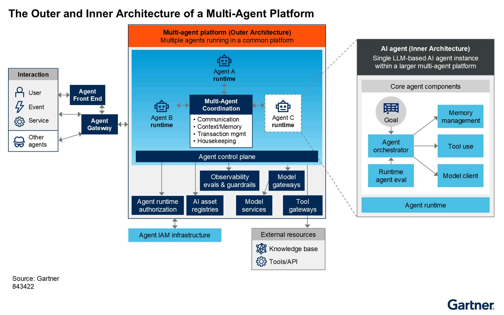
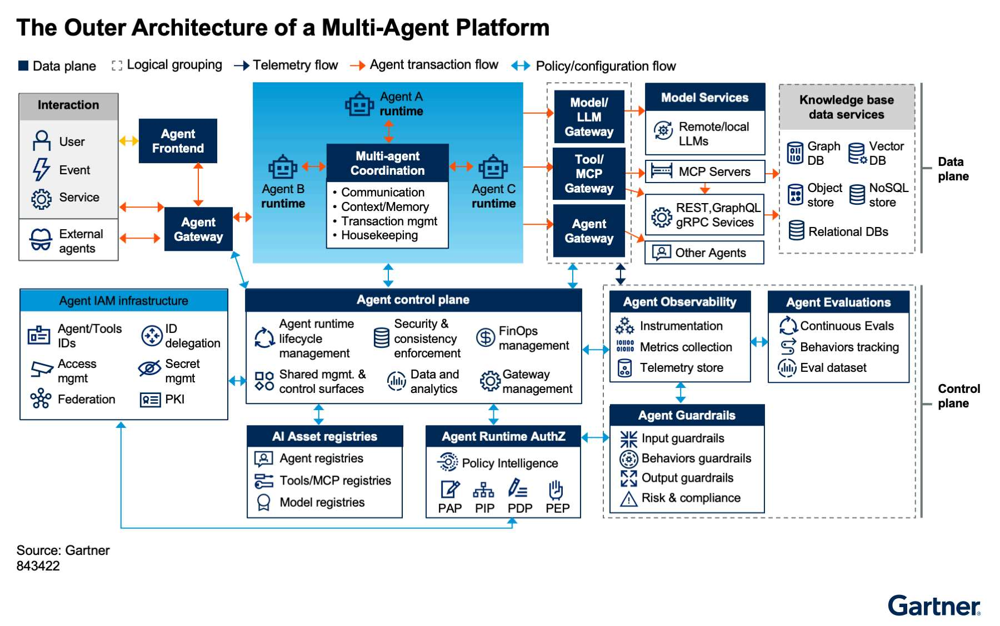
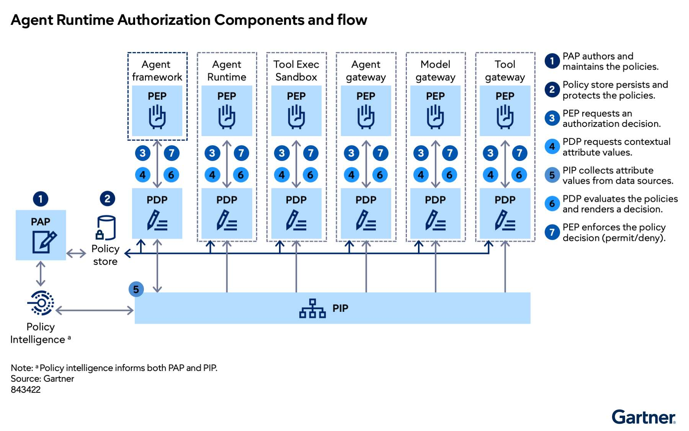
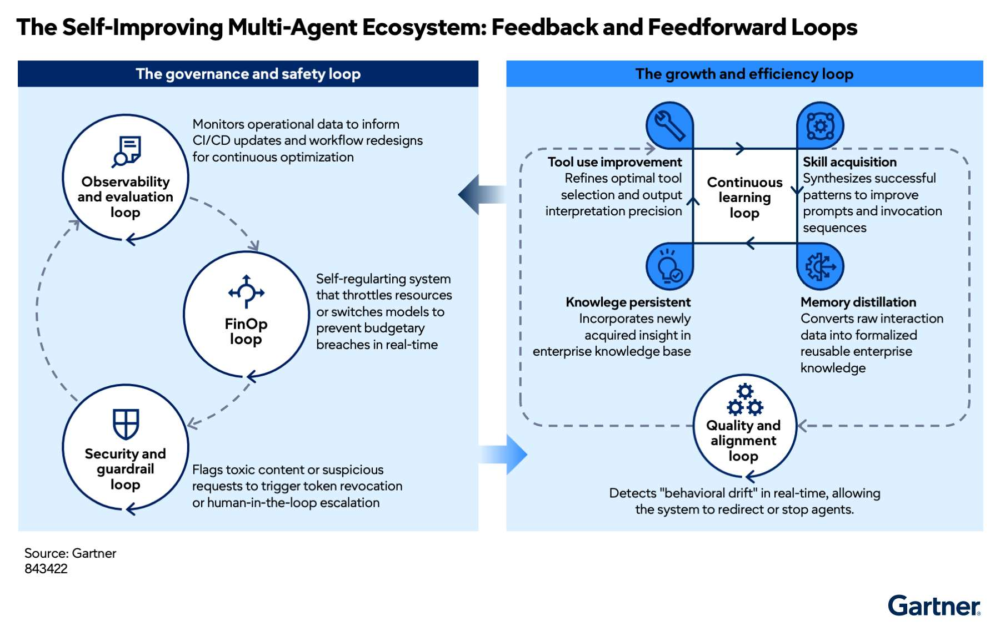

# Kiến trúc nền tảng đa tác tử: Từ “một AI biết làm việc” đến một hệ sinh thái AI có thể kiểm soát

> **Bài viết chuyển thể từ:** *Reference Architecture Brief: Multi-Agent Platform (Outer Architecture)*, Gartner, Steve Deng và Gary Olliffe, 27/05/2026, ID G00843422.  
> **Quy ước thuật ngữ:** Các từ khóa quan trọng được trình bày song ngữ theo dạng **tiếng Việt (English)**.

## Mở đầu

Khi doanh nghiệp chỉ thử nghiệm một trợ lý AI, kiến trúc thường khá đơn giản: người dùng gửi yêu cầu, mô hình ngôn ngữ xử lý, sau đó hệ thống trả về câu trả lời. Nhưng khi AI bắt đầu truy cập dữ liệu, gọi công cụ, thực hiện giao dịch và phối hợp với nhiều AI khác, bài toán không còn là “làm sao để mô hình trả lời tốt”. Câu hỏi quan trọng hơn trở thành: làm thế nào để toàn bộ hệ sinh thái tác tử vận hành an toàn, có trách nhiệm, tiết kiệm và có thể kiểm toán?

Đó là vai trò của **nền tảng đa tác tử (multi-agent platform)**. Nền tảng này cung cấp môi trường chung để nhiều **tác tử AI (AI agents)** độc lập hoặc liên kết có thể được triển khai, vận hành và quản trị. Nó không chỉ kết nối các tác tử, mà còn tạo ra những cơ chế nền tảng về danh tính, phân quyền, điều phối, quan sát, đánh giá, kiểm soát chi phí và bảo vệ dữ liệu.

Nếu **kiến trúc bên trong (inner architecture)** mô tả “bộ não” của một tác tử — gồm mô hình, bộ nhớ, công cụ, lập kế hoạch và logic điều phối cục bộ — thì **kiến trúc bên ngoài (outer architecture)** mô tả “môi trường thể chế và hạ tầng” bao quanh tác tử. Chính lớp bên ngoài này quyết định tác tử nào được phép hoạt động, được truy cập tài nguyên gì, phải tuân thủ chính sách nào, bị giám sát ra sao và bị dừng trong trường hợp nào.

*Hình 1. Kiến trúc bên ngoài và bên trong của nền tảng đa tác tử (The Outer and Inner Architecture of a Multi-Agent Platform). Nguồn ảnh gốc: Gartner.*

---

## 1. Vì sao hệ thống đa tác tử khó quản trị hơn một tác tử đơn lẻ?

Một hệ thống nhiều tác tử không đơn thuần là phép cộng của nhiều chatbot. Khi nhiều thực thể tự chủ cùng quan sát, suy luận, gọi công cụ và thay đổi môi trường, rủi ro có thể khuếch đại theo cấp số nhân.

### 1.1. Trách nhiệm ra quyết định bị phân tán

Trong **ra quyết định phân tán (diffused decision-making)**, kết quả cuối cùng có thể là sản phẩm của nhiều bước chuyển giao giữa tác tử điều phối, tác tử chuyên môn, mô hình nền tảng, công cụ và hệ thống nghiệp vụ. Khi xảy ra lỗi, doanh nghiệp khó xác định tác nhân nào chịu trách nhiệm nếu không có nhật ký và chuỗi truy vết đầy đủ.

### 1.2. Rủi ro phát sinh và lan truyền

**Rủi ro phát sinh và dây chuyền (emergent and cascading risks)** xuất hiện khi hành vi tập thể không thể suy ra trực tiếp từ thiết kế của từng thành phần. Một lỗi nhỏ có thể bị tác tử khác tiếp nhận như dữ liệu đúng, tiếp tục khuếch đại rồi dẫn tới gọi công cụ sai, cấp quyền quá mức hoặc tiêu tốn tài nguyên ngoài dự kiến.

### 1.3. Hành vi bị trôi theo thời gian

**Trôi hành vi (behavioral drift)** là hiện tượng tác tử dần lệch khỏi mục tiêu, giới hạn hoặc trách nhiệm ban đầu. Nguyên nhân có thể đến từ thay đổi dữ liệu, mô hình, lời nhắc, bộ nhớ dài hạn, công cụ hoặc cách các tác tử tương tác với nhau.

Vì vậy, nền tảng đa tác tử phải bổ sung các cơ chế kiểm soát mang tính hệ thống:

- **Quản lý danh tính và truy cập (Identity and Access Management — IAM)** cho người dùng, tác tử và công cụ.
- **Quản trị tương tác và điều phối (interaction and coordination governance)** giữa các tác tử.
- **Thực thi chính sách khi chạy (runtime policy enforcement)** tại các điểm kiểm soát phân tán.
- **Chấm điểm độ tin cậy và chất lượng (trust and quality scoring)** dựa trên dữ liệu vận hành.
- **Khả năng truy vết và kiểm toán bất biến (traceability and immutable auditability)** cho mọi giao dịch liên tác tử.

---

## 2. Hai miền kiến trúc: mặt phẳng dữ liệu và mặt phẳng điều khiển

Kiến trúc nền tảng đa tác tử có thể được nhìn qua hai miền lớn: **mặt phẳng dữ liệu (data plane)** và **mặt phẳng điều khiển (control plane)**.

*Hình 2. Kiến trúc tham chiếu tổng thể, thể hiện mặt phẳng dữ liệu, mặt phẳng điều khiển và các luồng kết nối (The Outer Architecture of a Multi-Agent Platform). Nguồn ảnh gốc: Gartner.*

### 2.1. Mặt phẳng dữ liệu (Data Plane)

Mặt phẳng dữ liệu là nơi công việc thực tế diễn ra. Nó bao gồm:

- Tác tử và **môi trường chạy tác tử (agent runtime)**.
- Ứng dụng giao diện dành cho người dùng.
- Dịch vụ điều phối đa tác tử.
- Cổng giao tiếp giữa tác tử, mô hình, công cụ và API.
- Mô hình ngôn ngữ, cơ sở dữ liệu, kho đối tượng, hệ thống sự kiện và dịch vụ doanh nghiệp.

Các yêu cầu, phản hồi, sự kiện, lệnh gọi công cụ và kết quả xử lý đều đi qua miền này.

### 2.2. Mặt phẳng điều khiển (Control Plane)

Mặt phẳng điều khiển không trực tiếp làm thay công việc của tác tử. Nó cấu hình, cấp phát, giám sát và áp chính sách lên mặt phẳng dữ liệu. Các năng lực quan trọng gồm:

- **Mặt phẳng điều khiển tác tử (agent control plane)**.
- **Ủy quyền khi chạy cho tác tử (agent runtime authorization)**.
- **Sổ đăng ký tài sản AI (AI asset registries)**.
- **Khả năng quan sát tác tử (agent observability)**.
- **Đánh giá tác tử (agent evaluations)**.
- **Rào chắn tác tử (agent guardrails)**.

Có thể hình dung mặt phẳng dữ liệu là “dàn nhạc”, còn mặt phẳng điều khiển là “nhạc trưởng”: dàn nhạc tạo ra kết quả, nhưng nhạc trưởng bảo đảm mọi thành phần tuân theo cùng một cấu hình, nhịp độ và quy tắc.

---

## 3. Năm luồng kết nối cốt lõi

Một nền tảng đa tác tử trưởng thành cần phân biệt rõ các loại luồng để đặt đúng cổng kiểm soát, chính sách và dữ liệu quan sát.

### 3.1. Luồng giao diện tác tử (Agent UI Flow)

Đây là giao tiếp hai chiều giữa giao diện người dùng và hệ thống tác tử phía sau. Các giao thức mới như **AG-UI (Agent–User Interaction)** hỗ trợ truyền văn bản, lệnh gọi công cụ, trạng thái và cập nhật giao diện theo thời gian thực.

### 3.2. Luồng giao dịch tác tử — Bắc–Nam (Agent Transaction Flow — North–South Traffic)

Luồng này kết nối nền tảng với thế giới bên ngoài: người dùng, hệ thống doanh nghiệp, tác tử thuộc nền tảng khác, thiết bị vật lý hoặc dịch vụ bên thứ ba. Nó thường đi qua gateway, proxy hoặc hệ thống môi giới sự kiện.

### 3.3. Luồng điều phối tác tử — Đông–Tây (Agent Coordination Flow — East–West Traffic)

Đây là giao tiếp nội bộ giữa các tác tử cùng nền tảng: giao nhiệm vụ, chia sẻ trạng thái, chuyển tiếp kết quả, đồng bộ bộ nhớ hoặc xử lý xung đột. Luồng này cần được tách khỏi logic nghiệp vụ của từng tác tử để giảm phụ thuộc và tăng khả năng quản trị.

### 3.4. Luồng đo xa tác tử (Agent Telemetry Flow)

Các chỉ số, nhật ký và vết theo dõi được gửi bất đồng bộ đến hệ thống thu thập. Luồng đo xa không nên phụ thuộc vào luồng giao dịch chính, bởi sự cố quan sát không được phép làm gián đoạn toàn bộ tác vụ.

### 3.5. Luồng IAM (IAM Flow)

Luồng IAM xử lý xác thực, ủy quyền, nhà cung cấp danh tính, hạ tầng khóa công khai, bí mật và thông tin ủy quyền. Danh tính được kiểm tra có thể là người dùng, tác tử, công cụ, dịch vụ hoặc một tác tử đang hành động thay mặt người dùng.

---

## 4. Điều phối đa tác tử: Ai quyết định, ai thực thi và ai chia sẻ trạng thái?

**Điều phối đa tác tử (multi-agent coordination)** là tập hợp các năng lực quản lý nhiệm vụ, tài nguyên, hoạt động và giao tiếp giữa nhiều tác tử. Các năng lực thường gồm:

- **Điều phối quy trình (process orchestration)** và ra quyết định.
- Quản lý **ngữ cảnh, bộ nhớ và tri thức (context, memory and knowledge management)**.
- Cơ chế giao tiếp trực tiếp, phát–đăng ký hoặc qua môi trường dùng chung.
- Quản lý giao dịch, sổ cái và điểm tạm dừng có người phê duyệt.
- Giám sát tiến độ, giải quyết xung đột và dọn dẹp tác tử không còn hoạt động.

Ba mô hình điều phối phổ biến là:

1. **Mô hình giám sát (supervisor model):** một tác tử quản lý giao nhiệm vụ và kiểm soát toàn cục.
2. **Mô hình phân cấp (hierarchical model):** tác tử được tổ chức theo đồ thị công việc, chẳng hạn đồ thị có hướng không chu trình hoặc đồ thị trạng thái có vòng lặp.
3. **Mô hình phân tán (distributed model):** quyền ra quyết định được chia sẻ, mỗi tác tử chỉ có góc nhìn cục bộ và phải phối hợp qua thông điệp hoặc môi trường chung.

Không có một mô hình tối ưu cho mọi trường hợp. Điều quan trọng là doanh nghiệp phải xác định rõ quyền quyết định, phạm vi thông tin và cơ chế xử lý xung đột của từng tác tử.

---

## 5. Mặt phẳng điều khiển tác tử: “nhạc trưởng” của toàn nền tảng

**Mặt phẳng điều khiển tác tử (agent control plane)** quản lý vòng đời của tác tử và môi trường chạy, từ tạo mới, cấu hình, triển khai, cập nhật đến thu hồi. Nó cũng là điểm tích hợp các năng lực IAM, quan sát, sổ đăng ký, gateway và quản trị.

Các trách nhiệm chính bao gồm:

- **Quản lý vòng đời (life-cycle management):** tạo, cập nhật, mở rộng và xóa tác tử hoặc runtime.
- **Danh tính khối lượng công việc (workload identity):** cấp danh tính và thông tin xác thực riêng cho từng tác tử.
- **Kiểm soát cấu hình (configuration control):** thống nhất cấu hình mạng, quyền truy cập, runtime, gateway và chiến lược bộ nhớ.
- **Cấp phát hộp cát an toàn (secure sandbox provisioning):** tạo môi trường cô lập cho tác tử và mã do công cụ sinh ra.
- **Thực thi nhất quán (enforced consistency):** bắt buộc mọi runtime tuân theo cùng chuẩn bảo mật và quan sát, bất kể framework phát triển.
- **Điều phối chính sách cục bộ (local policy orchestration):** dịch chính sách cấp doanh nghiệp thành cấu hình mà các điểm quyết định và thực thi cục bộ có thể hiểu.
- **Quản lý gateway (gateway management):** cấu hình và theo dõi các cổng tác tử, mô hình, MCP và API.
- **Phân tích sử dụng (usage analytics):** hỗ trợ tính phí nội bộ, dự báo ngân sách và **FinOps**.

Giá trị lớn nhất của control plane là chuyển doanh nghiệp từ các tác tử thử nghiệm rời rạc sang một “đội tàu tác tử” có tiêu chuẩn vận hành thống nhất.

---

## 6. Ủy quyền khi chạy: Quyền truy cập phải thay đổi theo nhiệm vụ và bối cảnh

Quyền tĩnh kiểu “tác tử này có vai trò quản trị” là quá rộng đối với hệ thống tự chủ. Thay vào đó, **ủy quyền khi chạy cho tác tử (agent runtime authorization)** đưa ra quyết định truy cập theo thời gian thực dựa trên danh tính, nhiệm vụ, dữ liệu, rủi ro, chi phí và trạng thái hiện tại.

*Hình 4. Thành phần và luồng ủy quyền khi chạy, với PAP, PIP, PDP và các PEP phân tán (Agent Runtime Authorization Components and Flow). Nguồn ảnh gốc: Gartner.*

Mô hình chính sách thường bao gồm:

- **Điểm quản trị chính sách (Policy Administration Point — PAP):** soạn thảo, chuyển đổi, kiểm thử, phê duyệt và phân phối chính sách.
- **Điểm thông tin chính sách (Policy Information Point — PIP):** thu thập thuộc tính và tín hiệu cần cho việc ra quyết định.
- **Điểm quyết định chính sách (Policy Decision Point — PDP):** đánh giá yêu cầu dựa trên chính sách rồi đưa ra quyết định.
- **Điểm thực thi chính sách (Policy Enforcement Point — PEP):** cho phép, cảnh báo hoặc từ chối hành động tại runtime, gateway hay sandbox.

Chính sách nên bao phủ nhiều miền:

- Quyền tối thiểu theo nhiệm vụ.
- Bảo vệ dữ liệu, mã hóa, che dữ liệu và lưu trú dữ liệu.
- Mức độ ghi log, theo dõi và kiểm toán bắt buộc.
- An toàn nội dung, căn chỉnh hành vi và rào chắn.
- Hạn mức token, độ sâu lặp và ngân sách tài nguyên.

Mục tiêu là thực thi **nguyên tắc đặc quyền tối thiểu (principle of least privilege)** không chỉ theo vai trò, mà theo đúng nhiệm vụ và đúng khoảng thời gian cần thiết.

---

## 7. Sổ đăng ký tài sản AI: Chống “AI bóng tối” và tạo nguồn dữ liệu chuẩn

**Sổ đăng ký tài sản AI (AI asset registries)** là danh mục trung tâm hoặc liên bang, quản lý metadata và vòng đời của tác tử, mô hình, công cụ, kỹ năng, ngữ cảnh và nguồn tri thức.

Ba nhóm sổ đăng ký đáng chú ý:

### 7.1. Sổ đăng ký tác tử (Agent Registry)

Quản lý danh tính, chủ sở hữu, phiên bản, khả năng, phạm vi sử dụng, chi phí và giới hạn của tác tử. **Thẻ tác tử (agent card)** đóng vai trò như hồ sơ năng lực, giúp người dùng hoặc tác tử khác biết tác tử đó có thể làm gì và không nên dùng vào việc gì.

### 7.2. Sổ đăng ký công cụ/MCP (Tool/MCP Registry)

Cho phép đăng ký, khám phá, phê duyệt và quản trị máy chủ MCP hoặc công cụ. Gateway có thể tham chiếu sổ đăng ký để chỉ cho phép các công cụ đã được phê duyệt, giảm nguy cơ **MCP bóng tối (shadow MCP)**.

### 7.3. Sổ đăng ký mô hình (Model Registry)

Quản lý phiên bản, nguồn gốc, triển khai, thẻ mô hình, phê duyệt và tuân thủ của mô hình. Đây là loại sổ đăng ký trưởng thành nhất nhờ kế thừa kinh nghiệm từ MLOps.

Các registry cần kết nối với IAM, control plane và gateway để metadata không chỉ dùng để tra cứu mà còn trở thành đầu vào thực tế cho quyết định quản trị.

---

## 8. Hệ thống gateway: Các cửa kiểm soát không thể thiếu

Nền tảng đa tác tử thường có ba loại gateway, mỗi loại giải quyết một bề mặt tương tác khác nhau.

### 8.1. Cổng mô hình/LLM (Model/LLM Gateway)

**Cổng mô hình/LLM (Model/LLM gateway)** nằm giữa ứng dụng hoặc tác tử và các dịch vụ mô hình. Nó cung cấp một điểm truy cập thống nhất và xử lý:

- Xác thực và ủy quyền.
- Định tuyến mô hình theo chi phí, độ trễ, độ phức tạp hoặc tải.
- Cân bằng tải, chuyển đổi dự phòng và giới hạn tốc độ.
- Hạn mức token, tối ưu lời nhắc và theo dõi chi phí.
- Che dữ liệu cá nhân, lọc độc hại, chống **tiêm lời nhắc (prompt injection)** và **bẻ khóa mô hình (jailbreak)**.
- **Bộ nhớ đệm ngữ nghĩa (semantic caching)** và truyền phản hồi dạng luồng.
- Thu thập metric, log, trace và dữ liệu phục vụ đánh giá.

Gateway này giúp doanh nghiệp thay đổi nhà cung cấp hoặc mô hình mà không buộc mọi ứng dụng phải viết lại logic tích hợp.

### 8.2. Cổng công cụ/MCP/API (Tool/MCP/API Gateway)

Gateway này môi giới truy cập từ tác tử đến API, cơ sở dữ liệu, công cụ và máy chủ MCP. Các chức năng nổi bật gồm:

- Điểm truy cập công cụ thống nhất.
- Khám phá máy chủ và định tuyến yêu cầu.
- Xác thực tác tử và kiểm tra quyền công cụ.
- Cấp thông tin xác thực ngắn hạn và chèn thông tin kế thừa khi cần.
- Giới hạn quyền theo ngữ cảnh và nhiệm vụ.
- Theo dõi lưu lượng, lỗi, độ trễ và chi phí sử dụng công cụ.

Đây là vị trí phù hợp để chặn một tác tử cố truy cập công cụ chưa được đăng ký hoặc yêu cầu dữ liệu ngoài phạm vi nhiệm vụ.

### 8.3. Cổng tác tử (Agent Gateway)

**Cổng tác tử (agent gateway)** chuyên cho giao tiếp tác tử–tác tử, chẳng hạn qua **giao thức A2A (Agent-to-Agent protocol)**. Ngoài AuthN/AuthZ, nó còn hỗ trợ:

- Đăng ký, khám phá và định tuyến tác tử.
- Quản lý ngữ cảnh tương tác giữa các tác tử dị thể.
- Theo dõi giao việc, trao đổi dữ liệu và kết quả cuối.
- Thương lượng hợp đồng, mức dịch vụ hoặc điều kiện cộng tác.
- Quản lý ngân sách token và mức độ nỗ lực của tác vụ.
- Ngăn chặn **tác tử bóng tối (shadow agents)**.

---

## 9. Giao diện tác tử: Từ chatbot sang trải nghiệm thích ứng

**Ứng dụng giao diện tác tử (agent front-end app)** là cầu nối hai chiều giữa con người và tác tử. Khác giao diện truyền thống được lập trình cố định, giao diện tác tử có thể được tạo hoặc điều chỉnh theo nhiệm vụ.

Một số hướng giao thức mới:

- **A2UI (Agent-to-User Interface):** tác tử gửi mô tả giao diện khai báo, thường ở dạng JSON, để ứng dụng dựng widget an toàn thay vì chạy mã tùy ý.
- **AG-UI (Agent–User Interaction):** truyền sự kiện, trạng thái, nội dung và lệnh gọi công cụ theo thời gian thực.
- **MCP Apps:** cho phép máy chủ MCP trả về thành phần tương tác được cô lập.
- **Agent Client Protocol:** chuẩn hóa giao tiếp giữa IDE và tác tử lập trình.

Với giao diện giọng nói, yêu cầu còn bao gồm độ trễ thấp, âm thanh hai chiều và khả năng người dùng ngắt lời tự nhiên.

---

## 10. Dịch vụ mô hình: Quản trị giữa đám mây, tự lưu trữ và thiết bị biên

**Dịch vụ mô hình/LLM (model/LLM services)** cung cấp suy luận dưới dạng API. Doanh nghiệp thường kết hợp ba mô hình triển khai:

1. **Nhà cung cấp bên thứ ba (third-party provider):** nhanh triển khai, trả phí theo mức sử dụng.
2. **Tự lưu trữ (self-hosted):** kiểm soát dữ liệu và hạ tầng tốt hơn, nhưng đòi hỏi vốn, chuyên môn và vận hành.
3. **Suy luận biên (edge inference):** giảm độ trễ, hoạt động khi mất kết nối và bảo đảm dữ liệu ở lại thiết bị.

Bất kể mô hình nào, doanh nghiệp cần quản lý phiên bản, tải mô hình, tự động mở rộng, độ trễ, thông lượng, mức sử dụng CPU/GPU, log, rào chắn và chính sách truy cập. Cổng LLM tạo lớp trừu tượng chung phía trước các dịch vụ này.

---

## 11. Khả năng quan sát và đánh giá: Nền tảng của niềm tin

**Khả năng quan sát tác tử (agent observability)** thu thập và liên kết dữ liệu từ toàn bộ hệ thống nhằm giải thích một tác tử đã làm gì, vì sao làm, gọi công cụ nào, tiêu tốn bao nhiêu và kết quả có đạt yêu cầu hay không.

Ba trụ cột quan sát gồm:

- **Chỉ số (metrics):** độ trễ, thông lượng, lỗi, token, CPU/GPU và mức sử dụng bộ nhớ.
- **Vết theo dõi (traces):** đường đi đầu cuối của yêu cầu qua nhiều tác tử, mô hình và công cụ.
- **Nhật ký (logs):** bản ghi sự kiện, thay đổi trạng thái, quyết định và lỗi.

**OpenTelemetry (OTel)** là nền tảng quan trọng để chuẩn hóa thu thập dữ liệu không phụ thuộc nhà cung cấp.

Điểm cần instrument không chỉ là API. Kiến trúc phải theo dõi:

- Quá trình lập kế hoạch và tái lập kế hoạch.
- Giao việc, chuyển giao và đồng bộ giữa tác tử.
- Lựa chọn công cụ, tham số gọi và cách diễn giải kết quả.
- Tương tác với LLM, phiên bản mô hình, token và độ trễ.
- Thao tác tạo, đọc, cập nhật, xóa trong bộ nhớ tác tử.
- Cấp phát, hết hạn và thu hồi thông tin xác thực.
- Kiểm tra quyền truy cập thành công hoặc thất bại.
- Nguồn gốc dữ liệu và lịch sử sửa đổi.

**Đánh giá tác tử (agent evaluation)** sử dụng dữ liệu quan sát để đo chất lượng trên toàn bộ hành vi nhiều bước, thay vì chỉ chấm một câu trả lời. Các nhóm thước đo nên gồm:

- Hiệu năng: độ trễ, thời gian đầu cuối, thông lượng, tỷ lệ lỗi.
- Chất lượng và độ tin cậy: tính đúng, tỷ lệ ảo giác, khả năng giải thích, độ lệch.
- Chi phí: token, cache hit, CPU/GPU/RAM, bộ nhớ và phí gọi API/công cụ.
- Tuân thủ: quyền truy cập, nguồn gốc dữ liệu, nhật ký và rào chắn.

Kết quả đánh giá phải quay trở lại hệ thống để tăng giám sát, hạn chế quyền, thay mô hình hoặc dừng tác tử khi chất lượng giảm.

---

## 12. Sáu vòng lặp giúp hệ sinh thái tự điều chỉnh

Nền tảng đa tác tử không nên được quản trị bằng các đợt kiểm tra rời rạc. Nó cần các **vòng phản hồi và truyền tiến (feedback and feedforward loops)** liên tục.

*Hình 3. Các vòng quản trị–an toàn và tăng trưởng–hiệu quả trong hệ sinh thái đa tác tử tự cải tiến (The Self-Improving Multi-Agent Ecosystem). Nguồn ảnh gốc: Gartner.*

### 12.1. Vòng quan sát và đánh giá

Phân tích metrics, logs và traces để phát hiện lỗi, độ lệch, suy giảm chất lượng và cơ hội tối ưu. Kết quả được chuyển sang các vòng khác hoặc dùng để điều chỉnh workflow, lời nhắc và mô hình.

### 12.2. Vòng chất lượng và căn chỉnh

Đánh giá tác tử ngay trong quá trình làm việc, phát hiện **trôi hành vi (behavioral drift)** và chuyển hướng, giới hạn hoặc dừng tác tử trước khi hậu quả lan rộng.

### 12.3. Vòng bảo mật và rào chắn

Phát hiện nội dung độc hại, yêu cầu đáng ngờ, truy cập trái phép hoặc hành vi có dấu hiệu bị tấn công. Cơ chế phản hồi có thể thu hồi token, hạ quyền hoặc yêu cầu **con người trong vòng lặp (human in the loop — HITL)**.

### 12.4. Vòng học tập liên tục

Bao gồm cải thiện cách dùng công cụ, tích lũy kỹ năng, chắt lọc bộ nhớ và đưa tri thức mới vào lớp ngữ cảnh doanh nghiệp. Vòng này phải được quản trị chặt để việc “tự học” không biến thành tích lũy lỗi hoặc dữ liệu nhạy cảm.

### 12.5. Vòng FinOps

Theo dõi token và tài nguyên theo từng lượt, tổng hợp chi phí của các tác tử con và áp hạn mức. Khi có nguy cơ vượt ngân sách, hệ thống có thể nén ngữ cảnh, đổi sang mô hình rẻ hơn, giảm tài nguyên hoặc kết thúc tác vụ.

### 12.6. Vòng tự phục hồi

Kết hợp dữ liệu quan sát, chính sách và điều phối để thử lại, chuyển tuyến, cô lập thành phần lỗi hoặc khôi phục từ trạng thái an toàn.

Các vòng lặp này tạo thành **bộ khung tác tử (agent harness)**: vừa là dây an toàn, vừa là cơ chế kiểm soát chất lượng, tự phục hồi và cải tiến dần theo thời gian.

---

## 13. Lộ trình triển khai thực tế cho doanh nghiệp

Một nền tảng đa tác tử không nhất thiết phải được xây dựng toàn bộ ngay từ đầu. Cách tiếp cận phù hợp là triển khai theo mức độ rủi ro và giá trị.

### Giai đoạn 1: Chuẩn hóa danh tính và khả năng truy vết

- Cấp danh tính riêng cho từng tác tử và công cụ.
- Gắn chủ sở hữu, mục đích và môi trường triển khai.
- Chuẩn hóa log, trace và correlation ID.
- Đảm bảo mọi hành động quan trọng có thể truy ngược tới người dùng hoặc tác tử khởi tạo.

### Giai đoạn 2: Đặt gateway tại các điểm ra/vào

- Đưa truy cập mô hình qua LLM gateway.
- Đưa công cụ, API và MCP qua tool gateway.
- Áp xác thực, hạn mức, che dữ liệu nhạy cảm và ghi nhận chi phí.

### Giai đoạn 3: Xây registry và control plane

- Lập danh mục tác tử, công cụ và mô hình đã được phê duyệt.
- Chuẩn hóa vòng đời từ phát triển đến sản xuất.
- Phân phối cấu hình và chính sách tập trung.

### Giai đoạn 4: Áp ủy quyền theo ngữ cảnh

- Chuyển từ vai trò rộng sang quyền theo nhiệm vụ.
- Xây PAP/PIP/PDP/PEP và đặt PEP gần nơi hành động được thực thi.
- Sử dụng thông tin rủi ro, dữ liệu, chi phí và độ tin cậy khi quyết định.

### Giai đoạn 5: Khép kín vòng quan sát–đánh giá–rào chắn

- Xây tập dữ liệu đánh giá đại diện cho các quy trình thật.
- Đánh giá tác tử nhiều lượt và nhiều công cụ.
- Tự động tăng mức giám sát, hạn chế hoặc dừng khi chất lượng xuống thấp.
- Đưa tín hiệu FinOps, bảo mật và chất lượng vào cùng một cơ chế điều khiển.

---

## Kết luận

Một tác tử AI có thể tạo ra giá trị nhờ khả năng suy luận và hành động. Nhưng một hệ sinh thái nhiều tác tử chỉ trở thành năng lực doanh nghiệp khi nó có kiến trúc bao quanh đủ mạnh.

Kiến trúc bên ngoài của nền tảng đa tác tử phải giải quyết đồng thời năm bài toán: **danh tính**, **điều phối**, **thực thi chính sách**, **quan sát–đánh giá** và **quản trị chi phí**. Các gateway tạo ra điểm kiểm soát; control plane bảo đảm tính nhất quán; registry tạo nguồn dữ liệu chuẩn; runtime authorization hạn chế quyền theo bối cảnh; còn các vòng phản hồi giúp hệ thống phát hiện, tự điều chỉnh và cải tiến.

Thông điệp cốt lõi là: doanh nghiệp không nên quản lý tác tử như một ứng dụng thông thường, và càng không nên quản lý nhiều tác tử như nhiều chatbot độc lập. Chúng phải được vận hành như một hệ thống phân tán có khả năng tự chủ — nơi mọi danh tính đều rõ ràng, mọi quyền đều có giới hạn, mọi giao dịch đều có thể truy vết và mọi hành vi đều được đánh giá liên tục.

---

## Bảng thuật ngữ song ngữ

| Tiếng Việt | English |
|---|---|
| Nền tảng đa tác tử | Multi-agent platform |
| Tác tử AI | AI agent |
| Kiến trúc bên trong | Inner architecture |
| Kiến trúc bên ngoài | Outer architecture |
| Mặt phẳng dữ liệu | Data plane |
| Mặt phẳng điều khiển | Control plane |
| Mặt phẳng điều khiển tác tử | Agent control plane |
| Môi trường chạy tác tử | Agent runtime |
| Điều phối đa tác tử | Multi-agent coordination |
| Quản lý danh tính và truy cập | Identity and Access Management (IAM) |
| Danh tính khối lượng công việc | Workload identity |
| Ủy quyền khi chạy | Runtime authorization |
| Điểm quản trị chính sách | Policy Administration Point (PAP) |
| Điểm thông tin chính sách | Policy Information Point (PIP) |
| Điểm quyết định chính sách | Policy Decision Point (PDP) |
| Điểm thực thi chính sách | Policy Enforcement Point (PEP) |
| Sổ đăng ký tác tử | Agent registry |
| Sổ đăng ký công cụ/MCP | Tool/MCP registry |
| Sổ đăng ký mô hình | Model registry |
| Cổng tác tử | Agent gateway |
| Cổng công cụ/MCP/API | Tool/MCP/API gateway |
| Cổng mô hình/LLM | Model/LLM gateway |
| Khả năng quan sát tác tử | Agent observability |
| Đánh giá tác tử | Agent evaluation |
| Rào chắn tác tử | Agent guardrails |
| Chỉ số | Metrics |
| Nhật ký | Logs |
| Vết theo dõi | Traces |
| Đo xa | Telemetry |
| Trôi hành vi | Behavioral drift |
| Rủi ro dây chuyền | Cascading risk |
| Đặc quyền tối thiểu | Least privilege |
| Con người trong vòng lặp | Human in the loop (HITL) |
| Bộ nhớ đệm ngữ nghĩa | Semantic caching |
| Tiêm lời nhắc | Prompt injection |
| Bẻ khóa mô hình | Jailbreak |
| Suy luận biên | Edge inference |
| Bộ khung tác tử | Agent harness |
| Vòng phản hồi | Feedback loop |
| Vòng truyền tiến | Feedforward loop |
| Quản trị vận hành tài chính AI | FinOps |
| Tác tử bóng tối | Shadow agent |
| MCP bóng tối | Shadow MCP |
| Giao thức tác tử–tác tử | Agent-to-Agent protocol (A2A) |
| Giao thức tác tử–người dùng | Agent–User Interaction (AG-UI) |
