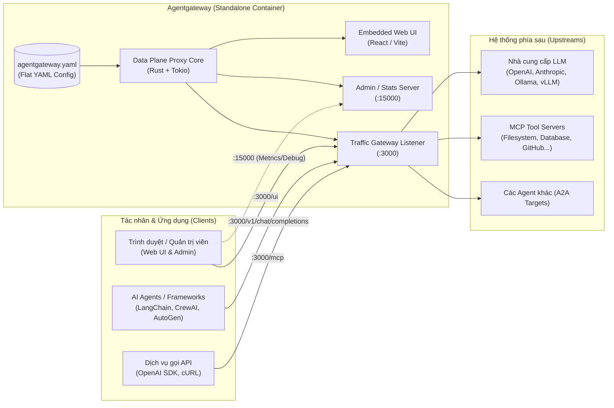

# Hướng dẫn sử dụng Agentgateway ở chế độ Standalone

> **Tài liệu hướng dẫn thực hành & tham khảo:** Dựa trên tài liệu chính thức của dự án [agentgateway](https://agentgateway.dev/docs/standalone/latest/) và quy trình triển khai bằng Docker Compose.
> **Mục tiêu:** Cung cấp hướng dẫn chi tiết từ kiến trúc, cấu hình đến cách triển khai và kiểm thử **Agentgateway Standalone** không cần Kubernetes.

---

## 1. Giới thiệu tổng quan

**Agentgateway** là giải pháp cổng kết nối mở (Open Source Gateway) được thiết kế chuyên biệt cho hệ sinh thái **AI Agentic**, hỗ trợ các giao thức hiện đại như **MCP** (Model Context Protocol), **A2A** (Agent-to-Agent), cùng với các mô hình **LLM** phổ biến và lưu lượng HTTP/gRPC truyền thống.

Ở chế độ **Standalone (Độc lập)**:
- Agentgateway không phụ thuộc vào Kubernetes hay mặt phẳng điều khiển xDS bên ngoài.
- Toàn bộ cơ chế định tuyến (routing), chính sách bảo mật (policy), quản lý tài nguyên LLM và MCP Server được điều khiển trực tiếp qua một tệp cấu hình phẳng duy nhất (`agentgateway.yaml`).
- Rất phù hợp cho môi trường **phát triển cục bộ (Local Development)**, **máy chủ thử nghiệm (Staging)**, hoặc các hệ thống chạy trên **Docker / Máy ảo độc lập**.

---

## 2. Kiến trúc chế độ Standalone



- **Traffic Gateway Listener (`:3000`)**: Cổng chính tiếp nhận lưu lượng HTTP/gRPC, các yêu cầu suy luận LLM, MCP JSON-RPC, đồng thời phục vụ Web UI quản trị trực tiếp tại đường dẫn `/ui`.
- **Admin Server (`:15000`)**: Cung cấp các endpoint nội bộ phục vụ chẩn đoán (`/debug/pprof`), số liệu giám sát Prometheus (`/stats`), và cấu hình runtime.
- **Config Hot-reload**: Agentgateway tự động theo dõi (watch) tệp `agentgateway.yaml` trên ổ đĩa. Khi bạn sửa file cấu hình, proxy sẽ cập nhật ngay lập tức mà không cần khởi động lại container.

---

## 3. Cài đặt và Triển khai với Docker Compose

### 3.1. Cấu trúc thư mục

Tạo cấu trúc thư mục làm việc như sau:

```text
agentgateway/
├── docker-compose.yml
└── agentgateway.yaml
```

### 3.2. Tệp cấu hình Docker Compose (`docker-compose.yml`)

Sử dụng image chính thức từ GitHub Container Registry (`ghcr.io/agentgateway/agentgateway:latest`):

```yaml
services:
  agentgateway:
    image: ghcr.io/agentgateway/agentgateway:latest
    container_name: agentgateway
    restart: unless-stopped
    command: ["-f", "/etc/agentgateway/config.yaml"]
    ports:
      - "3000:3000"     # Traffic Gateway + Web UI: http://localhost:3000/ui
      - "15000:15000"   # Admin API / Debugging
    volumes:
      - ./agentgateway.yaml:/etc/agentgateway/config.yaml:ro
    environment:
      - OPENAI_API_KEY=${OPENAI_API_KEY}
      - ANTHROPIC_API_KEY=${ANTHROPIC_API_KEY}
```

### 3.3. Tệp cấu hình Agentgateway (`agentgateway.yaml`)

Dưới đây là tệp cấu hình mẫu đầy đủ gồm Gateway chung, Web UI, tích hợp mô hình LLM và kết nối MCP Server:

```yaml
# yaml-language-server: $schema=https://agentgateway.dev/schema/config

# 1. Cấu hình Admin & Hệ thống
config:
  adminAddr: "0.0.0.0:15000"

# 2. Khai báo Gateway lắng nghe (Binds)
gateways:
  public:
    port: 3000

# 3. Kích hoạt giao diện Web UI
ui:
  gateways:
    - public

# 4. Cấu hình LLM Gateway (OpenAI Compatible)
llm:
  gateways:
    - public
  providers:
    - name: openai
      openAI:
        apiKey: "${OPENAI_API_KEY}"
    - name: ollama
      ollama:
        host: "http://host.docker.internal:11434"
  models:
    # Model định tuyến trực tiếp
    - name: gpt-4o
      provider: openai
    # Định tuyến linh hoạt theo tiền tố (wildcard)
    - name: "ollama/*"
      provider: ollama
      transformation:
        model: llmRequest.model.stripPrefix("ollama/")

# 5. Cấu hình MCP Gateway (Model Context Protocol)
mcp:
  gateways:
    - public
  targets:
    - name: filesystem-tools
      mcp:
        host: "http://host.docker.internal:8000/mcp"
```

---

## 4. Các lệnh vận hành

| Thao tác | Câu lệnh PowerShell / Bash |
| :--- | :--- |
| **Khởi động nền** | `docker compose up -d` |
| **Xem log thời gian thực** | `docker compose logs -f` |
| **Kiểm tra trạng thái** | `docker compose ps` |
| **Khởi động lại** | `docker compose restart` |
| **Dừng dịch vụ** | `docker compose down` |

---

## 5. Kiểm tra và Trải nghiệm

### 5.1. Truy cập Web UI
Mở trình duyệt và truy cập:
👉 **[http://localhost:3000/ui](http://localhost:3000/ui)**

Giao diện Web UI của Agentgateway cho phép:
- Xem danh sách các Route và Gateway đang hoạt động.
- Trực quan hóa các MCP Tools và kiểm tra kết nối với các Agent.
- Quan sát số lượng kết nối, độ trễ và thống kê lưu lượng.

### 5.2. Kiểm tra gọi LLM qua Gateway
Agentgateway cung cấp chuẩn API tương thích 100% với OpenAI (`/v1/chat/completions`):

```bash
curl -X POST http://localhost:3000/v1/chat/completions \
  -H "Content-Type: application/json" \
  -d '{
    "model": "gpt-4o",
    "messages": [
      {"role": "user", "content": "Xin chào, bạn là ai?"}
    ]
  }'
```

---

## 6. Các trường hợp sử dụng tiêu biểu

1. **Thống nhất API gọi LLM (Unified LLM Gateway)**:
   - Các ứng dụng trong công ty chỉ cần trỏ về `http://agentgateway:3000/v1`.
   - Gateway tự động kiểm soát rate limit, fallback sang mô hình phụ khi OpenAI gặp sự cố, và lưu vết log truy cập tập trung.
2. **Federation cho MCP (Model Context Protocol)**:
   - Gom nhiều server công cụ (Database MCP, Git MCP, Search MCP) về một đầu mối tập trung.
   - Quản lý phân quyền truy cập tool bằng CEL policies trước khi cho phép Agent thực thi.
3. **Bảo mật và Kiểm soát Chi phí**:
   - Gắn các bộ lọc tiền xử lý (Guardrails, kiểm tra PII/dữ liệu nhạy cảm) trước khi request được chuyển tiếp đến các mô hình đám mây.
