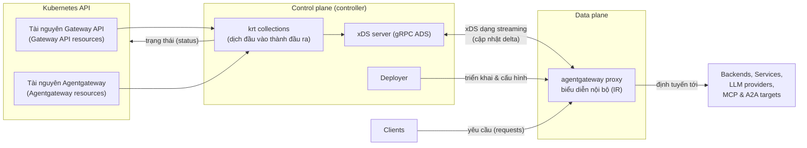

# Kiến trúc agentgateway trên Kubernetes

> **Bản dịch tiếng Việt từ:** [Architecture](https://agentgateway.dev/docs/kubernetes/latest/documentation/about/architecture/), tài liệu dự án agentgateway (phiên bản Kubernetes 1.6.x).
> **Nguồn gốc:** agentgateway.dev — Agent Connectivity Solved.
> **Quy ước thuật ngữ:** Từ khóa quan trọng trình bày dạng **tiếng Việt (English)** ở lần đầu; tên API/CRD, giao thức và lệnh được giữ nguyên.

Tìm hiểu về các thành phần (component) cấu tạo nên **agentgateway** và cách chúng phối hợp để chuyển các tài nguyên Kubernetes Gateway API thành cấu hình thời gian chạy (runtime) — thứ cung cấp khả năng quản lý lưu lượng (traffic management), bảo mật (security) và tính kiên cường (resiliency) cho các ứng dụng và agent của bạn.

Ở chế độ Kubernetes (Kubernetes mode), agentgateway là một gateway hoàn chỉnh, đi kèm sẵn **mặt phẳng điều khiển (control plane)** và **mặt phẳng dữ liệu (data plane)** riêng.

- **Control plane** là một Kubernetes controller: nó theo dõi (watch) các tài nguyên Gateway API và tài nguyên agentgateway, dịch chúng sang mô hình cấu hình của agentgateway, rồi phục vụ cấu hình đó cho các proxy qua xDS.
- **Data plane** là proxy của agentgateway: một proxy hiệu năng cao cho HTTP, gRPC, MCP, A2A và LLM, áp dụng cấu hình nhận được và định tuyến lưu lượng đến các backend của bạn.

## Kiến trúc thành phần (Component architecture)

Sơ đồ dưới đây mô tả các thành phần cấu tạo nên control plane và data plane của agentgateway, cùng đường đi (path) mà cấu hình trải qua từ Kubernetes API đến một proxy đang chạy.

1. Bạn tạo hoặc cập nhật các tài nguyên Kubernetes Gateway API (như Gateway, HTTPRoute, GRPCRoute) và tài nguyên agentgateway (như AgentgatewayBackend và AgentgatewayPolicy).
2. Control plane theo dõi cụm (cluster) để phát hiện các tài nguyên này bằng [krt](https://github.com/istio/istio/tree/master/pkg/kube/krt) collections. Các collection này dịch đầu vào thành các tài nguyên cấu hình của agentgateway — như Binds, Listeners, Routes, Backends và Policies — đồng thời phân giải (resolve) địa chỉ service và workload để khám phá endpoint (endpoint discovery). Khi một tài nguyên liên quan thay đổi, chỉ những collection bị ảnh hưởng mới được tính lại.
3. **xDS server** kéo (pull) cấu hình đã dịch từ các collection này và phục vụ chúng cho proxy qua một kết nối gRPC streaming. Control plane cũng ghi trạng thái (status) ngược về các tài nguyên Kubernetes để bạn thấy được cấu hình của mình có được chấp nhận hay không.
4. **Deployer** tự động cấp phát (provision) và cấu hình một bản triển khai (deployment) proxy agentgateway cho mỗi Gateway dùng GatewayClass `agentgateway`, bao gồm cả địa chỉ và thông tin xác thực (credentials) mà proxy dùng để kết nối tới xDS server.
5. **Proxy** agentgateway ở data plane mở một kết nối streaming tới xDS server, nhận các cập nhật cấu hình và áp dụng chúng vào biểu diễn nội bộ (internal representation) trong bộ nhớ của nó.
6. Clients gửi yêu cầu đến địa chỉ mà proxy được phơi bày (expose). Proxy dùng cấu hình listener, route, backend và policy của mình để ra quyết định định tuyến và chuyển tiếp (forward) yêu cầu đến đích thích hợp — dù đó là một Kubernetes service, một LLM provider, một MCP tool server, hay một A2A agent.

## Mặt phẳng điều khiển (Control plane)

Control plane là một Kubernetes controller biến các tài nguyên Gateway API và agentgateway khai báo (declarative) của bạn thành cấu hình proxy. Nó gồm các thành phần sau.

### krt collections

Trái tim của control plane là một tập hợp các **krt collections** — một thư viện collection phản ứng (reactive). Control plane theo dõi cụm để phát hiện các tài nguyên Kubernetes Gateway API (Gateway, HTTPRoute, GRPCRoute, TCPRoute và TLSRoute), các custom resource của agentgateway (AgentgatewayBackend, AgentgatewayParameters và AgentgatewayPolicy), cùng các tài nguyên hỗ trợ (như Service, ReferenceGrant và Secret), rồi tổ chức trạng thái này thành các collection. Khi bất kỳ tài nguyên được theo dõi nào thay đổi, chỉ những collection phụ thuộc vào nó mới được tính lại, giúp control plane giữ hiệu quả ngay cả trong các cụm lớn.

Các krt collection dịch đầu vào thành mô hình cấu hình của agentgateway. agentgateway dùng các kiểu tài nguyên chuyên dụng (purpose-built) thay vì các kiểu của Envoy, với triết lý thiết kế giữ ánh xạ gần như một-đối-một (near one-to-one) giữa API hướng người dùng, cấu hình gửi qua xDS, và biểu diễn nội bộ của proxy. Ánh xạ này giúp cấu hình dễ lập luận và control plane đơn giản, bởi hầu hết các phép dịch đều mang tính cơ học (mechanical) chứ không phải các phép join phức tạp.

Các collection tạo ra những tài nguyên sau:

- **Binds**: Một ràng buộc cổng (port binding) mà các listener gắn vào. agentgateway tạo một Bind cho mỗi cổng duy nhất trên tất cả các listener.
- **Listeners**: Một listener gateway riêng lẻ, gồm hostname, protocol và cài đặt TLS của nó, được dẫn xuất từ đặc tả listener của một Gateway.
- **Routes**: Các quy tắc định tuyến với điều kiện khớp (match conditions), filter và tham chiếu backend, được dịch từ các tài nguyên HTTPRoute, GRPCRoute, TCPRoute và TLSRoute.
- **Backends**: Các đích mà lưu lượng được định tuyến tới, được dịch từ tài nguyên AgentgatewayBackend thông qua một hệ thống plugin. Các loại backend gồm AI/LLM provider (như OpenAI, Anthropic, Azure OpenAI và Bedrock), MCP server, cùng các backend tĩnh và động.
- **Policies**: Các quy tắc lưu lượng, bảo mật và biến đổi (transformation) được dịch từ tài nguyên AgentgatewayPolicy — như sửa đổi header, redirect, URL rewrite, nhân bản yêu cầu (request mirroring), CORS, xác thực (authentication), timeout, retry và các phép biến đổi dựa trên CEL.
- **Addresses**: Địa chỉ service và workload dùng cho khám phá endpoint. Đây là các tài nguyên toàn cục (global) chia sẻ giữa tất cả các proxy.

Vì số lượng (cardinality) tài nguyên của agentgateway phản chiếu API hướng người dùng, một thay đổi ở một tài nguyên Gateway API tạo ra một cập nhật nhỏ, có mục tiêu rõ ràng. Ví dụ, một quy tắc HTTPRoute ánh xạ thành một Route, và một Pod ánh xạ thành một Workload, nên việc sửa một trường đơn lẻ không buộc control plane phải tính lại và gửi lại cấu hình không liên quan.

Các Policy được gửi tới proxy kèm một tham chiếu đến nơi chúng áp dụng, thay vì bị làm phẳng (flatten) lên mọi route. Proxy phân giải độ ưu tiên (precedence) và việc hợp nhất (merging) policy ngay tại thời điểm xử lý yêu cầu.

### xDS server

xDS server chuyển giao cấu hình đã dịch tới các proxy ở data plane. Nó dùng [giao thức truyền tải xDS (xDS transport protocol)](https://www.envoyproxy.io/docs/envoy/latest/api-docs/xds_protocol) qua một kết nối gRPC streaming (Aggregated Discovery Service), nhưng phục vụ [các kiểu tài nguyên chuyên dụng](https://github.com/agentgateway/agentgateway/blob/main/crates/protos/proto/resource.proto) của riêng agentgateway thay vì các kiểu của Envoy.

Mỗi proxy đăng ký (subscribe) cấu hình được giới hạn phạm vi (scope) theo Gateway của nó, cộng với các tài nguyên địa chỉ chia sẻ dùng cho khám phá service. Server gửi các cập nhật tăng dần (incremental/delta), nên khi cấu hình thay đổi, chỉ những tài nguyên đã thay đổi mới được gửi đi. Các kết nối có thể được xác thực bằng Kubernetes service account token và bảo mật bằng TLS.

### Deployer

Deployer quản lý vòng đời (lifecycle) của các workload proxy. Khi bạn tạo một Gateway dùng GatewayClass `agentgateway`, deployer cấp phát và cấu hình một proxy agentgateway cho nó. Mặc định, proxy chạy dưới dạng một Deployment. Bạn có thể tùy biến workload được sinh ra — như image của proxy, cài đặt ghi log, và việc proxy chạy dưới dạng Deployment hay DaemonSet — thông qua tài nguyên AgentgatewayParameters được tham chiếu bởi GatewayClass hoặc Gateway.

### Status (Trạng thái)

Khi các collection xử lý tài nguyên của bạn, control plane báo cáo trạng thái ngược về Kubernetes API cho các Gateway, listener và route. Cấu hình không hợp lệ hoặc bị từ chối sẽ được phơi bày trong trạng thái của tài nguyên để bạn chỉnh sửa, trong khi phần cấu hình hợp lệ còn lại vẫn tiếp tục được phục vụ.

## Mặt phẳng dữ liệu (Data plane)

Data plane là proxy agentgateway. Đây là một proxy HTTP và gRPC đa dụng (general-purpose) với cân bằng tải (load balancing), timeout, retry, TLS, giới hạn tốc độ (rate limiting), ủy quyền (authorization) và các policy lưu lượng; ngoài ra nó bổ sung hỗ trợ hạng nhất (first-class) cho các workload AI và agent:

- **LLM**: Định tuyến tới các AI provider như OpenAI, Anthropic, Azure OpenAI và Bedrock, với một API thống nhất (unified) xuyên suốt các provider.
- **MCP**: Làm proxy cho lưu lượng Model Context Protocol, bao gồm cả các MCP server ảo (virtual) gộp (aggregate) nhiều tool server.
- **A2A**: Làm proxy cho lưu lượng agent-tới-agent (agent-to-agent, A2A) giữa các agent.

Proxy duy trì toàn bộ cấu hình của nó trong một biểu diễn nội bộ (internal representation, IR) trong bộ nhớ. Nó nhận cấu hình từ xDS server dưới dạng các cập nhật tăng dần và áp dụng chúng một cách nguyên tử (atomically), rồi dùng trạng thái đó để khớp các yêu cầu đến với listener và route, áp dụng policy, và chuyển tiếp lưu lượng đến backend được chọn.

### Nguồn cấu hình (Configuration sources)

Mặc dù chế độ Kubernetes chuyển giao cấu hình qua xDS, bản thân proxy có thể được cấu hình theo ba cách, tất cả đều ánh xạ về cùng một biểu diễn nội bộ:

- **Cấu hình tĩnh (Static configuration)**: Các thiết lập tiến trình toàn cục như ghi log và cổng (port), đặt một lần lúc khởi động thông qua biến môi trường (environment variables) hoặc một tệp cấu hình.
- **Cấu hình cục bộ (Local configuration)**: Một tệp YAML hoặc JSON định nghĩa toàn bộ tập tính năng (backend, route và policy). Tệp được theo dõi để phát hiện thay đổi và nạp lại (reload) động. Điều này cho phép bạn chạy agentgateway như một proxy độc lập (standalone) mà không cần control plane.
- **Cấu hình xDS (xDS configuration)**: Cấu hình động do một control plane chuyển giao, chẳng hạn control plane của agentgateway ở chế độ Kubernetes.

Để biết thêm chi tiết về mô hình cấu hình, xem [kho mã agentgateway](https://github.com/agentgateway/agentgateway/blob/main/architecture/configuration.md).

## Thuật ngữ song ngữ (Glossary)

| Tiếng Việt | English |
| --- | --- |
| Mặt phẳng điều khiển | Control plane |
| Mặt phẳng dữ liệu | Data plane |
| Biểu diễn nội bộ | Internal representation (IR) |
| Khám phá endpoint | Endpoint discovery |
| Cập nhật tăng dần / delta | Incremental / delta updates |
| Ràng buộc cổng | Port binding (Bind) |
| Quy tắc định tuyến | Routing rules (Routes) |
| Giới hạn tốc độ | Rate limiting |
| Ủy quyền | Authorization |
| Cấu hình khai báo | Declarative configuration |
| Proxy độc lập | Standalone proxy |
