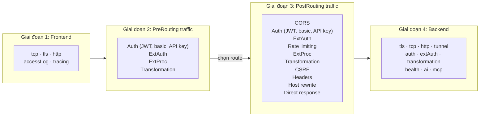

# Thứ tự xử lý Policy

> **Bản dịch tiếng Việt từ:** [Policy processing order](https://agentgateway.dev/docs/kubernetes/latest/documentation/about/policies/filter-order/), tài liệu dự án agentgateway (phiên bản Kubernetes 1.6.x).
> **Nguồn gốc:** agentgateway.dev — Agent Connectivity Solved.
> **Quy ước thuật ngữ:** Từ khóa quan trọng trình bày dạng **tiếng Việt (English)** ở lần đầu; tên trường (field), giai đoạn (phase) và filter được giữ nguyên.

## Thứ tự xử lý policy

Agentgateway xử lý mỗi request qua bốn giai đoạn (**phase**) theo thứ tự dưới đây. Bạn **không thể** thay đổi thứ tự các giai đoạn, nhưng có thể kiểm soát filter nào chạy trong từng giai đoạn bằng cách cấu hình các phân mục policy phù hợp.

1. **Policy frontend:** Kiểm soát cách gateway chấp nhận kết nối đến, gồm cài đặt TLS, cấu hình TCP và access logging. Policy frontend áp dụng ở cấp gateway, trước mọi quyết định định tuyến.
2. **Policy traffic PreRouting:** Chạy **trước** khi chọn route. Chỉ một tập con các traffic filter khả dụng trong [giai đoạn PreRouting](#prerouting).
3. **Policy traffic PostRouting:** Chạy **sau** khi chọn route. [PostRouting](#postrouting) là giai đoạn mặc định cho policy traffic và hỗ trợ tất cả traffic filter.
4. **Policy backend:** Chạy khi gateway kết nối tới backend đích, gồm backend TLS, authentication, external authorization và health check. External authorization ở cấp backend chạy **sau** khi chọn backend — hữu ích khi dịch vụ authorization cần định hình request đi ra (ví dụ chèn một token) và route có nhiều backend.

Phân quyền backend chạy sau khi chọn backend, nên policy đánh giá request theo đúng đích đã được chọn.

Trong mỗi giai đoạn, agentgateway hợp nhất (**merge**) tất cả policy áp dụng được bằng một phép merge nông ở cấp trường (**shallow field-level merge**). Nếu hai policy cấu hình các trường khác nhau thì cả hai cùng áp dụng. Ví dụ, nếu một policy đặt `transformation` và policy khác đặt `extAuth` thì cả hai filter đều chạy. Nếu hai policy cấu hình cùng một trường, policy có mức ưu tiên cao hơn sẽ có hiệu lực.

## Thứ tự thực thi của traffic filter

Trong giai đoạn traffic (cả PreRouting lẫn PostRouting), các filter thực thi theo một thứ tự cố định. Bạn không thể thay đổi thứ tự này.

### Các filter PreRouting được hỗ trợ {#prerouting}

Giai đoạn PreRouting chỉ hỗ trợ các filter sau, theo thứ tự thực thi.

Để chạy một filter trong giai đoạn PreRouting, đặt `phase: PreRouting` trên policy traffic.

> [!NOTE]
> Policy PreRouting chỉ có thể nhắm vào (target) một Gateway hoặc ListenerSet.

| Thứ tự | Filter | Trường |
| --- | --- | --- |
| 1 | Xác thực JSON Web Token (JWT) | `jwtAuthentication` |
| 2 | Basic authentication | `basicAuthentication` |
| 3 | API key authentication | `apiKeyAuthentication` |
| 4 | External authorization | `extAuth` |
| 5 | External processing | `extProc` |
| 6 | Transformation | `transformation` |

### Các filter PostRouting được hỗ trợ {#postrouting}

Mặc định, các filter chạy ở giai đoạn PostRouting. Giai đoạn PostRouting chỉ hỗ trợ các filter sau, theo thứ tự thực thi.

Filter PostRouting có thể nhắm vào bất kỳ target nào mà policy traffic hỗ trợ (Gateway, HTTPRoute, GRPCRoute hoặc ListenerSet).

| Thứ tự | Filter | Trường |
| --- | --- | --- |
| 1 | Cross-Origin Resource Sharing (CORS) | `cors` |
| 2 | Xác thực JSON Web Token (JWT) | `jwtAuthentication` |
| 3 | Basic authentication | `basicAuthentication` |
| 4 | API key authentication | `apiKeyAuthentication` |
| 5 | External authorization | `extAuth` |
| 6 | Authorization | `authorization` |
| 7 | Rate limiting (local) | `rateLimit` |
| 8 | Rate limiting (remote) | `rateLimit` |
| 9 | External processing | `extProc` |
| 10 | Transformation | `transformation` |
| 11 | Cross-Site Request Forgery (CSRF) | `csrf` |
| 12 | Header modifiers | `headerModifiers` |
| 13 | Host rewrite | `hostRewrite` |
| 14 | Direct response | `directResponse` |

### Điều chỉnh thứ tự thực thi bằng các giai đoạn

Bạn có thể dùng giai đoạn PreRouting để chạy một số filter sớm hơn trong vòng đời request. Ví dụ, để chạy external processing trước rate limiting, hãy cấu hình một policy `extProc` với giai đoạn PreRouting, và một policy `rateLimit` riêng với giai đoạn mặc định PostRouting. Khi đó external processing chạy trong PreRouting (trước khi chọn route), còn rate limiting chạy trong PostRouting (sau khi chọn route).
