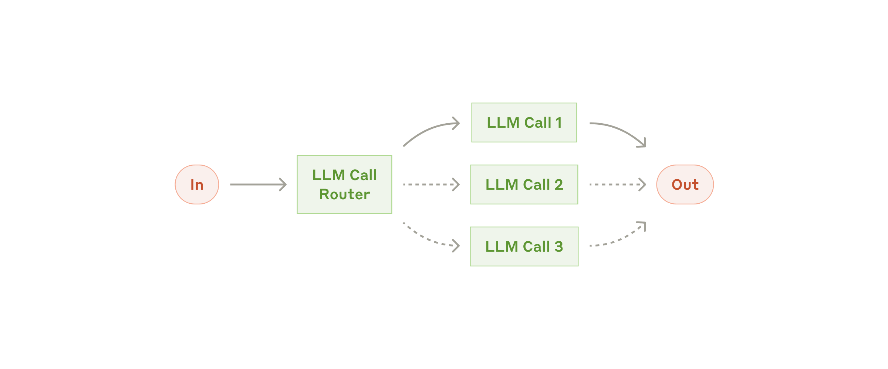
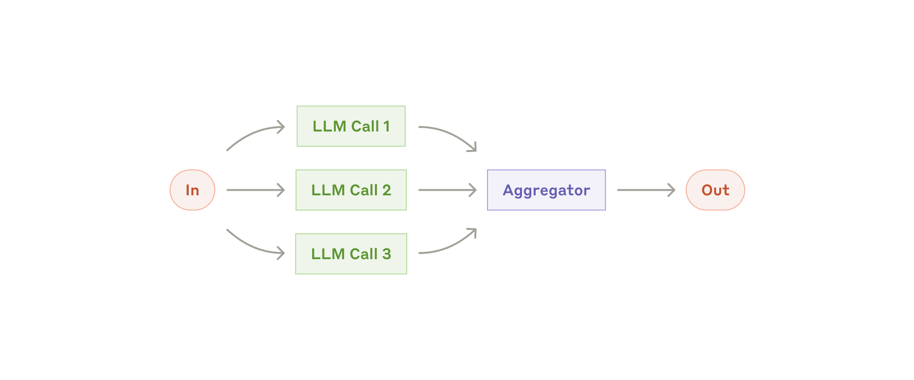
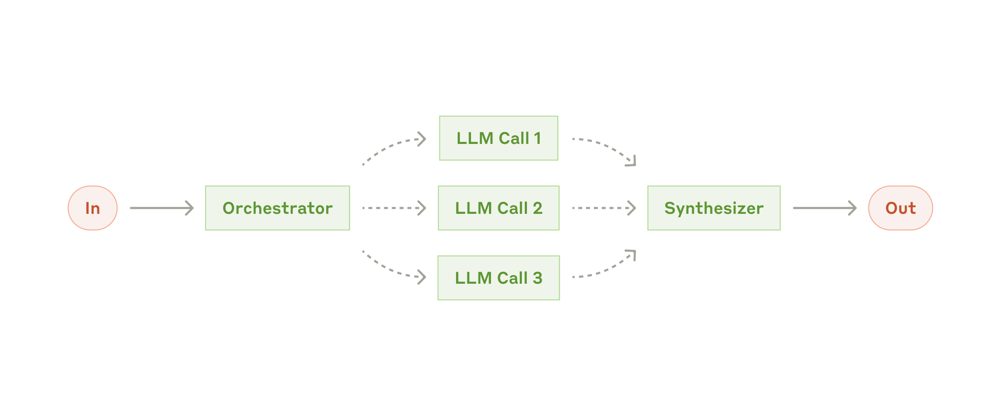

# Xây dựng tác tử hiệu quả

> **Bản dịch tiếng Việt từ bài viết:** [Building effective agents](https://www.anthropic.com/engineering/building-effective-agents), Anthropic, xuất bản ngày 19/12/2024.  
> **Tác giả:** Erik S. và Barry Zhang.  
> **Quy ước thuật ngữ:** Các từ khóa quan trọng được trình bày theo dạng **tiếng Việt (English)** ở lần xuất hiện đầu tiên.

Anthropic đã làm việc với hàng chục nhóm phát triển tác tử LLM trong nhiều ngành. Một kết quả xuất hiện rất nhất quán: những hệ thống thành công nhất thường sử dụng các mẫu đơn giản, có thể kết hợp, thay vì framework phức tạp.

> **Lưu ý:** Phần lớn hệ sinh thái công cụ được mô tả trong bài đã thay đổi kể từ tháng 12/2024. Để tìm hiểu cách tiếp cận hiện tại của Anthropic, xem [cách Anthropic xây dựng Claude Managed Agents](https://www.anthropic.com/engineering/managed-agents) và [tài liệu Managed Agents](https://platform.claude.com/docs/en/managed-agents/overview).

Trong bài viết này, Anthropic chia sẻ những bài học thu được khi làm việc với khách hàng và tự xây dựng tác tử, đồng thời đưa ra lời khuyên thực tế dành cho nhà phát triển.

---

## Tác tử là gì?

“Tác tử” có thể được định nghĩa theo nhiều cách. Một số khách hàng gọi những hệ thống hoàn toàn tự chủ, hoạt động độc lập trong thời gian dài và sử dụng nhiều công cụ để hoàn thành nhiệm vụ phức tạp là tác tử. Những người khác dùng thuật ngữ này cho các hệ thống có tính quy định cao hơn, đi theo workflow đã được định nghĩa trước.

Anthropic xếp tất cả các biến thể đó vào nhóm **hệ thống có tính tác tử (agentic systems)**, nhưng phân biệt rõ hai kiến trúc:

- **Quy trình công việc (workflows):** LLM và công cụ được điều phối theo những đường đi được định nghĩa trước trong mã.
- **Tác tử (agents):** LLM tự điều hướng quy trình và cách sử dụng công cụ, duy trì quyền kiểm soát đối với phương thức hoàn thành nhiệm vụ.

Bài viết sẽ phân tích cả hai nhóm. Phụ lục 1 trình bày hai lĩnh vực mà khách hàng nhận được giá trị đặc biệt rõ ràng từ các hệ thống này.

---

## Khi nào nên — và không nên — dùng tác tử?

Khi xây dựng ứng dụng LLM, hãy tìm giải pháp đơn giản nhất có thể và chỉ tăng độ phức tạp khi thực sự cần. Điều đó có thể đồng nghĩa với việc không xây hệ thống agentic. Những hệ thống này thường đánh đổi độ trễ và chi phí để đạt hiệu quả nhiệm vụ cao hơn; cần xác định rõ khi nào sự đánh đổi đó hợp lý.

Khi cần thêm độ phức tạp:

- Workflow tạo ra tính dự đoán và nhất quán cho nhiệm vụ được định nghĩa rõ.
- Agent phù hợp hơn khi cần linh hoạt và quyết định do mô hình điều khiển ở quy mô lớn.

Tuy nhiên, với nhiều ứng dụng, một lần gọi LLM được tối ưu tốt, kết hợp truy xuất dữ liệu và ví dụ trong ngữ cảnh, đã là đủ.

---

## Khi nào và cách sử dụng framework

Có nhiều framework giúp triển khai hệ thống agentic dễ hơn, chẳng hạn:

- [Claude Agent SDK](https://platform.claude.com/docs/en/agent-sdk/overview).
- [Strands Agents SDK của AWS](https://strandsagents.com/latest/).
- [Rivet](https://rivet.ironcladapp.com/), công cụ GUI kéo-thả để xây workflow LLM.
- [Vellum](https://www.vellum.ai/), công cụ GUI để xây dựng và kiểm thử workflow phức tạp.

Framework giúp bắt đầu nhanh bằng cách đơn giản hóa những việc cấp thấp như gọi LLM, định nghĩa và phân tích công cụ, hoặc nối nhiều lần gọi với nhau. Tuy nhiên, chúng cũng tạo thêm các lớp trừu tượng có thể che khuất prompt và response thực tế, khiến việc gỡ lỗi khó hơn. Framework còn dễ khiến nhóm phát triển thêm độ phức tạp dù một thiết kế đơn giản đã đủ.

Anthropic khuyến nghị nhà phát triển bắt đầu bằng cách gọi trực tiếp API của LLM; nhiều mẫu trong bài chỉ cần vài dòng mã. Nếu dùng framework, hãy chắc chắn rằng bạn hiểu mã bên dưới. Những giả định sai về cơ chế nội bộ là nguồn lỗi phổ biến.

Xem [Anthropic cookbook](https://platform.claude.com/cookbook/patterns-agents-basic-workflows) để tham khảo các cách triển khai mẫu.

---

## Khối xây dựng, workflow và agent

Phần này trình bày những mẫu agentic phổ biến đã xuất hiện trong môi trường production. Ta bắt đầu với khối nền tảng — LLM được tăng cường — rồi tăng dần độ phức tạp từ workflow kết hợp đơn giản đến agent tự chủ.

## Khối xây dựng: LLM được tăng cường

Khối cơ bản của hệ thống agentic là một **LLM được tăng cường (augmented LLM)** bằng các năng lực như truy xuất, công cụ và bộ nhớ. Các mô hình hiện tại có thể chủ động sử dụng những năng lực này: tự tạo truy vấn tìm kiếm, chọn công cụ phù hợp và quyết định thông tin nào cần lưu lại.

*LLM được tăng cường (The augmented LLM). Nguồn: Anthropic.*

Khi triển khai, nên tập trung vào hai yếu tố:

1. Điều chỉnh các năng lực bổ sung theo trường hợp sử dụng cụ thể.
2. Cung cấp cho LLM một giao diện đơn giản, được tài liệu hóa rõ ràng.

Có nhiều cách triển khai. Một lựa chọn là [Model Context Protocol](https://www.anthropic.com/news/model-context-protocol), cho phép nhà phát triển kết nối với hệ sinh thái công cụ bên thứ ba đang mở rộng thông qua một [MCP client đơn giản](https://modelcontextprotocol.io/tutorials/building-a-client#building-mcp-clients).

Trong phần còn lại của bài viết, giả định rằng mỗi lần gọi LLM đều có thể truy cập các năng lực tăng cường này.

---

## Workflow: Chuỗi prompt

**Chuỗi prompt (prompt chaining)** chia một nhiệm vụ thành chuỗi bước; mỗi lần gọi LLM xử lý đầu ra của bước trước. Có thể thêm kiểm tra bằng mã — “cổng kiểm tra” trong sơ đồ — tại các bước trung gian để bảo đảm quy trình vẫn đi đúng hướng.

*Workflow chuỗi prompt (The prompt chaining workflow). Nguồn: Anthropic.*

### Khi nào nên dùng?

Mẫu này phù hợp khi nhiệm vụ có thể được phân rã sạch sẽ thành các tác vụ con cố định. Mục tiêu chính là đánh đổi độ trễ để lấy độ chính xác cao hơn, bằng cách biến mỗi lần gọi LLM thành một bài toán dễ hơn.

### Ví dụ

- Tạo nội dung marketing, sau đó dịch sang ngôn ngữ khác.
- Viết dàn ý tài liệu, kiểm tra dàn ý theo tiêu chí, rồi viết tài liệu dựa trên dàn ý đã đạt yêu cầu.

---

## Workflow: Định tuyến

**Định tuyến (routing)** phân loại đầu vào và chuyển nó tới tác vụ chuyên biệt phía sau. Mẫu này giúp tách biệt trách nhiệm và tạo prompt chuyên sâu cho từng loại yêu cầu. Nếu không định tuyến, việc tối ưu cho một loại đầu vào có thể làm giảm hiệu năng trên loại khác.

*Workflow định tuyến (The routing workflow). Nguồn: Anthropic.*

### Khi nào nên dùng?

Routing phù hợp với nhiệm vụ phức tạp có các nhóm đầu vào khác biệt và mỗi nhóm nên được xử lý riêng. Việc phân loại phải đủ chính xác, bằng LLM hoặc mô hình/thuật toán phân loại truyền thống.

### Ví dụ

- Chuyển câu hỏi dịch vụ khách hàng — câu hỏi chung, hoàn tiền, hỗ trợ kỹ thuật — tới quy trình, prompt và công cụ riêng.
- Chuyển câu hỏi dễ, phổ biến tới mô hình nhỏ và tiết kiệm như Claude Haiku 4.5; chuyển câu hỏi khó, bất thường tới mô hình mạnh hơn như Claude Sonnet 4.5.

---

## Workflow: Song song hóa

LLM có thể xử lý đồng thời một nhiệm vụ, sau đó đầu ra được tổng hợp bằng chương trình. **Song song hóa (parallelization)** có hai biến thể chính:

- **Phân chia phần việc (sectioning):** chia nhiệm vụ thành các tác vụ con độc lập và chạy song song.
- **Bỏ phiếu (voting):** chạy cùng một nhiệm vụ nhiều lần để tạo các kết quả đa dạng.

*Workflow song song hóa (The parallelization workflow). Nguồn: Anthropic.*

### Khi nào nên dùng?

Song song hóa hiệu quả khi:

- Các tác vụ con độc lập có thể chạy đồng thời để giảm thời gian.
- Cần nhiều góc nhìn hoặc nhiều lần thử để tăng độ tin cậy.

Với nhiệm vụ có nhiều tiêu chí, LLM thường hoạt động tốt hơn nếu mỗi tiêu chí được giao cho một lần gọi riêng, để mô hình tập trung vào đúng khía cạnh đó.

### Ví dụ phân chia phần việc

- Một model instance xử lý yêu cầu người dùng, trong khi instance khác kiểm tra nội dung hoặc yêu cầu không phù hợp. Cách này thường tốt hơn việc bắt cùng một lần gọi vừa tạo câu trả lời vừa tự thực thi guardrail.
- Tự động hóa đánh giá LLM, trong đó mỗi lần gọi đánh giá một khía cạnh khác nhau của hiệu năng.

### Ví dụ bỏ phiếu

- Nhiều prompt cùng rà soát mã để tìm lỗ hổng; mã bị gắn cờ nếu một hoặc nhiều lượt phát hiện vấn đề.
- Nhiều prompt đánh giá nội dung không phù hợp theo các khía cạnh khác nhau, với ngưỡng biểu quyết nhằm cân bằng false positive và false negative.

---

## Workflow: Bộ điều phối và các worker

Trong workflow **bộ điều phối–worker (orchestrator-workers)**, một LLM trung tâm tự phân rã nhiệm vụ, giao việc cho các worker LLM và tổng hợp kết quả.

*Workflow bộ điều phối–worker (The orchestrator-workers workflow). Nguồn: Anthropic.*

### Khi nào nên dùng?

Mẫu này phù hợp với nhiệm vụ phức tạp mà không thể dự đoán trước các tác vụ con. Ví dụ, trong lập trình, số lượng tệp cần sửa và loại thay đổi trong mỗi tệp phụ thuộc vào yêu cầu cụ thể.

Dù hình dạng gần giống parallelization, điểm khác biệt cốt lõi là tính linh hoạt: tác vụ con không được định nghĩa sẵn mà do orchestrator xác định từ đầu vào thực tế.

### Ví dụ

- Sản phẩm coding agent thực hiện thay đổi phức tạp trên nhiều tệp.
- Nhiệm vụ tìm kiếm phải thu thập và phân tích thông tin từ nhiều nguồn có khả năng liên quan.

---

## Workflow: Bộ đánh giá và bộ tối ưu

Trong workflow **bộ đánh giá–bộ tối ưu (evaluator-optimizer)**, một lần gọi LLM tạo câu trả lời, còn một lần gọi khác đánh giá và cung cấp phản hồi trong vòng lặp.

*Workflow bộ đánh giá–bộ tối ưu (The evaluator-optimizer workflow). Nguồn: Anthropic.*

### Khi nào nên dùng?

Mẫu này đặc biệt hiệu quả khi có tiêu chí đánh giá rõ và việc tinh chỉnh lặp tạo ra giá trị đo được. Hai dấu hiệu cho thấy bài toán phù hợp:

1. Câu trả lời của LLM cải thiện rõ khi con người diễn đạt phản hồi.
2. Chính LLM cũng có thể cung cấp loại phản hồi hữu ích đó.

Mẫu này tương tự quá trình một người viết chỉnh sửa nhiều vòng để tạo tài liệu hoàn thiện.

### Ví dụ

- Dịch văn học, nơi bản dịch đầu có thể bỏ lỡ sắc thái nhưng evaluator LLM có thể đưa ra phê bình hữu ích.
- Tìm kiếm phức tạp cần nhiều vòng truy vấn và phân tích; evaluator quyết định có cần tìm thêm hay không.

---

## Agent

Agent bắt đầu xuất hiện nhiều hơn trong production khi LLM trưởng thành ở các năng lực quan trọng: hiểu đầu vào phức tạp, suy luận và lập kế hoạch, sử dụng công cụ đáng tin cậy và phục hồi sau lỗi.

Agent bắt đầu bằng mệnh lệnh hoặc cuộc trao đổi tương tác với con người. Khi nhiệm vụ đã rõ, agent lập kế hoạch và hoạt động độc lập, nhưng có thể quay lại hỏi người dùng để lấy thêm thông tin hoặc phán đoán.

Trong khi thực thi, agent cần liên tục nhận **sự thật nền (ground truth)** từ môi trường — chẳng hạn kết quả tool call hoặc code execution — để đánh giá tiến độ. Agent có thể dừng tại checkpoint để nhận phản hồi con người hoặc khi gặp blocker. Nhiệm vụ thường kết thúc khi hoàn thành, nhưng cũng nên có điều kiện dừng như số vòng lặp tối đa để duy trì kiểm soát.

Việc triển khai agent thường đơn giản hơn vẻ ngoài: về cơ bản, đó là LLM dùng công cụ trong một vòng lặp dựa trên phản hồi môi trường. Vì vậy, thiết kế bộ công cụ và tài liệu hướng dẫn rõ ràng là yếu tố quyết định.

*Tác tử tự chủ (Autonomous agent). Nguồn: Anthropic.*

### Khi nào nên dùng agent?

Agent phù hợp với bài toán mở mà số bước cần thiết không thể dự đoán và không thể hardcode một đường đi cố định. LLM có thể hoạt động qua nhiều lượt, vì vậy tổ chức phải có mức độ tin cậy nhất định vào khả năng ra quyết định của mô hình.

Tính tự chủ làm tăng chi phí và nguy cơ lỗi tích lũy. Anthropic khuyến nghị kiểm thử kỹ trong sandbox và triển khai guardrail phù hợp.

### Ví dụ

- Coding agent giải quyết [SWE-bench tasks](https://www.anthropic.com/research/swe-bench-sonnet), yêu cầu sửa nhiều tệp dựa trên mô tả nhiệm vụ.
- Bản triển khai tham chiếu [computer use](https://github.com/anthropics/anthropic-quickstarts/tree/main/computer-use-demo), trong đó Claude sử dụng máy tính để hoàn thành nhiệm vụ.

*Luồng cấp cao của một coding agent (High-level flow of a coding agent). Nguồn: Anthropic.*

---

## Kết hợp và tùy chỉnh các mẫu

Các khối xây dựng trên không phải quy tắc bắt buộc. Đây là những mẫu phổ biến mà nhà phát triển có thể điều chỉnh và kết hợp theo trường hợp sử dụng.

Chìa khóa thành công, giống mọi tính năng LLM khác, là đo hiệu năng và lặp lại quá trình triển khai. Chỉ thêm độ phức tạp khi có thể chứng minh rằng nó cải thiện kết quả.

---

## Tổng kết

Thành công trong lĩnh vực LLM không đến từ việc xây hệ thống phức tạp nhất, mà từ việc xây đúng hệ thống cho nhu cầu cụ thể. Hãy bắt đầu với prompt đơn giản, tối ưu chúng bằng đánh giá toàn diện, và chỉ thêm hệ thống agentic nhiều bước khi giải pháp đơn giản không đáp ứng được.

Khi triển khai agent, Anthropic tuân theo ba nguyên tắc:

1. Duy trì **tính đơn giản (simplicity)** trong thiết kế.
2. Ưu tiên **tính minh bạch (transparency)** bằng cách hiển thị rõ các bước lập kế hoạch.
3. Thiết kế cẩn thận **giao diện tác tử–máy tính (Agent–Computer Interface — ACI)** thông qua tài liệu và kiểm thử công cụ đầy đủ.

Framework giúp khởi động nhanh, nhưng khi đi vào production, đừng ngại giảm lớp trừu tượng và xây từ các thành phần cơ bản. Những nguyên tắc này giúp tạo ra agent không chỉ mạnh mà còn đáng tin cậy, dễ bảo trì và được người dùng tin tưởng.

### Lời cảm ơn

Bài viết do Erik S. và Barry Zhang thực hiện, dựa trên kinh nghiệm xây dựng agent tại Anthropic và những chia sẻ giá trị từ khách hàng.

---

## Phụ lục 1: Agent trong thực tế

Kinh nghiệm của Anthropic với khách hàng cho thấy hai ứng dụng đặc biệt triển vọng. Cả hai đều minh họa rằng agent tạo giá trị tốt nhất khi nhiệm vụ:

- Kết hợp hội thoại và hành động.
- Có tiêu chí thành công rõ ràng.
- Cho phép vòng phản hồi.
- Tích hợp sự giám sát có ý nghĩa của con người.

### A. Hỗ trợ khách hàng

Hỗ trợ khách hàng kết hợp giao diện chatbot quen thuộc với năng lực nâng cao thông qua công cụ. Đây là bài toán tự nhiên cho agent mở vì:

- Tương tác hỗ trợ đi theo luồng hội thoại nhưng cần truy cập thông tin và thực hiện hành động bên ngoài.
- Công cụ có thể lấy dữ liệu khách hàng, lịch sử đơn hàng và bài viết trong knowledge base.
- Các hành động như hoàn tiền hoặc cập nhật ticket có thể thực hiện bằng chương trình.
- Thành công có thể đo rõ qua việc vấn đề của người dùng đã được giải quyết hay chưa.

Một số công ty sử dụng mô hình tính phí dựa trên mức sử dụng, chỉ tính tiền cho những trường hợp giải quyết thành công. Điều đó thể hiện mức tin cậy vào hiệu quả của agent.

### B. Coding agent

Phát triển phần mềm cho thấy tiềm năng đáng kể của LLM, từ tự động hoàn thành mã đến giải quyết vấn đề tự chủ. Agent đặc biệt hiệu quả vì:

- Giải pháp mã có thể xác minh bằng kiểm thử tự động.
- Agent có thể dùng kết quả test làm phản hồi và lặp lại giải pháp.
- Không gian bài toán có cấu trúc và được định nghĩa tương đối rõ.
- Chất lượng đầu ra có thể đo khách quan.

Trong triển khai của Anthropic, agent có thể giải quyết issue GitHub thực tế trong benchmark [SWE-bench Verified](https://www.anthropic.com/research/swe-bench-sonnet) chỉ từ mô tả pull request. Tuy nhiên, dù test tự động giúp xác minh chức năng, review của con người vẫn rất quan trọng để bảo đảm giải pháp phù hợp với yêu cầu rộng hơn của hệ thống.

---

## Phụ lục 2: Kỹ thuật prompt cho công cụ

Dù xây loại hệ thống agentic nào, công cụ có thể sẽ là thành phần quan trọng. [Tool use](https://www.anthropic.com/news/tool-use-ga) cho phép Claude tương tác với dịch vụ và API bên ngoài thông qua cấu trúc và định nghĩa chính xác trong API. Khi Claude dự định gọi công cụ, phản hồi sẽ chứa một [tool-use block](https://docs.anthropic.com/en/docs/build-with-claude/tool-use#example-api-response-with-a-tool-use-content-block).

Định nghĩa và đặc tả công cụ cần được đầu tư kỹ thuật prompt nhiều như prompt tổng thể.

### Chọn định dạng công cụ phù hợp

Một hành động có thể được mô tả theo nhiều cách. Chỉnh sửa tệp có thể dùng diff hoặc viết lại toàn bộ tệp. Đầu ra có cấu trúc có thể đặt mã trong Markdown hoặc JSON.

Về mặt phần mềm, những khác biệt này có thể chỉ mang tính hình thức và chuyển đổi không mất dữ liệu. Nhưng đối với LLM, một số định dạng khó tạo hơn nhiều:

- Viết diff yêu cầu biết trước số dòng thay đổi trong chunk header trước khi viết mã mới.
- Viết mã trong JSON yêu cầu escape newline và dấu ngoặc kép.

Anthropic đưa ra ba gợi ý:

- Cho mô hình đủ token để “suy nghĩ” trước khi tự đẩy mình vào ngõ cụt.
- Giữ định dạng gần với những gì mô hình thường thấy trong văn bản tự nhiên trên internet.
- Tránh chi phí định dạng không cần thiết, như phải đếm chính xác hàng nghìn dòng hoặc escape toàn bộ mã.

### Từ HCI đến ACI

Con người đầu tư rất nhiều cho **giao diện người–máy (Human–Computer Interface — HCI)**. Hãy dự kiến mức đầu tư tương tự cho **giao diện tác tử–máy tính (Agent–Computer Interface — ACI)**.

Một số câu hỏi và nguyên tắc:

- Đặt mình vào vị trí mô hình: chỉ từ mô tả và tham số, cách dùng công cụ có hiển nhiên không? Một định nghĩa tốt nên có ví dụ, edge case, yêu cầu định dạng và ranh giới rõ với công cụ tương tự.
- Đổi tên tham số hoặc mô tả thế nào để ý nghĩa rõ hơn? Hãy viết như một docstring chất lượng cao cho một lập trình viên mới vào nhóm.
- Kiểm thử cách mô hình dùng công cụ với nhiều đầu vào trong [Anthropic Workbench](https://console.anthropic.com/workbench), quan sát lỗi rồi lặp lại thiết kế.
- Áp dụng **poka-yoke** — thiết kế chống sai sót — để tham số khiến việc dùng sai trở nên khó hơn.

Khi xây agent cho SWE-bench, Anthropic dành nhiều thời gian tối ưu công cụ hơn prompt tổng thể. Ví dụ, mô hình thường mắc lỗi khi dùng đường dẫn tương đối sau khi agent đã di chuyển khỏi thư mục gốc. Nhóm đã sửa công cụ để luôn yêu cầu đường dẫn tuyệt đối, và mô hình sử dụng cách này chính xác.

---

## Bảng thuật ngữ song ngữ

| Tiếng Việt | English |
|---|---|
| Hệ thống có tính tác tử | Agentic system |
| Quy trình công việc | Workflow |
| Tác tử | Agent |
| LLM được tăng cường | Augmented LLM |
| Chuỗi prompt | Prompt chaining |
| Định tuyến | Routing |
| Song song hóa | Parallelization |
| Phân chia phần việc | Sectioning |
| Bỏ phiếu | Voting |
| Bộ điều phối–worker | Orchestrator-workers |
| Bộ đánh giá–bộ tối ưu | Evaluator-optimizer |
| Tác tử tự chủ | Autonomous agent |
| Truy xuất | Retrieval |
| Bộ nhớ | Memory |
| Công cụ | Tools |
| Sự thật nền | Ground truth |
| Cổng kiểm tra | Gate |
| Điểm kiểm tra | Checkpoint |
| Điều kiện dừng | Stopping condition |
| Giao diện tác tử–máy tính | Agent–Computer Interface (ACI) |
| Giao diện người–máy | Human–Computer Interface (HCI) |
| Thiết kế chống sai sót | Poka-yoke |
| Giao thức ngữ cảnh mô hình | Model Context Protocol (MCP) |
| Dương tính giả | False positive |
| Âm tính giả | False negative |
