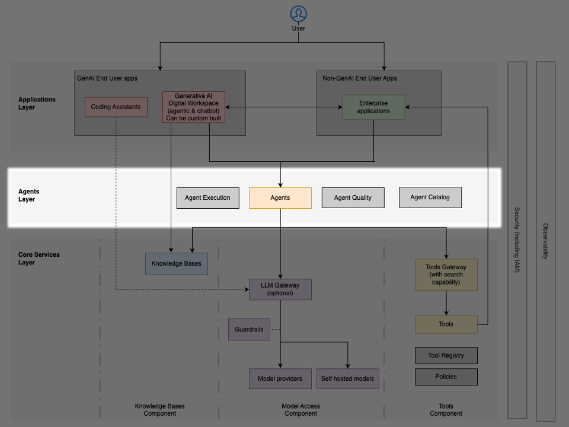

# Lớp tác tử (agents layer)

**Lớp (layer)** tác tử đóng vai trò là trung tâm điều phối chính cho các tương tác giữa người dùng, các mô hình nền tảng (foundation model), các **công cụ (tool)** và các nguồn tri thức. Lớp này chứa các môi trường runtime của **tác tử (agent)**, các cơ chế **điều phối (orchestration)** và hạ tầng hỗ trợ cho phép các tác tử AI hoạt động. Các tác tử sử dụng **LLM** để suy luận và lập kế hoạch, gọi các công cụ để thực hiện các tác vụ, truy xuất thông tin từ các **cơ sở tri thức (knowledge base)** và duy trì bộ nhớ về các tương tác trước đó.

## Thực thi tác tử

Các tác tử có những yêu cầu cụ thể làm chúng khác biệt với các ứng dụng và microservice truyền thống. Các tác tử có thể chạy tự chủ trong nhiều giờ, cần giữ lại ngữ cảnh và đồng thời phải được cô lập hoàn toàn khỏi các thực thể tác tử khác. Các tác tử cần khám phá, lựa chọn và truy cập một cách an toàn các công cụ và các tác tử khác qua các giao thức phổ biến như MCP và A2A. Các tác tử cũng cần các dịch vụ để lưu bền (persist) cuộc hội thoại qua các lần thực thi, và các cách an toàn để thực thi mã cũng như tương tác với trình duyệt và các hệ thống dựa trên web.

Các tổ chức có thể triển khai các năng lực này bằng cách sử dụng:

- [Amazon Bedrock AgentCore](https://aws.amazon.com/bedrock/agentcore/) Runtime – một dịch vụ nền tảng để thực thi các tác tử một cách an toàn ở quy mô lớn mà không cần quản lý hạ tầng. Runtime cung cấp bảo mật cấp doanh nghiệp và khả năng mở rộng động, lưu bền và cô lập phiên (session), các payload lớn, hỗ trợ đa giao thức và truyền phát hai chiều (bidirectional streaming).
- [Amazon Bedrock AgentCore](https://aws.amazon.com/bedrock/agentcore/) Memory – cung cấp khả năng lưu bền cho cả lịch sử hội thoại ngắn hạn và các insight được trích xuất dài hạn.
- [Amazon Bedrock AgentCore](https://aws.amazon.com/bedrock/agentcore/) Identity – bảo đảm tích hợp liền mạch xác thực với IAM và các nhà cung cấp OAuth cho cả inbound và outbound.
- [AWS Lambda](https://aws.amazon.com/lambda/) – cung cấp điện toán serverless cho logic tác tử tùy chỉnh và các triển khai công cụ. Cung cấp khả năng thực thi cho các thao tác tác tử nhẹ và các lần gọi công cụ.
- [Amazon ECS](https://aws.amazon.com/ecs/) hoặc [AWS Fargate](https://aws.amazon.com/fargate/) – cung cấp các triển khai tác tử dựa trên container cho các yêu cầu phức tạp, các thao tác có trạng thái (stateful) hoặc các workload tác tử tiêu tốn nhiều tài nguyên cần môi trường điện toán chuyên dụng.

## Sổ đăng ký và danh mục tác tử

Một **sổ đăng ký (registry)** tác tử tập trung duy trì một bản kiểm kê các tác tử đã triển khai, ghi nhận:

- Các năng lực, quyền hạn và mục đích của tác tử
- Siêu dữ liệu (metadata) về quyền sở hữu, lịch sử phiên bản và các phụ thuộc
- Các chỉ số hiệu năng và thống kê sử dụng
- Trạng thái phê duyệt và các phân loại quản trị

Sổ đăng ký hỗ trợ việc khám phá, tái sử dụng và quản trị, đồng thời ngăn ngừa việc trùng lặp năng lực không cần thiết trên toàn tổ chức. Các sổ đăng ký nên hỗ trợ các yêu cầu truy cập tự phục vụ (self-service) và ủy quyền phân quyền (authorization delegation) cho chủ sở hữu công cụ hoặc tác tử. Các sổ đăng ký nên tích hợp với các kiểm soát truy cập của MCP gateway để thực thi các chính sách truy cập cần thiết. Các tổ chức nên duy trì các sổ đăng ký ghi chép các tác tử đã được phê duyệt cùng với kiểm soát chất lượng và quản lý vòng đời.

## Phối hợp đa tác tử

Khi các hệ thống đa tác tử (multi-agent) trở nên phổ biến, các kiến trúc phải hỗ trợ giao tiếp giữa các tác tử (agent-to-agent) thông qua các giao thức chuẩn hóa như MCP và A2A, các quy ước định dạng thông điệp và chia sẻ trạng thái, sự cô lập trạng thái phù hợp, xác thực và ủy quyền giữa các tác tử cộng tác, và việc xác minh quyền hạn cho các hành động được ủy quyền.

Hạ tầng hỗ trợ bao gồm:

- [Amazon Bedrock AgentCore](https://aws.amazon.com/bedrock/agentcore/) Memory – dịch vụ bộ nhớ được quản lý để lưu trữ trạng thái tác tử, lịch sử hội thoại và các insight được trích xuất dài hạn, có thể chia sẻ qua các phiên tác tử với kiểm soát truy cập chi tiết (fine-grained) và sự cô lập lưu trữ
- [Amazon EventBridge](https://aws.amazon.com/eventbridge/) – xương sống hướng sự kiện cho việc nhắn tin đa tác tử
- [AWS Step Functions](https://aws.amazon.com/step-functions/) – điều phối cho các quy trình làm việc đa tác tử phức tạp với các checkpoint và khôi phục lỗi
- [Amazon DynamoDB](https://aws.amazon.com/dynamodb/) – lưu trữ nhanh, có khả năng mở rộng cho trạng thái tác tử và bộ nhớ dùng chung

## Chất lượng và an toàn của tác tử

Khi các tác tử ngày càng tự chủ hơn và xử lý các hoạt động nghiệp vụ then chốt, các kiến trúc phải hỗ trợ các cơ chế bảo đảm chất lượng và an toàn toàn diện thông qua các framework đánh giá về độ tin cậy và độ chính xác, kiểm thử an toàn đối với các đầu ra hoặc hành vi gây hại, giám sát hiệu năng và phát hiện suy thoái (regression), và các vòng phản hồi (feedback loop) cho việc cải tiến liên tục.

Hạ tầng hỗ trợ bao gồm:

- [Amazon Bedrock Guardrails](https://aws.amazon.com/bedrock/guardrails/) – quản lý các năng lực lọc nội dung, các chủ đề bị từ chối, các bộ lọc từ ngữ và việc che giấu (redaction) thông tin nhạy cảm
- [Amazon Bedrock AgentCore](https://aws.amazon.com/bedrock/agentcore/) Evaluations – các framework đánh giá tích hợp cung cấp các công cụ đánh giá tự động để đo lường mức độ hoàn thành các tác vụ cụ thể của tác tử hoặc công cụ, cách xử lý các trường hợp biên (edge case) và duy trì tính nhất quán trên các đầu vào và ngữ cảnh khác nhau.
- [Amazon CloudWatch](https://aws.amazon.com/cloudwatch/) – giúp bạn giám sát theo thời gian thực các chỉ số của tài nguyên AWS và các ứng dụng mà bạn chạy trên AWS.
- [Amazon Bedrock Evaluations](https://aws.amazon.com/bedrock/evaluations/) – đánh giá các LLM và các hệ thống truy xuất ngữ nghĩa bằng các chỉ số lập trình, người đánh giá là con người và LLM-làm-giám-khảo (LLM-as-judge).
- [AWS Lambda](https://aws.amazon.com/lambda/) - Thực thi serverless các logic kiểm tra tùy chỉnh và các kiểm tra an toàn
- [Amazon S3](https://aws.amazon.com/s3/) - Lưu trữ cho các tập dữ liệu đánh giá, kết quả kiểm thử và nhật ký kiểm toán an toàn
- Các công cụ quan sát (observability) mã nguồn mở - Các nền tảng như LangFuse cho việc truy vết (tracing), đánh giá, quản lý prompt và các chỉ số; [có thể triển khai trên AWS](https://langfuse.com/self-hosting/deployment/aws)

## Kiểm soát truy cập và xác thực

Hoạt động hiệu quả của tác tử đòi hỏi quản lý danh tính và quyền hạn vững chắc thông qua việc truyền danh tính từ người dùng qua các chuỗi tác tử, các ranh giới quyền hạn cho các hành động của tác tử và việc truy cập công cụ, các dấu vết kiểm toán (audit trail) về các quyết định và hành động của tác tử, và các cầu dao (circuit breaker) cho các mẫu hình hành vi bất thường.

Hạ tầng hỗ trợ bao gồm:

- [Amazon Bedrock AgentCore](https://aws.amazon.com/bedrock/agentcore/) Identity – quản lý danh tính tích hợp và truyền ngữ cảnh xác thực xuyên suốt các tương tác tác tử
- [Amazon Bedrock AgentCore](https://aws.amazon.com/bedrock/agentcore/) Gateway Interceptors – trình chặn (interceptor) yêu cầu và phản hồi dựa trên Lambda để đánh giá, lọc, thao tác và chặn các lần gọi công cụ MCP và các phản hồi
- [Amazon Bedrock AgentCore](https://aws.amazon.com/bedrock/agentcore/) Policy – engine dựa trên Cedar để triển khai ủy quyền chi tiết (fine-grained), có cơ sở theo ngữ cảnh (contextual grounded) trên các thao tác data plane của AgentCore
- [AWS Identity and Access Management](https://aws.amazon.com/iam/) và [AWS IAM Identity Center](https://aws.amazon.com/iam/identity-center/) – xác thực, ủy quyền doanh nghiệp và tích hợp đăng nhập một lần (single sign-on) với các nhà cung cấp danh tính
- [AWS Secrets Manager](https://aws.amazon.com/secrets-manager/) – lưu trữ thông tin xác thực an toàn và xoay vòng tự động cho các tài khoản dịch vụ
- [AWS CloudTrail](https://aws.amazon.com/cloudtrail/) – ghi nhật ký hoạt động API toàn diện và tạo dấu vết kiểm toán
- [Amazon EventBridge](https://aws.amazon.com/eventbridge/) – cảnh báo và khắc phục theo thời gian thực
