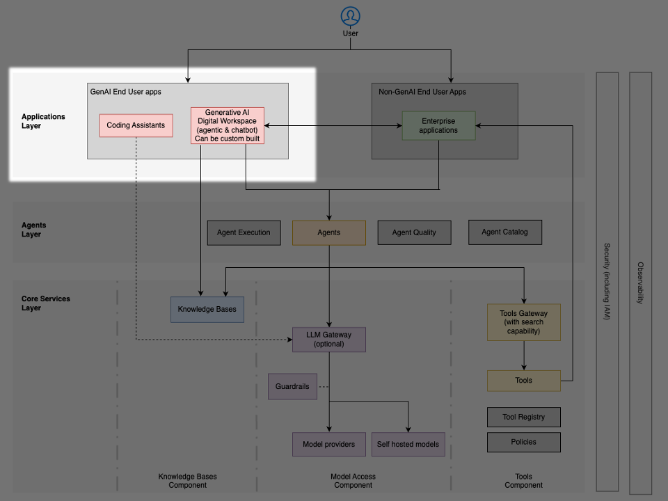

# Lớp ứng dụng – giải pháp AI tạo sinh dành cho người dùng cuối

**Lớp (layer)** này bao gồm các ứng dụng hướng người dùng, cho phép tương tác với các hệ thống **AI tác tử (agentic AI)**. Các thành phần trong lớp này đóng vai trò là giao diện chính giữa người dùng cuối và hạ tầng tác tử (agentic) nền tảng bên dưới, cung cấp giao diện hội thoại để tương tác bằng ngôn ngữ tự nhiên, các tính năng tăng năng suất bổ trợ cho quy trình làm việc bằng sự hỗ trợ của AI, và các công cụ no-code cho phép người dùng nghiệp vụ tạo và triển khai các **tác tử (agent)** tùy chỉnh. Chúng cũng cung cấp giao diện để lập lịch và giám sát việc thực thi của các tác tử.

## Mục đích và đặc điểm

Thành phần Giải pháp AI tạo sinh dành cho người dùng cuối cung cấp các năng lực bao gồm:

- Giao diện hội thoại – cho phép tương tác bằng ngôn ngữ tự nhiên với các tác tử AI thông qua trải nghiệm chat (văn bản hoặc đa phương thức) và giọng nói.
- Tăng cường năng suất – tích hợp các năng lực AI trực tiếp vào quy trình làm việc hằng ngày và các công cụ năng suất để nâng cao hiệu quả. Ví dụ gồm trợ lý mã nguồn (code assistant), công cụ tóm tắt cuộc họp, và trợ lý tạo tài liệu.
- Trao quyền cho nhà phát triển công dân (citizen developer) – cung cấp các nền tảng no-code/low-code để tạo các tác tử tùy chỉnh hoặc định nghĩa các quy trình làm việc tăng cường bởi AI mà không cần kỹ năng kỹ thuật chuyên biệt.

## Các giải pháp AWS cho lớp này

Các tổ chức có thể triển khai lớp này bằng những giải pháp AWS sau:

### Amazon Quick

[Amazon Quick](https://aws.amazon.com/quick/getting-started/) cung cấp một nền tảng năng suất hợp nhất, mang lại:

- Tìm kiếm và quản lý tri thức được hỗ trợ bởi AI trên phạm vi toàn doanh nghiệp, trên cả dữ liệu có cấu trúc và phi cấu trúc của công ty
- Năng lực tạo tác tử no-code/low-code, cho phép các nhà phát triển công dân xây dựng tác tử tùy chỉnh
- Quy trình làm việc và tự động hóa tích hợp thông qua Quick Flows
- Năng lực nghiên cứu chuyên sâu (Quick Research) cho việc phân tích toàn diện và tạo báo cáo dạng dài
- Các công cụ cộng tác bao gồm Spaces để tổ chức tệp, bảng điều khiển (dashboard) và các cơ sở tri thức
- Khả năng mở rộng thông qua tích hợp với các công cụ nội bộ và bên ngoài, qua MCP và các connector

### Kiro

[Kiro](https://kiro.dev/) đóng vai trò là trợ lý mã nguồn được hỗ trợ bởi AI, có khả năng:

- Chuyển đổi các yêu cầu bằng ngôn ngữ tự nhiên thành các đặc tả kỹ thuật toàn diện thông qua chế độ spec (spec mode)
- Tăng tốc các quy trình phát triển phần mềm thông qua việc sinh mã thông minh
- Tạo ra các sản phẩm bàn giao dự án toàn diện bao gồm đặc tả chức năng, tài liệu thiết kế, tài liệu hướng dẫn và các ca kiểm thử
- Có thể tạo các tác tử tùy chỉnh được hỗ trợ bởi các công cụ MCP để tương tác với các hệ thống nội bộ

### Claude Code với Amazon Bedrock

[Claude Code với Amazon Bedrock](https://aws.amazon.com/solutions/guidance/claude-code-with-amazon-bedrock/) mang trợ lý lập trình được hỗ trợ bởi AI của Anthropic đến với doanh nghiệp, cùng với bảo mật và các năng lực cấp doanh nghiệp của Amazon Bedrock. Giải pháp này tích hợp trực tiếp với terminal và IDE của nhà phát triển, cho phép tương tác bằng ngôn ngữ tự nhiên để sinh, rà soát và sửa đổi mã, trong khi tận dụng hạ tầng được quản lý hoàn toàn của Bedrock để có các kiểm soát bảo mật nghiêm ngặt, các tính năng tuân thủ và khả năng mở rộng.

[AWS cung cấp hướng dẫn](https://aws.amazon.com/solutions/guidance/claude-code-with-amazon-bedrock/) minh họa cách các tổ chức có thể triển khai Claude Code với xác thực doanh nghiệp an toàn bằng các giao thức chuẩn ngành và các dịch vụ AWS. Giải pháp cho phép phát triển tích hợp với terminal thông qua các lệnh hội thoại, thay thế các khóa truy cập dài hạn bằng thông tin xác thực tạm thời dựa trên phiên thông qua các giao thức liên kết (federation) chuẩn hóa, hỗ trợ Model Context Protocol (MCP) để kết nối các công cụ và nguồn dữ liệu bên ngoài, và cung cấp khả năng quan sát (observability) về các mẫu hình năng suất và các chỉ số sử dụng của nhà phát triển.

### Các giải pháp xây dựng tùy chỉnh

Các tổ chức cần những triển khai được điều chỉnh riêng có thể tận dụng:

- AWS Bedrock Chat ([https://github.com/aws-samples/bedrock-chat](https://aws.amazon.com/solutions/guidance/claude-code-with-amazon-bedrock/)) làm nền tảng mã nguồn mở cho các triển khai tự quản
- Các cổng thông tin doanh nghiệp (portal) tùy chỉnh tích hợp với các hệ thống hiện có bằng các dịch vụ AWS
- Các ứng dụng theo yêu cầu được xây dựng trên Amazon Bedrock cho các nhu cầu chuyên biệt theo lĩnh vực, tận dụng các giải pháp frontend của bên thứ ba như [v0 AI SDK](https://ai-sdk.dev/docs/introduction), [CopilotKit](https://webflow.copilotkit.ai/) và [Open WebUI.](https://github.com/open-webui/open-webui)

## Các mẫu hình tích hợp

Các giải pháp người dùng cuối trong lớp này tích hợp với kiến trúc nền tảng bên dưới thông qua:

- Tích hợp dựa trên connector – Các connector dựng sẵn và tùy chỉnh cho phép tích hợp liền mạch với các ứng dụng và nguồn dữ liệu của bên thứ ba mà không cần phát triển mã tùy chỉnh. Ví dụ, Quick Suite cung cấp các connector tới các nền tảng cộng tác (Slack, Microsoft Teams), các công cụ năng suất (Asana, Jira), các dịch vụ lưu trữ đám mây (OneDrive, SharePoint, Google Drive) và nhiều hơn nữa. Tương tự, một ứng dụng theo yêu cầu có thể dùng Bedrock Knowledge Bases, vốn cung cấp các connector tới các nguồn dữ liệu doanh nghiệp bao gồm Confluence, SharePoint, Salesforce và các trình thu thập dữ liệu web (web crawler) cho các trang web công khai được cấp phép.
- Tích hợp dựa trên API – Các API RESTful và WebSocket cho giao tiếp thời gian thực với các hệ thống doanh nghiệp
- Giao thức tác tử-tới-hệ thống – Các giao thức chuẩn hóa (như MCP) để kết nối các ứng dụng AI với các nguồn dữ liệu và công cụ bên ngoài, cho phép các tác tử truy cập tài nguyên doanh nghiệp thông qua các giao diện hợp nhất
- Các mẫu hình hướng sự kiện – Webhook và đăng ký sự kiện (event subscription) sử dụng Amazon EventBridge cho các quy trình làm việc bất đồng bộ
- Trải nghiệm nhúng – Widget và iframe để tích hợp liền mạch vào các ứng dụng hiện có
- Liên kết danh tính (identity federation) – Đăng nhập một lần (single sign-on, SSO) thông qua AWS IAM Identity Center, OIDC và OAuth 2.0 với tích hợp cùng các nhà cung cấp danh tính doanh nghiệp để kiểm soát truy cập người dùng cuối an toàn

## Các cách tiếp cận triển khai

Các tổ chức có thể lựa chọn giữa hai cách tiếp cận chính:

- Giải pháp có sẵn (off-the-shelf) – Các nền tảng như [Amazon Quick](https://aws.amazon.com/quick/getting-started/), [Kiro](https://kiro.dev/) và [Claude Code với Amazon Bedrock](https://aws.amazon.com/solutions/guidance/claude-code-with-amazon-bedrock/) mang lại lợi ích năng suất tức thì với cấu hình tối thiểu
- Ứng dụng tùy chỉnh – Các triển khai được điều chỉnh riêng để đáp ứng các yêu cầu cụ thể của tổ chức

Cách tiếp cận mô-đun này cho phép các tổ chức cân bằng giữa tốc độ triển khai và nhu cầu tùy chỉnh, lựa chọn giải pháp phù hợp dựa trên năng lực kỹ thuật, tiến độ và các yêu cầu cụ thể của tình huống sử dụng.
