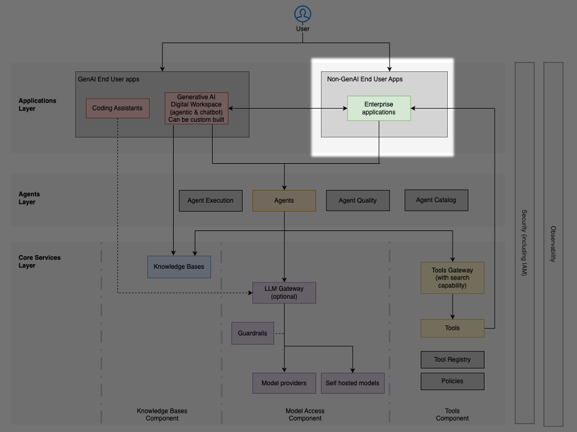

# Lớp ứng dụng: các giải pháp không dùng AI tạo sinh

**Lớp (layer)** này gồm các hệ thống nghiệp vụ hiện có — dù là phần mềm có sẵn (off-the-shelf), ứng dụng xây dựng tùy chỉnh hay nền tảng chuyên biệt theo ngành — tích hợp hai chiều (bidirectional) với các năng lực **AI tác tử (agentic AI)**. Các ứng dụng này về bản chất không mang tính tác tử (agentic), nhưng có thể tiêu thụ các dịch vụ AI tác tử hoặc phơi bày (expose) các chức năng của chúng dưới dạng **công cụ (tool)** để các **tác tử (agent)** gọi thực hiện các tác vụ nghiệp vụ.

## Mục đích và đặc điểm

Lớp Ứng dụng Doanh nghiệp cung cấp các năng lực sau cho các tác tử:

- Tích hợp hai chiều – cho phép giao tiếp hai chiều, trong đó các ứng dụng vừa tiêu thụ các dịch vụ AI vừa cung cấp các năng lực cho tác tử
- Truy cập logic nghiệp vụ – phơi bày các quy tắc và quy trình chuyên biệt theo lĩnh vực mà các tác tử có thể tận dụng
- Tích hợp hệ thống bản ghi (system of record) – kết nối các tác tử với các nguồn dữ liệu có thẩm quyền để đọc và ghi dữ liệu nghiệp vụ
- Tự động hóa quy trình – cho phép các tác tử khởi tạo và tham gia vào các quy trình làm việc doanh nghiệp
- Ủy quyền an toàn (secure delegation) – cho phép các tác tử hành động thay mặt người dùng với các quyền phù hợp

## Các hệ thống doanh nghiệp trong lớp này

Lớp này bao trùm nhiều hệ thống nghiệp vụ đa dạng, bao gồm các nền tảng quản lý nghiệp vụ như ERP (hoạch định nguồn lực doanh nghiệp, enterprise resource planning), CRM (quản lý quan hệ khách hàng, customer relationship management), HRMS (hệ thống quản lý nhân sự, Human Resources Management System) và SCM (quản lý chuỗi cung ứng, supply chain management); các hệ thống vận hành như Jira, ServiceNow và Salesforce; các engine quy trình làm việc; các nền tảng thông tin kinh doanh (business intelligence); và các hệ thống nội dung như quản lý tài liệu, wiki doanh nghiệp và không gian làm việc cộng tác. Những ứng dụng này — dù là phần mềm có sẵn, giải pháp xây dựng tùy chỉnh hay nền tảng chuyên biệt theo ngành — tích hợp hai chiều với các năng lực AI tác tử.

## Các cách tiếp cận tích hợp

Các ứng dụng doanh nghiệp tích hợp với các hệ thống tác tử thông qua công cụ, sự kiện và truy cập dữ liệu trực tiếp. Mỗi tích hợp này đòi hỏi các tính năng cụ thể để có thể thực hiện được.

### Phơi bày công cụ (tool exposure)

- Bọc hàm (function wrapping) – chức năng nghiệp vụ được phơi bày dưới dạng các công cụ có thể gọi được mà tác tử có thể gọi bằng các giao thức như MCP
- Kiểm tra tham số (parameter validation) – kiểm tra đầu vào để bảo vệ các hệ thống doanh nghiệp khỏi các yêu cầu không hợp lệ
- Định dạng phản hồi – các đầu ra có cấu trúc mà tác tử có thể phân tích một cách đáng tin cậy

### Tích hợp hướng sự kiện

- Thông báo thay đổi trạng thái – các hệ thống phát sinh sự kiện khi các đối tượng nghiệp vụ thay đổi
- Trigger quy trình – các cập nhật trạng thái quy trình làm việc mà tác tử có thể đăng ký nhận
- Tạo cảnh báo – các điều kiện ngoại lệ kích hoạt sự can thiệp của tác tử

### Các mẫu hình truy cập dữ liệu

- Truy vấn trực tiếp – các giao diện truy cập dữ liệu an toàn, có tham số hóa
- Khung nhìn được cache (cached view) – dữ liệu được tổng hợp trước để tác tử tiêu thụ hiệu quả
- Truy cập có nhận biết quyền (permission-aware access) – truy cập dữ liệu tôn trọng các ngữ cảnh ủy quyền của người dùng
- Chuyển đổi ngữ nghĩa (semantic transformation) – lập chỉ mục dữ liệu doanh nghiệp phi cấu trúc như văn bản, âm thanh và video thành các biểu diễn ngữ nghĩa thân thiện với AI tạo sinh bằng cách sử dụng embedding và cơ sở dữ liệu vector (vector database)
- Đồ thị tri thức (knowledge graph) – biểu diễn các quan hệ dữ liệu phức tạp thông qua đồ thị và bản thể luận (ontology) để các hệ thống AI hiểu rõ hơn các lĩnh vực ngành cụ thể

### Các cân nhắc khi triển khai

Các tổ chức triển khai lớp này nên giải quyết các thách thức sau:

- Truyền ngữ cảnh xác thực (authentication context propagation) – bảo đảm rằng danh tính người dùng được giữ lại khi các tác tử hành động thay mặt họ, thường thông qua các giải pháp trao đổi token (token exchange) phát hành các thông tin xác thực được ủy quyền — các token thay-mặt (on-behalf-of) — cho các tác tử
- Giới hạn tốc độ (rate limiting) – bảo vệ các hệ thống doanh nghiệp truyền thống vốn được thiết kế cho truy cập của con người khỏi quá tải do tác tử tự động
- Phối hợp cửa sổ bảo trì – bảo đảm các tác tử không cố truy cập các hệ thống trong giờ của cửa sổ bảo trì (maintenance window)
- Quản lý thông tin xác thực (credential management) – lưu trữ và xoay vòng an toàn các bí mật cần thiết để tác tử truy cập các công cụ và các hệ thống khác
- Xử lý lỗi – suy giảm nhẹ nhàng (graceful degradation) khi các hệ thống backend không khả dụng
- Chuyển đổi ngữ nghĩa hoặc định dạng – chuyển đổi giữa các định dạng thân thiện với AI và các cấu trúc dữ liệu doanh nghiệp

### Các cách tiếp cận triển khai của AWS

AWS cung cấp một số dịch vụ để hỗ trợ tích hợp ứng dụng doanh nghiệp:

- [Amazon EventBridge](https://aws.amazon.com/eventbridge/) – event bus serverless để kết nối các ứng dụng với dữ liệu thời gian thực
- [Amazon API Gateway](https://aws.amazon.com/api-gateway/) – tạo và bảo mật các API cho tác tử truy cập các chức năng nghiệp vụ, cung cấp các kiểm soát điều tiết API (API throttling) và vận chuyển websocket hai chiều
- [Amazon AppFlow](https://aws.amazon.com/appflow/) – tích hợp được quản lý để kết nối các ứng dụng SaaS với các dịch vụ AWS
- [AWS Glue](https://aws.amazon.com/glue/) – dịch vụ ETL để chuẩn bị và chuyển đổi dữ liệu
- [Amazon OpenSearch Service](https://aws.amazon.com/opensearch-service/) – năng lực tìm kiếm doanh nghiệp để khám phá nội dung
- [Amazon Bedrock Knowledge Bases](https://aws.amazon.com/bedrock/knowledge-bases/) – API hợp nhất để tương tác với các cơ sở tri thức được hỗ trợ bởi một số cơ sở dữ liệu vector và cơ sở dữ liệu đồ thị phổ biến.

Lớp tích hợp này bảo đảm rằng các năng lực AI tác tử có thể truy cập ngữ cảnh nghiệp vụ, dữ liệu và các hoạt động cần thiết để mang lại giá trị trong các quy trình làm việc của tổ chức, trong khi vẫn duy trì các ranh giới bảo mật phù hợp và các kiểm soát quản trị.
