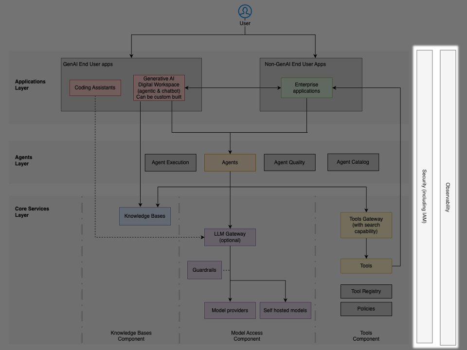

# Các mối quan tâm xuyên lớp

**Quan sát (observability)** và bảo mật trải rộng khắp mọi lớp (layer) của kiến trúc **AI tác tử (agentic AI)**, bảo đảm rằng các hoạt động AI được giám sát, có thể kiểm toán (audit) và tuân thủ các chính sách doanh nghiệp. Những yếu tố nền tảng này phải được tích hợp xuyên suốt toàn bộ hệ thống, thay vì bị xem như các thành phần tách biệt.

## Khả năng quan sát (observability)

Khả năng quan sát toàn diện giúp các tổ chức hiểu được hành vi của **tác tử (agent)**, theo dõi hiệu năng, chẩn đoán sự cố và xác thực tuân thủ xuyên suốt toàn bộ hệ thống tác tử thông qua: truy vết yêu cầu đầu-cuối (end-to-end) xuyên suốt các tác tử, LLM, **công cụ (tool)** và **cơ sở tri thức (knowledge base)**; giám sát hiệu năng về thời gian phản hồi, tỉ lệ thành công và mức sử dụng tài nguyên; theo dõi chi phí với khả năng quy gán chi tiết tới từng đơn vị kinh doanh hoặc ứng dụng; giám sát chất lượng về độ chính xác phản hồi, tỉ lệ ảo giác (hallucination) và tuân thủ hướng dẫn; và phân tích mức sử dụng nhằm mang lại hiểu biết về các mẫu hình áp dụng và giá trị kinh doanh được tạo ra.

Hạ tầng hỗ trợ bao gồm:

- [Amazon Bedrock AgentCore](https://aws.amazon.com/bedrock/agentcore/) – Observability cung cấp giám sát và truy vết sẵn dùng (out-of-the-box) cho các dịch vụ AgentCore, kèm hỗ trợ xuất ở định dạng OpenTelemetry để tương tác với các giải pháp quan sát của bên thứ ba.
- [Amazon CloudWatch](https://aws.amazon.com/cloudwatch/) – các chỉ số, nhật ký và cảnh báo tập trung cùng các bảng điều khiển (dashboard) tùy chỉnh phục vụ khả năng quan sát vận hành
- [Amazon OpenSearch Service](https://aws.amazon.com/opensearch-service/) – phân tích nhật ký và trực quan hóa nâng cao để phát hiện các mẫu hình phức tạp
- Amazon EventBridge – cảnh báo và tự động hóa phản ứng theo hướng sự kiện (event-driven)
- [AWS Cost Explorer Service](https://aws.amazon.com/aws-cost-management/aws-cost-explorer/) và [AWS Budgets](https://aws.amazon.com/aws-cost-management/aws-budgets/) – phân bổ và quản lý chi phí chi tiết xuyên suốt mọi thành phần hạ tầng của AI tác tử, bao gồm suy luận mô hình, điện toán, lưu trữ và truyền dữ liệu

## Bảo mật

Bảo mật toàn diện bảo đảm các hệ thống AI tác tử duy trì được:

- Bảo vệ dữ liệu, kiểm soát truy cập, tuân thủ các quy định và bảo vệ trước các mối đe dọa đặc thù của AI thông qua quản lý danh tính và truy cập (identity and access management) với xác thực và cấp quyền đúng đắn
- Bảo vệ dữ liệu nhằm bảo vệ thông tin nhạy cảm trong đầu vào, đầu ra và các cơ sở tri thức
- Bảo mật prompt nhằm ngăn chặn các tấn công chèn lệnh (prompt injection) và thao túng
- Bảo mật chuỗi cung ứng (supply chain) nhằm xác thực các mô hình và các phụ thuộc (dependency)
- Cách ly mạng (network isolation) nhằm kiểm soát các đường giao tiếp giữa các thành phần.

Hạ tầng hỗ trợ bao gồm:

- [IAM](https://aws.amazon.com/iam/) và [IAM Identity Center](https://aws.amazon.com/iam/identity-center/) – quản lý danh tính cấp doanh nghiệp với kiểm soát truy cập chi tiết và xác thực liên kết (federated)
- [Amazon Bedrock Guardrails](https://aws.amazon.com/bedrock/guardrails/) – lọc nội dung, ràng buộc chủ đề và bảo vệ PII cho các tương tác với mô hình
- [Amazon Bedrock AgentCore](https://aws.amazon.com/bedrock/agentcore/) Identity – lan truyền danh tính an toàn (secure identity propagation) xuyên suốt các tương tác của tác tử và các lời gọi công cụ
- [AWS KMS key](https://aws.amazon.com/kms/) – quản lý khóa mã hóa cho dữ liệu khi lưu trữ (at rest) và khi truyền (in transit)
- [Amazon Macie](https://aws.amazon.com/macie/) – khám phá và bảo vệ tự động dữ liệu nhạy cảm trong các cơ sở tri thức
- [AWS WAF (Web Application Firewall)](https://aws.amazon.com/waf/) – bảo vệ trước các tấn công dựa trên web cho các giao diện tác tử được phơi bày
- [Amazon Virtual Private Cloud (VPC)](https://aws.amazon.com/vpc/) và [AWS PrivateLink](https://aws.amazon.com/privatelink/) – cách ly mạng và kết nối riêng tư giữa các thành phần
- [AWS Security Hub](https://aws.amazon.com/security-hub/) – quản lý thế trận bảo mật (security posture) tập trung xuyên suốt hệ sinh thái AI
- [AWS CloudTrail](https://aws.amazon.com/cloudtrail/) – ghi nhật ký hoạt động API toàn diện phục vụ tuân thủ và kiểm toán
