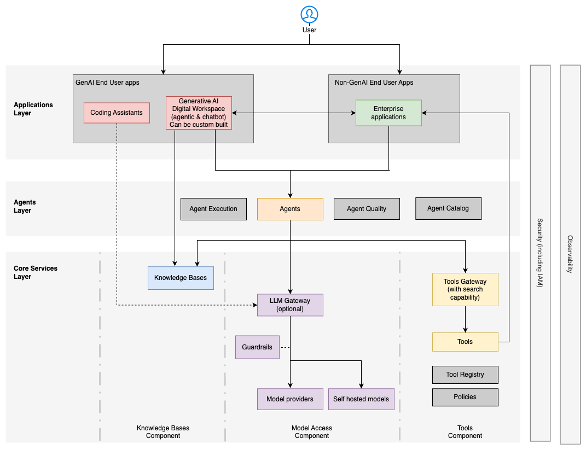

# Kiến trúc AI tác tử (agentic AI) trong doanh nghiệp

Kiến trúc tham chiếu (reference architecture) cho các hệ thống **AI tác tử (agentic AI)** cấp doanh nghiệp minh họa cách các tổ chức có thể triển khai năng lực AI ở mức sẵn sàng cho môi trường sản xuất (production-grade) trong khi vẫn duy trì **quản trị (governance)**, bảo mật và sự xuất sắc trong vận hành.

Kiến trúc được tổ chức thành các **lớp (layer)** phối hợp với nhau để hỗ trợ các **tác tử (agent)** AI trong khi vẫn duy trì khả năng kiểm soát của doanh nghiệp. Khả năng quan sát (observability), bảo mật và khả năng khám phá (discoverability) trải rộng trên nhiều lớp, bảo đảm rằng các hoạt động AI được giám sát, có thể kiểm toán và tuân thủ các chính sách của doanh nghiệp.

**Lớp ứng dụng (applications layer):**

- [Ứng dụng AI tạo sinh dành cho người dùng cuối (Generative AI End-User Applications)](/dich-thuat/aws/govern-architect-agentic-ai/3-enterprise-architecture/applications-genai) - Đây là các ứng dụng hướng người dùng, cho phép tương tác với các hệ thống AI tác tử. Những ứng dụng này có thể cung cấp giao diện hội thoại để tương tác bằng ngôn ngữ tự nhiên, các tính năng tăng năng suất bổ trợ cho quy trình làm việc bằng sự hỗ trợ của AI, và các công cụ no-code cho phép người dùng nghiệp vụ tạo và triển khai các tác tử tùy chỉnh. Một ứng dụng có thể là sản phẩm có sẵn (off the shelf), như môi trường phát triển tích hợp (integrated development environment, IDE) và các công cụ năng suất, hoặc được xây dựng tùy chỉnh.
- [Ứng dụng không dùng AI tạo sinh (Non-GenAI Applications)](/dich-thuat/aws/govern-architect-agentic-ai/3-enterprise-architecture/applications-non-genai) - Đây là các hệ thống nghiệp vụ, có thể là phần mềm có sẵn, ứng dụng xây dựng tùy chỉnh hoặc nền tảng chuyên biệt theo ngành. Hầu hết các ứng dụng này về bản chất không mang tính tác tử, nhưng có thể tiêu thụ các dịch vụ AI tác tử hoặc phơi bày (expose) các chức năng của chúng dưới dạng **công cụ (tool)** để các tác tử gọi thực hiện các tác vụ nghiệp vụ.

[Lớp tác tử (agents layer)](/dich-thuat/aws/govern-architect-agentic-ai/3-enterprise-architecture/agents-layer) - Lớp này chứa các thành phần cho phép các tác tử AI hoạt động và tương tác. Nó cũng cung cấp khả năng khám phá tác tử. Các tác tử thường cần truy cập **LLM** để diễn giải mục tiêu của người dùng, để suy luận và lập kế hoạch hành động, để có quyền truy cập công cụ nhằm thực hiện các tác vụ, và để truy xuất thông tin từ các nguồn tri thức. Chúng cũng cần khả năng lưu trữ các cuộc hội thoại và các insight rút ra từ cuộc hội thoại tương ứng trong bộ nhớ ngắn hạn và dài hạn. Lớp này cũng cung cấp các tính năng cho giao tiếp giữa các tác tử (agent-to-agent) và **điều phối (orchestration)**, cho phép nhiều tác tử cộng tác trong các tác vụ phức tạp.

## Ba nhóm dịch vụ cốt lõi

Kiến trúc định nghĩa ba loại dịch vụ riêng biệt mà các tác tử tương tác:

- [Thành phần truy cập mô hình (Model access component)](/dich-thuat/aws/govern-architect-agentic-ai/3-enterprise-architecture/model-access) – kiểm soát quyền truy cập đến các mô hình nền tảng (foundation model) với việc thực thi chính sách, các biện pháp an toàn bao gồm guardrails, và năng lực theo dõi/phân bổ chi phí.
- [Thành phần công cụ (Tools component)](/dich-thuat/aws/govern-architect-agentic-ai/3-enterprise-architecture/tools) – quản lý việc khám phá và thực thi an toàn các công cụ. Thành phần này cung cấp năng lực ủy quyền (authorization) để bảo đảm công cụ chỉ có thể được sử dụng bởi đúng chủ thể và cho đúng ngữ cảnh.
- [Thành phần cơ sở tri thức (Knowledge bases component)](/dich-thuat/aws/govern-architect-agentic-ai/3-enterprise-architecture/cross-cutting-concerns) – cung cấp quyền truy cập đến dữ liệu doanh nghiệp thông qua các **cơ sở tri thức (knowledge base)** có thể tận dụng các vector store, lưu trữ dạng đồ thị (graph storage), và cung cấp giao diện cho việc truy xuất thông tin ngữ nghĩa. Nó cũng cung cấp kiểm soát truy cập dựa trên vai trò (role-based access control, RBAC) cho dữ liệu nhằm thực thi các nguyên tắc đặc quyền tối thiểu (least privilege) và cần-thì-mới-biết (need-to-know). Thành phần này là bắt buộc cho các triển khai sinh tăng cường bởi truy xuất (retrieval-augmented generation, RAG).

## Các mối quan tâm xuyên lớp

Khả năng quan sát (observability), bảo mật và khả năng khám phá (discoverability) trải rộng trên nhiều lớp, bảo đảm rằng các hoạt động AI được giám sát, có thể kiểm toán và tuân thủ các chính sách của doanh nghiệp.
