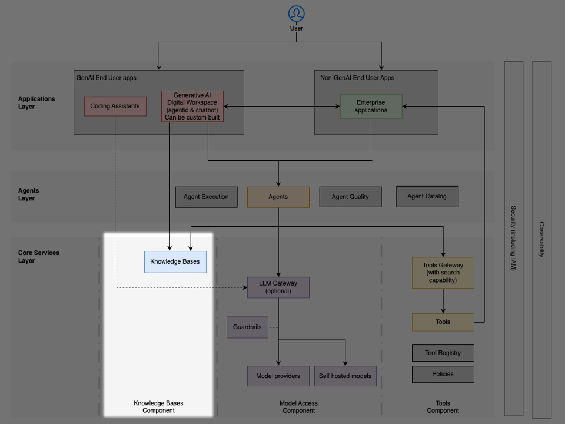

# Dịch vụ lõi: cơ sở tri thức

Thành phần **cơ sở tri thức (knowledge base)** cung cấp cho các **tác tử (agent)** quyền truy cập dữ liệu doanh nghiệp và thông tin đặc thù theo lĩnh vực thông qua **Sinh có tăng cường truy xuất (Retrieval Augmented Generation - RAG)**. RAG cho phép các tác tử neo (ground) các phản hồi của mình vào thông tin thực tế, cập nhật từ các nguồn dữ liệu của tổ chức, qua đó giảm ảo giác (hallucination) và mang lại trí tuệ đặc thù theo lĩnh vực mà không cần huấn luyện lại mô hình.

RAG kết hợp hai quá trình – các tác tử truy xuất thông tin liên quan từ một cơ sở tri thức thông qua tìm kiếm ngữ nghĩa (semantic search), sau đó cung cấp ngữ cảnh đã truy xuất đó cho LLM để sinh ra các phản hồi được neo vào dữ liệu thực.

## Triển khai trên AWS

### Amazon Bedrock Knowledge Bases

Amazon Bedrock Knowledge Bases cung cấp các năng lực RAG được quản lý hoàn toàn, xử lý việc nạp tài liệu (ingestion), phân mảnh (chunking), sinh embedding, lưu trữ vector và truy xuất mà không cần phát triển pipeline tùy chỉnh. Dịch vụ tự động hóa toàn bộ luồng công việc, từ các nguồn dữ liệu cho đến các prompt gửi tới LLM đã được tăng cường ngữ cảnh.

### Các lựa chọn cơ sở dữ liệu vector

Các tổ chức lựa chọn cơ sở dữ liệu vector dựa trên các yêu cầu cụ thể:

- [Amazon OpenSearch Service](https://aws.amazon.com/opensearch-service/) – phù hợp nhất cho các ứng dụng cần kết hợp tìm kiếm toàn văn (full-text) với tương đồng vector, hỗ trợ hàng tỉ vector với hiệu năng truy vấn tính bằng mili-giây. Lý tưởng khi tìm kiếm cần tích hợp với các trường hợp sử dụng phân tích và quan sát (observability).
- [Amazon Aurora](https://aws.amazon.com/rds/aurora/) PostgreSQL với pgvector – tối ưu khi tìm kiếm vector phải cùng tồn tại với dữ liệu giao dịch, tận dụng chuyên môn và hạ tầng PostgreSQL sẵn có.
- [Amazon S3 Vectors](https://aws.amazon.com/s3/features/vectors/) – tiết kiệm chi phí cho các yêu cầu lưu trữ vector ở quy mô cực lớn. Giảm chi phí lưu trữ và tìm kiếm tới 90% so với các cơ sở dữ liệu vector truyền thống, với hiệu năng truy vấn dưới một giây.

Hạ tầng hỗ trợ bao gồm Amazon S3 để lưu trữ tài liệu, AWS Lambda cho logic truy xuất tùy chỉnh và tiền xử lý, và Amazon Kendra để tìm kiếm doanh nghiệp thông minh với khả năng hiểu ngôn ngữ tự nhiên.

### Cơ sở dữ liệu đồ thị

Dành cho các trường hợp sử dụng mà các mối liên kết giữa các thực thể dữ liệu là trọng tâm của truy vấn và phân tích:

- [Amazon Bedrock Knowledge Bases](https://aws.amazon.com/bedrock/knowledge-bases/) với GraphRAG – năng lực GraphRAG được quản lý hoàn toàn, tự động tạo embedding cho tìm kiếm ngữ nghĩa và sinh ra các đồ thị gồm các thực thể và mối quan hệ từ dữ liệu phi cấu trúc, đồng thời kết hợp tìm kiếm vector với duyệt đồ thị (graph traversal). Lý tưởng cho các ứng dụng cần cả tương đồng ngữ nghĩa lẫn truy xuất dựa trên mối quan hệ
- [Amazon Neptune](https://aws.amazon.com/neptune/) Analytics – công cụ phân tích đồ thị trong bộ nhớ (in-memory) để phân tích nhanh các tập dữ liệu đồ thị lớn, hỗ trợ openCypher và phân tích hàng chục tỉ mối quan hệ trong vài giây
- [Amazon Neptune](https://aws.amazon.com/neptune/) – cơ sở dữ liệu đồ thị bền vững (persistent) hỗ trợ các đồ thị thuộc tính (property graph) (Gremlin, openCypher) và các đồ thị RDF (SPARQL). Được tối ưu cho các khối lượng công việc vận hành đòi hỏi truy cập giao dịch với độ trễ thấp

## Tích hợp với các tác tử

Các tác tử tương tác với cơ sở tri thức thông qua một luồng công việc truy xuất và sinh. Tác tử phân tích yêu cầu của người dùng và hình thành các truy vấn truy xuất. Cơ sở tri thức thực hiện một tìm kiếm tương đồng, trả về các tài liệu hoặc đoạn văn liên quan kèm điểm liên quan (relevance score). Thông tin được truy xuất được xếp hạng và lắp ghép thành ngữ cảnh cho prompt của LLM. LLM sinh ra các phản hồi được neo vào tri thức đã truy xuất, kèm theo trích dẫn tới các tài liệu nguồn.

## Các cân nhắc về quản trị

Lớp (layer) cơ sở tri thức đòi hỏi các kiểm soát **quản trị (governance)** để theo dõi dòng dữ liệu (data lineage) từ tài liệu nguồn, qua quá trình truy xuất, đến các phản hồi của tác tử, nhằm bảo đảm tính minh bạch và tuân thủ. Kiểm soát truy cập phải bảo đảm rằng quyền hạn trên cơ sở tri thức khớp với các chính sách truy cập dữ liệu nguồn, với các tác tử tôn trọng các ranh giới dữ liệu của tổ chức. Quản lý lưu giữ và vòng đời dữ liệu đòi hỏi sự đồng bộ giữa các cập nhật dữ liệu nguồn và việc làm mới chỉ mục vector, kèm theo các chính sách xóa và lưu trữ (archival) dữ liệu. Các tổ chức giám sát các chỉ số chất lượng truy xuất, bao gồm điểm liên quan và độ chính xác truy xuất, nhằm bảo đảm hiệu quả của cơ sở tri thức. Các cơ chế quy gán nguồn (source attribution) cho phép trích dẫn các tài liệu nguồn trong phản hồi của tác tử, hỗ trợ các yêu cầu kiểm chứng và tuân thủ. Đối với các cơ sở tri thức dùng chung, việc cách ly đa người thuê (multi-tenancy isolation) bảo đảm phân tách dữ liệu và kiểm soát truy cập đúng đắn xuyên suốt các ranh giới tổ chức.
