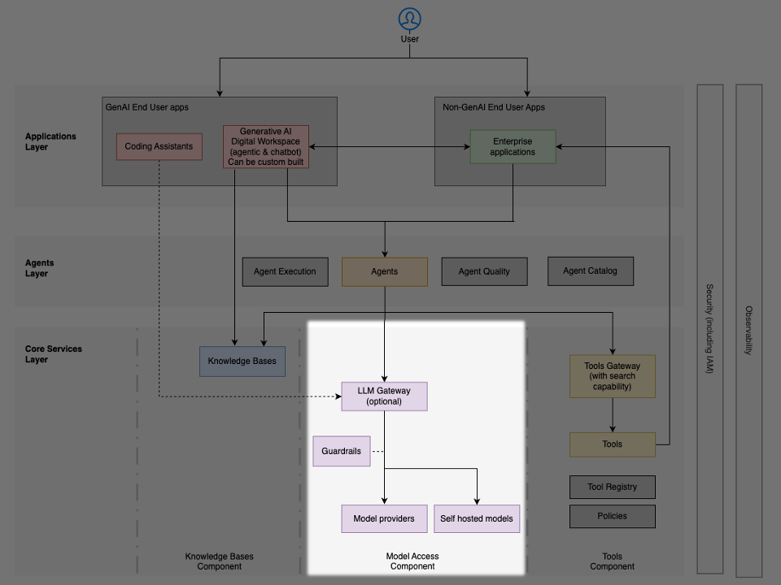

# Dịch vụ lõi: truy cập mô hình

Các tổ chức phải đưa ra một quyết định kiến trúc nền tảng về cách các **tác tử (agent)** truy cập các **mô hình nền tảng (foundation model)**. Lựa chọn này định hình việc thực thi bảo mật, **quản trị (governance)** vận hành và kiến trúc tổng thể của hệ thống.

Tồn tại hai mẫu hình (pattern) chính để truy cập mô hình, mỗi mẫu đều có ưu điểm và nhược điểm riêng:

- Cloud native
- LLM gateway

## Mẫu hình Cloud native

- Truy cập trực tiếp các dịch vụ mô hình của nhà cung cấp đám mây
- Tích hợp công cụ gốc (native) và các khung hành động (action framework) gắn chặt với hệ sinh thái đám mây
- Quản lý danh tính và truy cập (identity and access management) được quản trị theo đặc thù của từng nền tảng
- Các dịch vụ **điều phối (orchestration)** và quản lý bộ nhớ (memory) được tối ưu cho kiến trúc cloud-native
- Các tính năng **quan sát (observability)**, bảo mật và quản trị cấp doanh nghiệp được nhúng sẵn trong các dịch vụ được quản lý

## Mẫu hình LLM gateway

- Giao diện API hợp nhất xuyên suốt nhiều nhà cung cấp mô hình thông qua một trung gian được kiểm soát
- Thực thi chính sách thống nhất và tập trung xuyên suốt các nhà cung cấp mô hình nhằm bảo đảm bảo mật và tuân thủ
- Giám sát nhất quán, quản lý chi phí và chuẩn hóa API

### Các yếu tố quyết định

Khi lựa chọn giữa hai mẫu hình này, hãy cân nhắc:

- Mức độ trưởng thành về quản trị – các tổ chức có yêu cầu tuân thủ nghiêm ngặt hoặc hoạt động trong các ngành chịu quản lý cao thường hưởng lợi từ việc kiểm soát tập trung
- Yêu cầu về hiệu năng – các trường hợp sử dụng đòi hỏi độ trễ tối thiểu có thể ưu tiên truy cập trực tiếp
- Chiến lược đa nhà cung cấp – kế hoạch sử dụng mô hình từ nhiều nhà cung cấp sẽ hưởng lợi từ lớp trừu tượng của gateway
- Năng lực vận hành – các nhóm có nguồn lực hạn chế có thể ưu tiên sự đơn giản của cloud-native; những nhóm đã có sẵn năng lực quản lý API có thể tận dụng các lợi ích của gateway
- Tốc độ đổi mới – truy cập trực tiếp cho phép áp dụng nhanh hơn các năng lực mô hình mới
- Yêu cầu về hiệu năng – truy cập trực tiếp tránh được độ trễ của lớp định tuyến bổ sung do gateway tạo ra, mặc dù phần phụ phí (overhead) này thường không đáng kể so với thời gian suy luận của LLM
- Tính năng của các dịch vụ được quản lý – sự trỗi dậy của **AI tác tử (agentic AI)** và các dịch vụ được quản lý (chẳng hạn Amazon Bedrock Knowledge Bases) đưa đến các năng lực đặc thù theo nền tảng, vốn mang lại giá trị nhưng khó trừu tượng hóa

Các tổ chức cũng có thể áp dụng một cách tiếp cận lai (hybrid) – triển khai mẫu hình gateway cho một số ứng dụng sản xuất được chọn lọc, đồng thời cho phép truy cập cloud-native đối với các khối lượng công việc đổi mới.

### Các cách triển khai trên AWS

AWS hỗ trợ cả hai mẫu hình truy cập mô hình thông qua các dịch vụ bổ trợ cho nhau:

#### Mẫu hình Cloud native

- [Amazon Bedrock](https://aws.amazon.com/bedrock/) – dịch vụ mô hình nền tảng được quản lý, cung cấp truy cập API hợp nhất tới nhiều mô hình với guardrails tích hợp sẵn, các kiểm soát bảo mật và các tính năng cấp doanh nghiệp
- [Amazon SageMaker](https://aws.amazon.com/sagemaker/) – nền tảng để triển khai và lưu trữ (host) các mô hình tùy chỉnh hoặc của bên thứ ba, với toàn quyền kiểm soát hạ tầng và việc phục vụ mô hình (model serving)

#### Mẫu hình Gateway

- [AWS Guidance for Multi-Provider Generative AI Gateway](https://aws.amazon.com/solutions/guidance/multi-provider-generative-ai-gateway-on-aws/) – kiến trúc tham chiếu cung cấp lớp truy cập tập trung xuyên suốt [Amazon Bedrock](https://aws.amazon.com/bedrock/), [Amazon SageMaker](https://aws.amazon.com/sagemaker/) và các nhà cung cấp mô hình bên thứ ba, với theo dõi mức sử dụng hợp nhất, quản lý chi phí, giới hạn tốc độ (rate limiting), định tuyến mô hình và các kiểm soát quản trị

### Triển khai guardrails

Bất kể dùng mẫu hình nào, các tổ chức đều phải triển khai guardrails để lọc nội dung không phù hợp, thực thi các yêu cầu tuân thủ, xác thực đầu vào và đầu ra nhằm ngăn chặn **tấn công chèn lệnh (prompt injection)**, và hỗ trợ tùy chỉnh theo từng lĩnh vực chuyên biệt.

[Amazon Bedrock Guardrails](https://aws.amazon.com/bedrock/guardrails/) cung cấp các năng lực được quản lý để lọc nội dung, chặn chủ đề (denied topics), lọc từ ngữ và che giấu (redaction) thông tin nhạy cảm.
