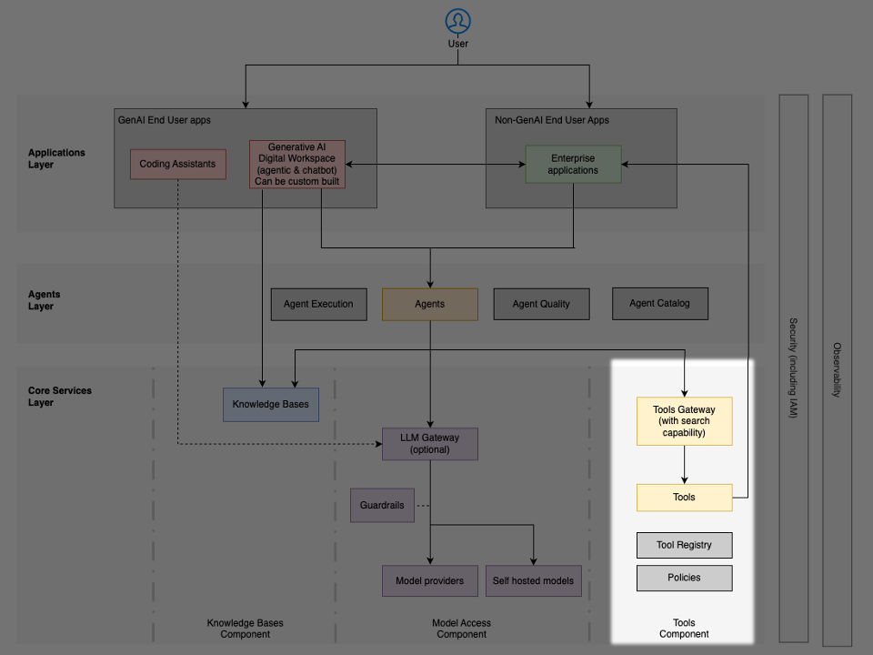

# Dịch vụ lõi: công cụ

Thành phần **công cụ (tool)** cho phép các **tác tử (agent)** tương tác với các hệ thống bên ngoài, thực thi các hàm và thực hiện các hành động vượt ra ngoài xử lý ngôn ngữ. Lớp (layer) này bắc cầu khoảng cách giữa suy luận của tác tử và các thao tác trong thế giới thực, cung cấp các cơ chế để tác tử truy xuất dữ liệu, gọi logic nghiệp vụ và tích hợp với các hệ thống doanh nghiệp.

## Các mẫu hình kiến trúc

Các tổ chức có thể triển khai truy cập công cụ thông qua ba mẫu hình (pattern) kiến trúc chính, mỗi mẫu đưa ra sự đánh đổi giữa tính đơn giản, **quản trị (governance)** và kiểm soát vận hành:

### Công cụ trong runtime (in-runtime tools)

Các công cụ thực thi trực tiếp bên trong môi trường **runtime** của tác tử dưới dạng các lời gọi hàm nội tuyến (inline).

Mẫu hình này có đặc trưng:

- Độ trễ tối thiểu đối với các thao tác đơn giản
- Kiến trúc được đơn giản hóa với ít thành phần hơn
- Phù hợp với các thao tác công cụ nhẹ, không trạng thái (stateless)
- Tích hợp trực tiếp trong ngữ cảnh thực thi của tác tử

### Truy cập trực tiếp với công cụ từ xa (direct access with remote tools)

Các tác tử gọi công cụ thông qua kết nối trực tiếp tới các dịch vụ từ xa bằng các giao thức chuẩn hóa như Model Context Protocol (MCP). Các công cụ chạy trong các tiến trình hoặc dịch vụ riêng biệt nhưng được truy cập mà không cần gateway trung gian.

Mẫu hình này mang lại:

- Phân tách mối quan tâm (separation of concerns) giữa logic của tác tử và việc thực thi công cụ
- Hỗ trợ triển khai công cụ cả cục bộ lẫn từ xa
- Khả năng tương tác dựa trên giao thức xuyên suốt các khung (framework)
- Cách ly tốt hơn trong khi vẫn duy trì độ trễ hợp lý

### Mẫu hình Tools gateway

Một dịch vụ gateway tập trung quản lý việc khám phá (discovery) công cụ, bảo mật, phiên bản hóa (versioning) và lời gọi. Các tác tử gửi yêu cầu tới gateway, và gateway chuyển tiếp chúng tới các công cụ.

Mẫu hình này đem lại:

- **Sổ đăng ký (registry)** công cụ tập trung và khả năng khám phá – các tác tử có thể tìm kiếm và khám phá các công cụ khả dụng thông qua một danh mục hợp nhất
- Giám sát bảo mật và kiểm soát truy cập chuẩn hóa – xác thực, cấp quyền và kiểm toán (audit) nhất quán xuyên suốt mọi lời gọi công cụ
- Quản lý phiên bản và kiểm soát vòng đời – hỗ trợ công cụ tiến hóa, loại bỏ (deprecation) và di trú (migration) mà không làm hỏng các luồng công việc của tác tử
- Hỗ trợ quản trị – các luồng công việc phê duyệt, theo dõi mức sử dụng, xác thực chất lượng và các kiểm soát tuân thủ

## Lựa chọn mẫu hình phù hợp

Lựa chọn giữa các mẫu hình này phản ánh quyết định giữa gọi API trực tiếp và quản lý API trong kiến trúc doanh nghiệp truyền thống – các tổ chức phải cân bằng giữa tính đơn giản của kiến trúc với các yêu cầu quản trị, nhu cầu mở rộng và kiểm soát vận hành. Tuy nhiên, các hệ thống tác tử đưa ra một ràng buộc độc đáo: không giống phần mềm truyền thống với các lời gọi API đã định trước, LLM phải lựa chọn công cụ phù hợp một cách động tại thời điểm chạy (runtime), dựa trên mô tả của công cụ.

Bảng dưới đây so sánh các mẫu hình này theo những chiều quan trọng. Lựa chọn chủ yếu phụ thuộc vào ba yếu tố:

- Yêu cầu quản trị – các tổ chức cần kiểm soát tập trung, các luồng công việc phê duyệt và dấu vết kiểm toán toàn diện thường ưu tiên mẫu hình Tools gateway, trong khi những tổ chức ưu tiên tốc độ phát triển có thể bắt đầu với các cách tiếp cận truy cập trực tiếp
- Quy mô danh mục công cụ – khi số lượng công cụ khả dụng tăng lên, việc cung cấp toàn bộ mô tả công cụ trong cửa sổ ngữ cảnh (context window) của LLM trở nên bất khả thi, đồng thời làm tăng tỉ lệ ảo giác (hallucination) và lỗi lựa chọn. Các trường hợp sử dụng với một tập công cụ nhỏ và ổn định có thể hoạt động mà không cần khám phá tập trung, nhưng khả năng mở rộng theo số lượng công cụ đòi hỏi các năng lực tìm kiếm và khám phá như những gì mẫu hình gateway cung cấp
- Mức độ trưởng thành vận hành – các nhóm có thể bắt đầu với truy cập trực tiếp để làm nguyên mẫu nhanh và di trú sang các cách tiếp cận dựa trên gateway khi hệ sinh thái công cụ và các yêu cầu quản trị của họ trưởng thành hơn

| Yếu tố | Công cụ trong runtime | Truy cập trực tiếp với công cụ từ xa | Mẫu hình Tools gateway |
| --- | --- | --- | --- |
| **Độ trễ** | Thấp nhất – lời gọi hàm nội tuyến trong runtime của tác tử | Thấp – kết nối trực tiếp, nhưng có phụ phí mạng cho các lời gọi từ xa | Cao hơn – thêm một chặng qua gateway |
| **Độ phức tạp kiến trúc** | Đơn giản nhất – ít thành phần nhất | Trung bình – có tiến trình/dịch vụ riêng, nhưng không có trung gian | Phức tạp nhất – đòi hỏi hạ tầng gateway |
| **Quản trị và kiểm soát truy cập** | Không tích hợp sẵn – phải triển khai cho từng công cụ | Hạn chế – phụ thuộc vào các kiểm soát của từng công cụ/dịch vụ | Tập trung – các luồng công việc phê duyệt, theo dõi mức sử dụng, các kiểm soát tuân thủ |
| **Kiểm toán và giám sát** | Thủ công – không có khả năng quan sát tập trung | Theo từng dịch vụ – không nhất quán giữa các công cụ | Tập trung – xác thực, cấp quyền và kiểm toán nhất quán |
| **Khám phá công cụ** | Không áp dụng – công cụ được mã hóa cứng trong runtime | Thủ công – tác tử phải biết các endpoint của công cụ | Danh mục hợp nhất – tác tử tìm kiếm và khám phá công cụ một cách động |
| **Quản lý phiên bản** | Thủ công – cập nhật đòi hỏi tái triển khai | Theo từng dịch vụ – mỗi công cụ tự quản lý phiên bản của mình | Tập trung – kiểm soát vòng đời, hỗ trợ loại bỏ và di trú |
| **Khả năng mở rộng (số lượng công cụ)** | Hạn chế – tất cả công cụ phải vừa trong ngữ cảnh của tác tử | Trung bình – hoạt động với một tập công cụ nhỏ, ổn định | Tốt nhất – tìm kiếm và khám phá ngăn quá tải cửa sổ ngữ cảnh và giảm ảo giác |
| **Cách ly** | Không có – các công cụ chia sẻ runtime của tác tử | Tốt – các tiến trình riêng biệt mang lại cách ly lỗi | Tốt – gateway bổ sung thêm một lớp cách ly |
| **Phù hợp nhất cho** | Các thao tác nhẹ, không trạng thái với một tập công cụ nhỏ | Các nhóm nhỏ làm nguyên mẫu với một tập công cụ từ xa đã biết | Môi trường doanh nghiệp cần quản trị, quy mô và kiểm soát vận hành |
| **Giai đoạn trưởng thành điển hình** | Khám phá ban đầu | Làm nguyên mẫu nhanh và trưởng thành dần | Sản xuất ở quy mô lớn |

## Các cân nhắc về quản trị

Lớp công cụ đòi hỏi các kiểm soát quản trị cho:

- Các luồng công việc đăng ký và phê duyệt công cụ – duy trì danh mục các công cụ được cấp phép, kèm theo kiểm soát chất lượng và quản lý vòng đời
- Các chính sách kiểm soát truy cập – xác định tác tử nào có thể gọi công cụ cụ thể nào, với phạm vi quyền hạn chi tiết
- Theo dõi mức sử dụng và nhật ký kiểm toán – ghi nhật ký toàn diện mọi lời gọi công cụ phục vụ tuân thủ và quản lý chi phí
- Quản lý phiên bản – hỗ trợ công cụ tiến hóa mà không làm hỏng các luồng công việc hiện có của tác tử, bao gồm các lộ trình loại bỏ và di trú
- Xác thực chất lượng – bảo đảm độ tin cậy của công cụ, các tiêu chuẩn hiệu năng và tuân thủ bảo mật
- Các năng lực khám phá và tìm kiếm – cho phép tác tử tìm được các công cụ phù hợp thông qua các sổ đăng ký có thể tìm kiếm

## Triển khai trên AWS

Mẫu hình Tools gateway được triển khai bằng gateway của [Amazon Bedrock AgentCore](https://aws.amazon.com/bedrock/agentcore/), đóng vai trò một máy chủ công cụ tập trung, cung cấp một giao diện hợp nhất nơi các tác tử có thể khám phá, truy cập và gọi công cụ.

AgentCore Gateway cung cấp:

- Hỗ trợ MCP gốc – được xây dựng với hỗ trợ gốc cho Model Context Protocol, cho phép giao tiếp liền mạch giữa tác tử và công cụ, đồng thời trừu tượng hóa các phức tạp về bảo mật, hạ tầng và ở cấp giao thức
- Chuyển đổi REST API – biến các REST API hiện có thành các máy chủ MCP, cho phép các hệ thống kế thừa (legacy) trở thành những công cụ có thể khám phá
- Tích hợp máy chủ MCP – xem các máy chủ MCP hiện có như các mục tiêu (target) gốc, cung cấp một điểm kiểm soát duy nhất cho việc định tuyến, xác thực và quản lý công cụ
- Khám phá công cụ tập trung – các tác tử có thể tìm kiếm và khám phá các công cụ khả dụng thông qua một danh mục hợp nhất xuyên suốt nhiều mục tiêu
- Kiến trúc dựa trên mục tiêu – mỗi mục tiêu (API, máy chủ MCP hoặc dịch vụ) phơi bày nhiều công cụ, trong đó mỗi hàm hoặc path/method trở thành một công cụ có thể khám phá
- Bảo mật và quản trị – xử lý xác thực, cấp quyền và ghi nhật ký kiểm toán xuyên suốt mọi lời gọi công cụ

Công cụ thực thi mã (code execution) và trình duyệt (browser) của [Amazon Bedrock AgentCore](https://aws.amazon.com/bedrock/agentcore/) – ngoài mẫu hình gateway, Amazon Bedrock AgentCore cung cấp truy cập an toàn và có khả năng mở rộng tới các môi trường thực thi mã và duyệt web được cách ly, cho phép các tác tử thực hiện các tác vụ tính toán và tương tác với nội dung web mà không cần cấp phát hay quản lý hạ tầng.
