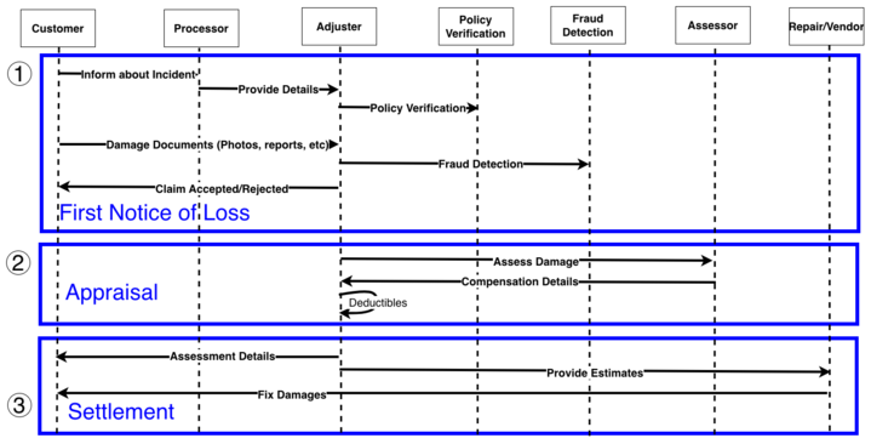
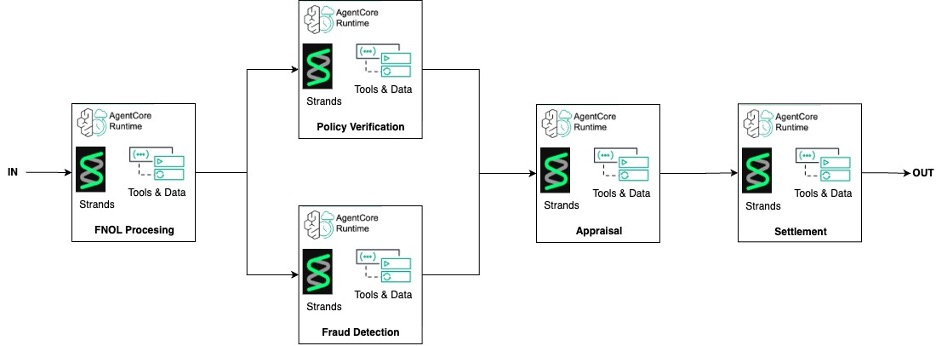
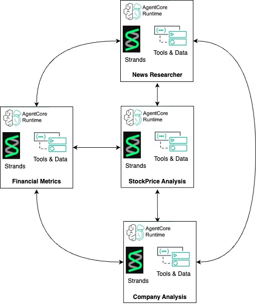
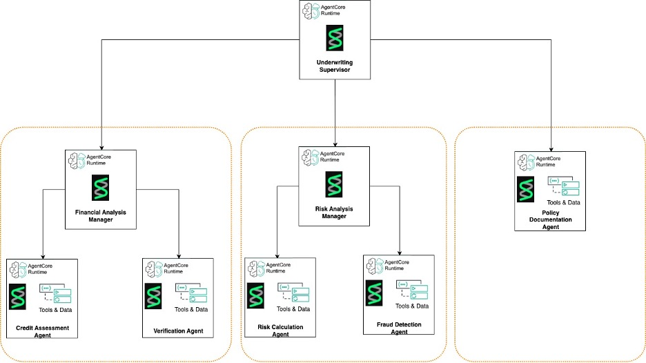
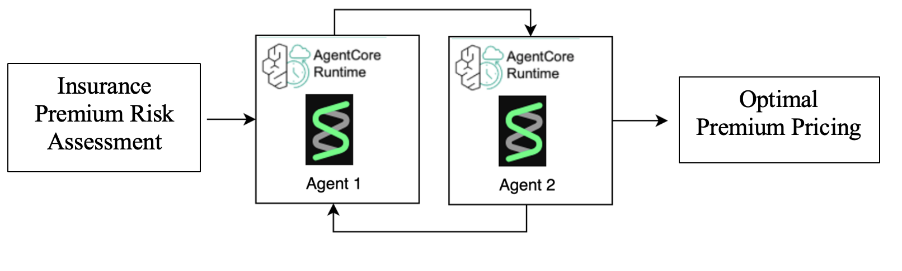
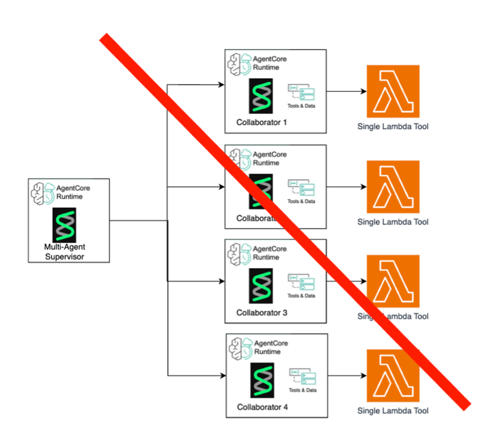

# Lựa chọn mẫu kiến trúc phù hợp cho hệ thống đa tác tử (Multi-Agent) trong dịch vụ tài chính

> **Bản dịch tiếng Việt từ:** [Agentic AI in Financial Services: Choosing the Right Pattern for Multi-Agent Systems](https://aws.amazon.com/blogs/industries/agentic-ai-in-financial-services-choosing-the-right-pattern-for-multi-agent-systems/), AWS for Industries.  
> **Tác giả:** Justin Hauer, Alfredo Castillo, Prashanth Ramanathan (Solutions Architects, AWS).  
> **Ngày xuất bản:** 17/12/2025.  
> **Quy ước thuật ngữ:** Các khái niệm cốt lõi được trình bày dưới dạng **tiếng Việt (English)** ở lần đầu xuất hiện; tên riêng sản phẩm, dịch vụ và giao thức công nghệ (AWS, Amazon Bedrock AgentCore, Strands Agents, MCP, A2A...) được giữ nguyên.

---

Nhiều định chế tài chính với quy mô đa dạng, bao gồm cả những tên tuổi hàng đầu như [NASDAQ](https://aws.amazon.com/solutions/case-studies/nasdaq-video-case-study/), đang nhận thấy **trí tuệ nhân tạo tác tử (agentic AI)** mang lại những lợi thế vượt trội so với các cách tiếp cận **AI tạo sinh (generative AI)** truyền thống. Một [nghiên cứu gần đây của Moody's](https://www.moodys.com/web/en/us/site-assets/ma-kyc-from-reactive-to-proactive-how-ai-is-transforming-risk-and-compliance.pdf) cho thấy tốc độ ứng dụng nhanh chóng này: 70% các tổ chức tham gia khảo sát ưu tiên AI cho công tác quản trị rủi ro và tuân thủ pháp lý, 66% sử dụng AI để đẩy nhanh tiến độ phân tích, 64% nhằm giảm thiểu chi phí vận hành, 56% để xử lý khối lượng dữ liệu quy mô lớn hơn, và 51% hướng tới nâng cao độ chính xác của quyết định.

Hệ thống **AI tác tử (agentic AI)** khai thác năng lực **suy luận phân tán (distributed reasoning)** và sự cộng tác đa tác tử để xử lý đồng thời các tác vụ phức tạp, từ phân tích dữ liệu thị trường theo thời gian thực đến xử lý luồng giao dịch. Các tác tử có khả năng truy cập các cơ sở tri thức tài chính phân tán để hỗ trợ phê duyệt khoản vay và thiết lập chiến lược đầu tư. Hiện nay, các giải pháp như [Strands Agents](https://strandsagents.com/latest/) và [Amazon Bedrock AgentCore](https://aws.amazon.com/bedrock/agentcore/) đang dân chủ hóa năng lực AI cho các định chế tài chính ở mọi quy mô, giúp doanh nghiệp dễ dàng triển khai các **hệ thống đa tác tử (multi-agent systems)** tùy biến dựa trên các dịch vụ AI được quản lý (*managed AI services*) của AWS.

Trong hệ thống agentic AI, các tác tử mở rộng tri thức được huấn luyện của mô hình nền tảng bằng cách sử dụng các **công cụ (tools)** được chọn lọc. Công cụ có thể là một ứng dụng máy tính nhỏ gọn, một hệ thống tác tử chuyên biệt khác, hoặc kết nối mở rộng thông qua các giao thức chuẩn hóa như **Giao thức ngữ cảnh mô hình (Model Context Protocol — MCP)** và **Giao thức tương tác giữa các tác tử (Agent2Agent — A2A)**.

Bài viết này đi sâu vào ba trường hợp sử dụng thực tế trong dịch vụ tài chính cho Agentic AI. Mỗi phần sẽ làm rõ bài toán kinh doanh, phân tích mẫu kiến trúc agentic AI tối ưu nhất, và mổ xẻ chi tiết luồng công việc tương ứng.

---

## 1. Các trường hợp sử dụng thực tế trong dịch vụ tài chính

### 1.1. Tự động hóa giải quyết bồi thường bảo hiểm (Autonomous Claims Adjudication)

Khi triển khai quy trình giải quyết bồi thường bảo hiểm tự động, các tổ chức thường đối mặt với bốn thách thức mấu chốt:
1. **Xử lý và phân tích hồ sơ:** Cần kết hợp thị giác máy tính (**Computer Vision**) và xử lý ngôn ngữ tự nhiên (**Natural Language Processing — NLP**) để bóc tách thông tin từ hiện trường và hóa đơn.
2. **Phát hiện gian lận (Fraud detection):** Đòi hỏi năng lực nhận dạng mẫu hành vi và phát hiện các điểm dị thường (*anomaly detection*).
3. **Thẩm định quy tắc hợp đồng (Policy validation):** Thực hiện đối soát chéo tự động với các điều khoản bảo hiểm hiện hành.
4. **Chuẩn hóa quyết định (Decision standardization):** Đảm bảo tính nhất quán trong các quyết định chi trả thông qua các mô hình học máy.

Nếu chậm trễ trong việc tự động hóa quy trình này, doanh nghiệp sẽ phải gánh chịu những hệ lụy vận hành nặng nề: đánh mất lợi thế cạnh tranh, năng lực mở rộng quy mô bị hạn chế, chất lượng xử lý không đồng đều, và nguy cơ mất thị phần vào tay các đối thủ đã làm chủ AI.

Giải pháp tự động hóa giải quyết bồi thường bảo hiểm bằng luồng tác tử xây dựng trên **Strands Agents** giải quyết bài toán phức tạp này trên toàn bộ chu trình xử lý. Điểm khởi đầu là **Thông báo tổn thất đầu tiên (First Notice of Loss — FNOL)** — đây là thông báo khiếu nại bồi thường ban đầu mà công ty bảo hiểm tiếp nhận từ khách hàng. Quy trình FNOL thu thập thông tin chi tiết về sự cố, đánh giá thiệt hại sơ bộ và dữ liệu người thụ hưởng bảo hiểm để kích hoạt quy trình điều tra bồi thường. Tiếp theo đó, các giai đoạn giám định thiệt hại (*damage appraisal*) và giải quyết chi trả (*settlement*) được tiếp nối để hoàn tất chu trình bồi thường. 

Kiến trúc này được triển khai theo **Mẫu luồng công việc (Workflow Pattern)** với năng lực [xử lý tuần tự (sequential processing)](https://strandsagents.com/latest/documentation/docs/user-guide/concepts/multi-agent/workflow/), chia thành ba giai đoạn chính:
- **Tự động hóa FNOL (FNOL automation)**
- **Giám định thông minh (Intelligent appraisal)**
- **Quyết toán tự động (Autonomous settlement)**

Mỗi giai đoạn sử dụng các tác tử AI chuyên trách cho từng nhóm nhiệm vụ cụ thể.

  
*Hình 1: Luồng quy trình tiếp nhận thông báo tổn thất đầu tiên (FNOL), thể hiện cách thức yêu cầu bồi thường đi qua các giai đoạn tiếp nhận, đánh giá và xử lý sơ bộ. Nguồn: AWS.*

[Giải pháp mẫu của AWS](https://github.com/aws-samples/genai-quickstart-pocs/blob/main/industry-specific-pocs/financial-services/Strands-Multi-Agent-Collaboration/workflow_ClaimsAdjudication/ClaimsAdjudication_SequentialPattern.ipynb) giúp tự động hóa hoàn toàn các trường hợp khiếu nại bồi thường rõ ràng, qua đó nâng cao hiệu suất và cắt giảm chi phí vận hành. Đồng thời, giải pháp cải thiện tỷ lệ kết hợp (**combined ratio**) để tối ưu doanh thu, giảm thiểu các vi phạm quy định nhằm hạn chế rủi ro pháp lý, và mang lại trải nghiệm vượt trội cho khách hàng.

  
*Hình 2: Cách triển khai quy trình FNOL kết hợp cả hai mô hình luồng công việc tuần tự và song song nhằm tối ưu hóa hiệu suất xử lý. Nguồn: AWS.*

---

### 1.2. Mẫu luồng công việc (Workflow Pattern)

Mẫu luồng công việc là một trong những cách tiếp cận nền tảng, có độ tin cậy cao nhất trong các kiến trúc AI đa tác tử. Đặc trưng của mẫu này là tiến trình thực thi bài bản theo từng bước, trong đó mỗi tác tử hoàn thành nhiệm vụ được giao trước khi chuyển giao kết quả sang tác tử kế tiếp trong chuỗi xử lý.

| Tiêu chí | Nội dung chi tiết |
| :--- | :--- |
| **Cơ chế suy luận (Reasoning Paradigm)** | - Xử lý theo chuỗi suy nghĩ (**Chain-of-thought processing**). - Phân rã các tác vụ phức tạp thành các bước nhỏ dễ quản lý với luồng thông tin và mối quan hệ phụ thuộc rõ ràng. |
| **Ứng dụng khác trong tài chính** | **Quy trình tuân thủ Chống rửa tiền và Định danh khách hàng (AML/KYC Compliance):** - Thực hiện tuần tự từ xác minh danh tính cơ bản. - Rà soát sàng lọc các cá nhân có tầm ảnh hưởng chính trị (**Politically Exposed Persons — PEP**). - Tiến hành thẩm định chuyên sâu (**Enhanced Due Diligence — EDD**). |
| **Cân nhắc về hiệu năng (Performance Considerations)** | - Mang lại tiến trình xử lý có kiểm soát và vết kiểm toán (**audit trail**) tường minh. - Tốc độ tổng thể bị giới hạn bởi mắt xích xử lý chậm nhất trong chuỗi. - Vượt trội trong các kịch bản đòi hỏi độ chính xác tuyệt đối và quy trình kiểm duyệt khắt khe, đặc biệt phù hợp với các ngành chịu sự giám sát chặt chẽ của pháp luật. |

---

### 1.3. Nghiên cứu và phân tích tài chính (Financial Research and Analysis)

Nghiên cứu tài chính trong môi trường hiện đại đối mặt với nhiều rào cản lớn:
- Tích hợp các nguồn dữ liệu đa dạng là bài toán phức tạp.
- Xử lý nhiều định dạng dữ liệu khác nhau đòi hỏi các bộ công cụ chuyên biệt.
- Duy trì chất lượng phân tích nhất quán trở nên cực kỳ khó khăn trong bối cảnh thị trường biến động không ngừng.

Hệ thống [nghiên cứu và phân tích tài chính](https://github.com/aws-samples/genai-quickstart-pocs/tree/main/industry-specific-pocs/financial-services/Strands-Multi-Agent-Collaboration/swarm_Automated_FinancialResearchAnalysis) vận hành trên nền **Amazon Bedrock AgentCore** tháo gỡ triệt để những trở ngại này thông qua hệ thống đa tác tử cộng tác theo **Mẫu bầy đàn (Swarm Pattern)**. Hệ thống biến quy trình nghiên cứu thủ công, tốn nhiều giờ làm việc thành một nền tảng thu thập và phân tích thông tin tự động. 

Bằng cách triển khai các tác tử Amazon Bedrock AgentCore chuyên biệt cho từng nhiệm vụ:
- Tác tử phân tích giá cổ phiếu (*Stock price analysis*)
- Tác tử tính toán chỉ số tài chính (*Financial metrics calculation*)
- Tác tử lập hồ sơ doanh nghiệp (*Company profiling*)
- Tác tử phân tích tâm lý tin tức (*News sentiment analysis*)

Tất cả các tác tử này được phối hợp nhịp nhàng thông qua bộ nhớ chia sẻ (**shared memory**) và mô hình nền tảng **Amazon Nova Pro**, cho phép tạo ra báo cáo nghiên cứu vốn đầu tư (*equity research report*) toàn diện chỉ trong vài phút thay vì hàng giờ.

  
*Hình 3: Ứng dụng Swarm Pattern giúp giảm thiểu công việc thủ công, mở rộng phạm vi nghiên cứu và xóa bỏ các điểm nghẽn vận hành. Nguồn: AWS.*

---

### 1.4. Mẫu bầy đàn (Swarm Pattern)

Tương tự như cách các đàn ong đạt được hành vi tập thể thông minh mà không cần một cá thể chỉ huy trung tâm, mẫu bầy đàn (triển khai theo cấu trúc mạng lưới phân tán — **mesh topology**) là một trong những cách tiếp cận đột phá nhất cho kiến trúc đa tác tử, khai thác sức mạnh của **suy luận cộng tác (collaborative reasoning)** và **chia sẻ thông tin phân tán**. Khác với kiến trúc phân cấp hay luồng công việc tuần tự, mẫu này cho phép các hành vi thông minh phức tạp tự nảy sinh (**emergent behavior**) từ các tương tác cục bộ đơn giản giữa các tác tử.

| Tiêu chí | Nội dung chi tiết |
| :--- | :--- |
| **Cơ chế suy luận (Reasoning Paradigm)** | - Suy luận cộng tác (**Collaborative reasoning**). - Chia sẻ thông tin đa chiều. - Trí tuệ xuất hiện tập thể (**Emergent intelligence**). |
| **Ứng dụng khác trong tài chính** | - Các nền tảng cho vay ngang hàng (**Peer-to-peer lending platforms**). - Tăng cường và làm giàu dữ liệu trong nghiệp vụ thẩm định thương mại (*Commercial underwriting*). - Mạng lưới bù trừ và quyết toán giao dịch phân tán (*Distributed trade settlement networks*) — nơi điều phối phi tập trung là yêu cầu bắt buộc. |
| **Cân nhắc về hiệu năng (Performance Considerations)** | - Khả năng chịu lỗi (**Fault tolerance**) và tính thích ứng vượt trội. - Thách thức lớn về chi phí truyền thông (**communication overhead**) giữa các tác tử và độ phức tạp khi gỡ lỗi (**debugging**). - Để triển khai thành công, cần cân bằng giữa lợi ích của hành vi tự nảy sinh với yêu cầu tuân thủ quy chuẩn pháp lý và tính dự đoán được (**predictability**) của hệ thống. Năng lực trí tuệ tập thể có thể vượt xa một tác tử đơn lẻ hoặc hệ thống tập trung. |

---

### 1.5. Xử lý thông minh hồ sơ vay vốn (Intelligent Loan Application Processing)

Quy trình thẩm định hồ sơ vay vốn truyền thống chịu ảnh hưởng nặng nề bởi các rào cản: thời gian thẩm định thủ công kéo dài, xử lý khối lượng hồ sơ giấy tờ phức tạp, và áp lực duy trì các tiêu chuẩn tuân thủ nghiêm ngặt trong khi phải quản trị rủi ro trên nhiều phòng ban độc lập.

Hệ thống [xử lý hồ sơ vay vốn thông minh](https://github.com/aws-samples/genai-quickstart-pocs/tree/main/industry-specific-pocs/financial-services/Strands-Multi-Agent-Collaboration/graph_IntelligentLoanUnderwriting) chứng minh sức mạnh của **Mẫu đồ thị (Graph Pattern)** — một cấu trúc đa tác tử phân cấp (**hierarchical multi-agent architecture**) trong việc tự động hóa các quy trình ra quyết định tài chính phức tạp. 

Mô hình triển khai trên **Amazon Bedrock AgentCore** kết hợp **Strands Agents** mô phỏng chính xác cơ cấu tổ chức của một định chế tài chính thực tế:
- **Tác tử giám sát thẩm định tín dụng (Loan Underwriting Supervisor):** Đóng vai trò điều phối tổng thể các phòng ban chuyên môn.
- **Tác tử quản lý phân tích tài chính (Financial Analysis Manager)** và **Tác tử quản lý rủi ro (Risk Analysis Manager):** Giám sát các tác tử nghiệp vụ chuyên trách.
- **Các tác tử cấp dưới:** Thực hiện đánh giá điểm tín dụng, xác minh thông tin, tính toán rủi ro, phát hiện gian lận và rà soát văn bản chính sách.

Cấu trúc topo phân cấp của Graph Pattern cho phép luồng hồ sơ vay — gồm báo cáo tín dụng, sao kê ngân hàng, bảng lương, tờ khai thuế và hồ sơ tài sản bảo đảm — được xử lý thông suốt qua các tác tử chuyên biệt trước khi tổng hợp thành khuyến nghị phê duyệt hoặc từ chối tự động.

  
*Hình 4: Mô hình phân cấp đa tác tử dạng đồ thị trong thẩm định hồ sơ vay vốn. Nguồn: AWS.*

---

### 1.6. Mẫu đồ thị (Graph Pattern)

Mẫu đồ thị trong hệ thống đa tác tử áp dụng cách tiếp cận phân tầng để quản lý công việc. Trong đó, một tác tử điều phối (**Coordinator Agent**) trong Amazon Bedrock AgentCore đứng ở vị trí gốc của cây quyết định, chịu trách nhiệm phân quyền và giám sát nhiệm vụ của các tác tử cấp dưới chuyên biệt. Cấu trúc này phản chiếu hệ thống phân cấp tổ chức truyền thống, thiết lập một chuỗi trách nhiệm rõ ràng giúp phân tách các bài toán lớn thành các phần việc vừa vặn.

| Tiêu chí | Nội dung chi tiết |
| :--- | :--- |
| **Cơ chế suy luận (Reasoning Paradigm)** | - Kiểm soát chính xác và chặt chẽ mọi tương tác giữa các tác tử. - Luồng dữ liệu được định nghĩa tường minh. - Duy trì trạng thái bền vững của tác tử (**Persistent agent state**). |
| **Ứng dụng khác trong tài chính** | - Các quy trình chịu ràng buộc pháp lý chặt chẽ (*Compliance-driven processes*). - Vận hành cổng thanh toán (*Payment gateway operations*). - Quy trình xử lý bồi thường bảo hiểm. - Thẩm định tín dụng và phát hành thẻ. - Tương tác dịch vụ khách hàng đa kênh. |
| **Cân nhắc về hiệu năng (Performance Considerations)** | - Phân rã bài toán có hệ thống với chuỗi trách nhiệm rõ ràng. - Tiềm ẩn rủi ro **Điểm nghẽn đơn lẻ (Single Point of Failure — SPoF)**: Nếu tác tử điều phối gặp sự cố, toàn bộ các quy trình cấp dưới có thể bị gián đoạn. - Bắt buộc phải xây dựng cơ chế chuyển đổi dự phòng (**failover mechanisms**) và hệ thống giám sát mạnh mẽ cho các ứng dụng tài chính trọng yếu. |

---

## 2. Mẫu kiến trúc bổ trợ: Mẫu vòng lặp (Loop Pattern)

Mẫu vòng lặp là một mẫu kiến trúc bổ sung có thể vận hành như một giải pháp độc lập hoặc đóng vai trò cơ chế phụ trợ trong các kiến trúc đa tác tử lớn hơn. Bằng cách cho phép các tác tử tinh chỉnh kết quả công việc thông qua các chu kỳ phản hồi, mẫu kiến trúc này tạo ra các hệ thống có năng lực tự hoàn thiện lặp đi lặp lại (**iterative refinement**).

[Mẫu vòng lặp](https://strandsagents.com/latest/documentation/docs/examples/python/graph_loops_example/?h=loop) mang lại chiều kích tự cải tiến động cho hệ thống đa tác tử: tác tử liên tục hoàn thiện đầu ra dựa trên phản hồi và kết quả đánh giá. Đây là thành phần bổ trợ đắc lực cho Graph Pattern khi một giai đoạn cụ thể trong luồng công việc đòi hỏi phải đạt được ngưỡng chất lượng định trước trước khi bước tiếp.

| Tiêu chí | Nội dung chi tiết |
| :--- | :--- |
| **Cơ chế suy luận (Reasoning Paradigm)** | - Suy luận phản tư (**Reflective reasoning / System 2**). - Tự hoàn thiện: cho phép các tác tử lặp lại quá trình giải quyết vấn đề cho đến khi thỏa mãn các tiêu chí chất lượng nghiêm ngặt. |
| **Ứng dụng khác trong tài chính** | - **Hệ thống giao dịch thuật toán (Algorithmic trading systems):** Sử dụng các vòng lặp để backtest, tối ưu hóa bộ tham số và mô phỏng thị trường nhằm hoàn thiện chiến lược giao dịch. - **Mô hình chấm điểm tín dụng:** Đánh giá và hiệu chỉnh các ước lượng rủi ro dựa trên dữ liệu thực tế phát sinh. - **Tối ưu hóa phí bảo hiểm:** Luân chuyển liên tục giữa đánh giá rủi ro, mô hình định giá và phân tích cạnh tranh thị trường để xác định mức phí tối ưu. |
| **Cân nhắc về hiệu năng (Performance Considerations)** | - Đem lại khả năng tự cải thiện động và thích ứng linh hoạt với các biến động thị trường. - **Lưu ý then chốt:** Phải thiết lập các **điều kiện dừng (termination conditions)** chặt chẽ để ngăn chặn nguy cơ rơi vào vòng lặp xử lý vô tận (**infinite loops**). Cần kiểm soát hội tụ nghiệm hiệu quả. |

  
*Hình 5: Loop Pattern thể hiện cơ chế suy luận phản tư (reflective reasoning), cho phép hệ thống nâng cao độ chính xác qua các chu kỳ đánh giá và điều chỉnh lặp. Nguồn: AWS.*

---

## 3. Các mẫu phản trực giác cần tránh (Anti-patterns)

Bên cạnh những lợi ích vượt trội, trong thực tế đã xuất hiện các **anti-pattern** làm suy giảm nghiêm trọng giá trị của kiến trúc agentic và dẫn đến các kết quả kém tối ưu khi các tổ chức tìm cách đo lường ROI của các sáng kiến AI.

### 3.1. Tác tử đơn khối phình to (Large Singleton)

Các tác tử đơn lẻ thường bắt đầu rất gọn gàng và hiệu quả. Tuy nhiên, việc nhồi nhét cho chúng quá nhiều công cụ (*tools*) sẽ gây ra những sự cố nghiêm trọng trong môi trường sản xuất.

**Ví dụ:** Một tác tử thẩm định được giao đảm nhận toàn bộ các khâu — từ tính toán hoa hồng, mô hình hóa rủi ro, tương tác với môi giới đại lý cho đến truy vấn cơ sở tri thức. Khi trách nhiệm mở rộng:
- Tác tử bắt đầu thể hiện sự nhầm lẫn: gọi sai công cụ, truyền sai tham số và đưa ra kết quả thiếu nhất quán.
- Kích thước Prompt phình to khiến tác tử phản hồi chậm hơn và tiêu tốn nhiều chi phí token hơn cho mỗi lượt gọi.

**Giải pháp khắc phục:** Đảm bảo mỗi tác tử có phạm vi trách nhiệm hẹp, chuyên biệt và chỉ sở hữu một số ít công cụ được chọn lọc kỹ càng. Tách bài toán trên thành nhiều tác tử chuyên trách để đảm bảo độ chính xác và tốc độ xử lý.

### 3.2. Gắn mác tác tử giả tạo (Agent Washing)

Trong ngành đang xuất hiện trào lưu "agent washing" đáng báo động: nhiều đơn vị chỉ đơn thuần đổi tên các công nghệ tự động hóa cũ hoặc các triển khai GenAI cơ bản thành "giải pháp agentic" mà không mang lại bất kỳ năng lực tác tử thực thụ nào. Điều này tạo ra kỳ vọng phi thực tế và làm phức tạp hóa hệ thống một cách không cần thiết.

**Ví dụ điển hình:** Dùng một tác tử chỉ để bọc một hàm AWS Lambda đơn lẻ (hoặc một công cụ đơn lẻ), rồi dựng thêm một "multi-agent supervisor" chỉ để tạo cảm giác rằng mình đang dùng hệ thống đa tác tử, trong khi hoàn toàn không sử dụng đến các năng lực tự chủ hay suy luận của AI.

**Giải pháp khắc phục:** Hãy chọn đúng công cụ cho đúng bài toán. Đôi khi hệ thống đa tác tử là giải pháp tối ưu, nhưng rất nhiều trường hợp, việc thu hẹp phạm vi về một tác vụ đơn lẻ cho một hàm tự động hóa truyền thống hoặc một tác tử đơn giản lại mang lại độ tin cậy cao hơn và chi phí rẻ hơn nhiều. Supervisor chỉ nên được sử dụng khi thực sự cần:
- Lựa chọn công cụ linh hoạt theo ngữ cảnh (*Dynamic tool selection*).
- Điều phối đa nhánh (*Orchestration*).
- Năng lực chủ động khám phá các hướng giải quyết bài toán khác nhau (*Agency to explore solution trajectories*).
- Cộng tác đa tác tử đi kèm chia sẻ dữ liệu.

  
*Hình 6: Minh họa trường hợp Agent Washing — mỗi tác tử cộng tác thực chất chỉ đóng vai trò vỏ bọc cho một hàm Lambda duy nhất. Nguồn: AWS.*

---

## 4. Kết luận và Hướng dẫn triển khai

Sự tiến hóa từ AI tạo sinh sang AI tác tử đánh dấu một bước chuyển dịch mang tính bước ngoặt trong cách các tổ chức tài chính khai thác trí tuệ nhân tạo. Các kiến trúc đa tác tử — từ luồng công việc tuần tự đến mẫu bầy đàn phức tạp — mang lại những năng lực chưa từng có trong việc tự động hóa và nâng tầm các hoạt động tài chính. Các mẫu này sẽ tiếp tục phát triển cùng các biến thể lai ghép mới khi các giao thức công cụ như MCP và A2A ngày càng hoàn thiện.

Chuyển đổi khỏi mô hình GenAI đơn lẻ (chỉ dựa vào prompt một mô hình) cho phép doanh nghiệp khai phóng tối đa sức mạnh của LLM, tự động hóa các hệ thống quy mô lớn với độ chính xác cao nhờ sự chuyên môn hóa của từng tác tử. Năng lực suy luận phân tán cho phép nhiều tác tử tự chủ cùng giao tiếp và giải quyết bài toán mà không một tác tử đơn lẻ nào có thể đảm đương nổi.

Các framework như **Strands Agents** và **Amazon Bedrock AgentCore** mang lại sự linh hoạt cao để thử nghiệm và kiểm chứng nhanh các kiến trúc mới trong khi vẫn duy trì chuẩn mực hiệu năng khắt khe. Việc chủ động tránh các anti-pattern như *Large Singleton* hay *Agent Washing* là yếu tố sống còn để tối ưu hóa hiệu quả và bảo toàn tính minh bạch cho hệ thống.

---

### Mã nguồn tham khảo (PoC)

Bạn có thể tham khảo toàn bộ mã nguồn mẫu và triển khai thử nghiệm các mẫu kiến trúc trên tại kho lưu trữ chính thức của AWS:
- [AWS GenAI Quickstart PoCs - Financial Services Multi-Agent Collaboration](https://github.com/aws-samples/genai-quickstart-pocs/tree/main/industry-specific-pocs/financial-services)
  - [Workflow Pattern: Claims Adjudication Notebook](https://github.com/aws-samples/genai-quickstart-pocs/blob/main/industry-specific-pocs/financial-services/Strands-Multi-Agent-Collaboration/workflow_ClaimsAdjudication/ClaimsAdjudication_SequentialPattern.ipynb)
  - [Swarm Pattern: Automated Financial Research & Analysis](https://github.com/aws-samples/genai-quickstart-pocs/tree/main/industry-specific-pocs/financial-services/Strands-Multi-Agent-Collaboration/swarm_Automated_FinancialResearchAnalysis)
  - [Graph Pattern: Intelligent Loan Underwriting](https://github.com/aws-samples/genai-quickstart-pocs/tree/main/industry-specific-pocs/financial-services/Strands-Multi-Agent-Collaboration/graph_IntelligentLoanUnderwriting)
  - [Loop Pattern: Graph Loops Example](https://strandsagents.com/latest/documentation/docs/examples/python/graph_loops_example/?h=loop)

---

### Về các tác giả

- **Justin Hauer:** Solutions Architect tại AWS, phụ trách khách hàng khối Dịch vụ Tài chính. Chuyên sâu về GenAI, Agentic AI, giải pháp giám sát khả năng quan sát (observability), serverless và container.
- **Alfredo Castillo:** Senior Solutions Architect tại AWS, chuyên về các hệ thống phân tán quy mô internet cho khối Dịch vụ Tài chính, Học máy, Xử lý Ngôn ngữ Tự nhiên, Xử lý Hồ sơ Thông minh và GenAI.
- **Prashanth Ramanathan:** Senior Solutions Architect tại AWS, đồng hành cùng khách hàng Tài chính hiện đại hóa kiến trúc ứng dụng quy mô lớn trên nền tảng AWS; chuyên sâu về GenAI, Agentic AI và Xử lý tài liệu thông minh.

---

## Bảng thuật ngữ song ngữ (Glossary)

| Thuật ngữ tiếng Việt | Thuật ngữ tiếng Anh gốc | Định nghĩa & Ý nghĩa trong kiến trúc |
| :--- | :--- | :--- |
| **Trí tuệ nhân tạo tác tử** | Agentic AI | Hệ thống AI có tính tự chủ, khả năng lập kế hoạch, sử dụng công cụ và hành động để đạt mục tiêu. |
| **Hệ thống đa tác tử** | Multi-Agent Systems (MAS) | Hệ thống gồm nhiều tác tử AI chuyên biệt cộng tác hoặc phối hợp cùng giải quyết bài toán. |
| **Suy luận phân tán** | Distributed Reasoning | Cơ chế phân bổ quá trình tư duy, suy luận và ra quyết định trên nhiều tác tử chuyên biệt. |
| **Mẫu luồng công việc** | Workflow Pattern | Mẫu kiến trúc thực thi theo chuỗi các bước tuần tự hoặc song song có định trước. |
| **Mẫu bầy đàn** | Swarm Pattern | Mẫu kiến trúc phân tán dạng lưới (mesh), tương tác ngang hàng và xuất hiện hành vi tập thể thông minh. |
| **Mẫu đồ thị / Phân cấp** | Graph Pattern / Hierarchical | Mẫu kiến trúc dạng cây phân cấp, có tác tử điều phối (Coordinator) phân rã và giám sát nhiệm vụ. |
| **Mẫu vòng lặp** | Loop Pattern | Mẫu kiến trúc thực hiện các chu kỳ đánh giá và phản tư lặp đi lặp lại để tự hoàn thiện đầu ra. |
| **Suy luận phản tư** | Reflective Reasoning | Phương pháp suy luận cho phép tác tử tự đánh giá kết quả của chính mình và điều chỉnh qua các vòng lặp. |
| **Trí tuệ xuất hiện** | Emergent Intelligence | Các hành vi thông minh phức tạp của toàn hệ thống tự nảy sinh từ các tương tác đơn giản giữa các cá thể. |
| **Giao thức ngữ cảnh mô hình** | Model Context Protocol (MCP) | Chuẩn giao thức mở giúp chuẩn hóa cách tác tử kết nối dữ liệu và công cụ bên ngoài. |
| **Giao thức giữa các tác tử** | Agent2Agent (A2A) Protocol | Chuẩn giao thức giao tiếp và trao đổi thông tin trực tiếp giữa các tác tử AI. |
| **Thông báo tổn thất đầu tiên** | First Notice of Loss (FNOL) | Báo cáo ban đầu tiếp nhận từ khách hàng khi xảy ra sự cố cần bảo hiểm bồi thường. |
| **Tác tử đơn khối phình to** | Large Singleton (Anti-pattern) | Lỗi kiến trúc khi dồn quá nhiều công cụ và trách nhiệm vào một tác tử duy nhất gây nghẽn và sai sót. |
| **Gắn mác tác tử giả tạo** | Agent Washing (Anti-pattern) | Xu hướng gắn nhãn "agentic" cho các giải pháp tự động hóa truyền thống mà không có năng lực tự chủ. |
| **Điểm nghẽn đơn lẻ** | Single Point of Failure (SPoF) | Thành phần mà nếu bị hỏng sẽ làm tê liệt toàn bộ hệ thống (như tác tử điều phối trung tâm). |
| **Cơ chế chuyển đổi dự phòng** | Failover Mechanisms | Quy trình tự động chuyển sang tài nguyên dự phòng khi thành phần chính gặp lỗi để duy trì dịch vụ. |
