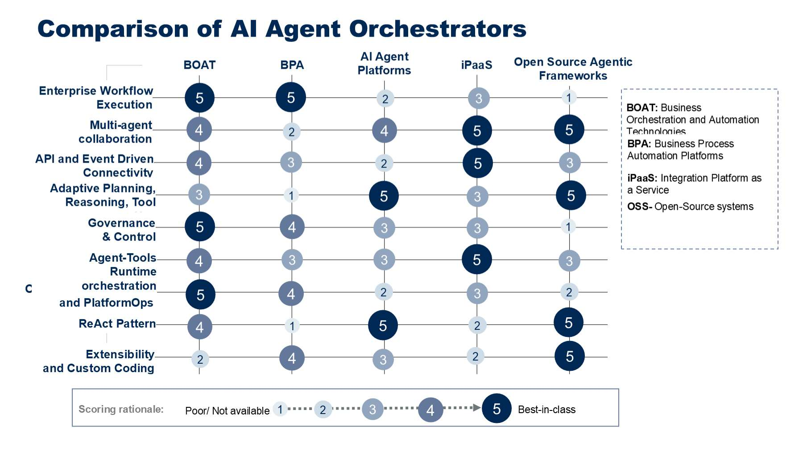
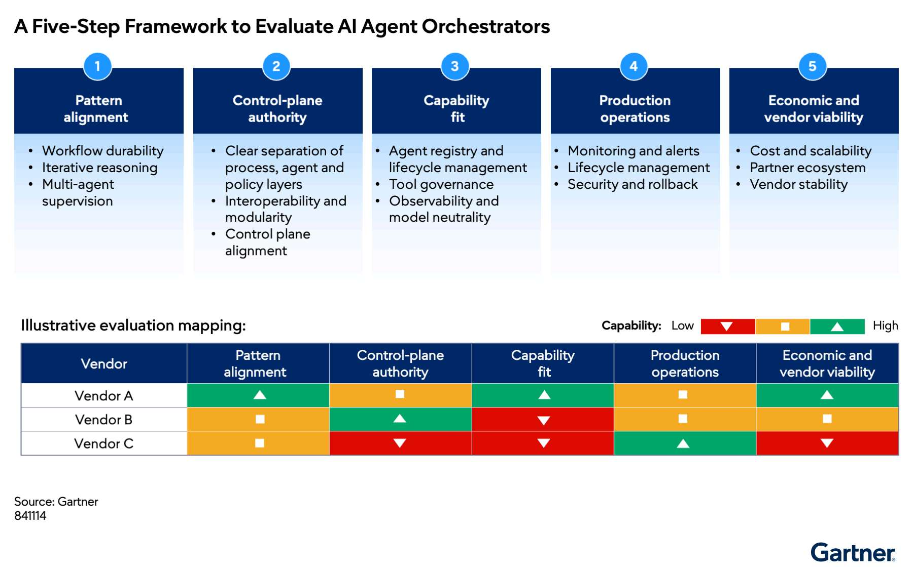

# Lựa chọn bộ điều phối tác tử AI bằng khung chấm điểm có cấu trúc

> **Bài viết chuyển ngữ và biên soạn từ:** *Choosing AI Agent Orchestrators: Apply a Structured Scoring Framework*, Gartner, 28/04/2026, ID G00851072.  
> **Đối tượng:** Lãnh đạo ứng dụng doanh nghiệp (Heads of Enterprise Applications).  
> **Quy ước thuật ngữ:** Từ khóa quan trọng được trình bày theo dạng **tiếng Việt (English)** ở lần xuất hiện đầu tiên.

## Tổng quan

Doanh nghiệp thường nhầm lẫn giữa **runtime tác tử AI sáng tạo nhất** và **bộ điều phối doanh nghiệp đáng tin cậy nhất**. Một nền tảng có thể trình diễn rất ấn tượng nhưng hoạt động kém khi phải xử lý trạng thái dài hạn, thực thi chính sách, can thiệp của con người, khả năng kiểm toán hoặc kỷ luật chi phí runtime.

Việc lựa chọn **bộ điều phối tác tử AI (AI agent orchestrator)** cần dựa trên hai câu hỏi nền tảng:

1. Mẫu điều phối nào chi phối danh mục use case: workflow, vòng lặp suy luận, giám sát đa tác tử hay hybrid?
2. Quyền kiểm soát của **mặt phẳng điều khiển (control plane authority)** phải nằm ở đâu?

Một khung đánh giá có cấu trúc giúp tổ chức quyết định:

- Loại nền tảng nào nên đóng vai trò **bộ điều phối chính (primary orchestrator)**.
- Loại nào nên là **runtime phụ (secondary runtime)**.
- Loại nào chỉ nên dùng như **thành phần bổ trợ (complementary component)**.

Khung này không nhằm tạo ra bảng xếp hạng phổ quát. Trọng số và kết quả phải được điều chỉnh theo kiến trúc, use case, rủi ro và ưu tiên riêng của từng doanh nghiệp.

---

## Những nhận định chính

- Cần một khung có cấu trúc để chọn nền tảng điều phối tác tử AI phù hợp.
- Điểm số phải phản ánh mẫu điều phối chi phối và vị trí ưu tiên của control plane.
- Danh mục thiên về workflow phải tăng trọng số cho độ bền, khả năng kiểm soát và trạng thái hoạt động doanh nghiệp.
- Danh mục thiên về vòng lặp hoặc giám sát đa tác tử phải tăng trọng số cho quản trị agent, đánh giá, phân quyền và ủy nhiệm.
- Phải so sánh **loại công nghệ điều phối** trước khi so sánh nhà cung cấp.
- Khả năng mở rộng phải được chứng minh trong production, không chỉ trong pilot.
- Chi phí runtime, nguy cơ lock-in và khả năng mở rộng quyết định tính bền vững dài hạn.
- Khung chấm điểm chỉ là công cụ hỗ trợ quyết định mẫu; nó không phải bảng xếp hạng dùng chung cho mọi tổ chức.

---

## Tác động đối với doanh nghiệp

Nếu lựa chọn dựa trên demo hoặc danh sách tính năng, doanh nghiệp có thể chọn một nền tảng mạnh về suy luận nhưng yếu về:

- Duy trì trạng thái của workflow dài hạn.
- Phục hồi hoặc bù trừ giao dịch.
- Thực thi policy.
- Phê duyệt và override bởi con người.
- Theo dõi, kiểm toán và truy vết.
- Khả năng chịu lỗi và SLA.
- Kiểm soát chi phí runtime.

Mô hình đánh giá trong bài kết hợp ba thành phần:

1. **Trọng số dựa trên mẫu điều phối (pattern-based weighting)**.
2. So sánh song song các loại công nghệ điều phối.
3. Mô hình chấm điểm năm lớp kết hợp heat map theo tình huống.

---

## Các hành động nên thực hiện

- Hiệu chỉnh trọng số theo mẫu điều phối chi phối các use case mục tiêu.
- Xác định năng lực bắt buộc trước khi so sánh các bộ điều phối.
- So sánh loại công nghệ trước, sau đó mới đánh giá sản phẩm và nhà cung cấp.
- Dùng khung chấm điểm có cấu trúc để đưa ra quyết định cuối cùng.

## Những điều cần thận trọng

- Không đặt trọng số quá lớn vào phần trình diễn sản phẩm.
- Không bỏ qua kiểm thử độ bền, hiệu năng và độ tin cậy của workflow dài hạn.
- Không dùng cam kết roadmap thay cho bằng chứng production.
- Tránh để nhiều nhóm tự chấm điểm theo các chuẩn khác nhau mà không có bước chuẩn hóa tập trung.

---

# Phần I — Hiệu chỉnh trọng số theo mẫu điều phối chi phối

## Bước 1: Xác nhận các use case production trong ngắn hạn

Rà soát các sáng kiến tự động hóa và tác tử AI dự kiến đi vào production trong 12 đến 18 tháng tới. Tập trung vào sáng kiến đã có ngân sách hoặc cam kết thực hiện, thay vì prototype thử nghiệm.

Mục tiêu không phải lấy trung bình của mọi kịch bản có thể xảy ra. Trọng số phải hướng tới mẫu tạo ra nhiều nhất:

- Rủi ro vận hành.
- Giá trị kinh doanh.
- Hệ quả kiến trúc.

## Bước 2: Điều chỉnh trọng số theo mẫu chính

### Danh mục thiên về workflow

Tăng trọng số cho:

- **Độ bền workflow (workflow durability)**.
- Quản lý trạng thái.
- Kiểm soát bởi con người.
- Tư thế vận hành doanh nghiệp.

### Danh mục thiên về vòng lặp

Tăng trọng số cho:

- Cơ chế đánh giá.
- Quản trị công cụ.
- Khả năng truy vết suy luận.
- Kiểm soát thực thi thích nghi.

### Danh mục thiên về giám sát hoặc đa tác tử

Tăng trọng số cho:

- Quản lý ủy nhiệm.
- Quản lý vòng đời tác tử.
- Phân xử xung đột.
- Logic phối hợp giữa các tác tử.

### Danh mục hybrid

Đặt trọng số theo mẫu chi phối. “Hybrid” không nên trở thành lý do để chia đều trọng số cho tất cả tiêu chí.

## Bước 3: Kiểm thử trọng số với mẫu phụ

Mẫu chi phối thiết lập trọng số cơ sở. Sau đó dùng mẫu phụ để kiểm tra liệu loại nền tảng được ưu tiên có còn khả thi trong điều kiện thực thi hỗn hợp hay không.

Ví dụ, danh mục thiên về workflow có thể ưu tiên BOAT hoặc BPA. Tuy nhiên, nếu một tỷ lệ đáng kể use case yêu cầu suy luận thích nghi, nền tảng chính phải tích hợp tốt với agent runtime chuyên biệt hoặc nền tảng tác tử AI.

---

# Phần II — So sánh các loại công nghệ trước khi so sánh nhà cung cấp

Tuyên bố và cam kết roadmap của nhà cung cấp chỉ cung cấp thông tin hạn chế về khả năng hỗ trợ tự động hóa ở quy mô production. Đánh giá doanh nghiệp cần tập trung vào hành vi vận hành cho thấy độ trưởng thành thực tế.

*Hình 1. So sánh các loại bộ điều phối tác tử AI (Comparison of AI Agent Orchestrators). Nguồn ảnh gốc: Gartner.*

## Các nhóm công nghệ

### BOAT

**Công nghệ điều phối và tự động hóa doanh nghiệp (Business Orchestration and Automation Technologies — BOAT)** phù hợp nhất khi cần một control plane cân bằng cho workflow xác định, agent, quản trị và vận hành.

### BPA

**Nền tảng tự động hóa quy trình nghiệp vụ (Business Process Automation Platforms — BPA)** phù hợp khi quy trình dài hạn, phê duyệt và phối hợp con người là yêu cầu chi phối.

### Nền tảng tác tử AI

**Nền tảng tác tử AI (AI agent platforms)** phù hợp khi thực thi dựa trên suy luận, lập kế hoạch và sử dụng công cụ quan trọng hơn quyền điều khiển workflow doanh nghiệp.

### iPaaS

**Nền tảng tích hợp dưới dạng dịch vụ (Integration Platform as a Service — iPaaS)** phù hợp khi bài toán điều phối chủ yếu là phối hợp API, SaaS và sự kiện.

### Framework agentic nguồn mở

**Framework agentic nguồn mở (open-source agentic frameworks)** phù hợp khi doanh nghiệp muốn linh hoạt kỹ thuật tối đa và sẵn sàng tự chịu trách nhiệm cho quản trị, khả năng phục hồi và độ trưởng thành runtime.

## Ma trận điểm tham khảo

Thang điểm: **1 — yếu hoặc không có**, đến **5 — tốt nhất trong nhóm**.

| Năng lực | BOAT | BPA | Nền tảng tác tử AI | iPaaS | Framework nguồn mở |
|---|---:|---:|---:|---:|---:|
| Thực thi workflow doanh nghiệp | 5 | 5 | 2 | 3 | 1 |
| Cộng tác đa tác tử | 4 | 2 | 4 | 5 | 5 |
| Kết nối dựa trên API và sự kiện | 4 | 3 | 2 | 5 | 3 |
| Lập kế hoạch thích nghi, suy luận và công cụ | 3 | 1 | 5 | 3 | 5 |
| Quản trị và kiểm soát | 5 | 4 | 3 | 3 | 1 |
| Runtime tác tử–công cụ | 4 | 3 | 3 | 5 | 3 |
| Điều phối và PlatformOps | 5 | 4 | 2 | 3 | 2 |
| Mẫu ReAct | 4 | 1 | 5 | 2 | 5 |
| Khả năng mở rộng và viết mã tùy chỉnh | 2 | 4 | 3 | 2 | 5 |

Ma trận này mô tả xu hướng của từng loại công nghệ, không phải điểm mặc định cho mọi sản phẩm. Khi đánh giá thực tế, phải chấm từng nền tảng cụ thể bằng bằng chứng production.

---

# Phần III — Khung năm bước đánh giá bộ điều phối tác tử AI

Lãnh đạo ứng dụng nên đánh giá các nền tảng ứng viên bằng mô hình chấm điểm có trọng số. Mỗi tiêu chí được chấm từ 1 đến 5; trọng số phản ánh mẫu điều phối đã xác định ở Phần I.

*Hình 2. Khung năm bước đánh giá bộ điều phối tác tử AI (A Five-Step Framework to Evaluate AI Agent Orchestrators). Nguồn ảnh gốc: Gartner.*

## Lớp 1: Mức phù hợp với mẫu điều phối

**Mức phù hợp với mẫu (pattern alignment)** đánh giá liệu nền tảng có hỗ trợ kiểu thực thi chi phối hay không.

Các tiêu chí:

- Độ bền workflow: quản lý trạng thái, bù trừ và versioning.
- Kiểm soát vòng lặp suy luận: evaluation gate, retry policy và traceability.
- Giám sát đa tác tử: delegation model, arbitration và quản lý vòng đời.
- Hỗ trợ điều phối hybrid.
- Duy trì trạng thái dài hạn.
- Độ sâu xử lý sự kiện.

## Lớp 2: Quyền kiểm soát của control plane

**Quyền kiểm soát mặt phẳng điều khiển (control-plane authority)** xác định nền tảng nào có thể thực thi chính sách và quản trị toàn cục.

Các tiêu chí:

- Phân tách rõ lớp quy trình, tác tử và chính sách.
- Khả năng tương tác và tính mô-đun.
- Mức phù hợp với control plane của doanh nghiệp.
- Độ sâu tích hợp danh tính và truy cập.
- Cơ chế override bởi con người.
- Khả năng tương tác xuyên nền tảng.
- Khả năng hoạt động như control plane toàn doanh nghiệp, nếu cần.

## Lớp 3: Độ sâu năng lực

**Mức phù hợp về năng lực (capability fit)** đánh giá khả năng thực hiện những chức năng cốt lõi.

Các tiêu chí:

- Agent registry và quản lý vòng đời.
- Quản trị và phân quyền công cụ.
- Mức trưởng thành của quản lý memory và state.
- Version control cho tác tử và workflow.
- Framework kiểm thử và đánh giá.
- Observability và traceability.
- Xử lý ngoại lệ và escalation.
- Mức dễ dàng khi tích hợp với workflow và hệ thống doanh nghiệp.
- Khả năng trung lập với mô hình hoặc hỗ trợ nhiều mô hình.

## Lớp 4: Độ trưởng thành vận hành production

**Vận hành production (production operations)** xác định liệu nền tảng có hoạt động bền vững ngoài môi trường thử nghiệm hay không.

Các tiêu chí:

- Khả năng phục hồi runtime và chịu lỗi.
- Độ trưởng thành của SLA.
- Độ chi tiết của log.
- Monitoring và alert.
- Quản lý vòng đời vận hành.
- Bảo mật và rollback.
- Hỗ trợ on-premises hoặc hybrid, nếu cần.
- Tính linh hoạt khi triển khai.
- Khả năng di chuyển mô hình và hỗ trợ multimodel.

## Lớp 5: Kinh tế và độ trưởng thành của nhà cung cấp

**Tính khả thi kinh tế và nhà cung cấp (economic and vendor viability)** đánh giá tính bền vững dài hạn.

Các tiêu chí:

- Khả năng dự đoán chi phí runtime.
- Tính minh bạch của mô hình giấy phép.
- Khả năng mở rộng so với rủi ro lock-in.
- Độ trưởng thành của hệ sinh thái và đối tác.
- Sự ổn định của nhà cung cấp.
- Mức rõ ràng của roadmap.
- Khả năng di chuyển workflow và tác tử.
- Chi phí và khả năng mở rộng quy mô.

---

## Cách tính điểm có trọng số

Mỗi tiêu chí được chấm theo thang 1–5. Điểm của một lớp có thể tính như sau:

$$
\text{Điểm lớp} = \frac{\sum (\text{điểm tiêu chí} \times \text{trọng số tiêu chí})}{\sum \text{trọng số tiêu chí}}
$$

Điểm tổng thể:

$$
\text{Điểm tổng} = \sum_{i=1}^{5}(\text{Điểm lớp}_i \times \text{trọng số lớp}_i)
$$

Trước khi chấm điểm, tổ chức phải định nghĩa bằng chứng cho từng mức. Ví dụ:

| Điểm | Diễn giải đề xuất |
|---:|---|
| 1 | Không có hoặc chỉ tồn tại trên roadmap |
| 2 | Có chức năng hạn chế, chưa chứng minh ở production |
| 3 | Đáp ứng yêu cầu cơ bản, có một số giới hạn |
| 4 | Đáp ứng tốt, có bằng chứng vận hành thực tế |
| 5 | Tốt nhất trong nhóm, đã chứng minh ở quy mô tương đương |

---

## Dùng heat map để đưa ra quyết định theo tình huống

Chuyển điểm thành heat map xanh–vàng–đỏ:

- **Xanh:** năng lực cao hoặc phù hợp mạnh.
- **Vàng:** đáp ứng một phần, cần biện pháp bổ sung.
- **Đỏ:** năng lực thấp hoặc tạo ra rủi ro kiến trúc.

Heat map không dùng để tuyên bố một nhà cung cấp là “người thắng tuyệt đối”. Nó giúp xác định vai trò thích hợp:

1. **Primary orchestrator:** nền tảng có điểm có trọng số cao và không tạo ra mismatch với control plane.
2. **Secondary runtime:** nền tảng mạnh về đổi mới, suy luận hoặc tool use nhưng yếu hơn về governance và production operations.
3. **Complementary component:** nền tảng cung cấp một năng lực chuyên biệt như integration, model runtime hoặc agent framework.

Hãy chọn nền tảng đạt điểm có trọng số mạnh nhất mà không tạo ra **sự không phù hợp của control plane (control-plane mismatch)**. Nếu loại có điểm cao nhất mạnh về đổi mới nhưng yếu về tư thế doanh nghiệp hoặc vận hành, hãy dùng nó làm runtime phụ thay vì bộ điều phối chính.

---

## Ví dụ trọng số theo mẫu điều phối

Bảng dưới đây là gợi ý để khởi tạo workshop đánh giá; doanh nghiệp phải hiệu chỉnh theo tình huống thực tế.

| Lớp đánh giá | Workflow chi phối | Vòng lặp chi phối | Đa tác tử chi phối |
|---|---:|---:|---:|
| Mức phù hợp với mẫu | 25% | 25% | 25% |
| Quyền control plane | 25% | 15% | 20% |
| Độ sâu năng lực | 15% | 30% | 30% |
| Vận hành production | 25% | 20% | 15% |
| Kinh tế và nhà cung cấp | 10% | 10% | 10% |
| **Tổng** | **100%** | **100%** | **100%** |

Đây là ví dụ minh họa được xây dựng từ nguyên tắc trong tài liệu, không phải trọng số cố định của Gartner.

---

## Quy trình đánh giá khuyến nghị

1. Lập danh sách use case sẽ vào production trong 12–18 tháng.
2. Phân loại từng use case theo workflow, iterative, supervisory/multiagent hoặc hybrid.
3. Xác định mẫu chi phối theo giá trị, rủi ro và hệ quả kiến trúc, không chỉ theo số lượng use case.
4. Xác định nơi control-plane authority phải nằm.
5. Chọn nhóm công nghệ phù hợp trước khi lập vendor shortlist.
6. Định nghĩa trọng số và tiêu chí bằng chứng.
7. Chấm điểm độc lập bởi kiến trúc, vận hành, bảo mật và tài chính.
8. Chuẩn hóa điểm trong một hội đồng tập trung.
9. Kiểm thử độ bền bằng workflow dài hạn và failure injection.
10. Lập heat map và xác định primary orchestrator, secondary runtime, complementary component.
11. Kiểm thử lại lựa chọn với mẫu điều phối phụ.
12. Đánh giá định kỳ khi danh mục use case hoặc nền tảng thay đổi.

---

## Thước đo thành công

### Tỷ lệ bao phủ điều phối

**Tỷ lệ bao phủ của bộ điều phối (orchestrator coverage ratio):** phần trăm workflow doanh nghiệp được nền tảng đã chọn quản trị.

### Tỷ lệ tuân thủ quản trị tác tử

**Tỷ lệ tuân thủ quản trị tác tử (agent governance compliance rate):** phần trăm hành động của tác tử có khả năng kiểm toán và tuân thủ policy.

### Thời gian ra quyết định

**Thời gian hoàn tất quyết định (decision turnaround time):** thời gian tiết kiệm được trên mỗi quyết định hoặc hành động của tác tử.

### Tỷ lệ hợp nhất công cụ

**Tỷ lệ hợp nhất công cụ (tool consolidation rate):** phần trăm công cụ điều phối trùng lặp được loại bỏ, hạ vai trò hoặc định vị lại.

---

## Kết luận

Không có một bộ điều phối tác tử AI tốt nhất cho mọi doanh nghiệp. Lựa chọn đúng phụ thuộc vào mẫu điều phối chi phối, vị trí control-plane authority và mức trưởng thành production mà tổ chức yêu cầu.

Quyết định nên đi theo thứ tự:

1. Xác định use case production và mẫu điều phối.
2. Điều chỉnh trọng số theo mẫu chi phối.
3. So sánh loại công nghệ trước khi so sánh nhà cung cấp.
4. Chấm điểm theo năm lớp.
5. Dùng heat map để xác định vai trò của từng nền tảng.

Nền tảng sáng tạo nhất không nhất thiết phải trở thành control plane chính. Một kiến trúc doanh nghiệp có thể dùng BOAT hoặc BPA làm primary orchestrator, nền tảng tác tử AI làm secondary runtime và iPaaS làm lớp tích hợp. Giá trị của khung chấm điểm nằm ở việc biến quyết định đó thành một quá trình minh bạch, có thể kiểm chứng và phù hợp với tình huống thực tế.

---

## Bảng thuật ngữ song ngữ

| Tiếng Việt | English |
|---|---|
| Bộ điều phối tác tử AI | AI agent orchestrator |
| Bộ điều phối chính | Primary orchestrator |
| Runtime phụ | Secondary runtime |
| Thành phần bổ trợ | Complementary component |
| Mặt phẳng điều khiển | Control plane |
| Quyền kiểm soát mặt phẳng điều khiển | Control-plane authority |
| Mẫu điều phối chi phối | Dominant orchestration pattern |
| Độ bền workflow | Workflow durability |
| Quản lý trạng thái | State management |
| Bù trừ giao dịch/quy trình | Compensation |
| Vòng lặp suy luận | Iterative reasoning loop |
| Giám sát đa tác tử | Multi-agent supervision |
| Quản lý ủy nhiệm | Delegation management |
| Phân xử | Arbitration |
| Công nghệ điều phối và tự động hóa doanh nghiệp | Business Orchestration and Automation Technologies (BOAT) |
| Nền tảng tự động hóa quy trình nghiệp vụ | Business Process Automation Platform (BPA) |
| Nền tảng tích hợp dưới dạng dịch vụ | Integration Platform as a Service (iPaaS) |
| Framework agentic nguồn mở | Open-source agentic framework |
| Mức phù hợp với mẫu | Pattern alignment |
| Mức phù hợp về năng lực | Capability fit |
| Vận hành production | Production operations |
| Tính khả thi kinh tế và nhà cung cấp | Economic and vendor viability |
| Khả năng quan sát | Observability |
| Khả năng truy vết | Traceability |
| Quản trị công cụ | Tool governance |
| Sự không phù hợp của control plane | Control-plane mismatch |
| Bản đồ nhiệt | Heat map |
| Rủi ro phụ thuộc nhà cung cấp | Vendor lock-in risk |
| Tỷ lệ bao phủ điều phối | Orchestrator coverage ratio |
| Tỷ lệ tuân thủ quản trị tác tử | Agent governance compliance rate |
| Tỷ lệ hợp nhất công cụ | Tool consolidation rate |
