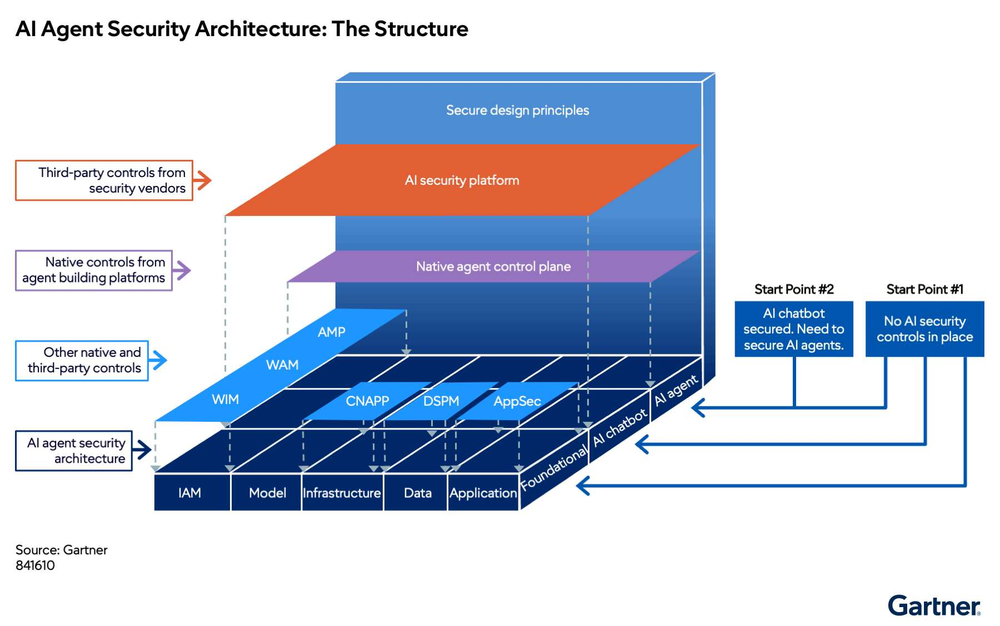
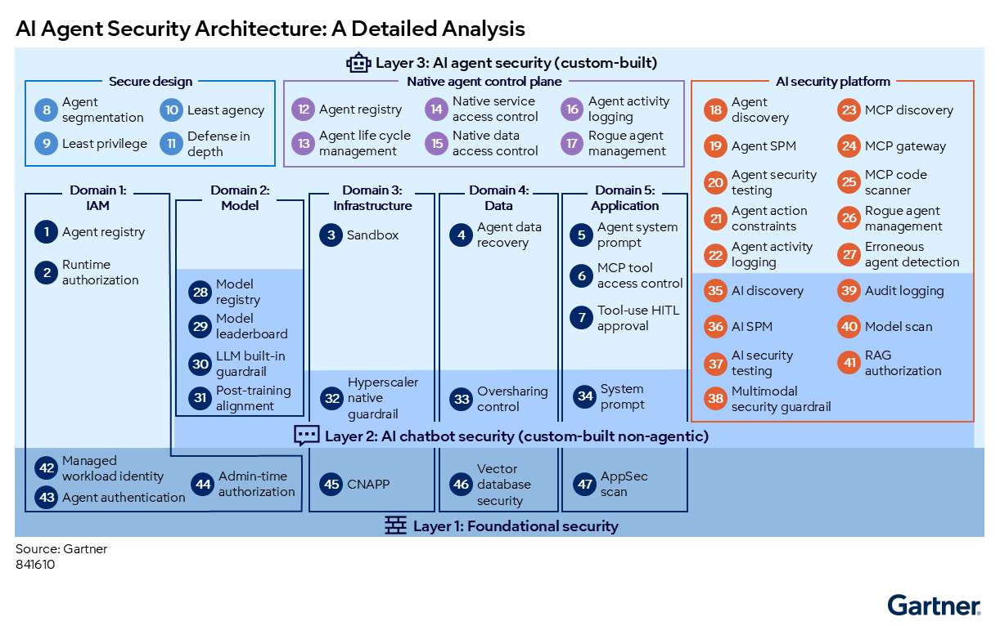

# Hướng dẫn bảo mật tác tử AI tự xây dựng

> **Bài viết chuyển ngữ và biên soạn từ:** *Custom-Built AI Agent Security Guide*, Gartner, 06/07/2026, ID G00841610.  
> **Quy ước thuật ngữ:** Từ khóa chuyên ngành được trình bày theo dạng **tiếng Việt (English)** ở lần xuất hiện đầu tiên.

## Mở đầu

**Tác tử AI tự xây dựng (custom-built AI agent)** có thể lập kế hoạch, truy cập dữ liệu, gọi công cụ và thực hiện hành động thay mặt người dùng. Chính khả năng hành động này khiến rủi ro của tác tử vượt xa chatbot AI truyền thống. Một chatbot bị tấn công có thể tạo nội dung sai hoặc độc hại; một tác tử bị chiếm quyền hoặc lập kế hoạch sai còn có thể gửi email, sửa cơ sở dữ liệu, xóa tài sản, làm rò rỉ dữ liệu hoặc gọi hệ thống sản xuất bằng quyền của doanh nghiệp.

Hai rủi ro nổi bật là **tiêm lời nhắc gián tiếp (indirect prompt injection)** và **tác tử bất hảo (rogue agent)**. Trong tấn công gián tiếp, chỉ dẫn độc hại không đến trực tiếp từ người dùng mà được cài trong email, tài liệu, website, bộ nhớ, dữ liệu RAG hoặc cấu hình MCP. Khi tác tử đọc nguồn dữ liệu đó, chỉ dẫn có thể đi vào ngữ cảnh của LLM và điều khiển chuỗi hành động tiếp theo.

Bảo mật tác tử vì vậy không thể dựa vào một guardrail duy nhất. Kiến trúc cần kết hợp quản lý danh tính, bảo mật mô hình, hạ tầng, dữ liệu và ứng dụng; đồng thời phối hợp kiểm soát gốc của nền tảng xây dựng tác tử với các nền tảng bảo mật AI bên thứ ba.

---

## 1. Những phát hiện và khuyến nghị quan trọng

### Phát hiện chính

- Phần lớn sản phẩm bảo mật thương mại hiện tập trung vào tác tử có runtime hoặc framework phổ biến, trong khi thị trường vẫn còn non trẻ và tồn tại nhiều lỗ hổng dư.
- **Giao thức ngữ cảnh mô hình (Model Context Protocol — MCP)** là phương thức phổ biến để kết nối tác tử với công cụ và tài nguyên. Tuy nhiên, chỉ một phần nhỏ trong hàng chục nghìn MCP server là máy chủ “chính thức” do chính tổ chức sở hữu tài nguyên xây dựng và vận hành.
- **Quản lý tư thế bảo mật tác tử (Agent Security Posture Management — Agent SPM)** và **quản lý tác tử bất hảo (rogue agent management)** là hai năng lực phức tạp và quan trọng nhất đối với tác tử tự xây dựng.
- **Mặt phẳng điều khiển tác tử gốc (native agent control plane)** và **nền tảng bảo mật AI (AI Security Platform — AISP)** là hai nhóm công cụ trung tâm, nhưng không thay thế hoàn toàn IAM, AppSec, CNAPP hoặc bảo mật dữ liệu hiện có.

### Khuyến nghị tổng quát

1. Bảo vệ tác tử trên năm miền: IAM, mô hình, hạ tầng, dữ liệu và ứng dụng.
2. Dùng IAM và kiểm soát dữ liệu gốc của nền tảng để cấp quyền tới dịch vụ cùng hệ sinh thái.
3. Với công cụ và dữ liệu bên thứ ba, dùng khai báo MCP rõ ràng và thực thi qua **cổng MCP (MCP gateway)**.
4. Chỉ cho phép MCP server chính thức hoặc đã được thẩm định bằng **danh sách cho phép (allow-list)**.
5. Bắt đầu với native control plane; chỉ bổ sung AISP khi cần lấp khoảng trống như Agent SPM liên tục, quản lý rogue agent hoặc control plane chung cho nhiều nền tảng.

---

## 2. Cấu trúc kiến trúc bảo mật tác tử AI

Kiến trúc được xây dựng theo nhiều chiều: nguồn cung cấp kiểm soát, lớp bảo mật và miền bảo mật.

*Hình 1. Cấu trúc kiến trúc bảo mật tác tử AI (AI Agent Security Architecture: The Structure). Nguồn ảnh gốc: Gartner.*

### 2.1. Ba nguồn kiểm soát

- **Kiểm soát gốc và bên thứ ba hiện có:** IAM, quản lý danh tính workload, authorization platform, CNAPP, DSPM và AppSec.
- **Mặt phẳng điều khiển tác tử gốc (native agent control plane):** tính năng bảo mật tích hợp trong nền tảng xây dựng tác tử.
- **Nền tảng bảo mật AI (AISP):** kiểm soát từ nhà cung cấp bảo mật bên thứ ba, thường bao phủ nhiều nền tảng tác tử.

### 2.2. Ba lớp bảo mật

1. **Lớp 1 — Bảo mật nền tảng (foundational security):** bảo vệ danh tính, cloud, dữ liệu và ứng dụng như với các workload khác.
2. **Lớp 2 — Bảo mật chatbot AI (AI chatbot security):** bảo vệ ứng dụng AI không có năng lực hành động, gồm model guardrail, chống prompt injection, AI SPM và kiểm soát RAG.
3. **Lớp 3 — Bảo mật riêng cho tác tử AI (AI agent-specific security):** bổ sung kiểm soát cho hệ thống có thể lập kế hoạch, sử dụng công cụ và thay đổi môi trường.

Chatbot security là đường cơ sở cho agent security, nhưng không có nghĩa ứng dụng phải được thiết kế dưới dạng chatbot trước khi trở thành tác tử.

### 2.3. Năm miền bảo mật

- **Quản lý danh tính và truy cập (Identity and Access Management — IAM)**.
- **Mô hình (model)**.
- **Hạ tầng (infrastructure)**.
- **Dữ liệu (data)**.
- **Ứng dụng (application)**.

### 2.4. Hai điểm bắt đầu

- Nếu tổ chức chưa có kiểm soát AI, hãy củng cố bảo mật nền tảng rồi triển khai chatbot security trước khi bổ sung agent-specific security.
- Nếu chatbot đã được bảo vệ, có thể bắt đầu trực tiếp từ lớp kiểm soát dành riêng cho tác tử.

---

## 3. Agency và autonomy: Hai trục rủi ro của tác tử

Từ góc độ bảo mật, cần phân biệt **khả năng tự quyết cách làm (agency)** và **mức tự chủ thực thi (autonomy)**.

### 3.1. Agency

- Tác tử có **agency cao** dùng khả năng suy luận của LLM để lập kế hoạch khi chạy. Nó thường cần một tập quyền rộng được chuẩn bị từ lúc xây dựng.
- Tác tử có **agency thấp** thực hiện các bước do nhà phát triển định nghĩa trước; quyền truy cập có thể bị giới hạn chặt hơn.

Cùng một yêu cầu có thể khiến tác tử agency cao tạo ra hai kế hoạch khác nhau ở hai lần chạy. Tính phi xác định và khả năng ảo giác của reasoning model khiến phạm vi hành động khó dự đoán.

### 3.2. Autonomy

- Tác tử có **autonomy cao** thực hiện nhiều bước mà không cần người phê duyệt.
- Tác tử có **autonomy thấp** yêu cầu **con người trong vòng lặp (Human in the Loop — HITL)** tại các điểm quan trọng.

HITL giống một “gờ giảm tốc”: nó làm giảm tốc độ tự động hóa nhưng ngăn hành động rủi ro. Tuy nhiên, yêu cầu phê duyệt quá thường xuyên sẽ gây **mệt mỏi phê duyệt (approval fatigue)**; người dùng có thể bấm đồng ý theo thói quen. Vì vậy, phê duyệt cần dựa trên rủi ro, công cụ, dữ liệu và tác động của hành động.

---

## 4. Kiến trúc chi tiết với 47 kiểm soát

*Hình 2. Kiến trúc bảo mật tác tử AI: phân tích chi tiết (AI Agent Security Architecture: A Detailed Analysis). Nguồn ảnh gốc: Gartner.*

### 4.1. Lớp 3 — Bảo mật tác tử AI tự xây dựng

#### Miền 1 — IAM

| Mã | Kiểm soát |
|---|---|
| C1 | **Sổ đăng ký tác tử (agent registry)** |
| C2 | **Ủy quyền khi chạy (runtime authorization)** |

**Agent registry** tạo góc nhìn tập trung về tác tử, chủ sở hữu, danh tính, trạng thái và quyền. Mỗi tác tử phải có danh tính riêng để chính sách có thể áp dụng và hành động có thể truy vết.

**Runtime authorization** tính quyền cần thiết dựa trên nhiệm vụ hiện tại, người dùng, ngữ cảnh, bộ nhớ và ranh giới truy cập. Mục tiêu dài hạn là **quyền đúng lúc (just-in-time access)** với **không có quyền thường trực (zero standing privilege)**.

#### Miền 2 — Mô hình

Lớp agent-specific không bổ sung control riêng tại miền này; model security và guardrail được triển khai ở Lớp 2 để dùng chung cho chatbot và tác tử.

#### Miền 3 — Hạ tầng

| Mã | Kiểm soát |
|---|---|
| C3 | **Hộp cát (sandbox)** |

Sandbox là môi trường cô lập để chạy agent runtime, tool call hoặc mã. Agent runtime sandbox kiểm soát filesystem và mạng; tool execution sandbox ngăn mã nguy hiểm ảnh hưởng môi trường doanh nghiệp.

#### Miền 4 — Dữ liệu

| Mã | Kiểm soát |
|---|---|
| C4 | **Khôi phục dữ liệu do tác tử tác động (agent data recovery)** |

Khi tác tử xóa hoặc làm hỏng dữ liệu, hệ thống backup phải khôi phục được trạng thái tốt gần nhất. Một phương án là tạo checkpoint trước mỗi thao tác ghi. Thiết kế phải xử lý race condition khi con người, ứng dụng và tác tử cùng cập nhật một kho dữ liệu.

#### Miền 5 — Ứng dụng

| Mã | Kiểm soát |
|---|---|
| C5 | **Lời nhắc hệ thống của tác tử (agent system prompt)** |
| C6 | **Kiểm soát truy cập công cụ MCP (MCP tool access control)** |
| C7 | **Phê duyệt HITL khi dùng công cụ (tool-use HITL approval)** |

System prompt định nghĩa vai trò, giới hạn và hành vi nhưng không phải biên bảo mật mạnh. Nếu bị sửa hoặc tiêm chỉ dẫn độc hại, nó có thể tạo persistence qua nhiều phiên; vì vậy system prompt phải nằm trong phạm vi Agent SPM và quản lý thay đổi.

Mỗi MCP tool là một **ranh giới năng lực (capability boundary)**. Ví dụ, `create_pull_request` không chỉ là tên hàm mà là một đặc quyền cho phép tác tử thay đổi repository. Quyền phải được kiểm soát ở mức server, tool, command và tham số.

### 4.2. Nguyên tắc thiết kế an toàn

| Mã | Kiểm soát |
|---|---|
| C8 | **Phân đoạn tác tử (agent segmentation)** |
| C9 | **Đặc quyền tối thiểu (least privilege)** |
| C10 | **Agency tối thiểu (least agency)** |
| C11 | **Phòng thủ theo chiều sâu (defense in depth)** |

#### Phân đoạn tác tử

Tác tử phải được phân vùng theo hồ sơ rủi ro. Một tác tử internet-facing nhận prompt trực tiếp từ bên ngoài không được phép kết nối tự do với tác tử nội bộ có quyền chạy lệnh đặc quyền trên cơ sở dữ liệu sản xuất.

#### Đặc quyền tối thiểu

Cấp quyền hệ thống và dữ liệu thấp nhất có thể tại build time, rồi thu hẹp tiếp tại runtime. Nguyên tắc này khó hơn với tác tử agency cao vì hệ thống không biết trước công cụ nào sẽ được chọn.

#### Agency tối thiểu

Chỉ cho tác tử quyền tự quyết mức cần thiết. Với workflow có thể xác định trước hoặc môi trường rủi ro cao, ưu tiên tác tử agency thấp. Chỉ dùng agency cao khi quy trình phức tạp và không thể mô tả đầy đủ lúc xây dựng.

#### Phòng thủ theo chiều sâu

Không một control nào đủ để chống prompt injection. Ví dụ, để ngăn tác tử đọc dữ liệu nhạy cảm rồi gửi email ra ngoài có thể phối hợp:

- Agent SPM phát hiện đường exfiltration tiềm tàng.
- Agent action constraint cấm đưa dữ liệu nhạy cảm vào email bên ngoài.
- Rogue agent management chặn hành động theo thời gian thực.
- Guardrail lọc chỉ dẫn độc hại trước khi gửi vào LLM.

### 4.3. Mặt phẳng điều khiển tác tử gốc

| Mã | Kiểm soát |
|---|---|
| C12 | **Sổ đăng ký tác tử (agent registry)** |
| C13 | **Quản lý vòng đời tác tử (agent life-cycle management)** |
| C14 | **Kiểm soát truy cập dịch vụ gốc (native service access control)** |
| C15 | **Kiểm soát truy cập dữ liệu gốc (native data access control)** |
| C16 | **Ghi nhật ký hoạt động tác tử (agent activity logging)** |
| C17 | **Quản lý tác tử bất hảo (rogue agent management)** |

Native control plane có lợi thế vì nằm trong cùng hệ sinh thái với nền tảng xây dựng tác tử. Nó có thể tạo danh tính, kích hoạt hoặc vô hiệu hóa tác tử, xác định chủ sở hữu, phát hiện tác tử mồ côi, cấp quyền tới dịch vụ gốc và thu log sâu hơn API dành cho bên thứ ba.

Activity log nên bao gồm prompt, memory operation, context retrieval, planning, tool call, external retrieval và giao tiếp agent-to-agent. Dữ liệu này phục vụ điều tra, phát hiện hành vi bất thường và đánh giá tư thế bảo mật.

Không có sự ngang bằng tính năng giữa các native control plane. Tổ chức dùng một nền tảng chiến lược nên đánh giá control gốc trước; tổ chức đa nền tảng có thể cần AISP để thống nhất góc nhìn.

### 4.4. Nền tảng bảo mật AI ở lớp tác tử

| Mã | Kiểm soát |
|---|---|
| C18 | **Khám phá tác tử (agent discovery)** |
| C19 | **Quản lý tư thế bảo mật tác tử (Agent SPM)** |
| C20 | **Kiểm thử bảo mật tác tử (agent security testing)** |
| C21 | **Ràng buộc hành động tác tử (agent action constraints)** |
| C22 | **Ghi nhật ký hoạt động tác tử (agent activity logging)** |
| C23 | **Khám phá MCP (MCP discovery)** |
| C24 | **Cổng MCP (MCP gateway)** |
| C25 | **Trình quét mã MCP (MCP code scanner)** |
| C26 | **Quản lý tác tử bất hảo (rogue agent management)** |
| C27 | **Phát hiện hành động sai (erroneous agent detection)** |

#### Agent discovery và Agent SPM

AISP kết nối với nền tảng xây dựng tác tử, source repository, registry hoặc network telemetry để tìm tác tử chưa được quản trị. Agent SPM đánh giá tĩnh:

- Cấu hình và system prompt.
- Memory và skill artifact.
- Quyền hệ thống, dữ liệu và công cụ.
- Người hoặc nhóm có thể truy cập tác tử.
- MCP server và tool đã khai báo.
- Chênh lệch giữa vai trò dự kiến với quyền thực tế.

Agent SPM có thể phát hiện tác tử không yêu cầu xác thực, tác tử được toàn tổ chức truy cập nhưng đọc dữ liệu cực kỳ nhạy cảm, hoặc tác tử được cấp năm công cụ dù baseline cho thấy chỉ dùng hai.

#### Kiểm thử bảo mật tác tử

Kiểm thử chatbot thường gửi jailbreak trực tiếp và đánh giá phản hồi. Kiểm thử tác tử khó hơn vì indirect prompt injection cần cài payload trước vào email, website, memory hoặc tài liệu mà tác tử sẽ đọc sau đó.

Trong giai đoạn công cụ tự động còn hạn chế, nên kiểm thử từng thành phần:

- Chỉ dẫn jailbreak có thể được ghi vào memory hay không.
- Tác tử có chuyển SQL injection hoặc `DROP TABLE` tới database MCP hay không.
- Tác tử có truy xuất webpage chứa chỉ dẫn độc hại rồi làm theo hay không.
- Tham số do LLM tạo có vượt schema hoặc boundary cho phép hay không.

#### Ràng buộc hành động

Chính sách có thể cấm ở mức command hoặc parameter, ví dụ:

- Không cho phép `DROP TABLE` tới database MCP.
- Không cho gửi `sudo` tới remote host.
- Không cho truy cập một số bảng hoặc cột.
- Không cho gửi dữ liệu nhạy cảm tới người nhận email bên ngoài.

#### MCP discovery, gateway và code scanner

MCP gateway tập trung proxy traffic, áp allow-list, xác thực, ủy quyền tool, audit log, guardrail và kiểm tra tham số. Một số gateway có thể ghép tool từ nhiều server thành virtual MCP server hoặc nhận policy từ authorization management platform.

MCP code scanner phân tích tĩnh repository của MCP server để tìm lỗ hổng như path traversal, dữ liệu đầu vào không được làm sạch, command injection hoặc dependency độc hại.

#### Rogue agent và erroneous action

Rogue agent management phát hiện và chặn chuỗi hành động bị điều khiển bởi tấn công. **Phát hiện hành động sai (erroneous action detection)** tập trung vào hành động gây hại do planning không chính xác, không nhất thiết do attacker.

AISP có thể dùng một mô hình khác để đánh giá kế hoạch và hành động. Tuy nhiên, độ tin cậy của **LLM làm giám khảo (LLM-as-a-judge)** còn gây tranh luận; không nên coi đây là nguồn quyết định duy nhất cho hành động có tác động cao.

---

## 5. Lớp 2 — Bảo mật chatbot AI làm nền cho tác tử

### 5.1. Miền mô hình

| Mã | Kiểm soát |
|---|---|
| C28 | **Sổ đăng ký mô hình (model registry)** |
| C29 | **Bảng xếp hạng mô hình (model leaderboard)** |
| C30 | **Guardrail tích hợp trong LLM (LLM built-in guardrail)** |
| C31 | **Căn chỉnh sau huấn luyện (post-training alignment)** |

Model registry kiểm soát mô hình được phép dùng. Model leaderboard giúp so sánh hiệu năng và khả năng chống jailbreak, dù chưa có benchmark bảo mật tiêu chuẩn chung.

Post-training alignment, thường gồm các phương pháp như RLHF, điều chỉnh trọng số để tăng khả năng tuân thủ và chống chỉ dẫn nguy hiểm. Built-in guardrail của LLM tạo thêm một lớp bảo vệ nhưng vẫn phải kết hợp với guardrail hạ tầng và ứng dụng.

### 5.2. Miền hạ tầng

| Mã | Kiểm soát |
|---|---|
| C32 | **Guardrail gốc của hyperscaler (hyperscaler-native guardrail)** |

Ví dụ gồm Amazon Bedrock Guardrails, Azure AI Content Safety/Prompt Shields và Google Model Armor. Các dịch vụ này có thể phát hiện hoặc chặn prompt injection tại điểm gọi mô hình.

### 5.3. Miền dữ liệu

| Mã | Kiểm soát |
|---|---|
| C33 | **Kiểm soát chia sẻ quá mức (oversharing control)** |

Tác tử grounding trên SharePoint, OneDrive hoặc kho dữ liệu doanh nghiệp có thể đọc tệp được cấp quyền kỹ thuật nhưng không được chủ sở hữu dự định cho AI sử dụng. Tổ chức phải phát hiện và giảm quyền chia sẻ dư thừa trước khi đưa dữ liệu vào RAG hoặc agent context.

### 5.4. Miền ứng dụng

| Mã | Kiểm soát |
|---|---|
| C34 | **Lời nhắc hệ thống (system prompt)** |

System prompt có thể tái sử dụng vai trò, chủ đề cấm và quy tắc phản hồi từ chatbot. Tuy nhiên, nó chỉ là một lớp trong chiến lược chống jailbreak nhiều lớp.

### 5.5. Nền tảng bảo mật AI ở lớp chatbot

| Mã | Kiểm soát |
|---|---|
| C35 | **Khám phá AI (AI discovery)** |
| C36 | **Quản lý tư thế bảo mật AI (AI SPM)** |
| C37 | **Kiểm thử bảo mật AI (AI security testing)** |
| C38 | **Guardrail bảo mật đa phương thức (multimodal security guardrail)** |
| C39 | **Nhật ký kiểm toán (audit logging)** |
| C40 | **Quét mô hình (model scan)** |
| C41 | **Ủy quyền RAG (RAG authorization)** |

Guardrail đa phương thức phải kiểm tra mọi dữ liệu hoặc chỉ dẫn trước khi gửi vào LLM, bất kể nguồn là văn bản, hình ảnh, memory, email, tài liệu grounding hay cấu hình MCP từ xa.

Model scan áp dụng với mô hình nguồn mở hoặc tự huấn luyện để phát hiện pickle độc hại, thư viện nguy hiểm và malware. RAG authorization cố gắng thực thi quyền ở mức embedding, nhưng đây vẫn là bài toán mở vì nhiều vector database thiếu mô hình authorization chi tiết.

---

## 6. Lớp 1 — Bảo mật nền tảng

| Miền | Mã | Kiểm soát |
|---|---|---|
| IAM | C42 | **Danh tính workload được quản lý (managed workload identity)** |
| IAM | C43 | **Xác thực tác tử (agent authentication)** |
| IAM | C44 | **Ủy quyền tại thời điểm quản trị (admin-time authorization)** |
| Hạ tầng | C45 | **Nền tảng bảo vệ ứng dụng cloud-native (CNAPP)** |
| Dữ liệu | C46 | **Bảo mật cơ sở dữ liệu vector (vector database security)** |
| Ứng dụng | C47 | **Quét bảo mật ứng dụng (AppSec scan)** |

Tác tử vẫn là một workload và ứng dụng. Nó phải đi qua SAST, DAST hoặc IAST; hạ tầng cloud phải được CNAPP bảo vệ; vector database phải có network isolation, access control, encryption và monitoring; danh tính tác tử phải được quản lý xuyên suốt vòng đời.

---

## 7. Chiến lược bảo mật MCP

MCP mở rộng nhanh bề mặt tấn công vì một server có thể cung cấp hàng trăm tool, mỗi tool lại đại diện cho một đặc quyền. Chiến lược an toàn nên gồm:

1. **Ưu tiên MCP server chính thức:** do tổ chức sở hữu tài nguyên xây dựng và vận hành.
2. **Dùng allow-list tập trung:** server, tool và phiên bản không có trong danh sách không được sử dụng.
3. **Ủy quyền chi tiết:** kiểm tra người dùng, tác tử, nhiệm vụ, tool, command và parameter.
4. **Phê duyệt theo rủi ro:** yêu cầu HITL với thao tác ghi, xóa, giao dịch hoặc truy cập dữ liệu nhạy cảm.
5. **Quét mã và dependency:** kiểm tra repository trước khi đưa server vào registry.
6. **Proxy qua MCP gateway:** thu log, áp guardrail, kiểm tra schema và chặn traffic bất thường.
7. **Credential ngắn hạn:** không nhúng secret lâu dài trong cấu hình MCP.
8. **Giám sát liên tục:** baseline tool usage và phát hiện công cụ ít dùng nhưng được cấp quyền quá mức.

---

## 8. Native control plane hay AISP?

### Ưu tiên native control plane khi

- Tổ chức tập trung vào một nền tảng xây dựng tác tử chiến lược.
- Cần log sâu, native IAM, native data access và vòng đời tác tử.
- Muốn giảm số lượng sản phẩm và tận dụng hệ sinh thái hiện có.

### Bổ sung AISP khi

- Tổ chức dùng nhiều agent-building platform.
- Cần khám phá tác tử và MCP trên toàn doanh nghiệp.
- Native control plane thiếu Agent SPM, agent security testing hoặc rogue agent management.
- Cần chính sách và báo cáo thống nhất xuyên cloud và nhà cung cấp.

AISP dựa trên API chỉ nhìn thấy dữ liệu nền tảng công khai. Nếu platform không cung cấp đầy đủ event hoặc log, AISP có blind spot. Một số sản phẩm dùng eBPF để quan sát ngoài băng và áp policy ở tầng runtime, nhưng cách này cũng cần đánh giá tác động vận hành và quyền hệ thống.

---

## 9. Lộ trình triển khai thực tế

### Giai đoạn 1 — Kiểm kê và gắn danh tính

- Khám phá tác tử, chatbot, MCP server và model đang được dùng.
- Gắn chủ sở hữu, mục đích, môi trường và mức rủi ro.
- Tạo managed workload identity riêng cho từng tác tử.

### Giai đoạn 2 — Củng cố nền tảng

- Áp CNAPP, AppSec, secrets management và data security.
- Bảo vệ vector database và nguồn RAG.
- Đưa model vào registry và xác định allow-list.

### Giai đoạn 3 — Giới hạn khả năng hành động

- Áp least privilege và least agency.
- Phân đoạn tác tử theo rủi ro.
- Đưa tool/API/MCP qua gateway.
- Chỉ cho phép server và tool đã thẩm định.

### Giai đoạn 4 — Bảo vệ runtime

- Chạy agent và tool trong sandbox.
- Áp runtime authorization và credential ngắn hạn.
- Đặt HITL tại hành động có tác động cao.

### Giai đoạn 5 — Quan sát và đánh giá liên tục

- Thu prompt, planning, memory, tool call, agent-to-agent traffic và thay đổi dữ liệu.
- Xây Agent SPM policy và baseline hành vi.
- Phát hiện rogue agent và erroneous action.
- Thực hiện kiểm thử indirect prompt injection theo từng nguồn dữ liệu.

### Giai đoạn 6 — Khả năng phục hồi

- Tạo checkpoint trước hành động ghi quan trọng.
- Bảo đảm backup có thể khôi phục dữ liệu do tác tử làm hỏng.
- Thiết kế kill switch, thu hồi credential và cô lập tác tử.
- Diễn tập sự cố tác tử giống các kịch bản ransomware hoặc insider threat.

---

## Kết luận

Bảo mật tác tử AI tự xây dựng là bài toán nhiều lớp. Các biện pháp dành cho chatbot như model guardrail, chống prompt injection và audit log vẫn cần thiết nhưng không đủ khi AI có thể hành động. Tổ chức phải bổ sung agent identity, runtime authorization, sandbox, tool-level access control, MCP gateway, Agent SPM, rogue agent management và data recovery.

Nguyên tắc cốt lõi là giảm cả quyền lẫn khả năng tự quyết xuống mức thấp nhất phù hợp với mục tiêu kinh doanh. Native control plane nên là điểm bắt đầu; AISP được bổ sung để lấp khoảng trống hoặc thống nhất quản trị đa nền tảng. Với công cụ bên thứ ba, chỉ dùng MCP server chính thức hoặc đã được kiểm tra, bắt buộc đi qua gateway và áp allow-list chi tiết.

Tác tử sẽ không bao giờ hoàn toàn xác định. Vì vậy, kiến trúc an toàn không cố “loại bỏ mọi sai sót”, mà tạo ra nhiều lớp để ngăn, phát hiện, chặn, truy vết và phục hồi trước khi một kế hoạch sai hoặc chỉ dẫn độc hại trở thành thiệt hại kinh doanh.

---

## Bảng thuật ngữ song ngữ

| Tiếng Việt | English |
|---|---|
| Tác tử AI tự xây dựng | Custom-built AI agent |
| Nền tảng bảo mật AI | AI Security Platform (AISP) |
| Mặt phẳng điều khiển tác tử gốc | Native agent control plane |
| Quản lý tư thế bảo mật tác tử | Agent Security Posture Management (Agent SPM) |
| Quản lý tư thế bảo mật AI | AI Security Posture Management (AI SPM/AISPM) |
| Tác tử bất hảo | Rogue agent |
| Tiêm lời nhắc gián tiếp | Indirect prompt injection |
| Khả năng tự quyết cách làm | Agency |
| Mức tự chủ thực thi | Autonomy |
| Agency tối thiểu | Least agency |
| Đặc quyền tối thiểu | Least privilege |
| Phòng thủ theo chiều sâu | Defense in depth |
| Phân đoạn tác tử | Agent segmentation |
| Ủy quyền khi chạy | Runtime authorization |
| Quyền đúng lúc | Just-in-time access |
| Không có quyền thường trực | Zero standing privilege |
| Danh tính workload được quản lý | Managed workload identity |
| Phê duyệt khi dùng công cụ | Tool-use HITL approval |
| Mệt mỏi phê duyệt | Approval fatigue |
| Giao thức ngữ cảnh mô hình | Model Context Protocol (MCP) |
| Cổng MCP | MCP gateway |
| Trình quét mã MCP | MCP code scanner |
| Danh sách cho phép | Allow-list |
| Ràng buộc hành động tác tử | Agent action constraints |
| Phát hiện hành động sai | Erroneous agent detection |
| Khôi phục dữ liệu tác tử | Agent data recovery |
| Guardrail đa phương thức | Multimodal security guardrail |
| Căn chỉnh sau huấn luyện | Post-training alignment |
| Ủy quyền RAG | RAG authorization |
| Nền tảng bảo vệ ứng dụng cloud-native | Cloud-Native Application Protection Platform (CNAPP) |
| Quản lý tư thế bảo mật dữ liệu | Data Security Posture Management (DSPM) |
| Bảo mật ứng dụng | Application Security (AppSec) |
| Con người trong vòng lặp | Human in the Loop (HITL) |
