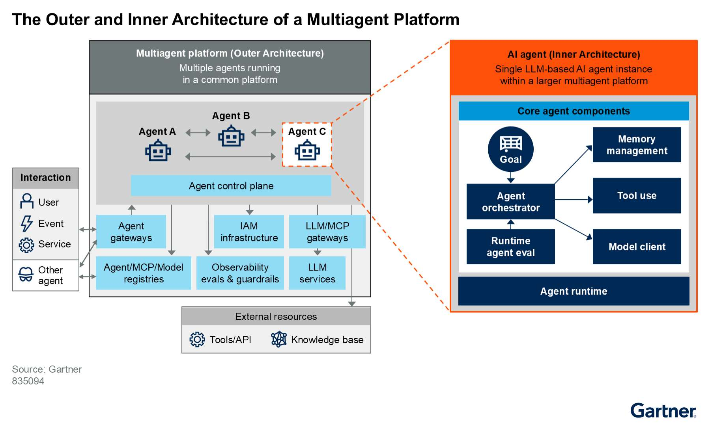
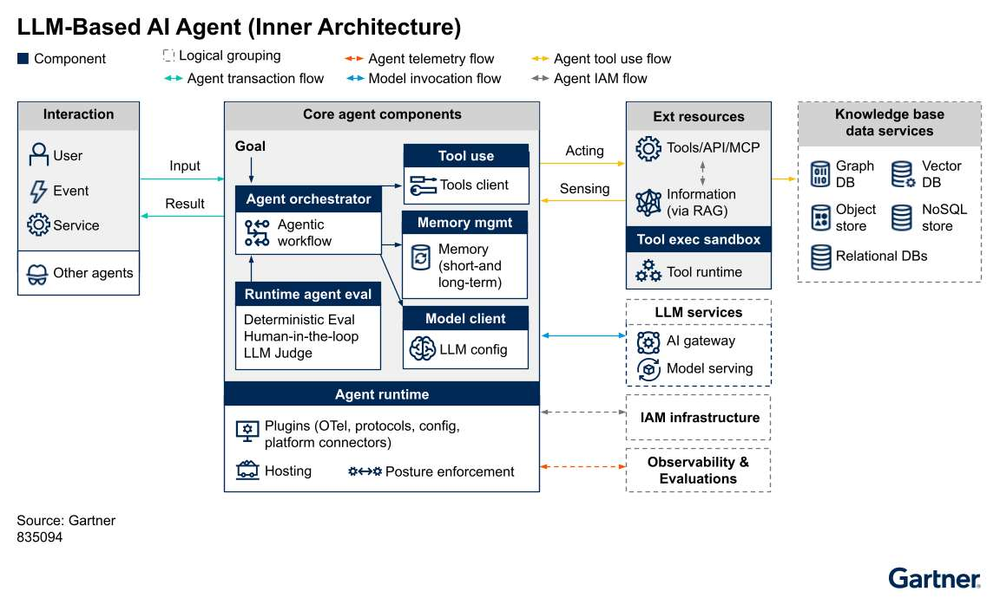

# Kiến trúc bên trong của tác tử AI dựa trên LLM

> **Bài viết chuyển ngữ và biên soạn từ:** *Reference Architecture Brief: LLM-Based AI Agent (Inner Architecture)*, Gartner, Steve Deng và Gary Olliffe, 07/11/2025, ID G00835094.  
> **Quy ước thuật ngữ:** Từ khóa chuyên ngành được trình bày theo dạng **tiếng Việt (English)** ở lần xuất hiện đầu tiên.

## Mở đầu

**Tác tử AI (AI agent)** đang trở thành một trong những trọng tâm lớn nhất của đổi mới và tự động hóa. Không giống chatbot truyền thống chỉ phản hồi những ý định đã được định nghĩa trước, tác tử dựa trên mô hình ngôn ngữ có thể tiếp nhận mục tiêu, chia mục tiêu thành các nhiệm vụ nhỏ, lập kế hoạch, gọi công cụ, quan sát kết quả và điều chỉnh hành động để hoàn thành yêu cầu của người dùng.

Các tác tử này kết hợp **điều phối phần mềm (software orchestration)** với **mô hình nền tảng (foundation model)** dạng ngôn ngữ hoặc đa phương thức. Dù tác tử có thể sử dụng nhiều loại mô hình AI, thị trường hiện chủ yếu tập trung vào **mô hình ngôn ngữ lớn (Large Language Model — LLM)** và **mô hình ngôn ngữ nhỏ (Small Language Model — SLM)**. Trong bài viết này, thuật ngữ LLM được hiểu là bao gồm cả SLM khi phù hợp.

Điểm quan trọng là LLM không tự tạo thành một tác tử hoàn chỉnh. Mô hình chỉ cung cấp một “bộ não xác suất”; để bộ não đó có thể hoạt động an toàn và nhất quán trong thế giới thực, kiến trúc cần bổ sung runtime, điều phối, bộ nhớ, công cụ, môi trường thực thi cô lập, kết nối mô hình và cơ chế đánh giá liên tục.

---

## 1. Kiến trúc bên trong và kiến trúc bên ngoài

Kiến trúc tác tử AI có thể được nhìn qua hai lớp tương tự cách kiến trúc microservice phân biệt dịch vụ với nền tảng vận hành:

- **Tác tử AI — kiến trúc bên trong (AI agent — inner architecture):** thiết kế phần mềm của một tác tử đơn lẻ cùng các thành phần được đóng gói trong môi trường chạy. Một runtime có thể chứa một tác tử hoặc nhiều module hợp thành tác tử.
- **Nền tảng đa tác tử — kiến trúc bên ngoài (multi-agent platform — outer architecture):** hệ sinh thái phân tán nơi nhiều tác tử được triển khai, mở rộng, tương tác, bảo mật và quản trị theo cách nhất quán.

Kiến trúc bên trong là đơn vị xây dựng cơ bản; kiến trúc bên ngoài cung cấp môi trường để nhiều đơn vị đó cộng tác có kiểm soát.

*Hình 1. Kiến trúc bên ngoài và bên trong của nền tảng đa tác tử (The Outer and Inner Architecture of a Multiagent Platform). Nguồn ảnh gốc: Gartner.*

### Các trường hợp sử dụng tiêu biểu

Kiến trúc này có thể hỗ trợ nhiều nhóm giải pháp:

- **Tác tử dịch vụ khách hàng (customer service agent):** trả lời yêu cầu, xử lý phiếu hỗ trợ và cung cấp thông tin sản phẩm qua thoại hoặc trò chuyện.
- **Tác tử hỗ trợ bán hàng (sales support agent):** cá nhân hóa tương tác, chủ động theo dõi khách hàng và tự động hóa các bước chăm sóc.
- **Tác tử nghiên cứu (research agent):** thu thập dữ liệu từ nguồn nội bộ hoặc bên ngoài, tổng hợp tri thức và tạo báo cáo.
- **Tác tử năng suất cá nhân/nhóm (personal/team productivity agent):** quản lý lịch, email, liên lạc và quy trình làm việc.
- **Tác tử không giao diện (headless agent):** hoạt động nền, cảm nhận sự thay đổi trong môi trường hoặc hành vi người dùng mà không cần tương tác trực tiếp thường xuyên.

---

## 2. Bảy thành phần cốt lõi của tác tử dựa trên LLM

Kiến trúc tham chiếu xác định bảy thành phần phần mềm chính:

1. **Môi trường chạy tác tử (agent runtime)**.
2. **Bộ điều phối tác tử (agent orchestrator)**.
3. **Quản lý bộ nhớ tác tử (agent memory management)**.
4. **Sử dụng công cụ của tác tử (agent tool use)**.
5. **Hộp cát thực thi công cụ (tool execution sandbox)**.
6. **Trình khách LLM (LLM client)**.
7. **Đánh giá tác tử khi chạy (runtime agent evaluation)**.

*Hình 2. Kiến trúc bên trong của một tác tử AI dựa trên LLM (LLM-Based AI Agent — Inner Architecture). Nguồn ảnh gốc: Gartner.*

### 2.1. Các luồng kết nối trong kiến trúc

Kiến trúc thể hiện năm loại kết nối:

- **Luồng giao dịch tác tử (agent transaction flow):** yêu cầu, phản hồi, lệnh, sự kiện và kích hoạt giữa tác tử với người dùng, hệ thống hoặc tác tử khác.
- **Luồng sử dụng công cụ (agent tool-use flow):** yêu cầu công cụ từ bộ điều phối đến API, MCP, chức năng hoặc sandbox và kết quả trả về.
- **Luồng gọi mô hình (model invocation flow):** lời nhắc, cấu hình và phản hồi giữa trình khách LLM với dịch vụ mô hình.
- **Luồng đo xa tác tử (agent telemetry flow):** log, metric và trace được gửi bất đồng bộ đến hệ thống quan sát.
- **Luồng IAM (IAM flow):** yêu cầu xác thực và ủy quyền giữa người dùng, tác tử, công cụ với hạ tầng quản lý danh tính doanh nghiệp.

Kiến trúc bên trong không đủ để tạo nên một hệ thống sản xuất hoàn chỉnh. Tác tử vẫn cần các năng lực bên ngoài như control plane, agent gateway, MCP/LLM gateway, dịch vụ LLM, IAM, observability, evaluation và guardrails.

---

## 3. Môi trường chạy tác tử: Biên an toàn đầu tiên

**Môi trường chạy tác tử (agent runtime)** là môi trường thực thi được thiết kế để triển khai, mở rộng, bảo mật và vận hành ứng dụng tác tử. Runtime trừu tượng hóa tài nguyên tính toán và mạng, cho phép tác tử chạy dưới dạng serverless, container, microVM hoặc dịch vụ PaaS.

Không nên coi tác tử giống một ứng dụng web thông thường rồi đặt nó vào container chung. Do hành vi xác suất của LLM, mỗi tác tử cần được xem như một thực thể **bán thù địch tiềm tàng (potentially semihostile)**: nó có thể vô tình tạo lệnh sai, truy cập nhầm dữ liệu, tiêu tốn quá nhiều tài nguyên hoặc thực hiện hành động nguy hiểm.

Runtime vì thế phải là **hộp cát được gia cố (hardened sandbox)**, thường triển khai bằng microVM hoặc container bên trong microVM. Nó cung cấp:

- Cô lập phiên, tiến trình và workload.
- Thực thi IAM và nguyên tắc **đặc quyền tối thiểu (least privilege)**.
- Tường lửa ở cấp máy chủ và kiểm soát truy cập mạng vào/ra.
- Kiểm soát filesystem, bộ nhớ, giao thức và lưu trữ.
- Quản lý vòng đời tự động.
- Bề mặt cấu hình và quản trị thống nhất.
- Khả năng instrument bằng OpenTelemetry và plugin bảo mật, IAM, mạng hoặc quan sát.

### Đặc điểm triển khai

Runtime có thể:

- Chạy độc lập hoặc thành cụm phân tán.
- Được cấu hình cục bộ hoặc quản lý tập trung bởi **mặt phẳng điều khiển tác tử (agent control plane)**.
- Chạy trên cloud, tại chỗ hoặc thiết bị biên.
- Gắn chặt với một framework tác tử hoặc hỗ trợ nhiều framework.
- Dùng Kata Container để có lớp cô lập cấp máy ảo mạnh hơn container truyền thống.
- Duy trì tác vụ dài hạn trên hạ tầng serverless tạm thời bằng cơ chế lưu trạng thái bền vững.

Các ví dụ công nghệ được tài liệu đề cập gồm AWS AgentCore Runtime, Azure AutoGen Runtime, Google Vertex AI Agent Engine, E2B, Dapr Agents, LangGraph Runtime, Akka và một số runtime chuyên dụng khác.

---

## 4. Bộ điều phối tác tử: Biến mục tiêu thành quy trình hành động

**Bộ điều phối tác tử (agent orchestrator)** quản lý tương tác giữa đầu vào, LLM, bộ nhớ, công cụ, hệ thống và tác tử khác. Nó có thể tuân theo workflow định trước hoặc tự tạo và tinh chỉnh kế hoạch trong khi thực hiện nhiệm vụ.

Workflow tác tử có thể được biểu diễn bằng:

- **Máy trạng thái hữu hạn (finite-state machine)**.
- **BPMN (Business Process Model and Notation)**.
- Luồng hội thoại đa tác tử.
- Đồ thị có hướng hoặc đồ thị trạng thái có vòng lặp.
- Mã hoặc giả mã.
- Chuỗi bước và chỉ dẫn bằng ngôn ngữ tự nhiên.

Trong quá trình thực hiện, orchestrator duy trì trạng thái, quản lý ngữ cảnh, truy cập bộ nhớ, gọi công cụ, xử lý kết quả trung gian, đánh giá đầu ra và quyết định bước tiếp theo.

### Năng lực quan trọng

- **Lập kế hoạch và phân rã nhiệm vụ (planning and task decomposition):** chuyển mục tiêu cấp cao thành các nhiệm vụ nhỏ có thể thực hiện.
- **Điều khiển luồng (flow control):** quản lý nhánh, ngoại lệ, retry và các quỹ đạo thực thi khác nhau.
- **Workflow bền vững, chạy dài hạn (durable or long-running workflow):** lưu trạng thái, ngữ cảnh và log để có thể tiếp tục, quay lui hoặc chạy lại.
- **Phối hợp mô hình và công cụ:** chọn thời điểm gọi LLM, công cụ hoặc tác tử con.
- **Cân bằng tính xác định và linh hoạt:** dùng workflow chặt chẽ ở bước cần kiểm toán, dùng LLM ở bước cần suy luận thích ứng.

Ví dụ công nghệ gồm LangGraph, Microsoft AutoGen, Microsoft Semantic Kernel, Google ADK, CrewAI, AWS Bedrock Agents, Camunda và Solace Agent Mesh Orchestrator.

---

## 5. Quản lý bộ nhớ: Tạo tính liên tục cho một “bộ não” không trạng thái

LLM vốn **không trạng thái (stateless)** giữa các lần suy luận. **Quản lý bộ nhớ tác tử (agent memory management)** giúp duy trì tính nhất quán của nhiệm vụ, cá nhân hóa trải nghiệm, cải thiện độ chính xác và hỗ trợ học hỏi qua thời gian.

### 5.1. Bộ nhớ ngắn hạn

**Bộ nhớ ngắn hạn (Short-Term Memory — STM)**, còn gọi là bộ nhớ làm việc, tồn tại trong một nhiệm vụ hoặc workflow. Nó lưu:

- Ngữ cảnh giữa các lần gọi LLM.
- Trạng thái hội thoại nhiều lượt.
- Kết quả công cụ và bước xử lý trung gian.
- Dữ liệu được lấy từ bộ nhớ dài hạn để suy luận.
- Tóm tắt hoặc bản nén ngữ cảnh khi cửa sổ token bị giới hạn.

### 5.2. Bộ nhớ dài hạn

**Bộ nhớ dài hạn (Long-Term Memory — LTM)** tồn tại qua nhiều phiên và có thể gồm:

- **Bộ nhớ thủ tục (procedural memory):** kỹ năng, quy trình, chiến lược hoặc tập công cụ.
- **Bộ nhớ tình tiết (episodic memory):** trải nghiệm từ các tương tác trước gắn với thời gian, tình huống và kết quả.
- **Bộ nhớ ngữ nghĩa (semantic memory):** tri thức thế giới hoặc tri thức miền, thường dùng để grounding qua RAG.

### 5.3. Phạm vi truy cập bộ nhớ

- **Phạm vi cục bộ (local scope):** chỉ một tác tử và một người dùng được truy cập.
- **Phạm vi chia sẻ (shared scope):** nhiều tác tử chia sẻ dữ liệu trong phạm vi một người dùng hoặc khách hàng.
- **Phạm vi toàn cục (global scope):** dùng chung cho mọi người dùng và vai trò tác tử.

Phạm vi bộ nhớ phải được ràng buộc bằng chính sách truy cập để tránh nhiễm chéo dữ liệu và rò rỉ thông tin giữa người dùng, phiên hoặc tác tử.

### 5.4. Năng lực quản lý bộ nhớ

Một lớp memory hoàn chỉnh cần:

- Thực hiện **kỹ thuật ngữ cảnh (context engineering)**.
- Trích xuất insight, dữ kiện và tri thức từ STM để lưu vào LTM.
- Lưu sở thích, tóm tắt phiên, chi tiết giao dịch và tri thức nghiệp vụ.
- Chia sẻ trạng thái có kiểm soát giữa các phiên và workflow.
- Hỗ trợ nhiều phương pháp truy xuất dành riêng cho tác tử.
- Kết nối filesystem, DBMS, vector database, graph database hoặc bộ nhớ phân tán.

Các công nghệ ví dụ gồm AWS AgentCore Memory, LangGraph Memory, Mem0, MemGPT, A-Mem, Akka Memory và Semantic Kernel Memory.

---

## 6. Sử dụng công cụ: Từ suy luận sang hành động

**Sử dụng công cụ của tác tử (agent tool use)**, còn gọi là **gọi hàm (function calling)** hoặc **sử dụng API (API tool use)**, cho phép tác tử tác động lên môi trường và nhận phản hồi.

Các hình thức chính:

- **Gọi hàm cục bộ (local function calling):** chọn hàm, điền tham số, thực thi rồi xử lý kết quả hoặc ngoại lệ.
- **Gọi API từ xa (remote API calling):** chọn endpoint, xác thực, gọi API và diễn giải phản hồi.
- **Gọi công cụ MCP (MCP tool calling):** tác tử đóng vai trò MCP client, truy cập resource, tool hoặc prompt qua MCP server hay MCP gateway.
- **Sử dụng máy tính (computer use):** thao tác CLI, shell, script, SDK, GUI hoặc màn hình.
- **Sử dụng trình duyệt (browser use):** truy cập và tương tác website thay mặt người dùng.

### Vòng đời gọi công cụ

1. **Trừu tượng hóa công cụ (tool abstraction):** chuẩn hóa tên, mô tả, schema dữ liệu và thuộc tính hàm.
2. **Khám phá và lựa chọn động (dynamic tool selection):** LLM suy luận công cụ phù hợp với nhiệm vụ.
3. **Thực thi công cụ (tool execution):** runtime hoặc sandbox gọi công cụ với tham số đã kiểm tra.
4. **Xử lý kết quả (result processing):** kết quả được đưa lại cho LLM để rút thông tin cần thiết.
5. **Tối ưu chi phí, độ trễ và độ tin cậy:** điều phối tool call dựa trên yêu cầu vận hành.

Công cụ làm tăng năng lực nhưng cũng mở rộng mạnh bề mặt tấn công. Do đó, đăng ký, mô tả, cấp quyền, kiểm tra tham số, quan sát và kiểm toán tool call phải là phần bắt buộc của kiến trúc.

---

## 7. Hộp cát thực thi công cụ: Cô lập mã và hành động có rủi ro

**Hộp cát thực thi công cụ (tool execution sandbox)** là môi trường được kiểm soát để chạy mã, công cụ hoặc ứng dụng do tác tử lựa chọn hoặc tạo ra mà không ảnh hưởng hệ thống khác.

Các đặc tính chính:

- **Cô lập và bảo mật (isolation and security):** chặn truy cập trực tiếp không an toàn tới host, filesystem, bộ nhớ và mạng.
- **Khả năng tái lập (reproducibility):** sử dụng môi trường bất biến với cùng thư viện, dependency và cấu hình.
- **Khả năng quan sát (observability):** thu log, metric, lỗi, hoạt động mạng, filesystem và system call.
- **Tối giản (simplification):** chỉ cấp tài nguyên và tính năng thực sự cần, giảm chi phí và lỗ hổng.
- **Tính tạm thời (ephemerality):** dọn sạch môi trường sau khi nhiệm vụ hoàn tất.
- **Tích hợp IAM và quản lý bí mật:** cấp credential đúng lúc, giới hạn phạm vi và thu hồi sau sử dụng.

Sandbox có thể dùng container, microVM, WebAssembly, V8 Isolate hoặc môi trường thực thi chuyên dụng. Các ví dụ khác gồm E2B, AutoGen CodeExecution, Chromium kết hợp Playwright và dịch vụ code execution của nhà cung cấp mô hình.

---

## 8. Trình khách LLM: Tách tác tử khỏi nhà cung cấp mô hình

**Trình khách LLM (LLM client)** là cầu nối giữa tác tử và dịch vụ mô hình cục bộ hoặc từ xa. LLM thường được gọi là “bộ não” của tác tử, nhưng về mặt kiến trúc nó là dịch vụ bên ngoài mà tác tử truy cập qua client.

LLM client chịu trách nhiệm:

- Xác thực, ủy quyền và quản lý credential khi gọi mô hình.
- Tạo và gửi prompt, cấu hình, tool schema hoặc dữ liệu đa phương thức.
- Nhận completion, streaming response và lỗi.
- Thực hiện retry, timeout và xử lý ngoại lệ.
- Định tuyến giữa nhiều mô hình.
- Cache theo prompt, giới hạn tốc độ theo token và ghi nhận chi phí.
- Thu thập trace, log, độ trễ và token usage.
- Ủy quyền một phần chức năng cho **cổng AI/LLM (AI/LLM gateway)** khi gateway tồn tại.

Việc tách client khỏi orchestrator giúp thay đổi nhà cung cấp hoặc phiên bản mô hình mà không viết lại toàn bộ logic tác tử. Các framework như AWS Strands, Microsoft Agent Framework, AutoGen, Semantic Kernel và OpenAI Agents SDK đều cung cấp lớp kết nối tương tự.

---

## 9. Đánh giá tác tử khi chạy: Kiểm soát chất lượng trên lưu lượng thật

**Đánh giá tác tử khi chạy (runtime agent evaluation)** là tập hợp quy trình đo mức độ tác tử hoàn thành nhiệm vụ trong nhiều tình huống và ràng buộc khác nhau. Các chiều đánh giá gồm:

- An toàn, độc hại và thiên lệch.
- Độ chính xác trong quyết định và suy luận.
- Grounding và tính đúng sự thật.
- Mức liên quan, hữu ích và chất lượng nội dung.
- Độ tin cậy, nhất quán và mạch lạc.
- Tuân thủ schema, cú pháp và chính sách.
- Mức hài lòng của người dùng và tỷ lệ hoàn thành nhiệm vụ.
- Độ chính xác khi chọn công cụ, điền tham số và diễn giải kết quả.
- Hiệu quả và chi phí.

### 9.1. Đánh giá trực tuyến và ngoại tuyến

- **Đánh giá trực tuyến (online evaluation):** chạy trên lưu lượng sản xuất; có thể nằm ngay trong vòng lặp tác tử để chặn, chuyển hướng hoặc sửa quỹ đạo theo thời gian thực.
- **Đánh giá ngoại tuyến (offline evaluation):** chạy trong CI, sau phiên hoặc theo lô với dataset và benchmark định trước.

Đánh giá runtime đặc biệt quan trọng vì lỗi hoặc ảo giác ở một bước có thể bị đưa vào bộ nhớ, làm đầu vào cho bước sau rồi lan sang tác tử khác. Phát hiện sớm giúp ngăn lỗi xác suất trở thành lỗi dây chuyền.

### 9.2. Phương pháp đánh giá

- Bộ kiểm tra xác định dựa trên mã.
- **LLM làm giám khảo (LLM-as-a-judge)**.
- Người dùng hoặc chuyên gia trong vòng lặp.
- Metric và ontology lỗi riêng cho từng lĩnh vực.
- Đánh giá phân tán tại orchestrator, memory, tool use, model client hoặc dịch vụ độc lập.

Quan sát và đánh giá không phải chức năng bổ sung tùy chọn; chúng là hai trụ cột trung tâm của kiến trúc tác tử.

---

## 10. Các nguyên tắc kiến trúc nền tảng

### 10.1. Dựng giàn cho “bộ não xác suất”

LLM có bản chất xác suất, không trạng thái và không luôn hành xử dự đoán được. Kiến trúc tác tử đóng vai trò **giàn đỡ (scaffolding)**, bổ sung cấu trúc, giám sát, tính xác định và các năng lực hỗ trợ để khai thác ưu điểm của mô hình đồng thời giảm rủi ro phi xác định.

### 10.2. Mô-đun, có thể kết hợp và độc lập

Các thành phần phải có giao diện rõ ràng để có thể thay LLM, memory store, tool provider hoặc evaluator mà không phá vỡ toàn hệ thống. Ở quy mô lớn hơn, nhiều tác tử độc lập có thể được phát triển, triển khai và mở rộng riêng.

### 10.3. Quan sát và đánh giá dẫn dắt thiết kế

Kiểm thử tĩnh không đủ cho hệ thống xác suất hoạt động trong môi trường luôn thay đổi. Thiết kế phải tích hợp observability và continuous evaluation ngay từ đầu, đặc biệt trên production.

### 10.4. Nhận biết ngữ cảnh và thích ứng

Tác tử cần nhận biết thay đổi của môi trường, người dùng, dữ liệu, công cụ và hiệu quả của chính nó. Tuy nhiên, cải tiến lặp lại phải diễn ra trong giới hạn chính sách, không được tự do ghi nhớ hoặc thay đổi hành vi mà thiếu kiểm soát.

---

## 11. Khuyến nghị triển khai

### 11.1. Quản lý lỗi xác suất tích lũy

Ảo giác và lỗi nhỏ có thể tích lũy nhanh qua nhiều bước và vòng lặp. Hãy đặt checkpoint đánh giá tại các điểm quan trọng, giới hạn số lần lặp, kiểm tra kết quả công cụ và yêu cầu phê duyệt trước hành động có ảnh hưởng lớn.

### 11.2. Bắt đầu từ mức rủi ro chấp nhận được

Trong giai đoạn đầu, nên chọn bài toán rủi ro thấp như khám phá tri thức, tổng hợp thông tin hoặc mô phỏng trong môi trường cô lập. Tránh ngay lập tức cho tác tử xử lý dữ liệu cực kỳ nhạy cảm hoặc thực hiện giao dịch không thể đảo ngược.

### 11.3. Bảo mật từ bên trong mỗi tác tử

Coi mọi tác tử là một rogue agent tiềm tàng. Runtime và sandbox là tuyến phòng thủ đầu tiên; gateway, IAM, policy và control plane tạo các lớp tiếp theo theo nguyên tắc **phòng thủ theo chiều sâu (defense in depth)**.

### 11.4. Cân bằng kế hoạch tự chủ với workflow định trước

Khi quy trình yêu cầu tuân thủ, giải thích và kiểm toán cao, orchestrator nên bám workflow xác định. LLM chỉ nên tối ưu những tác vụ con cần tính linh hoạt. Không nên giao toàn bộ quy trình quan trọng cho kế hoạch tự sinh nếu không có giới hạn.

### 11.5. Kiểm soát truy cập dịch vụ LLM

Đưa lưu lượng mô hình qua AI/LLM gateway để bảo mật, cân bằng tải, tối ưu chi phí, quan sát và phát hiện tác tử chưa được quản trị.

### 11.6. Quản lý và tuyển chọn công cụ

Thiết lập chuẩn thiết kế, đăng ký, phê duyệt, phân quyền, phiên bản và kiểm toán cho API, function và MCP server. Tác tử chỉ được khám phá và gọi các công cụ phù hợp với nhiệm vụ.

### 11.7. Triển khai rào chắn nhiều lớp và thích ứng

Kết hợp:

- **Rào chắn theo nhiệm vụ (task-aware guardrails)**.
- **Rào chắn theo công cụ (tool-aware guardrails)**.
- **Rào chắn theo lĩnh vực (domain-specific guardrails)**.
- Chính sách thống nhất cấp tổ chức tại gateway.

Rào chắn cục bộ tạo độ chính xác theo ngữ cảnh; rào chắn tập trung bảo đảm an toàn và tuân thủ nhất quán.

---

## 12. Lộ trình xây dựng một tác tử sản xuất

### Giai đoạn 1 — Đóng gói runtime an toàn

- Tách mỗi tác tử theo phiên và workload.
- Giới hạn filesystem, mạng, bộ nhớ và credential.
- Gắn OpenTelemetry và correlation ID.

### Giai đoạn 2 — Xây orchestrator có trạng thái

- Mô hình hóa workflow, nhánh, retry và checkpoint.
- Phân biệt bước xác định với bước cần LLM suy luận.
- Cho phép dừng, tiếp tục và quay lui.

### Giai đoạn 3 — Quản trị memory và context

- Tách STM/LTM và định nghĩa phạm vi local/shared/global.
- Đặt chính sách lưu, truy xuất, hết hạn và xóa.
- Không tự động ghi mọi hội thoại vào bộ nhớ dài hạn.

### Giai đoạn 4 — Chuẩn hóa tool use

- Dùng schema rõ ràng và registry được phê duyệt.
- Kiểm tra tham số trước khi thực thi.
- Chạy mã và công cụ rủi ro trong sandbox tạm thời.

### Giai đoạn 5 — Tách kết nối mô hình

- Dùng LLM client độc lập với orchestrator.
- Đưa routing, rate limit, cache và cost control ra gateway khi có thể.

### Giai đoạn 6 — Khép kín vòng quan sát và đánh giá

- Thu trace đầu cuối từ yêu cầu đến tool và model call.
- Đánh giá trực tuyến tại checkpoint quan trọng.
- Kết hợp deterministic eval, LLM-as-a-judge và phản hồi con người.
- Tự động chặn hoặc chuyển hướng khi vượt ngưỡng rủi ro.

---

## Kết luận

Một tác tử AI dựa trên LLM không chỉ là mô hình được gắn thêm công cụ. Nó là một hệ thống phần mềm mô-đun, có trạng thái và có khả năng hành động, được bao quanh bởi runtime an toàn, orchestrator, memory, tool layer, sandbox, model client và evaluation.

Giá trị của LLM nằm ở khả năng suy luận linh hoạt; giá trị của kiến trúc nằm ở việc biến khả năng xác suất đó thành hành vi có thể vận hành, quan sát, kiểm soát và cải tiến. Doanh nghiệp muốn đưa tác tử vào production cần thiết kế đồng thời cả “bộ não” lẫn “giàn đỡ”: dùng tính xác định ở nơi cần tuân thủ, dùng tự chủ ở nơi cần thích ứng, và luôn đặt bảo mật cùng đánh giá vào chính vòng lặp thực thi.

---

## Bảng thuật ngữ song ngữ

| Tiếng Việt | English |
|---|---|
| Tác tử AI | AI agent |
| Kiến trúc bên trong | Inner architecture |
| Kiến trúc bên ngoài | Outer architecture |
| Nền tảng đa tác tử | Multi-agent platform |
| Môi trường chạy tác tử | Agent runtime |
| Bộ điều phối tác tử | Agent orchestrator |
| Quản lý bộ nhớ tác tử | Agent memory management |
| Bộ nhớ ngắn hạn | Short-Term Memory (STM) |
| Bộ nhớ dài hạn | Long-Term Memory (LTM) |
| Bộ nhớ thủ tục | Procedural memory |
| Bộ nhớ tình tiết | Episodic memory |
| Bộ nhớ ngữ nghĩa | Semantic memory |
| Kỹ thuật ngữ cảnh | Context engineering |
| Sử dụng công cụ của tác tử | Agent tool use |
| Gọi hàm | Function calling |
| Giao thức ngữ cảnh mô hình | Model Context Protocol (MCP) |
| Hộp cát thực thi công cụ | Tool execution sandbox |
| Trình khách LLM | LLM client |
| Đánh giá tác tử khi chạy | Runtime agent evaluation |
| Đánh giá trực tuyến | Online evaluation |
| Đánh giá ngoại tuyến | Offline evaluation |
| LLM làm giám khảo | LLM-as-a-judge |
| Luồng giao dịch tác tử | Agent transaction flow |
| Luồng sử dụng công cụ | Agent tool-use flow |
| Luồng gọi mô hình | Model invocation flow |
| Luồng đo xa tác tử | Agent telemetry flow |
| Khả năng quan sát | Observability |
| Mô hình ngôn ngữ lớn | Large Language Model (LLM) |
| Mô hình ngôn ngữ nhỏ | Small Language Model (SLM) |
| Mô hình nền tảng | Foundation model |
| Đặc quyền tối thiểu | Least privilege |
| Phòng thủ theo chiều sâu | Defense in depth |
| Rào chắn theo nhiệm vụ | Task-aware guardrails |
| Rào chắn theo công cụ | Tool-aware guardrails |
| Tác tử không giao diện | Headless agent |
| Workflow bền vững | Durable workflow |
| Bộ não xác suất | Stochastic brain |
| Giàn đỡ kiến trúc | Architectural scaffolding |
