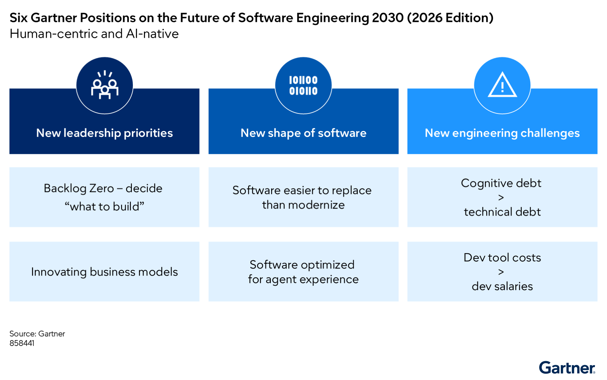
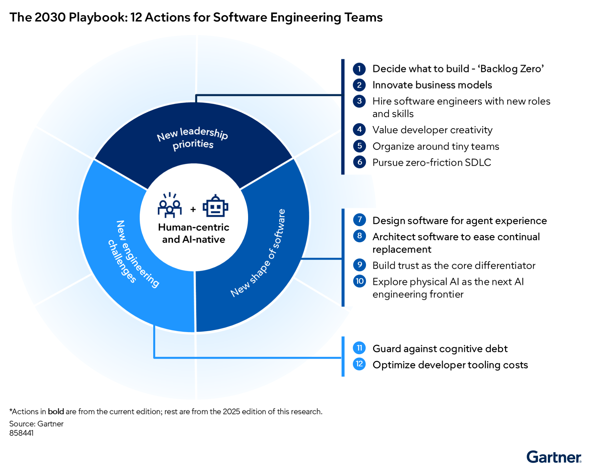

# Tương lai kỹ thuật phần mềm 2030: Tác động của AI tác tử

> **Bài viết chuyển ngữ và biên soạn từ:** *Future of Software Engineering 2030 (2026 Edition): Impact of Agentic AI*, Gartner, Inc., công bố ngày 22/09/2026, ID G00858441, thời lượng đọc khoảng 19 phút.  
> **Nhóm tác giả:** Manjunath Bhat, Akriti Kapoor, Brad Dayley, C.A. Swan, Mark O'Neill, Nabeeha Ahmed, Philip Walsh, Tigran Egiazarov, Annie Hodgkins, Frank O'Connor.  
> **Sáng kiến nghiên cứu:** CxO Leadership; Reshaping the Future of Software Engineering.  
> **Quy ước thuật ngữ:** Các thuật ngữ công nghệ quan trọng được giữ nguyên hoặc trình bày theo định dạng **tiếng Việt (English)** ở lần xuất hiện đầu tiên và tổng hợp tại bảng thuật ngữ cuối bài.

---

## Tóm tắt điều hành: Nghịch lý của kỷ nguyên phần mềm tác tử

Đến năm 2030, **tác tử AI (AI agents)** sẽ trực tiếp xây dựng và sử dụng phần lớn các sản phẩm phần mềm. Bước chuyển biến mang tính thời đại này biến con người trở thành **nút thắt lớn nhất (greatest constraint)** đối với năng lực phân phối phần mềm — nhưng đồng thời cũng biến con người thành **nhân tố kích hoạt lớn nhất (biggest enablers)**. Báo cáo nghiên cứu này của Gartner đưa ra sáu luận điểm chiến lược giúp các nhà lãnh đạo kỹ thuật phần mềm phát triển vững chắc trong một tương lai bản địa AI (AI-native) nhưng lấy con người làm trung tâm (human-centric).

> **Phần mềm đến năm 2030 sẽ là phần mềm tác tử (agentic software) — được xây dựng bởi tác tử, phục vụ cho tác tử, với con người đóng vai trò là hệ số nhân sức mạnh.**

Các đội ngũ sản phẩm AI-native sở hữu cơ chế quản trị mạnh mẽ đang chứng kiến AI xóa nhòa khoảng cách giữa một ý tưởng sơ khởi và một sản phẩm phần mềm hoàn chỉnh có thể vận hành thực tế. Tuy nhiên, AI đang làm cho quy trình phát triển phần mềm trở nên **lấy con người làm trung tâm hơn, chứ không hề giảm đi**. Phán đoán của con người, gu thẩm mỹ sản phẩm (taste), năng lực thấu hiểu nhận thức và tư duy phản biện đang trở nên thiết yếu hơn bao giờ hết.

Khi AI tự động hóa các khía cạnh mang tính rập khuôn, không tạo ra sự khác biệt trong việc phân phối phần mềm, trách nhiệm chính của nhà lãnh đạo kỹ thuật sẽ xoay trục: từ **quản lý việc thực thi (managing execution)** sang **thúc đẩy giá trị kinh doanh (driving business value)**. Một nhà lãnh đạo kỹ thuật phần mềm sẽ đảm nhận vai trò nâng tầm của một nhà lãnh đạo kinh doanh — người được ủy thác nhiệm vụ đổi mới mô hình kinh doanh, thay vì chỉ đơn thuần xây dựng các sản phẩm cải tiến kỹ thuật.

Các bộ công cụ AI-native giúp việc xây dựng, phát hành và thay thế phần mềm trở nên dễ dàng chưa từng thấy, khi các tác tử AI bắt đầu đảm nhận đại đa số tác vụ trong toàn bộ **vòng đời phát triển phần mềm (Software Development Life Cycle — SDLC)**. Thế nhưng, chi phí sử dụng AI gia tăng trong chu kỳ phát triển cũng đẩy mức độ rủi ro của các quyết định kỹ thuật lên mức cao kỷ lục. Tác tử không thể được tin tưởng tuyệt đối để đưa ra các lựa chọn chiến lược ảnh hưởng sống còn đến tổ chức. Quyết định **xây dựng cái gì (và không xây dựng cái gì)** vẫn là trách nhiệm độc quyền của con người với những hệ quả nghiêm trọng.

**Tác tử AI làm cho các kỹ sư phần mềm trở nên có giá trị hơn, chứ không hề ít đi.**

---

## Sáu luận điểm chiến lược của Gartner về tương lai kỹ thuật phần mềm 2030

Báo cáo xác lập sáu luận điểm chiến lược giải thích cách thức trực giác, chiều sâu hiểu biết của con người và năng lực tự chủ của AI bổ sung, củng cố lẫn nhau qua ba trụ cột chuyển đổi lớn:

*Hình 1. Sáu luận điểm của Gartner về tương lai kỹ thuật phần mềm 2030 (Phiên bản 2026) — Định hướng: Lấy con người làm trung tâm và Bản địa AI (Human-centric and AI-native). Nguồn: Gartner (Mã tài liệu 858441).*

Bảng tổng hợp cấu trúc ba trụ cột và sáu luận điểm chiến lược:

| Trụ cột chuyển đổi | Luận điểm chiến lược | Bản chất chuyển dịch cốt lõi |
| :--- | :--- | :--- |
| **1. Ưu tiên lãnh đạo mới** *(New leadership priorities)* | **Luận điểm 1:** Backlog Zero khiến "xây dựng cái gì" trở thành điểm nghẽn chính trong kỹ thuật phần mềm. | Điểm nghẽn dịch chuyển từ năng lực lập trình/thực thi sang phán đoán giá trị sản phẩm. |
| | **Luận điểm 2:** Đổi mới mô hình kinh doanh là sứ mệnh mới của các nhà lãnh đạo kỹ thuật phần mềm. | Lợi thế cạnh tranh chuyển từ năng suất viết mã sang năng lực kiến tạo dòng doanh thu và mô hình thương mại mới. |
| **2. Diện mạo mới của phần mềm** *(New shape of software)* | **Luận điểm 3:** Phần mềm được tối ưu hóa chủ yếu cho trải nghiệm tác tử (Agent Experience — AX). | Người dùng phần mềm chính yếu chuyển từ con người (UX/UI) sang các tác tử AI tự hành (AX/Schemas/APIs). |
| | **Luận điểm 4:** Phần mềm dễ thay thế toàn bộ hơn là hiện đại hóa cục bộ. | Chi phí viết lại phần mềm mới thấp hơn chi phí bảo trì và hiện đại hóa chắp vá các khối nguyên khối cũ. |
| **3. Thách thức kỹ thuật mới** *(New engineering challenges)* | **Luận điểm 5:** Nợ nhận thức (Cognitive Debt) là nghĩa vụ nợ lớn hơn nợ kỹ thuật (Technical Debt). | Nợ kỹ thuật nằm ở dòng mã, nhưng nợ nhận thức nằm trong trí não đội ngũ — xói mòn khả năng thấu hiểu và kiểm soát hệ thống. |
| | **Luận điểm 6:** Chi phí công cụ phát triển phần mềm vượt quá tiền lương kỹ sư phát triển. | Tiền chi trả token, tài nguyên tính toán và công cụ AI vượt qua quỹ lương nhân sự, làm đảo lộn cấu trúc tài chính R&D. |

---

## Cẩm nang 2030: 12 hành động dành cho các đội ngũ kỹ thuật phần mềm

Dựa trên tập hợp các luận điểm chiến lược hợp nhất từ ấn bản 2025 và cập nhật mới nhất năm 2026, Gartner tổng hợp **Cẩm nang 2030 (The 2030 Playbook)** với 12 hành động trọng tâm:

*Hình 2. Cẩm nang 2030: 12 hành động dành cho đội ngũ kỹ thuật phần mềm (The 2030 Playbook: 12 Actions for Software Engineering Teams). Nguồn: Gartner (Mã tài liệu 858441).*

### Danh mục 12 hành động chiến lược:

#### Nhóm 1: Ưu tiên lãnh đạo mới (New leadership priorities)
1. **Quyết định xây dựng cái gì — Thiết lập trạng thái "Backlog Zero"** *(Hành động mới 2026)*.
2. **Đổi mới mô hình kinh doanh** *(Hành động mới 2026)*.
3. Tuyển dụng kỹ sư phần mềm với các vai trò và bộ kỹ năng mới *(Kế thừa từ 2025)*.
4. Đề cao và tưởng thưởng tính sáng tạo của nhà phát triển *(Kế thừa từ 2025)*.
5. Tổ chức bộ máy xoay quanh các nhóm siêu nhỏ (tiny teams) *(Kế thừa từ 2025)*.
6. Theo đuổi vòng đời phát triển phần mềm không ma sát (zero-friction SDLC) *(Kế thừa từ 2025)*.

#### Nhóm 2: Diện mạo mới của phần mềm (New shape of software)
7. **Thiết kế phần mềm tối ưu cho trải nghiệm tác tử (Agent Experience — AX)** *(Hành động mới 2026)*.
8. **Kiến trúc phần mềm thuận tiện cho việc liên tục thay thế linh kiện** *(Hành động mới 2026)*.
9. Xây dựng niềm tin (trust) như một yếu tố phân hóa cạnh tranh cốt lõi *(Kế thừa từ 2025)*.
10. Khám phá AI vật lý (Physical AI) như ranh giới kỹ thuật AI tiếp theo *(Kế thừa từ 2025)*.

#### Nhóm 3: Thách thức kỹ thuật mới (New engineering challenges)
11. **Thiết lập cơ chế phòng ngừa và kiểm soát nợ nhận thức (cognitive debt)** *(Hành động mới 2026)*.
12. **Tối ưu hóa chi phí công cụ phát triển và ngân sách token AI** *(Hành động mới 2026)*.

---

## Chi tiết các luận điểm chiến lược và hành động triển khai

### Trụ cột 1: Ưu tiên lãnh đạo mới (New Leadership Priorities)

---

#### Luận điểm 1: Backlog Zero khiến "xây dựng cái gì" trở thành điểm nghẽn chính trong kỹ thuật phần mềm

**Mô tả:**  
**Backlog Zero** là trạng thái vận hành mà trong đó một đội ngũ kỹ thuật bản địa AI có thể hoàn thành các hạng mục công việc đã sẵn sàng định nghĩa (definition-ready work) nhanh tương đương với tốc độ mà doanh nghiệp sản sinh ra các nhu cầu giá trị mới. Khái niệm này đánh dấu bước ngoặt chuyển dịch: từ việc phân phối bị giới hạn bởi **năng lực triển khai (implementation capacity)** sang phân phối bị giới hạn bởi **phán đoán sản phẩm (product judgment)**. Các tổ chức tạo ra tác động lớn sử dụng Backlog Zero để tái định tuyến năng lực kỹ thuật dôi dư sang các hoạt động khám phá (discovery), thử nghiệm, hiện đại hóa và giảm thiểu rủi ro.

> *Khi các tác tử AI xóa bỏ các nút thắt xuyên suốt SDLC, chỉ còn lại một điểm nghẽn lớn duy nhất: quyết định xây dựng cái gì.*

**Lý do trở thành xu hướng:**  
Các tác tử AI hiện đã nén thời gian viết mã, kiểm thử và viết tài liệu lại đáng kể, giúp giải phóng thời gian để các kỹ sư con người tập trung vào việc khám phá sản phẩm (product discovery), thiết lập ưu tiên và thẩm định giá trị. Trong khi phần lớn các đội ngũ kỹ thuật phần mềm ghi nhận sự gia tăng mạnh mẽ về năng suất, chỉ một số ít chuyển hóa được những bước tiến này thành giá trị kinh doanh cụ thể. 

Theo *Khảo sát tác động của AI đối với các nhà phát triển phần mềm năm 2026 của Gartner (Gartner Impact of AI on Software Developers Survey 2026)*:
- **53%** người trả lời khảo sát báo cáo mức tăng năng suất của đội ngũ từ **11% trở lên**;
- Tuy nhiên chỉ có **32%** báo cáo mức tăng trưởng tương đương về năng lực đổi mới sáng tạo (innovation gains).

Khi năng suất phân phối tăng vọt, nút thắt tiếp theo lập tức lộ diện: các công việc có giá trị và được xác định phạm vi rõ ràng phải được đưa vào bộ máy kỹ thuật với tốc độ ngang bằng với tốc độ mà hệ thống phân phối hoàn tất chúng. Các đợt tư vấn khách hàng của Gartner chỉ ra rằng hàng đợi kỹ thuật (engineering queues) đang co ngắn lại rõ rệt. Backlog Zero đang nổi lên như một phương thức khả thi để xây dựng một lộ trình phần mềm thực sự đáng xây dựng, giúp các đội ngũ giữ vững năng lực phân phối tăng thêm của mình vào các công việc tạo ra giá trị cao nhất.

**Hệ quả đối với tổ chức:**  
Quy mô của backlog và thông lượng xử lý phiếu yêu cầu (ticket throughput) sẽ đánh mất giá trị vốn có trong vai trò là các chỉ số đại diện cho nhu cầu hay mức độ tận dụng năng lực của đội ngũ. Thước đo thành công mới của một nhóm kỹ thuật sẽ là:
1. Năng lực sản sinh liên tục và bền vững các ý tưởng giá trị về những gì cần xây dựng;
2. Khả năng phần mềm mang lại các kết quả kinh doanh kỳ vọng.

Khi AI giúp việc tạo lập phần mềm trở nên nhanh hơn và rẻ hơn, năng lực **quản lý sản phẩm (product management)**, **tri thức miền nghiệp vụ (domain knowledge)** và **chất lượng đặc tả yêu cầu (specification quality)** sẽ trở thành những yếu tố sống còn.

**Hành động cụ thể cho lãnh đạo:**
* **Thiết lập khả năng hiển thị nhu cầu bền vững (sustainable demand visibility):** So sánh tỷ lệ hoàn thành công việc đã sẵn sàng định nghĩa với tỷ lệ xuất hiện các cơ hội đã được kiểm chứng đối với từng sản phẩm và dòng giá trị (value stream).
* **Tạo nguồn cung cơ hội liên tục (continuous opportunity supply):** Kết nối trực tiếp quy trình khám phá sản phẩm với dữ liệu hành vi người dùng, thông tin hỗ trợ kỹ thuật, dữ liệu đo xa vận hành (production telemetry) cùng các biến động về pháp lý và thị trường.
* **Xây dựng năng lực giá trị hậu backlog (postbacklog value capacity):** Giữ lại thời lượng kỹ thuật được giải phóng để phục vụ cho các thử nghiệm có đo lường, công tác hiện đại hóa và giảm thiểu rủi ro kiến trúc, thay vì vội vã cắt giảm nhân sự kỹ thuật.

---

#### Luận điểm 2: Đổi mới mô hình kinh doanh là sứ mệnh mới của các nhà lãnh đạo kỹ thuật phần mềm

**Mô tả:**  
Khi AI bình dân hóa việc nâng cao năng suất và đổi mới tính năng sản phẩm, chỉ riêng hai yếu tố này sẽ không còn mang lại lợi thế cạnh tranh bền vững. Các tổ chức chỉ giành được ưu thế trên thị trường và hiện thực hóa lợi tức đầu tư AI (ROI) khi chuyển hướng năng lực kỹ thuật sang **đổi mới mô hình kinh doanh** — chẳng hạn như kiến tạo các dòng doanh thu mới, mở ra những trải nghiệm khách hàng đột phá hoặc thâm nhập vào các thị trường lân cận.

Đổi mới mô hình kinh doanh là một trách nhiệm hoàn toàn mới đối với các nhà lãnh đạo kỹ thuật phần mềm. Họ buộc phải vận hành như những nhà lãnh đạo kinh doanh thực thụ: phối hợp sự am hiểu sâu sắc về công nghệ với tư duy kinh doanh nhạy bén để kiến tạo, phân phối và thu giữ giá trị do AI mang lại.

**Lý do trở thành xu hướng:**  
AI san phẳng sân chơi doanh nghiệp. Các công ty khởi nghiệp hiện có thể vận hành ở quy mô doanh nghiệp lớn với tốc độ di chuyển nhanh hơn gấp nhiều lần, cho phép các nhóm nhỏ thách thức và làm gián đoạn các doanh nghiệp đầu ngành truyền thống. Điều này diễn ra vì AI mở khóa các năng lực kỹ thuật vốn trước đây bất khả thi cả về mặt kinh tế lẫn kỹ thuật. Những năng lực mới này cho phép tổ chức vượt thoát khỏi các sản phẩm và dịch vụ hiện có để tạo ra giá trị mới cho toàn bộ doanh nghiệp.

Thị trường đã ghi nhận những chỉ dấu sớm của xu hướng này:
- **Capital One Financial Corporation:** Phân bộ phần mềm B2B của tập đoàn này ban đầu xây dựng các công cụ nội bộ phục vụ hạ tầng đám mây và dữ liệu (như *Slingshot*, *Databolt*), sau đó thương mại hóa chúng thành các sản phẩm thương mại độc lập mang lại doanh thu lớn. Việc thương mại hóa các công cụ AI nội bộ tùy biến giúp bù đắp chi phí phát triển bằng cách biến chi phí thành dòng doanh thu mới.
- **Kroger:** Nền tảng quảng cáo số của Kroger được xây dựng bởi các đội ngũ liên chức năng nội bộ, sau đó được tách ra thành một công ty con hoạt động độc lập có tên *84.51°*.

**Hệ quả đối với tổ chức:**  
Các nhà lãnh đạo kỹ thuật phần mềm sẽ được đánh giá dựa trên **kết quả kinh doanh thực tế** (doanh thu nền tảng, mức độ mở rộng hệ sinh thái, cải thiện biên lợi nhuận) thay vì thông lượng sản phẩm bàn giao (delivery output). 

Đổi mới mô hình kinh doanh sẽ thử thách giới hạn năng lực hiện tại của các giám đốc kỹ thuật, đòi hỏi sự kết hợp phức tạp giữa chuyên môn công nghệ, sự nhạy bén thương mại và tư duy phân nhánh (lateral thinking). Những người làm chủ được những kỹ năng và kinh nghiệm này sẽ có vị thế vững chắc để bước lên các vai trò lãnh đạo cấp cao trong ban điều hành (C-level).

**Hành động cụ thể cho lãnh đạo:**
* **Nhận diện các tài sản phần mềm có thể thương mại hóa ra bên ngoài (externalizable software assets):** Đánh giá các nền tảng AI nội bộ, các sản phẩm dữ liệu và các năng lực kinh doanh đã sẵn sàng cho tác tử để xem xét khả năng đóng gói thành sản phẩm B2B, giao diện API thương mại hoặc nền tảng hệ sinh thái.
* **Đồng thiết kế các mô hình kiếm tiền bản địa AI (AI-native monetization models):** Hợp tác chặt chẽ với ban lãnh đạo kinh doanh để thu giữ giá trị do AI tạo ra (ví dụ: định giá dựa trên kết quả đạt được - outcome-based pricing, phí tiêu thụ API theo lưu lượng hoặc cơ chế chia sẻ doanh thu) thông qua các sáng kiến khởi nghiệp nội bộ (intrapreneurship).
* **Trao quyền cho các kỹ sư phần mềm trở thành những nhà khởi nghiệp nội bộ (business model intrapreneurs):** Đào tạo các nhóm kỹ thuật phân tích kiến trúc hệ thống dưới lăng kính thương mại, khuyến khích họ đề xuất các thiết kế sản phẩm và nền tảng giúp mở ra kênh doanh thu mới hoặc tạo hiệu ứng mạng lưới (network effects).

---

### Trụ cột 2: Diện mạo mới của phần mềm (New Shape of Software)

---

#### Luận điểm 3: Phần mềm được tối ưu hóa chủ yếu cho trải nghiệm tác tử (Agent Experience — AX)

**Mô tả:**  
**Trải nghiệm tác tử (Agent Experience — AX)** là khái niệm chỉ việc kiến trúc và thiết kế các sản phẩm, dịch vụ số được tối ưu hóa cho sự tiếp nhận và vận hành bởi các tác tử AI thay vì người dùng con người. Đơn vị hạt nhân của phần mềm bản địa tác tử là một **năng lực nghiệp vụ có thể gọi độc lập (independently invocable domain capability)** — ví dụ: `findCustomer`, `calculateQuote` — phơi bày lược đồ dữ liệu máy đọc được theo chuẩn giao thức ngữ cảnh mô hình (kiểu Model Context Protocol — MCP), chứ không chỉ là một màn hình giao diện hay một điểm cuối CRUD truyền thống. 

Chẳng hạn, các công cụ phát triển AI-native trong SDLC được tối ưu hóa với đối tượng "người dùng" hàng đầu là các tác tử lập trình AI, chứ không phải là lập trình viên con người.

> *Khi các tác tử AI trở thành người dùng chính của phần mềm, việc tối ưu hóa phần mềm cho trải nghiệm tác tử (AX) sẽ trở thành yêu cầu kỹ thuật nền tảng bắt buộc.*

**Lý do trở thành xu hướng:**  
Ba động lực then chốt đang đẩy nhanh bước chuyển dịch sang cải tiến AX:
1. **Các tiêu chuẩn tương tác (interoperability standards):** Sự xuất hiện và trưởng thành của các giao thức như **MCP (Model Context Protocol)**, **A2A (Agent-to-Agent)** và **AP2 (Agent Payment Protocol)** đang thiết lập tính chuẩn hóa và khả năng tương tác, cho phép các tác tử giao tiếp liền mạch với các hệ thống hiện có, đối thoại với tác tử khác và thực thi các giao dịch thanh toán tự động.
2. **Người dùng ủy quyền cho tác tử thông qua các Agent Harness:** Người dùng ngày càng trao quyền cho tác tử thay mặt mình hành động thông qua các khung bao bọc tác tử mới nổi (chẳng hạn như *OpenClaw*, *ZeroClaw* và *Hermes*), loại bỏ hoàn toàn nhu cầu con người phải tương tác qua giao diện đồ họa (GUI) truyền thống.
3. **Sự quá tải của các kho lưu trữ mã nguồn truyền thống:** Các kho mã nguồn dựa trên Git vốn được thiết kế cho con người đang phải vật lộn để đối phó với mức tăng lưu lượng theo cấp số nhân, bị thúc đẩy bởi các hành động tự động của tác tử ở khối lượng và tần suất vượt trội.

**Hệ quả đối với tổ chức:**  
Các dịch vụ "vô hình" trước tác tử (không thể được phát hiện hoặc gọi qua lược đồ máy tính) sẽ bị bỏ qua hoặc bị loại khỏi các luồng công việc tác tử, tạo nên một lớp **tài sản mắc cạn (stranded assets)** không thể đem lại giá trị.

Để tối đa hóa lợi tức từ các khoản đầu tư vào AX, các nhà lãnh đạo kỹ thuật phần mềm phải đặt **niềm tin (trust)** làm nền móng cốt lõi. Người dùng chỉ ủy thác nhiệm vụ cho tác tử AI nếu họ tin tưởng vào cách thức tác tử xử lý dữ liệu, ra quyết định và thực thi hành động. Do đó, tối ưu hóa cho AX đòi hỏi kỹ sư phần mềm phải thiết lập nghiêm ngặt:
- Kiểm soát truy cập (access control);
- Khả năng quan sát chuyên sâu (observability);
- Các rào chắn an toàn (guardrails) khi tác tử trở thành người dùng chính.

**Hành động cụ thể cho lãnh đạo:**
* **Áp dụng kiến trúc khả dịch (composable architecture):** Xây dựng các API sẵn sàng cho tác tử, quy trình hướng sự kiện (event-driven workflows) và kiến trúc ứng dụng - dịch vụ dạng lưới (Mesh App and Service Architecture — MASA), tạo ra các dịch vụ phân tách lỏng lẻo và giao tiếp bất đồng bộ.
* **Đầu tư vào lớp ngữ cảnh (context layer) và đồ thị tri thức doanh nghiệp (enterprise knowledge graph):** Hợp tác chặt chẽ với các đội ngũ dữ liệu, phân tích và kiến trúc doanh nghiệp để mã hóa từ vựng thể chế, ngữ nghĩa dữ liệu và các mối quan hệ nghiệp vụ, giúp tác tử truy xuất dữ liệu doanh nghiệp chính xác theo ngữ cảnh.
* **Chuẩn bị cho các kịch bản hệ thống đa tác tử (multi-agent systems):** Theo dõi mức độ sẵn sàng cho môi trường sản xuất của các giao thức A2A, ACP cùng các chuẩn giao tiếp tác tử khác trong các nền tảng và khung làm việc AI.

---

#### Luận điểm 4: Phần mềm dễ thay thế toàn bộ hơn là hiện đại hóa cục bộ

**Mô tả:**  
Trong nhiều thập kỷ, phương án hiện đại hóa từng phần luôn được ưu tiên vì việc bảo tồn logic nghiệp vụ cài cắm sâu trong các hệ thống cũ (legacy systems) dễ dàng hơn việc tái thiết kế toàn bộ từ đầu. Năng lực của AI hiện đã hạ thấp đáng kể ma sát của việc **thay thế toàn diện ứng dụng (wholesale application replacement)**, trong khi kiến trúc khả dịch (composable architecture) giúp đơn giản hóa việc tráo đổi các cấu phần ở cấp độ linh kiện.

Giờ đây, việc thay thế một khối nguyên khối cũ kỹ trở nên dễ dàng hơn nhiều so với việc chắp vá, hiện đại hóa từng mẩu nhỏ của nó — tương tự như việc người tiêu dùng ngày nay sẵn sàng mua một chiếc TV mới tinh thay vì tìm cách nâng cấp từng linh kiện bên trong một chiếc TV cũ.

**Lý do trở thành xu hướng:**  
Các nhà lãnh đạo kỹ thuật phần mềm không còn phải phụ thuộc vào các dự án hiện đại hóa nhỏ giọt, bởi việc thay thế phần mềm toàn diện đã tiềm ẩn ít rủi ro hơn trước. Sự dịch chuyển này được thúc đẩy bởi hai yếu tố song hành:
- Kiến trúc phần mềm ngày càng mô-đun hóa, mang tính khả dịch cao;
- Những bước tiến nhảy vọt của các công cụ hiện đại hóa và phát triển phần mềm bản địa AI (được phân tích trong các báo cáo *Magic Quadrant for Enterprise AI Coding Agents*, *AI-Augmented Code Modernization Tools* và *Technical Debt Management Tools* của Gartner).

**Hệ quả đối với tổ chức:**  
Thay thế toàn diện không phải là một viên đạn bạc cho mọi trường hợp — các loại phần mềm khác nhau sẽ có mức độ ma sát thay thế rất khác nhau. 

Trong vòng 5 năm tới, định nghĩa về **"hệ thống di sản" (legacy)** sẽ tiến hóa để bao gồm cả những thế hệ ứng dụng mới hơn:
- Ứng dụng bản địa đám mây (cloud-native) và ứng dụng đóng gói container;
- Ứng dụng phát triển trên nền tảng low-code;
- Các phần mềm thương mại đóng gói sẵn (COTS) đã bị can thiệp tùy biến quá nhiều.

Những tổ chức phân phối được kiến trúc mô-đun trưởng thành ngay từ hôm nay sẽ hưởng lợi lớn từ việc thay thế linh kiện dễ dàng, mở ra khả năng **hiện đại hóa liên tục (continuous modernization)** mà không gây gián đoạn cho khách hàng.

**Hành động cụ thể cho lãnh đạo:**
* **Tận dụng các công cụ phát triển tác tử và thiết lập thực hành SDLC bản địa AI:** Rút ngắn thời gian xây dựng và thay thế phần mềm, biến phương án thay thế toàn bộ hệ thống thành một lựa chọn khả thi khi phần mềm cũ kìm hãm bước tiến kinh doanh.
* **Kiến trúc hóa cho tính khả dịch và mô-đun:** Đảm bảo hệ thống tương lai cho phép liên tục tráo đổi linh kiện phần mềm mà không gây ma sát hay gián đoạn trải nghiệm của người dùng cuối, thay vì phải khởi động các chiến dịch hiện đại hóa tại chỗ kéo dài nhiều năm.
* **Đánh giá hệ thống qua lăng kính kép (dual lenses):** Phân tích sự phức tạp trong tích hợp (integration complexity) đối chiếu với mức độ tác động đến khách hàng (customer impact) để đưa ra lựa chọn sáng suốt: giữa nỗ lực hiện đại hóa tại chỗ gian nan, kéo dài và phương án thay thế phần mềm toàn diện một lần.

---

### Trụ cột 3: Thách thức kỹ thuật mới (New Engineering Challenges)

---

#### Luận điểm 5: Nợ nhận thức (Cognitive Debt) là nghĩa vụ nợ lớn hơn nợ kỹ thuật (Technical Debt)

**Mô tả:**  
**Nợ nhận thức (Cognitive debt)** là sự xói mòn tích lũy của sự hiểu biết chung, năng lực phán đoán và kỹ năng giải quyết vấn đề — những yếu tố vốn cho phép một đội ngũ kỹ thuật có thể suy luận thấu đáo về một hệ thống phần mềm và thực hiện các thay đổi an toàn. 

> *Trong khi nợ kỹ thuật (technical debt) cư trú bên trong các dòng mã của hệ thống, thì nợ nhận thức (cognitive debt) cư trú ngay trong chính nguồn nhân lực chịu trách nhiệm vận hành các hệ thống đó.*

Nợ nhận thức đặt ra một nghĩa vụ rủi ro lớn hơn nợ kỹ thuật, bởi nó làm suy yếu năng lực của tổ chức trong việc nhận diện, đánh giá và khắc phục mọi hình thái rủi ro phần mềm khác. Khi các tác tử AI sinh ra lượng mã nguồn vượt quá khả năng tiếp thu và thấu hiểu trọn vẹn của các kỹ sư, các tổ chức sẽ phải vận hành những hệ thống phần mềm ngày càng phức tạp mà không có đủ nhân sự có thể giải thích cách thức chúng hoạt động, dự đoán các điểm gãy vỡ tiềm tàng hoặc nâng cấp chúng một cách an toàn.

Việc thiết kế kỹ thuật phần mềm luôn đòi hỏi sự đánh đổi giữa chi phí, khả năng mở rộng, độ tin cậy, tốc độ và nhiều yếu tố khác. An ninh và quyền riêng tư càng làm gia tăng độ phức tạp. Việc thấu hiểu các nguyên lý phần mềm nền tảng là điều kiện tiên quyết để kỹ sư có thể nhận thức được những sự đánh đổi đó thực sự tồn tại.

**Lý do trở thành xu hướng:**  
AI tác tử đang đẩy thông lượng kỹ thuật lên cao chưa từng thấy, nhưng đồng thời lại làm suy yếu các vòng lặp phản hồi (feedback loops) mà thông qua đó các kỹ sư xây dựng sự hiểu biết chung. AI giúp các nhóm phát hiện lỗi, tái cấu trúc mã (refactor) và tự động sinh mã kiểm thử, từ đó làm giảm một số dạng nợ kỹ thuật bề mặt nhưng lại **đẩy nhanh tốc độ tích tụ nợ nhận thức**. 

Ngay cả khi mã do AI sinh ra hoạt động hoàn hảo và có kiến trúc tốt, đội ngũ kỹ thuật vẫn thiếu hụt một **mô hình tư duy (mental model)** đầy đủ về hành vi của nó. Sự xói mòn tri thức này cực kỳ khó phát hiện, bởi vì các kết quả đầu ra thành công của AI thường làm giảm sự cảnh giác và thổi phồng sự tự tin thái quá của lập trình viên.

**Hệ quả đối với tổ chức:**  
Các hệ thống sẽ trở nên đắt đỏ hơn nhiều khi cần khắc phục sự cố hoặc mở rộng tính năng, bởi vì mỗi thay đổi đều buộc các kỹ sư phải tái tạo lại sự hiểu biết vốn chưa từng được hình thành hoặc đã bị thoái hóa theo thời gian. 

Các buổi đánh giá mã (code review) trở nên hời hợt, thời gian phản ứng khi xảy ra sự cố chậm lại và chất lượng thiết kế suy giảm — ngay cả khi mã nguồn được sinh ra nhìn bề ngoài có vẻ rất chuẩn mực về mặt kỹ thuật.

**Hành động cụ thể cho lãnh đạo:**
* **Giám sát nợ nhận thức qua các chỉ báo quan sát được (observable signals):** Theo dõi tâm lý e ngại thay đổi mã nguồn, các hành vi bất ngờ của hệ thống, thời gian hòa nhập (onboarding) của nhân sự mới bị kéo dài, sự tập trung tri thức cục bộ ở một vài cá nhân và sự suy giảm tự tin của lập trình viên khi chạm vào hệ thống.
* **Bảo tồn sự hiểu biết chung (preserve shared understanding):** Triển khai các buổi phân tích toàn diện hệ thống (system walk-throughs), bình duyệt mã có sự tham gia sâu của con người, lập trình cặp (pair programming), các buổi hồi tưởng (retrospectives) và quy trình chuyển giao tri thức có chủ đích trong các giai đoạn triển khai, gia nhập và rời bỏ dự án.
* **Áp dụng các quy trình làm việc ưu tiên ý định (intent-first workflows):** Ghi nhận mục tiêu, các ràng buộc và lý do đưa ra quyết định kiến trúc trước khi để tác tử sinh ra các thay đổi hệ thống quan trọng, đồng thời yêu cầu các kỹ sư phải giải thích được cách thức các thay đổi đó vận hành và nơi chúng có nguy cơ đổ vỡ (theo phương pháp Phát triển theo định hướng đặc tả — *Spec-Driven Development*).

---

#### Luận điểm 6: Chi phí công cụ phát triển phần mềm vượt quá tiền lương kỹ sư phát triển

**Mô tả:**  
Cuộc cách mạng AI từng hứa hẹn mang lại quy trình phát triển phần mềm rẻ hơn, nhưng trên thực tế, chi phí AI leo thang đang làm thay đổi căn bản cấu trúc kinh tế của kỹ thuật phần mềm. AI sẽ không còn là một giải pháp cắt giảm chi phí đơn thuần. Đối với đại đa số tổ chức, **chi phí gia tăng của AI sẽ vượt tốc độ gia tăng hiệu quả**, khiến việc đánh giá liệu năng lực và giá trị của một mô hình AI có xứng đáng với chi phí của nó hay không trở thành một bài toán sống còn.

> *Chi phí AI sẽ trở thành khoản mục chi phí lớn nhất trong ngân sách phần mềm, vượt xa chi phí tiền lương của các lập trình viên.*

**Lý do trở thành xu hướng:**  
Mặc dù giá token trung bình trên thị trường liên tục giảm, hóa đơn thanh toán AI của doanh nghiệp lại không ngừng tăng phi mã:
- Các quy trình đa tác tử phức tạp tiêu tốn hàng triệu token mỗi ngày, đẩy chi phí trên từng tác vụ lên cao.
- Các nhà cung cấp dịch vụ đang chuyển dần sang các mô hình thuê bao và trả phí theo dung lượng (pay-as-you-go), che giấu chi phí thực tế và gây ra sự biến động khó lường cho ngân sách.
- Sự thiếu hụt giám sát chặt chẽ và quyền tự chủ không được kiểm soát của tác tử làm phình to các chi phí hạ nguồn: chi phí tuân thủ, chi phí đánh giá hành vi tác tử, xác minh kết quả và giải quyết nợ kỹ thuật phát sinh.

Dữ liệu thực tế cho thấy:
- **7%** tổ chức trên nền tảng *Gartner Peer Insights* báo cáo mức chi tiêu vượt quá **2.000 USD cho mỗi nhà phát triển mỗi tháng** chỉ riêng cho token AI.
- Các tập đoàn công nghệ lớn như **Uber** đã tiêu sạch toàn bộ ngân sách AI hàng năm chỉ trong vòng vài tháng đầu và đang phải đặt câu hỏi nghiêm túc về tỷ suất sinh lời thực tế (hiện tượng chạy đua quá đà "tokenmaxxing").
- Việc chấm dứt các gói trợ giá từ nhà cung cấp mô hình, chi phí năng lượng gia tăng và độ phức tạp leo thang của luồng công việc tác tử sẽ đẩy nhanh xu hướng này.

**Hệ quả đối với tổ chức:**  
Chi phí AI leo thang cùng với các khoản chi bắt buộc cho nền tảng bảo mật, dữ liệu và quản trị nhằm giảm thiểu rủi ro sẽ khiến AI trở nên **không thể biện minh về mặt kinh tế đối với các trường hợp sử dụng chỉ dựa thuần túy vào mục tiêu tiết kiệm chi phí**. 

Các quyết định sử dụng AI kỷ luật, dựa trên ROI và sự lựa chọn có chủ đích về mức độ tự chủ của tác tử sẽ là điều kiện tiên quyết để giá trị thu được lớn hơn tổng chi phí bỏ ra. Nhiều công việc kỹ thuật có thể sẽ chứng minh là đạt hiệu quả chi phí cao hơn khi do con người trực tiếp dẫn dắt. Do đó, các tổ chức vội vã cắt giảm nhân sự lập trình viên để chạy theo năng suất AI sẽ sớm phải tuyển dụng lại nhân tài với mức giá đắt đỏ hơn nhiều.

> *Những nhà lãnh đạo kỹ thuật phần mềm biết cách tối ưu hóa sự cân bằng giữa con người và AI, đạt đến điểm ngọt ngào **"ROImaxxing"** — nơi chi tiêu AI được chứng minh đầy đủ bởi giá trị kinh doanh tạo ra — sẽ vượt trội hoàn toàn so với những người vội vã cắt giảm nhân sự hoặc thất bại trong việc gắn kết đầu tư AI với kết quả kinh doanh hữu hình.*

**Hành động cụ thể cho lãnh đạo:**
* **Thực thi quản trị công cụ AI kỷ luật (disciplined AI tooling governance):** Triển khai quản trị chi phí và kiểm soát vận hành dưới dạng mã hóa ("as-code") để tối ưu hóa chi tiêu AI phù hợp với các mục tiêu kinh doanh.
* **Tái cấu trúc phương pháp lập ngân sách phần mềm (restructure software budgeting):** Chuyển từ ngân sách công cụ tĩnh sang các mô hình toàn diện hạch toán cả chi phí cố định và biến đổi của AI, bao gồm mức tiêu thụ token cùng các chi phí hạ nguồn như xác minh tính đúng đắn, đánh giá hành vi tác tử, làm lại (rework) và tuân thủ pháp lý.
* **Triển khai AI theo định hướng trường hợp sử dụng (use-case-driven AI deployment):** Thiết lập các khung đánh giá để xác định thời điểm và cách thức công cụ và tác tử AI được sử dụng, ở cấp độ tự chủ nào, tuân thủ nguyên tắc đặc quyền tối thiểu cần thiết (principle of least necessary privilege). Dành các công cụ AI đắt đỏ cho những nơi mang lại tỷ suất lợi nhuận (ROI) cao nhất.

---

## Nhìn lại: Sự tiến hóa từ ấn bản nghiên cứu 2025 sang 2026

Phần này điểm lại và cập nhật sáu luận điểm từ ấn bản nghiên cứu *Tương lai của kỹ thuật phần mềm 2030* năm 2025 của Gartner, phản ánh sự biến chuyển vượt bậc của công nghệ và thực tiễn thị trường:

### 1. AI thúc đẩy nhu cầu kỹ sư phần mềm với các vai trò và kỹ năng mới
*Cập nhật từ luận điểm năm 2025: "AI thúc đẩy nhu cầu tuyển dụng nhiều nhà phát triển hơn, chứ không ít đi."*

AI làm bùng nổ nhu cầu về các kỹ sư phần mềm đảm nhận những vai trò hoàn toàn mới và sở hữu bộ kỹ năng khác biệt. Nhu cầu tuyển dụng trong tương lai sẽ đến từ các chức danh mới nổi:
- **Kỹ sư sản phẩm (Product Engineers):** Các kỹ sư có năng lực quản lý sản phẩm, sở hữu tư duy kinh doanh nhạy bén.
- **Kỹ sư AI (AI Engineers):** Chuyên gia tinh chỉnh và tích hợp các mô hình trí tuệ nhân tạo.
- **Kỹ sư triển khai tiền tuyến (Forward-Deployed Engineers):** Nhân sự kỹ thuật làm việc trực tiếp tại hiện trường khách hàng để giải quyết các bài toán tích hợp phức tạp.
- **Kỹ sư nền tảng (Platform Engineers):** Xây dựng hạ tầng tự phục vụ và các đường ống phân phối nội bộ.

Đi kèm với đó là các kỹ năng kỹ thuật thế hệ mới như:
- **Kỹ thuật ngữ cảnh (Context Engineering):** Nghệ thuật và kỹ thuật thu thập, cấu trúc và cung cấp ngữ cảnh doanh nghiệp chính xác cho mô hình.
- **Kỹ thuật bao bọc tác tử (Harness Engineering):** Thiết kế và vận hành các môi trường runtime, rào chắn bảo mật, quyền hạn và công cụ cho các tác tử AI hoạt động.

### 2. Sự sáng tạo của nhà phát triển, chứ không phải năng suất, quyết định thành công của kỹ thuật
Nghiên cứu của Gartner về chân dung **"nhà phát triển khởi nghiệp nội bộ" (intrapreneur developer)** định vị sự sáng tạo dựa trên tư duy doanh nhân. Họ là những lập trình viên hoạt động như những nhà sáng lập nội bộ: chủ động phát hiện các cơ hội mới, tự mình quyết định xây dựng cái gì và thúc đẩy giá trị đến tay khách hàng bằng việc nhận trách nhiệm giải trình toàn trình (end-to-end ownership). Các tổ chức đang tích cực săn đón các "kỹ sư sản phẩm" — những người dung hòa xuất sắc giữa kỹ năng viết mã và tư duy quản lý sản phẩm.

### 3. Các nhóm sản phẩm siêu nhỏ (tiny teams) nở rộ, được trao quyền bởi các nhóm nền tảng
Các tổ chức đang tích cực đưa vào vận hành mô hình **"nhóm siêu nhỏ" (tiny teams)** — mỗi nhóm thông thường bao gồm:
- Một chủ sở hữu sản phẩm (Product Owner);
- Một nhà thiết kế sản phẩm (Product Designer);
- Từ một đến hai kỹ sư phần mềm bản địa AI (AI-native software engineers).

**Dẫn chứng thực tế:** Tập đoàn dịch vụ bất động sản thương mại **CBRE** đã đạt được mức giảm **15% thời gian chu kỳ (lead time)** khi thử nghiệm và triển khai diện rộng các nhóm siêu nhỏ trong quy trình SDLC tác tử. Tuy nhiên, Gartner khuyến nghị cần có cơ chế quản trị trên nền tảng (platform-enabled governance) để nhân rộng mô hình này hiệu quả, đồng thời nhấn mạnh rằng *nhóm siêu nhỏ là khái niệm về quy mô của một nhóm làm việc độc lập, chứ không đồng nghĩa với việc thu hẹp quy mô tổng lực lượng lao động của doanh nghiệp*.

### 4. Niềm tin là yếu tố phân hóa cốt lõi để giành người dùng và thị phần
Niềm tin đang nổi lên thành yếu tố cạnh tranh mang tính quyết định khi các đội ngũ kỹ thuật ngày càng xây dựng nhiều ứng dụng tác tử. Trong năm 2026, Gartner đã chính thức mở thêm các phân khúc thị trường nghiên cứu mới nhằm theo dõi các công cụ nâng cao niềm tin của người dùng vào tác tử AI:
- **Nền tảng đánh giá và quan sát AI (AI evaluation and observability platforms);**
- **Cổng kết nối AI (AI gateways);**
- **Nền tảng quản trị AI (AI governance platforms).**

Các thị trường này đang chứng kiến làn sóng hợp nhất thần tốc khi các nhà cung cấp lớn tìm cách thâu tóm các công nghệ chuyên sâu để lấp đầy khoảng trống niềm tin của khách hàng (điển hình như thương vụ tập đoàn **Cisco** thâu tóm công ty công nghệ quan sát AI **Galileo**).

### 5. AI vật lý (Physical AI) là ranh giới kỹ thuật AI tiếp theo
*Cập nhật từ luận điểm năm 2025: "Robot tự hành là ranh giới kỹ thuật phần mềm tiếp theo."*

Gartner mở rộng góc nhìn vượt ra ngoài phạm vi của các robot tự hành truyền thống để tập trung vào **AI vật lý (Physical AI)** như một ranh giới kỹ thuật AI kế tiếp. Khái niệm này bao hàm:
- Thiết bị bay không người lái tự hành (autonomous drones);
- Phương tiện tự hành (self-driving vehicles);
- Các thiết bị thông minh cảm nhận không gian và môi trường thực.

Các nhà cung cấp mô hình biên như **Anthropic** và **World Labs**, cùng các hãng sản xuất phần cứng bán dẫn như **Arm** và **Nvidia**, đang thích ứng mạnh mẽ với bước chuyển này:
- **Anthropic** đã giới thiệu **Tiêu chuẩn phần cứng mô hình (Model Hardware Standard — MHS)**, đóng vai trò cầu nối đối với AI vật lý tương tự như giao thức MCP đối với AI tác tử.
- Năm 2026, **World Labs** đã mua lại **SceniX**, một công ty mô phỏng và robotics phát triển động cơ chuyển đổi thực tế - sang - mô phỏng - sang - thực tế (**real-to-sim-to-real / R2S2R**), biến đổi dữ liệu từ thế giới vật lý thành các mô phỏng số và ngược lại.

### 6. SDLC không ma sát, vận hành bởi các nhà máy tối AI, chuyển hóa liền mạch ý định thành kết quả
*Cập nhật từ luận điểm năm 2025: "SDLC không ma sát chuyển đổi ý định thành kết quả trong một bước duy nhất."*

Các nhà lãnh đạo kỹ thuật đang theo đuổi mục tiêu thiết lập một quy trình SDLC không ma sát thông qua việc ứng dụng các **"nhà máy tối AI" (AI dark factories)** đóng vai trò đường ống phân phối tác tử.

Trong phương thức này:
- Các lập trình viên chỉ cần diễn đạt **ý định (intent)** — những gì cần được xây dựng;
- Các nhà máy tối AI — đóng vai trò là các harness tác tử tự hành phục vụ cho SDLC — sẽ tự động chuyển hóa ý định đó thành quá trình triển khai mã nguồn thực tế.

Được mô phỏng theo mô hình các nhà máy sản xuất tự động hoàn toàn "tắt đèn" (lights-out manufacturing plants) trong công nghiệp, nhà máy tối AI vận hành thông qua hai chốt chặn nghiêm ngặt:
1. **Cổng nạp tác tử (agentic intake gate):** Tiếp nhận và tự động thẩm định, kiểm chứng các yêu cầu đầu vào;
2. **Cổng xác thực con người (human-verification gate):** Con người trực tiếp thanh tra và phê duyệt các kết quả đầu ra trước khi phát hành chính thức lên môi trường vận hành thực tế (production).

---

## Dẫn chứng thực tế và tài liệu trích dẫn

1. **Khảo sát Gartner về tác động của AI đối với các nhà phát triển phần mềm năm 2026 (Gartner Impact of AI on Software Developers Survey 2026):** Khảo sát trực tuyến được tiến hành từ tháng 11 đến tháng 12 năm 2025 với 303 người tham gia tại Bắc Mỹ (n = 164), Tây Âu (n = 104) và Châu Á - Thái Bình Dương (n = 35). Các tổ chức tham gia đại diện cho nhiều ngành nghề với doanh thu tối thiểu 250 triệu USD trong năm tài chính 2024. Đối tượng tham gia là các nhà quản lý kỹ thuật hoặc kỹ sư đóng góp trực tiếp chịu trách nhiệm chính về kỹ thuật phần mềm, phát triển ứng dụng và nền tảng. Hơn 70% tham gia phát triển phần mềm mới hoặc bổ sung tính năng lớn; 100% sử dụng công cụ AI hoặc xây dựng ứng dụng AI.
2. **Các giải pháp dữ liệu thúc đẩy lộ trình AI của Capital One:** Giới thiệu bộ công cụ *Slingshot* và *Databolt* được thương mại hóa từ các công cụ nội bộ thành sản phẩm phần mềm B2B độc lập (Capital One Software).
3. **Phá vỡ rào cản và tạo sự gắn kết với khách hàng từ 84.51°:** Câu chuyện thương mại hóa nền tảng quảng cáo nội bộ của tập đoàn bán lẻ Kroger thành công ty con công nghệ độc lập (8451.com).
4. **Nghiên cứu về nợ nhận thức trên arXiv:** *From Technical Debt to Cognitive and Intent Debt: Rethinking Software Health in the Age of AI* — Đặt lại vấn đề về sức khỏe phần mềm, phân định nợ kỹ thuật trên mã nguồn với nợ nhận thức trong tư duy đội ngũ.
5. **Bản tin AI chuyên sâu:** *The Batch: What Matters in AI Right Now*, deeplearning.ai.
6. **Thăm dò chi tiêu token AI của lập trình viên:** Khảo sát cộng đồng ngang hàng Gartner (*Gartner Peer Community*) về mức chi tiêu token hàng tháng cho các công cụ AI như Claude Code.
7. **Báo cáo tài chính và chi phí AI tại Uber:** Giám đốc vận hành (COO) của Uber chia sẻ về thách thức khi biện minh cho ngân sách AI khổng lồ trước hiện tượng lạm dụng token (*tokenmaxxing*), đăng tải trên Business Insider.
8. **Thương vụ World Labs mua lại SceniX:** Bước chuyển mình phát triển động cơ mô phỏng thế giới vật lý sang mô phỏng R2S2R, công bố bởi World Labs.

---

## Tài liệu khuyến nghị đọc thêm của nhóm tác giả Gartner

- *How to Drive AI Value in Software Engineering* (Cách thúc đẩy giá trị AI trong kỹ thuật phần mềm).
- *Unlock AI-Native Engineering Value by Rethinking Your Software Delivery Model* (Khai phóng giá trị kỹ thuật bản địa AI bằng cách tái tư duy mô hình phân phối phần mềm).
- *Prevent Agentic AI From Eroding Software Engineering Skills* (Ngăn chặn AI tác tử làm xói mòn kỹ năng kỹ thuật phần mềm).
- *Innovation Insight: Spec-Driven Development* (Góc nhìn đổi mới: Phát triển định hướng đặc tả).
- *4 Strategies to Manage the Escalating Cost of AI Coding Assistants and Agents* (4 chiến lược quản lý chi phí leo thang của trợ lý và tác tử lập trình AI).
- *How to Optimize Token Consumption for AI Coding Agents* (Cách tối ưu hóa mức độ tiêu thụ token cho các tác tử lập trình AI).
- *AI Token Management Playbook for Software Engineering* (Cẩm nang quản lý token AI trong kỹ thuật phần mềm).
- *Choosing API Formats for AI Agents and Applications* (Lựa chọn định dạng API cho các tác tử và ứng dụng AI).
- *Guide to Redesigning the Software Engineer Job in the Age of AI* (Hướng dẫn tái thiết kế công việc kỹ sư phần mềm trong kỷ nguyên AI).
- *Dark Factories, Run by AI Agents, Will Power the Zero-Friction SDLC* (Các nhà máy tối do tác tử AI vận hành sẽ cung cấp sức mạnh cho SDLC không ma sát).

---

## Bảng thuật ngữ chuyên ngành song ngữ (Bilingual Glossary)

| Thuật ngữ tiếng Việt | Thuật ngữ gốc tiếng Anh | Định nghĩa tóm tắt trong ngữ cảnh báo cáo |
| :--- | :--- | :--- |
| **Phần mềm tác tử** | Agentic Software | Phần mềm được xây dựng bởi tác tử AI, tối ưu hóa cho tác tử sử dụng, với con người đóng vai trò là hệ số nhân sức mạnh. |
| **Trải nghiệm tác tử** | Agent Experience (AX) | Thiết kế kiến trúc và lược đồ giao tiếp của phần mềm tối ưu cho sự tiếp nhận và tương tác của tác tử AI thay vì giao diện người dùng con người (UX). |
| **Khung bao bọc tác tử** | Agent Harness | Môi trường runtime cung cấp ngữ cảnh, rào chắn an toàn, kết nối công cụ và quản lý phiên cho tác tử AI tự hành vận hành. |
| **Giao thức ngữ cảnh mô hình** | Model Context Protocol (MCP) | Chuẩn mở giúp kết nối liền mạch các mô hình và tác tử AI với các công cụ, nguồn dữ liệu và hệ thống doanh nghiệp. |
| **Backlog Zero** | Backlog Zero | Trạng thái kỹ thuật hoàn thành công việc đã sẵn sàng định nghĩa nhanh tương đương tốc độ phát sinh nhu cầu giá trị mới từ doanh nghiệp. |
| **Nợ nhận thức** | Cognitive Debt | Sự xói mòn tích lũy trong sự thấu hiểu chung, mô hình tư duy và khả năng giải thích hệ thống của đội ngũ kỹ sư vận hành. |
| **Nợ kỹ thuật** | Technical Debt | Những thỏa hiệp kỹ thuật ngắn hạn trong mã nguồn hoặc kiến trúc làm tăng chi phí bảo trì và thay đổi trong tương lai. |
| **Kiến trúc khả dịch** | Composable Architecture | Kiến trúc lắp ghép từ các linh kiện độc lập, phân tách lỏng lẻo, giao tiếp bất đồng bộ, dễ dàng tráo đổi và nâng cấp. |
| **Nhà máy tối AI** | AI Dark Factory | Đường ống phân phối phần mềm tự hành hoàn toàn bằng tác tử (mô phỏng nhà máy tắt đèn), tự động hóa từ ý định đến mã nguồn với các cổng kiểm soát. |
| **Phát triển định hướng đặc tả** | Spec-Driven Development | Phương pháp phát triển phần mềm bắt đầu bằng việc xác định rõ ràng ý định, mục tiêu, ràng buộc và lý do quyết định trước khi sinh mã. |
| **Lập trình viên khởi nghiệp nội bộ** | Intrapreneur Developer | Kỹ sư phần mềm tư duy như người sáng lập nội bộ, có năng lực phát hiện cơ hội kinh doanh và chịu trách nhiệm toàn trình cho sản phẩm. |
| **Kỹ thuật ngữ cảnh** | Context Engineering | Kỹ năng thiết kế, thu thập, chắt lọc và truyền tải tri thức tổ chức và ngữ nghĩa dữ liệu chính xác vào các lời nhắc của tác tử AI. |
| **Kỹ thuật bao bọc tác tử** | Harness Engineering | Kỹ năng thiết kế và tinh chỉnh môi trường runtime, hộp cát thực thi an toàn và rào chắn kiểm soát hành vi cho tác tử. |
| **Độ bão hòa token** | Tokenmaxxing | Hành vi lạm dụng token AI quá đà trong các quy trình tác tử phức tạp gây lãng phí ngân sách và suy giảm tỷ suất ROI. |
| **Tối ưu hóa giá trị đầu tư AI** | ROImaxxing | Điểm ngọt ngào mà tại đó chi tiêu cho AI được cân bằng hoàn hảo và chứng minh được bằng giá trị kinh doanh tạo ra. |
| **AI vật lý** | Physical AI | Trí tuệ nhân tạo tương tác và vận hành trực tiếp trong thế giới thực thông qua các thiết bị bay không người lái, phương tiện tự hành và cảm biến. |
| **Thực tế - Mô phỏng - Thực tế** | Real-to-Sim-to-Real (R2S2R) | Công nghệ chuyển đổi dữ liệu từ thế giới vật lý thành môi trường mô phỏng để huấn luyện AI và truyền ngược kết quả lại thế giới thực. |
