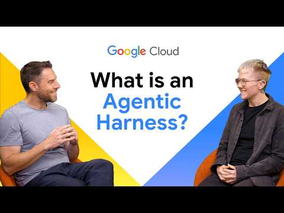
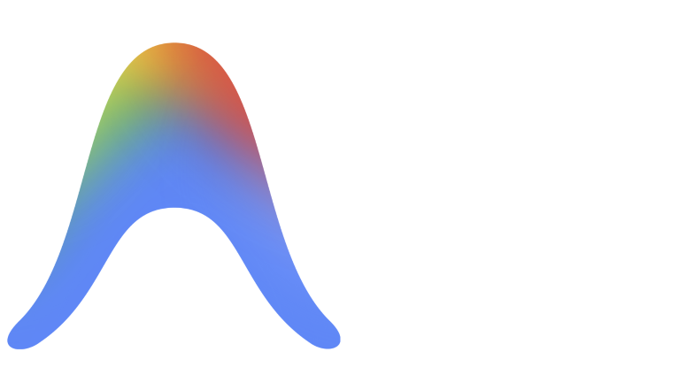

# Agent Harness là gì?

> **Bản dịch tiếng Việt từ:** [What is an agent harness?](https://cloud.google.com/discover/agent-harness), Google Cloud.  
> **Trang nguồn hiển thị lần cập nhật gần nhất:** 20/08/2026.  
> **Quy ước thuật ngữ:** Từ khóa quan trọng được trình bày theo dạng **tiếng Việt (English)** ở lần xuất hiện đầu tiên.

**Bộ khung vận hành tác tử (agent harness)** — còn được gọi là **bộ khung agentic (agentic harness)** — là một môi trường phần mềm bao quanh mô hình [trí tuệ nhân tạo](https://cloud.google.com/learn/what-is-artificial-intelligence), cho phép mô hình:

- Tương tác với công cụ bên ngoài.
- Ghi nhớ những lần tương tác trước.
- Thực hiện nhiệm vụ gồm nhiều bước.

Một mô hình ngôn ngữ tiêu chuẩn chỉ có thể tạo văn bản. Agent harness biến khả năng sinh văn bản đó thành hành động bằng cách cung cấp hạ tầng mà mô hình cần để vận hành an toàn trong một hệ thống lớn hơn.

Khi một [tác tử AI (AI agent)](https://cloud.google.com/discover/what-are-ai-agents) đưa ra câu trả lời hoặc thực hiện hành động, harness là framework bên dưới chịu trách nhiệm truy xuất dữ liệu, thực thi công cụ và đưa kết quả trở lại mô hình.

[](https://www.youtube.com/watch?v=W9BX0jyzd2k)

*Video giới thiệu các tính năng của agentic harness. Nguồn hình: Google Cloud.*

---

## Agent harness hoạt động như thế nào?

Mô hình ngôn ngữ không thể tự mình duyệt web, truy vấn cơ sở dữ liệu hoặc gửi email. Chúng cần một hệ thống bên ngoài để:

1. Tiếp nhận đầu ra dạng văn bản.
2. Nhận biết đầu ra đó là lệnh.
3. Thực thi lệnh.
4. Đưa kết quả trở lại mô hình.
5. Xác định khi nào nhiệm vụ được xem là hoàn tất.

Agentic harness thực hiện những chức năng này thông qua một số cơ chế chính.

### Kết nối mô hình với công cụ

Harness xử lý việc chuyển đổi giữa mô hình và các **giao diện lập trình ứng dụng (Application Programming Interfaces — APIs)** bên ngoài.

Tác tử AI thường gặp khó khăn khi sử dụng API truyền thống vì API không cung cấp sẵn loại ngữ cảnh động mà mô hình cần để suy luận hiệu quả. Để giải quyết vấn đề, nhiều agent harness hiện đại sử dụng [**Giao thức ngữ cảnh mô hình (Model Context Protocol — MCP)**](https://cloud.google.com/discover/what-is-model-context-protocol).

MCP chuẩn hóa cách tác tử AI kết nối với nguồn dữ liệu và công cụ bên ngoài. Nhờ đó, nhà phát triển có thể thay thế thành phần dễ dàng hơn mà không cần viết lại toàn bộ ứng dụng.

### Quản lý trạng thái và bộ nhớ

Mô hình vốn không tự nhớ điều đã xảy ra hai bước trước trong một workflow phức tạp. Harness duy trì:

- Ngữ cảnh cuộc hội thoại.
- Trạng thái của nhiệm vụ.
- Những công cụ agent đã sử dụng.
- Kết quả của các lần gọi công cụ.
- Yêu cầu ban đầu của người dùng.

Nhờ thông tin này, agent có thể lập kế hoạch cho bước tiếp theo.

### Cung cấp guardrail

Khi agent quyết định thực hiện một hành động, harness thực thi các quy tắc bảo mật. Nó kiểm tra liệu agent có đúng quyền để gọi API cụ thể hay không, qua đó ngăn mô hình:

- Thực hiện hành động chưa được phép.
- Truy cập dữ liệu bị hạn chế.
- Vượt quá phạm vi của người dùng hiện tại.
- Gây ra thay đổi ngoài ý muốn đối với hệ thống bên ngoài.

---

## Agent harness và orchestration framework khác nhau thế nào?

**Framework điều phối (orchestration framework)** giúp nhà phát triển xây ứng dụng mô hình ngôn ngữ bằng cách nối các prompt và nguồn dữ liệu với nhau.

Agent harness là một loại môi trường triển khai được xây dựng riêng cho tác tử tự chủ. Hai khái niệm có trọng tâm khác nhau:

| Khía cạnh | Orchestration framework | Agent harness |
|---|---|---|
| Trọng tâm | Trải nghiệm phát triển và cách viết luồng xử lý | Môi trường runtime của tác tử |
| Vai trò chính | Kết nối prompt, mô hình và dữ liệu | Duy trì vòng lặp, trạng thái, công cụ và bảo mật |
| Thời gian hoạt động | Thường theo request hoặc workflow đã định nghĩa | Có thể vận hành liên tục qua nhiều bước |
| Theo dõi tiến độ | Do workflow hoặc ứng dụng quản lý | Harness theo dõi trạng thái và tiến độ agent |
| Tương tác bên ngoài | Qua integration được lập trình | Qua tool/API/MCP có kiểm soát |
| An toàn | Phụ thuộc vào ứng dụng | Guardrail và permission boundary là thành phần runtime |

Orchestration framework tập trung vào cách nhà phát triển xây mã. Harness tập trung vào việc bảo đảm agent có thể chạy liên tục, theo dõi tiến độ của chính nó và tương tác an toàn với hệ thống bên ngoài.

---

## Các câu hỏi thường gặp

### Model Context Protocol là gì?

**Model Context Protocol (MCP)** là một tiêu chuẩn mở cho phép tác tử AI kết nối an toàn với nguồn dữ liệu và công cụ.

Thay vì xây integration API tùy chỉnh cho từng dịch vụ, tổ chức có thể dùng một giao thức chung. Điều này giúp agent harness quản lý kết nối bên ngoài và truy xuất dữ liệu dễ hơn.

### Chatbot cơ bản có cần agent harness không?

Nếu [chatbot](https://cloud.google.com/use-cases/ai-chatbot) chỉ trả lời câu hỏi dựa trên prompt cố định hoặc dữ liệu huấn luyện nội bộ, bạn không cần một agent harness đầy đủ.

Tuy nhiên, agent harness cung cấp hạ tầng cần thiết nếu chatbot phải:

- Duyệt internet.
- Truy vấn cơ sở dữ liệu đang hoạt động.
- Thực hiện workflow phức tạp gồm nhiều bước.
- Đặt lịch hoặc thực hiện hành động thay người dùng.
- Gọi API có ảnh hưởng tới hệ thống bên ngoài.

### Agent harness bảo vệ dữ liệu như thế nào?

Agent harness đóng vai trò **điểm kiểm soát bảo mật (security checkpoint)** giữa mô hình ngôn ngữ và hệ thống bên ngoài.

Harness thực thi ranh giới quyền hạn, bảo đảm mô hình chỉ được:

- Gọi API đã được cho phép.
- Truy cập dữ liệu mà người dùng có quyền xem.
- Thực hiện hành động trong phạm vi nhiệm vụ.

Cơ chế này giúp tránh việc mô hình vô tình làm rò rỉ thông tin nhạy cảm hoặc thực hiện hành động phá hoại.

---

## Lợi ích của agent harness

### Tăng tốc phát triển

Agentic harness cung cấp các kết nối dựng sẵn tới công cụ và API phổ biến, giúp nhà phát triển giảm thời gian viết mã integration.

### Cải thiện độ tin cậy

Harness cung cấp phương thức có cấu trúc để xử lý:

- Lỗi API.
- Timeout.
- Định dạng dữ liệu không mong đợi.
- Tool call thất bại.
- Retry và phục hồi.

### Tăng khả năng quan sát

Vì harness quản lý toàn bộ đầu vào và đầu ra, tổ chức dễ giám sát hành động của agent để:

- Kiểm tra bảo mật.
- Theo dõi chi phí.
- Điều chỉnh hiệu năng.
- Truy vết lỗi.
- Kiểm toán hành động.

### Đơn giản hóa kiểm thử

Nhà phát triển có thể dùng harness để chạy đánh giá tự động, kiểm tra cách agent hành xử trong môi trường mô phỏng trước khi phát hành cho người dùng.

---

## Cách thiết lập agent harness

Xây dựng agent harness có nghĩa là bao quanh mô hình ngôn ngữ bằng mã quản lý đầu vào, đầu ra và quá trình thực thi công cụ. Dưới đây là quy trình lý thuyết để thiết lập môi trường này.

### Bước 1: Khởi tạo vòng lặp lõi

Bắt đầu bằng cách tạo **vòng lặp suy luận liên tục (continuous reasoning loop)**:

1. Nhận prompt của người dùng.
2. Gửi prompt tới mô hình ngôn ngữ.
3. Chờ phản hồi.
4. Phân tích xem phản hồi là câu trả lời hay yêu cầu gọi công cụ.
5. Tiếp tục vòng lặp cho tới khi mô hình xác nhận đã hoàn tất yêu cầu.

Vòng lặp phải có điều kiện dừng như số bước tối đa, thời gian tối đa hoặc ngân sách token để tránh vận hành vô hạn.

### Bước 2: Tích hợp công cụ bằng MCP

Thay vì hardcode từng API request cho mọi công cụ, nhà phát triển có thể triển khai MCP server.

Các công cụ — chẳng hạn hàm truy vấn cơ sở dữ liệu hoặc API thời tiết — được đăng ký trong giao thức. Khi mô hình cần thông tin:

1. Mô hình tạo một yêu cầu có cấu trúc.
2. Harness chặn và xác thực yêu cầu.
3. Yêu cầu được chuyển qua MCP server.
4. Công cụ được thực thi.
5. Dữ liệu kết quả được trả về harness.

### Bước 3: Quản lý cửa sổ ngữ cảnh

Harness cần logic tiếp nhận đầu ra của công cụ và nối nó vào lịch sử hội thoại đang chạy. Lịch sử cập nhật được gửi trở lại mô hình ngôn ngữ.

Bước này đặc biệt quan trọng vì nó cho phép mô hình:

- Phân tích dữ liệu mới.
- Quyết định có cần gọi thêm công cụ hay không.
- Tạo câu trả lời cuối cùng.

Khi lịch sử vượt quá giới hạn, harness có thể cần tóm tắt, nén, truy xuất chọn lọc hoặc chuyển dữ liệu sang memory bên ngoài.

### Bước 4: Triển khai agentic harness

Sau khi mã hoạt động cục bộ, bước cuối cùng là chuyển agentic harness tới môi trường production để nó có thể hoạt động liên tục.

Môi trường phải hỗ trợ:

- Quản lý secret và danh tính workload.
- Logging và tracing.
- Autoscaling.
- Timeout, retry và dead-letter handling.
- Giới hạn tài nguyên và chi phí.
- Isolation cho quá trình thực thi công cụ.

---

## Triển khai và mở rộng hoạt động của agent

Một harness nhẹ là cách phù hợp để prototype và kiểm thử các mô hình mở. Tuy nhiên, chuyển sang production đòi hỏi hạ tầng có thể xử lý:

- Hoạt động liên tục.
- Bảo mật.
- Mở rộng quy mô.
- Trạng thái và bộ nhớ.
- Khả năng phục hồi.

Đối với prototype nhanh, môi trường container serverless cho phép đưa agent vào hoạt động với ít chi phí vận hành.

Khi workload agentic trở nên phức tạp hoặc xử lý dữ liệu doanh nghiệp nhạy cảm, yêu cầu triển khai chuyển sang các nền tảng điều phối mạnh hơn. Những môi trường này cung cấp monitoring, tracing và evaluation nâng cao để quản lý agent phức tạp, bảo đảm compliance, data governance và ổn định vận hành.

---

## Các trường hợp sử dụng agent harness phổ biến trên Google Cloud

Agentic harness đóng vai trò lớp runtime và bảo mật kết nối foundation model với dịch vụ và công cụ Google Cloud. Bằng cách quản lý state, permission và tool execution, harness hỗ trợ nhiều mẫu doanh nghiệp.

### Truy xuất và phân tích dữ liệu tự động

Harness kết nối mô hình ngôn ngữ với cơ sở dữ liệu và công cụ phân tích như [BigQuery](https://cloud.google.com/bigquery) hoặc [Spanner](https://cloud.google.com/spanner), sử dụng giao thức chuẩn như MCP.

Harness có thể:

- Xác thực SQL do mô hình tạo.
- Thực thi ranh giới danh tính người dùng.
- Chạy truy vấn.
- Đưa kết quả trở lại mô hình để suy luận theo ngữ cảnh.

### Microservice tác tử serverless

Nhà phát triển có thể triển khai agent runtime dưới dạng microservice container hóa trên [Cloud Run](https://cloud.google.com/run).

Harness quản lý request đến, phối hợp API call bất đồng bộ và chạy tool workflow mà không cần duy trì hạ tầng nhàn rỗi liên tục.

### Grounding doanh nghiệp và truy xuất ngữ cảnh an toàn

Khi grounding agent bằng tri thức doanh nghiệp trong [Cloud Storage](https://cloud.google.com/storage) hoặc [Agent Search](https://docs.cloud.google.com/generative-ai-app-builder/docs), harness thực thi kiểm soát [Identity and Access Management (IAM)](https://docs.cloud.google.com/iam/docs) chi tiết.

Nhờ đó, agent chỉ truy xuất tài liệu mà người dùng hiện tại được phép xem.

### DevOps vận hành và chẩn đoán sự cố

Harness có thể thực thi workflow chẩn đoán nhiều bước trên [Cloud Logging](https://cloud.google.com/logging) và [Cloud Monitoring](https://cloud.google.com/monitoring).

Agent có thể an toàn:

- Phân loại đột biến lỗi.
- Phân tích log và trace.
- Tương quan tín hiệu.
- Đề xuất bước khắc phục trong guardrail vận hành giới hạn.

### Điều phối đa tác tử và workflow pipeline

Khi sử dụng luồng sự kiện như [Pub/Sub](https://cloud.google.com/pubsub) hoặc Application Integration, harness quản lý việc chuyển giao state và giao tiếp giữa các agent chuyên biệt cùng cộng tác trên nhiệm vụ doanh nghiệp phức tạp.

---

## Các sản phẩm và dịch vụ Google Cloud liên quan

### Cloud Run


[Cloud Run](https://cloud.google.com/run) cho phép triển khai agent harness trực tiếp lên hạ tầng serverless. Đây là đường triển khai nhanh để đưa agent vào hoạt động mà không cần quản lý máy chủ.

### Google Antigravity



[Google Antigravity](https://antigravity.google/) là bộ công cụ phát triển ưu tiên agent, gồm ứng dụng desktop, CLI và SDK dùng chung một agent harness. Trong môi trường Google Cloud, Antigravity kết nối với Gemini Enterprise Agent Platform để cung cấp data governance, single sign-on và audit log cấp doanh nghiệp.

### Gemini Enterprise Agent Platform


[Gemini Enterprise Agent Platform](https://cloud.google.com/products/gemini-enterprise-agent-platform) là nền tảng thống nhất để xây dựng, mở rộng, quản trị và tối ưu agent AI cùng giải pháp dựa trên mô hình ở cấp doanh nghiệp.

Nền tảng cung cấp công cụ cần thiết để quản lý workload agentic phức tạp một cách an toàn và hiệu quả trong production.

---

## Kiến trúc logic tối thiểu

Một agent harness production có thể được hình dung qua luồng sau:

```text
Người dùng / Sự kiện
        │
        ▼
Agent Harness
  ├─ Xác thực và phân quyền
  ├─ Quản lý state, context và memory
  ├─ Vòng lặp suy luận
  ├─ Guardrail và policy
  ├─ Logging, tracing và evaluation
  └─ Tool router / MCP client
        │
        ├── MCP server → Công cụ / API
        ├── Cơ sở dữ liệu / Kho dữ liệu
        ├── Dịch vụ doanh nghiệp
        └── Agent chuyên biệt khác
        │
        ▼
Kết quả công cụ → Cập nhật context → Bước tiếp theo / Câu trả lời
```

Harness không thay thế mô hình, công cụ hoặc orchestration framework. Nó liên kết các thành phần này thành một môi trường runtime có trạng thái, có kiểm soát và có thể quan sát.

---

## Kết luận

Agent harness là lớp biến khả năng tạo ngôn ngữ của mô hình thành khả năng hành động an toàn. Nó duy trì vòng lặp tác tử, kết nối công cụ, quản lý state và memory, thực thi permission boundary, thu thập telemetry và hỗ trợ kiểm thử.

Chatbot chỉ trả lời từ prompt cố định có thể không cần harness đầy đủ. Nhưng khi hệ thống phải gọi API, truy vấn dữ liệu trực tiếp, vận hành nhiều bước hoặc thực hiện hành động thay người dùng, harness trở thành hạ tầng cốt lõi.

Khi chuyển từ prototype sang production, trọng tâm cũng phải thay đổi: từ “mô hình có gọi được công cụ không?” sang “hệ thống có thể vận hành liên tục, an toàn, có thể kiểm toán và mở rộng được không?”. Agent harness chính là lớp kiến trúc giải quyết câu hỏi thứ hai.

---

## Bảng thuật ngữ song ngữ

| Tiếng Việt | English |
|---|---|
| Bộ khung vận hành tác tử | Agent harness |
| Bộ khung agentic | Agentic harness |
| Tác tử AI | AI agent |
| Mô hình nền tảng | Foundation model |
| Framework điều phối | Orchestration framework |
| Môi trường runtime | Runtime environment |
| Vòng lặp suy luận liên tục | Continuous reasoning loop |
| Quản lý trạng thái | State management |
| Bộ nhớ | Memory |
| Cửa sổ ngữ cảnh | Context window |
| Gọi công cụ | Tool call |
| Thực thi công cụ | Tool execution |
| Giao thức ngữ cảnh mô hình | Model Context Protocol (MCP) |
| Cổng bảo vệ | Guardrail |
| Điểm kiểm soát bảo mật | Security checkpoint |
| Ranh giới quyền hạn | Permission boundary |
| Khả năng quan sát | Observability |
| Ghi vết phân tán | Tracing |
| Đánh giá tự động | Automated evaluation |
| Grounding doanh nghiệp | Enterprise grounding |
| Truy xuất ngữ cảnh an toàn | Secure context retrieval |
| Microservice serverless | Serverless microservice |
| Danh tính workload | Workload identity |
| Điều phối đa tác tử | Multi-agent orchestration |
