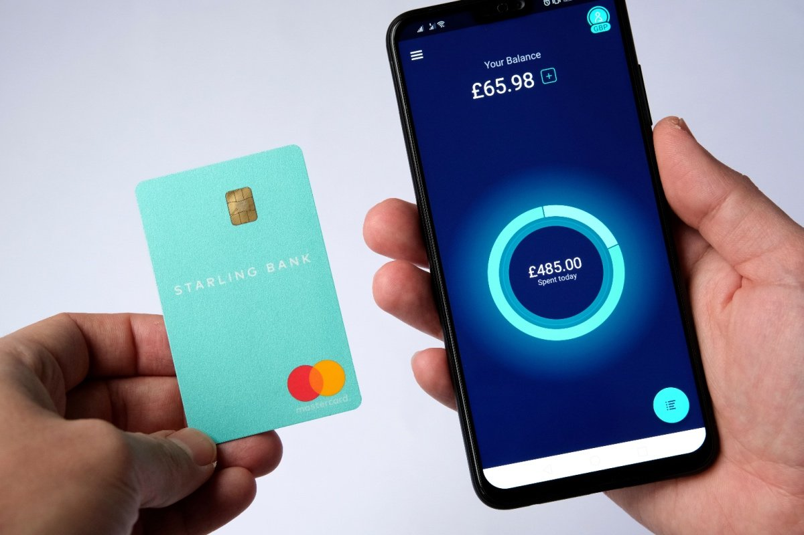
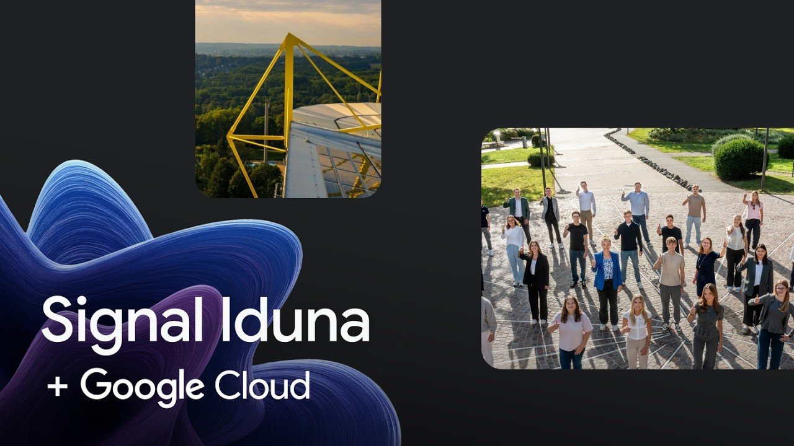
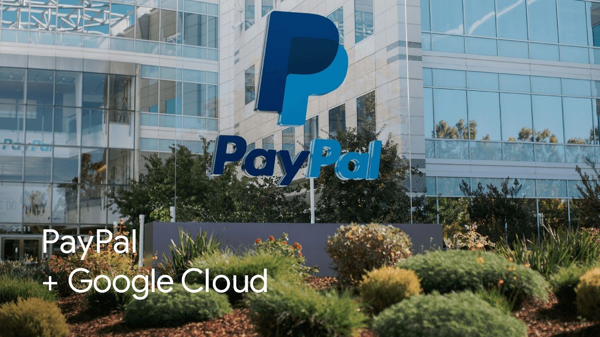

# Đặt cược vào AI Agent: 8 doanh nghiệp đang định hình tương lai ngành dịch vụ tài chính

> **Bản dịch tiếng Việt từ:** [Banking on agents: These 8 firms are building the future of financial services](https://cloud.google.com/transform/financial-services-ai-agents-gemini-enterprise-round-up), Google Cloud Blog.  
> **Tác giả:** Georgina Bulkeley (Managing Director, Global Financial Services Lead, Google Cloud), Paula Gondim (Contributing Writer, Financial Services).  
> **Ngày xuất bản:** 28/08/2026.  
> **Quy ước thuật ngữ:** Các thuật ngữ công nghệ quan trọng được trình bày dưới dạng **tiếng Việt (English)** ở lần đầu xuất hiện; tên riêng sản phẩm, nền tảng (Gemini Enterprise Agent Platform, BigQuery, GKE, ADK...) và tên doanh nghiệp được giữ nguyên.

---

Hiếm có ngành công nghiệp nào hưởng lợi từ **trí tuệ nhân tạo tác tử (agentic AI)** nhiều như dịch vụ tài chính. Đây là một lĩnh vực được xây dựng trên nền tảng của dữ liệu, sự tin cậy, tốc độ và độ chuẩn xác tuyệt đối — nơi mỗi quyết định đều chịu sự giám sát nghiêm ngặt của cơ quan quản lý và mỗi tương tác với khách hàng đều gắn liền với những rủi ro và giá trị thực tế. Điều này biến ngành tài chính thành môi trường kiểm chứng khắt khe nhất cho các hệ thống AI đảm nhận những trọng trách lớn: suy luận qua các tài liệu hợp đồng và chính sách phức tạp, xác minh phạm vi bảo hiểm, giải quyết tranh chấp giao dịch, và cá nhân hóa dịch vụ cho hàng triệu khách hàng.

Chúng ta đang chứng kiến hàng loạt định chế tài chính — từ các tập đoàn lâu đời cho đến các ngân hàng số (**neo banks**) và startup công nghệ tài chính (**fintech**) — đưa các **tác tử AI (AI agents)** vào vận hành thực tế:
- Một fintech giúp các doanh nghiệp ra mắt chương trình tín dụng riêng chỉ trong **25 ngày** thay vì 300 ngày theo quy trình truyền thống.
- Một mạng lưới thẻ thanh toán toàn cầu cắt giảm **90%** thời gian xử lý phát hiện gian lận và rủi ro.
- Một nhà cung cấp dịch vụ thanh toán xây dựng tác tử giúp rút ngắn **70%** thời gian giải quyết các vụ việc khiếu nại và tranh chấp bồi hoàn phức tạp.
- Một ngân hàng quốc gia lớn đang tái định hình toàn bộ mô hình dịch vụ xoay quanh công nghệ ngân hàng hội thoại (**conversational banking**).
- Một hãng bảo hiểm hàng đầu có thể xác minh quyền lợi bảo hiểm gần như tức thì, giải đáp các thắc mắc chính sách nhanh hơn và chính xác hơn bao giờ hết.

Dù các ứng dụng này rất đa dạng về nghiệp vụ, chúng đều được xây dựng trên một nền tảng chung: **dữ liệu hợp nhất sẵn sàng cho AI (AI-ready data)** trên nền tảng Google Cloud. Từ điểm tựa vững chắc đó, hầu hết các tổ chức đều tận dụng **Gemini Enterprise Agent Platform** để xây dựng và ứng dụng **Gemini Enterprise** nhằm triển khai nhanh chóng các công cụ nội bộ cũng như dịch vụ phục vụ khách hàng.

Hệ thống công nghệ AI chuyên biệt của Google Cloud giúp các tổ chức tài chính kiến tạo và vận hành tác tử nhanh hơn, an toàn hơn, với các yêu cầu về tuân thủ pháp lý và chủ quyền dữ liệu (**data sovereignty**) được tích hợp sẵn từ lõi. Dưới đây là phân tích chi tiết về 8 doanh nghiệp tiêu biểu trên toàn cầu đang ứng dụng tác tử AI để phục vụ khách hàng, tối ưu hóa vận hành và trao quyền cho đội ngũ nhân sự.

---

## 1. Cá nhân hóa hoạt động quản lý tài chính (Making Money Management More Personal)

Đối với khách hàng cá nhân, dấu ấn rõ nét nhất của làn sóng chuyển dịch này là các hệ thống AI mà họ có thể tương tác tự nhiên và liền mạch, bao gồm cả việc nhận các quyết định phê duyệt tín dụng gần như tức thì.

### Starling Bank (Vương quốc Anh)
**Starling Bank** đã ra mắt trợ lý tài chính ứng dụng AI tác tử đầu tiên tại Vương quốc Anh dành cho chủ tài khoản cá nhân. Được tích hợp ngay trong ứng dụng ngân hàng và xây dựng trên nền tảng mô hình **Google Gemini**, trợ lý **Starling Assistant** có khả năng hiểu ngôn ngữ tự nhiên và thay mặt khách hàng thực thi các tác vụ ngân hàng cụ thể:
- Thiết lập các mục tiêu tiết kiệm cá nhân hóa.
- Tự động sắp xếp và lên lịch thanh toán hóa đơn định kỳ.
- Cung cấp sự hỗ trợ được thiết kế riêng cho nhóm khách hàng có nhu cầu đặc biệt về khả năng tiếp cận hoặc điều kiện kinh tế - xã hội.

> *"AI tạo sinh sở hữu tiềm năng mang tính chuyển đổi cho dịch vụ tài chính và Starling đang chứng minh những gì có thể đạt được trong thực tế — từ việc bảo vệ người dùng trước các cạm bẫy lừa đảo cho đến việc giúp họ hiểu sâu hơn về thói quen chi tiêu của chính mình."*  
> — **Raman Bhatia**, CEO của Starling Group.

  
*Starling Assistant đại diện cho làn sóng trợ lý tài chính thế hệ mới, thay mặt người dùng thực thi các nghiệp vụ ngân hàng. Nguồn: Starling Bank / Google Cloud.*

---

### Bullla (Brazil)
**Bullla**, một công ty fintech tại Brazil với hơn 3,6 triệu thẻ đã phát hành, chuyên cung cấp các gói tín dụng, phúc lợi và ứng lương cho những đối tượng trước đây thường bị các định chế tài chính truyền thống bỏ quên.

Sau khi hiện đại hóa nền tảng dữ liệu trên kho dữ liệu đám mây **BigQuery**, Bullla hiện sử dụng AI cho các quy trình nghiệp vụ trọng yếu và các báo cáo tuân thủ quy định:
- Các báo cáo vốn tiêu tốn hàng giờ hoặc nhiều ngày làm việc trước đây nay hoàn tất chỉ trong **vài phút** — đạt mức tăng trưởng hiệu năng lên tới **90%**.
- Bullla tự xây dựng và huấn luyện các mô hình đánh giá rủi ro tín dụng trực tiếp trên **Gemini Enterprise Agent Platform**, cho phép doanh nghiệp quản lý khối tài sản tín dụng hơn **2,1 tỷ Real Brazil (R$)** với độ chuẩn xác vượt trội.

---

### Core AI (Brazil)
**Core AI**, một công ty công nghệ tín dụng tại São Paulo, hỗ trợ các doanh nghiệp đối tác triển khai chương trình tín dụng riêng của họ chỉ trong **25 ngày**, so với mức trung bình của thị trường vào khoảng **300 ngày**.

- Các tác tử tự động hóa của Core AI, vận hành bởi các mô hình Gemini, có khả năng phân tích các bộ chứng từ phức tạp (như hợp đồng thuê nhà) trong **dưới 15 giây** — công việc mà trước đây các chuyên viên thẩm định phải mất hàng giờ hoặc cả ngày.
- Gemini Enterprise Agent Platform chuyển hóa dữ liệu hồ sơ thành điểm tín dụng tức thì và mức lãi suất cá nhân hóa.
- Chi phí vận hành của Core AI thấp hơn **gấp 5 lần** so với các tổ chức tài chính thông thường, trong khi các mô hình quản trị rủi ro giúp duy trì tỷ lệ nợ xấu thấp hơn khoảng **gấp 3 lần** mức trung bình toàn ngành.

---

## 2. Tăng tốc quy trình vận hành hậu trường (Speeding Up Operations)

Phía sau giao diện người dùng, các tác tử AI đang đẩy nhanh cỗ máy vận hành của toàn bộ hệ thống tài chính, đặc biệt là trong các lĩnh vực cực kỳ nhạy cảm như phát hiện gian lận, xử lý tranh chấp bồi hoàn và giải quyết bồi thường bảo hiểm.

### Dojo (Vương quốc Anh)
**Dojo**, đơn vị cung cấp giải pháp thanh toán hàng đầu tại Anh với sản lượng xử lý hơn **2 tỷ giao dịch mỗi năm**, đã triển khai Gemini Enterprise trên toàn bộ tổ chức. Chỉ trong vòng 2 tháng, các nhân viên nội bộ của Dojo đã tự tay xây dựng hơn **680 tác tử AI**.

- **Tác tử giải quyết bồi hoàn (Chargeback Agent):** Giúp cắt giảm **70%** thời gian xử lý các vụ việc tranh chấp thanh toán phức tạp.
- Đội ngũ kinh doanh tiết kiệm được hơn **7 giờ/người mỗi tuần** nhờ các tác tử tự động hóa quy trình hành chính.
- Tốc độ ủy quyền thanh toán (**payment authorization**) của hệ thống tiếp tục duy trì mức nhanh hơn **60%** so với trung bình ngành.

---

### SIGNAL IDUNA (Đức)
Tập đoàn bảo hiểm hàng đầu nước Đức **SIGNAL IDUNA** đã biến Gemini Enterprise thành "cánh cửa mở vào thế giới AI" cho toàn bộ tổ chức, đạt tỷ lệ người dùng hoạt động hàng tháng (**monthly active usage — MAU**) hơn **80%** chỉ sau chưa đầy hai tháng triển khai tới **11.000 nhân viên**. Nền tảng này trao quyền cho các phòng ban tự phát triển các tác tử chuyên biệt phục vụ công việc của mình:

- **Tác tử y tế (Health Agent):** Hỗ trợ đội ngũ dịch vụ khách hàng tự động xác minh điều khoản và phạm vi chi trả bảo hiểm đối chiếu với kho dữ liệu hợp đồng đồ sộ và phức tạp tích lũy suốt một thế kỷ qua.
- Tác tử này đã thúc đẩy lượng sử dụng hàng tuần tăng vọt **400%** và giúp rút ngắn thời gian phản hồi thắc mắc của khách hàng nhanh hơn **37%**.

> *"Chúng tôi không chỉ mở rộng một công cụ công nghệ đơn thuần, chúng tôi đang mở rộng quy mô đổi mới sáng tạo, năng lực học hỏi và mở ra những tiềm năng không giới hạn về những gì toàn tổ chức có thể đạt được."*  
> — **Stefan Lemke**, Giám đốc Công nghệ Thông tin (CIO), SIGNAL IDUNA.

  
*SIGNAL IDUNA trao quyền cho 11.000 nhân viên xây dựng các tác tử AI chuyên trách như Health Agent. Nguồn: SIGNAL IDUNA / Google Cloud.*

---

### AXA Thụy Sĩ (Thụy Sĩ)
**AXA Thụy Sĩ**, công ty bảo hiểm số một tại quốc gia này, xây dựng năng lực AI dựa trên một nền tảng dữ liệu được đầu tư bài bản qua nhiều năm. Sau khi di chuyển hồ dữ liệu (**data lake**) lên BigQuery từ năm 2021, những truy vấn dữ liệu khổng lồ từng ngốn trọn cả kỳ nghỉ cuối tuần nay chỉ mất **vài giây hoặc vài phút** để hoàn tất.

Nền tảng dữ liệu vững chắc này làm bệ phóng cho chiến lược tiếp cận AI lấy trợ lý làm trung tâm (**assistant-first approach**):
- **Trích xuất hồ sơ bệnh án:** Các giám định viên từng phải mất 25 phút đọc các tập tài liệu y khoa phức tạp nay nắm bắt được thông tin mấu chốt chỉ sau **vài giây**.
- **Phân loại hồ sơ tự động:** Tự động nhận diện những yêu cầu khiếu nại bồi thường nào đòi hỏi sự đánh giá chuyên sâu của chuyên gia thẩm định.
- **Phát hiện gian lận:** Bộ quy tắc phòng chống gian lận mới đã phát hiện ra một yêu cầu bồi thường gian lận trị giá **120.000 franc Thụy Sĩ (CHF)** ngay trong tuần đầu tiên đưa vào áp dụng.
- Hiện nay, AXA Thụy Sĩ đang bước tiếp lên giai đoạn cao hơn: ứng dụng AI tác tử cho các luồng công việc bảo hiểm đặc thù, kết hợp các bot thoại (**voice bots**) và công cụ hỗ trợ tư vấn viên (**agent assist**) cho tổng đài và các nhóm thẩm định bồi thường.

> *"Chuyển đổi đám mây đã thay đổi căn bản cách chúng tôi tiếp cận CNTT. Chúng tôi không còn đơn thuần thực thi các yêu cầu nghiệp vụ từ doanh nghiệp — chúng tôi đang chủ động dẫn dắt đổi mới sáng tạo và đề xuất những cơ hội mới cho toàn bộ hoạt động kinh doanh."*  
> — **Kathrin Braunwarth**, Giám đốc Dữ liệu, Công nghệ và Đổi mới sáng tạo (Head of DTI), AXA Thụy Sĩ.

---

## 3. Trao quyền cho toàn thể nhân viên bằng công cụ AI (Empowering Employees with AI Tools)

Các đợt triển khai giàu tham vọng nhất là những dự án đặt năng lực xây dựng và tùy biến tác tử AI trực tiếp vào tay toàn bộ lực lượng lao động của doanh nghiệp.

### PayPal (Hoa Kỳ / Toàn cầu)
**PayPal** đặt mục tiêu xây dựng một nền tảng kỹ thuật thuần AI (**AI-native engineering platform**) nhằm tăng tốc đổi mới sáng tạo trên toàn bộ hạ tầng thanh toán toàn cầu và định hình thế hệ thương mại tiếp theo.

- **Nền tảng hạ tầng:** PayPal bắt đầu bằng việc di chuyển hơn **300 petabyte (PB)** dữ liệu sang BigQuery.
- **Vận hành quy mô siêu lớn:** Hiện tại, PayPal chạy các tác vụ AI trên nền tảng **Google Kubernetes Engine (GKE)** kết hợp với **Gemini Enterprise Agent Platform**, phục vụ hơn **500 mô hình đang hoạt động trong môi trường sản xuất (production models)**, xử lý gần **1 tỷ lượt yêu cầu mỗi ngày** với cam kết độ sẵn sàng đạt chuẩn **99,999%**.
- **Tốc độ triển khai:** Thời gian đưa một mô hình vào vận hành thực tế trước đây mất nhiều tuần nay được rút ngắn chỉ còn **vài phút**.
- Đội ngũ **10.000 kỹ sư** của PayPal hiện đang xây dựng các năng lực **thương mại tác tử (agentic commerce)** phục vụ hơn **439 triệu người tiêu dùng và đơn vị chấp nhận thanh toán** trên toàn thế giới.

> *"Đổi mới nhanh hơn, duy trì niềm tin ở quy mô lớn, và trao quyền cho toàn thể lực lượng lao động bằng AI — đó chính là những giá trị mà việc xây dựng trên Google Cloud đã mang lại cho PayPal."*  
> — **Srinivasan Manoharan**, Giám đốc Nền tảng AI/ML, PayPal.

  
*PayPal vận hành hơn 500 mô hình AI trên nền tảng BigQuery, GKE và Gemini Enterprise Agent Platform. Nguồn: PayPal / Google Cloud.*

---

### Unicaja (Tây Ban Nha)
**Unicaja**, một trong những ngân hàng lớn nhất tại Tây Ban Nha, đang hợp tác chiến lược cùng Google Cloud để thúc đẩy chiến lược AI hướng tới mô hình **Ngân hàng hội thoại (Conversational Banking)**.

Sáng kiến này hướng đến mục tiêu tái định hình mối quan hệ giữa ngân hàng với khách hàng và nhân viên, mang lại sự tương tác đơn giản, gần gũi và tự nhiên hơn, nâng cao trải nghiệm người dùng, thúc đẩy chuyển đổi số và nâng cao hiệu quả vận hành:
- Google cung cấp hạ tầng AI tiên tiến từ Google Cloud, nền tảng **Gemini Enterprise Agent Platform**, bộ khung phát triển tác tử **Agent Development Kit (ADK)**.
- Kết hợp các bộ khung quản trị và **AI có trách nhiệm (Responsible AI frameworks)** cùng hệ sinh thái đối tác công nghệ để hiện thực hóa các kịch bản chuyển đổi nghiệp vụ ngân hàng cốt lõi.

> *"Liên minh với Google với tư cách là đối tác chiến lược cho phép chúng tôi tận dụng tối đa các công cụ, môi trường và năng lực tiên tiến nhất để phát triển AI tạo sinh và AI tác tử mạnh mẽ ngay trong lòng tổ chức."*  
> — **Estrella Botas**, Giám đốc Công nghệ và Vận hành (CTOO), Unicaja.

---

## 4. Từ thử nghiệm đến sản xuất (From Pilot to Production)

Trải dài trên khắp các phân khúc — từ ngân hàng bán lẻ, thanh toán, bảo hiểm cho tới tín dụng tiêu dùng — 8 doanh nghiệp kể trên đã đưa các tác tử AI bước ra khỏi phạm vi thử nghiệm trong phòng lab để đi thẳng vào nhịp sống vận hành hàng ngày, nơi các nghiệp vụ nhạy cảm, chịu sự kiểm soát khắt khe của luật pháp được thực thi.

Hiệu quả định lượng thực tế đã chứng minh cho sự đúng đắn của chiến lược này:
- Thời gian ra mắt chương trình tín dụng giảm từ **300 ngày xuống 25 ngày** (Core AI).
- Tỷ lệ xử lý tranh chấp bồi hoàn nhanh hơn **70%**, ủy quyền thanh toán nhanh hơn **60%** (Dojo).
- Hiệu năng báo cáo quy định tăng **90%** (Bullla).
- Thời gian đọc hồ sơ y khoa rút ngắn từ **25 phút xuống vài giây** (AXA Thụy Sĩ).
- Tốc độ phản hồi khách hàng nhanh hơn **37%** (SIGNAL IDUNA).
- Triển khai mô hình AI từ **nhiều tuần xuống vài phút** cho hơn **500 mô hình production** (PayPal).

Những kết quả này khẳng định rằng: **AI tác tử chính là nơi mà tác động và lợi tức đầu tư (ROI) của trí tuệ nhân tạo được thể hiện rõ ràng và nhanh chóng nhất.**

---

### Bảng tổng hợp năng lực triển khai của 8 doanh nghiệp tài chính

| Doanh nghiệp | Quốc gia & Lĩnh vực | Nền tảng công nghệ Google Cloud | Kết quả & Năng lực tác tử nổi bật |
| :--- | :--- | :--- | :--- |
| **Starling Bank** | Vương quốc Anh *(Digital Banking)* | Google Gemini, Mobile App Integration | Ra mắt trợ lý **Starling Assistant**; thực thi tác vụ ngân hàng bằng ngôn ngữ tự nhiên thay cho khách hàng. |
| **Bullla** | Brazil *(Fintech tín dụng & phúc lợi)* | BigQuery, Gemini Enterprise Agent Platform | Tăng 90% hiệu năng báo cáo nghiệp vụ; quản lý hơn 2,1 tỷ R$ tín dụng với mô hình rủi ro AI tự xây dựng. |
| **Core AI** | Brazil *(Credit-as-a-Service)* | Gemini Models, Gemini Enterprise Agent Platform | Phân tích hợp đồng trong < 15 giây; ra mắt gói tín dụng trong 25 ngày; chi phí vận hành giảm 5 lần, nợ xấu giảm 3 lần. |
| **Dojo** | Vương quốc Anh *(Thanh toán)* | Gemini Enterprise | Nhân viên tự tạo > 680 tác tử; **Chargeback Agent** giảm 70% thời gian xử lý tranh chấp; tiết kiệm 7 giờ/người/tuần. |
| **SIGNAL IDUNA** | Đức *(Bảo hiểm)* | Gemini Enterprise | 11.000 nhân viên (80% MAU); **Health Agent** đối soát quyền lợi từ 100 năm dữ liệu hợp đồng; phản hồi nhanh hơn 37%. |
| **AXA Thụy Sĩ** | Thụy Sĩ *(Bảo hiểm)* | BigQuery, Gemini Models, Agentic Workflows | Đọc hồ sơ y khoa từ 25 phút xuống vài giây; phát hiện gian lận 120.000 CHF ngay tuần đầu tiên; tự động hóa phân loại claim. |
| **PayPal** | Hoa Kỳ / Toàn cầu *(Thanh toán)* | BigQuery (>300 PB), GKE, Gemini Enterprise Agent Platform | Chạy > 500 mô hình production, xử lý 1 tỷ req/ngày (99.999% SLA); triển khai mô hình trong vài phút; 10.000 kỹ sư làm **Agentic Commerce**. |
| **Unicaja** | Tây Ban Nha *(Ngân hàng truyền thống)* | Google Cloud AI, Gemini Enterprise Agent Platform, ADK Framework | Chuyển đổi toàn diện sang mô hình **Conversational Banking**; chuẩn hóa khung AI có trách nhiệm và quản trị. |

---

## Bảng thuật ngữ song ngữ (Glossary)

| Thuật ngữ tiếng Việt | Thuật ngữ tiếng Anh gốc | Giải thích ý nghĩa trong bối cảnh |
| :--- | :--- | :--- |
| **Trí tuệ nhân tạo tác tử** | Agentic AI | Thế hệ AI sở hữu tính tự chủ, khả năng lập kế hoạch, sử dụng công cụ và hành động để đạt mục tiêu kinh doanh. |
| **Tác tử AI** | AI Agents | Các thực thể phần mềm thông minh có khả năng tiếp nhận yêu cầu, lý luận, gọi API/công cụ và tương tác thay con người. |
| **Ngân hàng hội thoại** | Conversational Banking | Mô hình ngân hàng nơi mọi giao dịch, tư vấn và hỗ trợ khách hàng được thực hiện qua giao diện hội thoại tự nhiên. |
| **Thương mại tác tử** | Agentic Commerce | Hệ sinh thái thương mại nơi các tác tử AI tự động tìm kiếm, thương lượng, đặt hàng và thanh toán thay cho người tiêu dùng. |
| **Tranh chấp bồi hoàn** | Chargeback / Dispute | Quy trình chủ thẻ yêu cầu ngân hàng hoàn lại tiền do giao dịch gian lận hoặc hàng hóa/dịch vụ không đúng cam kết. |
| **Bộ khung phát triển tác tử** | Agent Development Kit (ADK) | Bộ công cụ và thư viện tiêu chuẩn giúp lập trình viên nhanh chóng xây dựng, kiểm thử và tích hợp tác tử AI. |
| **Chủ quyền dữ liệu** | Data Sovereignty | Yêu cầu pháp lý quy định dữ liệu số phải tuân thủ luật pháp và quyền tài phán của quốc gia nơi dữ liệu được thu thập. |
| **Thời gian hoạt động hàng tháng** | Monthly Active Usage (MAU) | Chỉ số đo lường tỷ lệ người dùng tham gia sử dụng hệ thống tích cực trong khoảng thời gian một tháng. |
| **Độ sẵn sàng dịch vụ** | Availability (SLA) | Tỷ lệ thời gian hệ thống hoạt động ổn định và sẵn sàng đáp ứng yêu cầu (ví dụ: 99,999% - chuẩn Five Nines). |
