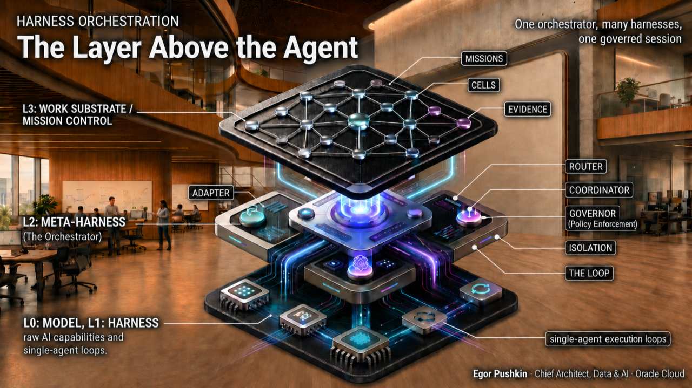

# Điều phối Harness: Lớp phía trên tác tử



> **Bản dịch tiếng Việt từ:** [Harness Orchestration: The Layer Above the Agent](https://www.linkedin.com/pulse/harness-orchestration-layer-above-agent-egor-pushkin-2h9hc), Egor Pushkin, đăng ngày 29/06/2026 trên LinkedIn.  
> **Phụ đề:** Cách thế giới nguồn mở đang xây dựng **meta-harness**, và vì sao giá trị của thập kỷ tới nằm ở lớp cao hơn tác tử một bậc.  
> **Quy ước thuật ngữ:** Bài dịch giữ các khái niệm kiến trúc quan trọng theo dạng **Việt–Anh** để bảo toàn khả năng tra cứu.

---

## Năng lượng đã dịch chuyển lên một lớp

Mở trang GitHub Trending vào bất kỳ buổi sáng nào trong tháng 6, bạn sẽ thấy một cảnh tượng lặp lại: một repository mới xuất hiện vài tuần, hứa hẹn vận hành cả nhóm Coding Agent trong khi bạn ngủ, được khoác lên một ẩn dụ mà bạn chưa từng gặp. Một tuần sau tải lại trang, ba dự án khác đã xuất hiện.

Tên gọi và bề mặt khác nhau:

- Bảng Kanban.
- Terminal.
- Ứng dụng desktop.
- Điện thoại.

Nhưng khi đọc mã nguồn, bạn sẽ thấy cùng một cỗ máy bên trong.

Sự giống nhau đó mới chính là câu chuyện. Khi đặt các dự án cạnh nhau, hàng chục nhóm độc lập, không có roadmap chung, đang tái phát minh cùng một số thành phần:

- Bao bọc nhiều agent khác nhau sau một giao diện thống nhất.
- Chạy nhiều agent trong môi trường cô lập.
- Phối hợp và quản trị chúng.
- Lặp lại cho tới khi công việc hoàn tất.

**Sự hội tụ (convergence)** — chứ không phải bất kỳ con số phổ biến nào — mới là tín hiệu đáng tin.

Những con số rất ồn ào nhưng thiếu ổn định. Một khảo sát giữa năm 2026 ghi nhận một trợ lý gần 380.000 GitHub star, lớn tới mức nên nghi ngờ chính thước đo. Trong khi đó, `vibe-kanban`, dự án tác giả nhiều lần dẫn chứng, đã bắt đầu ngừng phát triển dù từng nhận nhiều chú ý.

> **GitHub star đo sự chú ý, không đo độ trưởng thành.**

> **Cuộc cạnh tranh đã dịch chuyển lên một lớp: rời khỏi từng agent riêng lẻ và chuyển sang thứ có thể điều khiển nhiều agent cùng lúc.**

Hai bài trước trong loạt bài đã đưa lập luận từ hành vi tới đích đến.

Trong [Orchestrating Swarms of Agents](https://www.linkedin.com/pulse/orchestrating-swarms-agents-from-micromanaged-progress-egor-pushkin-m0hdc/) vào tháng 1/2026, tác giả lập luận rằng thay đổi có ý nghĩa không nằm ở mô hình tốt hơn, mà ở một tư thế vận hành mới:

- Từ con người gọi agent thủ công sang orchestrator lên lịch agent để phản ứng với sự kiện.
- Từ quản lý vi mô từng lần gọi sang **tiến triển có tính xác định (deterministic progression)**: thử, quan sát, điều chỉnh, thử lại và leo thang khi xác minh thất bại.

Trong [The Future of Work](https://www.linkedin.com/pulse/future-work-egor-pushkin-geldc/) vào tháng 6/2026, tác giả mô tả đích đến: công việc trở thành một **lớp nền dùng chung (shared substrate)** gồm mission và cell, được vận hành qua giao diện Mission Control, đồng thời được bảo vệ bằng **danh tính hành vi (behavioral identity)** chứ không chỉ bằng quyền tĩnh.

Bài viết hiện tại là phần ở giữa, gắn với thực tế xây dựng: không phải luận đề, cũng chưa phải đích đến, mà là **công trường kiến trúc**.

Trong hai năm, phần thưởng thuộc về **harness** — lớp giàn giáo biến mô hình thành một agent có thể làm việc. Cuộc cạnh tranh đó đang nguội dần, không phải vì bài toán đã được giải quyết, mà vì thị trường đã trở nên đông đúc: nhiều harness có năng lực hiện được cung cấp miễn phí và ngày càng hội tụ.

Cuộc cạnh tranh mới nằm cao hơn một bậc. Việc hàng chục nhóm công khai tái xây dựng cùng các thành phần là dấu hiệu một lớp kiến trúc bền vững — **meta-harness** — đang kết tinh.

---

## Hai định nghĩa: Harness và lớp phía trên nó

### Harness

**Harness** là giàn giáo bao quanh mô hình để biến nó thành một agent có khả năng làm việc. Thuật ngữ này được mượn từ **test harness** — bộ thiết bị điều khiển một thành phần và quan sát hành vi của nó.

Bỏ qua thương hiệu, mỗi harness đều gồm một số “cơ quan” tương tự:

- **Vòng lặp tác tử (agent loop):** quyết định bước tiếp theo.
- **Giao diện công cụ (tool interface):** cho phép agent hành động.
- **Quản lý ngữ cảnh và bộ nhớ:** giúp agent giữ định hướng.
- **Sandbox:** giới hạn phạm vi ảnh hưởng khi xảy ra sự cố.
- **Cơ chế xác minh:** cho biết agent đã thành công hay chưa; trên thực tế thường là công cụ bên ngoài như test suite hoặc type checker được vòng lặp gọi tới.

Claude Code, Codex, Cursor, Aider, OpenCode, Gemini CLI, OpenHands, Goose, Cline, OpenClaw và Pi có trải nghiệm khác nhau nhưng cùng một cấu trúc giải phẫu.

> **Harness là một agent đơn lẻ được trang bị đầy đủ.**

### Meta-harness hoặc harness orchestrator

Lớp mới nằm phía trên harness.

**Meta-harness**, hay **bộ điều phối harness (harness orchestrator)**, là thành phần có nhiệm vụ điều khiển nhiều agent hoặc nhiều harness:

- Chạy song song.
- Hoán đổi hoặc kết hợp chúng sau một giao diện chung.
- Phối hợp chúng như một đội.
- Quản trị chi phí và quyền hạn.
- Lặp lại cho tới khi mục tiêu được đáp ứng.

Khi mở mã nguồn dự án Omnigent, Databricks mô tả loại hệ thống này khá rõ: một meta-harness nằm phía trên những agent đã có, biến chúng thành các bộ phận tương tác được của một hệ thống phong phú hơn.

Nó là một runner:

- Bao bọc bất kỳ agent nào trong một phiên chạy sandbox.
- Cung cấp API thống nhất.
- Thực thi policy có trạng thái ở lớp meta-harness thay vì chỉ dựa vào prompt.

Có thể nén toàn bộ loại kiến trúc vào một dòng:

> **Một orchestrator, nhiều harness, một phiên được quản trị.**

Phổ thiết kế có hai đầu tiêu biểu:

- **Paperclip:** điều phối agent do người dùng tự chọn thành một cấu trúc giống công ty, gồm sơ đồ tổ chức, ngân sách, mục tiêu và governance. Nó sử dụng Claude Code, Codex và OpenCode thay vì tự trở thành một harness tương tự.
- **Omnigent:** đặt lớp orchestration, policy, sandbox và live session thống nhất lên nhiều harness, với mục tiêu “thay harness mà không phải viết lại hệ thống”.

Khoảng cách giữa Paperclip và Omnigent chính là không gian thiết kế mà phần còn lại của lĩnh vực đang lấp đầy.

---

## Ngăn xếp đầy đủ: Model, Harness, Meta-harness và Substrate

Cách rõ nhất để nhìn lớp kiến trúc mới là vẽ toàn bộ stack, vì giá trị đang tiếp tục đi lên theo stack đó.

| Lớp | Thành phần | Vai trò |
|---|---|---|
| **Layer 0** | Model | Năng lực thô; đối tượng thường được benchmark |
| **Layer 1** | Harness | Các bộ phận biến mô hình thành một agent |
| **Layer 2** | Meta-harness | Orchestrator điều khiển nhiều harness và nhiều agent |
| **Layer 3** | Work substrate | Mission, cell, Mission Control, evidence và behavioral identity |

Bài viết này tập trung vào **Layer 2** — lớp một năm trước còn chưa có tên, nhưng hiện có hàng chục cách triển khai.

Hai bài trước ánh xạ chính xác vào stack này:

- Bài 1 mô tả hành vi của Layer 2: orchestration phản ứng theo sự kiện, deterministic progression thay cho micromanagement, autonomy tăng dần và kinh tế học dùng compute để mua lại nguồn lực phối hợp khan hiếm của con người.
- Bài 2 mô tả đích đến: orchestrator sẽ trở thành gì khi trưởng thành và không còn chỉ quản lý mã nguồn.

Các orchestrator ngày nay phối hợp Coding Agent bởi mã nguồn có feedback loop chặt chẽ nhất. Nhưng cỗ máy bên dưới thực chất là cỗ máy của **ủy quyền công việc (delegation)**; coding chỉ là miền đầu tiên và chặt chẽ nhất.

Một meta-harness có thể:

- Route công việc tới agent phù hợp.
- Cô lập từng lần thử.
- Thu thập bằng chứng.
- Quản trị chi phí.
- Chặn merge cho tới khi điều kiện được đáp ứng.

Ở quy mô nhỏ và trong một miền, nó đang làm điều Mission Control sẽ làm với mission và cell trên toàn doanh nghiệp.

> **Model, harness, meta-harness, substrate. Harness orchestrator là dạng ấu trùng của Mission Control.**

Một số dự án Layer 2 đã dùng tên “Mission Control” cho giao diện của mình: OpenClaw dùng trực tiếp, GitHub dùng theo cách gợi ý. Tên gọi đang hội tụ trước cả lớp kiến trúc nằm bên dưới nó; điều này củng cố, chứ không phủ nhận, nhận định về dạng ấu trùng.

---

## Bảy “cơ quan” của một meta-harness

Đây là quan sát đã biến một chồng repository thành một kiến trúc trong mắt tác giả.

Mỗi orchestrator nghiêm túc — dù bề mặt là bảng Kanban, terminal, ứng dụng desktop hay điện thoại; dù dùng chủ đề Nhật Bản phong kiến như Shogun–Karo–Ashigaru hay thị trấn biên viễn như Mayor–Polecat–Refinery — đều tái tạo một tập con của cùng bảy cơ quan.

> **Từ vựng có thể mang tính sân khấu; cấu trúc giải phẫu thì không.**

| # | Cơ quan | Chức năng cốt lõi |
|---:|---|---|
| 1 | Adapter | Chuẩn hóa giao diện của nhiều agent CLI |
| 2 | Router | Chọn model hoặc harness phù hợp cho nhiệm vụ |
| 3 | Isolation and Parallelism | Chạy nhiều agent an toàn, song song và độc lập |
| 4 | Coordinator | Phân công, giao tiếp, handoff và chia sẻ trạng thái |
| 5 | Governor | Policy, quyền, ngân sách, approval, audit và escalation |
| 6 | Work Source | Chuyển issue, ticket hoặc PRD thành phiên chạy và bằng chứng |
| 7 | Loop | Lập kế hoạch, hành động, xác minh và lặp cho tới khi đạt spec |

Hai cơ quan — isolation và loop — cùng verification xuất hiện lại ở cấp cao hơn, được triển khai lại cho phạm vi cả fleet. Sự chồng lấn này chính là điểm quan trọng:

- Harness cô lập blast radius của một agent; meta-harness cô lập nhiều agent với nhau và với repository dùng chung.
- Vòng lặp harness chọn bước tiếp theo của agent; vòng lặp meta-harness quyết định mục tiêu tổng thể đã đạt hay chưa.
- Harness xác minh theo từng bước; meta-harness xác minh theo kết quả cuối.

Cùng từ ngữ, nhưng ở lớp cao hơn và gánh một công việc lớn hơn.

### 1. Adapter — bộ chuyển đổi

Adapter cung cấp một giao diện thống nhất trên nhiều agent CLI không đồng nhất.

Ví dụ rõ ràng là `agentapi` của Coder, đặt một HTTP API trước Claude Code, Goose, Aider, Gemini, Amp và Codex.

Cách triển khai rất đáng chú ý:

1. Chạy terminal emulator trong bộ nhớ.
2. Chuyển API call thành thao tác phím.
3. Phân tích đầu ra terminal của agent thành message.

Cơ chế này hoạt động nhưng giòn, bởi nó đang screen-scrape một UI vốn được thiết kế cho con người.

Adapter là primitive biến harness thành thành phần có thể thay thế, thay vì một đích đến cố định. Nhưng lĩnh vực vẫn thiếu một contract thực sự:

- Vòng đời phiên chạy có kiểu dữ liệu rõ ràng.
- Event stream cho tool call.
- Approval prompt.
- Chi phí.
- Exit code.
- Interrupt.

Đây là tiêu chuẩn còn thiếu sẽ xuất hiện lại ở phần dự báo.

### 2. Router — bộ định tuyến

Router hoạt động ở hai cấp mà mọi người thường nhầm lẫn.

#### Model routing — Layer 1

Chọn LLM đứng sau một harness. Ví dụ, `claude-code-router` có thể gửi Claude Code tới backend khác nhau.

#### Harness routing — Layer 2

Chọn agent nào nhận nhiệm vụ dựa trên:

- Năng lực.
- Chi phí.
- Lịch sử kết quả.
- Rủi ro.
- Độ sẵn sàng.

Đây là công việc của dispatcher trong Paperclip hoặc Symphony. Routing từng là một yêu cầu của swarm trong bài đầu tiên; tại đây, nó đông cứng thành hạ tầng.

### 3. Isolation and Parallelism — cô lập và song song hóa

Meta-harness chạy nhiều agent cùng lúc, mỗi agent trong:

- Git worktree riêng.
- Container riêng.
- MicroVM riêng.

Ví dụ:

- `vibe-kanban`: một agent, một worktree.
- `dagger/container-use`: môi trường riêng cho từng agent.
- Cursor: parallel agents.

Khởi chạy agent là phần dễ. Bài toán khó là **tích hợp**: N agent cùng thay đổi một repository sẽ xung đột.

Lĩnh vực đang dùng hai nhóm giải pháp.

#### Merge queue

Tuần tự hóa kết quả. Gas Town của Steve Yegge chạy 20–30 phiên Claude Code dưới một “Refinery” chịu trách nhiệm sắp thứ tự merge.

#### Spend-to-search

Khởi chạy nhiều lần thử trong các worktree cô lập, chấm điểm, giữ phương án tốt nhất và loại bỏ phần còn lại.

Đây là cụm lớn nhất của lĩnh vực và là nơi mô hình kinh tế của nó tồn tại: dùng thêm compute để giảm lượng phối hợp con người.

### 4. Coordinator — bộ phối hợp

Coordinator quản lý:

- Task board.
- Filesystem dùng chung.
- Mailbox.
- Handoff.
- Giao tiếp agent-to-agent.

Ví dụ gồm hệ thống vai trò của Gas Town, swarm dùng shared memory của `claude-flow`, cùng các mẫu mailbox và handoff xuất hiện lặp lại.

Đây là nơi agent ngừng hoạt động như nghệ sĩ độc tấu và bắt đầu trở thành một đội.

Đây cũng là phần đã có một tiêu chuẩn đang nổi lên: **A2A của Google** dành cho giao tiếp agent-to-agent giữa các nhà cung cấp.

### 5. Governor — bộ quản trị và thực thi chính sách

Governor chịu trách nhiệm:

- Giới hạn chi phí.
- Permission.
- Approval gate.
- Risk escalation.
- Audit.
- Role-based access control.

Phần quan trọng về kiến trúc là **cơ chế thực thi**.

Không phải một câu trong prompt yêu cầu agent cư xử đúng, mà là chặn và kiểm tra tại **ranh giới tool call (tool-call boundary)**:

- Claude Code cung cấp hooks.
- `claude-flow` có 27 hook.
- Omnigent thực thi policy có trạng thái và theo ngữ cảnh tại meta-harness, không qua prompt.

Guardrail dựa trên prompt không bền khi agent trở nên tự chủ. Ranh giới cứng quanh tool call mới có thể giữ được.

Điều này mở ra một đường phân chia kiến trúc:

- Soạn policy thuộc **mặt phẳng quản lý (management plane)** — Layer 3.
- Thực thi policy thuộc **mặt phẳng điều khiển (control plane)** — Layer 2.

`humanlayer` là một lớp chuyên dụng cho trường hợp cần con người phê duyệt.

### 6. Work Source — nguồn công việc

Work source tiếp nhận issue, ticket hoặc PRD, chuyển chúng thành phiên chạy và thu thập bằng chứng.

Ví dụ:

- Symphony — framework điều phối Codex nguồn mở của OpenAI — polling bảng Linear, tạo phiên chạy cô lập cho mỗi issue sẵn sàng, thu proof of work và tạo PR sau khi được chấp nhận.
- `Backlog.md`: task board dựa trên Git.
- `omnara`: đưa công việc vào từ điện thoại.

### 7. Loop — vòng lặp

Mẫu cốt lõi là:

> **Plan → Act → Verify → Repeat, cho tới khi spec được đáp ứng.**

Đây là mẫu “Ralph” của Geoff Huntley. Ở dạng thuần khiết nhất, nó chỉ là một vòng lặp `while` bằng Bash, đưa cùng một prompt file cho agent qua mỗi lần lặp.

Cơ chế đáng chú ý:

- Mỗi vòng bắt đầu với cửa sổ ngữ cảnh mới.
- Trạng thái không được giữ trong lịch sử trò chuyện.
- Trạng thái nằm trong codebase, tệp TODO và Git.

Lý do là chất lượng mô hình suy giảm khi context vượt khoảng 100–150 nghìn token. Vì vậy, reset context là tính năng chứ không phải lỗi.

Failure mode cũng rất cụ thể:

- Không có exit detection: vòng lặp chạy mãi.
- Không có grounding: agent trôi khỏi mục tiêu.

`snarktank/ralph` và plugin Claude Code `ralph-wiggum` chính thức hóa mẫu này thành sản phẩm.

> **Hàng chục nhóm không có roadmap chung đang độc lập tái xây dựng cùng bảy cơ quan; chính sự hội tụ đó là kiến trúc.**

---

## Nền trạng thái bên dưới các cơ quan

Bên dưới bảy cơ quan là thứ làm chúng bền vững: **trạng thái (state)**.

- Run journal.
- Checkpoint.
- Append-only event log.
- Lịch sử quyết định.
- Bằng chứng và artifact.

Đây là bản ghi giúp orchestrator bị crash có thể phục hồi fleet thay vì mất toàn bộ công việc. Nó cũng cho phép con người hỏi “đã xảy ra chuyện gì?” và nhận được câu trả lời.

Tác giả không tính state là cơ quan thứ tám vì nó không phải một thành phần ngang hàng. Nó là substrate mà cả bảy cơ quan cùng ghi dữ liệu vào.

State cũng là cây cầu trực tiếp nhất tới Layer 3, nơi công việc trở thành trạng thái bền vững, có version và có thể thực thi. Một orchestrator đã lưu phiên chạy thực chất đã bắt đầu xây substrate.

Bên cạnh đó còn có **generative meta-layer**: các công cụ xây hoặc cấu hình harness và đội agent, thay vì trực tiếp điều khiển chúng:

- Archon: tự mô tả là “open-source harness builder đầu tiên”.
- Ruler và Rulesync: phân phối rule, MCP server, skill và cấu hình subagent qua nhiều công cụ cùng lúc.

Đây không chỉ là taxonomy. Các cơ quan này hiện thực hóa những khái niệm trừu tượng từ hai bài trước:

- Router hiện thực hóa routing.
- Governor hiện thực hóa governance và telemetry qua audit trail.
- Work source hiện thực hóa evidence.
- Loop hiện thực hóa verification cho tới khi hoàn tất.
- Persisted state là dạng phôi của substrate.

Không có ánh xạ một-một hoàn hảo; tool access trải qua nhiều cơ quan, còn adapter là phát hiện mới từ hiện trường. Nhưng việc nhiều nhóm chưa từng đọc các bài luận vẫn độc lập tái dựng cùng abstraction là bằng chứng lớp này có thật.

---

## Hai trục phân loại lĩnh vực

Nếu bảy cơ quan cho biết công cụ được làm từ gì, hai trục cho biết đó là loại công cụ nào.

### Trục 1: Một harness hay nhiều harness

- Chạy nhiều instance của cùng một CLI.
- Hoặc kết hợp nhiều CLI khác nhau sau một giao diện.

### Trục 2: Tư thế tự chủ

- **Human on the Loop:** con người giám sát trong khi agent thực thi.
- **Human in the Loop:** con người trực tiếp điều hướng qua review gate.

Hai trục tạo bốn nhóm điển hình:

| | Một harness | Nhiều harness |
|---|---|---|
| **Con người trong vòng lặp / được điều hướng** | Parallel coding-agent runners — ví dụ `vibe-kanban` | Multi-harness control planes — ví dụ Omnigent |
| **Tự chủ cao / con người trên vòng lặp** | Autonomous loop runners — ví dụ Ralph | Agent companies — ví dụ Paperclip |

> **Bốn kiểu kiến trúc được phân chia theo một–nhiều harness và tư thế tự chủ; khi mức tự chủ tăng lên, mô hình bảo mật hiện tại bắt đầu vỡ.**

Hàng “nhiều harness” là phổ từ Paperclip tới Omnigent: workforce ở phía tự chủ, control plane ở phía được điều hướng.

Ma trận quan trọng bởi nó chỉ ra nơi autonomy đang tăng; và chính quá trình autonomy tăng qua ma trận cuối cùng sẽ phá vỡ mô hình bảo mật tĩnh.

---

## Đọc bản đồ thị trường

Các con số dưới đây chỉ là snapshot giữa năm 2026, phản ánh mức độ chú ý chứ không phải chân lý.

Harness Layer 1 lớn hơn rất nhiều so với mọi thứ được xây phía trên — đó chính là hình ảnh của quá trình hàng hóa hóa nhìn từ bên dưới.

Meta-harness Layer 2 có số lượng nhiều hơn và đáng chú ý là trẻ hơn. Theo số liệu làm tròn tại thời điểm bài viết:

| Dự án | GitHub star xấp xỉ | Định vị |
|---|---:|---|
| Paperclip | 71.000 | “Công ty” agent sử dụng agent do người dùng chọn |
| claude-flow | 60.000 | Điều phối swarm đa tác tử |
| vibe-kanban | 27.000 | Parallel runner, đã bắt đầu ngừng phát triển |
| Symphony | 25.000 | Điều phối Codex của OpenAI |
| Archon | 22.000 | Harness builder |
| Ralph | 20.000 | Mẫu vòng lặp tự chủ |
| Gas Town | 16.000 | Chạy 20–30 agent song song |
| Omnigent | 4.000 | Meta-harness của Databricks, mới mở nguồn trong tháng |

Có hai vùng lân cận nhưng không nằm trực tiếp trên bản đồ này:

1. **Framework orchestration ở cấp code** như AutoGen, CrewAI, LangGraph và OpenAI Agents SDK. Chúng kết hợp subagent được viết trong cùng process, không điều khiển CLI bên ngoài; vì vậy thuộc Layer 1 hoặc thấp hơn.
2. **Dòng dự án 2023–2024** như AutoGPT, MetaGPT và BabyAGI. Đây là tổ tiên — những lần thử đầu tiên nhằm lặp agent tới mục tiêu trước khi harness trở thành đơn vị ổn định.

Một lưu ý về nguồn: các danh sách “awesome” dùng cho khảo sát có phần được tạo tự động. Tác giả chỉ dựa mạnh vào những tên có thể xác minh, còn phần đuôi khác thường chỉ được xem như tín hiệu hệ sinh thái.

### Năm điều bản đồ cho thấy

#### 1. Sự hội tụ là tín hiệu

Bề mặt rất đa dạng, cách đặt tên mang tính sân khấu, nhưng cấu trúc bên dưới giống nhau. Đây là dấu vân tay của một lớp kiến trúc thực sự đang hình thành.

#### 2. Agent đơn lẻ đang bị hàng hóa hóa

Nhiều harness có năng lực hiện miễn phí, mở và hội tụ quanh cùng các cơ quan. Khi đơn vị nền tảng trở nên dồi dào, có thể thay thế, khác biệt sẽ dịch chuyển lên trên.

#### 3. Các công ty lớn đang tuyên bố quyền sở hữu lớp này

Không chỉ có dự án độc lập:

- OpenAI công bố Symphony cùng Codex.
- Databricks mở nguồn Omnigent.
- GitHub có Agent HQ và cách diễn đạt Mission Control.
- Anthropic cung cấp Claude Code hooks và Cowork.
- Cursor chạy parallel agents trong worktree.

Vốn và nhân lực đang cạnh tranh cho Layer 2.

#### 4. Kinh tế học “nhiều lần thử rẻ” giải thích sự bùng nổ

Nhiều lần thử rẻ có thể tốt hơn một lần chạy hoàn hảo:

1. Chi thêm compute.
2. Cô lập từng phương án.
3. Đánh giá.
4. Giữ phương án tốt nhất.

Cụm lớn nhất trên bản đồ là parallel runner với worktree isolation — một lập luận kinh tế được biên dịch thành phần mềm.

#### 5. GitHub star không đồng nghĩa với độ bền

`vibe-kanban` từng có nhiều star nhưng đã bắt đầu dừng lại. Trong lĩnh vực này, khái niệm “toàn diện” có chu kỳ bán rã khoảng một tuần.

Sự phân mảnh thành hàng chục control plane, mỗi hệ thống sở hữu một phần state, không phải đích đến. Nó chính là vấn đề cần được giải quyết.

> **Sự hội tụ, không phải số star, mới là tín hiệu. Các con số rất ồn ào, non trẻ và đáng được nhìn với sự hoài nghi.**

---

## Vì sao coding đi trước — và vì sao nó sẽ không dừng ở đó

Coding đi trước vì một lý do cấu trúc: mã có feedback loop chặt chẽ nhất trong công việc tri thức.

- Test pass hoặc fail.
- Type check đúng hoặc sai.
- Linter báo lỗi.
- Build hỏng.
- Review từ chối.
- Version control hoàn tác.
- Deployment gate chặn thay đổi.

Mật độ phản hồi nhanh, rẻ và khách quan là tiền đề của deterministic progression. Nó cho phép orchestrator thử, quan sát và thử lại mà không cần con người phán xét mọi bước.

> **Mã nguồn đi trước vì feedback loop chặt chẽ nhất; nhưng đây là các cơ quan của công việc được ủy quyền, không chỉ của lập trình.**

Không cơ quan nào trong bảy cơ quan chỉ dành cho code:

- Adapter có thể bao bọc mọi agent.
- Router có thể chọn mọi chuyên gia.
- Isolation giới hạn mọi blast radius.
- Governor kiểm soát mọi ngân sách.
- Work source tiếp nhận mọi ticket.
- Loop lặp theo mọi spec.

Chúng tổng quát hóa nhanh bằng tốc độ mà verification có thể tổng quát hóa:

- **Vận hành:** log và health check là test suite.
- **Hỗ trợ khách hàng:** giải quyết case là gate.
- **Nghiên cứu và compliance:** review và citation là bằng chứng.

Orchestrator sẽ rời khỏi repository ngay khi miền tiếp theo cung cấp một feedback loop đủ đáng tin cậy.

---

## Governance là hào phòng thủ, và behavioral identity xuất hiện ở đây trước tiên

Khi autonomy tăng, **ủy quyền tĩnh (static authorization)** bắt đầu thất bại.

Có thể cấp quyền trước cho một agent theo policy cố định. Nhưng không thể dễ dàng cấp quyền tĩnh cho hàng chục agent hành động song song, qua nhiều harness, mỗi agent tạo phiên chạy cô lập trên một codebase liên tục thay đổi.

Ma trận permission cần thiết sẽ lỗi thời trước khi viết xong.

Do đó, governor không chỉ hỏi hai câu cổ điển:

1. **Authentication:** Bạn là ai?
2. **Authorization:** Bạn được phép làm gì?

Nó bắt đầu hỏi câu thứ ba:

3. **Behavioral identity:** Agent này có đang hành xử đúng như actor đó nên hành xử, trong nhiệm vụ này và dưới các chuẩn mực này hay không?

Ngày nay, “task” có thể là coding ticket và “mission” là PRD — dạng ấu trùng của từ vựng Layer 3 — nhưng câu hỏi đã đúng.

Behavioral identity bị buộc phải xuất hiện ở Layer 2 vì lý do cấu trúc: orchestrator là thành phần duy nhất nhìn thấy:

- Mọi agent.
- Mọi harness.
- Toàn bộ phiên chạy.
- Tool call.
- Chi phí.
- Quyết định và bằng chứng.

Một harness chỉ nhìn thấy chính nó.

Orchestrator cũng đã sở hữu **điểm thực thi (enforcement point)** qua hooks và policy tại ranh giới tool call. **Agent Ops**, lĩnh vực được đặt tên trong bài đầu, cũng xuất hiện ở đây trước tiên vì cùng lý do.

### Ranh giới đạo đức: công việc, không phải người lao động

Có một nghĩa vụ từ bài trước không thể coi là chú thích phụ:

> **Behavioral identity chỉ cách surveillance đúng một quyết định thiết kế.**

Nó phải gắn với mục đích:

- Liên kết với task và mission, không liên kết với con người.
- Phục vụ ủy quyền an toàn, không trở thành giám sát thường trực người ngồi trên ghế.

Nếu xây đúng, nó giúp mở rộng autonomy an toàn. Nếu xây bất cẩn, nó trở thành một panopticon với dashboard đẹp hơn.

> **Đơn vị quan sát phải là công việc, không phải người lao động.**

### Vì sao governance trở thành hào phòng thủ

Đây cũng là nơi bức tranh cạnh tranh đảo chiều.

Mô hình ngừng là yếu tố khác biệt, runtime bắt đầu đảm nhiệm vai trò đó:

- Policy.
- Identity.
- Audit.
- Cost routing.
- Phiên chạy được quản trị.
- State liên harness.

Đối thủ không thể sao chép những tài sản này từ một benchmark.

> **Mô hình được thuê; runtime được quản trị thuộc quyền sở hữu.**

---

## Hướng phát triển tiếp theo

Dự đoán sản phẩm trong một lĩnh vực có chu kỳ bán rã một tuần là việc thiếu khôn ngoan. Nhưng dự báo cấu trúc khả thi hơn. Bốn chuyển động sau có vẻ bền vững.

### 1. Hợp nhất

Phần lớn dự án sẽ biến mất hoặc sáp nhập. Đây không phải rủi ro đối với luận đề; nó chính là luận đề.

- Harness trở thành adapter hàng hóa.
- Orchestrator trở thành sản phẩm.

Việc `vibe-kanban` dừng lại là thương vong sớm có thể quan sát và sẽ không phải trường hợp cuối. Nên theo dõi dự án nào âm thầm archive, không chỉ dự án nào tăng hạng.

### 2. Một tiêu chuẩn dành cho harness

Ngành đã chuẩn hóa:

- Agent-to-tool bằng MCP.
- Agent-to-agent bằng A2A.

Nhưng vẫn chưa có tiêu chuẩn cho đường nối **orchestrator-to-harness** — chưa có contract thống nhất để:

- Khởi động.
- Điều khiển.
- Hoán đổi.
- Ngắt.
- Đo chi phí.
- Handoff một harness.

Việc `agentapi` phải screen-scrape terminal là cách lĩnh vực thừa nhận khoảng trống, không phải cách đóng nó.

Ai định nghĩa được contract này sẽ làm cho Layer 2 điều MCP đã làm với tool. Cho tới lúc đó, hệ sinh thái mặc định tiếp tục phân mảnh thành các control plane không tương thích.

### 3. Đi lên substrate

Orchestrator hiện quản lý Coding Agent vì feedback loop ở đó chặt nhất. Cùng cỗ máy có thể tổng quát hóa sang bất kỳ đơn vị công việc nào có ranh giới và có thể xác minh — tức định nghĩa của một **cell**.

Bảy cơ quan không thay đổi khi đi lên; chỉ miền nghiệp vụ thay đổi từ pull request sang mission.

Khi meta-harness:

1. Tiếp nhận PRD.
2. Phân tán công việc qua các phiên cô lập.
3. Thu bằng chứng.
4. Giữ merge cho tới khi review đạt.

Ta đang nhìn thấy mission graph và readiness frontier được tạo mẫu trên từng repository.

Khi orchestrator đi lên, công việc con người cũng thay đổi:

- Ít vận chuyển state giữa công cụ hơn.
- Tập trung hơn vào định hình ý định.
- Mã hóa chuẩn mực.
- Chấp nhận hoặc bác bỏ bằng chứng.

Đó là sự dịch chuyển chú ý từ thao tác sang phán đoán.

### 4. Governance trở thành hào phòng thủ

Sự khác biệt đã rời khỏi mô hình và đang hội tụ ở runtime được quản trị — đặc biệt là khả năng tạo niềm tin mà không biến thành surveillance.

Câu hỏi từ bài đầu giờ có thể kiểm nghiệm:

- IDE hub sẽ thắng?
- Vendor runtime?
- Open protocol?
- Enterprise control plane?

Hiện cả bốn cùng cạnh tranh, tạo cảm giác hỗn loạn. Nhưng cấu trúc giúp thu hẹp đặt cược:

> **Lớp chiến thắng sẽ sở hữu state được quản trị xuyên nhiều harness, bởi đó là thứ một harness, theo định nghĩa, không thể tự sở hữu về toàn fleet.**

Một harness quản trị chính nó. Chỉ lớp phía trên mới quản trị được cả đội hình.

---

## Đừng chọn một harness; hãy thiết kế lớp phía trên nó

Khi quan sát sự bùng nổ, bản năng tự nhiên là đặt cược vào một harness: hỏi agent nào tốt nhất rồi chuẩn hóa toàn tổ chức trên nó.

Theo tác giả, đó là sai độ cao kiến trúc.

Harness đang bị hàng hóa hóa theo thời gian thực. Harness tốt nhất quý này có thể trở thành adapter phía sau giao diện chung ở quý sau và nhận thông báo ngừng phát triển ở quý kế tiếp.

Lợi thế không nằm ở agent tốt nhất. Nó nằm ở **lớp orchestration có thể điều khiển bất kỳ agent nào một cách an toàn tới kết quả đã được xác minh**, đồng thời đặt con người đúng vị trí:

- Định hình mục tiêu.
- Mã hóa chuẩn mực.
- Đánh giá bằng chứng.
- Phê duyệt kết quả.

Lớp đó đang được xây dựng công khai với tốc độ khiến người chiến thắng cuối cùng không thể dự đoán, nhưng đích đến lại tương đối rõ.

Phần lớn tên trên bảng xếp hạng hiện tại sẽ biến mất. Bảy cơ quan thì không. Chúng sẽ:

1. Hợp nhất thành phiên chạy được quản trị.
2. Rời khỏi miền code.
3. Đi lên substrate rộng hơn của mission và cell.
4. Trở thành thứ bài trước gọi là Mission Control.

> **Hãy xem harness là thành phần có thể thay thế. Đầu tư vào — và quản trị — lớp phía trên nó.**

Vì vậy, hãy thiết kế theo hướng đó. Xem harness là replaceable. Đầu tư vào lớp có thể route, cô lập, phối hợp và trên hết là quản trị chúng theo cách nhân văn.

> **Năng lượng đã dịch chuyển lên một lớp. Giá trị cũng đang đi theo.**

---

## Tóm tắt kiến trúc

```text
Layer 3 — Work Substrate / Mission Control
  ├─ Missions
  ├─ Cells
  ├─ Evidence
  ├─ Behavioral Identity
  └─ Management Plane: soạn policy và chuẩn mực
                ▲
                │ state, evidence, policy, telemetry
                │
Layer 2 — Meta-Harness / Harness Orchestrator
  ├─ Adapter
  ├─ Router
  ├─ Isolation & Parallelism
  ├─ Coordinator
  ├─ Governor / Policy Enforcement
  ├─ Work Source
  ├─ Loop
  └─ Durable State / Event Log
                ▲
                │ contract orchestrator-to-harness còn thiếu
                │
Layer 1 — Harness
  ├─ Agent Loop
  ├─ Tool Interface
  ├─ Context & Memory
  ├─ Sandbox
  └─ Step Verification
                ▲
                │
Layer 0 — Model
  └─ Năng lực AI thô
```

---

## Bảng thuật ngữ song ngữ

| Tiếng Việt | English |
|---|---|
| Điều phối harness | Harness orchestration |
| Bộ điều phối harness | Harness orchestrator |
| Siêu harness | Meta-harness |
| Lớp phía trên tác tử | Layer above the agent |
| Lớp nền công việc | Work substrate |
| Trung tâm điều hành | Mission Control |
| Phiên chạy được quản trị | Governed session |
| Đội hình tác tử | Agent fleet |
| Bộ chuyển đổi | Adapter |
| Bộ định tuyến | Router |
| Cô lập và song song hóa | Isolation and parallelism |
| Bộ phối hợp | Coordinator |
| Bộ quản trị | Governor |
| Nguồn công việc | Work source |
| Vòng lặp | Loop |
| Trạng thái bền vững | Durable state |
| Nhật ký chỉ nối thêm | Append-only event log |
| Mặt phẳng quản lý | Management plane |
| Mặt phẳng điều khiển | Control plane |
| Điểm thực thi chính sách | Policy enforcement point |
| Ranh giới gọi công cụ | Tool-call boundary |
| Tiến triển có tính xác định | Deterministic progression |
| Danh tính hành vi | Behavioral identity |
| Vận hành tác tử | Agent Ops |
| Bằng chứng công việc | Proof of work / Evidence |
| Tuyến đầu sẵn sàng | Readiness frontier |
| Đồ thị nhiệm vụ | Mission graph |
| Tác tử–tới–công cụ | Agent-to-tool |
| Tác tử–tới–tác tử | Agent-to-agent |
| Bộ điều phối–tới–harness | Orchestrator-to-harness |
| Hàng hóa hóa | Commoditization |
| Sự hội tụ | Convergence |
| Phạm vi ảnh hưởng sự cố | Blast radius |
| Con người trong vòng lặp | Human in the Loop |
| Con người giám sát vòng lặp | Human on the Loop |
