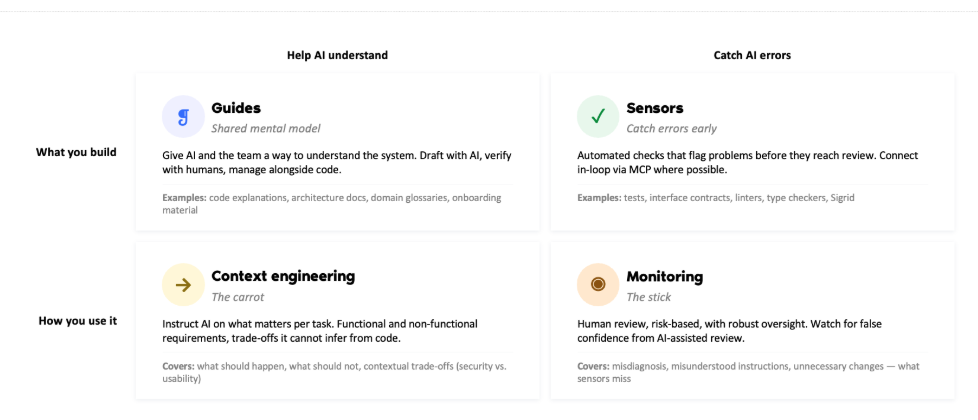

# Harness Engineering là gì?

> **Bản dịch tiếng Việt từ bài viết:** [What is harness engineering?](https://www.linkedin.com/pulse/what-harness-engineering-werner-heijstek-fmqve), Werner Heijstek, xuất bản ngày 30/04/2026 trên LinkedIn.  
> Bài gốc được đăng lần đầu trên website của [Software Improvement Group](https://www.softwareimprovementgroup.com/blog/what-is-harness-engineering/).  
> **Quy ước thuật ngữ:** Bài dịch giữ cụm **Harness Engineering** bên cạnh cách diễn giải tiếng Việt để bảo toàn khả năng tra cứu.

## Tóm tắt

**Kỹ nghệ môi trường kiểm soát tác tử (Harness Engineering)** — thuật ngữ được Mitchell Hashimoto đặt ra vào tháng 2/2026 — là hoạt động thiết kế toàn bộ môi trường mà một tác tử AI vận hành bên trong.

Hóa ra, **quản trị danh mục phần mềm (software portfolio governance)** chính là những gì cấu thành một harness đạt chuẩn production; đồng thời là điều kiện cần để tác tử AI đủ đáng tin cậy khi đưa vào môi trường thực tế.

---

## AI coding năm 2026: Từ trợ lý đến tác tử

Ba năm trước, một lập trình viên chuyên nghiệp sử dụng AI vẫn còn là điều mới mẻ. Ngày nay, đó gần như là kỳ vọng mặc định. Như được đề cập trong báo cáo [AI Boardroom Gap](https://www.softwareimprovementgroup.com/ai-boardroom-gap-2026/), 90% chuyên gia công nghệ hiện sử dụng AI trong công việc.

Công nghệ này không còn chỉ xuất hiện ở startup hay trong cộng đồng vibe coding. Việc ứng dụng AI cũng đang tăng nhanh trong doanh nghiệp. Theo [nghiên cứu của a16z](https://www.a16z.news/p/ai-adoption-by-the-numbers), gần một phần ba doanh nghiệp Fortune 500 và một phần năm Global 2000 đã triển khai AI thực tế. Cũng theo nghiên cứu đó, lập trình là trường hợp sử dụng AI nổi bật nhất trong doanh nghiệp.

Kết quả năng suất ngày càng rõ ràng. Báo cáo mới nhất của DX cho biết công cụ AI coding giúp lập trình viên tiết kiệm trung bình [3,9 giờ mỗi tuần](https://getdx.com/report/ai-assisted-engineering-Q1-impact-report/), tương đương khoảng 10% một tuần làm việc toàn thời gian.

Tuy vậy, tốc độ đổi mới AI vẫn tiếp tục tăng.

Nhiều người có thể ngạc nhiên khi biết thuật ngữ nổi tiếng **“vibe coding” chỉ mới xuất hiện vào tháng 2/2025**. Trước khi năm đó kết thúc, Collins Dictionary đã chọn nó làm “Từ của năm”.

Đến năm 2026, trong khi thế giới còn đang làm quen với trợ lý AI có thể viết bản nháp mã, đề xuất sửa lỗi và tăng tốc công việc thường ngày, một bước phát triển tiếp theo đã xuất hiện: **AI có tính tác tử (agentic AI)**.

Hãy hình dung những “nhân viên phần mềm” số có thể tự lập kế hoạch, viết, kiểm thử và sửa mã. Tỷ lệ doanh nghiệp triển khai tác tử AI đã tăng từ [11% lên 54%](https://kpmg.com/us/en/media/news/q4-ai-pulse.html) chỉ trong hai năm, nhưng hạ tầng quản trị những gì các tác tử tạo ra chưa bắt kịp.

Điều này dẫn tới câu hỏi: nếu agent có thể xây cả một hệ thống trong vài ngày, nó sẽ tạo ra loại hệ thống nào? Tác giả đã xem xét câu hỏi này trong [một bài viết khác về human-in-the-loop](https://www.softwareimprovementgroup.com/blog/agentic-ai-works-best-with-human-in-the-loop/), đồng thời cho rằng nên đối xử với agent như những kỹ sư mới vào nghề.

Bài viết này tập trung vào một thuật ngữ mới, có thể bao trùm nhiều phần việc thường được tách riêng dưới tên prompt engineering và context engineering: **Harness Engineering**.

*Hình 1. Tác tử AI giống một con ngựa mạnh mẽ cần dây cương, ranh giới và phản hồi để đi đúng hướng. Ảnh gốc trong bài LinkedIn.*

---

## Harness Engineering là gì?

Harness Engineering là ngành thực hành giúp thu hẹp khoảng cách giữa việc triển khai agent và việc quản trị những gì agent tạo ra.

Nói đơn giản, đó là hoạt động thiết kế toàn bộ môi trường mà một tác tử AI vận hành bên trong:

- Các quy tắc nó phải tuân theo.
- Những kiểm tra nó phải vượt qua.
- Các vòng phản hồi giúp một lỗi đã xảy ra không tiếp tục tái diễn.

Điều này có thể nghe rất phức tạp, nhưng thực tế không nhất thiết như vậy.

Các **cổng chất lượng (quality gates)**, tiêu chuẩn kiến trúc và hạ tầng quản trị mà kỹ nghệ phần mềm tốt luôn yêu cầu chính là những thành phần tạo nên một harness đạt chuẩn production.

### Ai đặt ra thuật ngữ Harness Engineering?

Mitchell Hashimoto — đồng sáng lập [HashiCorp](https://www.hashicorp.com/) và người tạo ra [Terraform](https://developer.hashicorp.com/terraform) — giới thiệu khái niệm này trong [một bài viết cá nhân](https://mitchellh.com/writing/harness-engineering) vào tháng 2/2026.

Ông mô tả một phương pháp đã hình thành trong quá trình làm việc với agent AI: mỗi lần agent mắc lỗi, ông thiết kế một bản sửa vĩnh viễn vào chính môi trường của agent, khiến loại lỗi cụ thể đó trở nên bất khả thi hoặc khó lặp lại về mặt cấu trúc.

Ông gọi phương pháp đó là **“engineering the harness”** — kỹ nghệ hóa toàn bộ bộ khung kiểm soát.

Vài ngày sau, kỹ sư OpenAI Ryan Lopopolo [công bố một báo cáo thực địa](https://openai.com/index/harness-engineering/) với các con số cụ thể. Nhóm của ông dành năm tháng xây dựng một sản phẩm production mà không viết thủ công dòng mã nào. Codebase đạt một triệu dòng và được quản lý qua khoảng 1.500 pull request tự động.

Con người trong nhóm không trực tiếp viết mã. Họ thiết kế môi trường giúp quá trình sinh mã trở nên đáng tin cậy. Sau đó, Martin Fowler đưa ra [một hệ thống phân loại chính thức](https://martinfowler.com/articles/exploring-gen-ai/34-harness-engineering.html). Chỉ trong vài tuần, Harness Engineering đã đi vào vốn từ cốt lõi của kỹ nghệ AI.

---

## Harness Engineering hoạt động như thế nào?

Công trình của Hashimoto đưa ra một công thức đơn giản:

> **Agent = Model + Harness**

Mô hình cung cấp năng lực thô. Harness là mọi thứ còn lại:

- Tệp hướng dẫn cách agent phải hành xử trong codebase.
- Vòng xác thực phát hiện đầu ra kém chất lượng.
- Kiểm tra chất lượng ngăn các kiểu lỗi đã biết tiếp tục tái diễn.
- Ranh giới kiến trúc, công cụ, bộ nhớ và cơ chế phản hồi.

### Ẩn dụ con ngựa và người cưỡi

Ẩn dụ về con ngựa mô tả khá chính xác vấn đề. Tại sự kiện SIGNAL 2025 của Software Improvement Group, Giáo sư Catholijn Jonker — Trưởng nhóm Interactive Intelligence tại Delft University of Technology và Giáo sư Explainable AI tại Leiden University — đã dùng hình ảnh này để mô tả thách thức của **trí tuệ lai (hybrid intelligence)**.

Theo bà, con ngựa là một cỗ máy mạnh mẽ có trí thông minh riêng. Người cưỡi không thể chỉ đạo chi tiết từng chuyển động, đặc biệt trong tình huống con vật phản ứng nhanh hơn tốc độ con người có thể đưa ra chỉ dẫn.

> “Con ngựa có trí thông minh riêng. Nếu đột nhiên xuất hiện một khoảng trống trên sàn hoặc có chuyện xảy ra, nó sẽ tránh sang bên. Nó sẽ nhảy — làm bất cứ điều gì cần thiết để tránh thảm họa — và bạn phải ở lại trên lưng nó. Bạn có dây cương trong tay và dùng chân để hướng con vật đi đúng hướng. Đó chính là ý tưởng.”  
> — Prof. Dr. Catholijn Jonker, [SIGNAL 2025 Keynote: Hybrid Intelligence](https://www.youtube.com/watch?v=oWdZ_7ZZg-0&t=232s)

Công việc của người cưỡi là thiết kế mối quan hệ, xác lập hướng đi và duy trì quyền kiểm soát vào đúng thời điểm.

Bài phát biểu khi đó không nói về Harness Engineering vì thuật ngữ chưa tồn tại, nhưng nguyên tắc là một: tác tử AI giống một con ngựa mạnh mẽ nhưng thiếu định hướng.

Nếu không được kiểm soát, nó chạy rất nhanh nhưng dễ lệch đường. Nếu vận hành mười agent cùng lúc, vấn đề nhân lên. Harness là toàn bộ dây cương, ràng buộc và vòng phản hồi biến một con ngựa hoang thành một con ngựa làm việc đáng tin cậy.

---

## Vì sao Harness Engineering quan trọng: Khoảng trống quản trị

Việc ứng dụng agent AI tăng nhanh hơn nhiều tổ chức nhận ra. [Khảo sát AI Pulse quý IV/2025 của KPMG](https://kpmg.com/us/en/media/news/q4-ai-pulse.html) cho thấy 54% tổ chức đang tích cực triển khai agent AI trong hoạt động cốt lõi, tăng từ 11% hai năm trước và 33% vào giữa năm 2024. Đó là mức tăng gần năm lần trong 24 tháng.

Tốc độ này khiến quản trị trở nên cấp thiết. Tổ chức chưa xây dựng hạ tầng quản trị mã do AI tạo ra sẽ không còn ở phía trước đường cong đổi mới mà có nguy cơ tụt lại.

Tháng 6/2025, [Gartner dự báo](https://www.gartner.com/en/newsroom/press-releases/2025-06-25-gartner-predicts-over-40-percent-of-agentic-ai-projects-will-be-canceled-by-end-of-2027) hơn 40% dự án agentic AI sẽ bị hủy vào cuối năm 2027. Những nguyên nhân được nêu không nằm ở bản thân công nghệ mà gồm:

- Kiểm soát rủi ro không đầy đủ.
- Giá trị kinh doanh không rõ ràng.
- Khoảng trống quản trị mà tổ chức chưa đủ trưởng thành để khép lại.

Mẫu thất bại ở cấp mã nguồn cũng nhất quán. Một khảo sát tháng 3/2026 với 700 chuyên gia kỹ thuật doanh nghiệp cho thấy, trong các nhóm sử dụng công cụ AI coding ở tần suất cao:

- 51% báo cáo nhiều vấn đề chất lượng mã hơn.
- 53% báo cáo nhiều lỗ hổng bảo mật hơn sau khi áp dụng công cụ.

Agent tạo mã nhanh hơn tốc độ hệ thống phân phối phần mềm có thể xác thực.

---

## So sánh Harness Engineering, Prompt Engineering và Context Engineering

Ba khái niệm này thường bị trộn lẫn, nhưng chúng không giống nhau.

### Prompt Engineering

**Kỹ thuật lời nhắc (prompt engineering)** tối ưu từng lần tương tác: cách diễn đạt, cấu trúc và ví dụ trong một lượt trao đổi. Nó cải thiện chất lượng của yêu cầu gửi tới mô hình tại một thời điểm.

### Context Engineering

**Kỹ thuật ngữ cảnh (context engineering)** quản lý những gì mô hình nhìn thấy: truy xuất dữ liệu, nén ngữ cảnh và quản lý cửa sổ ngữ cảnh. Nó kiểm soát thông tin mà mô hình suy luận trên đó tại từng thời điểm.

### Harness Engineering

**Kỹ nghệ môi trường kiểm soát tác tử (harness engineering)** thiết kế toàn bộ thế giới mà agent vận hành bên trong:

- Công cụ.
- Nguồn tri thức.
- Logic xác thực.
- Ràng buộc kiến trúc.
- Vòng phản hồi.
- Bộ nhớ.
- Quản lý vòng đời.

Nó quản trị cả những gì mô hình được phép làm lẫn những gì mô hình bị ngăn không được thực hiện.

Prompt engineering và context engineering đều cần thiết, nhưng chưa đủ.

Khi một agent tự vận hành nhiều giờ trên toàn codebase và đưa ra hàng trăm quyết định mà không có người giám sát, chất lượng của từng prompt riêng lẻ ít quan trọng hơn hệ thống mà agent đang hoạt động bên trong.

Theo một nguồn được bài gốc trích dẫn, hai nhóm kỹ thuật dùng cùng một mô hình có thể chênh lệch 40 điểm phần trăm về tỷ lệ hoàn thành nhiệm vụ chỉ do thiết kế harness. Chênh lệch giữa các mô hình hàng đầu thường chỉ từ 1 đến 3 điểm. Mô hình ngày càng có tính hàng hóa, còn harness trở thành yếu tố tạo khác biệt.

---

## Ba ngộ nhận về Harness Engineering

Xây dựng harness là một sáng kiến tương đối mới, vì vậy đã xuất hiện những giả định có thể khiến nhóm phát triển chậm lại trước cả khi bắt đầu.

### Ngộ nhận 1: Một tệp `AGENTS.md` tốt là đủ

Một tệp Markdown chứa quy tắc là điểm khởi đầu hữu ích, nhưng nó nhanh chóng xuống cấp. Khi hệ thống thay đổi, tài liệu trở nên lỗi thời.

Kinh nghiệm thực tế cho thấy các tệp hướng dẫn tĩnh suy giảm giá trị rất nhanh. Một harness trưởng thành phải có cấu trúc, có thể xác minh và được duy trì chủ động, chứ không phải một tài liệu bất biến.

### Ngộ nhận 2: Mô hình tốt hơn có nghĩa cần ít harness hơn

Đây là ngộ nhận nguy hiểm nhất. Bằng chứng thực địa cho thấy điều ngược lại.

Mô hình mạnh hơn nhưng hoạt động trong một môi trường được thiết kế sơ sài vẫn có thể:

- Lệch hướng.
- Tích lũy lỗi ngữ cảnh.
- Gặp các vấn đề độ tin cậy có tính cộng dồn.

Yêu cầu đối với harness tăng theo phạm vi công việc được giao cho agent.

Nghiên cứu của SIG cho biết mã do agent tự tạo đạt 1,1/5 về khả năng bảo trì và 2,2/5 về kiến trúc; mã có **con người trong vòng lặp (human-in-the-loop)** đạt lần lượt 3,1/5 và 4,4/5.

[Khác biệt đến từ bốn yếu tố](https://www.softwareimprovementgroup.com/blog/agentic-ai-works-best-with-human-in-the-loop/):

1. Ranh giới thiết kế.
2. Chiến lược kiểm thử.
3. Vệ sinh dependency.
4. Kiểm soát phạm vi.

Cả bốn đều là thuộc tính của harness, không phải thuộc tính của mô hình.

### Ngộ nhận 3: Guardrail chính là harness

Guardrail — kiểm tra CI/CD, quét bảo mật pipeline và quality gate — giống rào chắn bên đường. Chúng giới hạn thiệt hại khi hệ thống đi lệch hướng.

Harness rộng hơn. Nó bao gồm guardrail nhưng còn bao gồm context engineering: cung cấp cho AI đúng thông tin trước khi AI sinh bất cứ thứ gì.

Guardrail phát hiện lỗi sau khi lỗi xuất hiện. Harness ngăn nhiều lỗi xảy ra ngay từ đầu.

---

## Cách xây dựng một agent harness

Một **bộ khung kiểm soát tác tử (agent harness)** thành công kết hợp các artifact — những thứ nhóm xây dựng — với các phương pháp sử dụng chúng. Framework dưới đây do Floris van Leeuwen, Technical Consultant tại Software Improvement Group, xây dựng.

*Hình 2. Bốn thành phần của agent harness: Guides, Context Engineering, Sensors và Monitoring. Nguồn ảnh gốc trong bài LinkedIn.*

Framework chia thành hai chiều:

| | Giúp AI hiểu hệ thống | Phát hiện lỗi AI |
|---|---|---|
| **Những gì bạn xây dựng** | Guides — mô hình tinh thần chung | Sensors — bắt lỗi sớm |
| **Cách bạn sử dụng** | Context Engineering — “củ cà rốt” | Monitoring — “cây gậy” |

### 1. Hướng dẫn (Guides)

Thành phần nền tảng mà phần lớn nhóm bắt đầu là tệp hướng dẫn như `AGENTS.md` hoặc `CLAUDE.md`, thường đặt tại thư mục gốc của repository.

Tệp `AGENTS.md` của Hashimoto cho dự án terminal Ghostty là một ví dụ được ghi chép rõ: mỗi dòng tương ứng với một lỗi đã quan sát trong thực tế.

Trước khi agent tạo dòng mã đầu tiên, nó cần một mô hình tinh thần chung về hệ thống. Guides giúp AI và đội ngũ hiểu codebase thông qua:

- Tài liệu kiến trúc.
- Giải thích mã.
- Bảng thuật ngữ nghiệp vụ.
- Tài liệu onboarding.

Hãy soạn guides với sự hỗ trợ của AI, xác minh bằng con người và quản lý chúng cùng mã nguồn.

Đây là phiên bản số của quá trình onboarding một lập trình viên mới, ngoại trừ việc nó xảy ra ở đầu mỗi phiên làm việc.

### 2. Context Engineering

Guides cho agent biết hệ thống là gì. Context engineering cho agent biết điều gì quan trọng với nhiệm vụ hiện tại.

Ngữ cảnh gồm:

- Yêu cầu chức năng và phi chức năng.
- Các đánh đổi agent không thể suy ra chỉ từ mã, chẳng hạn bảo mật so với khả năng sử dụng.
- Chỉ dẫn rõ ràng về điều gì phải xảy ra và điều gì không được xảy ra.

Đây là “củ cà rốt”: định hướng agent tới kết quả đúng trước khi nó bắt đầu.

### 3. Cảm biến (Sensors)

Sensors là các kiểm tra tự động phát hiện vấn đề trước khi mã đến bước review:

- Linter phát hiện vi phạm style.
- Type checker phát hiện không tương thích kiểu.
- Security scanner phát hiện lỗ hổng.
- Test kiểm tra hành vi.
- Interface contract kiểm tra ranh giới tích hợp.

Agent đọc lỗi, sửa mã và thử lại ngay trong cùng phiên. Khi có thể, hãy kết nối sensor trực tiếp vào vòng lặp thông qua [MCP](https://www.softwareimprovementgroup.com/mcp/) để phản hồi đến ngay lập tức và có tính xác định.

Nền tảng Sigrid của SIG là một ví dụ: phân tích dựa trên quy tắc, lặp lại được và tạo cùng một phát hiện với cùng một đầu vào, cung cấp tín hiệu đáng tin cậy để agent sửa lỗi.

### 4. Giám sát (Monitoring)

Sensors bắt những gì có thể tự động hóa. Monitoring bắt những gì sensors bỏ sót.

Review của con người, được điều chỉnh theo rủi ro và mức độ quan trọng với doanh nghiệp, bao phủ:

- Lỗi bị chẩn đoán sai.
- Chỉ dẫn bị hiểu sai.
- Thay đổi không cần thiết.
- Quyết định hợp lệ về mặt kỹ thuật nhưng sai mục tiêu nghiệp vụ.

Một rủi ro đáng chú ý là cảm giác tự tin giả do review có AI hỗ trợ. Khi cả mã và người review đều dựa vào AI, những lỗi trông có vẻ hợp lý có thể lọt qua.

Kiểm soát mạnh của con người tại các checkpoint quan trọng là “cây gậy” giữ hệ thống đi đúng hướng.

Bốn thành phần trên tích lũy giá trị theo thời gian. Mỗi guide được cập nhật, mỗi sensor được cấu hình và mỗi chỉ dẫn ngữ cảnh được tinh chỉnh sẽ cải thiện tất cả phiên agent sau đó theo cách mà một lần nâng cấp mô hình không thể thay thế.

---

## Vì sao quản trị danh mục phần mềm chính là harness

SIG đã đo lường những vấn đề này trong 25 năm.

Tổ chức luôn cần một harness quanh hoạt động phát triển phần mềm. Trước thời AI, harness đó gồm:

- Bộ phận kiểm thử.
- Quy trình và thủ tục.
- Code review.
- Nguyên tắc bốn mắt (four-eyes principle).

Những kiểm soát này bảo đảm sản phẩm được xây đúng với nhu cầu và đáp ứng tiêu chuẩn kinh doanh. Khi AI hoạt động với tốc độ mà kiểm soát thủ công không thể theo kịp, harness phải mạnh hơn, tự động hơn và gắn chặt hơn với quy trình phát triển.

Khi agent tạo mã, câu hỏi quản trị phải giống với bất kỳ mã nào được đưa vào production:

- Mã có dễ bảo trì không?
- Có an toàn không?
- Có nhất quán với kiến trúc không?
- Có tránh những mẫu [nợ kỹ thuật (technical debt)](https://www.softwareimprovementgroup.com/blog/what-is-technical-debt/) đã được nhận diện không?

AI khuếch đại mọi thứ đang tồn tại.

Tổ chức có nền tảng tốt sẽ đi nhanh hơn và xây tốt hơn. Tổ chức có nợ kỹ thuật, kiến trúc kém và danh mục thiếu quản trị sẽ tích lũy nhiều vấn đề hơn với tốc độ nhanh hơn rất nhiều.

Những tổ chức đã quản trị chất lượng mã ở cấp danh mục thực chất đã xây nền tảng mà Harness Engineering yêu cầu. Harness chính thức hóa nền tảng đó cho đầu ra do AI tạo ra.

Tổ chức không thể thiết kế harness để thực thi những tiêu chuẩn chưa được định nghĩa. Đồng thời, tổ chức không thể định nghĩa tiêu chuẩn nếu không có khả năng quan sát trạng thái hiện tại của danh mục phần mềm.

### Sự đồng tiến hóa của người và agent

Giáo sư Jonker bổ sung một chiều quan trọng: ngựa và người cưỡi cùng cải thiện theo thời gian. Ngựa mới học từ người cưỡi có kinh nghiệm; người cưỡi mới học từ con ngựa có kinh nghiệm.

Sự đồng tiến hóa chỉ có thể xảy ra nếu mối quan hệ được cấu trúc đủ rõ để quan sát và hiểu.

Hạ tầng quản trị khiến vòng phản hồi đó hoạt động ở quy mô tổ chức bằng cách:

1. Ghi lại những gì agent hoặc trợ lý AI coding đã làm.
2. Đánh giá hành động theo tiêu chuẩn đã định nghĩa.
3. Đưa kết quả trở lại hệ thống để cải thiện phiên tiếp theo.

---

## Bắt đầu với Harness Engineering như thế nào?

Harness Engineering không phải khái niệm của tương lai. Chênh lệch giữa nhóm áp dụng và nhóm không áp dụng đã có thể đo bằng:

- Chất lượng đầu ra.
- Tỷ lệ tái diễn lỗi.
- Tốc độ mở rộng phát triển có AI hỗ trợ.

Có bốn điểm khởi đầu nên thực hiện ngay.

### 1. Tạo khả năng quan sát trước

Bạn không thể quản trị những gì mình không nhìn thấy.

Hãy hiểu trạng thái chất lượng mã, tư thế bảo mật và kiến trúc trước khi đưa AI vào phương trình. Khả năng quan sát phải đi trước tăng tốc.

### 2. Xây harness trước khi mở rộng agent

Không áp dụng workflow agentic nếu chưa có hạ tầng quản trị.

Hãy triển khai tệp ngữ cảnh, enforcement hook và verification gate cho một nhóm hoặc một hệ thống trước. Học hỏi ở phạm vi nhỏ rồi mới mở rộng.

### 3. Kết nối quality gate vào đường thực thi

Các kiểm tra tự động về bảo mật, độ bao phủ kiểm thử và khả năng bảo trì phải chạy trong quá trình agent làm việc và trước khi mã do AI tạo ra tới bước review.

Nếu hạ tầng quản trị đã định nghĩa tiêu chuẩn ở cấp danh mục, kết nối các tiêu chuẩn đó với đầu ra của agent là bước tiếp theo tự nhiên.

### 4. Đo kết quả, không chỉ đo đầu ra

Số dòng mã được tạo không phải chỉ số năng suất; đó chỉ là chỉ số đầu ra.

Hãy theo dõi đồng thời:

- Xu hướng khả năng bảo trì.
- Thay đổi tư thế bảo mật.
- Chất lượng kiến trúc.
- Tần suất commit.
- Thông lượng merge.
- Tỷ lệ lỗi tái diễn.
- Thời gian từ thay đổi đến phản hồi xác thực.

Nếu muốn hiểu trạng thái codebase trước khi mở rộng AI, trang [AI Code Governance của SIG](https://www.softwareimprovementgroup.com/ai-code-governance/) là một điểm tham khảo.

---

## Kết luận

Harness Engineering không chỉ là viết một prompt tốt hơn hoặc thêm một tệp `AGENTS.md`. Đó là hoạt động thiết kế toàn bộ môi trường vận hành của agent: kiến thức, ranh giới, công cụ, sensor, quality gate, feedback loop, giám sát và quản lý vòng đời.

Mô hình càng có năng lực, phạm vi hành động của agent càng rộng thì harness càng quan trọng. Một agent mạnh trong môi trường yếu vẫn tạo ra sai lệch với tốc độ cao. Ngược lại, một môi trường có tiêu chuẩn rõ, phản hồi xác định và kiểm soát phù hợp có thể biến năng lực thô của mô hình thành kết quả production đáng tin cậy.

Tư tưởng cốt lõi có thể tóm tắt như sau:

> Đừng chỉ sửa đầu ra sai của agent. Hãy sửa môi trường để loại sai lầm đó khó có thể xảy ra lần nữa.

---

## Bảng thuật ngữ song ngữ

| Tiếng Việt | English |
|---|---|
| Kỹ nghệ môi trường kiểm soát tác tử | Harness Engineering |
| Bộ khung kiểm soát tác tử | Agent harness |
| AI có tính tác tử | Agentic AI |
| Tác tử AI | AI agent |
| Kỹ thuật lời nhắc | Prompt engineering |
| Kỹ thuật ngữ cảnh | Context engineering |
| Quản trị danh mục phần mềm | Software portfolio governance |
| Cổng chất lượng | Quality gate |
| Hàng rào bảo vệ | Guardrail |
| Vòng phản hồi | Feedback loop |
| Hướng dẫn | Guides |
| Mô hình tinh thần chung | Shared mental model |
| Cảm biến kiểm tra | Sensors |
| Giám sát | Monitoring |
| Khả năng quan sát | Visibility/Observability |
| Hạ tầng quản trị | Governance infrastructure |
| Con người trong vòng lặp | Human in the Loop (HITL) |
| Nguyên tắc bốn mắt | Four-eyes principle |
| Nợ kỹ thuật | Technical debt |
| Tư thế bảo mật | Security posture |
| Ranh giới thiết kế | Design boundaries |
| Vệ sinh dependency | Dependency hygiene |
| Kiểm soát phạm vi | Scope control |
| Móc thực thi chính sách | Enforcement hook |
| Cổng xác minh | Verification gate |
| Giao thức ngữ cảnh mô hình | Model Context Protocol (MCP) |
