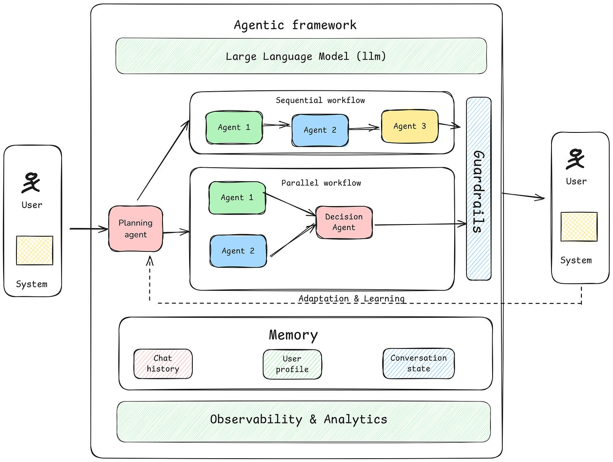
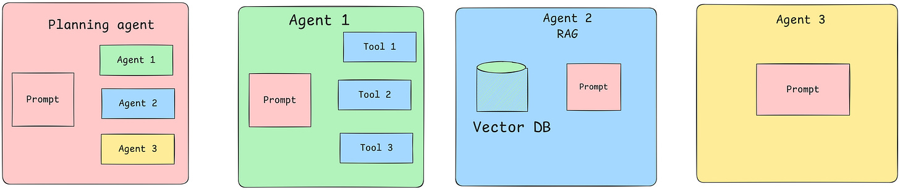
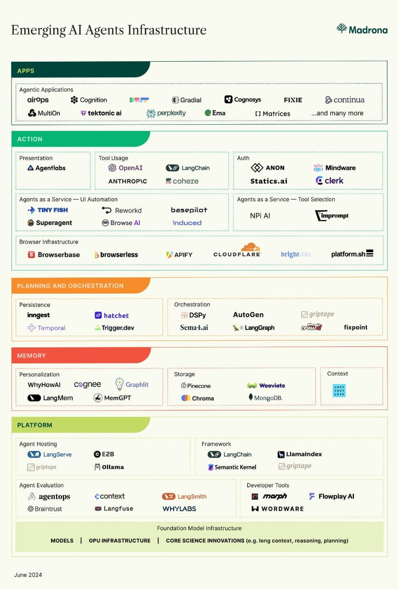
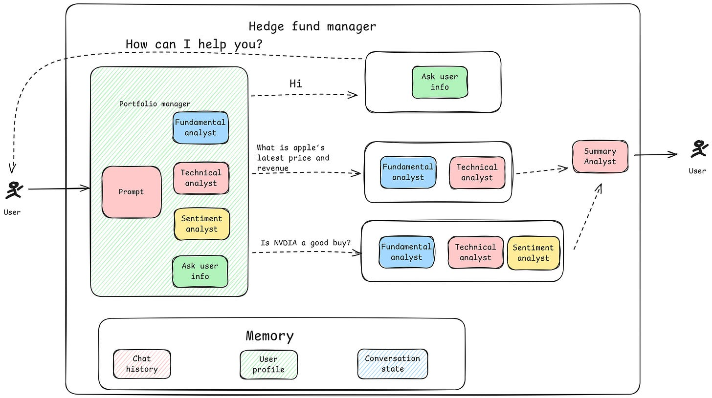
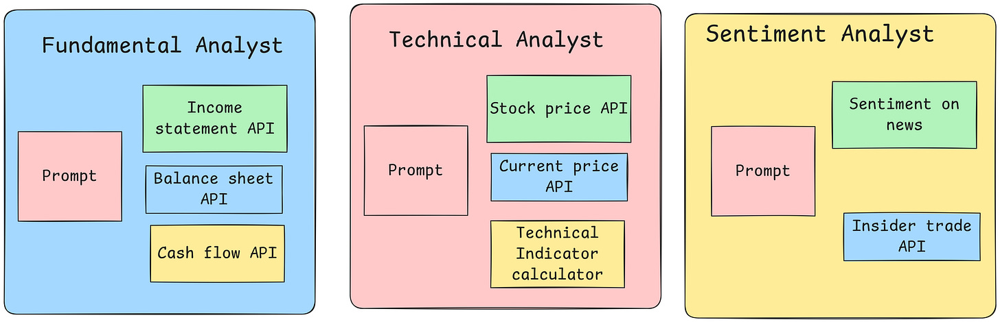
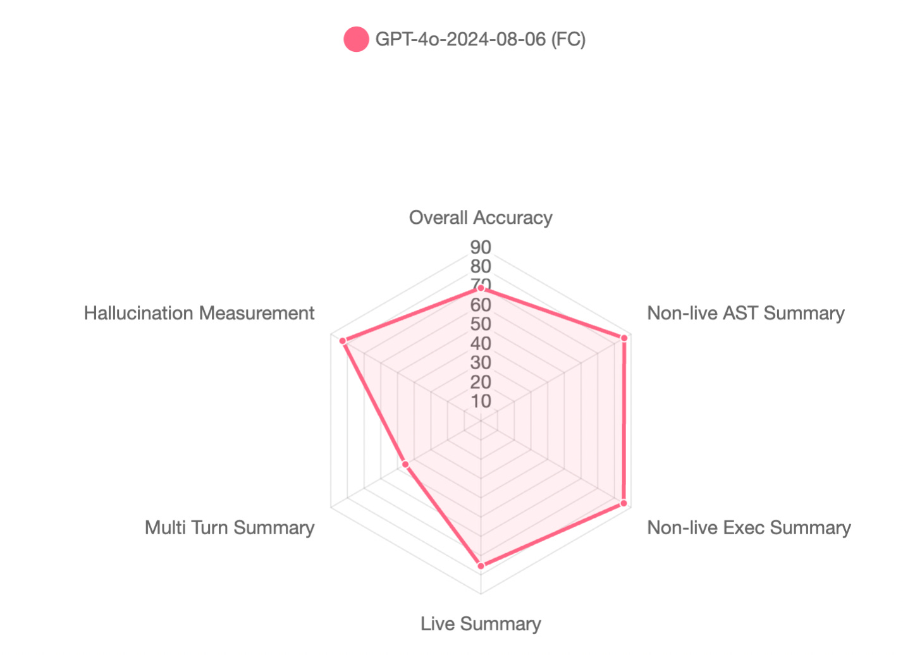

# Hiểu về kiến trúc AI tác tử (Agentic AI)

> **Bản dịch tiếng Việt từ bài viết:** [Understanding Agentic AI Architecture](https://www.srajdev.com/p/understanding-agentic-ai-architecture), Swapan Rajdev, xuất bản ngày 26/11/2024 trên [srajdev.com](https://www.srajdev.com).  \
> **Quy ước thuật ngữ:** Bài dịch giữ các thuật ngữ cốt lõi bằng tiếng Anh (kèm chú thích tiếng Việt ở lần đầu xuất hiện) để bảo toàn khả năng tra cứu — ví dụ: **Agent** (tác tử), **Guardrail** (lan can an toàn), **Memory** (bộ nhớ), **Orchestration** (điều phối), **Reasoning** (suy luận).

## Tóm tắt

AI tác tử (agentic AI) là một biên giới hấp dẫn và phức tạp của AI. Khác với mô hình học máy truyền thống tiếp nhận đầu vào và trả đầu ra một cách thụ động, AI tác tử bao gồm các thực thể gọi là **agent** — chúng có thể ra quyết định, tương tác với môi trường và đạt được các mục tiêu cụ thể. Các tác tử này sử dụng các thành phần như **suy luận (reasoning)**, **bộ nhớ (memory)** và **lập kế hoạch (planning)** để thực hiện nhiệm vụ một cách tự trị, thậm chí cộng tác với các tác tử khác để giải bài toán lớn hơn. Bài viết khám phá chi tiết AI tác tử từ trình độ mới bắt đầu đến chuyên gia, kèm ví dụ và ứng dụng thực tế.

---

## AI tác tử là gì

AI tác tử chỉ những hệ thống AI thể hiện hành vi tự trị, chủ động hướng tới mục tiêu với sự can thiệp trực tiếp của con người ở mức tối thiểu. Một hệ thống AI tác tử có khả năng hiểu môi trường của nó, suy luận về các lựa chọn sẵn có, lập kế hoạch hành động, thực thi nhiệm vụ và học hỏi từ trải nghiệm. Thuật ngữ "agentic" gợi ý rằng các hệ thống này có thể chủ động, ra quyết định, thậm chí giao tiếp với các tác tử khác để hoàn thành nhiệm vụ phức tạp.

**Ví dụ**

- **Customer Support Agent (tác tử hỗ trợ khách hàng):** Tương tác với khách hàng, trả lời câu hỏi và leo thang vấn đề khi cần. Cung cấp hỗ trợ 24/7, thích ứng với nhu cầu khách hàng và học từ tương tác trước đó để cải thiện câu trả lời.
- **Marketing Agent (tác tử tiếp thị):** Tự quản lý chiến dịch tiếp thị, gồm phân khúc khán giả, lên lịch bài đăng và tối ưu quảng cáo dựa trên dữ liệu hiệu năng thời gian thực.
- **Coding Agent (tác tử lập trình):** Tự sinh code, script hoặc thực hiện gỡ lỗi. Hữu ích cho tự động hóa nhiệm vụ lập trình lặp lại, sinh boilerplate hoặc tạo hàm tùy chỉnh; hoạt động trong IDE để thực thi lệnh.
- **Virtual Assistant (trợ lý ảo):** Như Alexa hay Google Assistant — phản hồi yêu cầu, đặt nhắc nhở, đưa gợi ý và điều khiển thiết bị thông minh, thích ứng với sở thích người dùng.
- **Financial Trading Bot (bot giao dịch tài chính):** Ra quyết định giao dịch thời gian thực dựa trên điều kiện thị trường, quy tắc định sẵn và chiến lược tiến hóa.

Trong cuốn sách _Thinking, Fast and Slow_ (Tư duy nhanh và chậm) của Daniel Kahneman, nhận thức con người được mô tả qua hai hệ thống: **System 1** và **System 2**. Tư duy System 1 nhanh, trực giác và tự động; tư duy System 2 chậm hơn, có cân nhắc và logic. Khái niệm này có thể áp dụng để hiểu cách AI tác tử vận hành.

- **System 1 Agents:** Được thiết kế để ra quyết định nhanh và phản hồi các nhiệm vụ đơn giản, thường nhật — nhanh và hiệu quả. Ví dụ tác tử hỗ trợ khách hàng trả lời tức thì theo quy tắc hoặc mẫu định sẵn là giống tư duy System 1.
- **System 2 Agents:** Xử lý nhiệm vụ phức tạp đòi hỏi suy luận, lập kế hoạch và đánh giá cẩn thận. Tác tử như Planning Agent thể hiện hành vi System 2, nơi nhiều lớp phân tích, lập kế hoạch và đánh giá diễn ra trước khi ra quyết định.

AI tác tử thường pha trộn hai chế độ vận hành này — phản ứng nhanh, theo bản năng cho nhiệm vụ định nghĩa rõ (System 1) và hành động toàn diện, có cân nhắc cho quyết định phức tạp (System 2). Hiểu sự khác biệt này giúp thiết kế tác tử tận dụng cả hai cách tiếp cận tùy theo bản chất nhiệm vụ.

*Chú thích gốc: "Agentic AI Framework Architecture".*

---

## Kiến trúc thành phần tác tử

*Chú thích gốc: "Agent Component Architecture" — sơ đồ mô tả các thành phần của một framework tác tử.*

**Cơ chế kích hoạt (Triggering Mechanisms)**

Bất kỳ hệ thống tác tử nào cũng có thể được khởi tạo bởi người dùng tương tác với nó, hoặc bởi một hệ thống khác kích hoạt hành động — thông qua webhook hoặc bộ đếm thời gian theo tần suất.

**LLM**

Mọi framework tác tử đều phụ thuộc vào một mô hình ngôn ngữ (LLM). Mỗi thành phần có thể truy cập cùng một LLM hoặc các LLM khác nhau để hoàn thành mục tiêu, mang lại sự linh hoạt và khả năng mở rộng trong xử lý các nhiệm vụ.

**Planning Agent (tác tử lập kế hoạch)**

Đóng vai trò thành phần điều phối (orchestration), bao gồm suy luận, lập kế hoạch và phân rã nhiệm vụ. Tác tử này biết tất cả các tác tử khác và — thông qua lập kế hoạch, suy luận và phân rã nhiệm vụ đúng đắn — quyết định tác tử nào sẽ được thực thi và theo thứ tự nào. Các LLM có khả năng suy luận (như o1-preview của OpenAI) phù hợp nhất cho loại tác tử này, nhưng cần dùng cẩn thận để cân bằng với các yếu tố khác của hệ thống.

**Agents (các tác tử)**

Tác tử đóng gói một tập hợp chỉ thị và công cụ để đạt được một nhiệm vụ nhất định:

- **Prompts:** Các lệnh đưa cho mô hình ngôn ngữ cùng với các công cụ mà nó có quyền truy cập.
- **Tools (công cụ):** Các khối thực thi hành động, như khối code đơn giản, lời gọi API hoặc tích hợp với hệ thống khác.
- **Environments (môi trường):** Công cụ có thể có môi trường gắn kèm để thực thi nhiệm vụ cụ thể, như IDE hoặc sử dụng máy tính nói chung.
- **Complex Agents (tác tử phức hợp):** Tác tử cũng có thể là cả một kiến trúc, như Retrieval-Augmented Generation (RAG), bao gồm embeddings và vector database.
- **Memory (bộ nhớ):** Cho phép tác tử lưu trữ thông tin và nhớ lại trong các tương tác sau. Bộ nhớ khả dụng cho mọi thành phần ở mọi lúc và có thể gồm nhiều loại:
  - **User Profile:** Thông tin riêng của người dùng giúp tác tử tạo trải nghiệm cá nhân hóa.
  - **Chat History:** Lịch sử hội thoại, cho phép tác tử kéo ngữ cảnh từ các tương tác trước.
  - **Chat State:** Theo dõi các luồng công việc đã thực thi để tránh trùng lặp nhiệm vụ.

**Guardrails (lan can an toàn)**

Guardrail là cơ chế an toàn ngăn chặn hành vi có hại trong khi vẫn đảm bảo độ bền vững khi xử lý đầu vào hoặc kịch bản không lường trước. Các quy tắc như "Đảm bảo không nhắc đến đối thủ cạnh tranh trong câu trả lời", "Tránh bàn về tôn giáo hay chính trị" là một vài ví dụ nên tồn tại ở cấp framework. Những ràng buộc này rất quan trọng khi triển khai tác tử trong môi trường động, cung cấp các kiểm tra an toàn mặc định có thể chỉnh sửa khi cần.

**Agent Observability (khả năng quan sát tác tử)**

Observability cho phép nhà phát triển và người dùng hiểu tác tử đang làm gì và vì sao. Minh bạch trong hành vi của tác tử giúp chẩn đoán vấn đề, tối ưu hiệu năng và đảm bảo quyết định của tác tử phù hợp với kết quả mong muốn.

**Adaptation and Learning (thích ứng và học hỏi)**

Thích ứng là khả năng tác tử điều chỉnh hành vi dựa trên phản hồi từ môi trường, gồm reinforcement learning (học tăng cường) hoặc các kỹ thuật thích ứng khác giúp tác tử tối ưu ra quyết định theo thời gian. Ví dụ, một marketing agent có thể điều chỉnh chiến lược dựa trên sở thích khách hàng đang thay đổi.

---

## Hạ tầng AI tác tử

Hạ tầng AI tác tử đã tiến hóa vượt bậc trong năm qua và dự kiến còn tiếp tục phát triển nhanh. Sự tăng trưởng này mang lại nhiều công cụ và thành phần mới giúp xây dựng hệ thống AI tác tử.

*Chú thích gốc: "Agentic AI Infrastructure" — sơ đồ từ [Madrona](https://www.madrona.com/the-rise-of-ai-agent-infrastructure/) mô tả các phần khác nhau của hệ sinh thái, gồm agent hosting, orchestration, memory, platform tools và hơn thế.*

**Ưu điểm**

- **Hệ công cụ đa dạng:** Có nhiều công cụ tốt cho mọi phần của việc xây dựng AI tác tử, cho phép nhà phát triển chọn công cụ chuyên biệt theo yêu cầu cụ thể.
- **Thiết kế đơn giản:** Nhiều công cụ được thiết kế với giao diện thân thiện hoặc API đơn giản, dễ bắt đầu và tạo prototype nhanh.

**Nhược điểm**

- **Hệ sinh thái phân mảnh:** Số lượng lớn công cụ chuyên biệt tạo ra hệ sinh thái phân mảnh cao, đòi hỏi nhiều công sức ghép nối. Nhà phát triển thường dành nhiều thời gian tích hợp và quản lý nhiều công cụ hơn là phát triển cốt lõi.
- **Phức tạp tích hợp:** Đảm bảo tính tương thích và giao tiếp hiệu quả giữa các công cụ khác nhau có thể phức tạp và tốn thời gian.

Sự đa dạng công cụ cho phép mức độ tùy biến và chuyên biệt cao, nhưng cũng đặt ra thách thức đáng kể: nhà phát triển phải tìm cách tích hợp chúng liền mạch vào framework của mình. Khi hệ sinh thái tiếp tục phát triển, việc hợp nhất thành các framework thống nhất hoặc công cụ toàn diện hơn sẽ là chìa khóa để đơn giản hóa quá trình phát triển.

---

## Ví dụ: Hedge Fund Agent (tác tử quỹ đầu cơ)

Để đánh giá các framework nêu trên, tác giả dùng ví dụ một tác tử quỹ đầu cơ thực hiện nhiều phân tích khác nhau để đưa ra tóm tắt và quyết định về cổ phiếu của một công ty đại chúng.

*Chú thích gốc: "Hedge Fund Agent Architecture".*

*Chú thích gốc: "Analyst Agent Architecture" — kiến trúc một đội ngũ nhà phân tích của quỹ đầu cơ (lấy từ repository GitHub của [@virattt](https://x.com/virattt), xem [tại đây](https://gist.github.com/virattt/0e4c7740472177a327b61449c9af721d)).*

- **Portfolio Manager:** Đóng vai trò planning agent, điều phối toàn bộ quá trình ra quyết định bằng cách quyết định tác tử nào được gọi và theo thứ tự nào.
- **Fundamental Analyst:** Thực hiện phân tích cơ bản một cổ phiếu, đánh giá báo cáo tài chính, doanh thu, khả năng sinh lời và các chỉ báo khác.
- **Technical Analyst:** Thực hiện phân tích kỹ thuật bằng dữ liệu thị trường lịch sử, xu hướng giá và mẫu hình biểu đồ.
- **Sentiment Analyst:** Tập trung vào tin tức, mạng xã hội và các nguồn cảm xúc công chúng khác để đo lường tâm lý thị trường.
- **Summary Analyst:** Nhận đầu vào từ các nhà phân tích khác và quyết định cổ phiếu nên là **Buy** (mua), **Hold** (giữ) hay **Sell** (bán).
- **User-Asking Analyst:** Liên hệ với người dùng khi cần thêm thông tin để tiếp tục phân tích.

### Đánh giá các framework

Có nhiều framework giúp xây dựng tác tử dễ dàng. Dưới đây là đánh giá nhanh tất cả các framework (tác giả đã triển khai thử trên hầu hết chúng):

**Ghi chú framework** — Hầu hết các framework có phần lớn chức năng tương đương và khác nhau ở chi tiết triển khai hơn là chức năng.

- **Langchain:** Dễ bắt đầu nhưng khó xây dựng luồng phức tạp. Dùng tốt nhất kèm LangGraph.
- **LangGraph:** Cùng với Langchain, là công cụ rất mạnh. Cần thời gian làm quen, và việc trực quan hóa đồ thị khó, khiến người mới khó hiểu luồng nếu không đào sâu.
- **CrewAI:** Framework tổng thể tốt, cho phép mọi chức năng; có cả nền tảng SaaS giúp dễ dùng hơn. Cho phép luồng phân cấp, nhưng luồng phức tạp hơn vẫn đang trong lộ trình.
- **Swarm:** Chủ yếu là framework giáo dục, chưa sẵn sàng cho production. Có hầu hết chức năng, nhưng kết hợp chúng để xây luồng phức tạp còn hạn chế.
- **Microsoft AutoGen:** Sẽ được đánh giá sớm.

**Quan sát**

- Chưa ai có cách xây guardrail ở cấp framework. Có framework của NVIDIA gọi là [NeMo Guardrails](https://github.com/NVIDIA/NeMo-Guardrails) cho phép cắm guardrail lập trình được, nhưng phải cắm riêng.
- Bộ nhớ ở hầu hết framework được thực hiện bằng state và biến ngữ cảnh — tất cả đều phải quản lý thủ công.
- Planning có thể thực hiện qua các tác tử thông thường, nhưng xử lý state vẫn phải làm thủ công.
- Luồng công việc động được thực hiện bằng handoff, nhưng LangGraph và CrewAI giúp xây đồ thị dễ hơn.

---

## Đánh giá và kiểm thử AI tác tử

Đánh giá AI tác tử là rất quan trọng để đảm bảo độ tin cậy, hiệu năng và an toàn. Do nhu cầu lặp nhanh và tính chủ quan khi đánh giá tác tử, việc kiểm thử và đánh giá thường không được chú trọng đủ.

**Unit Evaluation (đánh giá đơn vị)**

Lý tưởng là mỗi tác tử nên có đánh giá riêng, tương tự unit testing trong kỹ thuật phần mềm. Đánh giá đơn vị đảm bảo từng tác tử hành xử như kỳ vọng, đáp ứng yêu cầu chức năng. Tác tử nên được kiểm thử qua nhiều kịch bản để xác nhận độ chính xác về suy luận, lập kế hoạch và thực thi. Giữ đầu ra có cấu trúc cho mỗi tác tử là có lợi vì đầu ra có cấu trúc giúp xác thực dễ hơn.

**Integration Evaluation (đánh giá tích hợp)**

Toàn bộ hệ thống cũng nên trải qua đánh giá, tương tự integration testing. Đánh giá tích hợp xem xét các tác tử phối hợp tốt đến đâu như một hệ thống hoàn chỉnh, xác minh rằng tương tác giữa các tác tử dẫn đến kết quả đúng. Loại kiểm thử này quan trọng để phát hiện vấn đề phát sinh từ lỗi giao tiếp hoặc phụ thuộc bất ngờ giữa các tác tử.

**Runtime Verification (xác minh lúc chạy)**

Xác minh lúc chạy đánh giá đầu ra của tác tử trong thời gian thực để cải thiện khả năng thích ứng và học hỏi. Có 2 cách: dùng con người trong vòng lặp (chỉ khả thi với lượng dữ liệu nhỏ) hoặc dùng mô hình lớn hơn làm bộ xác minh lúc chạy — giúp đảm bảo tác tử ra quyết định phù hợp với mục tiêu, nhưng có thể tốn kém về tính toán. Để giảm chi phí, có thể dùng xác minh lúc chạy theo lô (batched) hoặc chọn lọc (selective, dựa trên phản hồi người dùng hoặc sự kiện quan trọng).

**Red Teaming**

Red teaming là thành phần quan trọng để đánh giá framework tác tử, đặc biệt để nhận diện lỗ hổng và đảm bảo độ bền vững. Đánh giá kiểu này mô phỏng điều kiện đối kháng để xác định hệ thống xử lý đầu vào bất ngờ hoặc có khả năng gây hại tốt đến đâu. Red team testing giúp phơi bày điểm yếu trong suy luận, xử lý bộ nhớ và chiến lược tương tác của tác tử — thiết yếu để hiểu tác tử có thể thất bại thế nào dưới điều kiện đối kháng và xây dựng biện pháp an toàn tốt hơn.

**Best Practices (thực hành tốt nhất)**

- **Structured Outputs:** Đảm bảo đầu ra mỗi tác tử có cấu trúc tốt — giúp xác thực tính đúng đắn dễ dàng và phát hiện vấn đề kịp thời.
- **Testing at Scale:** Dùng mô hình ngôn ngữ lớn hơn để kiểm thử kết quả cuối cùng nhằm đảm bảo khả năng mở rộng. Mô hình lớn có thể mô phỏng nhiều hành vi người dùng, giúp stress-test hệ thống hiệu quả.
- **Iterative Evaluation:** Đánh giá tác tử theo vòng lặp, cho phép phát hiện điểm yếu sớm và cải thiện nhanh.

---

## Các hạn chế của hệ thống AI tác tử

Dù có tiềm năng, hệ thống AI tác tử vẫn đối mặt với một số hạn chế hạn chế khả năng ứng dụng.

**Độ chính xác của function calling (gọi hàm)**

Dù LLM có thể xác định công cụ cần gọi, độ chính xác của các quyết định này vẫn chưa cao. Theo [UC Berkeley Function-Calling Leaderboard](https://gorilla.cs.berkeley.edu/leaderboard.html), LLM tốt nhất có độ chính xác 68,9%, với mức độ ảo giác (hallucination) cao. Hạn chế này khiến LLM kém tin cậy cho các ca sử dụng rủi ro cao.

*Chú thích gốc: "Function calling accuracy".*

**Best Practices để cải thiện độ chính xác**

- **Giới hạn công cụ:** Giới hạn số công cụ ở mức 4-5 mỗi prompt. Vượt quá mức này, ảo giác tăng và độ chính xác giảm đáng kể.
- **Prompt cụ thể kèm ví dụ:** Làm prompt rất cụ thể và cố gắng cung cấp ví dụ về khi nào gọi công cụ nào — giúp LLM hiểu ngữ cảnh tốt hơn.
- **Đánh giá tốt cho tool calling:** Đánh giá kỹ lưỡng cho việc gọi công cụ là thiết yếu để đo lường và cải thiện độ chính xác. Điều này khả thi vì đầu ra có thể cấu trúc hóa.

**Chi phí**

Chạy AI tác tử có thể đắt đỏ, đặc biệt với số lượng lời gọi LLM và sự tham gia của nhiều tác tử. Quản lý bộ nhớ, suy luận và dùng công cụ làm tăng chi phí tính toán. Một số chiến lược giúp giảm thiểu:

- **Pricing Dynamics:** Dù AI tác tử đắt đỏ hiện nay, xu hướng giá dự kiến giảm đáng kể theo thời gian ([10x mỗi năm](https://a16z.com/llmflation-llm-inference-cost/)). Tiến bộ trong tối ưu mô hình và cạnh tranh ngày càng tăng giữa các nhà cung cấp đang hạ chi phí.
- **Lựa chọn LLM:** Mỗi tác tử có thể dùng loại LLM khác nhau phù hợp nhất với mục đích. Ví dụ planning agent cần LLM mạnh hơn cho suy luận phức tạp, trong khi tác tử đơn giản có thể dựa vào LLM nhẹ, rẻ hơn.
- **Hybrid Models:** Kết hợp LLM với mô hình nhỏ, chuyên biệt (như hệ thống dựa trên quy tắc) cho nhiệm vụ không cần hiểu ngôn ngữ phức tạp — chuyển bớt nhiệm vụ đơn giản sang mô hình không phải LLM.
- **Optimized Token Usage:** Dùng token và prompt khôn ngoan. Ví dụ gửi tóm tắt hoặc chỉ phần liên quan của codebase thay vì toàn bộ, giảm số token.
- **Batch Processing và Shared Resources:** Thiết kế tác tử chia sẻ tài nguyên khi có thể. Bộ nhớ và kết quả trung gian có thể cache và tái sử dụng giữa nhiều tác tử, giảm tính toán dư thừa và lời gọi LLM.

**Độ trễ (Latency)**

AI tác tử thường liên quan đến suy luận và tương tác nhiều bước, gây ra độ trễ đáng kể, đặc biệt khi tác tử giao tiếp hoặc gọi công cụ bên ngoài.

- **Streaming Last Layer:** Với tác tử đối mặt người dùng, làm lớp cuối của LLM streaming có thể giảm đáng kể độ trễ cảm nhận — cung cấp token ngay khi sinh ra.
- **Prompt Optimization:** Prompt và kết quả thường giống hệt giữa các người dùng khác nhau. Prompt caching có thể tái sử dụng kết quả đã tính trước đó.
- **Specialized LLMs:** Không phải tác tử nào cũng cần LLM lớn, phức tạp. Dùng LLM đơn giản cho nhiệm vụ thẳng thắn và dành mô hình nặng cho suy luận phức tạp.
- **Parallel Execution:** Khi có thể, tác tử nên chạy song song thay vì tuần tự. Ví dụ phân tích cảm xúc và phân tích kỹ thuật có thể chạy đồng thời.
- **Efficient Runtime Strategies:** Dùng xác minh lúc chạy theo lô hoặc chọn lọc — chỉ kiểm tra đầu ra quan trọng hoặc mẫu ngẫu nhiên thay vì mọi đầu ra.

**Alignment (sự căn chỉnh giá trị)**

Đảm bảo tác tử phù hợp với giá trị và mục tiêu của con người là thách thức liên tục. Tác tử lệch hướng có thể ra quyết định hợp lý theo góc nhìn của nó nhưng có hại hoặc không mong muốn cho người dùng.

- **Fine-Tuning cho mục tiêu nhiệm vụ cụ thể:** Fine-tune mô hình ngôn ngữ cho nhiệm vụ cụ thể giúp cải thiện sự căn chỉnh của tác tử với kết quả mong muốn.
- **RLHF (Reinforcement Learning from Human Feedback):** Dùng phản hồi người dùng để tinh chỉnh tác tử dựa trên sở thích và giá trị người dùng, giúp tác tử cải thiện hành vi theo vòng lặp.
- **Consistency Checks:** Thực hiện kiểm tra nhất quán định kỳ — so sánh đầu ra tác tử với tập phản hồi chấp nhận được định sẵn để phát hiện lệch hướng sớm.
- **Explainability:** Tác tử giải thích được lập luận thì dễ căn chỉnh hơn với kỳ vọng con người. Explainable AI giúp người dùng hiểu vì sao tác tử ra quyết định cụ thể.
- **Human-in-the-Loop Oversight:** Với ứng dụng quan trọng, giám sát con người trong vòng lặp là tối quan trọng — cho phép can thiệp thời gian thực khi tác tử lệch khỏi mục tiêu, đặc biệt trong kịch bản rủi ro cao.

---

## Kết luận

Trong hướng dẫn toàn diện này, chúng ta đã khám phá các khái niệm và thành phần cơ bản của AI tác tử, gồm kiến trúc, các ví dụ và framework. AI tác tử là một cách tiếp cận độc đáo để xây dựng hệ thống tự trị có khả năng suy luận, lập kế hoạch và thích ứng để đạt mục tiêu cụ thể. Chúng ta đã thảo luận cách tác tử có thể vận hành như tư duy System 1 và System 2, pha trộn hành động nhanh, trực giác với quá trình ra quyết định có cân nhắc và phức tạp; đồng thời phân tích các framework khác nhau và chia sẻ thực hành tốt nhất cho kiểm thử và đánh giá.

Dù có các nghiên cứu thành công như [Amdocs dùng Nvidia NIM](https://developer.nvidia.com/blog/amdocs-accelerates-generative-ai-performance-and-lowers-costs-with-nvidia-nim/) và [Wiley hợp tác với Salesforce](https://www.salesforce.com/customer-stories/wiley/), thách thức vẫn còn trong việc làm tác tử hoàn toàn tự trị. Niềm tin và khả năng xác minh lúc chạy ở quy mô vẫn là trở ngại đáng kể, cũng như câu hỏi về cách tốt nhất để kiến trúc hóa tác tử nhằm đạt kết quả tối ưu. Phát triển framework bền vững có thể đóng vai trò then chốt trong việc vượt qua các thách thức này, và những cải tiến liên tục trong kiểm thử — gồm runtime verification và red team testing — sẽ giúp đảm bảo tác tử vận hành đáng tin cậy và an toàn.

---

## Tài liệu tham khảo

- Repository GitHub về đội ngũ AI hedge fund của [@virattt](https://x.com/virattt): [gist](https://gist.github.com/virattt/0e4c7740472177a327b61449c9af721d)
- [a16z — LLMflation: LLM inference cost](https://a16z.com/llmflation-llm-inference-cost/)
- [UC Berkeley Gorilla Function-Calling Leaderboard](https://gorilla.cs.berkeley.edu/leaderboard.html)
- [NVIDIA NeMo Guardrails](https://github.com/NVIDIA/NeMo-Guardrails)
- [Madrona — The Rise of AI Agent Infrastructure](https://www.madrona.com/the-rise-of-ai-agent-infrastructure/)
- [LangChain](https://www.langchain.com/) · [LangGraph](https://www.langchain.com/langgraph)
- [CrewAI](https://www.crewai.com/) · [OpenAI Swarm](https://github.com/openai/swarm) · [Microsoft AutoGen](https://github.com/microsoft/autogen) · [LlamaIndex](https://www.llamaindex.ai/)
- [Wikipedia — Thinking, Fast and Slow](https://en.wikipedia.org/wiki/Thinking,_Fast_and_Slow)
- [NVIDIA — Amdocs accelerates generative AI performance with NIM](https://developer.nvidia.com/blog/amdocs-accelerates-generative-ai-performance-and-lowers-costs-with-nvidia-nim/)
- [Salesforce — Wiley customer story](https://www.salesforce.com/customer-stories/wiley/)

---

## Thuật ngữ song ngữ

| Tiếng Anh | Tiếng Việt |
|---|---|
| Agent | Tác tử |
| Agentic AI | AI tác tử |
| Reasoning | Suy luận |
| Planning | Lập kế hoạch |
| Memory | Bộ nhớ |
| Guardrail | Lan can an toàn |
| Orchestration | Điều phối |
| Observability | Khả năng quan sát |
| Tool | Công cụ |
| Function calling | Gọi hàm |
| Retrieval-Augmented Generation (RAG) | Sinh tăng cường truy xuất |
| Reinforcement Learning from Human Feedback (RLHF) | Học tăng cường từ phản hồi con người |
| Human-in-the-Loop (HITL) | Con người trong vòng lặp |
| Red teaming | Tấn công mô phỏng đối kháng |
| Fine-tuning | Tinh chỉnh mô hình |
| Hallucination | Ảo giác |
