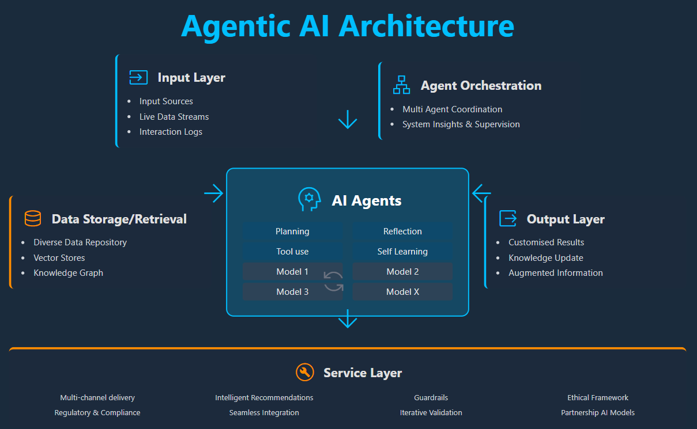
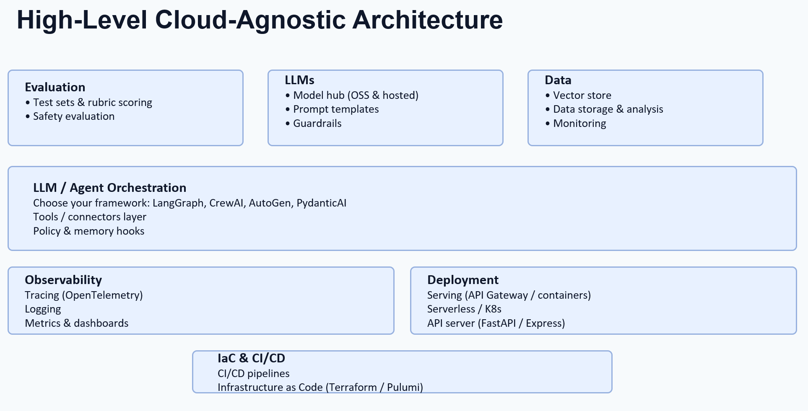
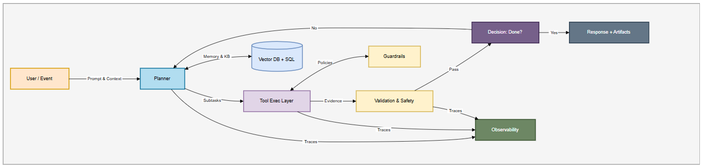
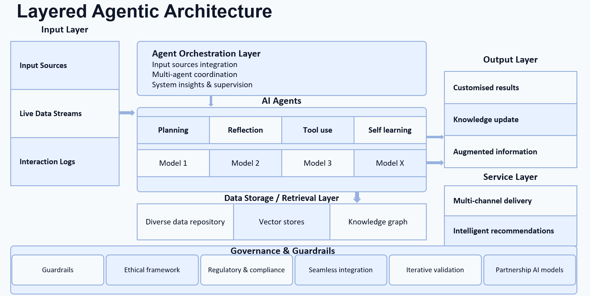
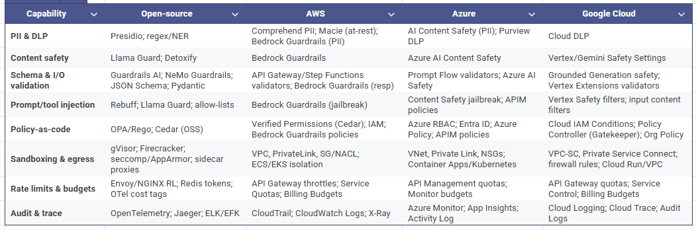
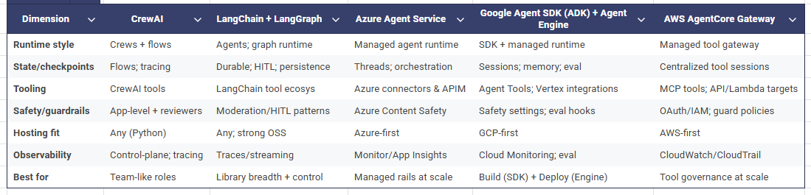
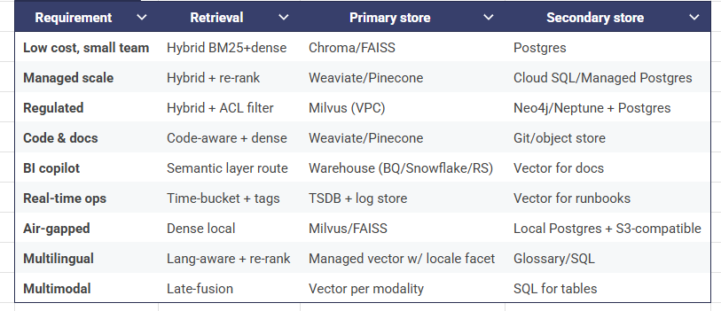
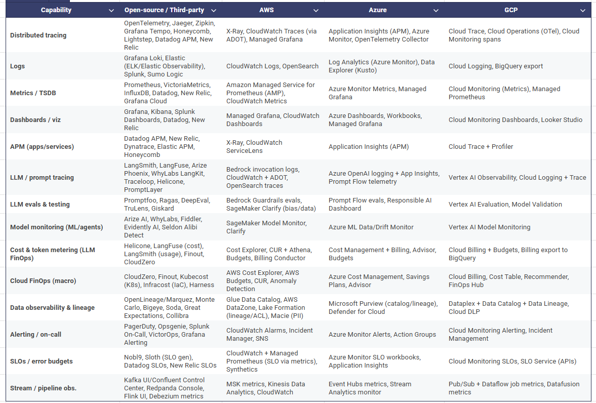

# Kiến trúc AI tác tử (Agentic AI): Hướng dẫn thực tế, sẵn sàng cho production

> **Bản dịch tiếng Việt từ bài viết:** [Agentic AI Architecture: A Practical, Production-Ready Guide](https://medium.com/agenticai-the-autonomous-intelligence/agentic-ai-architecture-a-practical-production-ready-guide-2b2aa6d16118), Monoj Kanti Saha, xuất bản ngày 30/08/2025 trên ấn phẩm *AgenticAI: The Autonomous Intelligence* (Medium).  \
> **Quy ước thuật ngữ:** Bài dịch giữ các thuật ngữ cốt lõi bằng tiếng Anh (kèm chú thích tiếng Việt ở lần đầu xuất hiện) để bảo toàn khả năng tra cứu — ví dụ: **Agent** (tác tử), **Guardrail** (lan can an toàn), **Tool** (công cụ), **Memory** (bộ nhớ), **Orchestration** (điều phối). Chú thích ảnh giữ nguyên văn tiếng Anh kèm diễn giải tiếng Việt.

## Tóm tắt

Bài viết là một hướng dẫn thực tiễn về kiến trúc AI tác tử — các thành phần cốt lõi, guardrail (lan can an toàn), Dependency Injection cho công cụ, validation (xác thực), triển khai và observability (khả năng quan sát) — kèm ghi chú về LangGraph, CrewAI và các nền tảng đám mây. Tác giả trình bày một "bản thiết kế tối giản nhưng sẵn sàng cho production", nhấn mạnh rằng tác tử không thay thế hệ thống hiện có mà **điều phối** chúng, với guardrail đảm bảo mọi hành động đều truy vết được, có thể hoàn tác và tuân thủ quy định.

---

## 1. Kiến trúc AI tác tử (Agentic AI) là gì?

Một **kiến trúc AI tác tử (agentic AI architecture)** là một hệ thống phần mềm trong đó một tác tử (agent) tự trị hoặc bán tự trị theo đuổi một mục tiêu bằng cách _lập kế hoạch hành động, gọi công cụ, quan sát kết quả, cập nhật những gì nó biết_, rồi lặp lại vòng lặp đó cho đến khi đạt được mục tiêu — và mọi ràng buộc an toàn hay chính sách đều được thỏa mãn. Hãy hình dung nó như một "nhân viên vận hành" AI: có thể phân rã nhiệm vụ, gọi đúng dịch vụ vào đúng thời điểm, tự kiểm tra công việc của mình, rồi hoàn thành hoặc xin trợ giúp (ví dụ sự phê duyệt của con người) khi rủi ro cao.

### Vì sao điều này quan trọng lúc này

Các hệ thống ML cổ điển rất tốt khi đầu vào và đầu ra là cố định. Các bài toán doanh nghiệp hiện đại — phân loại ticket hỗ trợ, đối soát giao dịch, sinh tài liệu tuân thủ — lại là bài toán mở, cần nhiều nguồn dữ liệu và đòi hỏi guardrail cẩn thận. Kiến trúc tác tử mang lại **cấu trúc** (kế hoạch, trạng thái, chính sách) để sử dụng LLM một cách an toàn và lặp lại được.

*Bản thiết kế tầng kiến trúc "cloud-agnostic": tầng Evaluation (đánh giá) — LLMs — Data ở trên, tầng Orchestration (điều phối) ở giữa, Observability/Deployment ở dưới, và nền tảng IaC & CI/CD ở đáy.*

### Vòng lặp điều khiển trong một cái nhìn

1. **Lập kế hoạch (Plan):** Chia mục tiêu thành các bước (ví dụ: "lấy đơn hàng → kiểm tra chính sách → đề xuất phương án xử lý").
2. **Hành động (Act):** Gọi một hoặc nhiều **công cụ (tools)** — API, cơ sở dữ liệu, tìm kiếm, trình chạy code.
3. **Quan sát (Observe):** Ghi nhận kết quả và mọi tác dụng phụ.
4. **Suy ngẫm/Quyết định (Reflect/Decide):** Xác thực đầu ra, cập nhật **bộ nhớ/trạng thái (memory/state)**, rồi tiếp tục vòng lặp hoặc dừng.
5. **Tuân thủ (Comply):** Tôn trọng **guardrail** (quyền riêng tư, chi phí, an toàn) ở từng bước.

*Luồng điều khiển: từ User/Event → Planner → Tool Exec Layer → Validation & Safety → quyết định "Done?"; vòng lặp quay lại Planner khi chưa xong, và mọi thành phần đều báo trace về Observability.*

### Các thuật ngữ chính (góc nhìn người thực hành)

- **Agent (tác tử):** Người ra quyết định. Thường được vận hành bởi một LLM, nó quyết định _làm gì tiếp theo_ dựa trên mục tiêu, ngữ cảnh và chính sách. Trong kịch bản trung tâm liên lạc, tác tử có thể quyết định lấy ba đơn hàng gần nhất của khách trước khi soạn câu trả lời.
- **Planner / Router (bộ lập kế hoạch / bộ định tuyến):** "Quản đốc" của luồng công việc. Nó chuyển một mục tiêu cấp cao thành chuỗi bước và định tuyến công việc đến các kỹ năng hoặc tác tử con phù hợp. Nó có thể điều chỉnh kế hoạch khi có quan sát mới.
- **Reasoner (bộ suy luận):** "Nhà phê bình nội tâm" của tác tử. Nó thực hiện chain-of-thought (chuỗi suy luận) có giới hạn, kiểm tra mâu thuẫn và tinh chỉnh bản nháp. Hệ thống tốt giới hạn thời gian suy ngẫm này để kiểm soát chi phí và độ trễ.
- **Tools / Skills (công cụ / kỹ năng):** Các năng lực bên ngoài mà tác tử có thể gọi: API REST/GraphQL, truy vấn cơ sở dữ liệu, tìm kiếm/truy xuất, thực thi code, email/lịch, cloud SDK… Mỗi công cụ cần có hợp đồng (contract) rõ ràng và phạm vi quyền rõ ràng.
- **Validators / Evaluators (bộ xác thực / đánh giá):** Các kiểm tra mang tính quyết định (schema, quy tắc nghiệp vụ, PII/DLP) và các "giám khảo" học máy tùy chọn (chấm điểm chất lượng). Chúng giữ cho đầu ra _hữu ích, an toàn và đúng hợp đồng_.
- **Orchestration Runtime (runtime điều phối):** Bộ máy thực thi chạy kế hoạch, quản lý retry và timeout, lưu trữ checkpoint (điểm kiểm tra) và hỗ trợ điểm dừng human-in-the-loop (HITL). Đây là nơi bạn đảm bảo hệ thống phục hồi được sau lỗi một phần.
- **Policy / Guardrails (chính sách / lan can an toàn):** Thực thi luật chơi: danh sách cho phép/từ chối cho công cụ và tên miền, kiểm soát quyền riêng tư và nơi cư trú dữ liệu, trần chi phí, giới hạn tốc độ và đường dẫn leo thang cho các hành động rủi ro.
- **Memory (bộ nhớ):**
  - **Ngắn hạn:** Ngữ cảnh làm việc cho nhiệm vụ hiện tại (lượt đối thoại, trạng thái kế hoạch).
  - **Dài hạn:** Kho tri thức như vector database (nhớ lại theo ngữ nghĩa), SQL (dữ kiện và sổ cái), hoặc graph database (quan hệ và đường dẫn).
  - **Nhật ký episodic:** Những gì đã xảy ra trong các lần chạy trước — hữu ích cho kiểm toán và học hỏi.

### Các topology (và khi nào dùng chúng)

- **Đơn tác tử (Single-agent)**  \
  _Dùng cho:_ Luồng công việc tập trung với ranh giới rõ ràng (ví dụ tóm tắt tài liệu kết hợp truy xuất).  \
  _Lợi ích:_ Dễ xây dựng và quan sát hơn; ít thành phần chuyển động.  \
  _Cảnh báo:_ Có thể trở thành "god-agent" nếu bị nhồi nhét quá nhiều trách nhiệm.
- **Phân cấp (Hierarchical)**  \
  _Dùng cho:_ Quy trình nhiều bước với các vai trò riêng biệt (planner → researcher → reviewer).  \
  _Lợi ích:_ Tách biệt trách nhiệm, dễ mở rộng và kiểm thử từng vai trò.  \
  _Cảnh báo:_ Chi phí phối hợp cao hơn; đảm bảo bàn giao rõ ràng và trạng thái chia sẻ.
- **Dựa trên đồ thị (Graph-based)**  \
  _Dùng cho:_ Luồng động, nơi các đường dẫn khác nhau được kích hoạt dựa trên quan sát (nút quyết định, vòng lặp, nhánh điều kiện).  \
  _Lợi ích:_ Trạng thái, retry và checkpoint tường minh; tuyệt vời cho độ tin cậy và kiểm toán.  \
  _Cảnh báo:_ Đòi hỏi thiết kế kỷ luật cho hợp đồng nút và điểm xác thực.
- **Bầy đàn / Cộng tác (Swarm / Collaborative)**  \
  _Dùng cho:_ Brainstorm, tổng hợp, hoặc nhiệm vụ hưởng lợi từ nhiều góc nhìn (ví dụ phân tích đa tài liệu).  \
  _Lợi ích:_ Đa dạng lập luận; phủ nhiều trường hợp biên hơn.  \
  _Cảnh báo:_ Giới hạn chặt chẽ là thiết yếu — đặt ngân sách thời gian/bước và một cơ chế phân định rõ ràng (reviewer hoặc policy).

### Một mô hình tư duy cụ thể

Hãy hình dung một "tác tử" xử lý yêu cầu bồi thường. Nó nhận một hồ sơ, **lập kế hoạch** các bước, **gọi công cụ** để lấy dữ liệu chính sách và giao dịch, **xác thực** kết quả đề xuất theo quy tắc nghiệp vụ và chính sách PII, **cập nhật bộ nhớ** với lý lẽ và bằng chứng, rồi hoặc **hoàn tất** yêu cầu hoặc **leo thang** đến con người nếu số tiền vượt ngưỡng. Tác tử không thay thế hệ thống của bạn — nó điều phối chúng, với **guardrail** đảm bảo mọi hành động đều truy vết được, có thể hoàn tác và tuân thủ.

*Mô hình phân lớp: Input Layer → Agent Orchestration Layer → AI Agents (Planning/Reflection/Tool use/Self learning + Model 1..X) → Data Storage/Retrieval → Output Layer → Service Layer, với dải Governance & Guardrails chạy xuyên suốt bên dưới.*

---

## 2. Thành phần cốt lõi và trách nhiệm

### 2.1 Bản thiết kế tối giản nhưng sẵn sàng cho production

**Ingress / API**

- Đặt một API gateway phía trước (WAF, TLS, CORS) và chấm dứt xác thực bằng **JWT/OAuth/OIDC**.
- Thực thi **rate limit** và **quota** theo tenant, người dùng và tác tử. Thêm bảo vệ chống bùng nổ và trả về 429 một cách nhẹ nhàng.
- Áp dụng **ngân sách yêu cầu** (token, độ trễ, chi phí) ở biên; từ chối sớm payload quá khổ.
- Đóng dấu **correlation ID** lên mọi yêu cầu; lan truyền đến mọi span và log ở hạ nguồn.
- Định nghĩa **timeout** cứng và **circuit breaker** để ngăn công cụ lỗi lan truyền dây chuyền.

**Orchestrator (bộ điều phối)**

- Chọn **stateful graph runtime** (ví dụ LangGraph) khi muốn nút, retry và checkpoint tường minh; chọn **role-based crews** (ví dụ CrewAI) khi muốn các vai trò giống con người (planner/researcher/reviewer) cộng tác.
- Quản lý phiên bản **flows/prompts/policies** cùng nhau; ghim phiên bản trong production; dùng feature flag để triển khai an toàn.
- Xây dựng điểm dừng **HITL** vào các nút rủi ro cao; luồng nên tạm dừng, chờ phê duyệt, rồi tiếp tục từ checkpoint.
- Xử lý hành động liên dịch vụ như **saga**: định nghĩa các bù trừ cho lỗi một phần.

**Tầng công cụ (DI)**

- Duy trì **danh mục công cụ**: tên, hợp đồng (đầu vào/đầu ra), chủ sở hữu, SLO, lịch sử thay đổi.
- Bọc các nhà cung cấp bằng **adapter phi trạng thái** (HTTP, DB, tìm kiếm, trình chạy code, mail, lịch, cloud SDK).
- Chặn mọi lời gọi qua **policy** (danh sách cho phép/từ chối, IAM theo từng công cụ, danh sách cho phép egress, kiểm tra chi phí).
- Cung cấp **mock và fixture** cho CI; công bố ma trận tương thích theo môi trường.
- Thêm **fallback** (nhà cung cấp chính → phụ) và **caching** phản hồi có TTL cho các công cụ đọc nhiều.

**Memory**

- Dùng **hybrid store**: Vector DB (RAG) cho nhớ lại theo ngữ nghĩa; **SQL** cho dữ kiện và trạng thái chuẩn; tùy chọn **Graph DB** cho quan hệ và suy luận nhiều bước.
- Chuẩn hóa **chunking và metadata** (nguồn, dấu thời gian, quyền, ngôn ngữ); ưu tiên truy xuất hybrid (sparse+dense) và re-ranking.
- Thực thi **cô lập tenant**, mã hóa, kiểm soát truy cập cấp hàng/bộ sưu tập và **loại bỏ PII** khi nạp dữ liệu.
- Theo dõi nguồn gốc cho trích dẫn; giám sát **hit-rate** truy xuất và độ tươi; xoay vòng nội dung cũ.

**Policy & guardrails**

- Phân tầng kiểm soát tại **đầu vào → kế hoạch → công cụ → đầu ra**.
- **Redaction PII/DLP**, **an toàn nội dung** (độc hại, tự hại…), **policy-as-code** (cho phép/từ chối) và **sandboxing** (egress mạng, filesystem).
- Đặt **ngân sách** (token, thời gian, tiền) và **quy tắc leo thang** (kích hoạt HITL, chuyển model, hoặc dừng) khi có rủi ro.
- Cập nhật hiện vật quản trị (model card, sổ đăng ký rủi ro, nhật ký quyết định).

**Validation**

- Làm mọi I/O của tác tử theo **schema-first**. Xác thực cấu trúc, kiểu, khoảng, đơn vị và enum.
- Thêm **quy tắc nghiệp vụ** và kiểm tra hợp lý (ví dụ số lượng bằng chứng ≥ ngưỡng, tổng khớp nhau, ngày trong khoảng).
- Quyết định xử lý lỗi: **sửa, thử lại, fallback hoặc leo thang**; ghi nhận mọi lỗi xác thực dưới dạng metric.

**Eventing**

- Phát ra luồng sự kiện **append-only** (kiểm toán, bước kế hoạch, lời gọi công cụ, phê duyệt, sự cố).
- Dùng **schema registry** và lưu trữ sự kiện bất biến cho **replay**, đánh giá ngoại tuyến và mẫu fine-tuning.
- Giảm thiểu nội dung nhạy cảm trong sự kiện; băm hoặc tokenize khi có thể.

**Observability**

- Đo lường **traces, logs, metrics** với ID nhất quán và thuộc tính chuẩn (agent.step, tool.name, model.name, token.in/out, cost).
- Đưa **cost accounting** thành metric hạng nhất; cảnh báo khi vượt ngân sách, sự cố an toàn hoặc độ trễ p95.
- Chuẩn bị **runbook** và **incident playbook** (rollback, kill-switch, safe mode).
- Lên lịch **diễn tập red-team** định kỳ; theo dõi kết quả và hồi quy theo thời gian.

### 2.2 Công cụ thông qua Dependency Injection (DI)

**Vì sao quan trọng**

- **Linh hoạt nhà cung cấp:** Hoán đổi nhà cung cấp (ví dụ Search-A → Search-B) mà không cần thay đổi tác tử.
- **Bảo mật: Least-privilege** theo từng công cụ (credential giới hạn phạm vi, token có thời hạn) và **danh sách cho phép egress**.
- **Khả năng kiểm thử:** Mock công cụ trong CI; **contract-test** đầu ra để phát hiện trôi lệch âm thầm.
- **Kiểm soát: Feature flag** và policy để bật/tắt công cụ theo persona, tenant hoặc điểm rủi ro.

**Các pattern chính**

- **Một registry duy nhất** đánh khóa theo **năng lực** (ví dụ `kb.search`, `orders.read`) và **phiên bản hợp đồng**.
- **Adapter bất khả tri nhà cung cấp**: đầu vào/đầu ra chuẩn bất kể backend.
- **Policy gate** trước khi thực thi: cho phép/từ chối, kiểm tra ngân sách, rate limit, quy tắc egress, bậc model.
- **Idempotency & retries**: gắn khóa idempotency; backoff theo cấp số nhân; **circuit breaker**; giới hạn đồng thời theo từng công cụ.
- **Caching** cho các lần đọc có tính quyết định; **hedging** (gửi sang backup sau T ms) cho nhà cung cấp hay trục trặc.
- **Quản trị**: chủ sở hữu công cụ, SLO, chính sách khai tử, rà soát bảo mật trên mỗi thay đổi hợp đồng.

**Anti-pattern cần tránh**

- Gọi trực tiếp SDK của nhà cung cấp từ prompt/tác tử.
- Credential dùng chung, thời hạn dài.
- Công cụ "shape-shifting" có đầu ra thay đổi theo cờ ẩn.
- Bỏ qua đường dẫn policy hoặc logging cho các lời gọi "khẩn cấp".

### 2.3 Điều phối sống sót qua thực tế

- **LangGraph (DAG có trạng thái):** Mô hình hóa luồng điều khiển tường minh — **Plan → Retrieve → Act → Validate → Decide** — với retry, vòng lặp và **checkpoint** tại mỗi nút. Thêm điểm dừng HITL cho hành động không thể đảo ngược.
- **CrewAI (đa tác tử):** Tổ chức một **crew** có giám sát gồm các vai trò (planner, researcher, analyst, reviewer) với ngữ cảnh chia sẻ và bàn giao rõ ràng. Tuyệt vời cho các nhiệm vụ phản ánh luồng làm việc nhóm.
- **Tái nhập theo thiết kế:** Sau sự cố, khởi động lại hoặc phê duyệt, tác tử **tiếp tục từ checkpoint** một cách quyết định; tránh trạng thái toàn cục ẩn.
- **Ngữ nghĩa vận hành:** Với tác dụng phụ, chọn **saga/compensation** thay vì hy vọng; định nghĩa **timeout** và **deadline** theo từng bước; song song hóa nhánh độc lập khi an toàn.
- **Replay ngoại tuyến:** Giữ **replay** quyết định cho rà soát sự cố và kiểm thử hồi quy; gieo bằng golden set và kịch bản red-team.

### 2.4 Các lựa chọn bộ nhớ (RAG và xa hơn)

- **Cục bộ/nhúng** (Chroma, FAISS): Chi phí thấp, dễ bắt đầu; tuyệt vời cho nhóm nhỏ hoặc ứng dụng đơn tenant.
- **Được quản lý** (Weaviate, Pinecone): Đa tenant, tự mở rộng, hybrid search, vận hành được lo liệu.
- **Ở quy mô lớn** (Milvus): Tự host, thông lượng cao, tốt cho cụm đa tenant lớn.
- **Bộ nhớ pha trộn:** Dùng **vector recall** cho ngữ cảnh, **SQL** cho dữ kiện hệ thống gốc, **graph** cho quan hệ và đường dẫn (ví dụ câu hỏi "ai liên quan đến cái gì").
- **Chất lượng truy xuất:** Tinh chỉnh kích thước/độ chồng lấn chunk; làm giàu metadata (nguồn, ngày, độ nhạy, ngôn ngữ); thêm **hybrid BM25+dense** và **re-ranking**.
- **Quản trị:** Định nghĩa **TTL**, retention và quyền được quên; bảo vệ chống **poisoning** (nguồn đã ký, cách ly nội dung kém tin cậy); thực thi index theo tenant và **quyền cấp hàng**.

### 2.5 Trạng thái, sự kiện, checkpoint

- **State schema:** Khai báo tác tử lưu gì ở mỗi bước (kế hoạch, ID bằng chứng, quyết định, phán quyết chính sách). Đánh phiên bản schema; cung cấp migration.
- **Checkpoint:** Lưu sau mỗi bước đáng kể; bao gồm đầu vào, đầu ra, metadata công cụ và quyết định chính sách để kiểm toán và tiếp tục.
- **Event stream:** Xuất bản sự kiện chính (started, tool_called, validated, escalated, completed, failed) đến **Kafka/Redpanda**. Giữ payload gọn và an toàn quyền riêng tư.
- **Replay & consumer:** Thúc đẩy **eval pipeline**, phát hiện bất thường và sinh tập dữ liệu từ event stream; hỗ trợ **consumer idempotent**.
- **Ngân sách:** Theo dõi **token, chi phí và độ trễ** theo từng bước và từng yêu cầu; khi vượt ngưỡng, **giảm cấp nhẹ nhàng** (model nhỏ hơn, ngữ cảnh rút gọn, công cụ an toàn hơn) hoặc định tuyến sang HITL; luôn ghi quyết định vào telemetry.

---

## 3. Nguyên tắc thiết kế & an toàn ngay từ thiết kế (từ policy đến runtime)

### 3.1 Các cổng an toàn đúng thời điểm

- **Trước prompt (Pre-prompt):** Redaction DLP/PII, phân loại ý định, chấm điểm rủi ro.
- **Trước công cụ (Pre-tool):** Kiểm tra policy (tên miền trong danh sách cho phép, rate limit, IAM theo công cụ), trần ngân sách/chi phí.
- **Sau công cụ (Post-tool):** Xác thực schema, kiểm tra hợp lý (số lượng bằng chứng, ngưỡng).
- **Trước hành động (Pre-action, thao tác rủi ro):** Phê duyệt **HITL** (giải thích kế hoạch, diff, chi phí tính đến hiện tại).
- **Sau phản hồi (Post-response):** Redact, watermark, log + trace + snapshot bằng chứng.
- **Danh tính theo từng công cụ** (cloud IAM/service account).
- **Danh sách cho phép egress mạng** thực thi ở tầng hạ tầng (K8s NetworkPolicy/sidecar proxy).
- **Dry-run** trước khi commit; trình bày diff & tác động; yêu cầu phê duyệt.
- **Đường dẫn undo/compensation** cho hành động quan trọng.

### 3.3 Vệ sinh prompt & quản lý phiên bản

- Xử lý prompt như code: có phiên bản, có chủ sở hữu, được đánh giá, **ghim theo phiên bản** trong production.
- Duy trì **changelog** và **bảng điểm đánh giá** cho mỗi bản phát hành prompt/tác tử.

### 3.4 Human-in-the-loop (HITL)

- Hàng đợi phê duyệt với **ngữ cảnh, kế hoạch, bằng chứng, diff, điểm chính sách, chi phí**.
- Quyết định có thể kiểm toán; chính sách timeout & fallback.

### 3.5 Red-teaming & đánh giá (CI + production)

- **CI ngoại tuyến:** Đánh giá tự động cho hồi quy chính sách, ảo giác (Promptfoo, DeepEval, Ragas).
- **Trực tuyến:** Canary deploy, shadow traffic, rollback tự động khi vi phạm an toàn/SLO.

---

## 4. Guardrails: chính sách, tuân thủ và kiểm soát runtime

Hệ thống tác tử hành động với quyền tự trị. Guardrail đảm bảo chúng hành động **trong ranh giới chính sách, ngân sách và an toàn** — mà không làm tê liệt tính hữu dụng. Hãy thiết kế cho **kiểm soát phân lớp** tại đầu vào → kế hoạch → công cụ → đầu ra, với **leo thang rõ ràng**, **khả năng quan sát** và **khả năng kiểm toán** được gắn sẵn.

### 4.1 PII & Data Loss Prevention (DLP)

**Là gì**  \
 Các kiểm soát phát hiện, che giấu hoặc chặn dữ liệu nhạy cảm (PII/PHI/PCI, bí mật) ở đầu vào, trong bộ nhớ và ở đầu ra.

**Vì sao cần**

- Nghĩa vụ pháp lý và hợp đồng (quyền riêng tư, nơi cư trú, lưu giữ).
- Ngăn lộ dữ liệu ngẫu nhiên qua prompt, đầu ra công cụ hoặc log.
- Cho phép cộng tác an toàn giữa các nhóm và tenant.

**Cách vận hành**

- Chạy **phát hiện PII** trên đầu vào và đầu ra; redact hoặc tokenize trước khi lưu trữ.
- Áp dụng **truy cập cấp bộ sưu tập** và **mã hóa** trong kho bộ nhớ.
- Phân loại dữ liệu khi nạp; thực thi **TTL/retention** và quyền được quên.
- Giám sát **hit-rate PII** và false positive; tinh chỉnh bộ phát hiện theo lĩnh vực.

**Chế độ lỗi cần lưu ý**  \
 Redaction quá mức (hại độ chính xác), điểm mù cho loại thực thể ngách, rò rỉ qua observability hoặc event stream.

**KPI**  \
 Precision/recall phát hiện PII, phạm vi redaction, sự cố trên 1k yêu cầu.

### 4.2 An toàn nội dung & kiểm duyệt

**Là gì**  \
 Các bộ lọc và chính sách thời gian thực cho độc hại, thù ghét, nội dung tình dục, tự hại, bạo lực, cực đoan và nỗ lực jailbreak.

**Vì sao cần**

- Bảo vệ người dùng và nhân viên.
- Phù hợp với quy tắc nền tảng và pháp lý.
- Duy trì tư thế thương hiệu và pháp lý.

**Cách vận hành**

- **Trước prompt:** chặn/tuyên bố từ chối đầu vào rủi ro cao; thu hẹp phạm vi.
- **Sau sinh:** phân loại mức độ; chặn, làm dịu hoặc leo thang đến con người.
- Cấu hình **danh sách cho phép tên miền** để tránh false positive vô hại (ví dụ thuật ngữ y khoa).

**Chế độ lỗi**  \
 Chặn quá mức thuật ngữ lĩnh vực hợp lệ; chặn thiếu các cách diễn đạt đối kháng.

**KPI**  \
 Tỷ lệ chặn/đánh dấu theo danh mục, tỷ lệ false positive, tỷ lệ lật lại khiếu nại.

### 4.3 Xác thực cấu trúc & schema (hợp đồng I/O)

**Là gì**  \
 Hợp đồng schema-first cho mọi đầu vào/đầu ra của tác tử; kiểm tra quyết định và luồng "sửa chữa" tùy chọn.

**Vì sao cần**

- Ngăn sự cố hạ nguồn và hỏng dữ liệu âm thầm.
- Thực thi quy tắc nghiệp vụ (khoảng, tổng, số lượng bằng chứng).
- Làm cho lỗi quan sát được và phục hồi được.

**Cách vận hành**

- Định nghĩa **hợp đồng có kiểu** cho mỗi bước (kế hoạch, đầu vào công cụ, đầu ra công cụ, câu trả lời cuối).
- Quyết định chính sách fail-closed so với repair-and-retry.
- Log mọi lỗi xác thực; đưa vào eval set.

**Chế độ lỗi**  \
 Đầu ra "shape-shifting", schema giòn, lệch đơn vị ẩn.

**KPI**  \
 Tỷ lệ lỗi xác thực, tỷ lệ auto-repair thành công, thời gian khắc phục.

### 4.4 Phòng thủ prompt-/tool-injection

**Là gì**  \
 Phát hiện và ngăn chặn các chỉ thị cố gắng ghi đè chính sách, đánh cắp dữ liệu hoặc chiếm quyền công cụ.

**Vì sao cần**

- Tác tử đọc văn bản không tin cậy (web, tài liệu, đầu vào người dùng).
- Injection có thể gây rò rỉ dữ liệu hoặc hành động không an toàn.

**Cách vận hành**

- Phân lớp **bộ phát hiện** + **heuristic** + **danh sách cho phép**.
- Vô hiệu hóa hoặc giảm cấp **quyền công cụ** với đầu vào đáng ngờ.
- Neo câu trả lời vào **bằng chứng truy xuất được**; yêu cầu trích dẫn cho các tuyên bố rủi ro.

**Chế độ lỗi**  \
 Tránh né bộ phát hiện, phụ thuộc quá mức vào một model, cảm giác an toàn giả khi không có danh sách cho phép.

**KPI**  \
 Nỗ lực phát hiện được, lời gọi công cụ bị chặn, tỷ lệ hậu sự cố.

### 4.5 Policy-as-code & ủy quyền runtime

**Là gì**  \
 Chính sách tập trung, có phiên bản (cho phép/từ chối, điều kiện, ngân sách, phê duyệt) được đánh giá ở runtime với khả năng giải thích.

**Vì sao cần**

- Quyết định nhất quán giữa các dịch vụ.
- Rà soát, kiểm toán và rollback rõ ràng.
- Lặp nhanh khi quy tắc thay đổi.

**Cách vận hành**

- Đánh giá chính sách tại **điểm vào tác tử**, **trước công cụ**, **trước mạng**, **trước ghi**, **trước gửi**.
- Lưu **decision log** (ai/cái gì/vì sao).
- Gắn chính sách với **môi trường**, **tenant**, **persona** và **điểm rủi ro**.

**Chế độ lỗi**  \
 Policy sprawl, tăng đột biến độ trễ, ghi đè không được ghi chép.

**KPI**  \
 Độ trễ đánh giá policy, phân bố lý do từ chối, tỷ lệ lỗi thay đổi.

### 4.6 Sandboxing & kiểm soát egress

**Là gì**  \
 Cách ly thực thi/runtime và kiểm soát mạng/hệ thống tệp giới hạn những gì tác tử và công cụ có thể chạm vào.

**Vì sao cần**

- Khống chế phạm vi thiệt hại của lạm dụng công cụ và thực thi code từ xa.
- Ngăn đánh cắp dữ liệu ra internet công cộng.

**Cách vận hành**

- **Cách ly process/container**, root chỉ đọc, temp tạm thời.
- **Danh sách cho phép mạng** ở cấp nền tảng (không chỉ code ứng dụng).
- **Bí mật** qua KMS và credential giới hạn phạm vi, thời hạn ngắn.

**Chế độ lỗi**  \
 Đường egress ẩn (DNS, sidecar), leo thang quyền, bí mật trong log.

**KPI**  \
 Vi phạm chính sách egress, tuổi xoay vòng bí mật, sự cố thoát sandbox.

### 4.7 Rate limit, ngân sách và trần chi phí

**Là gì**  \
 Các bộ hãm và rào chắn chi tiêu đa chiều: theo người dùng, theo công cụ, theo tenant, theo bậc model.

**Vì sao cần**

- Bảo vệ SLO và hầu bao.
- Công bằng giữa các tenant và nhóm.
- Lỗi **dự đoán được** dưới tải.

**Cách vận hành**

- Hãm theo **RPS**, **đồng thời**, **token**, **độ trễ**, **$**.
- Dùng **model auto-tiering** (fallback sang model nhỏ/rẻ hơn khi gần trần).
- Cảnh báo khi vượt; **HITL** cho vượt mức giá trị cao.

**Chế độ lỗi**  \
 Hãm toàn cục bỏ đói đường dẫn quan trọng, retry không được theo dõi, thiếu thẻ chi phí.

**KPI**  \
 Độ trễ p95, chi phí/nhiệm vụ, tỷ lệ trúng hãm, tràn sang fallback.

### 4.8 Khả năng kiểm toán, truy vết & minh bạch

**Là gì**  \
 Chuỗi lưu ký đầy đủ cho quyết định: trace, log, phê duyệt, bằng chứng và chi phí.

**Vì sao cần**

- Điều tra hậu sự cố và kiểm toán pháp lý.
- Tái lập được (cái gì thay đổi, vì sao, ở phiên bản nào).
- Niềm tin với các bên liên quan.

**Cách vận hành**

- Trace từng bước **plan/tool/validate** bằng correlation ID.
- Giữ **decision log** và **hiện vật phê duyệt**.
- Lưu **phiên bản chính sách**, **phiên bản prompt** và **dataset** đã dùng.

**Chế độ lỗi**  \
 Dữ liệu nhạy cảm trong log, thiếu span, chi phí không liên kết.

**KPI**  \
 Độ đầy đủ trace, thời gian trung bình để giải thích (MTTX), phát hiện kiểm toán.

### 4.9 Mô hình vận hành & quản trị

**Là gì**  \
 Con người, quy trình và quản lý thay đổi quanh các guardrail.

**Vì sao cần**

- Ngăn trôi lệch chính sách và "ghi đè ngầm".
- Đảm bảo cải tiến liên tục (red-team, postmortem, đánh giá).

**Cách vận hành**

- Định nghĩa **chủ sở hữu** cho an toàn, chính sách, dữ liệu và observability.
- **Policy board** hàng tuần cho thay đổi; nhịp **red-team**; quy trình **canary**.
- Tài liệu: **runbook**, **RACI** và **đào tạo**.

*Bảng tóm tắt: ánh xạ từng năng lực bảo vệ (PII & DLP, content safety, schema validation, injection defense, policy-as-code, sandboxing, rate limit, audit) sang công cụ open-source và ba đám mây lớn.*

---

## 5. Dependency Injection (DI) cho công cụ

**Mục tiêu**  \
 Làm việc dùng công cụ trở nên **bất khả tri nhà cung cấp** với **hợp đồng ổn định** và **policy gate**, để tác tử không quan tâm bạn dùng dịch vụ tìm kiếm/DB/email _nào_, mà chỉ quan tâm _năng lực_ nó nhận được trong ràng buộc tường minh.

**Các giao diện bạn thường phơi ra**

- **HTTP** (REST/GraphQL), **DB** (SQL/NoSQL), **tìm kiếm/RAG** (vector + từ khóa), **trình thông dịch code**, **cloud SDK**, **lưu trữ tệp/đối tượng**, **email/lịch**, **nhắn tin/thông báo**, **analytics/BI**, cộng adapter đặc thù lĩnh vực (thanh toán, KMS, ticketing, CRM).

**Nguyên tắc thiết kế**

- **Adapter nhỏ, đơn mục đích** với đầu vào/đầu ra, đơn vị và timeout tường minh.
- **Tên năng lực** thay vì tên nhà cung cấp (ví dụ `kb.search`, không phải `pinecone.search`).
- **Phân loại tác dụng phụ** (chỉ đọc so với ghi đổi) để quyết định khi nào cần dry-run, phê duyệt hay bù trừ.
- **Idempotency** cho lời gọi ghi đổi (khóa dedupe, an toàn replay).
- **Mặc định quyết định** (sắp xếp, phân trang, locale/timezone, tiền tệ).

**Registry & cấu hình**

- Một **tool registry** ánh xạ năng lực → phiên bản hợp đồng → ràng buộc môi trường.
- Gắn metadata: **chủ sở hữu**, SLO, lớp rủi ro, **hồ sơ chi phí**, độ nhạy dữ liệu, **danh sách cho phép tên miền egress**.
- **Feature flag** để hoán đổi nhà cung cấp theo tenant/khu vực/persona; giữ sẵn tuyến _A/B_ và canary.
- **Danh tính theo từng công cụ** (IAM/service account giới hạn phạm vi), credential ngắn hạn từ trình quản lý bí mật, và phạm vi theo tenant.

**Kiểm soát runtime**

- **Policy gate** trước mỗi lời gọi (cho phép/từ chối, ngân sách, rate/quota, kiểm tra egress).
- **Giới hạn đồng thời**, retry với backoff, **circuit breaker** và **hedging** (gửi sang backup nếu chậm).
- **Caching** cho năng lực đọc nhiều với TTL và kỷ luật khóa cache.
- **Bậc thang fallback** (chính → phụ → tóm tắt tĩnh → con người).

**Kiểm thử & triển khai**

- **Contract test** lỗi khi hình dạng trôi lệch; negative test cho lỗi/timeout.
- **Mock/fixture** cho CI và môi trường thử nghiệm tạm thời.
- Chính sách **tương thích ngược** và khai tử trên phiên bản hợp đồng.
- **Bake-off nhà cung cấp** với đầu vào giống hệt và bảng điểm chất lượng/chi phí/độ trễ; chỉ thăng cấp khi đạt tiêu chí thoát.

**Observability & quản trị**

- Metric theo từng công cụ: tỷ lệ thành công, độ trễ p50/p95, phân loại lỗi, chi phí/nhiệm vụ, tỷ lệ trúng cache, call-site hàng đầu.
- Giữ **change log** cho hợp đồng và nhà cung cấp; yêu cầu rà soát bảo mật cho công cụ rủi ro cao.
- **Tái chứng nhận truy cập** định kỳ cho danh tính theo công cụ và danh sách egress.

**Anti-pattern**

- Gọi trực tiếp SDK nhà cung cấp từ prompt/tác tử.
- Credential dùng chung, thời hạn dài.
- Đầu ra "shape-shifting" điều khiển bằng cờ ẩn.
- Bỏ qua đường dẫn policy/logging "chỉ một lần này thôi".

---

## 6. Tự nhắc (self-prompting) & cải thiện suy luận

**Vòng lặp tự phản tư (self-reflection)**

- Cấu trúc vòng lặp như _phê bình → sửa → thử lại_ với **điểm dừng cứng** (bước, thời gian, token, chi phí).
- Yêu cầu **ngưỡng bằng chứng** (ví dụ số trích dẫn tối thiểu) trước khi chấp nhận.
- Log phê bình và delta để đo lường liệu phản tư có thực sự cải thiện kết quả hay không.
- Leo thang sang **HITL** khi độ tin cậy hoặc bằng chứng tụt dưới sàn chính sách.

**Các kiểu lập kế hoạch**

- **Kế hoạch khung xương (Skeleton plan):** Một vài bước thô lên trước; nhanh nhất, tốt khi nhiệm vụ quen thuộc và nhạy cảm độ trễ.
- **Lập kế hoạch động (Dynamic planning):** Lập lại kế hoạch sau mỗi quan sát; tốt hơn cho nhiệm vụ bất định và phân nhánh; giới hạn vòng lặp để tránh suy nghĩ quá mức.
- Chú thích bước bằng **độ tin cậy** và **ước lượng chi phí/độ trễ**; để orchestrator cắt tỉa đường dẫn vượt ngân sách.

**Nhắc nhở nhận biết công cụ (tool-aware prompting)**

- Dạy tác tử _khi nào_ gọi _công cụ nào_ (điều kiện tiên quyết, tín hiệu kỳ vọng, chi phí).
- Phạt câu trả lời "không dùng công cụ" cho nhiệm vụ _yêu cầu_ truy xuất hoặc bằng chứng (giảm ảo giác).
- Ưu tiên "**hỏi-công-cụ**" hơn là đoán: nếu không chắc, hãy truy xuất hoặc gọi một bộ kiểm tra quyết định.
- Ghi **lý do dùng công cụ** làm metadata cho kiểm toán và huấn luyện tương lai.

**Các pattern suy luận nâng cao (có giới hạn)**

- **Tree/Graph-of-Thought:** Khám phá nhiều đường ứng viên, rồi hội tụ — giới hạn nghiêm ngặt bề rộng/độ sâu.
- **Debate / tác tử kép:** pro/con hoặc solver/reviewer; dùng quy tắc **tie-breaker** để tránh bế tắc.
- **Self-consistency:** Lấy mẫu nhiều giải pháp và bỏ phiếu — dành cho câu hỏi rủi ro cao do chi phí.

**Tinh chỉnh theo dữ liệu**

- Khai thác **lỗi** production (xác thực từ chối, con người ghi đè, đánh giá kém).
- Duy trì **phân loại lỗi** có nhãn (ảo giác, thiếu bằng chứng, toán, vi phạm chính sách).
- Đưa ca khó vào **golden set** và đánh giá định kỳ; điều chỉnh prompt, chính sách hoặc công cụ tương ứng.
- Cân nhắc **tín hiệu thưởng** cho trích dẫn nguồn, đáp ứng schema và ở trong ngân sách.

**KPI cần theo dõi**

- Tỷ lệ dùng công cụ (khi yêu cầu), độ phủ bằng chứng, tỷ lệ ảo giác, số bước phản tư trên mỗi thành công, chi phí/nhiệm vụ, tỷ trọng độ trễ dành cho lập kế hoạch so với hành động, tỷ lệ thành công trên golden set.

**Chế độ lỗi phổ biến & biện pháp giảm thiểu**

- **Vòng lặp chạy trốn / suy nghĩ quá mức** → thực thi trần và heuristic dừng sớm.
- **Lạm dụng công cụ** → kiểm tra lợi ích biên; cache lần đọc; gộp lời gọi.
- **Phụ thuộc bộ nhớ cũ** → thẻ độ tươi và trọng số gần đây; tái nạp theo lịch.
- **Prompt rot** → đánh phiên bản prompt, đánh giá hồi quy và cảnh báo trôi lệch.

---

## 7. Chiến lược xác thực (validation)

**Hợp đồng trước (contract-first)**

- Mọi giao diện tác tử (đầu vào, lời gọi công cụ, câu trả lời cuối) có **schema khai báo** với kiểu, khoảng, đơn vị, locale và timezone.
- Bao gồm **độ bất định/độ tin cậy**, **ID bằng chứng** và **chú thích an toàn** (redaction, phán quyết chính sách).
- Đánh phiên bản schema; ghi chép thay đổi phá vỡ; kiểm thử tương thích ngược trước khi triển khai.

**Quy tắc nghiệp vụ**

- Mã hóa ngưỡng lĩnh vực: **số lượng bằng chứng** tối thiểu, cửa sổ gần đây, quy tắc tiền tệ và thuế, kích hoạt phê duyệt (số tiền, VIP, lớp rủi ro) và ràng buộc thẩm quyền pháp lý.
- Quyết định **fail-closed so với repair**: một số vi phạm phải chặn; một số khác có thể tự sửa hoặc fallback.

**Kiểm tra chéo**

- Chấm điểm **neo vào truy xuất** (câu trả lời phải khớp với bằng chứng truy xuất được).
- Phát hiện **mâu thuẫn** và **trùng lặp** giữa các bước.
- **Máy tính quyết định** cho số học quan trọng, tổng, ngày, tỷ giá.
- **Kiểm tra thời gian** (tuyên bố có hợp lệ tại thời điểm nêu ra không?); kiểm tra **tuân thủ** cho PII/nơi cư trú.

**Vị trí đặt pipeline xác thực**

- **Trước công cụ** (xác thực, ngân sách, rate, schema).
- **Sau công cụ** (hình dạng, bất biến, hợp lý).
- **Trước hành động** (rà soát rủi ro/HITL nếu phá hoại hoặc tốn kém).
- **Trước phản hồi** (redaction, trích dẫn hiện diện, tuyên bố miễn trừ khi cần).

**Fallback & trải nghiệm người dùng**

- Thiết kế **mặc định an toàn** (phạm vi hẹp hơn, kết quả một phần kèm cảnh báo).
- Cung cấp **loại lỗi rõ ràng** và giải thích con người đọc được.
- Đưa ra **đường thay thế** (model đơn giản hơn, ngữ cảnh rút gọn) và **bàn giao con người** cho ca giá trị cao.
- Log mọi fallback kèm mã lý do để tinh chỉnh sau.

**Observability & vòng lặp học**

- Dashboard **phạm vi xác thực**, tỷ lệ lỗi, quy tắc lỗi hàng đầu và thành công sửa chữa.
- Lấy mẫu lỗi vào **eval dataset**; chạy hồi quy định kỳ.
- Tạo **ticket hoặc cảnh báo** cho suy giảm quy tắc, tăng đột biến một lớp lỗi hoặc mẫu lạm dụng.

**KPI**

- Tỷ lệ lỗi xác thực, tỷ lệ false positive/negative (nơi có nhãn), thời gian sửa trung bình, tỷ lệ leo thang, tỷ lệ chấp nhận đầu cuối, mức hài lòng khách hàng trên đầu ra đã xác thực.

**Quản trị**

- Lưu schema và chính sách với **quản lý phiên bản**, chủ sở hữu và lịch sử rà soát.
- Yêu cầu **phê duyệt thay đổi** cho hợp đồng rủi ro cao; giữ kế hoạch **rollback**.
- Duy trì **triển khai tham chiếu** và **contract test** như một phần CI.

---

## 8. So sánh các framework điều phối

Chọn nền tảng điều phối là chọn **kiểm soát, an toàn và độ phù hợp đám mây**. Dưới đây: từng lựa chọn là gì, tỏa sáng ở đâu và mức phù hợp doanh nghiệp điển hình — kèm bảng so sánh gọn.

### 8.1 CrewAI (đa tác tử theo crew + flows)

**Là gì.** Framework Python cho **tác tử cộng tác theo vai trò** ("crews") và luồng theo sự kiện. Nhấn mạnh ủy quyền, pattern reviewer và hook vận hành cho tracing/observability. Tốt khi quy trình của bạn ánh xạ sang các vai trò giống đội nhóm (planner → researcher → reviewer). [Google Developers Blog](https://developers.googleblog.com/en/building-agents-google-gemini-open-source-frameworks/)

**Phù hợp ở đâu.** Pipeline đa vai trò, hoạt động nghiên cứu/nội dung, vòng lặp rà soát với bàn giao tường minh.

### 8.2 LangChain (agents) với runtime LangGraph

**Là gì.** LangChain Agents quyết định và gọi công cụ; **LangGraph** cung cấp **thực thi bền vững, có trạng thái** (checkpoint, HITL, persistence, streaming). Bạn giữ bề rộng thư viện trong khi có được kiểm soát đồ thị tường minh. [Google AI for Developers](https://ai.google.dev/gemini-api/docs)

**Phù hợp ở đâu.** Đội ngũ muốn hệ sinh thái LangChain cộng **state machine đáng tin cậy** cho nhiệm vụ nhiều bước phức tạp.

### 8.3 Azure AI Foundry — Agent Service

**Là gì. Runtime tác tử được quản lý**: thread/hội thoại, điều phối công cụ, **an toàn nội dung**, danh tính, mạng và observability tích hợp với dịch vụ nền tảng Azure. Xây cho guardrail doanh nghiệp và quy mô trên hệ thống Azure. [Google AI for Developers](https://ai.google.dev/aistudio)

**Phù hợp ở đâu.** Tổ chức ưu tiên Azure tìm kiếm **guardrail nền tảng + connector** và đường đi được quản lý từ dev → prod.

### 8.4 Google — Agent SDK (ADK) + Agent Engine (Vertex AI)

**Là gì. Agent Development Kit (ADK)** là **framework mã nguồn mở** để xây hệ đa tác tử với kiểm soát chính xác hành vi (bất khả tri model và triển khai, tối ưu cho Gemini). **Agent Engine** cung cấp **runtime production** để triển khai và mở rộng tác tử (session, memory, đánh giá, runtime được quản lý). Cùng nhau chúng bao phủ build → deploy. [Google GitHub](https://google.github.io/adk-docs/) [Google Cloud](https://cloud.google.com/vertex-ai/generative-ai/docs/agent-development-kit/quickstart)

**Phù hợp ở đâu.** Đội ngũ trung tâm GCP muốn linh hoạt SDK với **runtime được quản lý** cho vận hành, đánh giá và quy mô. (Bản cập nhật 2025 của Google nêu bật ADK + Agent Engine như đường đi build/deploy.) [IT Pro](https://www.itpro.com/cloud/live/google-cloud-next-2025-all-the-news-and-updates-live)

### 8.5 AWS — Amazon Bedrock AgentCore Gateway

**Là gì.** Một **cổng công cụ được quản lý** chuẩn hóa cách tác tử **khám phá, truy cập và gọi công cụ** (M×N công cụ↔tác tử), gồm kết nối MCP-native, dịch giao thức, bảo mật OAuth/IAM và observability tập trung. Nhắm đến quản trị công cụ ở quy mô doanh nghiệp.

**Phù hợp ở đâu.** Doanh nghiệp ưu tiên AWS hợp nhất **tích hợp & chính sách công cụ** trên nhiều tác tử và hàng nghìn công cụ.

*Bảng so sánh bảy chiều (runtime style, state/checkpoints, tooling, safety/guardrails, hosting fit, observability, best for) của CrewAI, LangChain+LangGraph, Azure Agent Service, Google ADK+Agent Engine và AWS AgentCore Gateway.*

---

## 9. Tầng dữ liệu & bộ nhớ

**Lập chỉ mục (indexing)**

- Dùng **chiến lược chunking khớp với câu hỏi**: cấu trúc (heading/mục), ngữ nghĩa (ranh giới chủ đề) và phân cấp (tài liệu → mục → đoạn).
- Ưu tiên **truy xuất hybrid**: dense embedding + bộ lọc từ khóa/BM25 + khía cạnh metadata (nguồn, ngày, locale, độ nhạy).
- Chuẩn hóa nội dung (ngôn ngữ, chữ hoa/thường, đơn vị), bỏ boilerplate và **deduplicate** chunk gần trùng.
- Lưu **metadata** phong phú (source_id, phiên bản, dấu thời gian, tác giả, quyền) và giữ **nguồn gốc** cho trích dẫn.

**Độ tươi**

- Chạy **nạp định kỳ hoặc CDC** (lịch hoặc change-data-capture từ hệ nguồn).
- Áp dụng **trọng số gần đây** hoặc re-ranking nhận biết thời gian; hiển thị "cập nhật lần cuối" trong câu trả lời.
- **Đánh dấu nội dung cũ** (TTL, "tombstone") và loại trừ hoặc hạ hạng; cảnh báo nguồn ngừng cập nhật.
- Giữ **index có phiên bản** để rollback hoặc so sánh hành vi truy xuất giữa các bản phát hành.

**Quản trị**

- Thực thi **ACL cấp bộ sưu tập** (phạm vi tenant/vai trò) và **quyền cấp hàng** khi cần.
- **Loại bỏ PII khi nạp** (che/tokenize) với thẻ lineage để redaction kiểm toán được.
- Theo dõi **lineage từ nguồn → chunk → truy xuất → câu trả lời**; lưu ID bằng chứng kèm phản hồi.
- Mã hóa khi lưu/khi truyền; hạn chế egress; log truy cập kho dữ liệu nhạy cảm.

**Hiệu năng & chi phí (nên có)**

- Tinh chỉnh **model & chiều embedding** cho chất lượng so với chi phí; cache embedding.
- Dùng **re-ranking** để giảm kích thước ngữ cảnh; trần top-k theo độ tin cậy; nén trích dẫn dài.
- Giám sát **hit-rate, độ trễ và chi phí mỗi truy vấn**; tỉa nội dung giá trị thấp.

> Về lựa chọn cơ sở dữ liệu theo từng pattern, xem blog khác của tác giả: [_Designing the Data & Memory Layer for Agentic AI — Scenario-based Cloud-Native Blueprints_](https://monojkantisaha.medium.com/designing-the-data-memory-layer-for-agentic-ai-scenario-based-cloud-native-blueprints-39b0044e8758)

*Bảng ánh xạ yêu cầu (low cost, managed scale, regulated, code & docs, BI copilot, real-time ops, air-gapped, multilingual, multimodal) sang chiến lược truy xuất và kho dữ liệu chính/phụ.*

---

## 10. Kiến trúc triển khai & runtime

**Triển khai an toàn**

- **Đóng gói hiện vật** (prompt, flow, policy pack, dataset) với phiên bản ghim.
- Phát hành sau **cổng canary** (qua đánh giá ngoại tuyến + kiểm tra SLO runtime); **auto-rollback** khi vi phạm.
- Dùng **feature flag** cho hoán đổi model/công cụ; giữ đường **kill-switch**.

**Cô lập**

- **Khóa, hàng đợi và lưu trữ theo tenant**; hãm theo tenant và persona.
- **Danh sách cho phép egress** ở tầng mạng (không outbound mặc định).
- **WAF + API Gateway** cho xác thực đầu vào và kiểm soát lạm dụng.

**Bí mật**

- Xoay vòng qua **cloud secret store/KMS**; token ngắn hạn; không bí mật trong log.
- **Credential giới hạn theo công cụ** với quyền tối thiểu; ràng buộc theo môi trường.

**Độ tin cậy & quy mô**

- Timeout, retry với backoff, **khóa idempotency** và **circuit breaker** cho lời gọi công cụ.
- Đúng kích thước đồng thời; **autoscale** theo độ sâu hàng đợi/CPU/độ trễ; warm pool để giảm khởi động lạnh.
- Nắm **SLO triển khai** (error budget, độ trễ p95) và thực thi trong CD.

---

## 11. Observability & FinOps

**Đường đi chuẩn (golden path)**

- **Traces:** Một span mỗi bước (plan, tool, validate) với correlation ID; gắn model, token, độ trễ, **thẻ chi phí**.
- **Logs:** Có cấu trúc; gồm lý do quyết định, phán quyết chính sách, ID bằng chứng; loại bỏ PII.
- **Metrics:** Dashboard SLI/SLO cho chất lượng, an toàn, độ trễ và chi tiêu; cảnh báo ngân sách và phát hiện bất thường.
- **Runbook:** Playbook phân loại cho sự cố an toàn, tăng đột biến chi phí, công cụ hay trục trặc; rà soát red-team hàng tuần.

*Bảng ánh xạ 14 năng lực quan sát (tracing, logs, metrics, dashboards, APM, LLM tracing, evals, model monitoring, token metering, FinOps, lineage, alerting, SLO, stream obs) sang open-source và ba đám mây lớn.*

---

## Tài liệu tham khảo (GitHub & tài liệu chính thức)

**Điều phối & tác tử cốt lõi**

- LangGraph (repo & docs). [GitHub](https://github.com/langchain-ai/langgraph) [LangChain](https://langchain-ai.github.io/langgraph/concepts/why-langgraph/)
- CrewAI (repo & trang OSS). [GitHub](https://github.com/crewAIInc/crewAI) [CrewAI](https://www.crewai.com/open-source)
- Google **Agent Development Kit (ADK)** (repo & docs & mẫu). [GitHub](https://github.com/google/adk-python) [Google GitHub](https://google.github.io/adk-docs/)
- Amazon **Bedrock AgentCore** (tổng quan, docs, toolkit, mẫu, giá, tin tức). [AWS](https://aws.amazon.com/bedrock/agentcore/) [AWS Documentation](https://docs.aws.amazon.com/bedrock-agentcore/) [aws.github.io](https://aws.github.io/bedrock-agentcore-starter-toolkit/) [GitHub](https://github.com/awslabs/amazon-bedrock-agentcore-samples/) [TechRadar](https://www.techradar.com/pro/aws-looks-to-super-charge-ai-agents-with-amazon-bedrock-agentcore) [IT Pro](https://www.itpro.com/cloud/cloud-computing/three-of-the-biggest-announcements-from-aws-summit-new-york)
- Azure **Prompt Flow** & **Agent Service** (docs). [Microsoft Learn](https://learn.microsoft.com/en-us/azure/ai-foundry/concepts/prompt-flow)

**Guardrails & an toàn**

- Microsoft Presidio (repo & docs). [GitHub](https://github.com/microsoft/presidio) [Microsoft GitHub](https://microsoft.github.io/presidio/)
- Guardrails AI (repo). [GitHub](https://github.com/guardrails-ai/guardrails)
- NVIDIA NeMo Guardrails (repo & trang nhà phát triển). [GitHub](https://github.com/NVIDIA/NeMo-Guardrails) [NVIDIA Developer](https://developer.nvidia.com/nemo-guardrails)
- Azure AI Content Safety (docs & sản phẩm). [Microsoft Learn](https://learn.microsoft.com/en-us/azure/ai-services/content-safety/) [Microsoft Azure](https://azure.microsoft.com/en-us/products/ai-services/ai-content-safety)
- Amazon Bedrock Guardrails (docs, API & sản phẩm). [AWS Documentation](https://docs.aws.amazon.com/bedrock/latest/userguide/guardrails.html) [AWS](https://aws.amazon.com/bedrock/guardrails/)
- Google Vertex / Gemini safety filters (docs). [Google Cloud](https://cloud.google.com/vertex-ai/generative-ai/docs/multimodal/configure-safety-filters) [Google AI for Developers](https://ai.google.dev/gemini-api/docs/safety-settings)
- Rebuff (bộ phát hiện prompt injection). [GitHub](https://github.com/protectai/rebuff)
- Llama Guard / Purple Llama. [GitHub](https://github.com/meta-llama/PurpleLlama)
- Detoxify (độc hại). [GitHub](https://github.com/unitaryai/detoxify)

**Chính sách & ủy quyền**

- Open Policy Agent (OPA) (org & repo; plugin Envoy; docs). [GitHub](https://github.com/open-policy-agent)
- Cedar policy (org & site; mẫu). [GitHub](https://github.com/cedar-policy) [cedarpolicy.com](https://www.cedarpolicy.com/)

**Xác thực & hợp đồng**

- Pydantic (repo & docs). [GitHub](https://github.com/pydantic/pydantic) [Pydantic](https://docs.pydantic.dev/latest/)
- JSON Schema (impl Python & org). [GitHub](https://github.com/python-jsonschema/jsonschema)

**Đánh giá / red-teaming**

- Promptfoo (repo & hướng dẫn). [GitHub](https://github.com/promptfoo/promptfoo) [Promptfoo](https://www.promptfoo.dev/docs/integrations/github-action/)
- DeepEval (repo & org). [GitHub](https://github.com/confident-ai/deepeval)
- Ragas (repo & docs). [GitHub](https://github.com/explodinggradients/ragas) [Ragas](https://docs.ragas.io/en/stable/)

**Bộ nhớ & tìm kiếm**

- Chroma (repo & site). [GitHub](https://github.com/chroma-core/chroma) [Chroma](https://www.trychroma.com/)
- FAISS (repo & docs & tổng quan). [GitHub](https://github.com/facebookresearch/faiss) [Faiss](https://faiss.ai/index.html) [Meta AI](https://ai.meta.com/tools/faiss/)
- Weaviate (repo). [GitHub](https://github.com/weaviate/weaviate)
- Milvus (repo & lite). [GitHub](https://github.com/milvus-io/milvus)
- Pinecone (docs). [Pinecone Docs](https://docs.pinecone.io/)

**Observability & eventing**

- OpenTelemetry (spec & org & docs). [GitHub](https://github.com/open-telemetry/opentelemetry-specification) [OpenTelemetry](https://opentelemetry.io/docs/specs/otel/)
- Jaeger (repo). [GitHub](https://github.com/jaegertracing/jaeger)
- Grafana Loki (repo & docs). [GitHub](https://github.com/grafana/loki) [Grafana Labs](https://grafana.com/docs/loki/latest/setup/install/local/)
- Prometheus (repo & site). [GitHub](https://github.com/prometheus/prometheus) [Prometheus](https://prometheus.io/)
- Apache Kafka (repo & site). [GitHub](https://github.com/apache/kafka) [Apache Kafka](https://kafka.apache.org/)
- Redpanda (repo). [GitHub](https://github.com/redpanda-data/redpanda)

**Ngân sách & rate limit**

- aiolimiter (repo & docs). [GitHub](https://github.com/mjpieters/aiolimiter) [aiolimiter.readthedocs.io](https://aiolimiter.readthedocs.io/)
- tiktoken (repo). [GitHub](https://github.com/openai/tiktoken)

---

## Thuật ngữ song ngữ

| Tiếng Anh | Tiếng Việt |
|---|---|
| Agent | Tác tử |
| Agentic AI architecture | Kiến trúc AI tác tử |
| Orchestration | Điều phối |
| Guardrail | Lan can an toàn |
| Tool | Công cụ |
| Memory | Bộ nhớ |
| Planner / Router | Bộ lập kế hoạch / bộ định tuyến |
| Reasoner | Bộ suy luận |
| Validator / Evaluator | Bộ xác thực / đánh giá |
| Human-in-the-loop (HITL) | Con người trong vòng lặp |
| Policy | Chính sách |
| Checkpoint | Điểm kiểm tra |
| Dependency Injection (DI) | Tiêm phụ thuộc |
| Observability | Khả năng quan sát |
| Validation | Xác thực |
| PII / DLP | Thông tin nhận dạng cá nhân / ngăn mất mát dữ liệu |
| Least-privilege | Quyền tối thiểu |
| Idempotency | Tính lũy đẳng |
| Circuit breaker | Bộ ngắt mạch |
| Egress | Luồng ra (mạng) |
| Retrieval (RAG) | Truy xuất (truy xuất tăng cường sinh) |
| Red-teaming | Tấn công mô phỏng đối kháng |
