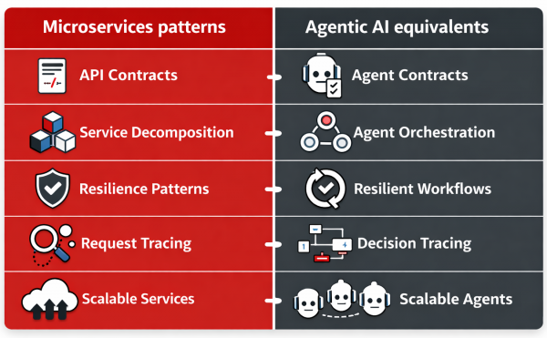

# Agentic AI: Thiết kế workflow tin cậy trên hybrid cloud

> **Bản dịch tiếng Việt từ:** [Agentic AI: Design reliable workflows across the hybrid cloud](https://developers.redhat.com/articles/2026/02/11/agentic-ai-design-reliable-workflows-across-hybrid-cloud), Red Hat Developer — tác giả **Suleiman Sadiq**, đăng 11/02/2026.
> **Nguồn trích xuất:** trang gốc chặn truy cập trực tiếp (Akamai 403), bản dịch dựa trên bản lưu Wayback Machine (snapshot 18/06/2026).
> **Quy ước thuật ngữ:** từ khóa quan trọng trình bày dạng **tiếng Việt (English)** ở lần xuất hiện đầu tiên; tên sản phẩm giữ nguyên bản gốc.
>
> **Chủ đề liên quan:** Artificial intelligence, Microservices.
> **Sản phẩm liên quan:** Red Hat AI Inference, Red Hat AI, Red Hat Enterprise Linux AI, Red Hat OpenShift AI.

**Cách tiếp cận microservices-first (ưu tiên vi dịch vụ).**

**Agentic AI (AI tác tử)** được hiểu rõ nhất khi nhìn như một **distributed system (hệ phân tán)**, và nhiều **pattern (khuôn mẫu)** từng làm nên thành công của **microservices (vi dịch vụ)** vẫn áp dụng được. Bài viết này giải thích cách thiết kế agentic workflow với các thành phần **composable (có thể ghép nối)**, **contract (hợp đồng giao diện)** và **guardrail (lan can bảo vệ)** rõ ràng, các thực hành **resilience (khả năng chống chịu)** như **timeout** và **idempotency (tính bất biến khi lặp)**, cùng **observability (khả năng quan sát)** đầu-cuối. Chúng ta cũng sẽ bàn cách bộ sản phẩm Red Hat AI hỗ trợ các hệ agentic sẵn sàng cho **production (môi trường vận hành)** trên **hybrid cloud (đám mây lai)** — từ **inference (suy luận)** hiệu quả đến thực thi nhất quán và quản lý vòng đời ở quy mô lớn.

---

## Agentic AI qua lăng kính microservices

Microservices đã thay đổi ngành kỹ thuật phần mềm bằng cách buộc chúng ta coi hệ thống là **distributed (phân tán)** mặc định — với các thành phần nhỏ, contract rõ ràng, khả năng **scale (co giãn)** độc lập, và sự tập trung nghiêm túc vào **reliability (độ tin cậy)** cùng observability. Agentic AI đang tạo ra một bước chuyển tương tự. Thay vì các HTTP service gọi nhau, giờ đây ta có các **Agent (tác tử)** điều phối **model (mô hình)**, **tool (công cụ)** và dữ liệu doanh nghiệp để hoàn thành các tác vụ nhiều bước.

Nếu bạn xây dựng ứng dụng cloud-native, phép loại suy này hữu ích vì nó thay thế trực giác mơ hồ bằng một khung kỹ thuật quen thuộc. Agentic AI là một distributed system. Những thực tế quen thuộc vẫn áp dụng: **latency (độ trễ)**, **partial failure (lỗi cục bộ)**, **versioning (quản lý phiên bản)**, **security boundary (ranh giới bảo mật)**, và khả năng quan sát vận hành. Khi đã chấp nhận điều đó, việc xây dựng các hệ agentic trở nên thực tế hơn nhiều. Hình 1 minh họa so sánh giữa các pattern microservices và các tương đương trong Agentic AI.

*Hình 1: Biểu đồ đối chiếu các pattern microservices với các tương đương trong Agentic AI. Nguồn hình: Red Hat Developer.*

| Microservices patterns | Agentic AI equivalents |
| --- | --- |
| API Contracts (Hợp đồng API) | Agent Contracts (Hợp đồng tác tử) |
| Service Decomposition (Phân rã dịch vụ) | Agent Orchestration (Điều phối tác tử) |
| Resilience Patterns (Khuôn mẫu chống chịu) | Resilient Workflows (Workflow chống chịu) |
| Request Tracing (Truy vết request) | Decision Tracing (Truy vết quyết định) |
| Scalable Services (Dịch vụ co giãn được) | Scalable Agents (Tác tử co giãn được) |

## Từ một Agent khổng lồ đến các workflow composable

Những triển khai agent thời kỳ đầu thường biến thành một agent làm-mọi-thứ duy nhất. Nó truy xuất ngữ cảnh, quyết định phải làm gì, gọi tool, xử lý lỗi, và viết ra câu trả lời cuối cùng. Trông thì tiện, nhưng đó chính là phiên bản AI của một **monolith (khối nguyên)**. Khi có sự cố, rất khó cô lập nguyên nhân. Khi muốn cải thiện một phần (ví dụ **retrieval — truy xuất**), bạn có nguy cơ làm hỏng toàn bộ.

Một pattern dễ mở rộng hơn chính là cái mà microservices đã thúc đẩy: **decomposition (phân rã)**. Chia workflow thành các agent nhỏ hơn, chuyên biệt theo mục đích, rồi điều phối chúng như một **pipeline (đường ống)**. Chẳng hạn, bạn có thể có một agent truy xuất và xếp hạng thông tin, một agent khác kiểm chứng các ràng buộc **policy (chính sách)** và **safety (an toàn)**, và một agent nữa thực thi tool call và định dạng kết quả. Bạn có thể **test**, cập nhật và scale từng thành phần độc lập, nhờ đó lỗi dễ được khoanh vùng hơn.

## Contract càng quan trọng hơn với Agent

Microservices thành công khi các **interface (giao diện)** tường minh. Agent cần kỷ luật đó còn hơn nữa, bởi sự mơ hồ chính là nơi hành vi khó lường trú ngụ. Hãy định nghĩa agent nhận gì và tạo ra gì, lý tưởng là với **structured output (đầu ra có cấu trúc)** mà bạn có thể kiểm chứng (ví dụ JSON schema). Bạn cũng phải tường minh không kém về tool contract và **allowlist (danh sách cho phép)**. Ví dụ, định nghĩa tool nào được gọi, với tham số gì, và dữ liệu nào được truy cập. Đây là cách bạn ngăn **prompt drift (trôi dạt prompt)** biến thành **system drift (trôi dạt hệ thống)**, và là cách bạn làm cho agentic workflow có thể **governable (quản trị được)** giữa các team.

Tư duy contract vững vàng cũng cải thiện tính **portability (khả năng chuyển dịch)**. Khi các tool và các bước agent có interface ổn định, bạn có thể hoán đổi model, đổi phương pháp retrieval, hoặc thêm bước workflow mới mà không phải viết lại toàn bộ hệ thống.

## Các reliability pattern vẫn áp dụng được

Microservices dạy ta phải giả định rằng lỗi sẽ xảy ra. Mạng rớt, **dependency (phụ thuộc)** xuống cấp, và **tail latency (độ trễ đuôi)** phá hỏng trải nghiệm người dùng. Hệ agentic có đúng những vấn đề đó cộng thêm vài cái mới, chẳng hạn tool call thất bại, retrieval trả về ngữ cảnh không liên quan, và inference latency đột biến. Bài học từ microservices vẫn đúng. Vẫn là playbook vận hành ấy: **timeout**, **retry (thử lại)** với **backoff (giãn cách tăng dần)**, **circuit breaker (cầu dao ngắt mạch)** để tránh lỗi lan truyền theo chuỗi, và các **fallback behavior (hành vi dự phòng)** cho phép workflow **degrade gracefully (suy giảm êm)**. Với tool call, nên thiết kế cho **idempotency (tính bất biến khi lặp)** để các lần retry không tạo ra hành động trùng lặp.

Đây chính là chỗ thiết kế agentic trở thành một **engineering discipline (kỷ luật kỹ thuật)**. Bạn định nghĩa **failure semantics (ngữ nghĩa lỗi)**, đặt kỳ vọng hiệu năng, và quyết định hệ thống nên làm gì khi suy giảm. Nói cách khác, bạn đang đưa ra các **tradeoff (đánh đổi)** tường minh về latency, **cost (chi phí)** và **correctness (tính đúng đắn)** khi một dependency chậm hoặc không khả dụng.

## Observability: Truy vết các quyết định

Trong microservices, ta **trace (truy vết)** request đi qua các service. Trong hệ agentic, ta còn cần trace các *quyết định* đi qua các bước của workflow. Khi một kết quả sai, bạn muốn biết lỗi đến từ retrieval, từ một lần gọi tool, hay từ **reasoning (suy luận)** của model. Điều đó nghĩa là phải thu thập trace cấp-bước, input/output của tool call, và các số đo hiệu năng inference; rồi tương quan chúng đầu-cuối qua một trace duy nhất trải khắp workflow.

Thiếu observability, agentic AI mắc kẹt mãi ở giai đoạn **prototype (nguyên mẫu)**. Có nó, các team mới có thể tinh chỉnh chất lượng, giảm chi phí, và cải thiện độ tin cậy với sự tự tin như khi vận hành cloud-native.

Hình 2 cho thấy một **reference architecture (kiến trúc tham chiếu)** đơn giản cho một agentic workflow, truy vết một request từ client qua **orchestrator (bộ điều phối)** và các agent service, vào tool và dữ liệu, rồi tới model inference, và cuối cùng là observability đầu-cuối.

*Hình 2: Reference architecture cho các agentic AI workflow. Luồng từ trái sang phải: Client / Application → Orchestrator → Agent Services → Tools & Data → Model Inference → Observability. Nguồn hình: Red Hat Developer.*

## Red Hat AI nằm ở đâu trong mô hình lấy cảm hứng từ microservices này

Agentic AI trở thành hiện thực khi được hỗ trợ bởi một lớp **platform (nền tảng)** nhất quán trên khắp hybrid cloud — lớp mang lại inference hiệu quả, **runtime (môi trường thực thi)** nhất quán, và quản lý vòng đời ở quy mô lớn. Cùng nhau, các dịch vụ Red Hat sau ánh xạ gọn gàng vào tư duy microservices, bao gồm **inference-as-a-service (suy luận dưới dạng dịch vụ)**, runtime nhất quán ở nơi bạn cần, và một platform để xây dựng và vận hành các AI workflow một cách tin cậy xuyên môi trường.

- **Red Hat AI Inference Server** cung cấp lớp inference bằng cách biến việc thực thi model thành một dịch vụ được quản lý, thông lượng cao. Dựa trên vLLM, nó giúp tối đa hóa mức sử dụng **accelerator (bộ tăng tốc)** và giảm latency để các agentic workflow có thể gọi model thường xuyên mà không gặp bất ngờ về chi phí hay hiệu năng. Nó cũng cung cấp quyền truy cập tới các model bên thứ ba đã được kiểm định và tối ưu, giúp các team chuẩn hóa triển khai xuyên môi trường.
- **Red Hat Enterprise Linux AI** cung cấp một platform đơn-máy-chủ, được thiết kế chuyên biệt cho workload inference (như LLM), khi cần kiểm soát chặt hơn và vận hành lặp lại được. Nó kết hợp một **bootable image (ảnh khởi động được)** của Red Hat Enterprise Linux với các thư viện AI phổ biến và inference tối ưu theo phần cứng, đồng thời bao gồm Red Hat AI Inference Server để các team có thể bắt đầu **serving** model nhanh chóng với một **stack** nhất quán, được hỗ trợ.
- **Red Hat OpenShift AI** cung cấp một platform nhất quán về vận hành để xây dựng, huấn luyện, **fine-tune (tinh chỉnh)**, serve và giám sát các model AI dự đoán và **generative (sinh sinh)** ở quy mô lớn trên khắp hybrid cloud, bao gồm cả triển khai **private (riêng tư)** và **sovereign (chủ quyền)**. Nó bao gồm năng lực **model monitoring** và **drift detection (phát hiện trôi dạt)**, và hỗ trợ serving phân tán qua một framework vLLM đã tối ưu, trong khi chuẩn hóa quyền truy cập tới model và tool cho các agentic workflow.

## Bước chuyển tư duy này mở khóa cho production

Agentic AI không phải là thứ thay thế cho engineering discipline. Nó đòi hỏi kỷ luật ấy *nhiều hơn*. Agentic AI là một distributed system với các thành phần **probabilistic (xác suất)**, và điều đó nâng cao tiêu chuẩn cho kiến trúc và vận hành. Trên thực tế, bạn phải kỹ thuật hóa các agent như microservices: phân rã workflow thành các thành phần composable, thực thi contract và guardrail rõ ràng, thiết kế để chống lỗi với timeout và fallback, và **instrument (gắn đo đạc)** mọi thứ để hành vi có thể quan sát và **audit (kiểm toán)** được.
