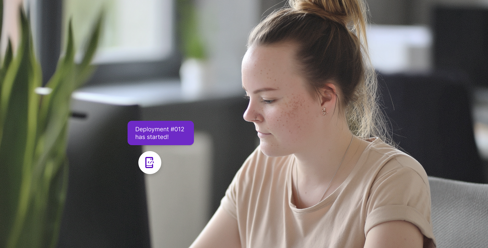
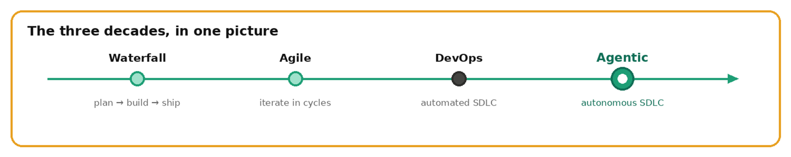
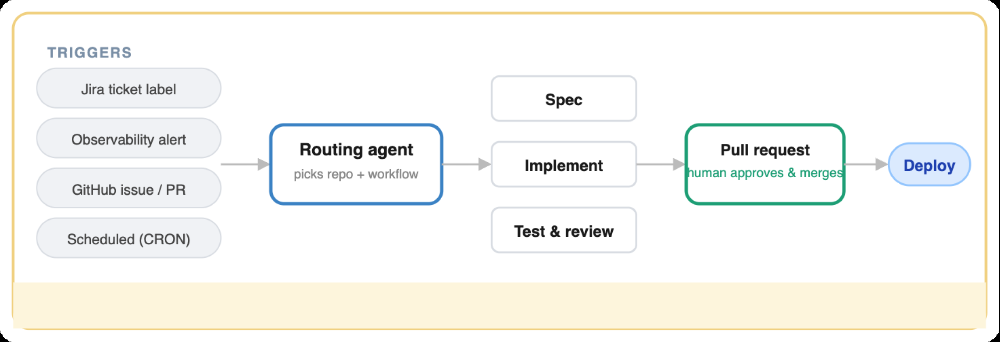
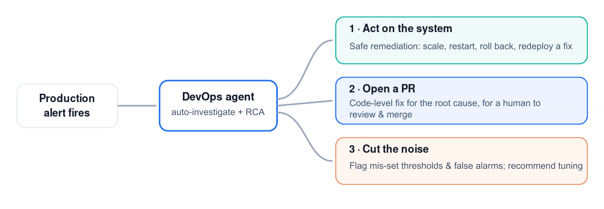
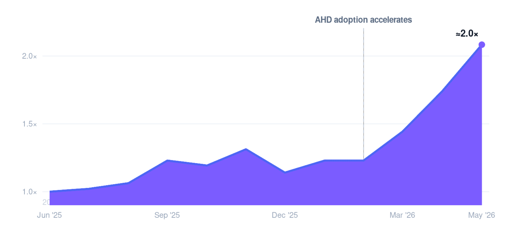
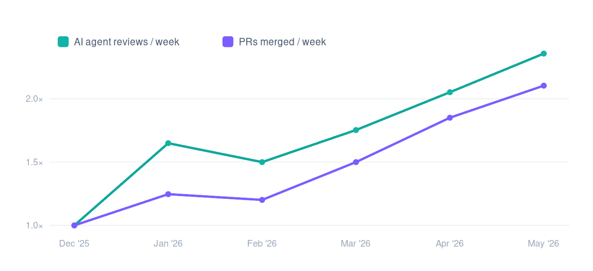

# Từ viết code đến điều phối công việc: Kỹ nghệ Agent Harness Delivery tại Talkdesk

> Cách một doanh nghiệp dẫn đầu về CCaaS ưu tiên AI đang tái thiết toàn bộ vòng đời phần mềm xoay quanh các tác tử AI, nhằm phát hành nhanh hơn, loại bỏ nợ kỹ thuật và tự động hóa công việc thường lệ.

- **Tác giả:** Mudit Mathur
- **Cập nhật lần cuối:** 30/07/2026
- **Nguồn:** [Engineering agent harness delivery at Talkdesk](https://www.talkdesk.com/blog/from-writing-code-directing-work-agent-harness-delivery/)

## Mở đầu

Cứ vài thập kỷ, các “mảng kiến tạo” của ngành kỹ nghệ phần mềm lại dịch chuyển. Mô hình thác nước (Waterfall) nhường chỗ cho Agile. Agile mở rộng thành DevOps. Mỗi lần tiến hóa đều đưa các đội kỹ thuật lên một tầng trừu tượng cao hơn, chuyển trọng tâm khỏi thao tác cơ học và hướng về chủ đích.

Sự dịch chuyển lớn tiếp theo đã bắt đầu. Ngành đang dần thống nhất cách gọi: OpenAI nói về **kỹ nghệ harness (harness engineering)**, trong khi nơi khác dùng các khái niệm như **nhà máy phần mềm (software factory)** hoặc **phân phối không cần người vận hành (lights-out delivery)**. Tại Talkdesk, chúng tôi theo đuổi hướng đi này một cách toàn diện dưới tên gọi nội bộ: **Agent Harness Delivery (AHD)**.

Nói rõ hơn, chúng tôi không phát minh ra khái niệm này. Đây là một phong trào đang hình thành trên toàn ngành. Việc Talkdesk làm là chủ động tiếp nhận, đặt tên để các đội cùng quy tụ, rồi xây dựng nền tảng và phương pháp ở quy mô doanh nghiệp để biến nó thành hiện thực. Ý tưởng cốt lõi dễ phát biểu nhưng tạo ra hệ quả sâu rộng:

> Các mô hình viết mã đã đạt tới mức mà “viết từng dòng code” không còn là nút thắt chính. Chúng ta đơn giản là đã chuyển lên một tầng trừu tượng cao hơn.
>
> — *Định hình sự chuyển dịch, lãnh đạo Product & Engineering của Talkdesk*

Khi các **tác tử lập trình AI (AI coding agents)** có thể xử lý phần lớn cú pháp, viết từng dòng code không còn là nút thắt hay nguồn tạo giá trị chính. Điều đó không khiến kỹ năng kỹ thuật lỗi thời; hoàn toàn ngược lại. Khả năng phán đoán sản phẩm, gu thiết kế, tính toàn vẹn kiến trúc và tư duy hệ thống trở nên quan trọng hơn bao giờ hết. Khác biệt nằm ở cách kỹ sư sử dụng thời gian: gõ ít hơn, điều phối, rà soát và thiết kế các hệ thống cho phép tác tử thực thi an toàn nhiều hơn.

### Ba thập kỷ trong một hình ảnh

*Hình 1. Mỗi thời kỳ đưa kỹ sư lên một tầng trừu tượng cao hơn. AHD là bước tiếp theo: con người chỉ định chủ đích; tác tử thực thi dưới các rào chắn kiểm soát. Nguồn ảnh gốc: Talkdesk.*

## Agent Harness Delivery là gì?

Từ quan trọng nhất trong **Agent Harness Delivery** là *harness*. Một LLM hay mô hình lập trình mạnh, nếu đứng riêng, chỉ là công suất thô. Harness là toàn bộ những gì được xây dựng quanh mô hình để hướng năng lực đó vào khối lượng công việc sản xuất thực tế một cách an toàn.

Để đạt mục tiêu này, harness kết hợp nhiều lớp thiết yếu:

- **Quy ước (Conventions):** dạy tác tử cách codebase được tổ chức.
- **Kỹ năng và công cụ (Skills and tools):** các năng lực tái sử dụng mà tác tử có thể tự gọi.
- **Rào chắn kiểm soát (Guardrails):** những ranh giới cứng giữ tác tử hoạt động đúng phạm vi.
- **Điều phối luồng công việc (Workflow orchestration):** các bước tường minh cần thực hiện để hoàn tất một nhiệm vụ kỹ thuật.
- **Cổng rà soát của con người (Human review gates):** các điểm kiểm tra bắt buộc cần đến phán đoán kỹ thuật của con người.

Agent Harness Delivery là kỷ luật xây dựng và vận hành harness này, để kỹ sư con người chỉ định chủ đích, còn các tác tử được harness kiểm soát sẽ đảm nhiệm phần thực thi.

Cách tiếp cận này phát triển từ những ý tưởng đang hình thành trong ngành: cách OpenAI mô tả harness engineering và thang trưởng thành của nhà máy phần mềm, bắt đầu từ “tự động hoàn thành được tăng lực” rồi tiến tới những hệ thống nơi con người viết đặc tả và nhà máy xử lý phần còn lại. Chúng tôi không chỉ thử nghiệm công cụ AI ở nơi sai sót không gây hậu quả; chúng tôi đã tích hợp AI an toàn vào một hệ thống mà thất bại là điều tuyệt đối không được phép xảy ra.

## Agent Harness Delivery có ý nghĩa gì với đội kỹ thuật Talkdesk?

Trong thực tế, việc áp dụng Agent Harness Delivery làm thay đổi một số khía cạnh trong công việc hằng ngày:

- **Kho Git trở thành nguồn sự thật duy nhất (single source of truth).** Đặc tả, kiến trúc, hướng dẫn thiết kế, tiêu chuẩn rà soát, kỹ năng tác tử và mã ứng dụng cùng tồn tại trong một nơi. Product, Design, Engineering và Docs phối hợp bằng cách mở pull request vào kho, loại bỏ tài liệu phân tán và lỗi thời.
- **Kỹ sư chuyển lên tầng trừu tượng cao hơn.** Nghề kỹ thuật chuyển từ viết từng dòng sang viết đặc tả sắc bén, thiết kế harness và rà soát đầu ra của tác tử. Điều phối AI trở thành một năng lực kỹ thuật cốt lõi.
- **Đội tính năng được tăng năng suất.** Khi một đội tác tử xử lý phần nặng của triển khai, kỹ sư có thể vận hành nhiều luồng công việc song song mà không chịu chi phí chuyển ngữ cảnh. Mỗi sprint tạo ra sản lượng cao hơn đáng kể nhưng không làm suy giảm hoạt động peer review.
- **Nhịp độ chuyển giao giá trị cho khách hàng tăng lên.** Khi khâu xây dựng không còn là nút thắt, một sprint có thể mang khối lượng tương đương một bản phát hành lớn trước đây. Giới hạn chuyển từ “xây nhanh đến đâu” sang “điều gì đáng để xây”.
- **Công việc thường lệ được kỳ vọng sẽ thu hẹp.** Nếu các tác tử liên tục xử lý backlog, tỷ trọng năng lực dành cho hoạt động vận hành thông thường (business as usual — BAU) phải giảm dần; đây là chỉ số chúng tôi chủ động theo dõi.

Một niềm tin làm nền tảng cho tất cả: khi AI khiến chi phí sản xuất code giảm, code tiến gần hơn tới một loại hàng hóa, nhưng các nền tảng cấp doanh nghiệp thì không. Chất lượng, quy mô, bảo mật, an toàn và hỗ trợ là những gì khách hàng trả tiền để nhận; trong thế giới được AI gia tốc, chúng càng trở thành yếu tố khác biệt. Agent Harness Delivery mang lại tốc độ; các nền tảng kỹ thuật khiến tốc độ đó đáng tin cậy.

## Ẩn dụ “nhà máy tối”

Trong sản xuất, **nhà máy tối (dark factory)** hay nhà máy “tắt đèn” vận hành tự chủ: nguyên liệu đi vào, thành phẩm đi ra. Con người tập trung thiết kế, tối ưu và giám sát robot thay vì tự siết từng con ốc.

Chúng tôi mượn ẩn dụ này cho các pipeline phân phối phần mềm. Trong một pipeline Agent Harness Delivery, một tập yêu cầu rõ ràng — có thể là user story, tệp thiết kế hoặc ticket — đi vào hệ thống; đầu ra là một pull request đã được kiểm thử và rà soát. Vai trò con người chuyển sang định nghĩa trước thế nào là “tốt”, rồi kiểm chứng rằng thay đổi tạo ra đáp ứng định nghĩa đó.

Điểm then chốt: đây không phải hệ thống để AI tùy ý viết rồi phát hành trực tiếp lên production. Đó là một hệ sinh thái có AI hỗ trợ và **con người trong vòng lặp (human-in-the-loop)**. Tác tử soạn thay đổi; con người rà soát code, yêu cầu sửa và phê duyệt merge. Pipeline phân phối được xây trên các công cụ tác tử hàng đầu và điều phối qua nền tảng nhà phát triển nội bộ, nhờ đó mọi lần chạy của tác tử đều thừa hưởng cùng quy ước, kỹ năng và rào chắn an toàn mà kỹ sư đã tin dùng.

## Một luồng Agent Harness Delivery làm gì?

Luồng công việc là chuỗi bước tác tử thực hiện để hoàn thành nhiệm vụ: phân tích, lập kế hoạch, triển khai, kiểm thử và mở pull request. Các luồng có thể tùy biến hoàn toàn, chạy cô lập và được kích hoạt tự động bởi những sự kiện mà đội ngũ vốn đã sử dụng.

Khi một nhiệm vụ vào hệ thống, tác tử định tuyến lập tức chọn đúng kho mã và luồng phù hợp. Pipeline sau đó soạn và thực thi thay đổi dưới các bộ kiểm thử tự động nghiêm ngặt. Tuy nhiên, tự động hóa không bao giờ vượt qua tuân thủ: quy trình triển khai an toàn và việc con người bắt buộc rà soát code vẫn là những điều không thể thương lượng.

*Hình 2. Pipeline AHD: từ chủ đích đến pull request đã kiểm thử và rà soát. Nguồn ảnh gốc: Talkdesk.*

Các đội đã xây luồng cho danh sách nhiệm vụ ngày càng dài: chuyển user story thành đặc tả kỹ thuật rồi triển khai; truy nguyên lỗi và mở bản sửa; làm mới tài liệu theo thay đổi code. Chúng tôi cũng dùng chúng để biến đầu việc sau họp production và post-mortem thành thay đổi code thực, tránh để việc theo dõi biến mất; đồng thời chạy rà soát bảo mật liên tục để tự động mở pull request chứa bản sửa.

## Nền tảng mở, không phụ thuộc công cụ và được tự xây dựng

Thay vì ràng buộc luồng công việc vào trợ lý lập trình của một nhà cung cấp, chúng tôi xây bộ công cụ nhà phát triển nội bộ. Nó đóng gói các kỹ năng, tác tử và quy ước mà một đội cần, rồi cài đặt qua một giao diện dòng lệnh duy nhất.

Thiết kế không phụ thuộc công cụ này mang lại hai lợi thế doanh nghiệp quan trọng:

- **Kiểm soát chi phí token:** tối ưu chính xác cách dữ liệu được truyền cho mô hình.
- **Sẵn sàng cho tương lai:** có thể thay LLM nền hoặc tích hợp công cụ mới mà không phải viết lại toàn bộ phương pháp.

Mức độ tiếp nhận kể câu chuyện rõ hơn sơ đồ kiến trúc. Nền tảng có lõi chính thức được tuyển chọn gồm khoảng **95 kỹ năng đã phê duyệt** và **18 tác tử**, cùng hơn **280 đóng góp** từ kỹ sư, nhà thiết kế và quản lý sản phẩm Talkdesk đang trong pipeline. Tỷ lệ này tạo ra một “xương sống” ổn định mà mọi người có thể tin tưởng, đồng thời duy trì phần năng lực chuyên biệt theo miền liên tục tăng ở bất kỳ nơi nào có người phát hiện một tác vụ lặp lại.

Khi một nhà thiết kế có thể phát hành kỹ năng kiểm tra giao diện theo các nguyên tắc khả dụng, hoặc một PM có thể chạy luồng biến tín hiệu thị trường thành đặc tả nháp, nền tảng rõ ràng đã vượt khỏi phạm vi riêng của nhà phát triển.

## Xóa bỏ BAU và nợ kỹ thuật

Đây là nơi mô hình trở nên thật sự hấp dẫn với bất kỳ ai từng quản lý một đội kỹ thuật. Thực tế ít hào nhoáng của phần mềm trưởng thành là một phần lớn năng lực kỹ thuật dành cho **công việc vận hành thông thường (business as usual — BAU)** và **nợ kỹ thuật (technical debt)**: phân loại kiểm thử chập chờn, vá phụ thuộc, sửa lỗi nhỏ, migration và dọn backlog. Đây là công việc thiết yếu nhưng cạnh tranh trực tiếp nguồn lực với các tính năng đổi mới trong lộ trình.

Một số mô hình chúng tôi đã đưa vào production:

- **Tự động vá phụ thuộc và bảo mật.** Công việc thủ công kéo dài nhiều ngày qua từng kho giờ được thay bằng một lần chạy tự động, mở mọi pull request cần thiết để con người phê duyệt.
- **Dọn code cũ và nợ kỹ thuật ở quy mô lớn.** Tác tử nhận diện có hệ thống và loại bỏ các feature flag mồ côi không có lưu lượng trong nhiều tháng, qua đó xóa những rủi ro độ tin cậy tiềm ẩn mà các đội thường xuyên hạ ưu tiên.
- **Biến cuộc họp thành thay đổi.** Chuyển thẳng các đầu việc từ họp production và post-mortem thành bản sửa đã triển khai cùng pull request, để việc theo dõi không biến mất trong backlog.
- **Tự động hóa việc vụn trong sprint.** Tạo sprint review, chia nhỏ nhiệm vụ và lập tóm tắt hoạt động hằng ngày, để con người dành thời gian cho phán đoán thay vì ghi chép hành chính.

Điểm chiến lược tuy tinh tế nhưng quan trọng: khi chi phí biên của công việc thường lệ giảm, những khoản nợ mà trước đây không bao giờ xử lý tới trở nên khả thi. Tác tử không chỉ giúp phát hành tính năng tiếp theo nhanh hơn; chúng còn giúp trả nợ quá khứ trong khi đội tiếp tục tiến lên.

## Độ tin cậy: Từ nhiễu cảnh báo đến hành động cụ thể

Nếu BAU là nơi tác tử tiết kiệm thời gian, thì độ tin cậy và phân loại cảnh báo là nơi chúng giành được niềm tin. Vận hành phần mềm doanh nghiệp ở quy mô lớn tạo ra dòng cảnh báo production liên tục: pod khởi động lại, độ trễ vượt ngưỡng, tỷ lệ lỗi tăng vọt, CPU bão hòa. Trước đây, mỗi cảnh báo kéo kỹ sư trực ca khỏi công việc đang làm để hỏi lại những câu đầu tiên giống nhau: Đây có phải sự cố thật không? Điều gì đã thay đổi? Nguyên nhân gốc nằm ở đâu?

Chúng tôi kết nối một tác tử DevOps chạy trên AWS trực tiếp với nền tảng quan sát. Ngay khi phát hiện sự cố, tác tử tự mở cuộc điều tra — lấy trace, log, lịch sử triển khai và dữ liệu phụ thuộc. Sau đó, nó đăng một báo cáo có cấu trúc ngay tại nơi cảnh báo xuất hiện, đưa ra giả thuyết rõ ràng, nguyên nhân tức thời và nguyên nhân gốc có khả năng nhất. Khi kỹ sư con người xem xét, phần lớn công việc điều tra đã hoàn tất.

Từ đó, tác tử định tuyến vấn đề theo một trong ba hướng:

*Hình 3. Ba hướng xử lý sau khi tác tử phân loại sự cố độ tin cậy. Nguồn ảnh gốc: Talkdesk.*

Hướng thứ ba thường bị đánh giá thấp. Một tỷ lệ lớn cảnh báo production xuất phát từ ngưỡng đặt thấp hơn phạm vi vận hành bình thường của dịch vụ, hoặc từ mẫu sự cố kéo dài nhưng bị đánh dấu như mới. Nếu để mặc, nhiễu này bào mòn sự chú ý của đội trực cho đến khi tín hiệu thật bị bỏ sót. Tác tử phân loại của chúng tôi tách hồi quy thật — ví dụ bản sửa bộ nhớ đã merge nhưng chưa triển khai — khỏi sai lệch cấu hình — ví dụ ngưỡng độ trễ nằm dưới baseline dịch vụ — giúp ngăn mệt mỏi cảnh báo và giữ kỹ sư tập trung vào vấn đề thật.

Quyết định chọn hướng nào là trọng tâm của việc harness các luồng này một cách có trách nhiệm. Hành động trực tiếp lên production chỉ dành cho biện pháp khắc phục an toàn, đã hiểu rõ và nằm trong các rào chắn triển khai an toàn hiện hữu. Mọi thay đổi hành vi ứng dụng đều phải đi qua pull request và người rà soát. Tác tử nối khả năng quan sát trực tiếp với hành động, nhưng kỹ sư con người vẫn ở trong vòng lặp tại bất cứ đâu mà **phạm vi ảnh hưởng (blast radius)** đòi hỏi.

## QA: Bộ kiểm thử tự xây dựng và tự phục hồi

Cùng triết lý tự động hóa có trách nhiệm được áp dụng khi chúng tôi tái thiết kỹ nghệ chất lượng. Thay vì buộc kỹ sư QA viết thủ công từng kiểm thử end-to-end, một chuỗi tác tử chuyên biệt đọc yêu cầu từ tệp thiết kế, tài liệu sản phẩm và ticket. Sau đó, chúng đối chiếu thành đặc tả nhất quán, lập kế hoạch phạm vi bao phủ và tạo mã kiểm thử có thể chạy.

Để hệ thống vận hành trơn tru, một tác tử chuyên trách chẩn đoán và sửa kiểm thử lỗi trong quá trình phát triển, lập tức phân biệt hồi quy sản phẩm thật với kiểm thử dễ vỡ chỉ cần cập nhật. Ở phía vận hành, một tác tử “lính cứu hỏa” phân loại lỗi kiểm thử tổng hợp mỗi ngày, khử trùng lặp ticket và đăng bản tóm tắt liên tục cho đội.

Các luồng mới hiện lần theo những thay đổi quan trọng từ đầu đến cuối qua các tuyến báo cáo trong môi trường staging trước khi chúng tới khách hàng. Kết quả là một bộ kiểm thử có thể tự mở rộng và tự bảo trì, cho phép độ bao phủ tăng lên ngay cả khi sản phẩm tiến nhanh hơn.

## Đo lường Agent Harness Delivery một cách trung thực

Một cuộc chuyển đổi không đo được chỉ là khẩu hiệu. Chúng tôi theo dõi năng lực phân phối bằng một chỉ số đơn giản, khó thao túng: **số pull request được merge mỗi tuần**, chuẩn hóa theo quy mô đội và theo dõi xu hướng theo thời gian. Chỉ số tốc độ này được ghép với các chỉ số rào chắn nghiêm ngặt như kích thước PR, thời gian chờ review và khung DORA tiêu chuẩn ngành, để bảo đảm tốc độ không bao giờ đồng nghĩa với cẩu thả.

Dữ liệu triển khai cho thấy:

- **Thông lượng tăng khoảng 2 lần.** Trong năm 2025, tốc độ phân phối hằng tuần gần như đi ngang. Khi việc áp dụng Agent Harness Delivery lan rộng giữa các đội vào đầu năm 2026, thông lượng PR tăng gấp đôi chỉ trong vài tháng.
- **Đạt trạng thái DORA Elite.** Dù lượng code tăng mạnh, tỷ lệ thay đổi gây lỗi vẫn ở mức một chữ số thấp, khoảng **2–3%**, còn **thời gian trung bình khôi phục (mean time to restore — MTTR)** chỉ khoảng **1–2 giờ**.
- **Tương quan trực tiếp.** Điểm bẻ cong tăng của lượng code phân phối bám gần như từng đường một với chỉ số gọi tác tử nội bộ, cho thấy chính công cụ — chứ không phải trùng hợp — tạo ra mức tăng hiệu suất.

*Hình 4. Xu hướng thông lượng pull request tại Talkdesk. Nguồn ảnh gốc: Talkdesk.*

*Hình 5. Số lượt rà soát của tác tử AI và PR được merge mỗi tuần, cùng được chuẩn hóa theo mức tháng 12/2025 (1,0×). Mức sử dụng tác tử và thông lượng phân phối tăng cùng nhau — tín hiệu cho thấy công cụ, không phải ngẫu nhiên, đang tạo ra mức tăng. Nguồn: dashboard phân phối nội bộ Talkdesk, 06/2025–05/2026; dữ liệu đã chuẩn hóa và mang tính định hướng.*

## Ba điều chúng tôi luôn ám ảnh

Di chuyển nhanh với tác tử AI là phần rất dễ làm sai. Để mô hình thực thi không trở thành trách nhiệm pháp lý và vận hành của tổ chức, chiến lược được neo vào ba nguyên tắc không thể thỏa hiệp:

- **Một con đường chuẩn (canonical path).** Xây luồng “từ ý tưởng đến production” mang tính bán quy định, cho đội một mặc định đã được chứng minh mà không giết chết tinh thần thử nghiệm đã đưa chúng tôi tới đây.
- **Rào chắn trước tiên (guardrails first).** Độ tin cậy và bảo mật là bất khả xâm phạm. Chúng tôi phục vụ khách hàng doanh nghiệp, nên quy trình triển khai an toàn áp dụng cho thay đổi do tác tử viết hệt như thay đổi do con người viết.
- **Kỷ luật chi phí.** Token là chi phí vận hành thật. Cấu trúc tri thức thành các tệp kỹ năng tập trung, thay vì nạp schema công cụ cồng kềnh ở mọi lần gọi, giúp giảm chi phí mỗi lần gọi từ hàng chục nghìn token xuống vài trăm. Chúng tôi tách điều tác tử cần *biết* khỏi điều nó cần *làm*, đồng thời benchmark các luồng để tốc độ không kéo theo chi phí mất kiểm soát.

## Tiếp nhận là vấn đề văn hóa, không phải công cụ

Phần khó nhất của một chuyển dịch như thế này không phải nền tảng, mà là giúp cả tổ chức thay đổi cách phối hợp mà không để ai mắc kẹt khi phải tự tìm hiểu một mình. Chúng tôi chủ động thực hiện:

- Các buổi office hour mở, vận hành hoàn toàn theo hình thức hỏi đáp bởi những người trực tiếp triển khai.
- Các buổi chia sẻ kỹ thuật nội bộ và ngày học tập dành riêng cho vòng đời AI-native.
- Một kênh chuyên gia duy nhất để bất kỳ ai trong Product hay Engineering đều có thể đặt câu hỏi.
- Bản tin hằng tuần tách rõ nội dung **sẵn sàng áp dụng hôm nay** khỏi nội dung **thú vị nhưng còn thử nghiệm**, để tín hiệu không chìm trong nhiễu.

Điểm cuối quan trọng hơn vẻ bề ngoài. Di chuyển nhanh với công cụ mới chỉ hiệu quả khi mọi người đều biết đâu là chuẩn đã được phê duyệt và đâu là thử nghiệm hứa hẹn. Đặt tên ranh giới đó thật rõ là cách duy trì đồng thời tốc độ và niềm tin.

## Những thách thức chúng tôi đã gặp

Sẽ là thiếu trung thực nếu mô tả quá trình này như thể không có ma sát. Một số vấn đề thực sự khó:

- **Tác tử đôi khi sai với vẻ ngoài rất tự tin.** Một diff trông hợp lý hay bản tường thuật nguyên nhân gốc gọn gàng vẫn có thể sai. Vì vậy, cổng rà soát và harness đánh giá là điều không thể thương lượng. Chúng tôi đo xem một kỹ năng có tạo đầu ra đúng và đáng tin cậy hay không thay vì mặc nhiên tin nó.
- **Bảo mật code do AI viết là một kỷ luật riêng.** Nhiều code hơn, được viết nhanh hơn và bởi nhiều người đóng góp hơn làm tăng yêu cầu đối với quét lỗ hổng, vệ sinh phụ thuộc và quản lý bí mật. Thay đổi do tác tử viết phải tuân cùng tiêu chuẩn và quy trình rà soát bảo mật như thay đổi do con người viết; trong môi trường được quản lý, tiêu chuẩn còn cao hơn.
- **Quản trị “đuôi dài” rất khó.** Hàng trăm kỹ năng do cộng đồng đóng góp là thế mạnh, nhưng nếu không có ranh giới rõ giữa nội dung được hỗ trợ chính thức và thử nghiệm cá nhân, các đội sẽ không biết nên tin gì. Tuyển chọn và duy trì ranh giới đó là công việc liên tục.
- **Chi phí và chất lượng có thể âm thầm trôi lệch.** Chi phí token và hồi quy chất lượng tinh vi không tự thông báo; chúng phải được đo và theo dõi, nếu không hiệu quả kinh tế và chất lượng nghề sẽ bị tốc độ bào mòn.

Không vấn đề nào trong số này là lý do để chậm lại; chúng chính là lý do harness tồn tại. Rào chắn không phải quan liêu, mà là thứ giúp tốc độ có thể được duy trì an toàn.

## Điều này có ý nghĩa gì với khách hàng?

Tất cả cuối cùng đều phục vụ những người sử dụng phần mềm. Bằng cách gia tốc pipeline và tự động hóa công việc kỹ thuật thường lệ, chúng tôi mang lại giá trị kinh doanh trực tiếp:

- **Phân phối tính năng nhanh và an toàn hơn.** Năng lực khách hàng yêu cầu đi từ ý tưởng đến production sớm hơn.
- **Giải quyết sự cố nhanh.** Phân loại tự chủ giúp vấn đề production được hiểu và xử lý nhanh hơn.
- **Nhiều đổi mới hơn, ít bảo trì hơn.** Giảm BAU và nợ kỹ thuật giải phóng kỹ sư giỏi để tập trung vào các tính năng khác biệt có tác động đến hoạt động kinh doanh của khách hàng.

Quan trọng là nhanh hơn không có nghĩa cắt góc. Các nền tảng cấp doanh nghiệp mà khách hàng phụ thuộc — chất lượng, quy mô, bảo mật và hỗ trợ — vẫn là điều không thể thương lượng khi tốc độ tăng lên.

## Nhìn về phía trước

Chúng tôi coi đây là hành trình đi lên qua các mức trưởng thành của harness: từ tác tử hỗ trợ tự động hoàn thành, đến tác tử soạn toàn bộ thay đổi, đến luồng đưa nhiệm vụ từ chủ đích thành PR đã rà soát, và cuối cùng là các luồng tự chủ nối trực tiếp khả năng quan sát với hành động an toàn trên production. Với Talkdesk, mở rộng luồng harness từ mã ứng dụng sang hạ tầng và độ tin cậy là bước nâng toàn tổ chức lên một tầng mới.

Chúng tôi thẳng thắn thừa nhận chưa có playbook cố định; trình độ tiên tiến thay đổi từng tuần và chúng tôi đang tự viết một phần phương pháp trong quá trình thực hiện. Nhưng những lựa chọn an toàn đã rõ: mô hình sẽ tiếp tục cải thiện, còn việc xây dựng sản phẩm phức tạp sẽ tiếp tục rẻ hơn đáng kể về thời gian và công sức. Công việc của chúng tôi là nắm lấy lợi ích đó mà không làm tổn hại độ tin cậy khách hàng phụ thuộc.

Với Talkdesk, Agent Harness Delivery không phải một công cụ được tiếp nhận. Nó là thay đổi trong bản chất nghề phần mềm: từ tự viết mọi dòng code sang thiết kế hệ thống, đặc tả và rào chắn để một đội tác tử thực hiện phần xây dựng, trong khi con người vẫn nắm chắc quyền phán đoán, chất lượng và định hướng.

## Về tác giả

**Mudit Mathur** là Giám đốc toàn cầu về SRE và kỹ thuật hạ tầng tại Talkdesk. Ông lãnh đạo đội ngũ toàn cầu chịu trách nhiệm xây dựng các nền tảng đám mây đáng tin cậy, có khả năng mở rộng và an toàn cho sản phẩm SaaS doanh nghiệp.

Với chuyên môn sâu về kỹ nghệ độ tin cậy hệ thống, kỹ nghệ nền tảng, hạ tầng đám mây, tự động hóa, DevOps và năng suất kỹ thuật do AI dẫn dắt, Mudit tập trung tạo ra các hệ thống có khả năng chống chịu, giúp đội kỹ thuật tiến nhanh hơn mà không đánh đổi độ tin cậy hay chất lượng vận hành.

## Bảng thuật ngữ song ngữ

| Tiếng Việt | English |
|---|---|
| Phân phối bằng harness tác tử | Agent Harness Delivery (AHD) |
| Kỹ nghệ harness | Harness engineering |
| Tác tử lập trình AI | AI coding agent |
| Nhà máy phần mềm | Software factory |
| Nhà máy tối / phân phối không cần người vận hành | Dark factory / Lights-out delivery |
| Rào chắn kiểm soát | Guardrail |
| Điều phối luồng công việc | Workflow orchestration |
| Cổng rà soát của con người | Human review gate |
| Con người trong vòng lặp | Human-in-the-loop |
| Nguồn sự thật duy nhất | Single source of truth |
| Công việc vận hành thông thường | Business as usual (BAU) |
| Nợ kỹ thuật | Technical debt |
| Khả năng quan sát | Observability |
| Phân loại cảnh báo | Alert triage |
| Phạm vi ảnh hưởng | Blast radius |
| Thời gian trung bình khôi phục | Mean time to restore (MTTR) |
| Con đường chuẩn | Canonical path |
| Harness đánh giá | Evaluation harness |
| Vòng đời ưu tiên AI | AI-native lifecycle |
| Kỹ nghệ độ tin cậy hệ thống | Site Reliability Engineering (SRE) |
| Nền tảng trung tâm liên lạc dạng dịch vụ | Contact Center as a Service (CCaaS) |

---

> **Ghi chú bản dịch:** Đây là bản dịch toàn văn từ nội dung công khai của Talkdesk được trích xuất ngày 03/09/2026. Hình ảnh sử dụng tài sản gốc của Talkdesk và được lưu cục bộ để bảo đảm khả năng hiển thị lâu dài. Các số liệu về hiệu suất, DORA và mức sử dụng tác tử là tuyên bố/dữ liệu nội bộ của Talkdesk theo bài nguồn; bản dịch không xác minh độc lập các số liệu này.
