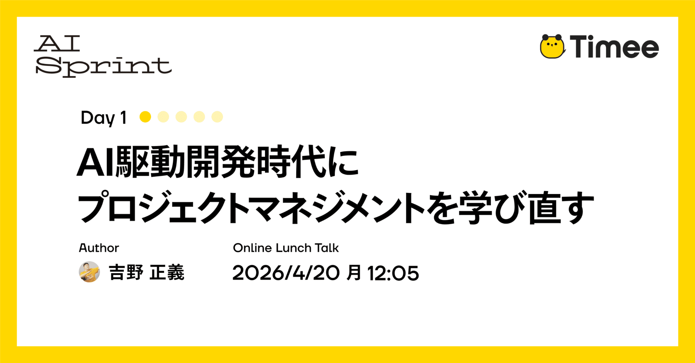
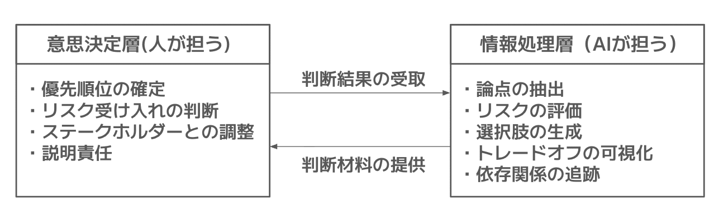
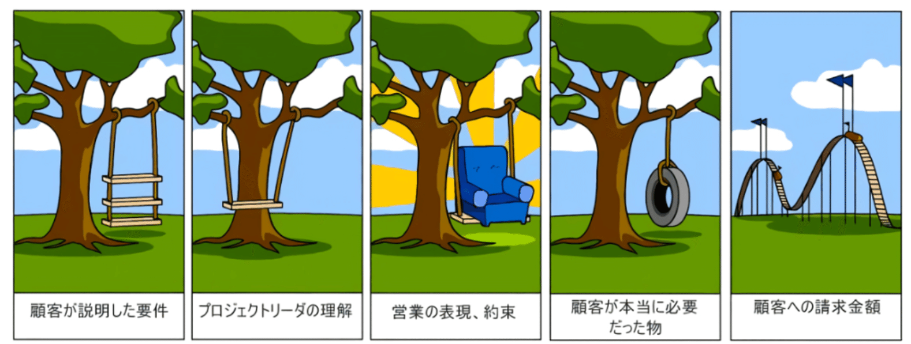
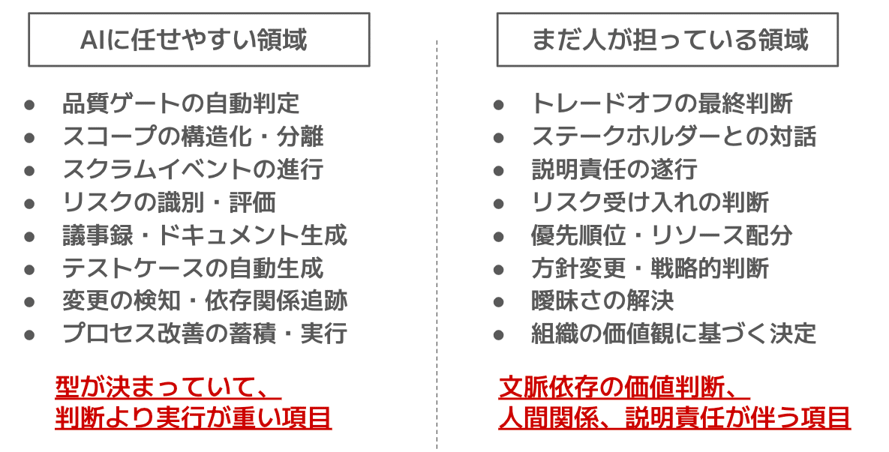
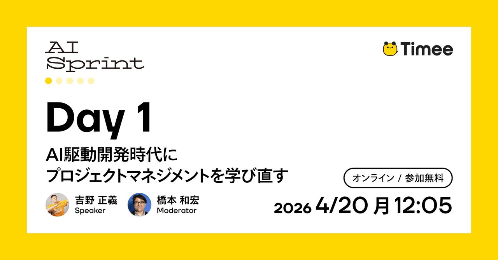

# Timee AI Sprint Day 1: Học lại quản lý dự án trong kỷ nguyên phát triển do AI dẫn dắt

> **Thông tin nguồn và bản dịch:** Bài gốc được Timee xuất bản bằng tiếng Nhật ngày **13/04/2026 lúc 16:30**. Bản tiếng Việt này được dịch đầy đủ từ bản **dịch tự động sang tiếng Anh (auto-English) do Timee cung cấp**. Vì lớp auto-English có thể không phản ánh hoàn toàn độ chính xác, sắc thái và chủ ý của tác giả Nhật ngữ, người đọc nên đối chiếu [bài gốc tiếng Nhật](https://productpr.timee.co.jp/n/ncc1d19e4c771) khi cần. [Xem bản auto-English của Timee](https://productpr.timee.co.jp/n/ncc1d19e4c771?hl=en).

Bài viết này thuộc chuỗi **Timee AI Sprint Day 1**.

> **Timee AI Sprint là gì?**  
> “Timee sử dụng AI như thế nào?” Đây là một dự án tăng tốc nhằm trả lời trọn vẹn câu hỏi đó trong một lần! Chúng tôi sẽ công khai toàn bộ tri thức sử dụng AI mà Timee đã tích lũy cho đến nay qua chuỗi “đăng bài liên tục” trong 7 ngày và một “sự kiện giờ ăn trưa” đào sâu vào các chi tiết kỹ thuật của nội dung ấy.

Xin chào! Tôi là Seigi, Quản lý Kỹ thuật (Engineering Manager — EM) tại Timee. Ở công việc trước đây, tôi từng làm Scrum Master và Agile Coach. Hiện nay, với vai trò EM, tôi cũng tham gia sâu vào các quy trình phát triển của đội ngũ.

Trong bài này, tôi sẽ viết về một câu hỏi nảy sinh khi thực hành **vòng đời phát triển do AI dẫn dắt (AI-Driven Development Life Cycle — AI-DLC)**: “Ở thời điểm hiện tại, kiến thức quản lý dự án quan trọng đến mức nào?”

### Nội dung tôi sẽ trình bày trong bài

- Kiến thức quản lý dự án (Project Management — PM) phát huy tác dụng ra sao khi AI đảm nhiệm quy trình phát triển?
- Hệ thống hóa vấn đề từ góc nhìn các phiên bản PMBOK thứ 6, 7 và 8
- Suy nghĩ về “điều thay đổi” và “điều không thay đổi” qua thực tiễn

Năm ngoái, công ty chúng tôi tham gia AWS AI-DLC Unicorn Gym; từ đó, việc đưa phát triển do AI dẫn dắt vào thực tế bắt đầu được triển khai nghiêm túc.  
*Để biết chi tiết về AI-DLC, vui lòng tham khảo [bài giải thích chính thức trên blog AWS](https://aws.amazon.com/jp/blogs/news/ai-driven-development-life-cycle/) và [báo cáo trên blog kỹ thuật của chúng tôi](https://tech.timee.co.jp/entry/2026/03/06/141357).*

Đã có những lúc tôi nghĩ: “Có phải kiến thức PM không còn cần thiết nữa không?”, khi AI bắt đầu chịu trách nhiệm thực thi quy trình và tạo tác phẩm bàn giao (artifact). Tuy nhiên, khi thực sự vận hành, kết luận lại hoàn toàn ngược lại. Muốn giao quy trình cho AI, điều thiết yếu là phải có đủ kiến thức quản lý dự án để đánh giá quy trình đó tốt hay xấu. Vì vậy, chính tôi cảm nhận rất rõ nhu cầu phải “học lại”.

Từ đây, tôi sẽ lấy các lĩnh vực kiến thức của PMBOK phiên bản thứ 6 làm trục phân tích. PMBOK còn có phiên bản thứ 7 (dựa trên nguyên tắc) và phiên bản thứ 8 (các lĩnh vực trọng tâm + quy trình không mang tính áp đặt). Tuy nhiên, khi bàn về “quy trình nào có thể giao cho AI”, tôi cho rằng phiên bản thứ 6 dễ dùng nhất làm hệ thống phân loại vì phần “How — làm thế nào” được hệ thống hóa rõ ràng theo quy trình. Một lý do khác là phiên bản này phổ biến, giúp dễ chia sẻ tiền đề với người đọc. Tôi sẽ trở lại với góc nhìn của phiên bản 7 và 8 ở nửa sau bài viết.

## AI khuếch đại điều gì — Vì sao cần lan can bảo vệ

Điều đầu tiên tôi nhận ra khi bắt đầu vận hành AI-DLC là tốc độ và khối lượng của toàn bộ quy trình phát triển tăng áp đảo. Xây dựng đặc tả, thiết kế, triển khai, kiểm thử: khi giao việc thực thi quy trình cho AI, chu kỳ phát triển chạy với tốc độ không thể so sánh với trước đây.

Tuy nhiên, ở đây có một cạm bẫy. **AI khuếch đại cả quy trình tốt lẫn quy trình xấu như nhau.** Nếu AI chạy một quy trình được định nghĩa đúng đắn, kết quả chất lượng cao sẽ xuất hiện với tốc độ cao. Nhưng nếu AI chạy một quy trình được định nghĩa trong khi vẫn còn mơ hồ, các artifact có vấn đề cũng sẽ bị sản xuất hàng loạt với chính tốc độ ấy. Và bản thân AI không nhận ra sự khác biệt.

Kết quả là xuất hiện những ý kiến như:

- Dù AI phụ trách thúc đẩy và điều phối quy trình, vẫn khó đi đến phát hành;
- Chất lượng artifact kém, tần suất rà soát tăng lên, nên rốt cuộc không nhanh như kỳ vọng.

Một góc nhìn để cải thiện tình trạng này là cần có **lan can bảo vệ (guardrail)** nhằm giữ chất lượng quy trình và việc thúc đẩy dự án. Kiến thức quản lý dự án chính là thứ đóng vai trò lan can đó.

Ví dụ, nếu giao phần triển khai cho AI khi phạm vi còn mơ hồ, **phình phạm vi (scope creep)** — phạm vi ban đầu cứ mở rộng và trở nên cồng kềnh mà ta không hay biết — sẽ diễn ra với tốc độ cao. Nếu giao việc tạo artifact mà không xác định tiêu chuẩn chất lượng, một lượng lớn artifact sẽ chồng chất nhưng không có tiêu chí để đánh giá tốt hay xấu. Hơn nữa, nếu chạy quy trình mà không nhận diện rủi ro, khối lượng làm lại khi rủi ro trở thành hiện thực cũng sẽ bị khuếch đại.

Các lĩnh vực kiến thức PMBOK như:

- Quản lý phạm vi (Scope Management)
- Quản lý chất lượng (Quality Management)
- Quản lý rủi ro (Risk Management)
- Quản lý tích hợp (Integration Management), v.v.

là những khung để ngăn ngừa các vấn đề này một cách có cấu trúc. Trong kỷ nguyên AI, giá trị của các khung ấy thực ra còn tăng lên. Bởi AI tăng tốc quy trình, nếu không có guardrail thì vấn đề cũng có thể mở rộng với tốc độ cao.

Vậy trên thực tế, chúng ta có thể giao cho AI bao nhiêu phần của các guardrail này?  
Hãy xem xét dựa trên dữ liệu thực tế xuyên suốt tổ chức.

## Giao quy trình cho AI — Câu hỏi về quản lý tích hợp

Khi thúc đẩy AI-DLC, phạm vi những việc có thể giao cho AI không ngừng mở rộng.  
Cụ thể là mở rộng đến mức nào? Từ góc nhìn quản lý dự án, chúng tôi đã khảo sát cắt ngang các thiết lập tác nhân AI (kỹ năng, quy tắc, hook, v.v.) của nhiều đội trong tổ chức đang thực sự triển khai AI-DLC.

### Thực tế: hơn 100 quy trình được giao cho AI ở 8 đội

Khảo sát bao phủ 8 đội đang triển khai AI-DLC cùng hai kho mã nguồn mà các đội đều tham chiếu chung. Khi tổng hợp **kỹ năng (skill — thực hành có thể thực thi)**, **quy tắc (rule — quy tắc tự động áp dụng)** và **hook (xử lý tự động theo sự kiện)** mà mỗi đội đã định nghĩa cho tác nhân AI, chúng tôi xác nhận tổng cộng hơn 100 định nghĩa quy trình liên quan đến quản lý dự án.

Khi hệ thống hóa theo 10 lĩnh vực kiến thức của PMBOK phiên bản thứ 6, tình hình như sau.

**Quản lý chất lượng (được 8 đội triển khai)** là lĩnh vực có mức tự động hóa tiến xa nhất. Một đội vận hành cơ chế chuẩn hóa tiêu chí chấp nhận theo định dạng Gherkin; nếu tiêu chuẩn chất lượng không được đáp ứng, AI tự động từ chối nội dung gửi lên. Một số đội đã triển khai **kiểm thử dựa trên rủi ro (risk-based testing)**, tự động xác định cường độ kiểm thử theo độ lớn của rủi ro. Bằng cách tự động đánh giá rủi ro trên hai trục — tác động kinh doanh và độ phức tạp kỹ thuật — cơ chế bắt buộc con người rà soát và thực hiện kiểm thử thăm dò đối với hạng mục rủi ro cao. Mỗi đội đang độc lập phát triển cơ chế để AI tự động áp dụng một “thước đo chất lượng”.

**Quản lý phạm vi (được 7 đội triển khai)** cũng được tự động hóa rộng rãi. Nội dung gồm chia nhỏ user story, cấu trúc hóa tiêu chí chấp nhận và phân rã công việc thành các đơn vị. Một đội có cơ chế để AI từ chối chuyển sang giai đoạn tiếp theo nếu vẫn còn vấn đề chưa được giải quyết. Cách này ngăn việc bắt đầu triển khai khi sự mơ hồ vẫn còn tồn tại ngay từ cấp độ cấu trúc.

**Quản lý giao tiếp (được 7 đội triển khai)** nổi bật với việc tự động hóa điều phối các sự kiện Scrum. Nội dung gồm dẫn dắt và ghi lại Daily Scrum, tự động tạo kế hoạch sprint, điều phối retrospective và tổng hợp dữ liệu. Một đội để AI điều phối toàn bộ sự kiện Scrum và tự động tạo biên bản họp.

**Quản lý rủi ro (được 6 đội triển khai)** đã có tiến triển trong tự động nhận diện và đánh giá rủi ro. Một số đội đã xây dựng cơ chế định nghĩa bảng nhận diện cho các nhóm rủi ro như pháp lý, tài chính, thông tin cá nhân, hiệu năng và tích hợp bên ngoài; AI tự động đề xuất hoạt động chất lượng tương ứng với rủi ro liên quan. Cũng có **kiểm soát chặn (blocking control)** gán cấp độ rủi ro cho vấn đề và không cho giai đoạn tiến tiếp nếu vẫn còn hạng mục rủi ro cao chưa được giải quyết.

**Quản lý lịch trình (được 4 đội triển khai)** mới ở mức một phần. Các cơ chế như tự động tạo kế hoạch sprint và tự động ghi lại chênh lệch giữa kế hoạch với thực tế để phát hiện công việc ngoài kế hoạch đã được triển khai, nhưng chưa đạt đến mức xây dựng hoặc điều chỉnh lịch trình tổng thể của dự án.

**Quản lý nguồn lực (được 4 đội triển khai)** cũng mới ở mức một phần. Đã có cơ chế quản lý các thực hành của đội (skill) như “được trang bị” hoặc “trong kho”, cũng như tự động dựng môi trường cô lập phục vụ công việc song song, nhưng chưa đi vào phân bổ nhân sự hay lập kế hoạch phát triển.

**Quản lý bên liên quan (được 3 đội triển khai)** còn hạn chế. Các skill chủ động rà soát đặc tả từ góc nhìn của nhiều bên liên quan và skill tự động chuyển các mối quan ngại kỹ thuật của kỹ sư sang ngôn ngữ phía kinh doanh đã được triển khai. Tuy vậy, mọi đối thoại và điều phối thực tế với các bên liên quan đều do con người đảm nhiệm.

**Quản lý tích hợp** sẽ được bàn chi tiết ở mục nhỏ tiếp theo.

**Quản lý chi phí** và **quản lý mua sắm** gần như hoàn toàn chưa được tự động hóa. Ở đây, chúng ta có thể thấy phạm vi hiện tại của AI-DLC.

Ngoài ra, dù không trực tiếp tương ứng với một lĩnh vực kiến thức PMBOK, **tích lũy cải tiến quy trình** cũng là một mảng thú vị. Các đề xuất cải tiến được thống nhất trong retrospective được đăng ký vào AI dưới dạng skill “thử nghiệm”; từ sprint tiếp theo, AI tự động thực thi những thực hành ấy. Sau khi hiệu quả được xác nhận qua vài sprint, chúng được nâng lên trạng thái “được trang bị” và trở thành thực hành chuẩn cho toàn đội. Đây là cơ chế biến tri thức ngầm của đội thành tri thức tường minh và tích lũy nó dưới dạng skill AI.

### Vậy còn quản lý tích hợp thì sao?

Các ví dụ đến đây nói về từng lĩnh vực kiến thức riêng lẻ như chất lượng và phạm vi. Vậy còn quản lý tích hợp dự án — thứ bó các lĩnh vực ấy lại với nhau trên toàn cục — thì sao?  
Theo định nghĩa của PMBOK phiên bản thứ 6, quản lý tích hợp dự án bao gồm quản lý thay đổi, điều phối lợi ích giữa các bên liên quan và quyết định đánh đổi về phạm vi, lịch trình, chi phí. Kết quả điều tra cho thấy thực tế thẳng thắn là quản lý tích hợp **có thể giao một phần cho AI**.  
Quả thực có những phần đang được giao cho AI:

- Tự động phát hiện và ghi lại thay đổi;
- Cơ chế quản lý tập trung các quan hệ phụ thuộc giữa tệp và tự động kiểm tra phạm vi ảnh hưởng khi có thay đổi;
- Kiểm soát tự động xác định tiêu chuẩn chất lượng cho cổng giai đoạn (phase gate) và ngăn tiến tiếp nếu tiêu chuẩn không được đáp ứng;
- Cơ chế tự động cập nhật thông tin bàn giao để luân chuyển người điều khiển vào cuối phiên, thực hiện một mạch từ commit, push đến tạo pull request (PR);
- Cơ chế tự động quay lại giai đoạn trước khi phát hiện phạm vi đang mở rộng.

Các cơ chế này chắc chắn đang xử lý một phần công việc quản lý tích hợp.  
Tuy nhiên, cũng có những phần không được giao cho AI: điều phối lợi ích giữa các bên liên quan; quyết định cuối cùng về đánh đổi giữa phạm vi, lịch trình và chi phí; thực hiện trách nhiệm giải trình; phán đoán về việc chấp nhận rủi ro. Ở mọi đội, những việc này nhất quán do con người đảm nhiệm.

### Tách lớp xử lý thông tin khỏi lớp ra quyết định

Điều trở nên rõ ràng qua cuộc điều tra là quản lý tích hợp đang bắt đầu tách thành hai lớp.

Nói cách khác, chúng ta có thể giao đến khâu “tổng hợp thông tin”, nhưng không thể giao phần “ra quyết định dựa trên thông tin đã tổng hợp và chịu trách nhiệm về quyết định ấy”. Cốt lõi của quản lý tích hợp dự án nằm ở phần sau.

Điều quan trọng ở đây là: muốn giao lớp xử lý thông tin cho AI, điều kiện tiên quyết là phải có chuyên môn để đánh giá quá trình xử lý đó có phù hợp hay không. Cấu trúc tương tự quản lý chất lượng cũng hiện diện ở đây.

Khi AI đánh giá một rủi ro là “cao”, nếu bạn không thể xác định phán đoán đó có hợp lệ hay không, bản thân việc giao quy trình cho AI sẽ trở thành một rủi ro. Chỉ khi bạn có đủ chuyên môn PM để đánh giá chất lượng quy trình mà AI đang chạy thì việc ủy thác mới khả thi.

## Điều không thay đổi — Quản lý bên liên quan và giao tiếp

Tôi đã nhắc đến “điều phối lợi ích giữa các bên liên quan” và “trách nhiệm giải trình” như những lĩnh vực không thể giao cho AI.  
Trong khảo sát 8 đội, riêng lĩnh vực này được tất cả các đội, không ngoại lệ, để cho con người đảm nhiệm. Có một lý do sâu xa hơn.

AI rõ ràng giỏi “chuẩn bị” cho giao tiếp. Trên thực tế, có đội dùng skill để chủ động rà soát đặc tả từ góc nhìn của nhiều bên liên quan (pháp lý, chăm sóc khách hàng — CS, đảm bảo chất lượng — QA, vận hành, v.v.), và skill để tự động chuyển các mối quan ngại kỹ thuật của kỹ sư thành ngôn ngữ phía kinh doanh như “chi phí lãi vay, chi phí cơ hội và lợi nhuận kỳ vọng”. Cấu trúc hóa các điểm cần thảo luận, tự động tạo tài liệu đề nghị rà soát, trích xuất quyết định và hành động tiếp theo từ biên bản họp — AI có thể xử lý đến mức này.

Nhưng việc thực thi câu hỏi “nói gì với ai và bằng cách nào, dựa trên thông tin đã chuẩn bị” đều do con người đảm nhiệm ở mọi đội. Hãy xem xét nguyên nhân.

Lý do thứ nhất là **hành vi thu thập “nguồn” của bối cảnh phụ thuộc vào quan hệ giữa người với người**.

Tương tác với các bên liên quan nội bộ, nắm bắt ý định và sắc thái đằng sau lời nói của họ, rồi khai thác thông tin ở độ chi tiết phù hợp. Chạm tới “nỗi đau thực sự” trong các cuộc họp xác định yêu cầu và tìm được điểm chung khi lợi ích giữa các phòng ban xung đột — tất cả đều nảy sinh từ đối thoại giữa người với người.

*Hình: Tham khảo từ tác phẩm “The Oregon Experiment” của Christopher Alexander. Nguồn ảnh gốc: Timee.*

Không phải lúc nào mọi người cũng có thể diễn đạt chính xác “nỗi đau thực sự” của mình, nên cần khám phá nó qua đối thoại và các sản phẩm bàn giao.  
Điều AI có thể cấu trúc chỉ là “quy trình hạ nguồn” của thông tin do con người thu thập.

Lý do thứ hai là **trách nhiệm giải trình được xây dựng trên nền tảng lòng tin**.

Báo cáo tiến độ dự án, giải thích tác động của thay đổi phạm vi, truyền đạt quyết định hoãn phát hành — tất cả đều là các hình thức giao tiếp chỉ vận hành được khi có quan hệ tin cậy với đối phương.

Rốt cuộc, AI không thể chịu trách nhiệm cho một lời xin lỗi. Trách nhiệm giải trình trong bối cảnh **AI có trách nhiệm (Responsible AI)** là điều con người phải gánh vác khi sử dụng AI. Khi dự án gặp vấn đề, trách nhiệm chân thành đối diện các bên liên quan, giải thích tình hình và cam kết bước tiếp theo không chuyển dịch, bất kể AI tiến bộ đến đâu.

Khi dự án gặp vấn đề, chân thành đối diện các bên liên quan, giải thích tình hình và cam kết hành động tiếp theo là việc chỉ con người mới có thể làm.

Lý do thứ ba là **phán đoán cuối cùng về đánh đổi phụ thuộc vào các giá trị của tổ chức**.

Trong khảo sát, cơ chế để AI tự động trình bày bảng so sánh nhiều phương án hoặc đánh giá rủi ro đã được triển khai ở một số đội. Một số đội còn dùng skill đặt câu hỏi phản biện dựa trên nguyên tắc sản phẩm, chẳng hạn: “Chúng ta có đang nhìn từ góc độ người dùng không?”, “Điều này có công bằng khi xét chúng ta là một nền tảng không?”, “Điều này có mở rộng các lựa chọn trong tương lai không?”. Tuy nhiên, trước các câu hỏi ấy, người đưa ra quyết định “Lần này chúng ta ưu tiên tốc độ” hay “Chúng ta chấp nhận rủi ro này” luôn là con người.

Đây không phải vấn đề năng lực, mà là vấn đề trách nhiệm nằm ở đâu.

Quản lý bên liên quan và lập kế hoạch giao tiếp trong PMBOK phiên bản thứ 6 vẫn quan trọng như vậy trong kỷ nguyên AI. Giao tiếp với ai, khi nào, nội dung gì và bằng cách nào. Chính vì AI đã tăng tốc độ phát triển, thiết kế này càng cần được thực hiện có chủ đích hơn.

Trong phiên bản thứ 7, “Bên liên quan” được đặt làm một trong các miền hiệu suất (performance domain), nhìn nhận việc xây dựng quan hệ với bên liên quan trong bối cảnh chuyển giao giá trị. Ngay cả trong thời đại AI vận hành quy trình, xây dựng và duy trì quan hệ với những người mà ta cung cấp giá trị vẫn là miền của con người.

## Điều thay đổi — Năng lực lãnh đạo và tính chủ động của mỗi cá nhân

Đến đây tôi đã nói về “điều không thay đổi”, nhưng có những thứ rõ ràng đã thay đổi vì AI-DLC: cấu trúc đội ngũ và năng lực cần có ở mỗi cá nhân.

Khi AI đảm nhiệm việc can thiệp vào quy trình và tạo sản phẩm bàn giao, timebox trong chu kỳ phát triển rõ ràng ngắn lại. Việc trước đây mất một sprint, nay hoàn thành trong vài ngày, không còn hiếm.

Đi cùng với đó là thay đổi về quy mô đội. Theo trải nghiệm của tôi, một đội — đơn vị hoạt động nhỏ nhất — nay có thể vận hành đầy đủ chỉ với 2 đến 3 người. AI đóng vai trò bạn lập trình cặp, xử lý việc tạo tài liệu và sàng lọc sơ bộ trong review. Nhờ vậy, phát triển có thể tiếp tục ngay cả với ít người hơn. Trên thực tế, ở đội từ 5 người trở lên còn có cảm giác việc ra quyết định tốn thời gian và cản trở chu kỳ tốc độ cao mà AI tạo ra. Khi AI tăng tốc quy trình, chi phí phụ trội của việc xây dựng đồng thuận trở thành nút thắt dễ nhận thấy.

Tuy nhiên, đội nhỏ hơn đồng nghĩa phạm vi trách nhiệm của mỗi người rộng hơn. Những việc trước đây có thể chia cho đội 5 đến 7 người, khi chỉ có 2 đến 3 người thực hiện sẽ đòi hỏi mỗi cá nhân phán đoán và hành động chủ động hơn. Đây là môi trường mà suy nghĩ “sẽ có người khác làm” không còn phù hợp.

Xu hướng này cũng được xác nhận trong khảo sát 8 đội. Nhiều đội đặt quy tắc cho tác nhân AI: “Không được điền bằng phỏng đoán; nếu có điều chưa rõ, luôn hỏi con người.” Ngược lại, điều đó có nghĩa mỗi khi AI đặt câu hỏi, con người phải quyết định ngay. Phê duyệt tiêu chuẩn chất lượng, xác nhận phạm vi, chấp nhận rủi ro: AI chạy quy trình càng nhanh thì con người càng phải phán đoán nhanh.

Hơn nữa, một đội vận hành cơ chế “trang bị các đề xuất cải tiến từ retrospective thành skill AI”. Bài học của đội được tích lũy thành thực hành AI và tự động thực thi từ sprint tiếp theo. Để cơ chế này hoạt động, mọi thành viên phải chủ động suy nghĩ và đề xuất “nên cải thiện điều gì”. Chính vì AI thực thi đề xuất cải tiến, toàn đội phải tham gia phán đoán “cần cải thiện điều gì”.

Trong PMBOK phiên bản thứ 7, **Tinh thần quản gia (Stewardship)** và **Đội ngũ (Team)** được nêu cao như các nguyên tắc. Stewardship là thái độ hành động có trách nhiệm đối với điều được giao phó. Nguyên tắc Team giả định rằng mỗi thành viên đều thể hiện năng lực lãnh đạo.

Khi vận hành các đội nhỏ với AI-DLC, hai nguyên tắc này bắt đầu gây tiếng vang với tôi qua trải nghiệm thực tế.

Các khái niệm “đội tự tổ chức (self-organizing team)” và “đội tự quản (self-managing team)” trong Scrum truyền thống giờ đây được đòi hỏi mạnh hơn nữa, ở những đơn vị còn nhỏ hơn. Năng lực lãnh đạo không còn là thứ do một cá nhân cụ thể thực thi, mà là điều mọi thành viên trong đội cần có. Tôi cảm thấy đây là một trong những thay đổi lớn của quản lý dự án trong kỷ nguyên AI.

## Sự tiến hóa của PMBOK và quản lý dự án trong kỷ nguyên AI

Hãy hệ thống hóa những gì đã thảo luận theo trục tiến hóa của PMBOK.

**Phiên bản thứ 6 (2017)**  
Vào thời điểm này, cách tiếp cận dựa trên quy trình là trọng tâm chính. 49 quy trình được sắp xếp trong 10 lĩnh vực kiến thức, hệ thống hóa “làm gì, theo thứ tự nào và làm như thế nào”.

Trong kỷ nguyên AI, giá trị của việc biết các mẫu quy trình này thực ra đã tăng lên.  
Như khảo sát cho thấy, tại những lĩnh vực mà việc giao quy trình cho AI đang tiến triển — chất lượng, phạm vi, giao tiếp — đều có skill và rule được thiết kế theo cấu trúc của các lĩnh vực kiến thức định nghĩa trong PMBOK phiên bản thứ 6.  
Chính vì biết các mẫu quy trình, chúng ta mới có thể vạch ranh giới: “Tôi có thể giao phần này cho AI, còn từ đây trở đi tôi sẽ ra quyết định.” Ngược lại, nếu không biết các mẫu, bạn thậm chí không thể đánh giá nên giao việc gì.

**Phiên bản thứ 7 (2021)**  
Ở đây đã có sự chuyển dịch lớn sang cách tiếp cận dựa trên nguyên tắc.  
Nó tập trung vào “Why — vì sao” và “What — điều gì”, thay vì “How — làm thế nào” của quy trình.  
12 nguyên tắc và 8 miền hiệu suất. Giờ đây AI có thể thực thi phần “How” của quy trình với tốc độ cao, việc hiểu nguyên tắc “vì sao chúng ta làm việc đó” trở nên quan trọng hơn. Tôi tin rằng lý do đối thoại với bên liên quan vẫn là công việc của con người ở mọi đội nằm ở lòng tin và trách nhiệm giải trình.

Trong đội nhỏ 2–3 người, mọi người đều phải có tính chủ động cá nhân mạnh mẽ. Đây chính xác là những nguyên tắc mà phiên bản thứ 7 đưa ra dưới tên “Stewardship”, “Stakeholders” và “Team”.

Vì AI nay có thể xử lý phần “How” của quy trình, con người đang bị thử thách về năng lực ra quyết định ở cấp độ “Why”.

**Phiên bản thứ 8 (2025)**  
Và rồi đến phiên bản thứ 8 mới. Tôi sẽ diễn giải dựa trên thông tin như những thay đổi trong bản tiếng Anh.  
*(Vì bản tiếng Nhật dự kiến sớm được xuất bản, tôi sẽ cập nhật nếu nội dung khác biệt đáng kể sau khi đọc.)*

Phiên bản này sử dụng cấu trúc 5 lĩnh vực trọng tâm và 40 quy trình không mang tính áp đặt.  
Nó tích hợp cách tiếp cận dựa trên quy trình của phiên bản thứ 6 với cách tiếp cận dựa trên nguyên tắc của phiên bản thứ 7, tạo đủ độ linh hoạt để áp dụng tùy tình huống. Điều này thực sự trùng khớp với hình thức quản lý dự án cần có trong kỷ nguyên AI.  
Ngay trong khảo sát 8 đội, mỗi đội đã thiết kế các skill và rule hoàn toàn khác nhau cho cùng một lĩnh vực kiến thức. Mức độ sử dụng AI khác nhau theo từng dự án, nên quy trình cố định không thể đáp ứng. Hiểu các nguyên tắc rồi lựa chọn và áp dụng quy trình theo cách không mang tính áp đặt — tôi cảm thấy cấu trúc của phiên bản thứ 8 tương thích cao với phong cách phát triển mới như AI-DLC.

Ba phiên bản không xung đột; mỗi phiên bản hữu hiệu ở một lớp khác nhau. Biết các mẫu (phiên bản 6), hiểu các nguyên tắc (phiên bản 7), và áp dụng linh hoạt (phiên bản 8). Có vẻ cả ba lớp đều cần thiết cho quản lý dự án trong kỷ nguyên AI.

## Tổng kết — Khuyến nghị học lại kiến thức PM

Điều tôi cảm nhận sâu sắc khi thực hành AI-DLC là: để giao quy trình cho AI, ta phải hiểu sâu quy trình ấy.

AI làm tốc độ phát triển tăng mạnh. Tạo sản phẩm bàn giao, thực thi thực hành và tổng hợp thông tin — nhờ AI xử lý các việc này, chúng tôi có thể tập trung vào công việc cốt lõi hơn.

Mặt khác, phán đoán chất lượng, trách nhiệm giải trình, xây dựng quan hệ với bên liên quan và năng lực lãnh đạo vẫn là các lĩnh vực do con người đảm nhiệm. Và phần giao cho AI càng nhiều thì sức nặng của phần con người đảm nhiệm càng lớn.

Nếu hệ thống hóa “lĩnh vực dễ giao cho AI” và “lĩnh vực vẫn do con người đảm nhiệm” đã xem xét trong bài, ta có hình sau.

Đó là lý do tôi tin rằng cần học lại quản lý dự án. Biết các mẫu PMBOK, hiểu nguyên tắc và áp dụng chúng linh hoạt. Chính vì đây là kỷ nguyên AI, nền tảng này mới phát huy hiệu quả.

**Trước hết, hãy thử viết ra đội của bạn đang giao những gì cho AI và con người đang xử lý những gì.**  
Nếu ánh xạ danh sách đó vào 10 lĩnh vực kiến thức của PMBOK phiên bản thứ 6, bạn sẽ thấy lĩnh vực nào tự động hóa đang tiến triển và lĩnh vực nào vẫn chưa được đụng tới. Nếu có một lĩnh vực muốn giao, trước hết hãy học mẫu quy trình của nó. Nếu có lĩnh vực đã giao, hãy suy ngẫm xem bạn có thể đánh giá phán đoán của AI có phù hợp hay không. Tôi tin rằng lặp lại việc kiểm kê và suy ngẫm này chính là hành động học lại quản lý dự án trong kỷ nguyên AI.

Giờ đây khi phương pháp phát triển đang thay đổi nhờ AI, đội của bạn đang giao gì cho AI và con người đang xử lý gì?  
Tôi nghĩ suy nghĩ về đường ranh đó là bước đầu tiên hướng tới quản lý dự án trong tương lai!

Bài Timee AI Sprint ngày mai sẽ do chanyou từ DRE thực hiện! Hãy đón đọc!

## Tuần tới, chúng tôi sẽ tổ chức một sự kiện đào sâu hơn vào bài viết này!

**Sự kiện:** [Timee AI Sprint Day 1 — “Học lại quản lý dự án trong kỷ nguyên phát triển do AI dẫn dắt” (20/04/2026, 12:05)](https://connpass.com/event/390235)

Nếu đã đọc và thấy bài viết thú vị, nhất định hãy tham gia cùng chúng tôi!!

## Bảng thuật ngữ song ngữ

| Tiếng Việt | English |
|---|---|
| Vòng đời phát triển do AI dẫn dắt | AI-Driven Development Life Cycle (AI-DLC) |
| Quản lý dự án | Project Management (PM) |
| Bộ kiến thức quản lý dự án | Project Management Body of Knowledge (PMBOK) |
| Lớp bảo vệ | Guardrail |
| Quản lý tích hợp | Integration Management |
| Quản lý phạm vi | Scope Management |
| Quản lý chất lượng | Quality Management |
| Quản lý rủi ro | Risk Management |
| Quản lý lịch trình | Schedule Management |
| Quản lý nguồn lực | Resource Management |
| Quản lý giao tiếp | Communications Management |
| Quản lý bên liên quan | Stakeholder Management |
| Quản lý chi phí | Cost Management |
| Quản lý mua sắm | Procurement Management |
| Phình phạm vi | Scope creep |
| Kiểm thử dựa trên rủi ro | Risk-based testing |
| Cổng giai đoạn | Phase gate |
| Tinh thần quản gia | Stewardship |
| Đội tự tổ chức | Self-organizing team |
| Đội tự quản | Self-managing team |
| Sản phẩm bàn giao | Artifact/Deliverable |
| Tác tử AI | AI agent |
| Kỹ năng tác tử | Agent skill |
| Quy tắc tác tử | Agent rule |
| Móc xử lý sự kiện | Hook |
