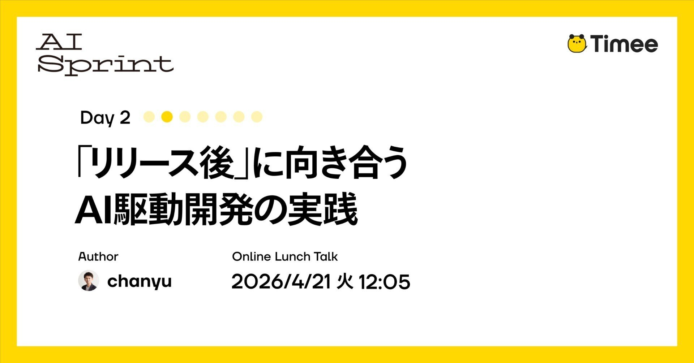
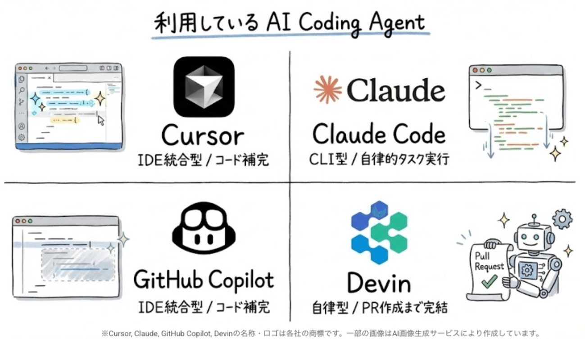
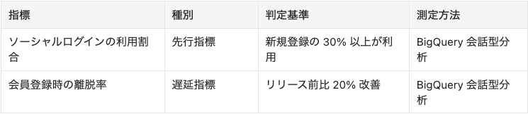
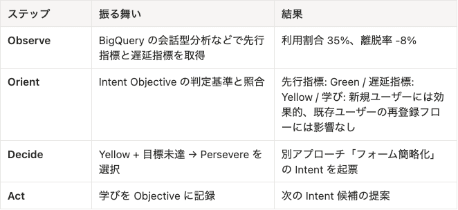
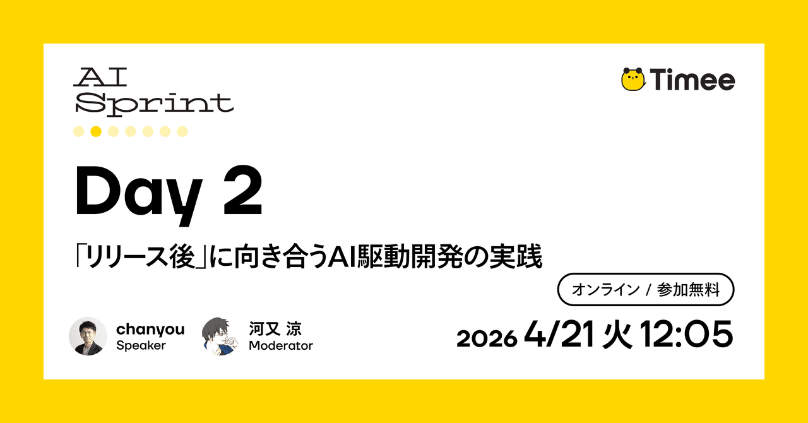

# Timee AI Sprint Day 2: Thực hành phát triển do AI dẫn dắt, tập trung vào giai đoạn “sau phát hành”



> **Thông tin nguồn và bản dịch:** Bài gốc được Timee xuất bản bằng tiếng Nhật ngày **14/04/2026 lúc 15:45**. Bản tiếng Việt này được dịch đầy đủ từ bản **dịch tự động sang tiếng Anh (auto-English) do Timee cung cấp**. Vì lớp auto-English có thể không phản ánh hoàn toàn độ chính xác, sắc thái và chủ ý của tác giả Nhật ngữ, người đọc nên đối chiếu [bài gốc tiếng Nhật](https://productpr.timee.co.jp/n/nd599df323e06) khi cần. [Xem bản auto-English của Timee](https://productpr.timee.co.jp/n/nd599df323e06?hl=en).

Bài viết này thuộc chuỗi **Timee AI Sprint Day 2**.

> **Timee AI Sprint là gì?**  
> Đây là một dự án tăng tốc nhằm trả lời trọn vẹn trong một lần câu hỏi: “Timee sử dụng AI như thế nào?” Chúng tôi sẽ công khai toàn bộ tri thức sử dụng AI mà Timee đã tích lũy qua chuỗi “đăng bài liên tục” trong 7 ngày và các “sự kiện giờ ăn trưa” đào sâu vào chi tiết kỹ thuật của nội dung ấy.

## Mở đầu

Xin chào. Tôi là chanyou, Kỹ sư Phân tích (Analytics Engineer) tại Timee. Trong nhóm **Kỹ thuật Độ tin cậy Dữ liệu (Data Reliability Engineering — DRE)** mà tôi đang làm việc, chúng tôi tổng hợp và sắp xếp nhiều loại dữ liệu nội bộ, đồng thời phát triển và vận hành hạ tầng dữ liệu cho phép các bộ phận kinh doanh đưa ra quyết định dựa trên dữ liệu.

Đã từ lâu, phát triển phần mềm có sử dụng AI trở thành điều bình thường. Gần đây, chúng ta thường thấy các ví dụ đưa AI vào quy trình phát triển, như phát triển dựa trên đặc tả (specification-driven development) và kỹ thuật harness (harness engineering).

Trên thực tế, sau khi rà soát lại quy trình phát triển của chính đội mình, tôi đã cảm nhận được hiệu quả giảm làm lại trước phát hành và rút ngắn thời gian hoàn thành (lead time).

Mặt khác, lead time đến lúc phát hành càng ngắn, tôi càng tò mò về “những gì diễn ra tiếp theo”: tính năng đã phát hành có tiếp tục được sử dụng hay không, và nó có thực sự tạo ra hiệu quả kinh doanh như dự kiến hay không. Khi mở rộng phát triển bằng AI, tôi bắt đầu nghĩ liệu chúng ta có thể vừa cộng tác với AI vừa thực hiện các quy trình sau phát hành này hay không.

Trong bài viết này, tôi sẽ giới thiệu nỗ lực của chúng tôi trong việc tự xây dựng và vận hành giai đoạn **Vận hành (Operation)** của một khung có tên [AI-DLC (AI-Driven Development Life Cycle — Vòng đời phát triển do AI dẫn dắt)](https://github.com/awslabs/aidlc-workflows).

Việc đưa AI-DLC vào Timee và những tác động của nó được giới thiệu trong bài sau.



**Bài liên quan:** [Ba ngày Unicorn Gym đã thay đổi tổ chức trong một tháng — Hiệu ứng lan tỏa của việc đưa AI-DLC vào, nhìn từ dữ liệu](https://tech.timee.co.jp/entry/2026/03/06/141357) — Timee Product Team Blog.

Trong bài này, tôi sẽ giới thiệu luồng làm việc cơ bản của AI-DLC, đồng thời giải thích những gì chúng tôi đang thực hành trong giai đoạn gọi là Operation.

## AI-DLC và phát triển theo chủ đích

AI-DLC là một luồng làm việc đặt AI vào trung tâm của quy trình phát triển. Đội của chúng tôi cũng đang thực hành dựa trên [kho mã nguồn aidlc-workflows do AWS công bố](https://github.com/awslabs/aidlc-workflows).

Quá trình phát triển gồm ba giai đoạn:

- **Khởi tạo (Inception)** — Quyết định xây dựng cái gì và vì sao;
- **Xây dựng (Construction)** — Thiết kế và triển khai cách xây dựng;
- **Vận hành (Operation)** — Kiểm chứng và vận hành sau phát hành.

Đặc điểm của AI-DLC là chạy chu kỳ phát triển với **Chủ đích (Intent)** làm đơn vị. Một giả thuyết như “Tôi muốn đưa đăng nhập mạng xã hội vào để giảm tỷ lệ rời bỏ trong quá trình đăng ký thành viên” trở thành một Intent. Với mỗi Intent, các giai đoạn Inception → Construction → Operation được thực hiện. Intent là khái niệm gần với hạng mục product backlog trong Scrum, nhưng vì tốc độ triển khai tăng lên, Intent thường được định nghĩa với độ chi tiết lớn hơn.

Dù hơi lệch khỏi chủ đề chính của bài, AI-DLC còn có những đặc điểm khác. Nổi bật là cách tiếp cận này khơi dậy tính tự chủ của AI và giả định sử dụng lập trình mob (mob programming).

Vì hành vi AI được định nghĩa bởi các rule và skill sẽ mô tả sau, chúng tôi không đơn phương truyền đạt đặc tả chi tiết, mà truyền đạt chủ đích dưới dạng: “Tôi muốn làm việc này, bạn nghĩ sao?”. Đặc điểm của cách tiếp cận là dần làm rõ đặc tả và cách triển khai trong quá trình trả lời câu hỏi và đề xuất từ AI.

Ngoài ra, mob programming hướng đến giảm tối đa thời gian chờ review bất đồng bộ, tiến hành công việc trong khi giải quyết vấn đề ngay tại chỗ. Nhờ vậy, cách này cũng hiệu quả trong việc rút ngắn lead time. Chúng tôi linh hoạt tổ chức lại đội khi cần và đôi khi tham gia đội khác.

Trong nhóm của chúng tôi, mỗi ngày dành bốn giờ cho phát triển bằng AI-DLC. Nhờ vậy, nhịp độ chuyển giao nội bộ qua Inception/Construction đã được cải thiện. Mặt khác, khi việc chuyển giao tăng tốc, kiểm chứng sau phát hành lại trở thành nút thắt; đó là động lực để chúng tôi xây dựng giai đoạn Operation.

Nền tảng cho các rule và skill này là kho mã nguồn [awslabs/aidlc-workflows](https://github.com/awslabs/aidlc-workflows) đã nhắc ở đầu bài. Các quy tắc thực thi từng giai đoạn được định nghĩa chi tiết, và đội của chúng tôi đã đưa chúng vào dưới dạng skill.

Khi gọi như dưới đây, AI có thể tiến từ Intent đến tạo Pull Request theo các quy tắc, đồng thời để lại các sản phẩm bàn giao.

```text
/inception Tôi muốn đưa đăng nhập mạng xã hội vào để giảm tỷ lệ rời bỏ khi đăng ký thành viên
```

Tuy nhiên, trong aidlc-workflows, giai đoạn Operation vẫn chỉ là một chỗ giữ chỗ. Trong khi Inception và Construction đã được phát triển đầy đủ, chưa có định nghĩa cho hành vi sau phát hành. Vì vậy, đội của chúng tôi đã tự xây dựng giai đoạn Operation.

## Xây dựng giai đoạn Operation dựa trên vòng lặp OODA

Nếu Inception xử lý **WHY/WHAT — vì sao/cái gì** và Construction xử lý **HOW — bằng cách nào**, thì chúng tôi đặt câu hỏi cho giai đoạn Operation là **“SO WHAT? — vậy thì sao?”**. Đây là giai đoạn đặt câu hỏi liệu thứ đã phát hành có thực sự hoạt động hay không.

Chúng tôi quyết định dùng **vòng lặp OODA (OODA loop)** làm quy trình cốt lõi cho giai đoạn này.

**OODA** là chu trình ra quyết định gồm bốn bước: **Quan sát (Observe), Định hướng (Orient), Quyết định (Decide) và Hành động (Act)**. Vốn là một lý thuyết chiến lược quân sự, OODA phù hợp với việc phán đoán nhanh trong tình huống bất định và cũng có thể áp dụng vào bối cảnh phát triển phần mềm. Bằng cách để AI thực thi OODA, chúng tôi đang cấu trúc hóa việc kiểm chứng sau phát hành.

Trong vận hành thực tế, tương tự Inception/Construction, chúng tôi định nghĩa Operation dưới dạng một skill. Khi được gọi bằng **`/operation`**, AI đọc các tệp quy tắc tương ứng cho Observe, Orient, Decide và Act, rồi thực thi OODA theo đầu vào.

Để thực thi OODA, cần quyết định “quan sát điều gì” và “dùng điều gì làm cơ sở phán đoán”. Vì vậy, chúng tôi đưa ba khái niệm — **Contract, Objective và Intent Objective** — vào quy trình AI-DLC.

### Contract — Cam kết vận hành

Đây là định nghĩa dùng để hỏi dịch vụ có đang liên tục cung cấp giá trị hay không, và trong tương lai có thể tiếp tục như vậy hay không. Dựa trên **chỉ báo mức dịch vụ/mục tiêu mức dịch vụ (Service Level Indicator/Service Level Objective — SLI/SLO)**, chúng tôi nêu rõ “trạng thái nào của dịch vụ được coi là bình thường”. Contract được thực thi đều đặn hằng ngày hoặc hằng tuần, độc lập với chu kỳ phát triển, nhằm đề xuất các Intent cần thực hiện trong tương lai dựa trên biến đổi trung và dài hạn. Có thể tận dụng giải pháp chạy theo lịch như Scheduled Sessions của Devin hoặc Schedule tasks của Claude Code; nhưng tôi nghĩ ban đầu chỉ cần định kỳ chạy thủ công **`/operation <contract-path>`** cũng được. Trong lĩnh vực hạ tầng dữ liệu có khái niệm **Hợp đồng Dữ liệu (Data Contract)**; Contract ở đây mở rộng ý tưởng ấy thành hình thức tổng quát hơn. Trong bối cảnh hạ tầng dữ liệu, thời lượng của các job truyền dữ liệu chạy định kỳ và độ tươi mới của dữ liệu là các đối tượng của Contract.

### Objective — Mục tiêu

Đây là những mục tiêu kinh doanh có thể đo lường. Chúng tôi định nghĩa chúng theo dạng “giảm tỷ lệ rời bỏ 20%”, và nhiều Intent được liên kết với một Objective. Vị trí của nó tương tự **Mục tiêu Sản phẩm (Product Goal)** trong Scrum. Độc lập với chu kỳ phát triển, tại các cuộc họp đồng bộ đội hằng tuần hoặc hằng tháng, chúng tôi hỏi mình có đang tiến gần mục tiêu kinh doanh hay không và căn chỉnh hướng của các Intent sẽ thực hiện. Có thể hình dung việc sử dụng bằng cách gọi thủ công **`/operation <objective-path>`** trong họp đồng bộ đội để đào sâu thảo luận dựa trên đề xuất của AI; hoặc chạy định kỳ để nắm xu hướng và tạo báo cáo, tương tự Contract.

Objective không do riêng đội phát triển quyết định, mà được định nghĩa sau khi thống nhất với các bên liên quan rằng “nếu cải thiện điều gì thì được coi là thành công về mặt kinh doanh”. Đội của chúng tôi căn chỉnh định hướng trung hạn hai lần mỗi năm, đồng thời điều chỉnh hoặc bổ sung Objective trong quá trình phát triển hằng ngày.

Trong phát triển hạ tầng dữ liệu, dự án thường bắt đầu từ các yêu cầu như “Tôi muốn có một data mart phân tích kiểu này” và có xu hướng tiếp tục với Objective mơ hồ. Vì độ cụ thể của Objective ảnh hưởng đến chất lượng phán đoán khi chạy OODA trong Operation, quy trình tinh chỉnh mục tiêu với các bên liên quan trước phát triển trở nên quan trọng.

### Intent Objective — Mục tiêu của chủ đích

Đây là các tiêu chí kiểm chứng cho từng Intent. Chúng tôi định nghĩa giả thuyết và hạng mục kiểm chứng trong Inception, rồi bổ sung thông tin triển khai và rủi ro trong Construction. Sau khi Construction hoàn tất và nội dung được phát hành, chúng tôi thực thi theo dạng **`/operation <intent-objective-path>`** để hỏi Intent có thực sự tạo ra hiệu quả hay không. Đây là phần nối tiếp Construction, dự kiến được thực hiện như một lần kiểm tra duy nhất sau phát hành. Chúng tôi ghi lại bài học và nối chúng với việc tạo Intent tiếp theo.

Lý do định nghĩa Intent Objective riêng với Objective là không phải Intent nào cũng nhất thiết liên kết với một Objective. Có những Intent tất yếu không liên quan đến Objective, chẳng hạn ứng phó khẩn cấp. Ngay cả trong trường hợp đó, bản thân Intent vẫn phải có một mục tiêu nào đó; định nghĩa mục tiêu ấy theo cách có thể quan sát và đánh giá chính là Intent Objective. Nhờ đó, ngay cả ứng phó một lần cũng có thể đi qua giai đoạn Operation.

Contract đặt câu hỏi về sức khỏe liên tục của dịch vụ, còn Objective và Intent Objective đặt câu hỏi về tác động của những thay đổi do Intent tạo ra; bản chất của chúng khác nhau.

## Các yếu tố cần thiết để thực hành vòng lặp OODA

Với các khái niệm trên, hãy xem từng bước của OODA. Phần quan trọng nhất là Observe và Orient; nếu hai phần này chưa sẵn sàng, OODA sẽ không vận hành.

### Observe — Quan sát

OODA không thể bắt đầu nếu AI không thể quan sát thực tế. Muốn Observe hoạt động, bạn cần cung cấp công cụ cho AI.

Để quan sát Contract — sức khỏe hạ tầng — có thể tận dụng các MCP Server như [Datadog MCP Server](https://docs.datadoghq.com/bits_ai/mcp_server/) hoặc [Google Cloud Observability MCP Server](https://github.com/googleapis/gcloud-mcp). Đối với thực thi định kỳ, tôi nghĩ Remote MCP Server rất phù hợp.

Để quan sát Objective hoặc Intent Objective — các chỉ số kinh doanh — cần dữ liệu gần với hoạt động kinh doanh hơn, như doanh số hoặc tỷ lệ ghép nối. Điều kiện tiên quyết là các chỉ số này phải được định nghĩa trước theo cách AI có thể tham chiếu. Để truy cập chỉ số kinh doanh, thiết lập **lớp ngữ nghĩa (semantic layer)** thông qua mô hình hóa dữ liệu là cách hữu hiệu. Các công cụ cho phép truy vấn dữ liệu tính toán sẵn bằng ngôn ngữ tự nhiên, chẳng hạn [BigQuery conversational analytics](https://cloud.google.com/bigquery/docs/conversational-analytics), cũng có thể được dùng như một phương tiện Quan sát.

### Orient — Định hướng

Chỉ thu thập dữ liệu quan sát thôi chưa đủ; cần có tiêu chí để trao ý nghĩa cho dữ liệu ấy.

Nếu tiêu chí không được ghi thành tài liệu, AI chỉ có thể đưa ra phán đoán kiểu “có vẻ ổn”. Chỉ khi chỉ ra mục tiêu và kỳ vọng, bạn mới xác định được khoảng cách so với tình trạng hiện tại.

Trong đội của chúng tôi, Contract, Objective và Intent Objective được đưa vào kho mã nguồn dưới dạng Markdown; AI tham chiếu chúng làm tiêu chí để thực hiện phán đoán có cấu trúc.

Orient xuất kết quả theo hai trục. Một là **phán đoán trạng thái (state judgment)** — đang trong phạm vi kỳ vọng, đang trôi lệch hay đã sai lệch khỏi tiêu chí. Trục còn lại là **bài học (learning)** — giả thuyết có đúng không, điều gì khác với kỳ vọng, và insight nào có thể áp dụng vào lần sau.

### Decide — Quyết định

Dựa trên đầu ra của Orient, chúng tôi quyết định hành động tiếp theo. Ở đây, chúng tôi đưa vào khái niệm **Chuyển hướng hoặc Kiên trì (Pivot-or-Persevere)** của Lean Startup. Nếu đạt mục tiêu thì **Đóng (Close)**; nếu chưa đạt nhưng sẽ tiếp tục cùng hướng ở Intent kế tiếp thì **Kiên trì (Persevere)**; nếu cần đổi hướng thì **Chuyển hướng (Pivot)**; và nếu có vấn đề nghiêm trọng thì **Quay lui (Rollback)**.

### Act — Hành động

Chúng tôi thực hiện hành động thực tế dựa trên quyết định từ Decide: đề xuất các ứng viên Intent tiếp theo hoặc cập nhật định nghĩa của Contract hay Objective. Đồng thời, bằng cách ghi lại bài học trong tài liệu, chất lượng của chu kỳ tiếp theo được cải thiện. Theo cách này, kết quả Operation dẫn đến Intent tiếp theo và chu kỳ phát triển tiếp tục.

## Ví dụ cụ thể: giảm tỷ lệ rời bỏ trên một trang thương mại điện tử

Vì đến đây nội dung còn khá trừu tượng, hãy theo dõi luồng qua một ví dụ cụ thể. Để truyền tải luồng theo cách không phụ thuộc vào miền hạ tầng dữ liệu mà đội chúng tôi xử lý, chúng tôi dùng một trang thương mại điện tử (EC site) giả định làm đối tượng.

### Điều kiện tiên quyết

Giả sử Objective được đặt là “giảm 20% tỷ lệ rời bỏ trong quá trình đăng ký thành viên”.

### Inception

```text
/inception Tỷ lệ rời bỏ khi đăng ký thành viên đang cao. Tôi muốn đưa đăng nhập mạng xã hội vào để giảm tỷ lệ rời bỏ.
```

Thông qua Inception, các Intent Objective như dưới đây được định nghĩa. Điểm mấu chốt là làm rõ **Tiêu chí Đo lường (Measurement Criteria)** cho các giả thuyết.

```markdown
# Intent Objective: social-login

## Objective

Giảm 20% tỷ lệ rời bỏ khi đăng ký thành viên

## Giả thuyết

Nếu đưa đăng nhập mạng xã hội vào, tỷ lệ rời bỏ khi đăng ký thành viên sẽ giảm

## Measurement Criteria

| Chỉ số | Loại | Tiêu chí phán đoán | Phương pháp đo |
| --- | --- | --- | --- |
| Tỷ lệ sử dụng đăng nhập mạng xã hội | Chỉ báo sớm | Từ 30% lượt đăng ký mới trở lên sử dụng | Phân tích hội thoại BigQuery |
| Tỷ lệ rời bỏ khi đăng ký thành viên | Chỉ báo trễ | Cải thiện 20% so với trước phát hành | Phân tích hội thoại BigQuery |
```

Phần bảng được hiển thị bên dưới để dễ đọc.



**Chỉ báo sớm (leading indicator)** là chỉ số dùng để xác định từ sớm liệu một cơ chế có đang hoạt động hay không. **Chỉ báo trễ (lagging indicator)** là chỉ số kết quả cuối cùng mà bạn muốn cải thiện, nhưng cần thời gian mới cho thấy kết quả. Các Measurement Criteria này được dùng làm tiêu chuẩn phán đoán trong giai đoạn Orient tiếp theo.

### Construction

Trong Construction, chúng tôi triển khai tính năng đăng nhập mạng xã hội và tạo PR. Sau khi review, chúng tôi phát hành tính năng.

### Operation

```text
/operation Tôi muốn đánh giá Intent Objective của việc đưa đăng nhập mạng xã hội vào.
```



Theo cách này, kết quả của giai đoạn Operation dẫn đến tập hợp ứng viên Intent tiếp theo.

## Những insight thu được khi đưa giai đoạn Operation vào

Bằng cách thực sự đưa giai đoạn Operation vào quy trình, chúng tôi có một số phát hiện.

### Tiêu chí kiểm chứng được củng cố trước khi phát triển

Khi giả định sẽ có giai đoạn Operation, việc định nghĩa Measurement Criteria ở bước Inception trở thành yêu cầu không thể tránh khỏi. Đặc biệt trong các hoạt động phát triển như tác nhân AI phân tích dữ liệu nội bộ của đội chúng tôi, định nghĩa “thế nào là thành công” rất dễ vẫn còn mơ hồ.

Bằng cách quyết định trước “sau phát hành sẽ Observe điều gì”, chúng tôi có thể củng cố các tiêu chí trước khi bắt đầu phát triển. Tôi cảm thấy đây là một kỷ luật nảy sinh chính vì giai đoạn Operation tồn tại.

### Việc phát triển công cụ được thúc đẩy một cách tự nhiên

Nếu chưa có môi trường để AI Observe, con người sẽ phải thay AI thu thập và sắp xếp dữ liệu. Khi MCP Server và semantic layer đã được thiết lập để AI truy cập dữ liệu trực tiếp, con người có thể tập trung nhiều hơn vào phân tích và ra quyết định hướng tới tương lai. Sự tồn tại của giai đoạn Operation đã tự nhiên thúc đẩy việc phát triển những công cụ như vậy.

### Hạ tầng dữ liệu đóng vai trò quan trọng trong Operation

Quan sát Objective đòi hỏi quyền truy cập vào các chỉ số kinh doanh. Để AI tự chủ tham chiếu dữ liệu và đưa ra phán đoán, thiết lập semantic layer thông qua mô hình hóa dữ liệu là cách hữu hiệu; khoản đầu tư đó có ý nghĩa then chốt.

### Con người theo đuổi những thông tin mà AI khó Observe

Khi giai đoạn Operation ngày càng tinh chỉnh, ngược lại, tôi tin tầm quan trọng của những thông tin mà AI khó Observe sẽ tăng lên.

Ví dụ, trong nhóm DRE, chúng tôi thực hiện phỏng vấn N1 với nhân viên bán hàng sử dụng dữ liệu để tăng độ phân giải của các thách thức trong công việc hằng ngày của họ.

Hiện tại, rất khó thay thế hoàn toàn các hoạt động này bằng AI; tôi nghĩ trước mắt chúng vẫn là những công việc mà chỉ con người mới có thể quan sát và khai thác.

## Tổng kết

Trong bài viết này, tôi đã giới thiệu nỗ lực tự xây dựng và triển khai giai đoạn Operation của AI-DLC.

Dù các rule cho Operation vẫn còn thô và việc phát triển công cụ mới chỉ đi được nửa chặng đường, chúng tôi đang dần có thể thực hiện kiểm chứng sau phát hành cùng AI. Tôi tin rằng việc thiết lập được một luồng làm việc trong đó “tiếp tục kiểm chứng với AI ngay cả sau phát hành”, thay vì coi phát hành là điểm kết thúc, là một thay đổi tích cực.

Hơn nữa, dù trước đây chưa từng nghĩ tới cho đến khi xem xét giai đoạn Operation, tôi nhận ra rằng hoạt động phát triển hạ tầng dữ liệu mà nhóm DRE theo đuổi có chức năng như một phương tiện Quan sát và đóng vai trò quan trọng trong việc hỗ trợ thực hành Operation.

Tôi hy vọng nội dung này sẽ là tài liệu tham khảo cho những ai đang cảm thấy thách thức tương tự với các quy trình sau phát hành. Tại Timee, nhóm DRE đang xây dựng loại hạ tầng dữ liệu này và triển khai giai đoạn Operation. Nếu quan tâm, bạn có thể xem trang tuyển dụng sản phẩm bên dưới và thoải mái đăng ký một cuộc trao đổi không chính thức!


**Tuyển dụng:** [Timee Inc. — Trang tuyển dụng sản phẩm](https://product-recruit.timee.co.jp/) — thông tin tuyển dụng các vị trí kỹ sư, nhà thiết kế và các vai trò khác.

## Tuần tới, chúng tôi sẽ tổ chức một sự kiện đào sâu hơn vào bài viết này!



**Sự kiện:** [Timee AI Sprint Day 2 — “Thực hành phát triển do AI dẫn dắt, đối diện với giai đoạn ‘sau phát hành’” (21/04/2026, 12:05)](https://timeedev.connpass.com/event/390292)

Nếu đã đọc và thấy bài viết thú vị, hãy tham gia cùng chúng tôi!!

## Bảng thuật ngữ song ngữ

| Tiếng Việt | English |
|---|---|
| Vòng đời phát triển do AI dẫn dắt | AI-Driven Development Life Cycle (AI-DLC) |
| Giai đoạn hình thành | Inception |
| Giai đoạn xây dựng | Construction |
| Giai đoạn vận hành | Operation |
| Phát triển theo chủ đích | Intent-driven development |
| Mục tiêu chủ đích | Intent Objective |
| Tiêu chí đo lường | Measurement Criteria |
| Cam kết vận hành | Contract |
| Mục tiêu | Objective |
| Giả thuyết | Hypothesis |
| Quan sát | Observe |
| Định hướng | Orient |
| Quyết định | Decide |
| Hành động | Act |
| Vòng lặp OODA | Observe–Orient–Decide–Act loop |
| Giao thức ngữ cảnh mô hình | Model Context Protocol (MCP) |
| Máy chủ MCP | MCP Server |
| Lớp ngữ nghĩa | Semantic layer |
| Phân tích khám phá | Exploratory analysis |
| Kiểm chứng sau phát hành | Post-release validation |
| Hạ tầng dữ liệu | Data infrastructure |
| Tác tử AI | AI agent |
