# [Timee AI Sprint Day 3] Hệ thống hóa “tư duy” của PdM: Toàn cảnh nền tảng ứng dụng AI đã tạo ra 105 nguyên mẫu trong 30 ngày

**Tác giả:** Timee  
**Ngày xuất bản:** 15/04/2026, 15:17 (JST)  
**Bài gốc tiếng Nhật:** [Timee Product PR](https://productpr.timee.co.jp/n/nbd741d254465)  
**Bản auto-English dùng làm nguồn dịch:** [Timee Product PR — English](https://productpr.timee.co.jp/n/nbd741d254465?hl=en)

> **Lưu ý về nguồn:** Đây là bản dịch tiếng Việt đầy đủ từ bản tiếng Anh được Timee tự động dịch bằng AI từ bài gốc tiếng Nhật. Chính trang nguồn cảnh báo rằng độ chính xác, sắc thái và ý đồ của tác giả có thể chưa được phản ánh hoàn toàn. Bản dịch này giữ nguyên nội dung, số liệu và cấu trúc lập luận của bản auto-English; các thuật ngữ chuyên môn quan trọng được trình bày theo dạng Việt–Anh.

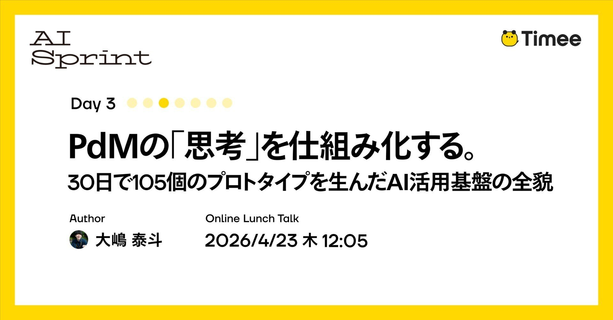

*Hình bìa. Ảnh bìa gốc của bài viết. Nguồn: Timee.*

Bài viết này thuộc chuỗi **Timee AI Sprint Day 3**.

> **Timee AI Sprint là gì?** Đây là một dự án chuyên sâu nhằm trả lời một lượt câu hỏi: “Timee sử dụng AI như thế nào?”. Chúng tôi công khai toàn bộ những hiểu biết về ứng dụng AI mà Timee đã tích lũy, thông qua chuỗi “đăng bài liên tục” trong 7 ngày và chuỗi “sự kiện giờ ăn trưa” đi sâu vào các chi tiết kỹ thuật của nội dung đó.

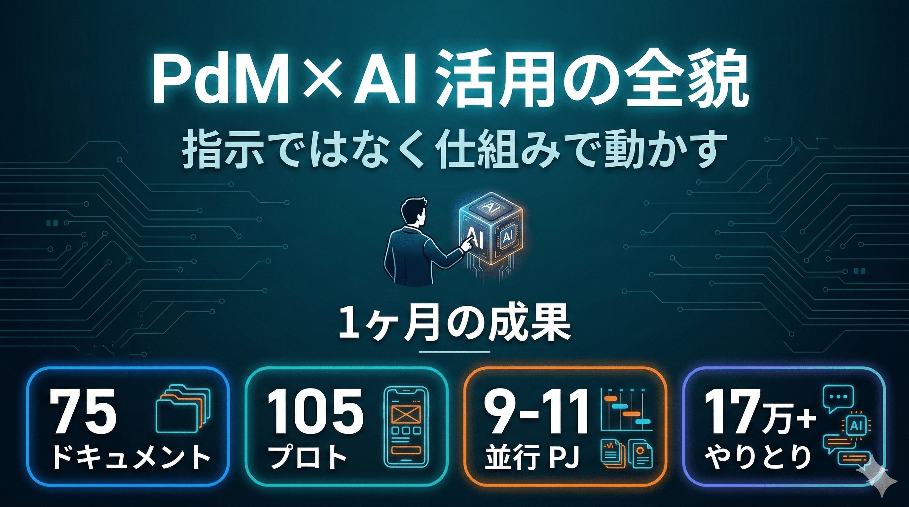

*Hình 1. Tổng quan chuỗi Timee AI Sprint. Nguồn ảnh gốc: Timee.*

## Tóm tắt nhanh (TL;DR)

- **Làm được gì (What):** 105 nguyên mẫu (prototype), 60 tài liệu và 19 dự án chạy song song trong 30 ngày.
- **Làm như thế nào (How):** Xây dựng nền tảng ứng dụng AI, xác định hành vi của AI như trình tự tư duy và tiêu chuẩn chất lượng, rồi vận hành bằng hệ thống thay vì từng chỉ dẫn riêng lẻ.
- **Vì sao hiệu quả (Why it works):** Loại bỏ những đề xuất không có căn cứ, tạo ra đầu ra nhất quán và có khả năng tái lập cao nhờ xử lý công việc theo từng bước cùng các cổng chất lượng (quality gate).
- **Ý nghĩa là gì (So what):** Giao việc xử lý thông tin cho AI. Nhà quản lý sản phẩm (Product Manager — **PdM**) nên tập trung vào các kỹ năng mềm như “đánh giá”, “thúc đẩy con người” và “ra quyết định”.

## 1. Tiền đề: Cách tôi làm việc

Vai trò của tôi với tư cách Chủ sở hữu sản phẩm (Product Owner — **PO**) là quyết định “xây dựng cái gì”. Xét theo các kiểu PdM, tôi thiên về kinh doanh. Công việc của tôi tập trung vào **Khám phá (Discovery)** — khám phá vấn đề/kiểm chứng giả thuyết — và **Phân phối (Delivery)** — chiến lược/triển khai đưa sản phẩm ra thị trường (Go-to-Market — **GTM**). Tôi không viết đặc tả yêu cầu. Tôi xác định mục tiêu và mức độ ưu tiên, còn phần “làm như thế nào” (How) được giao cho đội phát triển.

## 2. Kết quả ứng dụng AI qua các con số

Số lượng và chất lượng đầu ra đã thay đổi mạnh mẽ trước và sau khi sử dụng AI.

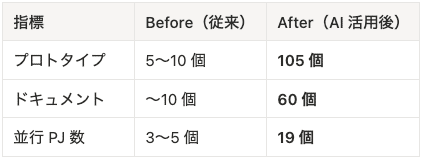

*Hình 2. So sánh kết quả đầu ra trước và sau khi ứng dụng AI. Nguồn ảnh gốc: Timee.*

Các nguyên mẫu không phải là bản mô phỏng dùng xong rồi bỏ. Chúng được tạo theo đúng hệ thống thiết kế (design system), có tham chiếu codebase và hướng dẫn thiết kế hiện có. Chất lượng đủ để dùng trực tiếp khi thống nhất nhận thức với kỹ sư và nhà thiết kế.

### Vì sao điều này trở nên khả thi

Trước đây, tôi phải yêu cầu đội phân tích cung cấp dữ liệu, nhờ nhà thiết kế làm nguyên mẫu và không còn lựa chọn nào khác ngoài làm việc khác trong lúc chờ câu trả lời. Còn hiện nay, tôi đồng thời vận hành ở nhiều phiên một chu trình khép kín: **“Chỉ thị → AI thực thi (1–2 phút) → Rà soát”**.

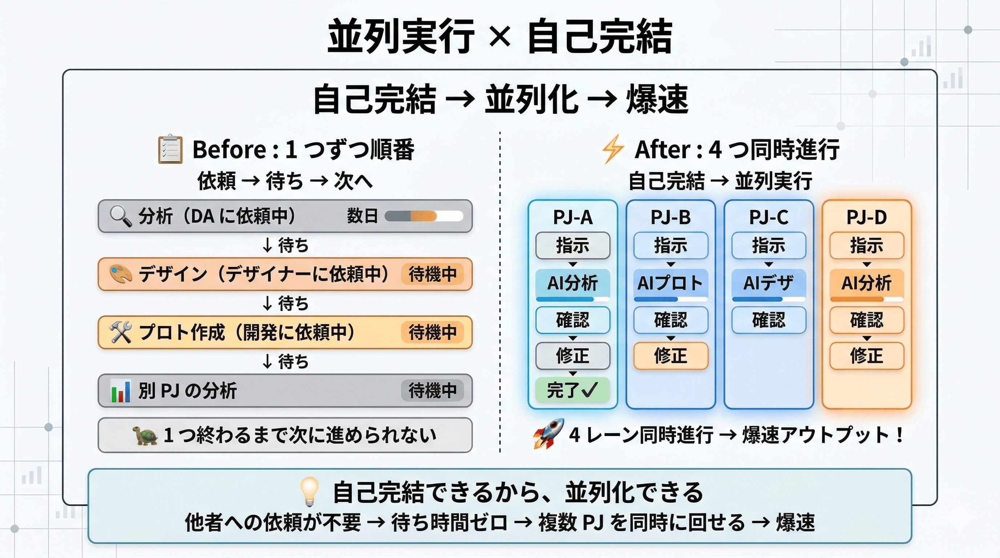

*Hình 3. Chu trình làm việc khép kín với AI ở nhiều phiên song song. Nguồn ảnh gốc: Timee.*

## 3. Hệ thống: Cấu trúc ba lớp hỗ trợ ứng dụng AI

Chỉ “sử dụng” AI thì hiệu quả có giới hạn. Hiệu quả sẽ tăng gấp bội khi thiết lập được một **hệ thống (system)**.  
**Nếu các lớp bên dưới chưa sẵn sàng thì các lớp bên trên sẽ không hoạt động.**

- Thiếu L1 → Lần nào AI cũng hỏi: “Tệp nào?” hoặc “Bối cảnh là gì?”.
- Thiếu L2 → Mỗi lần AI lại hành xử khác nhau và chất lượng trở nên thiếu nhất quán.

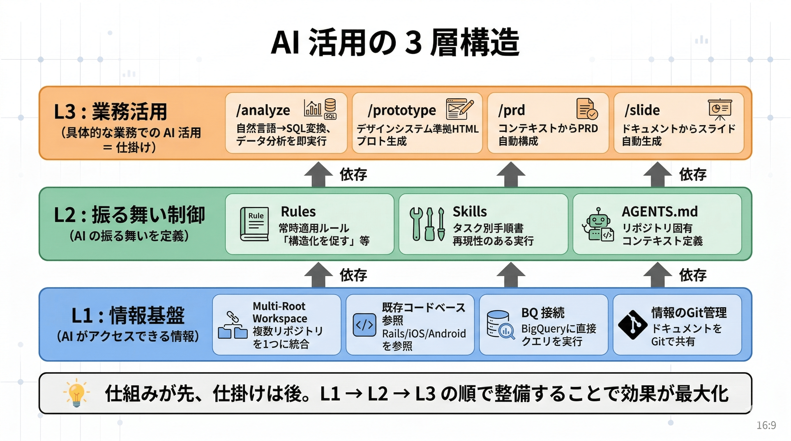

*Hình 4. Cấu trúc ba lớp: nền tảng thông tin, kiểm soát hành vi và thực thi. Nguồn ảnh gốc: Timee.*

## 4. Lớp 1: Nền tảng thông tin | Thiết kế môi trường để AI ở trong “cùng một bối cảnh”

Đây là lớp tổ chức thông tin mà AI có thể tham chiếu. Chúng tôi cho phép truy cập codebase hiện có và **BigQuery (BQ)**, đồng thời quản lý tài liệu trên GitHub để chia sẻ với cả đội.

Hơn nữa, bằng cách quản lý tài liệu trong Git, chúng tôi đã đạt tới **trạng thái mà đội ngũ có thể truy cập tư duy của PO thông qua AI**. Điều này giảm yếu tố “phải hỏi PO mới hiểu”, giúp đội ngũ hành động tự chủ hơn để đạt mục tiêu.

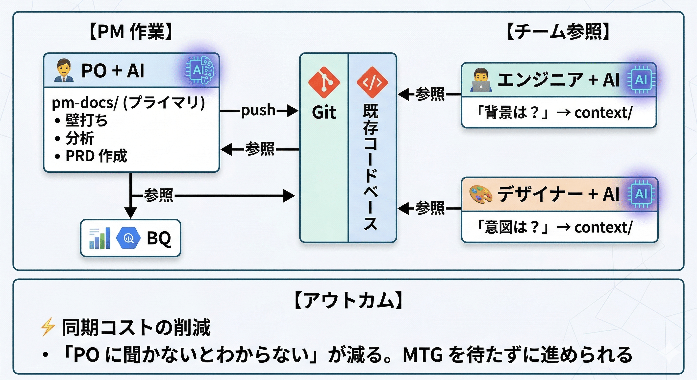

*Hình 5. Môi trường thông tin giúp AI và đội ngũ dùng chung bối cảnh. Nguồn ảnh gốc: Timee.*

### Cấu trúc thư mục dự án

Với các tệp do AI đọc, chúng tôi đặt quy tắc chỉ đọc lượng tệp tối thiểu cần thiết và dùng cách ghi tiếng Anh tiết kiệm token để tăng hiệu suất sử dụng token. Còn tệp dành cho con người đọc cần có mức độ phân biệt rõ ràng nhất định.

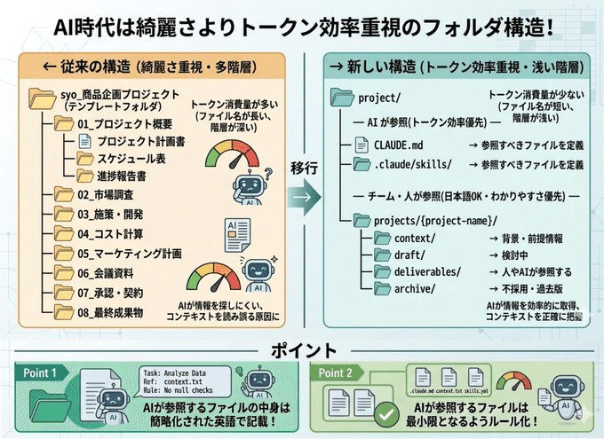

*Hình 6. Cấu trúc thư mục dự án phục vụ cả AI và con người. Nguồn ảnh gốc: Timee.*

## 5. Lớp 2: Kiểm soát hành vi | Bảo đảm chất lượng AI bằng cấu trúc

Nếu L1 là “AI nhìn thấy gì”, thì L2 là lớp xác định “AI hành xử như thế nào”. Không có lớp này, AI sẽ hành động khác nhau ở mỗi lần chạy, dẫn đến chất lượng thiếu nhất quán.

Chúng tôi ghi các tiêu chuẩn chất lượng và kỷ luật tư duy vào `AGENTS.md` (hoặc `CLAUDE.md`) của Cursor hay Claude Code dưới dạng “quy tắc luôn phải tuân thủ”. **Các tệp này được tự động đọc mỗi khi AI bắt đầu một phiên.** Nói cách khác, những gì viết ở đây trở thành tiền đề cho mọi cuộc hội thoại.

Toàn cảnh có thể sẽ được giới thiệu trong một bài riêng; ở đây tôi chỉ trình bày ngắn gọn một số quy tắc đặc biệt hiệu quả:

- **Con người trong vòng lặp (Human In The Loop — HITL):** Luôn có xác nhận của con người tại mọi điểm đánh giá, phê duyệt và rà soát. Không để AI tự mình ra quyết định.
- **Bằng chứng trước tiên (Evidence First):** Cấm nói “có lẽ”. Trước khi đề xuất, bắt buộc phải kiểm tra phần triển khai hoặc dữ liệu (BQ), qua đó ép cuộc thảo luận dựa trên sự thật.
- **Tự rà soát (Self-Review):** Cấm kết luận “không có điểm yếu”. Buộc AI liệt kê “ít nhất 3 điểm yếu” cho mọi đầu ra, để tự phơi bày các điểm mù của mình.

## 6. Lớp 3: Thực thi | Chuyển tri thức ngầm của PdM thành `/commands` để đồng bộ tư duy

Thư mục `skills/` chứa các sổ tay riêng lẻ chạy trên L1 (Nền tảng thông tin) và L2 (Kiểm soát hành vi).

- `/analyze`: Tạo và thực thi SQL từ câu hỏi bằng ngôn ngữ tự nhiên, sau đó trả về insight.
- `/prototype`: Tạo mã nguồn tuân thủ hệ thống thiết kế từ các yêu cầu.
- `/prd`: Tự động tạo Tài liệu yêu cầu sản phẩm (Product Requirements Document — **PRD**) có cấu trúc.

## 7. `/pm-skill` — hệ thống hóa tư duy PdM: Giới thiệu một số quy trình tự chủ

`/pm-skill` là “nhạc trưởng” kết hợp L1 (Nền tảng thông tin) và L2 (Hành vi) để tái hiện quá trình tư duy của PdM. Đây không chỉ là tự động hóa; **nó đưa “kỷ luật tư duy của PdM” vào quy trình làm việc.**

> **Lưu ý:** Phần này giới thiệu một số triết lý thiết kế và tổng quan quy trình của `/pm-skill`. Việc có bài giải thích chi tiết riêng hay phát hành trên Git hay không vẫn chưa được quyết định…

### Bốn triết lý thiết kế: Ràng buộc bằng “chất lượng” thay vì quy trình

Chúng tôi ngừng điều khiển AI bằng “chỉ dẫn” và đưa bốn nguyên tắc sau vào hệ thống.

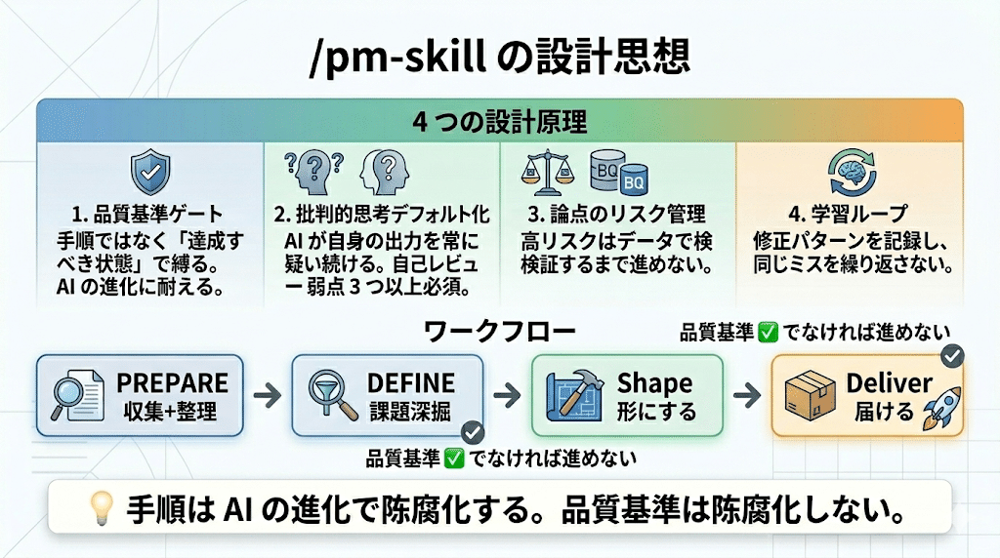

*Hình 7. Bốn triết lý thiết kế của `/pm-skill`. Nguồn ảnh gốc: Timee.*

**1. Ràng buộc bằng tiêu chuẩn chất lượng, không phải bằng thủ tục**  
Chỉ xác định “trạng thái cần đạt” ở mỗi giai đoạn và để AI tự chọn cách thực thi. Thủ tục sẽ lỗi thời khi AI tiến hóa, còn tiêu chuẩn chất lượng thì không.

```text
Tiêu chuẩn chất lượng ✅ → Sang giai đoạn tiếp theo
Tiêu chuẩn chất lượng ❌ → Dừng. Không tiếp tục cho đến khi đáp ứng tiêu chuẩn
```

**2. Mặc định áp dụng tư duy phản biện**

Nếu không bị ràng buộc, AI có xu hướng đồng tình. `/pm-skill` đưa tư duy phản biện thành một quy tắc không cần tín hiệu kích hoạt. Mọi đầu ra bắt buộc phải tự rà soát — xác định ít nhất ba điểm yếu — để bảo đảm AI luôn chất vấn chính kết quả của mình.

**3. Tiến lên bằng cách xử lý từng vấn đề một**

Quản lý các vấn đề đã nhận diện theo mức rủi ro, rồi đào sâu và giải quyết lần lượt từng vấn đề. Trước khi ra quyết định, các vấn đề rủi ro cao phải được kiểm chứng qua BQ hoặc codebase. Cấu trúc này ngăn việc “cứ tiến lên mà không có định hướng”.

**4. Học hỏi và cải tiến**

Ghi lại các mẫu lỗi mà PM đã sửa để không lặp lại cùng sai sót. Khi bắt đầu phiên làm việc, xem lại những bài học trước đây và áp dụng các bài học phù hợp.

### Quy trình bốn giai đoạn và “sự can thiệp của con người”

Sau khi được cung cấp mục tiêu, AI tự chủ đi qua bốn giai đoạn dưới đây, đồng thời đưa “phê duyệt của con người” vào quy trình.

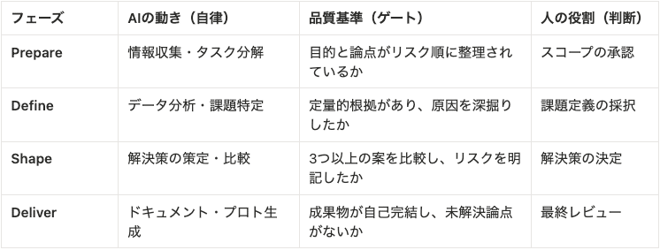

*Hình 8. Quy trình bốn giai đoạn có sự phê duyệt của con người. Nguồn ảnh gốc: Timee.*

### Ví dụ thực thi: Từ cải thiện chỉ số đến quyết định chiến lược

Bằng cùng một quy trình, toàn bộ công việc PdM được cô đọng vào một “cuộc đối thoại 15 phút”.

- **Cải thiện chỉ số (ví dụ tăng CVR):** Xác định điểm nghẽn bằng `/analyze` → Xây dựng giả thuyết → Đề xuất cải tiến.
- **Tạo PRD:** Tự động trích xuất đặc tả hiện có → Xác định vấn đề N1 → Tạo nguyên mẫu tuân thủ hệ thống thiết kế.
- **Ra quyết định chiến lược:** Nghiên cứu thị trường → Đánh giá 4 phương án theo 6 tiêu chí → Trình bày các kịch bản thất bại.

### Cấu trúc thư mục như một tài sản

Toàn bộ quá trình cân nhắc được cấu trúc hóa và lưu trong repository, nhờ đó có thể tiếp tục từ `tasks.md` ngay cả khi phiên làm việc hết hạn.

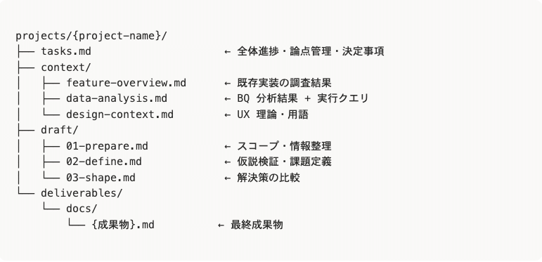

*Hình 9. Cấu trúc thư mục biến quá trình cân nhắc thành tài sản có thể tiếp tục sử dụng. Nguồn ảnh gốc: Timee.*

### Các kỹ năng PM được `/pm-skill` tự động chọn cho từng giai đoạn

AI lựa chọn và áp dụng kỹ năng phù hợp dựa trên tính chất của nhiệm vụ.

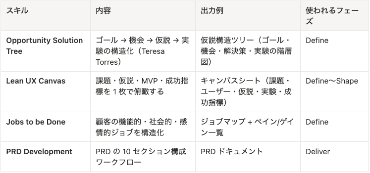

*Hình 10. Các kỹ năng PM được `/pm-skill` tự động chọn theo từng giai đoạn. Nguồn ảnh gốc: Timee.*

Cơ chế hoạt động theo cách sau: ngay cả khi PM không yêu cầu “tổ chức bằng OST”, AI vẫn tự động áp dụng khung **Cây giải pháp cơ hội (Opportunity Solution Tree — OST)** khi cấu trúc giả thuyết trong giai đoạn Define. Ngoài ra còn hơn 40 kỹ năng khác đã được định nghĩa để AI lựa chọn dựa trên tính chất nhiệm vụ.

## 8. Công việc của con người là thúc đẩy con người

Trên đây là các hệ thống và kỹ năng. Giờ đây, khi xử lý thông tin đã chuyển sang AI, giá trị cốt lõi mà PdM tạo ra nên nằm ở đâu?

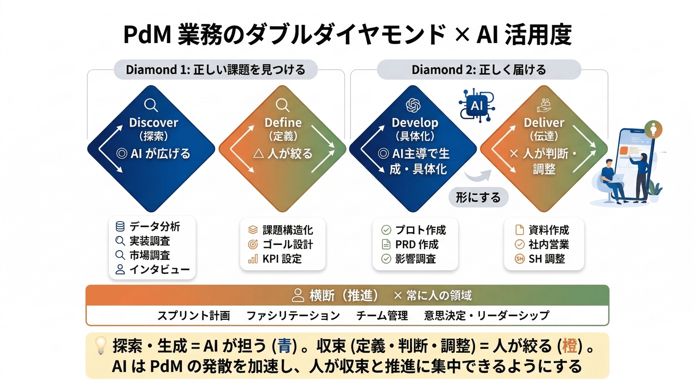

*Hình 11. Phân chia vai trò giữa AI và con người trong công việc quản lý sản phẩm. Nguồn ảnh gốc: Timee.*

### Điều có thể thấy từ mô hình kim cương kép

AI mạnh ở **giai đoạn phân kỳ (divergence)** — nghiên cứu và sáng tạo. Con người là không thể thiếu ở **giai đoạn hội tụ (convergence)** — thu hẹp lựa chọn, quyết định và chuyển giao — cũng như ở **khâu thực thi (execution)**, tức thúc đẩy con người hành động.

### Ba kỹ năng cần trau dồi trong kỷ nguyên AI

Ngay cả khi xử lý thông tin chuyển sang AI, vai trò căn bản của PdM — “tạo ra kết quả lớn hơn với tốc độ nhanh hơn” — vẫn không thay đổi. Tuy nhiên, tốc độ đạt kết quả sẽ khác biệt rất lớn tùy vào mức độ ứng dụng AI. Từ đó, các kỹ năng cần có của PdM có thể được tóm lại thành ba nhóm.

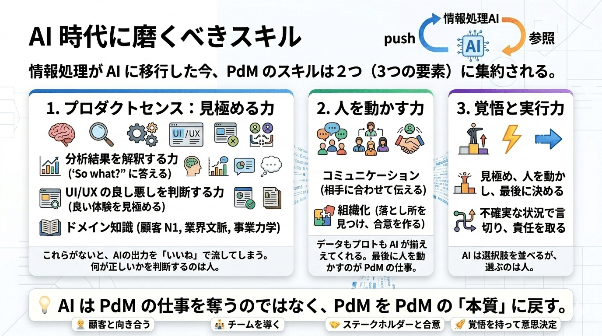

*Hình 12. Ba kỹ năng PdM cần trau dồi trong kỷ nguyên AI. Nguồn ảnh gốc: Timee.*

## Tổng kết

Bạn thấy thế nào? Dù vẫn còn những phần đang được phát triển, tôi hy vọng bài viết sẽ là tài liệu tham khảo hữu ích.  
Về `pmskill`, tuy tôi hướng tới việc phát hành trên GitHub, nó được tạo ra với cả thông tin nội bộ của công ty, nên tôi nghĩ quyết định còn phụ thuộc vào nhu cầu…  
Trong một thế giới nơi chi phí xử lý thông tin tiến gần về 0 nhờ AI, thời gian dành để đối diện với “giá trị thiết yếu cho khách hàng” cần tăng lên hơn bao giờ hết. Thông qua khoa học và thực hành **AI × Quản lý sản phẩm (AI × Product Management)**, tôi muốn tiếp tục kiên trì đương đầu với thử thách để có thể đưa tương lai đó đến gần hơn, dù chỉ sớm hơn một ngày!

## Tuần tới, chúng tôi sẽ tổ chức sự kiện đi sâu hơn vào bài viết này!

[**Timee AI Sprint Day 4 — “Hệ thống hóa tư duy của PdM” (23/04/2026, 12:05–)**](https://timeedev.connpass.com/event/390333/)  
Trang sự kiện giới thiệu các trường hợp ứng dụng AI của Timee và đào sâu nội dung kỹ thuật.

Nếu bạn đọc bài này và thấy thú vị, hãy tham gia cùng chúng tôi!!  
Đây sẽ là phần tôi xuất hiện tại sự kiện Day 4!

## Thuật ngữ Việt–Anh

| Tiếng Việt | Thuật ngữ gốc |
|---|---|
| Nhà quản lý sản phẩm | Product Manager (PdM) |
| Chủ sở hữu sản phẩm | Product Owner (PO) |
| Khám phá / Phân phối | Discovery / Delivery |
| Đưa sản phẩm ra thị trường | Go-to-Market (GTM) |
| Nguyên mẫu | Prototype |
| Hệ thống thiết kế | Design system |
| Con người trong vòng lặp | Human In The Loop (HITL) |
| Bằng chứng trước tiên | Evidence First |
| Tự rà soát | Self-Review |
| Tài liệu yêu cầu sản phẩm | Product Requirements Document (PRD) |
| Cổng chất lượng | Quality gate |
| Cây giải pháp cơ hội | Opportunity Solution Tree (OST) |
| Phân kỳ / Hội tụ | Divergence / Convergence |

## Nguồn

- Timee, bài gốc tiếng Nhật: <https://productpr.timee.co.jp/n/nbd741d254465>
- Timee, bản auto-English dùng làm nguồn dịch: <https://productpr.timee.co.jp/n/nbd741d254465?hl=en>
