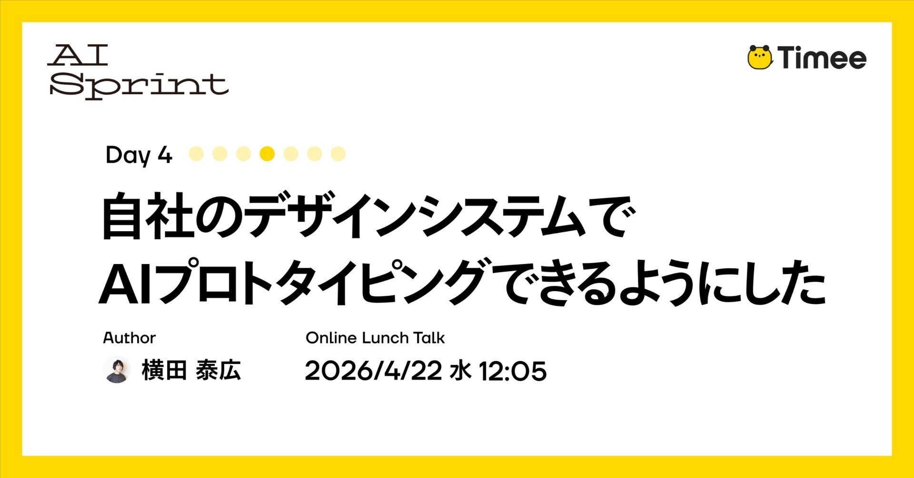
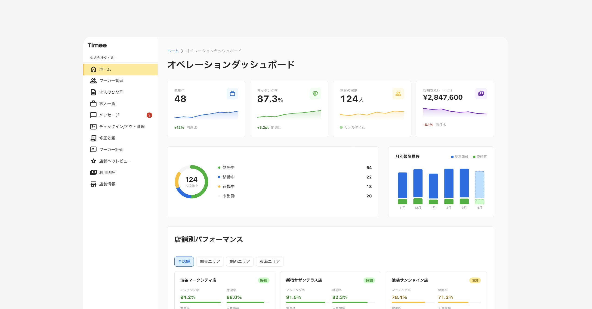
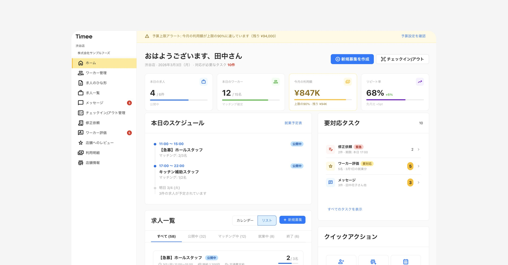
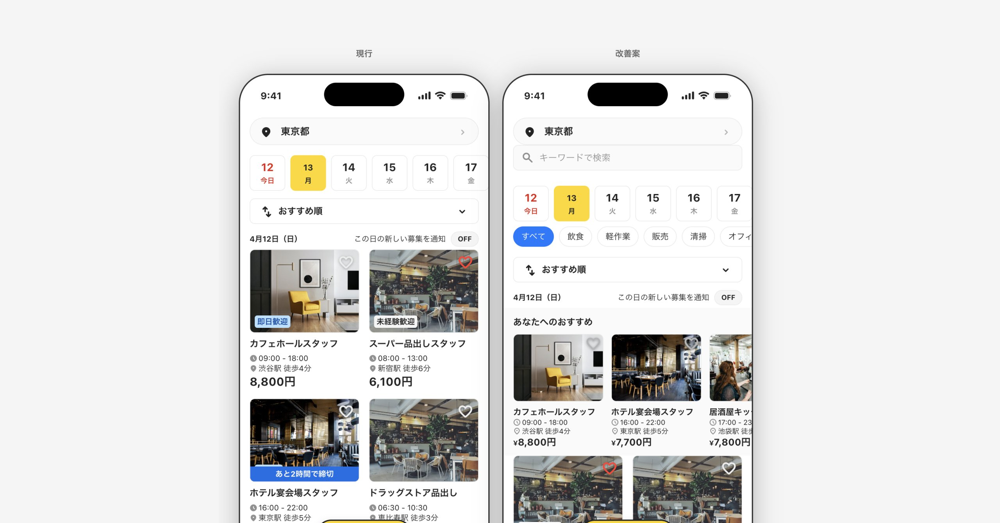
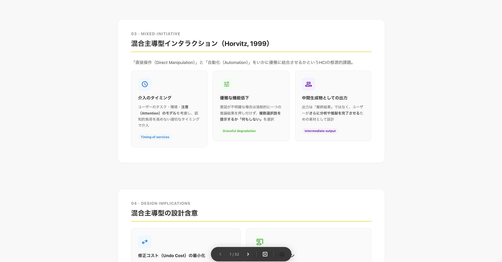
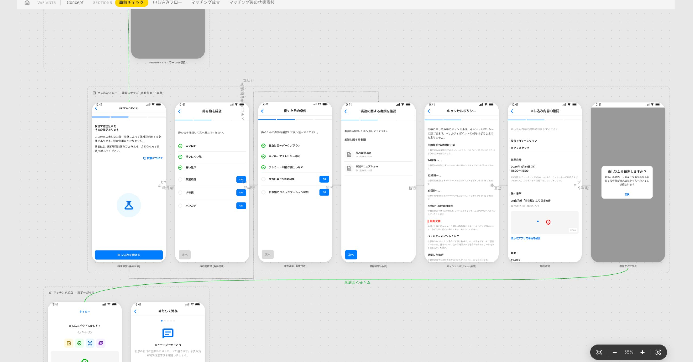

# [Timee AI Sprint Day 4] Cho phép AI tạo nguyên mẫu bằng hệ thống thiết kế nội bộ

**Tác giả:** Timee — Yokota, Product Designer  
**Ngày xuất bản:** 16/04/2026, 14:06 (JST)  
**Bài gốc tiếng Nhật:** [Timee Product PR](https://productpr.timee.co.jp/n/n037784ccd24f)  
**Bản auto-English dùng làm nguồn dịch:** [Timee Product PR — English](https://productpr.timee.co.jp/n/n037784ccd24f?hl=en)

> **Lưu ý về nguồn:** Đây là bản dịch tiếng Việt đầy đủ từ bản tiếng Anh được Timee tự động dịch bằng AI từ bài gốc tiếng Nhật. Chính trang nguồn cảnh báo rằng độ chính xác, sắc thái và ý đồ của tác giả có thể chưa được phản ánh hoàn toàn. Bản dịch này giữ nguyên nội dung, số liệu và cấu trúc lập luận của bản auto-English; các thuật ngữ chuyên môn quan trọng được trình bày theo dạng Việt–Anh.

*Hình bìa. Ảnh bìa gốc của bài viết. Nguồn: Timee.*

Bài viết này thuộc **Timee AI Sprint Day 4**.

> **Timee AI Sprint là gì?** Đây là một dự án chuyên sâu nhằm trả lời một lượt câu hỏi: “Timee sử dụng AI như thế nào?”. Chúng tôi sẽ công khai toàn bộ tri thức ứng dụng AI mà Timee đã tích lũy cho đến nay qua hai kênh: chuỗi “đăng bài liên tục” trong 7 ngày và các “sự kiện giờ ăn trưa” đi sâu vào chi tiết kỹ thuật của nội dung đó.

Xin chào, tôi là Yokota, một nhà thiết kế sản phẩm (Product Designer) tại Timee. Đây là ngày thứ tư của “Timee AI Sprint”, chuỗi bài về cách Timee ứng dụng AI được xuất bản liên tục trong 7 ngày.

Trong bài viết này, tôi sẽ giới thiệu một cơ chế cho phép AI lập trình các nguyên mẫu (prototype) dựa trên quy tắc thiết kế nội bộ. Chưa đầy hai tháng kể từ khi đưa vào sử dụng, hơn 300 nguyên mẫu đã được tạo ra, thay thế khoảng 300 giờ lao động thiết kế.

## Hiện trạng của việc tạo nguyên mẫu và AI

Dù đã xuất hiện nhiều công cụ có thể tạo giao diện người dùng (User Interface — **UI**) chỉ bằng chỉ dẫn văn bản, việc đưa chúng vào quy trình phát triển sản phẩm nội bộ lại khó một cách đáng ngạc nhiên. Các chi tiết như bối cảnh của công ty và tri thức về phần triển khai hiện có thường khác với thực tế, nên cần tốn công tối ưu để giảm nhiễu trong thảo luận.

Hẳn nhiều người đã gặp cảm giác vướng mắc tinh tế kiểu: “Tôi đã làm được điều mình muốn, nhưng nó vẫn hơi lệch…”.

Vì vậy, lần này chúng tôi quyết định tạo một cơ chế để AI lập trình nguyên mẫu dựa trên quy tắc thiết kế nội bộ.

## Chuyển đổi tài sản thiết kế để AI sử dụng

Tại Timee, chúng tôi quản lý hướng dẫn thiết kế, danh sách thành phần và cơ sở dữ liệu ngôn ngữ chung (ubiquitous language) trong Notion. Chúng tôi đã xây dựng một hệ thống tự động đồng bộ những nội dung này lên GitHub mỗi đêm.

Khi các AI agent như Cursor, Devin và Claude tham chiếu repository này, AI nhận prompt trong trạng thái luôn nạp sẵn các hướng dẫn mới nhất. Vì repository cũng được tham chiếu từ cả repository backend và frontend, bảng thuật ngữ cùng các tài nguyên khác cũng được dùng nhất quán trong quá trình phát triển thực tế.

Điều này không chỉ hữu ích cho rà soát mã nguồn (code review), mà còn giúp AI hiểu tri thức miền (domain knowledge) của công ty chúng tôi.

## Tạo môi trường làm nguyên mẫu

Tiếp theo là môi trường làm nguyên mẫu. Phiên bản đầu tiên được hoàn thành trong khoảng 4 giờ.

Tôi sẽ giải thích ngắn gọn cách tiếp cận. Chúng tôi tái hiện bằng HTML giao diện của màn hình quản trị web dành cho đơn vị vận hành kinh doanh và ứng dụng di động dành cho người lao động, rồi để AI lập trình. Thanh trạng thái, điều hướng, tab, menu bên và các phần khác được đưa vào template dưới dạng thành phần. Vì thông tin được trích từ phần triển khai thực tế, hình thức hiển thị rất gần với sản phẩm thật.

Cách dùng rất đơn giản: từ Claude Code hoặc Devin — một coding agent có thể khởi chạy từ Slack — chỉ cần đưa ra một chỉ dẫn một dòng như “Hãy tạo nguyên mẫu cho màn hình chi tiết công việc”. AI đọc hướng dẫn và ngôn ngữ chung, tạo một nguyên mẫu HTML tuân thủ quy tắc, rồi triển khai nó tới một URL chỉ có thể xem trong nội bộ.

Timee có ba hệ thống frontend — Swift, Kotlin và React — nên cách tái hiện chúng bằng HTML phù hợp để tạo một môi trường làm nguyên mẫu thống nhất. Nếu công ty của bạn tập trung vào dịch vụ web, tôi nghĩ bạn có thể thiết kế các quan hệ phụ thuộc trực tiếp hơn.

## Những loại sản phẩm nào được tạo ra?

Có một số loại nguyên mẫu được tạo. Hãy cùng xem sản phẩm thực tế. Dù trong bài chúng được chèn dưới dạng ảnh, đây là các nguyên mẫu có thể tương tác trong trình duyệt.

### Màn hình quản trị web

*Hình 1. Ví dụ nguyên mẫu tương tác của màn hình quản trị web. Nguồn ảnh gốc: Timee.*

*Hình 2. Một ví dụ khác về nguyên mẫu màn hình quản trị web. Nguồn ảnh gốc: Timee.*

### Ứng dụng di động

Đây là nguyên mẫu của ứng dụng dành cho người lao động. Vì sản phẩm thật là ứng dụng native, chúng tôi hiện thực hóa bằng cách triển khai lại UI dưới dạng **Web Components**.

*Hình 3. Nguyên mẫu ứng dụng di động với UI được triển khai lại bằng Web Components. Nguồn ảnh gốc: Timee.*

### Tạo slide

Trong cùng môi trường với nguyên mẫu, bạn cũng có thể tạo slide giải thích dự án. Chẳng hạn, toàn bộ quy trình lấy dữ liệu sử dụng từ BigQuery, tạo slide có biểu đồ về vấn đề và đặt nguyên mẫu bên cạnh có thể hoàn tất trong một môi trường duy nhất.

*Hình 4. Slide kết hợp dữ liệu, biểu đồ vấn đề và nguyên mẫu. Nguồn ảnh gốc: Timee.*

### Chế độ canvas

Đây là tính năng cho phép đặt nhiều màn hình trên một canvas vô hạn và nối chúng bằng mũi tên. Tương tự cách nhà thiết kế thường làm trong Figma, bạn có thể trực quan hóa toàn bộ luồng chuyển màn hình. Tôi làm tính năng này như một phần bổ sung, nhưng điểm nghẽn là nó tiêu thụ rất nhiều token, khiến việc đạt độ chính xác cao ngay lần đầu trở nên khó khăn.

*Hình 5. Chế độ canvas trực quan hóa toàn bộ luồng chuyển màn hình. Nguồn ảnh gốc: Timee.*

## Bên trong quá trình tạo sinh

Bản thân cấu trúc repository không quá phức tạp. Nó gồm:

- Các thành phần cho ứng dụng native và màn hình quản trị;
- Design token giống hệt môi trường production;
- Hướng dẫn thiết kế;
- Bộ sưu tập thực hành tốt nhất về thiết kế trải nghiệm người dùng (User Experience — **UX**);
- Ngôn ngữ chung (ubiquitous language);
- Template tái hiện đầy đủ các màn hình chính.

Sử dụng các tài liệu trên, AI agent tạo nguyên mẫu theo một quy trình đã định nghĩa:

1. **Xác định màn hình mục tiêu** — Phân biệt Web/Mobile và xác định trang trong mã nguồn.
2. **Nghiên cứu** — Trích xuất đặc tả thiết kế từ hướng dẫn và mã triển khai (15–30 tệp).
3. **Tái hiện màn hình hiện có** — Tái hiện chính xác trạng thái trước thay đổi để làm rõ các điểm khác biệt.
4. **Áp dụng thay đổi** — Thực hiện thay đổi mong muốn và tạo nhiều biến thể khi cần.
5. **Kiểm tra chất lượng** — Tự động kiểm tra tính nhất quán của thuật ngữ, định dạng và token.

Tôi sẽ trình bày chi tiết từng bước và demo tại sự kiện “radio giờ ăn trưa” vào tuần tới.

Sau khi quá trình tạo sinh hoàn tất và một Pull Request được tạo trên GitHub, tệp HTML sẽ được triển khai và thêm vào trang danh sách. Chỉ cần mở trong trình duyệt là có thể dùng; bạn có thể thử trực tiếp cảm giác khi thao tác các nút và tab. Nhờ AI tự động thực hiện nghiên cứu và kiểm tra chất lượng, việc tạo ra nguyên mẫu có xét đến bối cảnh và tính nhất quán trở nên dễ dàng hơn.

## Những thay đổi đã diễn ra

Kể từ khi triển khai cơ chế này, không chỉ nhà thiết kế mà cả PdM và kỹ sư cũng bắt đầu tự tạo nguyên mẫu.

Hơn 300 nguyên mẫu đã được tạo trong chưa đầy hai tháng. Nếu ước tính mỗi nguyên mẫu cần 60 phút từ nghiên cứu đến thiết kế, chúng tôi đã thay thế khoảng 300 giờ lao động thiết kế.

Hiện nay, việc một nguyên mẫu do ai đó tạo đã tồn tại sẵn trước khi cuộc họp định nghĩa yêu cầu hoặc refinement được lên lịch đang dần trở thành chuyện bình thường. Ngay từ đầu cuộc họp đã có một nguyên mẫu hoạt động được, cho phép chúng tôi vừa thao tác trên trình duyệt tại chỗ vừa đi thẳng vào chủ đề chính.

Dưới đây là một số trích đoạn nhận xét từ thành viên thuộc các chuyên môn khác.

> Việc tạo bản nháp thô trong quá trình tổng hợp yêu cầu thành tài liệu đã trở nên dễ dàng hơn hẳn và tôi thấy nó rất hữu ích. Trước đây có sự phiền toái khi phải chép lại bằng Miro và Mermaid, nhưng với timee-design, tôi có thể dễ dàng bắt đầu động não với AI bằng ngôn ngữ tự nhiên.
>
> Tôi đã có thể chuyển nguồn lực của mình sang việc khám phá giá trị khách hàng và công việc thiết kế. Trong đội, chúng tôi dùng timee-design để hiện thực hóa điều muốn truyền đạt, chẳng hạn tạo nguyên mẫu và tài liệu thuyết trình.
>
> Một cách dùng phổ biến của tôi là tạo sẵn nguyên mẫu, đưa nó vào thảo luận để so sánh, xem xét user story và nhiều ý tưởng theo các phương án khác nhau. Tôi cảm thấy cách này truyền tải thông tin nhanh hơn so với chỉ dùng văn bản. Tôi tin rằng trải nghiệm có thể tự mình thiết kế mọi thứ đã tăng cường tính linh hoạt của đội.
>
> — **Kỹ sư sản phẩm / kazzhira**

> Tốc độ ra quyết định đã tăng lên vì từ ngữ và hình thức của sản phẩm trở nên nhất quán!
>
> Điều đặc biệt hữu ích với tôi trong vai trò PdM là có thể nhận ngay nguyên mẫu chất lượng cao từ giai đoạn ý tưởng. Vì thiết kế được tạo ra với sự nắm bắt chắc chắn về “Tại sao” (Why), chúng tôi có thể thảo luận “vì sao thiết kế này được chọn” dựa trên bằng chứng. Sự va chạm giữa các ý kiến chủ quan đã giảm. Việc khả năng tái lập xuất hiện trong quá trình ra quyết định thiết kế đã giúp cải thiện năng suất của cả đội.
>
> — **PdM / Kazuki Igarashi**

## Công việc của nhà thiết kế đã thay đổi chưa?

Nhà thiết kế là nhóm sử dụng thường xuyên nhất. Dựa trên biên bản họp và bản ghi nhớ yêu cầu, họ có thể dùng cơ chế này để bỏ qua quá trình suy nghĩ kiểu “Nếu áp dụng ý tưởng này vào màn hình hiện có thì sao?” hoặc “Cần lưu ý kỹ thuật gì?”.

Vậy việc dân chủ hóa hoạt động làm nguyên mẫu có khiến công việc của nhà thiết kế thay đổi mạnh mẽ hay không?

Kết luận là tại Timee, quá trình này vẫn đang diễn ra từng bước. Vốn dĩ thời gian tạo UI trong Figma chỉ chiếm khoảng 20–30% tổng khối lượng công việc; phần còn lại dành cho khám phá vấn đề, nghiên cứu, tổ chức yêu cầu và giao tiếp với các chuyên môn khác. Nếu phải chỉ ra một thay đổi, tôi cho rằng việc tiếp cận trạng thái triển khai và dữ liệu định lượng đã trở nên liền mạch hơn với công việc thiết kế.

Điều đã thay đổi là vai trò “biến ý tưởng thành hình ảnh để khởi động thảo luận” không còn giới hạn ở nhà thiết kế. Trước đây, cần có một nhà thiết kế tham gia để chuyển yêu cầu thành màn hình trong Figma. Giờ đây, bất kỳ ai cũng có thể trực tiếp tạo một nguyên mẫu tuân thủ hướng dẫn của Timee. Không cần chờ lịch của nhà thiết kế. Tôi nghĩ điều này đã hạ thấp chi phí giao tiếp giữa các chuyên môn và giúp chúng tôi tiến tới các cuộc thảo luận cốt lõi nhanh hơn.

## Triển vọng tương lai

Dù muốn chuyển cơ chế này sang React hoặc cải thiện chất lượng, tôi hầu như không dành thời gian bảo trì kể từ khi phát hành. Lý do là tôi nhìn cơ chế làm nguyên mẫu theo ba giai đoạn — chưa phù hợp với bối cảnh công ty, phù hợp với bối cảnh công ty và sẵn sàng phát hành. Ngay cả khi được cải tiến, cơ chế hiện tại vẫn không vượt khỏi phạm vi “phù hợp với bối cảnh công ty”, nên giá trị của nó sẽ không thay đổi.

Trong lúc vòng đời phát triển do AI dẫn dắt (AI-Driven Development Lifecycle — **AI-DLC**) đang được thử nghiệm trên toàn bộ tổ chức sản phẩm/kỹ thuật và dần trở nên có hệ thống hơn, tôi đang nghĩ đến việc tạo một cơ chế trong đó nguyên mẫu được tạo như phần tổng hợp biên bản họp, đồng thời xuất ra prompt dùng cho triển khai thực tế.

Tại Timee, sản phẩm không bị phân mảnh theo dòng sản phẩm về mặt tổ chức, codebase hay thiết kế. Vì vậy, điều thú vị là ngay khi một thực hành AI tốt nhất xuất hiện, nó có thể lập tức được áp dụng cho toàn bộ hệ thống.

## Có thể áp dụng tại công ty khác không?

Tôi tin rằng có thể bắt đầu tương đối đơn giản nếu bạn có môi trường sử dụng được coding agent. Các yếu tố tối thiểu cần có gồm:

- **Mã hóa design token** — Quản lý màu sắc, typography và khoảng cách ở định dạng máy có thể đọc như JSON/CSS.
- **Thư viện thành phần (component library)** — Chuẩn bị các UI component nội bộ dưới dạng HTML hoặc theo đơn vị của framework.
- **Pipeline CI/CD** — Môi trường tự động triển khai sản phẩm được tạo và cho phép kiểm tra ngay qua URL.
- **Văn bản hóa hướng dẫn và bảng thuật ngữ** — Chuyển chúng sang định dạng như Markdown để AI có thể tham chiếu.

Tuần tới, chúng tôi sẽ tổ chức một sự kiện “radio giờ ăn trưa” để trình bày hậu trường và demo cơ chế này. Chúng tôi dự định nói về các nội dung thực tiễn hơn tại đó. Nếu còn đủ khả năng, có lẽ tôi cũng có thể phát hành các prompt.

Tôi sẽ rất vui nếu bạn nghe chương trình như nghe radio trong lúc ăn trưa.

Ngày mai là Day 5 của “AI Article Sprint”. Tôi sẽ mang đến một góc nhìn khác về cách Timee ứng dụng AI.

## Tuần tới, chúng tôi sẽ tổ chức sự kiện đi sâu hơn vào bài viết này!

[**Timee AI Sprint Day 3 — Cho phép AI làm prototyping bằng hệ thống thiết kế nội bộ (22/04/2026, 12:05–)**](https://timeedev.connpass.com/event/390342)  
Trang sự kiện giới thiệu các trường hợp ứng dụng AI của Timee và đào sâu nội dung kỹ thuật.

Nếu bạn đọc bài này và thấy thú vị, hãy tham gia cùng chúng tôi!!  
Sự kiện sẽ giới thiệu nội dung Day 3!

## Timee đang tìm kiếm đồng nghiệp

Timee đang tích cực tuyển dụng nhà thiết kế sản phẩm hơn bao giờ hết! Nếu bạn quan tâm, hãy trò chuyện cùng chúng tôi!  
[Trang tuyển dụng sản phẩm](https://product-recruit.timee.co.jp/)  
[Đăng ký một buổi phỏng vấn trao đổi thân mật](https://product-recruit.timee.co.jp/casual)

## Cập nhật ngày 22/04: Hỏi đáp tại sự kiện

Tôi sẽ trả lời trong bài viết này những câu hỏi chưa kịp giải đáp tại sự kiện!

> **Hỏi:** Cảm ơn bạn đã chia sẻ một nghiên cứu tình huống rất hữu ích! Tôi nghĩ AI có nhiều cách sử dụng như tạo nguyên mẫu và tạo slide. Bạn có thể cho biết trong thực tế cách nào được dùng nhiều nhất, và kiểu ứng dụng thiết kế nào được các phòng ban khác đánh giá cao không?

**Đáp:** Cơ chế này đang được dùng trong các dự án ở giai đoạn Phát triển kinh doanh (Business Development — **BizDev**), khi thành viên đội sản phẩm chưa tham gia. Tôi cảm nhận được tiềm năng giúp thiết kế trở nên dễ tiếp cận hơn!

> **Hỏi:** Tôi nghĩ mã nguồn production được cập nhật hằng ngày. Việc đồng bộ với TimeeDesign được xử lý như thế nào? Có cơ chế để luôn bám theo các cập nhật đó không, hay màn hình được tạo sau khi lấy mã production mới nhất?

**Đáp:** Các thành phần trong Timee Design được đồng bộ định kỳ với production bằng AI. Còn khi tạo màn hình, mỗi lần AI sẽ tham chiếu phần triển khai production khi cần.

> **Hỏi:** Khi triển khai sẵn các thành phần bằng HTML rồi gọi lại, chẳng phải khối lượng quản lý thành phần sẽ tăng lên giữa phía triển khai và phía nguyên mẫu (HTML) sao?

**Đáp:** Đúng vậy. Chúng tôi dùng một quy trình tương đối linh hoạt, trong đó AI kéo các bản cập nhật vào theo từng đợt. Ngoài ra, chúng tôi không chia sẻ trực tiếp thành phần giữa các nguyên mẫu; thay vào đó, mỗi nguyên mẫu tạo ra HTML có các thành phần được nhúng bên trong. Nhờ vậy, ngay cả khi một thành phần được cập nhật, các nguyên mẫu hiện có cũng không bị hỏng. Ngược lại, cách làm này còn cho phép chúng tôi đi trước một bước dù những đặc tả đã định nghĩa trong hệ thống thiết kế chưa được triển khai.

> **Hỏi:** Những sản phẩm này có hoàn toàn chỉ dùng làm nguyên mẫu cho mục đích công việc không?

**Đáp:** Đúng, chúng chỉ dành riêng cho mục đích làm nguyên mẫu! Tôi mong đến bước tiến hóa mà chúng ta có thể gửi Pull Request vào môi trường production khi hiệu năng mô hình được cải thiện!

> **Hỏi:** Các định nghĩa màu sắc được thiết lập thế nào, và bạn có thể cho biết có những ràng buộc nào đối với phạm vi của các định nghĩa đó không?

**Đáp:** Màu sắc được đồng bộ với Design Token của production, giống như trong hướng dẫn của chúng tôi. Nhờ tận dụng cơ chế này, chỉ các design token của production được sử dụng. Hãy xem bài viết sau để biết cơ chế nền tảng:

[**Phân phối design token từ Figma Variables tới ba nền tảng Swift, Kotlin và React!**](https://zenn.dev/yy/articles/5a708bc57f60fe)

## Thuật ngữ Việt–Anh

| Tiếng Việt | Thuật ngữ gốc |
|---|---|
| Nguyên mẫu / làm nguyên mẫu | Prototype / Prototyping |
| Hệ thống thiết kế | Design system |
| Nhà thiết kế sản phẩm | Product Designer |
| Giao diện người dùng | User Interface (UI) |
| Trải nghiệm người dùng | User Experience (UX) |
| Ngôn ngữ chung | Ubiquitous language |
| Tác tử AI | AI agent |
| Tri thức miền | Domain knowledge |
| Thành phần web | Web Components |
| Mã thiết kế | Design token |
| Vòng đời phát triển do AI dẫn dắt | AI-Driven Development Lifecycle (AI-DLC) |
| Phát triển kinh doanh | Business Development (BizDev) |
| Tích hợp liên tục / triển khai liên tục | Continuous Integration / Continuous Delivery (CI/CD) |
| Yêu cầu kéo mã | Pull Request |

## Nguồn

- Timee, bài gốc tiếng Nhật: <https://productpr.timee.co.jp/n/n037784ccd24f>
- Timee, bản auto-English dùng làm nguồn dịch: <https://productpr.timee.co.jp/n/n037784ccd24f?hl=en>
