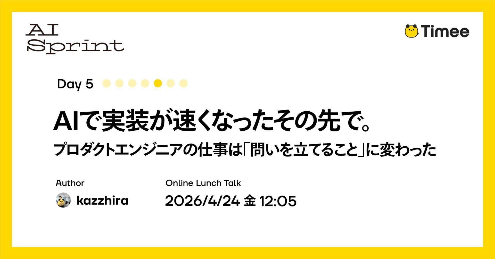
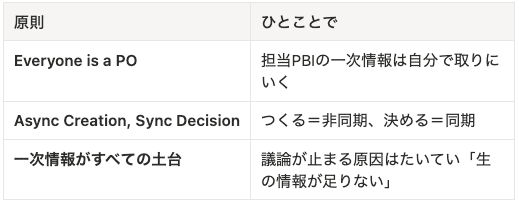
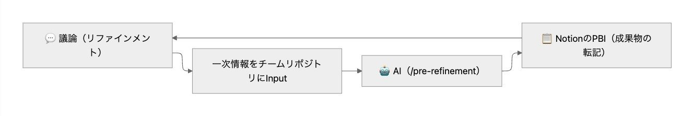
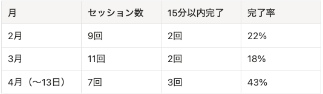
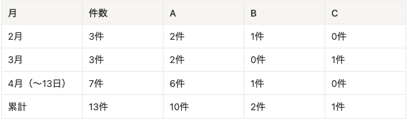

# Timee AI Sprint Day 5: Sau khi AI giúp triển khai nhanh hơn — công việc của kỹ sư sản phẩm chuyển sang “đặt đúng câu hỏi”

*Hình 1. Ảnh bìa gốc: “AIで実装が速くなったその先で。プロダクトエンジニアの仕事は「問いを立てること」に変わった” — “Sau khi AI giúp triển khai nhanh hơn: công việc của kỹ sư sản phẩm chuyển sang ‘đặt câu hỏi’”. Nguồn ảnh gốc: Timee.*

> **Lưu ý về nguồn dịch:** Bài gốc được viết bằng **tiếng Nhật** và đăng trên Timee ngày **17/04/2026 lúc 18:13 (giờ Nhật Bản)**. Bản tiếng Việt này được dịch đầy đủ từ chế độ **auto-English** do nền tảng Timee/note cung cấp. Chính nền tảng cảnh báo rằng bản dịch tự động có thể chưa phản ánh trọn vẹn độ chính xác, sắc thái và chủ ý của tác giả; vì vậy, bản tiếng Việt cũng cần được đọc với lưu ý đó.
>
> **Bài gốc tiếng Nhật:** [Timee AI Sprint Day 5 — AIで実装が速くなったその先で。プロダクトエンジニアの仕事は「問いを立てること」に変わった](https://productpr.timee.co.jp/n/nec21a7a98c6f)  
> **Bản auto-English dùng làm cơ sở dịch:** [English view](https://productpr.timee.co.jp/n/nec21a7a98c6f?hl=en)

Bài viết này thuộc chuỗi **Timee AI Sprint Day 5**.

> **Timee AI Sprint là gì?** Đây là một dự án chuyên sâu nhằm trả lời một lần cho trọn vẹn câu hỏi: “Timee sử dụng AI như thế nào?”. Timee chia sẻ toàn bộ tri thức đã tích lũy về việc ứng dụng AI thông qua chuỗi bài đăng liên tục trong 7 ngày trên note, cùng chuỗi sự kiện giờ trưa đi sâu vào các chi tiết kỹ thuật của nội dung đó.

Xin chào! Tôi là [kazzhira](https://x.com/kazuhira_0001), kỹ sư sản phẩm tại Timee.

Khoảng hai tháng trước, tôi đã viết một [bài blog](https://tech.timee.co.jp/entry/2026/02/19/190000) về việc đưa **phát triển dựa trên đặc tả (specification-driven development)** vào quy trình để nâng cao năng suất phát triển.

Ở cuối bài đó, tôi đã thẳng thắn viết rằng “tần suất triển khai chưa tăng mạnh”. Bài này là phần tiếp theo của câu chuyện ấy.

**Nhóm đã làm gì với những nút thắt nhìn thấy khi đó? Và điều gì đang bắt đầu thay đổi?**

Trong bài viết này, tôi sẽ chia sẻ nhật ký về những sáng kiến thử nghiệm trong một nhóm Scrum gồm ba lập trình viên.

## Refinement khó ở điểm nào?

Trong các buổi **làm rõ backlog (refinement)** của nhóm, những tình huống sau cứ lặp đi lặp lại:

- Các cuộc thảo luận có xu hướng chồng giả thuyết lên trên giả định.
  - Chuỗi trao đổi kiểu “Trong trường hợp này chẳng phải sẽ như thế sao?” và “Tôi nghĩ có lẽ là thế này” khiến thảo luận lan man mà không chốt được gì.
- Khó đưa ra giải thích chuyên môn trong một bối cảnh đồng bộ.
  - Đôi khi chúng tôi phải suy nghĩ ngay tại chỗ xem thay đổi có ảnh hưởng đến thiết kế hệ thống hiện hữu hay làm tổn hại trải nghiệm hiện tại hay không.

Vì sao điều này xảy ra? Trong buổi hồi tưởng của nhóm, hai yếu tố chính đã được nêu ra.

Thứ nhất, **quy trình rà soát các hạng mục Product Backlog (Product Backlog Item — PBI) chưa được cấu trúc hóa**. Việc thu thập thông tin và tạo PBI có xu hướng dồn về phía **Product Owner (PO)**, trong khi chưa có cơ chế để cả nhóm chủ động chuẩn bị.

Thứ hai, **thiếu thông tin sơ cấp (primary information)**. Có những lúc cuộc thảo luận diễn ra dựa trên phỏng đoán, vì khi bắt đầu refinement, nhóm chưa có kết quả phỏng vấn từ các **Customer Success Manager (CSM)** hoặc kết quả phân tích dữ liệu.

Một số thành viên có thể phân rã câu chuyện người dùng thành những hình dung cụ thể sau nhiều lần trao đổi trước với **Product Manager (PdM)**. Tuy nhiên, cách làm này không thể mở rộng khi việc chuẩn bị phụ thuộc vào năng lực cá nhân thay vì một cơ chế của nhóm. Tôi muốn biến năng lực ấy thành một cơ chế để lan tỏa ra toàn nhóm.

## Thách thức của nhóm

Nhóm của tôi muốn dùng AI để nhanh chóng chuyển giao giá trị cho khách hàng. Chúng tôi sử dụng **Four Keys** như một trong các thước đo định lượng, đồng thời tin rằng tăng tần suất triển khai sẽ giúp chuyển giao giá trị cho khách hàng.

Mặc dù việc triển khai đã nhanh hơn nhờ phát triển dựa trên đặc tả, chúng tôi nhận ra nguồn cung yêu cầu không theo kịp. Vì vậy, tần suất triển khai — một chỉ số trong Four Keys — không tăng.

Do đó, chúng tôi bắt đầu một sáng kiến nhằm tăng tốc độ cung cấp yêu cầu.

## Thay đổi cách tổ chức refinement

Trước đây, để làm cho refinement hiệu quả hơn, chúng tôi đặt **khung thời gian (timebox)** và thiết lập các quy tắc thảo luận. Tuy nhiên, nếu mọi người tập hợp lại khi chưa có đủ thông tin thì vấn đề cũ vẫn tái diễn.

Những thách thức được cả nhóm diễn đạt thành lời gồm:

- Việc tạo PBI và thu thập thông tin bị lệch về phía PO.
- Vì AI thiếu thông tin sơ cấp, thảo luận bị đình trệ nếu bước vào refinement mà chưa có đủ dữ liệu thô.
- Ngay cả khi đã thống nhất hướng đi, thảo luận vẫn tiếp tục vì logic của câu chuyện chưa đủ thuyết phục.

Sau nhiều vòng trao đổi, chúng tôi xác lập ba nguyên tắc.

*Hình 2. Ba nguyên tắc thay đổi refinement (nguyên bản tiếng Nhật). Nguồn ảnh gốc: Timee.*

| Nguyên tắc | Ý nghĩa cụ thể |
|---|---|
| **Everyone is a PO** — Mọi người đều là PO | Mỗi người tự đi lấy thông tin sơ cấp cho PBI mình phụ trách. |
| **Async Creation, Sync Decision** — Tạo bất đồng bộ, quyết định đồng bộ | “Tạo ra” theo cách bất đồng bộ; “ra quyết định” theo cách đồng bộ. |
| **Thông tin sơ cấp là nền móng của mọi thứ** | Nguyên nhân khiến thảo luận đình trệ hầu như luôn là “thiếu thông tin sống/thông tin trực tiếp”. |

Thông qua ba nguyên tắc này, chúng tôi kỳ vọng mỗi thành viên đều làm chủ công việc và tham gia vào quá trình cân nhắc, chuẩn bị PBI.

Xin nói thêm: **Everyone is a PO** không có nghĩa là làm mờ vai trò hay trách nhiệm giải trình của Product Owner. Quyền ra quyết định cuối cùng về thứ tự ưu tiên PBI vẫn thuộc về PO.

## Kỹ năng pre-refinement: dùng AI làm đối tác phản biện

Để hiện thực hóa ba nguyên tắc thay đổi cách tổ chức refinement, chúng tôi tạo ra **kỹ năng pre-refinement (pre-refinement skill)**. Đúng như tên gọi, kỹ năng này được chạy trước refinement để nhập và sắp xếp những thông tin cần thiết cho phiên refinement.

Pre-refinement được triển khai bằng cơ chế [Skills](https://platform.claude.com/docs/en/agents-and-tools/agent-skills/overview). Khi gọi **`/pre-refinement`**, quy trình sẽ tiến qua bốn giai đoạn dưới dạng đối thoại có cấu trúc:

1. **Xác định vấn đề (Issue Definition)** — đọc tài liệu liên quan và dùng AI như một **đối tác phản biện (sounding board)**, tức đối thoại để thử nảy ý tưởng và sắp xếp chúng, qua đó diễn đạt rõ vấn đề là gì.
2. **Câu chuyện người dùng (User Story)** — cấu trúc hóa ai đang gặp vấn đề gì và sẽ giải quyết bằng cách nào.
3. **Tiêu chí chấp nhận (Acceptance Criteria)** — định nghĩa “trạng thái nào được xem là đạt”.
4. **Xác minh (Verification)** — AI thực hiện kiểm tra song song về mức độ đầy đủ và tính nhất quán của toàn bộ sản phẩm đầu ra.

Điểm quan trọng là AI đóng vai trò đối tác phản biện, không phải người ra quyết định. Thiết kế quy trình không cho phép chuyển sang bước tiếp theo nếu con người chưa phê duyệt rõ ràng tại ranh giới mỗi giai đoạn. Nếu còn điểm chưa chắc chắn, AI sẽ nhắc chẳng hạn: “Bạn nên hỏi CSM về việc này” hoặc “Bạn cần xác nhận điều này bằng dữ liệu”.

Mọi phán đoán đều do con người thực hiện.

### Luồng vận hành

Trong Notion có một cơ sở dữ liệu dành cho pre-refinement. Một thành viên trong nhóm nhận phụ trách PBI mà mình muốn ưu tiên. Người phụ trách chạy `/pre-refinement`, rồi thông qua đối thoại với AI để đi hết quy trình từ xác định vấn đề đến tiêu chí chấp nhận. Các sản phẩm đầu ra được sao chép sang Notion để cả nhóm thảo luận.

*Hình 3. Luồng vận hành: thảo luận refinement → lấy thông tin sơ cấp trong kho của nhóm → AI (`/pre-refinement`) → chép sản phẩm đầu ra vào PBI trên Notion; kết quả có thể quay lại vòng thảo luận. Nguồn ảnh gốc: Timee.*

### Điều chúng tôi chủ động chấp nhận đánh đổi

Có một điểm chúng tôi cố ý thỏa hiệp: chưa chủ động tái sử dụng hoặc bảo trì các sản phẩm đầu ra của pre-refinement. Chúng vẫn được lưu trong Git repository, nhưng chúng tôi chưa xây dựng cơ chế tìm kiếm và tái sử dụng.

Chúng tôi xem tài liệu là phương tiện phục vụ thảo luận và ưu tiên đối thoại hơn việc để lại một bộ tài liệu toàn diện.

## Những thay đổi đã diễn ra

Sau khoảng ba tháng vận hành, điều tôi có thể nói chắc chắn là **refinement đang chuyển từ “nơi mang các giả định đến để thảo luận” thành “nơi ra quyết định dựa trên tài liệu đã chuẩn bị”**.

Tôi sẽ trình bày thay đổi này từ ba góc nhìn: **con số (bằng chứng khách quan) / trải nghiệm cá nhân (quan sát định tính của tôi) / thay đổi quan sát được trong nhóm (thay đổi hành vi của nhóm)**.

### Những thay đổi thể hiện qua con số

Các con số cho thấy hai tín hiệu: refinement đang trở nên nhẹ hơn và cách làm mới đang dần trở thành thói quen.

#### Tỷ lệ hoàn tất refinement trong timebox 15 phút

Chúng tôi vận hành refinement với timebox 15 phút. Lấy đây làm chỉ báo, tôi đã tổng hợp tỷ lệ các phiên hoàn tất trong vòng 15 phút từ biên bản của 27 phiên diễn ra từ tháng 2 đến tháng 4.

*Hình 4. Số phiên và tỷ lệ hoàn tất trong 15 phút theo tháng (nguyên bản tiếng Nhật). Nguồn ảnh gốc: Timee.*

| Tháng | Số phiên | Hoàn tất trong 15 phút | Tỷ lệ hoàn tất |
|---|---:|---:|---:|
| Tháng 2 | 9 | 2 | 22% |
| Tháng 3 | 11 | 2 | 18% |
| Tháng 4 (đến ngày 13) | 7 | 3 | 43% |

Trong tháng 4, số PBI cỡ nhỏ đến trung bình tăng lên, đồng thời số trường hợp hoàn tất trong 15 phút cũng tăng. Các phiên refinement đang nhẹ hơn, và chúng tôi đang tiến gần đến trạng thái có thể tập trung vào những điểm thật sự cần thảo luận.

#### Phân bố người thực hiện pre-refinement

Tôi tổng hợp ai là người tạo các sản phẩm đầu ra của pre-refinement — trong Git repository, chúng được gọi là *inception deliverables*. A là tác giả; B và C là hai kỹ sư còn lại.

*Hình 5. Phân bố số lần thực hiện pre-refinement theo thành viên và theo tháng (nguyên bản tiếng Nhật). Nguồn ảnh gốc: Timee.*

| Tháng | Tổng số | A | B | C |
|---|---:|---:|---:|---:|
| Tháng 2 | 3 | 2 | 1 | 0 |
| Tháng 3 | 3 | 2 | 0 | 1 |
| Tháng 4 (đến ngày 13) | 7 | 6 | 1 | 0 |
| **Lũy kế** | **13** | **10** | **2** | **1** |

Có thể đồng thời đọc ra hai điều từ bảng này:

- **Cả ba thành viên đều đã trở thành người thực hành trong tổng thời gian ba tháng** — đây không còn là hoạt động chỉ do một cá nhân cụ thể thúc đẩy.
- **Tần suất thực hiện vẫn lệch về phía tác giả** — cơ chế đã hình thành, nhưng việc thúc đẩy nó vẫn còn phụ thuộc vào cá nhân.

### Thay đổi trong trải nghiệm cá nhân

Từ đây trở đi là những trải nghiệm cá nhân của tôi.

Trong các phiên nhóm rà soát sản phẩm đầu ra của pre-refinement, những câu hỏi có chất lượng khác trước đã bắt đầu xuất hiện. Trước đây, nhiều câu hỏi chỉ mang tính xác nhận như “Đặc tả này có nghĩa là gì?”. Giờ đây, theo cảm nhận của tôi, chúng đã chuyển lên cấp độ “Định nghĩa vấn đề này có thật sự giải quyết vấn đề của người dùng không?”.

Ngoài ra, vì quá trình pre-refinement làm rõ “điều mình chưa biết”, các hành động chủ động đi tìm thông tin sơ cấp cũng bắt đầu nảy sinh một cách tự nhiên.

### Những thay đổi quan sát được trong nhóm

Dưới đây là những hiện tượng cụ thể đã quan sát được trong nhóm:

- **Khái niệm “pre-refinement” đã bén rễ trong nhóm.** Các thành viên bắt đầu tự tuyên bố “Tôi sẽ pre-refine việc này” rồi hành động.
- **Số trường hợp người phụ trách PBI thu thập thông tin trước khi tham gia refinement đã tăng.** Quá trình chuẩn bị vốn phụ thuộc vào năng lực của một vài thành viên đang chuyển thành một cấu trúc mà cả nhóm đều có thể tham gia.

### Tóm tắt thay đổi

Ở cả ba lớp quan sát, chúng tôi đều thấy tín hiệu cùng hướng: refinement đang chuyển từ “nơi thảo luận” thành “nơi ra quyết định”. Chỉ dựa trên một thước đo hoặc một trải nghiệm cá nhân thì chưa thể khẳng định chắc chắn; nhưng khi chồng nhiều góc nhìn lên nhau, ta có thể cảm nhận rõ rằng một điều gì đó đang bắt đầu diễn ra trong nhóm.

Dẫu vậy, đây mới chỉ là quan sát qua vài sprint; còn quá sớm để tuyên bố rằng cách làm đã thực sự bén rễ.

## Vẫn mới đi được nửa đường: những thách thức tiếp theo

Nói thẳng ra, vẫn có những điểm chưa vận hành tốt.

Dù pre-refinement đã giúp giảm thời gian thảo luận đối với PBI nhỏ, vẫn có những trường hợp refinement cho hạng mục cỡ **Epic** mất nhiều thời gian.

Vì vậy, theo đề xuất của PdM, chúng tôi đã chi tiết hóa thêm các quy tắc refinement:

1. Với thông tin hiện có, chúng ta có thể ra quyết định không?
2. Nếu chưa thể quyết định, những điểm nào cần được làm rõ?
3. Các điểm đó nên được xử lý đồng bộ hay bất đồng bộ?
4. **NA (Next Action — hành động tiếp theo)** là gì?

Điều chúng tôi hướng tới là trạng thái **chỉ thảo luận những gì cần phải thảo luận**. Kết thúc sớm rồi chuyển sang công việc thực tế mang lại nhiều giá trị hơn.

## Kết luận

Với tư cách kỹ sư sản phẩm, **cách tôi sử dụng thời gian** đã thay đổi. Tôi dành nhiều thời gian hơn để đối diện với những câu hỏi như “Vì sao chúng ta xây dựng thứ này?” và “Chúng ta có thật sự nên xây dựng nó không?”, thay vì “Xây dựng nó như thế nào?”.

Khi AI đảm nhiệm phần triển khai, công việc của chúng tôi chuyển dần sang “đặt đúng câu hỏi”. Đây là sự chuyển dịch từ **How sang Why**; có thể nói rằng với tư cách kỹ sư sản phẩm, chúng tôi đang thực sự tiến gần hơn đến công việc lẽ ra mình cần làm ngay từ đầu.

Chúng tôi vẫn đang ở giữa quá trình thử và sai. Tôi hy vọng lần tới khi nói về chủ đề này, mình sẽ có một báo cáo tốt hơn để chia sẻ.

## Sự kiện đào sâu nội dung bài viết

Timee tổ chức sự kiện **Timee AI Sprint Day 5「リファインメントをAIで最適化した後の世界」** — “Thế giới sau khi tối ưu refinement bằng AI” — vào **12:05 ngày 24/04/2026**.

[Xem thông tin sự kiện trên connpass](https://timeedev.connpass.com/event/390378/)

Nếu bạn thấy bài viết này thú vị, hãy tham gia cùng chúng tôi!

## Timee đang tìm kiếm đồng đội mới

Timee đang tích cực tuyển kỹ sư sản phẩm. Nếu bạn quan tâm, hãy cùng trò chuyện!

- [Trang tuyển dụng sản phẩm](https://product-recruit.timee.co.jp/)
- [Đăng ký trò chuyện không chính thức (casual interview)](https://product-recruit.timee.co.jp/casual)

## Thuật ngữ Việt–Anh

| Thuật ngữ tiếng Việt | Thuật ngữ tiếng Anh | Nghĩa trong bài |
|---|---|---|
| Phát triển dựa trên đặc tả | Specification-driven development | Tổ chức phát triển quanh các đặc tả rõ ràng trước khi triển khai. |
| Làm rõ backlog | Refinement | Hoạt động làm rõ, chia nhỏ và chuẩn bị PBI để nhóm có thể quyết định/thực hiện. |
| Hạng mục Product Backlog | Product Backlog Item (PBI) | Một hạng mục công việc trong backlog sản phẩm. |
| Chủ sở hữu sản phẩm | Product Owner (PO) | Vai trò chịu trách nhiệm cuối cùng về ưu tiên PBI. |
| Quản lý sản phẩm | Product Manager (PdM) | Vai trò định hướng sản phẩm và phối hợp bối cảnh kinh doanh/người dùng. |
| Quản lý thành công khách hàng | Customer Success Manager (CSM) | Nguồn hiểu biết trực tiếp về khách hàng và nhu cầu thực tế. |
| Thông tin sơ cấp | Primary information | Dữ liệu trực tiếp như kết quả phỏng vấn CSM hoặc phân tích dữ liệu, thay vì giả định. |
| Đối tác phản biện | Sounding board | AI dùng để trao đổi, thử ý và cấu trúc suy nghĩ; không thay con người quyết định. |
| Tiêu chí chấp nhận | Acceptance Criteria | Điều kiện xác định khi nào một hạng mục được xem là đạt. |
| Khung thời gian | Timebox | Khoảng thời gian cố định dành cho một hoạt động. |
| Bất đồng bộ / đồng bộ | Asynchronous / synchronous | Chuẩn bị độc lập theo thời gian riêng / thảo luận trực tiếp cùng lúc. |
| Hành động tiếp theo | Next Action (NA) | Bước cụ thể cần thực hiện sau khi làm rõ điểm vướng. |

---

*Bản dịch tiếng Việt: dịch đầy đủ từ bản auto-English của Timee/note; các bảng tiếng Việt dưới hình được dựng lại từ nội dung trong ảnh gốc tiếng Nhật để tăng khả năng đọc và tra cứu.*
