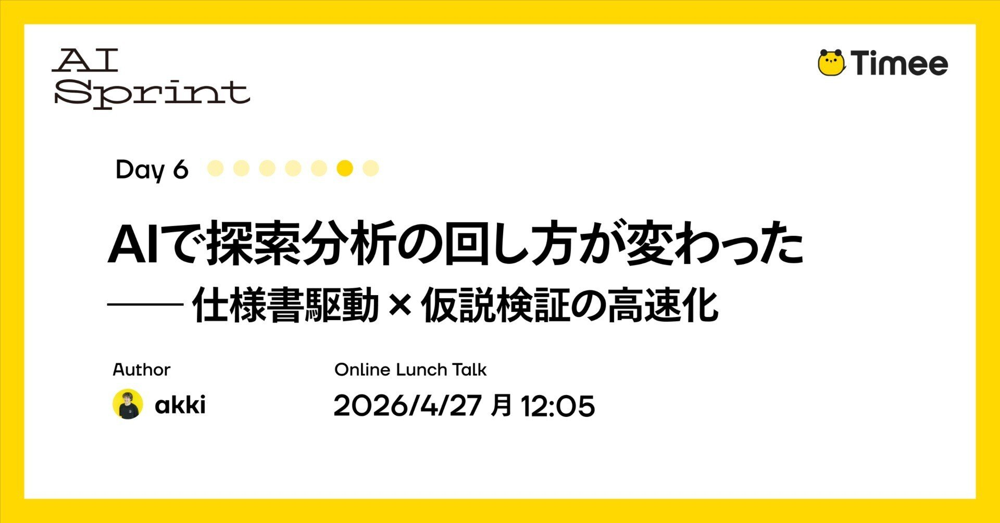
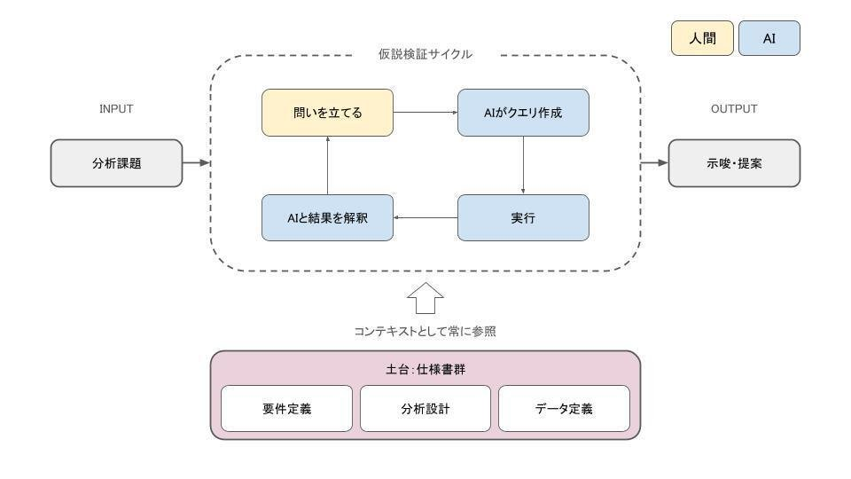
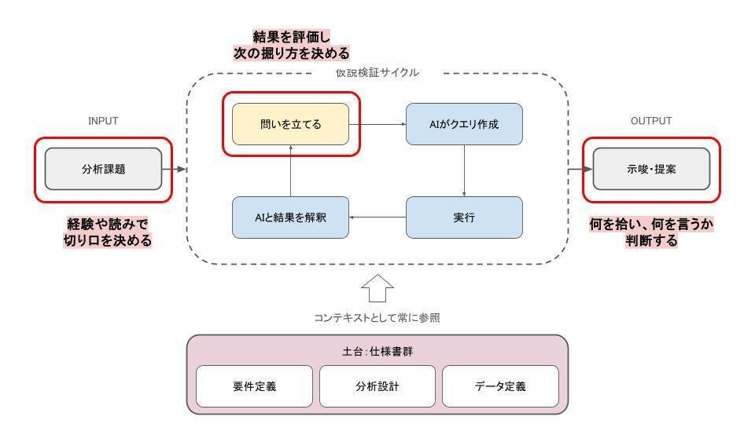

# Timee AI Sprint Day 6: AI đã thay đổi cách tôi thực hiện phân tích khám phá — phát triển dựa trên đặc tả × tăng tốc kiểm chứng giả thuyết

*Hình 1. Ảnh bìa gốc: “AIで探索分析の回し方が変わった — 仕様書駆動 × 仮説検証の高速化” — “AI đã thay đổi cách vận hành phân tích khám phá — dựa trên đặc tả × tăng tốc kiểm chứng giả thuyết”. Nguồn ảnh gốc: Timee.*

> **Lưu ý về nguồn dịch:** Bài gốc được viết bằng **tiếng Nhật** và đăng trên Timee ngày **20/04/2026 lúc 16:51 (giờ Nhật Bản)**. Bản tiếng Việt này được dịch đầy đủ từ chế độ **auto-English** do nền tảng Timee/note cung cấp. Chính nền tảng cảnh báo rằng bản dịch tự động có thể chưa phản ánh trọn vẹn độ chính xác, sắc thái và chủ ý của tác giả; vì vậy, bản tiếng Việt cũng cần được đọc với lưu ý đó.
>
> **Bài gốc tiếng Nhật:** [Timee AI Sprint Day 6 — AIで探索分析の回し方が変わった — 仕様書駆動 × 仮説検証の高速化](https://productpr.timee.co.jp/n/n564bab398cb5)  
> **Bản auto-English dùng làm cơ sở dịch:** [English view](https://productpr.timee.co.jp/n/n564bab398cb5?hl=en)

Bài viết này thuộc chuỗi **Timee AI Sprint Day 6**.

> **Timee AI Sprint là gì?** Đây là một dự án chuyên sâu nhằm trả lời một lần cho trọn vẹn câu hỏi: “Timee sử dụng AI như thế nào?”. Timee chia sẻ tri thức đã tích lũy về ứng dụng AI thông qua bảy ngày đăng bài liên tục trên note, cùng các sự kiện giờ trưa đi sâu vào chi tiết kỹ thuật của những nội dung đó.

Xin chào, tôi là **@akki**.

Tôi bắt đầu làm nhà phân tích dữ liệu tại Timee cách đây khoảng hai năm rưỡi. Trong sáu tháng gần đây, cách tiếp cận phân tích của tôi đã thay đổi đáng kể. Bằng việc tích hợp đầy đủ các **AI agent** — chủ yếu là Cursor và Claude Code — vào quy trình phân tích, tôi cảm thấy tốc độ kiểm chứng giả thuyết, đặc biệt trong **phân tích khám phá (exploratory analysis)**, đã tăng lên rõ rệt.

Trong bài viết này, tôi sẽ trình bày cách mình đưa AI vào quy trình phân tích và điều đó đã thay đổi năng suất phân tích cá nhân như thế nào.

## Phân tích dựa trên đặc tả làm nền tảng

Cách tôi tiếp cận phân tích có thể gọi là **dựa trên đặc tả (specification-driven)**. Ở từng giai đoạn của quy trình phân tích, tôi tạo các tài liệu như định nghĩa yêu cầu, thiết kế phân tích và định nghĩa dữ liệu dưới dạng tệp Markdown (`.md`), rồi tiến hành từng bước.

Một ví dụ tiêu biểu là phương pháp được Mercari hệ thống hóa dưới tên **Analytics Design Docs**. Cũng đã có một số nghiên cứu tình huống về chính phương pháp phát triển dựa trên đặc tả; bạn có thể tham khảo chúng 🙆

- [Analytics Design Docs của Mercari](https://note.com/mercari_data/n/n2828a0098baf)

Trong khi xây dựng môi trường cho phép phân tích dữ liệu theo cách dựa trên đặc tả, tôi nghĩ rằng nếu đã có nền móng này thì mình có thể vận hành kiểm chứng giả thuyết nhanh hơn. Vì vậy, tôi thử chạy kiểm chứng giả thuyết ở tốc độ cao ngay trong phân tích khám phá.

## Kiểm chứng giả thuyết trong phân tích khám phá đã nhanh hơn

Điểm mà tôi cảm thấy năng suất cá nhân thay đổi nhiều nhất là: nhờ phát triển dựa trên đặc tả, tôi có thể tăng số vòng lặp kiểm chứng giả thuyết trong phân tích khám phá.

### Cẩn trọng ở đầu vào, nhanh ở các vòng lặp

*Hình 2. Chu trình kiểm chứng giả thuyết: từ bài toán phân tích, con người đặt câu hỏi; AI viết truy vấn; hệ thống thực thi; AI diễn giải kết quả; đầu ra là insight/đề xuất. Toàn chu trình luôn tham chiếu định nghĩa yêu cầu, thiết kế phân tích và định nghĩa dữ liệu. Nguồn ảnh gốc: Timee.*

**Diễn giải các nhãn trong hình:**

- **Đầu vào:** bài toán phân tích.
- **Chu trình kiểm chứng giả thuyết:** đặt câu hỏi → AI tạo truy vấn → thực thi → AI diễn giải kết quả → quay lại đặt câu hỏi tiếp theo.
- **Đầu ra:** insight và đề xuất.
- **Nền tảng — bộ tài liệu đặc tả:** định nghĩa yêu cầu, thiết kế phân tích, định nghĩa dữ liệu; được tham chiếu liên tục như ngữ cảnh.
- Màu vàng biểu thị phần việc của **con người**; màu xanh biểu thị phần việc của **AI**.

Xuyên suốt toàn bộ quy trình phân tích, tôi chủ động **thay đổi mức độ nghiêm ngặt của việc rà soát giữa nửa đầu và nửa sau**.

Ở nửa đầu — tức các phần chốt định nghĩa yêu cầu, thiết kế phân tích, định nghĩa dữ liệu nền và tạo truy vấn đầu tiên — tôi tiến hành thận trọng. Tôi rà soát thiết kế do AI đưa ra và tương tác để hiệu chỉnh. Nếu thiết kế ban đầu lệch hướng thì toàn bộ các truy vấn phía sau cũng sẽ lệch, nên đây là phần không thể làm qua loa.

Ngược lại, trong giai đoạn kiểm chứng giả thuyết sau khi các định nghĩa đã được chốt, tôi tập trung tăng số vòng lặp. Vì các tài liệu nền đã nằm trong ngữ cảnh của AI, phần chỉ dẫn bổ sung được giữ ở mức tối thiểu, nhờ đó tôi có thể duy trì nhịp lặp tốt.

### Cách vận hành cụ thể chu trình kiểm chứng giả thuyết

Giả sử có một nhiệm vụ phân tích như: **“Phân khúc nào đang có chỉ số này xấu đi?”**. Thay vì bắt tay viết truy vấn ngay, trước hết tôi xây nền móng. Tôi sắp xếp định nghĩa yêu cầu cho nhiệm vụ, viết thiết kế phân tích và đưa định nghĩa dữ liệu của các bảng cần dùng vào tài liệu. Ở giai đoạn này, tôi cẩn thận rà soát đầu ra của AI để kiểm tra xem thiết kế có điểm nào không nhất quán hay không. Đây chính là phần “cẩn trọng ở đầu vào”.

Khi nền móng đã hoàn tất, tôi bước vào chu trình kiểm chứng giả thuyết. Khi tôi hỏi AI, chẳng hạn “Phân khúc nào đang có chỉ số này xấu đi?”, AI sẽ viết truy vấn dựa trên các định nghĩa dữ liệu vừa được tạo. Tôi chạy nguyên truy vấn đó, rồi cho AI đọc và diễn giải kết quả.

**Tiếp theo, tôi đọc phần diễn giải của AI, hình thành câu hỏi kế tiếp, rồi lại yêu cầu nó viết và chạy một truy vấn khác.** Tôi tiếp tục chu trình theo cách đó.

> “Hành vi của phân khúc này có đặc điểm gì?” → Truy vấn → Thực thi → Diễn giải → “Vậy nhìn theo chuỗi thời gian thì sao?” → Truy vấn → Thực thi → Diễn giải → “So với các phân khúc khác thì thế nào?” → …

Tôi lặp lại tương tác này nhiều lần trong cùng một phiên phân tích. Vì các định nghĩa đã được chốt, mỗi khi thay đổi tôi không cần viết lại truy vấn từ đầu. Do đó, việc rà soát cũng có thể tương đối nhẹ. Ngay cả với các phân tích kiểu “chỉ kiểm tra nhanh” — như histogram để xác nhận phân phối hoặc những phép tổng hợp cơ bản — tôi cũng có thể nhanh chóng lặp qua bằng cách để AI tạo báo cáo.

### Trước và sau

Trước khi đưa AI vào, một vòng **“hình thành giả thuyết → tự viết truy vấn → thực thi → tự diễn giải kết quả → nghĩ ra giả thuyết tiếp theo”** tốn khá nhiều thời gian. Số góc nhìn có thể kiểm tra trong quỹ thời gian đó bị giới hạn; tôi thường nghĩ: “Thật ra mình cũng muốn xem góc này, nhưng thời gian quá gấp nên tạm bỏ qua”.

Giờ đây, số vòng tôi có thể chạy trong cùng một khoảng thời gian đã tăng đáng kể. Nhờ tiếp cận được cả những góc nhìn mà trước đây tôi sẽ từ bỏ, câu chuyện phân tích có thêm chiều sâu.

Trong một dự án, tôi có thể đào sâu đặc điểm hành vi của một phân khúc cụ thể từ nhiều góc độ; dựa trên các kết quả đó, tôi còn đưa ra được đề xuất đi sâu tới các giả thuyết giải pháp. Tôi không nghĩ phiên bản trước đây của mình có thể hoàn thành một phân tích sâu đến vậy trong khung thời gian này.

## Vai trò của con người trong quy trình

*Hình 3. Các điểm con người tạo ra giá trị: dùng kinh nghiệm và thế mạnh để chọn góc tiếp cận bài toán đầu vào; đánh giá kết quả để quyết định hướng đào sâu tiếp theo; và phán đoán nên chọn kết quả nào, truyền đạt điều gì ở đầu ra. Nguồn ảnh gốc: Timee.*

**Diễn giải các phần được nhấn mạnh trong hình:**

1. **Ở đầu vào:** quyết định góc tiếp cận bằng kinh nghiệm và trực giác.
2. **Trong chu trình:** đánh giá kết quả rồi quyết định sẽ đào sâu theo hướng nào tiếp theo.
3. **Ở đầu ra:** phán đoán nên chọn phát hiện nào và nên nói điều gì.

Tôi cho rằng về mặt kỹ thuật, có thể giao mọi thứ cho AI. Tuy nhiên, trong quy trình này có những điểm con người tạo ra giá trị, nên tôi thiết kế để con người can thiệp tại các nút quan trọng.

Điểm thứ nhất là **thiết lập câu hỏi ban đầu**. Việc quyết định “chính xác thì cần làm rõ điều gì” đòi hỏi tri thức miền và hiểu biết về bối cảnh kinh doanh. Ví dụ, khi một chỉ số nào đó xấu đi, hướng phân tích sẽ hoàn toàn khác tùy việc ta đào sâu câu hỏi “Điều này đang xảy ra ở phân khúc nào?” hay “Nhìn theo chuỗi thời gian, nó bắt đầu xảy ra từ khi nào?”. Chọn góc nhìn ban đầu dựa trên tình hình kinh doanh và điều các bên liên quan đang cố gắng quyết định chính là nơi kinh nghiệm và trực giác của nhà phân tích phát huy tác dụng.

Điểm thứ hai là **đánh giá đầu ra của AI trong mỗi vòng lặp**. Nhìn vào diễn giải do AI cung cấp rồi phán đoán “Kết quả này thật sự có thể được hiểu như vậy không?” hoặc “Đằng sau những con số này còn ẩn yếu tố nào khác không?” là việc chỉ con người am hiểu bối cảnh kinh doanh và dữ liệu mới có thể làm. Từ đánh giá đó, bạn quyết định “tiếp theo sẽ đào sâu ở đâu”. Việc điều hướng trong vòng lặp này quyết định độ sâu của phân tích.

Cuối cùng là **phán đoán đầu ra cuối cùng**. Thay vì dùng nguyên các con số do AI tạo ra, tôi luôn tự mình kiểm tra rồi tổng hợp lại. Quyết định sẽ chọn điều gì và nói điều gì từ rất nhiều kết quả thu được qua phân tích là công việc của con người; tôi tin rằng đây là phần mà nhà phân tích phải chịu trách nhiệm.

Vì AI mang lại tốc độ, con người có thể tập trung vào các phán đoán như vậy. Khi sự phân vai này vận hành tốt, tôi cảm thấy năng suất đang tăng lên.

## Hướng tới tương lai

Phương pháp này đặc biệt hiệu quả đối với **“phân tích khám phá do một người thực hiện”**. Với trường hợp chia sẻ công việc phân tích trong nhóm hoặc cần kiểm chứng hiệu quả một cách nghiêm ngặt, có lẽ sẽ cần cách tiếp cận khác. Tôi vẫn đang khám phá những lĩnh vực đó; nhưng ít nhất trong phân tích khám phá, tôi cảm nhận được giá trị từ việc tăng số vòng kiểm chứng giả thuyết. Tôi sẽ tiếp tục vừa thử, vừa thất bại, vừa lần tìm cách làm tốt hơn!

Nhân tiện, bài viết này cũng được viết theo một tư duy tương tự, với sự phân vai giữa con người và AI.

## Sự kiện đào sâu nội dung bài viết

Timee tổ chức sự kiện **Timee AI Sprint Day 6「AIで探索分析の回し方が変わった」** — “AI đã thay đổi cách vận hành phân tích khám phá” — vào **12:05 ngày 27/04/2026**.

[Xem thông tin sự kiện trên connpass](https://timeedev.connpass.com/event/390381/)

Nếu bạn thấy bài viết này thú vị, hãy tham gia cùng chúng tôi!

## Timee đang tìm kiếm đồng đội

Nếu bạn muốn đóng góp cho hoạt động kinh doanh bằng cách tận dụng dữ liệu và AI, hãy xem trang tuyển dụng của Timee 👀

- [Vị trí dữ liệu — Thông tin tuyển dụng Timee](https://product-recruit.timee.co.jp/data)

## Thuật ngữ Việt–Anh

| Thuật ngữ tiếng Việt | Thuật ngữ tiếng Anh | Nghĩa trong bài |
|---|---|---|
| Phân tích khám phá | Exploratory analysis | Quá trình thăm dò dữ liệu qua nhiều góc nhìn để hình thành, kiểm tra và tinh chỉnh giả thuyết. |
| Phân tích/phát triển dựa trên đặc tả | Specification-driven analysis/development | Tạo và duy trì các tài liệu định nghĩa trước, rồi dùng chúng làm nền tảng và ngữ cảnh cho quá trình thực thi. |
| Tài liệu thiết kế phân tích | Analytics Design Docs | Cách hệ thống hóa yêu cầu, thiết kế phân tích và định nghĩa dữ liệu trong tài liệu. |
| AI agent | AI agent | Công cụ AI có thể tiếp nhận ngữ cảnh, lập/thi hành chuỗi tác vụ và hỗ trợ quy trình phân tích. |
| Kiểm chứng giả thuyết | Hypothesis testing | Chu trình đặt câu hỏi, truy vấn dữ liệu, diễn giải kết quả và hình thành câu hỏi tiếp theo. |
| Định nghĩa yêu cầu | Requirement definition | Xác định bài toán cần giải, mục tiêu và điều cần làm rõ. |
| Thiết kế phân tích | Analysis design | Xác định cách tiếp cận, chỉ số, phép so sánh và trình tự phân tích. |
| Định nghĩa dữ liệu | Data definition | Mô tả bảng, trường dữ liệu, ý nghĩa và cách dùng trong phân tích. |
| Truy vấn | Query | Câu lệnh lấy hoặc biến đổi dữ liệu, thường là SQL trong bối cảnh phân tích dữ liệu. |
| Chuỗi thời gian | Time series | Dữ liệu hoặc góc nhìn phân tích theo trình tự thời gian. |
| Phân khúc | Segment | Một nhóm đối tượng/dữ liệu có đặc điểm chung dùng để so sánh và đào sâu. |
| Tri thức miền | Domain knowledge | Hiểu biết chuyên sâu về nghiệp vụ, sản phẩm và bối cảnh của dữ liệu. |
| Bên liên quan | Stakeholder | Người hoặc nhóm sử dụng kết quả phân tích để ra quyết định. |
| Insight | Insight | Phát hiện có ý nghĩa rút ra từ dữ liệu, hữu ích cho việc ra quyết định. |

---

*Bản dịch tiếng Việt: dịch đầy đủ từ bản auto-English của Timee/note; phần diễn giải tiếng Việt dưới các hình được bổ sung bằng cách đọc trực tiếp nhãn trong ảnh gốc tiếng Nhật để giúp người đọc tra cứu nội dung.*
