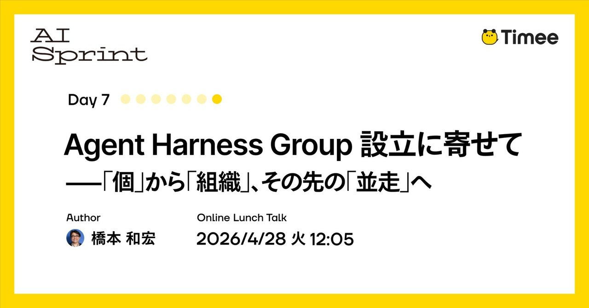
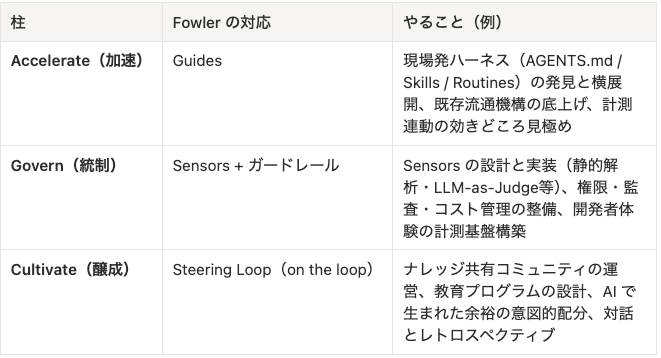

# [Timee AI Sprint — Ngày 7] Thành lập Agent Harness Group: Từ “cá nhân” tới “tổ chức”, rồi tiến tới “đồng hành”



> **Bản dịch tiếng Việt từ:** [On the Establishment of the Agent Harness Group: From the “Individual” to the “Organization,” and Beyond to “Running Alongside”](https://productpr.timee.co.jp/n/n99011b2a6947?hl=en), Timee, đăng ngày 21/04/2026.  
> **Tác giả:** Kazuhiro Hashimoto (橋本 和宏, [@kaz-under-the-bridge](https://github.com/kaz-under-the-bridge)).  
> **Lưu ý về nguồn:** Bài gốc được viết bằng tiếng Nhật. Trang Timee cung cấp bản dịch tiếng Anh tự động và cảnh báo rằng độ chính xác, sắc thái cùng ý định của tác giả có thể chưa được phản ánh đầy đủ. Bản tiếng Việt này được dịch từ phiên bản tiếng Anh đó, đồng thời đối chiếu nội dung tiếng Nhật trong các hình gốc.  
> Các thuật ngữ quan trọng được giữ theo dạng **Việt–Anh** để thuận tiện tra cứu.

Bài viết này thuộc chuỗi **Timee AI Sprint — Ngày 7**.

> **Timee AI Sprint là gì?** Đây là một dự án chuyên sâu nhằm trả lời trọn vẹn câu hỏi: “Timee sử dụng AI như thế nào?”. Timee chia sẻ kiến thức tích lũy về ứng dụng AI thông qua chuỗi đăng bài liên tục trong bảy ngày và chuỗi sự kiện trực tuyến vào giờ trưa để đi sâu vào các chi tiết kỹ thuật.

Tôi là Hashimoto, phụ trách thúc đẩy ứng dụng AI trong tổ chức sản phẩm của Timee.

Ngày 01/05/2026, **Agent Harness Group — AHG** sẽ được thành lập trong tổ chức kỹ thuật của Timee. Đây là một đơn vị mới với sứ mệnh xây dựng workflow AI xoay quanh **tác tử lập trình (Coding Agent)** và thúc đẩy chúng vận hành tự chủ một cách an toàn. Tôi sẽ đảm nhiệm vai trò GM của nhóm.

---

## Tiếp nối bài trước: Vượt ra ngoài một phong trào cấp tổ chức

Trong [bài viết trước](https://tech.timee.co.jp/entry/2026/03/06/141357), tôi đã mô tả những thay đổi trong tổ chức kỹ thuật Timee sau chương trình **AI-DLC Unicorn Gym — UG**, một chương trình chuyên sâu về phát triển dựa trên AI được tổ chức cùng AWS vào tháng 1.

Chỉ trong một tháng:

- Số người sử dụng Claude Code tăng **1,4 lần**.
- Số repository có Skills tăng **11 lần**.
- Việc sử dụng công cụ AI mở rộng sang cả các vai trò ngoài kỹ thuật.
- Tổ chức chuyển từ **“mỗi cá nhân ứng dụng AI”** sang **“thực hành AI-DLC ở cấp tổ chức”**.

Sáng kiến cá nhân được đưa vào cơ chế của nhóm, rồi các cơ chế đó lan sang những nhóm khác. Thành thật mà nói, được quan sát chuỗi phản ứng vốn không dễ xảy ra này hình thành chỉ trong vài tuần là điều vượt xa tưởng tượng của tôi.

Tuy nhiên, sau vài tháng theo sát xu hướng đó, **những thách thức của giai đoạn tiếp theo** dần lộ rõ. Tốc độ của từng cá nhân không tự động biến thành tốc độ của cả tổ chức. Trong một số tình huống, các nút thắt mới thậm chí còn xuất hiện ở những nơi khác trong hệ thống.

Bài viết này trình bày các vấn đề Timee bắt đầu quan sát được, cách chúng tôi dự định ứng phó và những gì tổ chức mới mang tên AHG sẽ thực hiện.

---

## Ba thách thức xuất hiện ở giai đoạn tiếp theo

### Thách thức 1: “Cá nhân làm nhanh hơn, nhưng tổ chức có thực sự nhanh hơn không?”

Trong nhiều tình huống, AI giúp từng cá nhân lập trình nhanh hơn. Số lượng pull request và commit trong nhóm tăng lên không còn là điều hiếm gặp.

Nhưng điều đó có thực sự khiến sản phẩm được phát hành nhanh hơn không? Giá trị chuyển đến người dùng có tăng lên không?

Nếu quan sát kỹ tại hiện trường, câu trả lời thường là: **“Không nhiều như kỳ vọng.”**

Đây là hiện tượng được quan sát trên toàn ngành, được gọi là **nghịch lý năng suất AI (AI Productivity Paradox)**.

Có nhiều nguyên nhân, nhưng dễ hiểu nhất là **sự dịch chuyển nút thắt (bottleneck shifting)**. Khi lập trình trở nên nhanh hơn, công việc tích tụ ở các công đoạn phía sau:

- Review.
- Kiểm thử.
- Phê duyệt.
- Triển khai.

Một kết luận kinh điển của **Lý thuyết các ràng buộc (Theory of Constraints — TOC)** là:

> Một hệ thống chỉ có thể vận hành nhanh bằng quy trình chậm nhất của nó.

Nếu chỉ tăng tốc khâu coding, tổ chức có thể bị mắc kẹt ở review và không đạt mức cải thiện tốc độ như kỳ vọng.

Tại Timee, khi Coding Agent ngày càng được dùng rộng rãi, các vấn đề chung của ngành không còn là câu chuyện của người khác. Tôi xem đây là tín hiệu cho thấy chúng tôi cần thiết kế bước đi tiếp theo.

### Thách thức 2: “Chúng ta có đang tạo ra thứ thực sự hoạt động với tốc độ tương ứng không?”

Một thách thức khác cũng bắt đầu phát huy tác động.

Mã do AI tạo phải được xử lý dựa trên giả định rằng **nó có thể chứa lỗi**. Không thể tin cậy mã đó theo cùng cách với mã do con người viết, bởi còn nhiều câu hỏi:

- Có vấn đề bảo mật hay không?
- AI có hiểu sai logic nghiệp vụ hay không?
- Kiểm thử đã đầy đủ chưa?
- Thay đổi có đúng với ý định của yêu cầu không?

Theo [nghiên cứu của CodeRabbit](https://www.coderabbit.ai/blog/state-of-ai-vs-human-code-generation-report), **mã do AI tạo chứa số vấn đề nhiều gấp 1,7 lần mã do con người viết; riêng lỗ hổng liên quan tới XSS cao hơn 2,74 lần**.

Một đoạn mã có vẻ thuận tiện vẫn có thể chứa những lỗ hổng vô hình.

Không thể nói rằng “test chạy qua là được”. Ngay cả khi test pass, vẫn có thể tồn tại khoảng cách **“chạy được nhưng không đúng”**: hệ thống hoạt động nhưng không đáp ứng ý định của logic nghiệp vụ. Khoảng cách này vẫn cần con người xác nhận.

Nói cách khác, không thể tránh khỏi một cấu trúc trong đó **một phần thời gian tiết kiệm được ở khâu coding phải tái đầu tư vào chi phí xác minh**. Khi công sức viết mã giảm xuống, công sức review “đã viết gì” và “có thực sự đáp ứng yêu cầu hay không” lại tăng lên.

### Thách thức 3: “Tốc độ và an toàn có xung đột với nhau không?”

“Xây nhanh” và “xây an toàn” thường được thảo luận như một đánh đổi: review bảo mật kỹ sẽ làm giảm tốc độ; tăng kiểm thử sẽ kéo dài thời gian phát triển.

Nhưng đây thực chất chỉ là một nhận thức phổ biến tại hiện trường.

**DORA — DevOps Research and Assessment** đã thực hiện [nghiên cứu thực nghiệm](https://dora.dev/research/) trong hơn mười năm. Kết quả nhất quán cho thấy **tốc độ và độ ổn định có tương quan thuận**. Các nhóm có tần suất triển khai cao và lead time ngắn cũng thường có tỷ lệ thất bại thấp hơn và khôi phục sau sự cố nhanh hơn.

Nói cách khác: nhóm càng nhanh thì càng có khả năng ổn định.

Tuy nhiên, mối quan hệ này không tự động xuất hiện. Theo cách hiểu của tôi, nó chỉ đúng trong **các tổ chức chủ động nuôi dưỡng đồng thời cả hai năng lực**:

- Cơ chế tạo tốc độ: CI/CD, kiểm thử tự động, deployment pipeline.
- Cơ chế tạo an toàn: code review, monitoring, feature toggle.

Điều gì xảy ra khi AI được đưa vào?

AI thường xuất hiện như công cụ **tăng tốc cực mạnh cho phía tốc độ**, nhưng các cơ chế ở phía an toàn không tự động theo kịp. Vì vậy, mối quan hệ đồng tiến hóa giữa tốc độ và an toàn có nguy cơ bị phá vỡ.

Báo cáo DORA 2025 tóm tắt hiện tượng này như sau:

> **AI không sửa được một nhóm. Nó khuếch đại những gì vốn đã tồn tại.**

AI là một bộ khuếch đại thuần túy. Nó mở rộng cơ chế tốt và thói quen xấu với cùng một cường độ. Nếu AI được đưa vào một tổ chức chỉ có đòn bẩy tăng tốc, các điểm yếu tiềm ẩn trước đây cũng sẽ bị khuếch đại theo.

Ba thách thức sau chính là bức tường cần vượt qua để đi từ “ứng dụng AI ở cấp cá nhân”, qua “thực hành AI-DLC ở cấp tổ chức”, tới giai đoạn tiếp theo:

1. Nút thắt dịch chuyển.
2. Chi phí xác minh xuất hiện.
3. Mối quan hệ đồng tiến hóa giữa tốc độ và an toàn bị phá vỡ.

---

## Khái niệm Harness Engineering

Để hệ thống hóa những thách thức trên, tôi thấy framework **Kỹ nghệ môi trường kiểm soát tác tử (Harness Engineering)** — bắt đầu được ngành thảo luận từ đầu năm 2026 — đặc biệt hữu ích.

### Từ “harness”

Trong tiếng Anh, “harness” chỉ bộ dây cương và đai buộc dùng cho ngựa. Công cụ này không triệt tiêu sức mạnh to lớn của con ngựa. Nó kiểm soát hướng và tốc độ, biến sức mạnh đó thành lao động hữu ích.

Ẩn dụ này lan rộng trong lĩnh vực kỹ nghệ AI từ đầu năm 2026. Một thảo luận tiêu biểu là bài [Harness Engineering for Coding Agent Users](https://martinfowler.com/articles/exploring-gen-ai/harness-engineering.html) của Birgitta Böckeler, Thoughtworks, đăng trên website Martin Fowler.

Bài viết diễn giải khái niệm như sau:

> **Agent = Model + Harness**  
> Harness là mọi thứ ngoài mô hình có tác dụng định hình hành vi của tác tử AI — toàn bộ lớp cấu hình gồm công cụ, quy tắc, sensor và guide.

`AGENTS.md`, hook, permission control, linter, review agent và test suite trước đây thường được thảo luận riêng lẻ. Harness Engineering tái khái niệm hóa chúng thành **một đối tượng thiết kế thống nhất gọi là “harness”**. Cá nhân tôi cảm nhận đây là một thay đổi lớn về góc nhìn.

Có thể hình dung điều này bằng phép ẩn dụ kiến trúc máy tính. Andrej Karpathy từ lâu đã nói:

> **LLM là một loại hệ điều hành mới; cửa sổ ngữ cảnh là RAM.**

Trong thảo luận về Harness Engineering, phép so sánh đó được mở rộng:

| Kiến trúc máy tính | Hệ thống tác tử AI |
|---|---|
| CPU | Mô hình (Model) |
| RAM | Ngữ cảnh (Context) |
| Hệ điều hành | Harness |
| Ứng dụng | Tác tử AI |

Dù liên tục nâng hiệu năng CPU — tức mô hình — nếu hệ điều hành, tức harness, yếu thì ứng dụng AI agent vẫn không thể chạy đúng.

“Harness Engineering” nghe có vẻ khó, nhưng nếu diễn đạt lại thành **“cấu hình hệ điều hành và thiết lập môi trường”**, công việc trở nên gần gũi hơn nhiều.

### Prompt → Context → Harness

Theo quan sát của tôi, phần lớn thảo luận giai đoạn 2023–2024 tập trung vào cách cải thiện prompt:

- “Viết thế này thì AI trả lời thông minh hơn.”
- “Cụm từ này cho kết quả tốt.”
- Chia sẻ các mẹo viết lời nhắc.

Nhưng **kỹ thuật lời nhắc (prompt engineering)** có những giới hạn căn bản:

- **Phụ thuộc cá nhân:** ngay cả với prompt tương tự, kết quả vẫn thay đổi tùy người viết.
- **Khả năng tái lập thấp:** khi mô hình được cập nhật, prompt thường phải điều chỉnh lại.
- **Không mở rộng được:** chất lượng của cả tổ chức không thể phụ thuộc vào kỹ năng của từng cá nhân.

Đến năm 2025, mối quan tâm chuyển lên một tầng cao hơn: **kỹ thuật ngữ cảnh (context engineering)**. Andrej Karpathy mô tả đây là nghệ thuật cung cấp cho AI đủ ngữ cảnh để giải quyết nhiệm vụ một cách hợp lý.

Đối tượng thiết kế không còn là một prompt đơn lẻ mà là toàn bộ ngữ cảnh đưa cho AI:

- Tài liệu.
- Lịch sử.
- Công cụ.
- Schema.
- Dữ liệu liên quan.

Đến năm 2026, thảo luận tiến thêm một tầng nữa sang **Harness Engineering**: tổ chức thiết kế toàn bộ môi trường xung quanh AI — công cụ, quy tắc, sensor và feedback loop.

Điểm quan trọng là **cái cũ không bị cái mới thay thế**. Thay vào đó, nó được bao hàm trong một mức trừu tượng cao hơn:

```text
Prompt Engineering
        ↓ được bao hàm bởi
Context Engineering
        ↓ được bao hàm bởi
Harness Engineering
```

Mô hình càng thông minh, trọng số tương đối của kỹ nghệ prompt càng giảm, còn vai trò của việc thiết kế ngữ cảnh bên ngoài và harness càng tăng.

### Guides và Sensors

Harness nhìn chung gồm hai loại cơ chế.

#### Guides — hướng dẫn trước khi hành động

**Guides** chỉ ra hướng cần đi **trước khi AI hành động**. Ví dụ:

- `AGENTS.md`.
- Tiêu chuẩn coding.
- Tài liệu kiến trúc.
- Quy tắc nghiệp vụ.
- Danh mục công cụ được phép sử dụng.

Có thể hình dung guide giống hệ thống dẫn đường ô tô: cung cấp trước lộ trình tới điểm đến.

#### Sensors — phát hiện sau khi hành động

**Sensors** kiểm tra kết quả có đúng hay không **sau khi AI hành động**. Ví dụ:

- Test.
- Linter.
- Type checker.
- Static analysis.
- Review agent.
- LLM-as-Judge.

Đây là các thiết bị phát hiện hậu hành động, giúp nhận ra khi đầu ra không đúng.

Fowler và Böckeler viết:

> **Chỉ có guide thì bạn không biết chúng có hiệu quả hay không; chỉ có sensor thì bạn sẽ tiếp tục lặp lại cùng một sai lầm. Bạn cần cả hai.**

Đây là trọng tâm của thiết kế harness. Thiếu một trong hai, AI không thể trở thành một thực thể thực sự có khả năng học hỏi.

### Từ “Human in the Loop” sang “Human on the Loop”

Một khái niệm quan trọng khác trong Harness Engineering là **định nghĩa lại vai trò của con người**.

| Mô hình | Vai trò con người |
|---|---|
| **Human in the Loop — HITL** | Con người review từng đầu ra AI một |
| **Human on the Loop — HOTL** | Con người cải thiện chính harness tạo ra đầu ra |

Phần lớn hoạt động AI coding cho tới nay thuộc mô hình đầu tiên:

- Viết comment trong PR review.
- Mỗi lần lại viết lại prompt.
- Sửa thủ công đầu ra.

Đó đều là “in the loop”: một thế giới được duy trì bằng nỗ lực của từng cá nhân.

Harness Engineering đảo ngược cách tiếp cận này. Khi xảy ra vấn đề, thay vì mỗi lần lại sửa prompt, nhóm sẽ:

- Bổ sung công cụ còn thiếu.
- Cập nhật rulebook.
- Thêm sensor.
- Điều chỉnh permission hoặc guardrail.
- Cải thiện feedback loop.

Bằng cách đó, cơ chế ngăn tái diễn được nhúng vào môi trường để cùng một vấn đề không lặp lại. Đây chính là tư duy **“on the loop”**.

Mục tiêu là chuyển:

- Từ phụ thuộc vào cá nhân sang phụ thuộc vào tổ chức.
- Từ kỹ nghệ thủ công cá nhân sang kỹ nghệ hệ thống.

Đó là thế giới chúng tôi muốn hướng tới.

---

## Sứ mệnh của Agent Harness Group

Sau phần mở đầu dài, cuối cùng chúng ta cũng tới chủ đề chính: AHG sẽ làm gì.

### Tuyên bố sứ mệnh — bản nháp

Sứ mệnh dự thảo của AHG có thể gói gọn trong một câu:

> **Xây dựng một nền tảng hiện thực hóa sự đồng tiến hóa có thể đo lường giữa năng suất và an toàn trong các workflow AI xoay quanh Coding Agent, đồng thời thúc đẩy quá trình tiến tới các hệ thống tự chủ.**

Sứ mệnh này bao hàm toàn bộ những suy nghĩ ở trên.

#### Đồng tiến hóa năng suất và an toàn

Đây là câu trả lời cho vấn đề đánh đổi giữa tốc độ và an toàn trong Thách thức 3. Hai phía phải **đồng hành**, hỗ trợ và làm mạnh lẫn nhau.

#### Hiện thực hóa theo cách có thể đo lường

Như Thách thức 1 và 2 đã chỉ ra, tổ chức phải có khả năng theo dõi bằng số liệu — thay vì chỉ dựa trên cảm nhận — xem tốc độ và chất lượng có thực sự cải thiện hay không.

#### Xây dựng nền tảng

AHG đứng ở phía cung cấp hạ tầng giúp developer tiến nhanh và an toàn, thay vì hoạt động như một bộ phận governance chỉ nhằm hạn chế họ.

#### Thúc đẩy mức độ tự chủ

Mục tiêu là tiến khỏi mô hình con người review mọi thứ — in the loop — để chuyển sang bảo đảm tính tự chủ thông qua thiết kế môi trường — on the loop.

### Ba trụ cột

Khi cụ thể hóa sứ mệnh thành hoạt động, AHG có ba trụ cột. Các hành động trong bảng dưới đây là ví dụ được tác giả cân nhắc tại thời điểm viết; sáng kiến thực tế sẽ được quyết định thông qua đối thoại với tổ chức.



*Hình 1. Bảng ba trụ cột Accelerate, Govern và Cultivate trong bài gốc tiếng Nhật.*

| Trụ cột | Thành phần tương ứng theo Fowler | Mục tiêu | Hành động dự kiến |
|---|---|---|---|
| **Accelerate — Tăng tốc** | Guides | Tăng năng lực tại hiện trường thông qua harness | Phát triển và phổ biến `AGENTS.md`, Skills, Routines; cải thiện cơ chế phân phối hiện có; xác định điểm cải thiện dựa trên liên kết với số liệu đo lường |
| **Govern — Kiểm soát** | Sensors + Guardrails | Xây nền tảng đo lường, kiểm soát và phản hồi | Thiết kế, triển khai sensor như static analysis và LLM-as-Judge; hoàn thiện permission, audit và cost management; xây nền tảng đo trải nghiệm developer |
| **Cultivate — Nuôi dưỡng** | Steering Loop — on the loop | Tạo văn hóa và vòng lặp cải tiến | Vận hành cộng đồng chia sẻ tri thức; thiết kế chương trình đào tạo; đối thoại và retrospective về những lo ngại phát sinh do AI |

Ba trụ cột không phải ba hoạt động độc lập. Chúng tồn tại trong **mối quan hệ đồng tiến hóa lẫn nhau**:

1. **Accelerate** tạo ra tăng tốc.
2. Sensor của **Govern** đo mức tăng tốc và rủi ro đi kèm.
3. **Cultivate** chuyển số liệu thành đối thoại và hành động cải tiến.
4. Kết quả cải tiến quay lại làm mạnh Accelerate và Govern.

Cốt lõi công việc của AHG là biến chu trình này thành một **vòng lặp OODA — Observe, Orient, Decide, Act** trong tổ chức.

Khác với PDCA thiên về kế hoạch, OODA được thiết kế cho tình huống thay đổi nhanh và lấy **quan sát trước tiên** làm điểm khởi đầu.

AHG dự kiến có cấu trúc gồm những thành viên đã trực tiếp thực hành tại hiện trường. Nhờ vậy, nhóm có thể vận hành gần với workflow của stakeholder.

Thay vì xây cơ chế từ con số không, lập trường của nhóm là:

> **Tập trung nỗ lực con người vào nơi có đòn bẩy lớn nhất, đồng thời tham chiếu chéo dữ liệu đo lường từ phía Govern như một phần mở rộng của văn hóa hiện trường đang tồn tại.**

Cá nhân tôi đặc biệt cam kết với Cultivate. Tổ chức phát triển của Timee có một nền tảng lâu nay coi trọng văn hóa. Nhưng chỉ văn hóa không đủ để duy trì tiến bộ; phải có các cơ chế đồng hành với nó.

Sự “đồng hành” đó chính là cốt lõi của Cultivate. Điều tôi muốn đặt ở trung tâm là **văn hóa on-the-loop** đã nói ở phần trước. Chia sẻ tri thức, đào tạo và phân bổ slack đều nhằm nuôi dưỡng mạch vòng này.

### Ví dụ: Đối thoại về “năng suất bị thất thoát”

Một ví dụ dễ hiểu về sự đồng tiến hóa của ba trụ cột là đối thoại về **“năng suất bị thất thoát” (lost productivity)**.

Thuật ngữ này chỉ hiện tượng khoảng thời gian trống đáng lẽ được AI tạo ra lại bị hấp thụ mà không ai nhận thấy bởi:

- Số cuộc họp tăng lên.
- Chờ review lâu hơn.
- Phạm vi yêu cầu mở rộng.
- Công việc xác minh phát sinh.

Ví dụ:

- “Vì AI giúp làm nhanh hơn nên số cuộc họp tăng lên.”
- “Thời gian cứ tan biến trong lúc chờ review.”

Govern sẽ trực quan hóa những thay đổi này bằng nền tảng đo lường, rồi Cultivate biến chúng thành đối thoại và hành động cải tiến. Chỉ khi kết hợp đo lường với văn hóa, tổ chức mới nhìn thấy bước đi tiếp theo.

---

## Những gì AHG sẽ làm tiếp theo

AHG mới chỉ bắt đầu. Các sáng kiến cụ thể cho ba trụ cột đã được trình bày trong bảng trên, nhưng ở giai đoạn khởi động, tác giả dự định tập trung đặc biệt vào hai nội dung.

### 1. Vận hành mạch đồng tiến hóa của ba trụ cột bằng OODA

Xây framework để Accelerate, Govern và Cultivate không trở thành ba silo độc lập.

### 2. Đánh giá độ bao phủ của harness

Đây là lĩnh vực mà chính [bài viết của Fowler và Böckeler](https://martinfowler.com/articles/exploring-gen-ai/harness-engineering.html) cũng xem là một vấn đề chưa được giải quyết.

Ngành hiện chưa có câu trả lời hoàn chỉnh, vì vậy AHG sẽ khám phá bằng thực hành.

Hai nội dung trên không phải thách thức kỹ thuật một lần rồi kết thúc. Chúng là bài toán **nhúng sự đồng tiến hóa giữa năng suất và an toàn vào chính tổ chức**.

Đó cũng là lý do công việc này thú vị: Timee có cơ hội **tự xây dựng một phần câu trả lời cho toàn ngành**.

---

## Bạn có muốn tham gia cùng chúng tôi không?

Cảm ơn tất cả mọi người đã đọc tới đây.

Nếu bạn:

- Đang vật lộn với AI Productivity Paradox tại hiện trường.
- Muốn đứng về phía thiết kế harness.
- Quan tâm tới vai trò mới mang tên **Coding Agent Governance**.

Hãy trò chuyện cùng chúng tôi.

Timee đang tuyển kỹ sư làm việc trong các lĩnh vực Coding Agent Governance và năng suất phát triển bằng AI. Thông tin tuyển dụng và đăng ký trao đổi có tại [trang tuyển dụng của Timee](https://hrmos.co/pages/timee/jobs).

---

## Sự kiện đào sâu nội dung bài viết

Timee đã tổ chức sự kiện trực tuyến:

- **Tên:** Timee AI Sprint Day 7 — Agent Harness Group 設立に寄せて.
- **Thời gian:** 12:05 ngày 28/04/2026.
- **Trang sự kiện:** [timeedev.connpass.com/event/390510](https://timeedev.connpass.com/event/390510/).

---

## Tài liệu tham khảo trong bài gốc

### Harness Engineering và ba giai đoạn tiến hóa

- Birgitta Böckeler, [Harness Engineering for Coding Agent Users](https://martinfowler.com/articles/exploring-gen-ai/harness-engineering.html), Martin Fowler, 2026.
- Epsilla, [The Third Evolution: Why Harness Engineering Replaced Prompting in 2026](https://www.epsilla.com/blogs/harness-engineering-evolution-prompt-context-autonomous-agents).
- Atlan, [Prompt vs Context vs Harness Engineering: Key Differences](https://atlan.com/know/harness-engineering-vs-prompt-engineering/).
- MindStudio, [What Is Harness Engineering? The Next Evolution Beyond Prompt and Context Engineering](https://www.mindstudio.ai/blog/what-is-harness-engineering-ai-coding).
- Steven Cen, [From Prompt Engineering to Harness Engineering: The Layer That Makes AI Agents Actually Work](https://medium.com/@cenrunzhe/from-prompt-engineering-to-harness-engineering-the-layer-that-makes-ai-agents-actually-work-466fe0489fbe), Medium, 03/2026.

### Phép ẩn dụ LLM-OS của Karpathy

- [Why Andrej Karpathy Says LLMs Are the New Operating System](https://medium.com/@shaunakpython/why-andrej-karpathy-says-llms-are-the-new-operating-system-7dd0620a14f6).
- [Karpathy: AI is not electricity. It’s a new operating system](https://haimagazine.com/en/science-and-development/karpathy-ai-is-not-electricity-its-a-new-operating-system/).
- [The Invisible OS of AI: Context Is the Architecture Behind the Magic](https://medium.com/@belikesaif/the-invisible-os-of-ai-context-is-the-architecture-behind-the-magic-633cbc41ce37).

### Nghịch lý năng suất AI

- Faros AI, [The AI Productivity Paradox Research Report](https://www.faros.ai/blog/ai-software-engineering).
- Fortune, [The AI productivity paradox: More work, not less](https://fortune.com/2026/03/10/ai-productivity-workers-workday-efficiency/), 10/03/2026.
- Fortune, [Thousands of CEOs just admitted AI had no impact on employment or productivity](https://fortune.com/2026/02/17/ai-productivity-paradox-ceo-study-robert-solow-information-technology-age/), 17/02/2026.
- Platformer, [The AI productivity paradox](https://www.platformer.news/ai-productivity-paradox-metr-pwc-workday/).
- World Economic Forum, [AI paradoxes: Why AI’s future isn’t straightforward](https://www.weforum.org/stories/2025/12/ai-paradoxes-in-2026/), 12/2025.
- WIRED.jp, [The Productivity Paradox Problem Surrounding AI](https://wired.jp/article/sz-the-ai-profits-drought-and-the-lessons-of-history/).
- Toyo Keizai, [The “Productivity Paradox” of AI](https://toyokeizai.net/articles/-/905496).

### Nghiên cứu DORA

- [DORA Research](https://dora.dev/research/).
- DORA 2025 Annual Report — nguồn của nhận định “AI không sửa được nhóm; nó khuếch đại những gì đã tồn tại”.

### Chất lượng và bảo mật của mã do AI tạo

- CodeRabbit, [State of AI vs Human Code Generation Report](https://www.coderabbit.ai/blog/state-of-ai-vs-human-code-generation-report), 12/2025.
- The Register, [AI-authored code needs more attention, contains worse bugs](https://www.theregister.com/2025/12/17/ai_code_bugs/), 17/12/2025.
- SoftwareSeni, [AI-Generated Code Security Risks — Why Vulnerabilities Increase 2.74x](https://www.softwareseni.com/ai-generated-code-security-risks-why-vulnerabilities-increase-2-74x-and-how-to-prevent-them/).

### Văn hóa đồng hành và cơ chế

- a-thug, [How we reached the point where 83% of all PRs can be merged with AI review only](https://zenn.dev/kauche/articles/e051583461c181), Zenn/Kauche.

### Bài viết trước

- [How a 3-day Unicorn Gym changed the organization in one month: The ripple effects of AI-DLC adoption seen through data](https://tech.timee.co.jp/entry/2026/03/06/141357).

---

## Bảng thuật ngữ song ngữ

| Tiếng Việt | English |
|---|---|
| Nhóm Agent Harness | Agent Harness Group (AHG) |
| Kỹ nghệ môi trường kiểm soát tác tử | Harness Engineering |
| Bộ khung kiểm soát tác tử | Agent harness |
| Tác tử lập trình | Coding Agent |
| Phát triển dựa trên AI | AI-Driven Development Lifecycle (AI-DLC) |
| Nghịch lý năng suất AI | AI Productivity Paradox |
| Sự dịch chuyển nút thắt | Bottleneck shifting |
| Lý thuyết các ràng buộc | Theory of Constraints (TOC) |
| Đồng tiến hóa | Co-evolution |
| Kỹ thuật lời nhắc | Prompt Engineering |
| Kỹ thuật ngữ cảnh | Context Engineering |
| Hướng dẫn | Guides |
| Cảm biến kiểm tra | Sensors |
| Hàng rào bảo vệ | Guardrails |
| Con người trong vòng lặp | Human in the Loop (HITL) |
| Con người giám sát vòng lặp | Human on the Loop (HOTL) |
| Vòng lặp điều hướng | Steering Loop |
| Tăng tốc | Accelerate |
| Kiểm soát và đo lường | Govern |
| Nuôi dưỡng văn hóa | Cultivate |
| Năng suất bị thất thoát | Lost productivity |
| Độ bao phủ harness | Harness coverage |
| Quản trị tác tử lập trình | Coding Agent Governance |
| Mô hình làm giám khảo | LLM-as-Judge |
| Phân tích tĩnh | Static analysis |
| Vòng lặp quan sát–định hướng–quyết định–hành động | OODA — Observe, Orient, Decide, Act |
