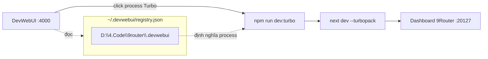

# Tăng tốc dev 9Router bằng Turbopack

> **Trạng thái:** Đã áp dụng ngày 26/10/2026.
> **Mã nguồn:** `D:\4.Code\9router`
> **Tham khảo:** [Next.js — Turbopack](https://nextjs.org/docs/app/api-reference/turbopack)
> **Phạm vi:** Chỉ ảnh hưởng **dev mode** (`npm run dev`). Không đổi hành vi **production** (`npm run build && npm run start`).

## 1. Vấn đề

Trên dashboard 9Router (Next.js 16, React 19), click vào các tab render **chậm mỗi lần** — kể cả khi quay lại tab đã xem, và chậm đều ở mọi tab chứ không riêng tab nào.

Triệu chứng này loại trừ nguyên nhân "render nặng ở một page cụ thể". Nó khớp với đặc tính của **bundler ở chế độ dev**: mỗi route phải được biên dịch (compile) theo yêu cầu, và công cụ biên dịch chậm sẽ làm mọi lần điều hướng đều có độ trễ.

## 2. Root cause

Script `dev` của dự án **ép dùng Webpack**:

```json
"dev": "next dev --webpack --port 20127"
```

Trên Next.js 16, **Turbopack là bundler mặc định**; cờ `--webpack` là lựa chọn opt-out ngược lại. Chạy Webpack ở dev có hai hệ quả khớp chính xác triệu chứng:

| Quan sát (đo thực tế) | Webpack dev | Turbopack dev |
|---|---|---|
| Thời gian khởi động (`Ready in`) | vài giây | **484 ms** |
| RAM tiến trình dev | **~2.2 GB** | thấp hơn rõ rệt |
| Biên dịch route khi click tab | compile lại, chậm | lazy + cache, nhanh |

> Số liệu lấy từ chính máy dev: tiến trình Webpack `node.exe` chiếm ~2.267.640 KB RAM; Turbopack khởi động cùng project báo `✓ Ready in 484ms`.

Một yếu tố phụ (không phải thủ phạm chính) nằm ở `src/shared/components/layouts/DashboardLayout.js`:

```jsx
<Header key={pathname} onMenuClick={...} />
```

`key={pathname}` ép **unmount + remount toàn bộ `Header`** mỗi lần đổi route, kéo theo gọi lại `fetch("/api/auth/status")` mỗi lần chuyển tab. Đây là lãng phí nhỏ cộng dồn vào cảm giác giật, có thể tối ưu riêng.

## 3. Turbopack là gì

Khi chạy dev server, Next.js phải **bundle** (gộp + biên dịch) React/JSX, TypeScript, CSS... thành thứ trình duyệt hiểu. Turbopack là bundler **tăng dần (incremental)**, viết bằng **Rust**, tích hợp sẵn trong Next.js để thay cho Webpack ở dev. Cùng kết quả hiển thị — chỉ khác "động cơ" biên dịch.

Vì sao Turbopack nhanh hơn (theo tài liệu Next.js):

- **Unified Graph** — một đồ thị phụ thuộc duy nhất cho mọi môi trường đầu ra (client/server), không phải ghép nhiều compiler.
- **Incremental Computation** — song song hóa theo số core và **cache tới mức từng hàm**; việc đã làm không làm lại, kết quả còn được ghi xuống đĩa giữa các lần chạy.
- **Lazy Bundling** — chỉ bundle đúng những gì dev server yêu cầu, giảm thời gian compile lần đầu và lượng RAM.
- **Bundling trong dev** — vẫn bundle (thay vì phó mặc ESM native của trình duyệt), nên app lớn không bị nghẽn vì quá nhiều request mạng.

### Tương thích với 9Router

9Router dùng các tính năng mà Turbopack hỗ trợ **zero-config**:

| Tính năng 9Router dùng | Turbopack |
|---|---|
| JSX/TSX, ESM, React Server Components | Hỗ trợ (SWC) |
| Path alias `@/*` → `src/*` (từ `jsconfig.json`) | Hỗ trợ (đọc `paths`/`baseUrl`) |
| Fast Refresh (hot reload) | Hỗ trợ |
| PostCSS / Tailwind | Hỗ trợ (chạy qua worker pool) |
| Import ảnh, JSON | Hỗ trợ |

Lưu ý giới hạn: Turbopack **không chạy** trên nền WASM (một số nền tảng không có native binding như FreeBSD/OpenBSD) — ở đó phải quay lại `--webpack`. Trên **Windows x64/ARM64** (máy dev hiện tại) Turbopack có native binding đầy đủ.

## 4. Thay đổi đã áp dụng

### 4.1 Thêm script dev dùng Turbopack

`D:\4.Code\9router\package.json`:

```json
"dev:turbo": "next dev --turbopack --port 20127"
```

Giữ nguyên `dev` (Webpack) làm đường lùi — Turbopack bỏ qua hàm `webpack:` tùy biến trong `next.config.mjs`, nhưng ở đây hàm đó chỉ gồm `fs/path` fallback cho bundle trình duyệt và `watchOptions` loại trừ thư mục; Turbopack tự xử lý tương đương nên không gây lỗi.

### 4.2 Đăng ký process trong DevWebUI

DevWebUI (`D:\4.Code\devwebui`) quản lý các dev server của máy qua file định nghĩa process mỗi project. Với 9Router là `D:\4.Code\9router\.devwebui`. Đã thêm một process **Turbo**:

```json
{
  "id": "dev-turbo",
  "name": "Turbo",
  "command": "npm run dev:turbo",
  "color": "#14b8a6",
  "port": 20127
}
```

Sơ đồ quan hệ:



## 5. Cách dùng

1. Mở DevWebUI tại `http://localhost:4000`, vào project **9router App**.
2. **Tắt process Dev/Webpack cũ trước** (cùng port 20127) — Next chỉ cho một dev server mỗi thư mục, nếu không sẽ gặp lỗi `Another next dev server is already running`.
3. Bấm process **Turbo**.

Hoặc chạy trực tiếp từ terminal:

```bash
npm run dev:turbo
```

Lần click tab đầu tiên vẫn cần compile (nhỏ hơn nhiều so với Webpack), các lần sau gần như tức thì nhờ cache của Turbopack.

## 6. Kiểm chứng & giới hạn

- **Đã xác nhận:** Turbopack khởi động cùng project, báo `✓ Ready in 484ms`; `package.json` và `.devwebui` parse JSON hợp lệ sau khi sửa.
- **Chưa đo trực tiếp** độ trễ compile từng route qua Turbopack: khi thử, dev server Webpack đang chạy (PID 15588) giữ khóa thư mục nên instance Turbopack thử nghiệm ở port khác không bind được (`Another next dev server is already running`). Không tự ý kill tiến trình dev đang chạy. Để đo đầy đủ: tắt Webpack trước, rồi chạy `npm run dev:turbo` và quan sát dòng `✓ Compiled /dashboard/... in XXms` trong log.
- Việc tối ưu `key={pathname}` ở `Header` chưa thực hiện; tách thành thay đổi riêng để không trộn với chuyển bundler.

## 7. Thuật ngữ (song ngữ)

- **Bundler** — công cụ gộp và biên dịch mã nguồn thành gói trình duyệt chạy được.
- **Turbopack** — bundler tăng dần (incremental) viết bằng Rust, mặc định của Next.js 16 ở dev.
- **Webpack** — bundler đời cũ viết bằng JavaScript; chậm và tốn RAM hơn ở dev.
- **Lazy Bundling** — chỉ bundle phần được yêu cầu, giảm compile ban đầu.
- **Incremental Computation** — tính toán tăng dần, cache tới mức từng hàm.
- **Fast Refresh** — làm mới nhanh, cập nhật JS/TS/CSS không reload toàn trang.
- **RSC (React Server Components)** — thành phần React chạy phía server.
