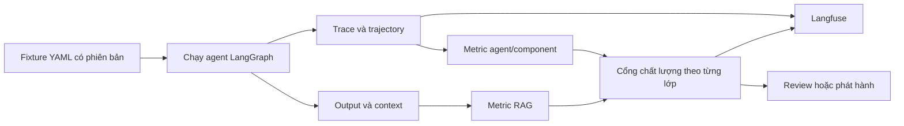

# Bộ công cụ đánh giá LangGraph: từ Langfuse đến AWS AgentCore

> [!IMPORTANT]
> **Chế độ xử lý: Tổng thuật tiếng Việt (ORIGINAL_SUMMARY), không phải bản dịch toàn văn.** Không tìm thấy bằng chứng cho phép dịch/chuyển thể toàn văn. Trang này không sao chép code hoặc sơ đồ của tác giả; hãy đọc [bài gốc trên Medium](https://topuzas.medium.com/building-an-eval-stack-for-a-langgraph-agent-from-langfuse-to-aws-agentcore-4bd494f3a2de) để xem nội dung nguyên bản.

## Thông tin nguồn và phạm vi kiểm chứng

| Trường | Thông tin |
|---|---|
| Bài gốc | *Building an Eval Stack for a LangGraph Agent: From LangFuse to AWS AgentCore* |
| Tác giả | Ali Süleyman TOPUZ |
| Nền tảng | Medium |
| Ngày xuất bản | 11/04/2026 |
| Ngày truy cập | 06/10/2026 |
| Quyền dịch | Chưa xác minh được giấy phép/quyền tạo bản dịch phái sinh; không suy rộng giấy phép code sang bài blog |
| Mức độ đã đọc | Agent không tải được trang Medium trong lần thực thi này. Tổng thuật dựa trên hồ sơ A02 và báo cáo nghiên cứu đã đọc trước đó; chi tiết nguyên văn, code và sơ đồ chưa được đối chiếu lại |

Tác giả, ngày và trọng tâm kỹ thuật trong bảng lấy từ hồ sơ nghiên cứu A02 của dự án. Đây là metadata thứ cấp trong lần thực thi này vì kết nối tới trang gốc thất bại; người đọc nên kiểm tra lại trực tiếp trên Medium.

## Tổng thuật tiếng Việt

Theo hồ sơ nghiên cứu, bài tổ chức đánh giá LangGraph thành ba lớp: chất lượng hội thoại, điều phối hành động và chất lượng truy xuất. Phương án ghép Langfuse để quan sát, Ragas cho metric RAG và DeepEval để kiểm thử/chấm điểm; tình huống được mô tả bằng fixture YAML nhằm chạy lại cục bộ. Bài sau đó đặt bộ công cụ tự lắp ghép này cạnh AWS AgentCore nhằm xem xét lựa chọn nền tảng tích hợp hơn.

Điểm hữu ích là cách tách câu hỏi “câu trả lời có tốt không”, “agent có đi đúng đường không” và “ngữ cảnh truy xuất có phù hợp không”, thay vì nén tất cả vào một điểm. Tuy vậy, ví dụ code và Docker Compose trong bài gắn với phiên bản tại thời điểm viết. Chúng không chứng minh các SDK hiện hành còn tương thích hoặc hệ thống đã vận hành ổn định. Trước khi áp dụng, cần đối chiếu API mới, khóa phiên bản, chạy fixture trong môi trường cô lập và xác nhận cổng chất lượng thật sự làm pipeline thất bại khi metric không đạt.

*Phần tổng thuật trên gồm dưới 200 từ, được viết mới từ hồ sơ nghiên cứu A02; không phải bản dịch hoặc bản chép cấu trúc bài gốc.*

## Phân tích kiến trúc độc lập

Phần này do agent tổng hợp, không phải nội dung hay sơ đồ của tác giả.

### Ba lớp đo nên có hợp đồng dữ liệu riêng

| Lớp đánh giá | Câu hỏi | Dữ liệu tối thiểu | Ví dụ cổng kiểm soát |
|---|---|---|---|
| Hội thoại — *conversation quality* | Câu trả lời có đúng, hữu ích và dựa trên bằng chứng không? | input, output, expected/context, rubric, phiên bản judge | Điểm theo rubric và không có lỗi nghiêm trọng |
| Điều phối — *orchestration/trajectory* | Agent có gọi đúng công cụ, đúng tham số và đúng thứ tự không? | trajectory, tool calls, arguments, tool results, termination state | Cấm công cụ vượt quyền; bắt buộc hoàn thành bước trọng yếu |
| Truy xuất — *retrieval quality* | Tài liệu lấy về có liên quan và đủ để trả lời không? | query, retrieved contexts, ground truth/expected evidence | Recall/precision hoặc tiêu chí faithfulness đã hiệu chỉnh |

Không nên cộng ba lớp thành một điểm duy nhất rồi dùng điểm trung bình để phát hành: một lỗi quyền ở lớp điều phối có thể bị điểm hội thoại tốt che khuất.

### Vai trò công cụ, không phải ánh xạ bắt buộc

- **Langfuse — khả năng quan sát:** lưu trace/span, cấu hình và điểm để điều tra kết quả.
- **Ragas — đánh giá RAG:** phù hợp với metric cần query, context và câu trả lời; phải kiểm tra schema từng metric.
- **DeepEval — bộ chạy/metric:** tổ chức test case và assertion trong tiến trình đánh giá; việc gọi hàm đánh giá chưa mặc nhiên tạo quality gate.
- **AWS AgentCore — nền tảng agent được quản lý:** là một lựa chọn kiến trúc cần so sánh theo runtime, quan sát, đánh giá, IAM, chi phí và mức khóa chặt nhà cung cấp; không nên coi là bản thay thế một-một cho từng thư viện.

### Luồng đề xuất

*Sơ đồ do agent tạo cho trang này.* Fixture nên có định danh, input, kỳ vọng, dữ liệu truy xuất, ràng buộc trajectory, tags và phiên bản. Không đưa bí mật hay dữ liệu cá nhân vào YAML; giá trị phụ thuộc môi trường nên được tham chiếu qua cấu hình an toàn.

## Checklist đối chiếu SDK trước khi dùng snippet

1. Mở tài liệu chính thức hiện hành của Langfuse, Ragas, DeepEval và AgentCore; ghi ngày truy cập cùng phiên bản package.
2. Kiểm tra tên lớp/hàm, kiểu test case, cơ chế callback/tracing và phương thức ghi score.
3. Khóa phiên bản trong một môi trường thử nghiệm; không chạy script cài đặt chưa review.
4. Dùng một fixture tối thiểu để kiểm tra schema, trace ID và kết quả metric.
5. Tạo một ca cố ý thất bại để chứng minh CI trả mã lỗi khác 0.
6. Kiểm tra retry, timeout, chi phí judge, dữ liệu nhạy cảm và hành vi khi hệ thống chấm điểm ngừng hoạt động.

Trang này không khẳng định snippet trong bài còn chạy được và không cài/chạy toàn bộ stack.

## Từ khóa Anh–Việt

| English | Tiếng Việt |
|---|---|
| Evaluation stack | Bộ công cụ đánh giá |
| Conversation quality | Chất lượng hội thoại |
| Orchestration / trajectory | Điều phối / chuỗi hành động |
| Retrieval quality | Chất lượng truy xuất |
| Evaluation fixture | Dữ liệu tình huống đánh giá |
| Trace / span | Dấu vết / khoảng thực thi |
| Metric | Chỉ số đánh giá |
| Quality gate | Cổng kiểm soát chất lượng |
| Regression | Suy giảm chất lượng |
| Managed agent platform | Nền tảng agent được quản lý |

## Giới hạn

- Không truy cập được nội dung trực tiếp của Medium trong lần kiểm tra này; không xác nhận được cấu trúc, code, sơ đồ và thông báo bản quyền hiển thị trên trang.
- Mô tả nội dung bài là phát biểu quy thuộc cho tác giả/hồ sơ nghiên cứu, không phải benchmark độc lập.
- Chưa chạy LangGraph, Langfuse, Ragas, DeepEval hoặc AgentCore; sơ đồ và checklist là phân tích/khuyến nghị.
- API và mô hình dịch vụ có thể thay đổi sau ngày xuất bản; mọi snippet cần được đối chiếu tài liệu chính thức trước khi dùng.

## Đọc tiếp

- [Báo cáo tổng hợp EDD, Langfuse và DeepEval](/nghien-cuu/kien-truc/edd-langfuse-deepeval/)
- [Bài A02 gốc trên Medium](https://topuzas.medium.com/building-an-eval-stack-for-a-langgraph-agent-from-langfuse-to-aws-agentcore-4bd494f3a2de)
