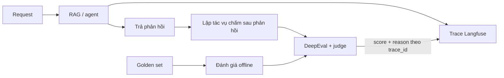

# Theo dõi và chấm điểm pipeline RAG với Langfuse và DeepEval

> [!IMPORTANT] Chế độ xử lý bản quyền
> Đây là **Tổng thuật tiếng Việt**, không phải bản dịch toàn văn. Tại thời điểm truy cập, trang nguồn hiển thị thông báo © 2026 và không nêu giấy phép cho phép dịch/chuyển thể toàn văn. Trang này không sao chép code hay sơ đồ của tác giả; hãy xem chúng tại [bài gốc](https://aiwithvd.com/blog/tracing-and-scoring-rag-without-slowing-it-down).

## Thông tin nguồn

| Trường | Giá trị |
|---|---|
| Bài gốc | [Tracing and Scoring a RAG Pipeline Without Slowing It Down](https://aiwithvd.com/blog/tracing-and-scoring-rag-without-slowing-it-down) |
| Tác giả | Vishvdeep Dashadiya |
| Nhà xuất bản | AI with VD |
| Ngày xuất bản/cập nhật | 05/09/2026 (metadata của trang) |
| Ngày truy cập | 06/10/2026 |
| Mức độ đọc | Toàn bộ nội dung công khai của bài tại URL trên; không gặp tường phí |
| Chế độ | `ORIGINAL_SUMMARY` — Tổng thuật tiếng Việt |
| Quyền dịch | Chưa tìm thấy quyền phái sinh rõ ràng trên bài; không áp dụng giấy phép của repository code cho nội dung blog |

Bối cảnh rộng hơn: [EDD và kiến trúc đánh giá agent với Langfuse + DeepEval](../../kien-truc/edd-langfuse-deepeval/).

## Tổng thuật tiếng Việt

Bài viết trình bày cách quan sát và đánh giá một pipeline RAG mà không bắt người dùng chờ mô hình chấm điểm. Theo thiết kế được tác giả mô tả, mỗi request tạo một callback Langfuse để LangGraph gom các bước vào cùng trace. Khi luồng trả lời đã đóng, dịch vụ đọc trạng thái cuối, gắn thông tin trích dẫn rồi mới lập tác vụ DeepEval; kết quả được ghi ngược về đúng `trace_id`.

Tác vụ chấm chạy bất đồng bộ trong cùng event loop. Tham chiếu tác vụ được giữ lại và lỗi được cô lập để không làm hỏng request, nhưng cách này vẫn phụ thuộc vòng đời của tiến trình. Mô hình giám khảo có cấu hình riêng với mô hình tạo câu trả lời.

Với traffic thực, bài dùng các phép đo không cần đáp án chuẩn để xem mức phù hợp của truy xuất, câu trả lời và ngữ cảnh. Recall và precision được dành cho đánh giá offline trên golden set vì cần đầu ra kỳ vọng. Tác giả cũng lưu ý chi phí judge, độ tin cậy của judge nhỏ và khuyến nghị lấy mẫu thay vì chấm mọi request.

## Phân tích kiến trúc độc lập

Phần này do agent tổng hợp, không phải nội dung dịch từ bài gốc.

### 1. Tách đường phản hồi khỏi đường đánh giá

Luồng chính nên kết thúc trách nhiệm với người dùng trước khi chạy judge. Điều đó loại bỏ **thời gian chờ trực tiếp** do chấm điểm khỏi phản hồi, nhưng không chứng minh hệ thống “không bị chậm”: tác vụ nền vẫn tranh CPU, bộ nhớ, kết nối và quota mô hình. Cần đo p95/p99, throughput và backlog khi bật/tắt đánh giá.

*Sơ đồ do agent tạo để mô tả ranh giới kiến trúc; không phải sơ đồ của tác giả.*

### 2. `trace_id` là khóa tương quan, chưa phải bảo đảm giao nhận

Gắn score vào đúng `trace_id` giúp điều tra một lượt chạy, nhưng cần thêm khóa idempotency cho metric và phiên bản cấu hình để retry không tạo điểm trùng. Nên lưu phiên bản prompt, agent, judge, rubric và dataset cùng kết quả.

### 3. Giới hạn của `create_task` cùng tiến trình

Giữ tham chiếu giúp tác vụ không bị thu gom khi còn chạy; nó không biến tác vụ thành công việc bền vững. Khi process restart, deploy, crash hoặc scale-to-zero, công việc chưa xong có thể mất. Với yêu cầu bảo đảm cao, nên dùng outbox/hàng đợi bền vững, worker riêng, retry có giới hạn và dead-letter queue. Nếu chấp nhận mất mẫu, cần công bố rõ semantics “best effort”.

### 4. Live eval và offline eval trả lời câu hỏi khác nhau

- **Live evaluation — đánh giá trực tiếp:** theo dõi tín hiệu không cần đáp án chuẩn trên mẫu traffic; hữu ích cho phát hiện xu hướng, không tự chứng minh tính đúng tuyệt đối.
- **Offline evaluation — đánh giá ngoại tuyến:** chạy trên dữ liệu có kỳ vọng để so sánh phiên bản và kiểm tra regression.
- Judge và rubric cần hiệu chuẩn với đánh giá của con người; điểm do LLM sinh ra không phải ground truth.

## Từ khóa Anh–Việt

| English | Tiếng Việt |
|---|---|
| per-request callback | callback theo từng request |
| trace / span | dấu vết / khoảng thực thi |
| trace correlation | liên kết dấu vết |
| post-response scoring | chấm điểm sau phản hồi |
| fire-and-forget task | tác vụ lập rồi chạy nền, không chờ |
| live evaluation | đánh giá trực tiếp trên traffic |
| offline evaluation | đánh giá ngoại tuyến |
| referenceless metric | chỉ số không cần đáp án chuẩn |
| golden set | bộ dữ liệu chuẩn có kỳ vọng |
| judge model | mô hình giám khảo |
| idempotency | tính lũy đẳng |
| durable queue | hàng đợi bền vững |

## Giới hạn và trạng thái kiểm chứng

- Các mô tả triển khai ở phần tổng thuật là **phát biểu của tác giả**, chưa được task này chạy lại hay benchmark độc lập.
- Task này chỉ kiểm tra nội dung công khai và metadata của bài; không cài Langfuse, DeepEval hoặc stack RAG.
- Cụm “không làm chậm” nên hiểu hẹp là không thêm bước `await` judge vào đường phản hồi theo thiết kế được mô tả, không phải cam kết không có tác động tài nguyên.
- API và hành vi thư viện có thể thay đổi sau ngày xuất bản; cần đối chiếu tài liệu phiên bản đang dùng trước khi triển khai.
