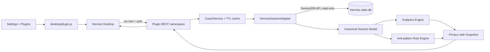
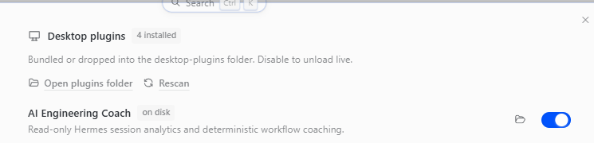
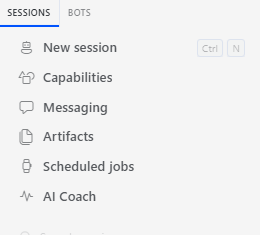

# AI Engineering Coach với Hermes

> **Trạng thái:** MVP đã triển khai, kiểm thử và cài vào active Hermes profile ngày 09/09/2026.  
> **Mã nguồn:** `D:\4.Code\ai-engineering-coach-hermes`  
> **Bản cài:** `C:\Users\ADMIN\AppData\Local\hermes\plugins\ai-engineering-coach`

## 1. Mục tiêu

Port ý tưởng của [Microsoft AI Engineering Coach](https://github.com/microsoft/AI-Engineering-Coach) từ VS Code extension thành **Unified Plugin** chạy native trong Hermes Desktop. MVP tập trung vào:

- Dashboard và timeline session Hermes.
- Thống kê Model, Provider, Token, Tool call, thời lượng và workspace.
- Phát hiện anti-pattern bằng luật local, tất định.
- Phân tích read-only, không gửi nội dung hội thoại ra ngoài.
- Giao diện native trong sidebar Hermes.

Đây không phải bản cài `.vsix`. Phần phụ thuộc `vscode.*` được thay bằng API plugin/runtime của Hermes.

## 2. Kiến trúc triển khai



### 2.1 Các lớp

| Lớp | File | Trách nhiệm |
|---|---|---|
| Unified manifest | `plugin.yaml`, `__init__.py` | Cho Hermes phát hiện, bật/tắt và kiểm tra package như một agent plugin. MVP không đăng ký Tool hay Hook. |
| Desktop shell | `desktop/plugin.js` | Đăng ký route `/ai-engineering-coach`, sidebar **AI Coach** và command palette. |
| REST adapter | `dashboard/plugin_api.py` | Cung cấp `health`, `snapshot`, `reanalyze` dưới namespace được Hermes bảo vệ. |
| Session adapter | `coach/adapter.py` | Đọc `SessionDB`, chuẩn hóa metadata/message/tool call và đóng DB sau khi dùng. |
| Analytics | `coach/analyzer.py` | Tổng hợp timeline, Model, Provider, Token, Tool, duration và workspace. |
| Rule engine | `coach/rules.py` | Chạy 11 luật anti-pattern deterministic. Không cần LLM. |
| Cache | `coach/service.py` | Cache snapshot theo cửa sổ ngày và limit trong 30 giây; hỗ trợ force refresh. |

### 2.2 Canonical Session Model

Adapter cô lập schema Hermes khỏi analytics và UI:

```text
CoachSession
├── id, source, workspace
├── started_at, ended_at, duration_seconds
├── model, provider
├── message_count, prompt_count
├── tools[] {name, status}
├── tokens {input, output, cache_read, cache_write, reasoning, total}
├── token_provenance = session-aggregate
├── estimated_cost_usd, actual_cost_usd
└── internal-only analysis fields
    ├── prompts[]
    ├── assistant_texts[]
    ├── tool_arguments[]
    └── tool_errors
```

Các trường `prompts[]`, `assistant_texts[]` và `tool_arguments[]` chỉ tồn tại trong pipeline local. Snapshot trả về Desktop không chứa message body, Tool arguments hoặc tiêu đề session; tiêu đề được thay bằng nhãn `Session <id-prefix>`.

### 2.3 Luồng dữ liệu

1. Desktop gọi `ctx.rest('/snapshot?days=30&limit=500')`.
2. Hermes tự thêm namespace `/api/plugins/ai-engineering-coach` và thông tin xác thực.
3. `HermesSessionAdapter` gọi `SessionDB.list_sessions_rich(compact_rows=True)` và `SessionDB.get_messages(include_compacted=True)`.
4. Adapter chuẩn hóa các dạng `content`, `tool_calls`, token và timestamp.
5. Analytics và Rule Engine xử lý model nội bộ.
6. API trả về một privacy-safe snapshot.
7. React Query cache/dedupe request và UI cho phép refresh thủ công.

> **Độ chính xác Token:** Hermes cung cấp tổng Token đáng tin cậy ở cấp session/model nhưng không đồng đều ở cấp từng turn. API vì vậy gắn `token_provenance: session-aggregate`. Breakdown theo Model/Provider quy tổng session về Model/Provider được ghi trên session; không tuyên bố độ chính xác per-turn và không tái dựng các lần đổi Model giữa session.

## 3. API của MVP

| Method | Route | Mục đích |
|---|---|---|
| `GET` | `/api/plugins/ai-engineering-coach/health` | Kiểm tra adapter và số session có thể đọc. |
| `GET` | `/api/plugins/ai-engineering-coach/snapshot?days=30&limit=500` | Trả dữ liệu dashboard đã tổng hợp, giới hạn tối đa 500 session. |
| `POST` | `/api/plugins/ai-engineering-coach/reanalyze` | Bỏ cache và phân tích lại. |

Route nằm sau authentication middleware của Hermes. Test không có token nhận `401 Unauthorized`, đúng thiết kế.

## 4. Giao diện MVP

Dashboard dùng UI kit/theme variables của Hermes và không có dependency build riêng. Các tab:

- **Overview:** metric cards, timeline, top Models, top Tools, anti-pattern mới nhất.
- **Sessions:** session timeline/table, mở lại session bằng `host.openSession()`.
- **Insights:** danh sách phát hiện, severity và evidence không chứa prompt nguyên văn.

Bộ lọc thời gian: 7, 30, 90 ngày hoặc toàn bộ lịch sử.

### Plugin đã được bật



### Sidebar native đã xuất hiện



## 5. Anti-pattern rules

MVP triển khai 11 luật local:

1. `vague-prompt` — prompt quá ngắn/mơ hồ.
2. `long-session` — session có ít nhất 60 messages.
3. `tool-retry-loop` — một Tool bị gọi lặp bất thường.
4. `repeated-prompt` — cùng prompt xuất hiện nhiều lần.
5. `no-verification` — sửa file nhưng không có dấu hiệu test/build/lint.
6. `edit-without-context` — sửa file mà không đọc/tìm context trước.
7. `token-heavy` — session vượt 100.000 Token.
8. `tool-failure-cluster` — nhiều Tool failures.
9. `monolithic-prompt` — prompt đơn lẻ quá lớn.
10. `code-task-without-tools` — tác vụ code kéo dài nhưng không dùng Tool.
11. `marathon-session` — một session kéo dài ít nhất bốn giờ.

Luật tạo evidence dạng số đếm/Tool name; không trả prompt raw về UI.

## 6. Privacy và bảo mật

- Mở DB bằng `SessionDB(read_only=True)` thay vì query/ghi SQLite trực tiếp.
- Không có lệnh `INSERT`, `UPDATE`, `DELETE` hoặc write-back vào session.
- Đóng DB trong `finally`.
- Không đưa prompt, assistant message, Tool arguments hoặc tiêu đề session ra REST response.
- Giữ `reasoning_tokens` như breakdown nhưng không cộng lần hai vào `tokens.total`, vì đây là tập con của output ở provider có hỗ trợ.
- Backend route dùng authentication middleware sẵn có của Hermes.
- Chỉ lấy compact session metadata, giới hạn tối đa 500 session/request và cache 30 giây để tránh quét không giới hạn.
- Bao gồm durable display history đã compact để luật không bỏ mất phần đầu của session dài.
- Không gọi external API và không dùng LLM trong MVP.

Tính năng coaching bằng AI sau này phải dùng `ctx.llm`/runtime của Hermes và chỉ bật khi người dùng chủ động yêu cầu.

## 7. Bằng chứng kiểm thử

### 7.1 Unit test

```text
test_normalizes_tokens_and_counts_tools_once ... ok
test_snapshot_never_returns_message_bodies ... ok
test_detects_retry_and_missing_context ... ok
test_failed_verification_and_prompt_break_do_not_hide_findings ... ok
test_verification_command_clears_no_verification_rule ... ok
Ran 5 tests
OK
```

### 7.2 Static/runtime checks

| Kiểm tra | Kết quả |
|---|---|
| `python -m unittest discover -s tests -v` | Pass — 5/5 |
| `python -m compileall -q .` | Pass |
| `node --check desktop/plugin.js` | Pass |
| `hermes plugins doctor ai-engineering-coach` | Pass: discovery, manifest, import, registration |
| Hermes plugin registry | `ai-engineering-coach`, enabled, v0.1.0, source `user` |
| Fresh `hermes_cli.web_server` route discovery | Đủ ba route plugin |
| Unauthenticated route request | `401`, xác nhận middleware bảo vệ route |
| Desktop runtime inventory | Plugin xuất hiện trong Settings; toggle bật |
| Desktop contribution | Sidebar **AI Coach** xuất hiện; không có error toast |

Log đầy đủ: [`evidence/verification.txt`](./evidence/verification.txt).

### 7.3 Smoke test với dữ liệu Hermes thật

Adapter được chạy trên active Hermes `state.db` với nội dung hội thoại không được in hoặc lưu vào evidence.

| Metric trong lần chụp evidence | Giá trị |
|---|---:|
| Session | 44 |
| Prompt | 229 |
| Message | 3.618 |
| Tool call | 3.395 |
| Token tổng hợp | 160.227.966 |
| Workspace | 5 |
| Delegated child session | 17 |
| Insight | 182 |

Top Tools trong snapshot: `terminal`, `read_file`, `search_files`, `write_file`, `skill_view`. Dữ liệu máy đọc được: [`evidence/real-session-summary.json`](./evidence/real-session-summary.json).

> Token được cộng từ metadata do Hermes lưu, bao gồm cache-read Token; vì vậy tổng này không phải chỉ là Token được tính phí.

## 8. Cài đặt và vận hành

Bản hiện tại đã được copy vào active profile:

```text
C:\Users\ADMIN\AppData\Local\hermes\plugins\ai-engineering-coach
```

Agent half đã được bật bằng plugin registry, Desktop half đã được bật trong Settings > Plugins. Nếu vừa cài backend trong lúc Hermes Desktop đang chạy, cần khởi động lại Desktop một lần để Python web server mount `dashboard/plugin_api.py`; về sau `desktop/plugin.js` hot-reload độc lập.

Mã nguồn phát triển ở:

```text
D:\4.Code\ai-engineering-coach-hermes
```

## 9. License và nguồn gốc

Repository có `LICENSE` MIT và `THIRD_PARTY_NOTICES.md`. Notice ghi rõ dự án lấy cảm hứng từ Microsoft AI Engineering Coach, giữ liên kết repository gốc và copyright/license notice của Microsoft.

MVP này reimplement adapter, analytics, rule engine và Desktop UI cho schema/runtime Hermes; không đóng gói `.vsix` hoặc phụ thuộc `vscode.*`.

## 10. Giới hạn và hướng tiếp theo

- MVP có 11 luật, chưa port toàn bộ catalog luật của upstream.
- Chưa có coaching bằng LLM; nếu bổ sung phải dùng runtime Hermes và cơ chế opt-in.
- Cost phụ thuộc metadata mà Provider trả về; có thể bằng 0 dù Token có dữ liệu.
- Backend được mount lúc Hermes Python web server khởi động; cài khi app đang mở cần restart một lần.
- Có thể bổ sung export Markdown/JSON, so sánh theo thời kỳ, custom rule packs và event-driven incremental analysis sau khi MVP ổn định.
