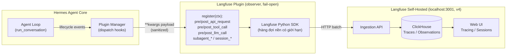
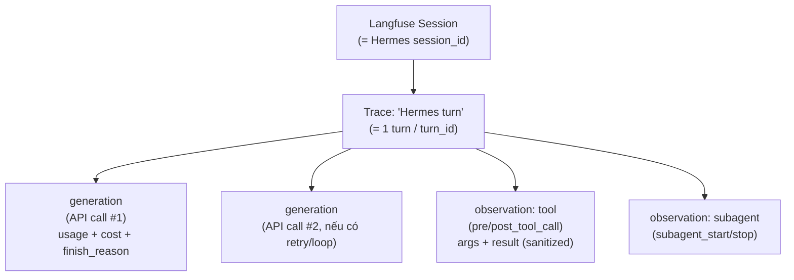

# Kiến trúc Giải pháp: Hermes Agent tích hợp Langfuse

> **Phạm vi:** Quan sát (Observability) toàn bộ vòng đời thực thi của **Hermes Agent** — mỗi lượt (turn), mỗi lời gọi LLM, mỗi tool call và subagent — và đẩy dấu vết (trace) lên **Langfuse self-hosted** đang chạy cục bộ.
> **Trạng thái:** Đã triển khai và kiểm chứng thực tế (xác nhận trace sinh ra tới `localhost:3001`).
> **Tài liệu liên quan:** [Vận hành Langfuse Self-Hosted (v4)](../../kien-truc/langfuse-self-hosted/) · [EDD và kiến trúc đánh giá agent với Langfuse + DeepEval](../../kien-truc/edd-langfuse-deepeval/)

---

## 1. Executive Summary

Hermes Agent không nhúng mã quan sát (**instrumentation**) rải rác trong luồng agent. Thay vào đó, nó phơi ra một **hợp đồng telemetry chỉ-đọc (read-only)** gọi là **Observer Hooks** — các điểm móc (hook) ổn định theo vòng đời thực thi. Một plugin đăng ký vào các hook này để tái dựng lại toàn bộ quỹ đạo (**trajectory**) của agent mà **không thay đổi hành vi runtime**.

**Langfuse plugin** (chính thức, do Nous Research bảo trì) là một observer plugin như vậy. Nó ánh xạ (map) các hook của Hermes thành mô hình dữ liệu của Langfuse:

> Một **turn** → một **trace**. Một **lời gọi LLM** → một **generation** (kèm token + chi phí). Một **tool call / subagent** → một **observation**.

Nguyên tắc cốt lõi:

> **Observer báo cáo điều đã xảy ra, không thay thế request hay can thiệp thực thi.** Plugin fail-open (lỗi → no-op), nên một backend Langfuse chậm hoặc chết **không bao giờ** làm treo vòng lặp agent.

### 1.1. Hai lớp tích hợp độc lập

Cần phân biệt rõ hai việc **tách biệt nhau**, dùng chung một project/key Langfuse nếu muốn gộp dashboard:

| Lớp | Quan sát cái gì | Cơ chế |
| :--- | :--- | :--- |
| **Hermes plugin** (bài này) | Các phiên agent của Hermes (CLI, Desktop, gateway, cron, kanban) | Observer Hooks nội bộ Hermes |
| **SDK trong 9Router** (lộ trình §7) | Traffic routing/translation đi qua gateway 9Router | Langfuse JS/TS SDK nhúng vào request lifecycle |

Plugin Hermes **không** tự động trace traffic của 9Router — đó là service Node/Next.js riêng, cần nhúng SDK trực tiếp.

---

## 2. Kiến trúc Tổng thể

Luồng dữ liệu từ agent loop của Hermes, qua plugin, tới Langfuse self-hosted:

<iframe src="/nghien-cuu/kien-truc/hermes-langfuse-integration/assets/diagram-01-overview.html" width="100%" height="640" style="border:none;border-radius:0.75rem;"></iframe>



Điểm mấu chốt về hiệu năng: Hermes chỉ dựng payload telemetry (serialize request/response đã làm sạch) **khi có ít nhất một plugin đăng ký hook tương ứng** (`has_hook(...)`). Đường chạy không-instrument vẫn rẻ.

---

## 3. Mô hình Dữ liệu Trace

Plugin ánh xạ vòng đời Hermes vào cây trace của Langfuse theo quan hệ cha–con, dùng các ID ổn định để nối sự kiện mà không phụ thuộc thứ tự callback.

<iframe src="/nghien-cuu/kien-truc/hermes-langfuse-integration/assets/diagram-02-trace-model.html" width="100%" height="620" style="border:none;border-radius:0.75rem;"></iframe>



### 3.1. Các khóa tương quan (correlation IDs)

| Field | Ý nghĩa |
| :--- | :--- |
| `session_id` | Danh tính phiên/hội thoại → gom thành 1 Langfuse session |
| `turn_id` | Danh tính một lượt người dùng; chia sẻ bởi mọi API attempt + tool call trong lượt |
| `api_request_id` | Danh tính mờ (opaque) của một lần thử gọi provider — **không parse chuỗi này** |
| `tool_call_id` | ID tool call do provider cấp |
| `parent_*` / `child_*` | Liên kết cha–con cho subagent được ủy quyền (delegation) |

### 3.2. Nhãn & metadata trên trace

- Mỗi root trace mang nhãn `platform:<tên>` và `trigger:cron|interactive` (cron còn có `cron-job:<id>`).
- Metadata ghi tên **profile** Hermes mà lượt chạy thuộc về → tách được các profile dùng chung một project.
- Lượt chạy của **Kanban worker** mang `kanban_task_id` / `kanban_run_id` → nối trace về đúng card trên board.
- `metadata.capture_mode` ghi chế độ capture đang dùng (xem §5.2).

---

## 4. Vòng đời Hook (chi tiết)

Bảng ánh xạ hook → hành vi plugin:

| Hook | Hành vi |
| :--- | :--- |
| `pre_api_request` / `pre_llm_call` | Mở (hoặc dùng lại) root span "Hermes turn". Bắt đầu một `generation` con cho API call này, input là các message gần đây đã serialize. |
| `post_api_request` / `post_llm_call` | Đóng generation; gắn `usage_details`, `cost_details`, `finish_reason`, output + tool calls. Nếu không có tool call và content không rỗng → đóng turn. |
| `api_request_error` | Đóng generation lỗi với `level=ERROR`, status code, bộ đếm retry, thông điệp lỗi đã làm sạch. Lỗi không-retry cũng đóng turn. |
| `pre_tool_call` | Bắt đầu `observation` loại tool với `args` đã làm sạch. |
| `post_tool_call` | Đóng observation với `result` đã làm sạch. Payload `read_file` được tóm tắt (đầu + cuối + số dòng bị bỏ) để giữ dưới `HERMES_LANGFUSE_MAX_CHARS`. |
| `subagent_start` / `subagent_stop` | Một observation cho mỗi subagent được ủy quyền, dưới turn cha. |
| `on_session_end` / `on_session_finalize` | Đóng mọi trace còn mở của phiên, tránh trace treo (turn bị ngắt hoặc chỉ-tool). |

> **Flush & độ bền:** Observation đã đóng được xuất qua hàng đợi nền có giới hạn của SDK. Turn hoàn thành / lỗi API / xoay phiên (`/new`, `/reset`) **không chờ** `flush()`. Chỉ process thoát mới flush và có thể chờ SDK. Hàng đợi đầy, export lỗi hoặc kill đột ngột **có thể mất telemetry** (không có spool offline).

---

## 5. Cấu hình Triển khai

### 5.1. Biến môi trường (profile `.env`)

Cài plugin từ catalog: `hermes plugins install langfuse`. Secret vào **`.env`**, không vào `config.yaml`:

```ini
HERMES_LANGFUSE_PUBLIC_KEY=pk-lf-...
HERMES_LANGFUSE_SECRET_KEY=sk-lf-...
HERMES_LANGFUSE_BASE_URL=http://localhost:3001    # URL self-host; mặc định là cloud.langfuse.com
HERMES_LANGFUSE_CAPTURE=sanitized                 # metadata | sanitized | full
```

Tuning tùy chọn:

```ini
HERMES_LANGFUSE_ENV=production        # nhãn môi trường
HERMES_LANGFUSE_RELEASE=v1.0.0        # nhãn release
HERMES_LANGFUSE_SAMPLE_RATE=0.5       # lấy mẫu 50% trace (mỗi turn là 1 trace → mẫu theo turn)
HERMES_LANGFUSE_MAX_CHARS=12000       # giới hạn ký tự mỗi field
HERMES_LANGFUSE_MAX_DEPTH=4           # độ sâu payload (MCP sâu → tăng lên, vd 10)
HERMES_LANGFUSE_DEBUG=true            # log chi tiết plugin ra agent.log (để verify, sau đó tắt)
OTEL_SERVICE_NAME=my-agent            # service.name OTel (mặc định hermes-agent)
```

> Tên biến chuẩn của SDK (`LANGFUSE_PUBLIC_KEY`, `LANGFUSE_SECRET_KEY`, `LANGFUSE_BASE_URL`) cũng được chấp nhận; bản có tiền tố `HERMES_` thắng khi cả hai cùng đặt.
>
> Với self-host (host không phải `*.langfuse.com`), key không bắt buộc tiền tố `pk-lf-`/`sk-lf-` — endpoint tự xác thực.

### 5.2. Chế độ Capture (bảo mật nội dung)

`HERMES_LANGFUSE_CAPTURE` kiểm soát bao nhiêu **nội dung** (prompt, response, tool args/results) được xuất. Metadata cấu trúc (ID, role, tên tool, token, cost, timing) luôn được ghi ở mọi mode.

| Mode | Hành vi |
| :--- | :--- |
| `metadata` | **Không** nội dung. Mỗi field nội dung thay bằng stub hình dạng/kích thước. |
| `sanitized` | **(mặc định)** Nội dung xuất sau khi redact theo pattern (API key, token, JWT, private key, `password=`) và cắt ngắn. Redact chạy *trước* khi cắt. |
| `full` | Nội dung thô, chỉ cắt ngắn. Opt-in rõ ràng: trace chứa mọi thứ đi qua hội thoại — kể cả memory được inject và nội dung file. |

> [!CAUTION]
> `sanitized` là phòng thủ chiều sâu theo pattern, **không phải đảm bảo DLP**. Với phiên cá nhân hoặc project Langfuse dùng chung, ưu tiên `metadata`.

### 5.3. Verify

```bash
hermes plugins list                       # langfuse = enabled
HERMES_LANGFUSE_DEBUG=true hermes chat -q "7 x 8?"   # chạy 1 turn
grep -i langfuse ~/.hermes/logs/agent.log | tail     # tìm "started trace <id>"
```

Thấy dòng `Langfuse tracing: started trace <hash> for task:...` là plugin đã nạp key và bắn trace thành công. Sau đó mở Web UI → project → **Tracing** tìm trace tên **"Hermes turn"**.

---

## 6. Bẫy Vận hành trên Windows (đã gặp & cách xử lý)

### 6.1. `WinError 5 Access denied` khi quét plugin

**Triệu chứng:** Hermes bỏ qua plugin langfuse với cảnh báo `Skipping unreadable plugin directory langfuse: [WinError 5] Access is denied: ...plugins\langfuse\plugin.yaml`, và dù `.env` có key đúng vẫn báo `missing credentials, traces will NOT be emitted`.

**Nguyên nhân gốc:** Thư mục `plugins/langfuse` ở một hoặc nhiều profile bị **mất ACL của user chạy Hermes** — một tiến trình sandbox quyền cao (ví dụ `CodexSandboxUsers`) đã chiếm quyền sở hữu và gỡ quyền đọc của user thường. Khi Hermes quét plugin lúc khởi động, nó đụng `plugin.yaml` không đọc được → **bỏ qua plugin hoàn toàn** → hook không đăng ký → không trace, kể cả cho profile khác đang dùng.

**Khắc phục** (cấp lại quyền đọc cho user, có thể đảo ngược, không đổi owner hệ thống):

```powershell
icacls "C:\Users\<user>\AppData\Local\hermes\profiles\<profile>\plugins\langfuse" `
  /grant "<user>:(OI)(CI)F" /T /C
```

Chẩn đoán nhanh ACL một file: `icacls "<path>\plugin.yaml"` — nếu danh sách thiếu user của bạn là trúng lỗi này.

> **Phòng ngừa:** Nếu còn chạy agent sandbox (Codex / Claude Code) đụng vào `~/.hermes/profiles/*/plugins`, ACL có thể bị gỡ lại và lỗi tái phát. Chạy lại lệnh `icacls ... /grant` là khỏi.

### 6.2. `install` báo "already exists" / out-of-sync

Nếu plugin đã cài, `hermes plugins install langfuse` từ chối với `Plugin 'langfuse' already exists`. Dùng `hermes plugins update langfuse` hoặc `--force`. Nếu đã enabled rồi, **không cần cài lại** — chỉ cần đặt secret vào `.env`.

### 6.3. Desktop app không lên trace sau khi sửa `.env`

Process Desktop/gateway nạp `.env` **một lần lúc khởi động**. Sau khi thêm key hoặc sửa ACL, phải **thoát hẳn và mở lại** Desktop app để nạp lại — nếu không nó giữ trạng thái cũ (bỏ qua plugin / thiếu key).

### 6.4. Langfuse v4 `events_only`: API đọc trace bị tắt

Bản self-host v4 chạy ở chế độ `events_only` **chỉ nhận ingestion**, chặn các endpoint đọc như `GET /api/public/traces`:

```json
{"message":"This endpoint is not available on deployments running in Langfuse v4 events_only mode."}
```

Đây là **cấu hình của Langfuse, không phải lỗi**. Hệ quả: không verify trace qua REST API được — phải xem bằng **Web UI** (`/tracing`) hoặc bật `HERMES_LANGFUSE_DEBUG=true` và đọc `agent.log`. Việc nhận trace (ingestion) vẫn chạy bình thường.

---

## 7. Lộ trình Mở rộng: Trace gateway 9Router

Plugin Hermes chỉ quan sát các phiên agent. Để quan sát **traffic định tuyến** qua gateway **9Router** (Node/Next.js), nhúng Langfuse **JS/TS SDK** trực tiếp vào request lifecycle của 9Router — độc lập với plugin Hermes, nhưng có thể trỏ về **cùng project/key** để gộp dashboard.

<iframe src="/nghien-cuu/kien-truc/hermes-langfuse-integration/assets/diagram-03-9router-roadmap.html" width="100%" height="560" style="border:none;border-radius:0.75rem;"></iframe>

Các điểm nhúng gợi ý trong vòng đời request của 9Router:

| Vị trí | Tạo | Ghi |
| :--- | :--- | :--- |
| `src/sse/handlers/chat.js` (vào request, mở rộng combo, vòng chọn account) | `trace` gốc cho 1 request client | `input`, model-combo, account được chọn |
| `open-sse/handlers/chatCore.js` (phát hiện format, dịch, dispatch, retry/refresh) | `generation` cho mỗi lần gọi upstream | format nguồn↔đích, retry, refresh token |
| `open-sse/executors/*` (gọi upstream thật) | `span` con cho upstream call | provider, latency, status |
| Kết thúc stream SSE | `trace.update` + `flushAsync()` | `output`, usage, cost |

> [!WARNING]
> **Bảo mật là ưu tiên hàng đầu khi chạm vào 9Router.** Trace của gateway dễ vô tình chứa khóa API/token của upstream, header nhạy cảm (`X-Forwarded-For`) hoặc nội dung request của người dùng cuối. Trước khi gửi lên Langfuse: dùng `metadata` hoặc redact chủ động, **không** log Authorization header / API key, và chỉ gửi tới project do chính bạn kiểm soát. Giữ nguyên cơ chế strip `X-Forwarded-For` của `custom-server.js`.

---

## 8. Phản biện & Giới hạn

- **Không phải đảm bảo DLP.** Chế độ `sanitized` chặn theo pattern đã biết; nội dung bất thường vẫn có thể lọt. Dữ liệu nhạy cảm → `metadata`.
- **Mất telemetry khi crash.** Không có spool offline; kill đột ngột hoặc hàng đợi SDK đầy làm mất trace chưa flush. Observability ≠ audit log bền vững.
- **Phụ thuộc ACL trên Windows.** Môi trường nhiều agent/sandbox có thể gỡ quyền thư mục plugin bất cứ lúc nào → plugin âm thầm ngừng trace. Nên giám sát sự hiện diện của dòng `started trace` định kỳ.
- **v4 events_only giới hạn tự động hóa.** Không query trace qua API ⇒ kiểm thử tự động phải dựa vào log plugin, không dựa vào Langfuse API.
- **Plugin ≠ gateway.** Dễ nhầm tưởng cài plugin Hermes là đã trace 9Router. Hai lớp hoàn toàn tách biệt (§1.1).

---

## 9. Thuật ngữ (Glossary)

| Thuật ngữ | Giải thích |
| :--- | :--- |
| **Observer Hooks** | Hợp đồng telemetry chỉ-đọc của Hermes: điểm móc theo vòng đời, không đổi hành vi runtime. |
| **Trace** | Một lượt (turn) hoàn chỉnh trong Langfuse; cây chứa generation + observation. |
| **Generation** | Một lời gọi LLM, kèm token usage và cost. |
| **Observation** | Một đơn vị con của trace: tool call hoặc subagent. |
| **Fail-open** | Plugin lỗi → trả về no-op, không chặn luồng chính. |
| **Capture mode** | Mức nội dung được xuất: `metadata` / `sanitized` / `full`. |
| **events_only** | Chế độ triển khai Langfuse v4 chỉ nhận ingestion, tắt API đọc. |
| **Ingestion API** | Endpoint Langfuse nhận trace do SDK đẩy lên. |
| **ACL** | Access Control List — danh sách quyền của Windows trên file/thư mục. |

---

> **Nguồn & kiểm chứng:** Observer Hooks contract (tài liệu Hermes Agent); plugin `langfuse` chính thức của Nous Research (`hermes-official-plugins`); triển khai và kiểm chứng thực tế trên máy cục bộ ngày 2026-10-14 (trace xác nhận sinh tới `localhost:3001`, lỗi ACL `WinError 5` và chế độ v4 `events_only` quan sát trực tiếp).
