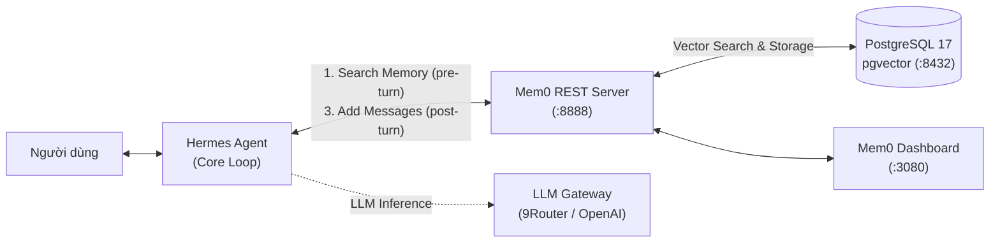
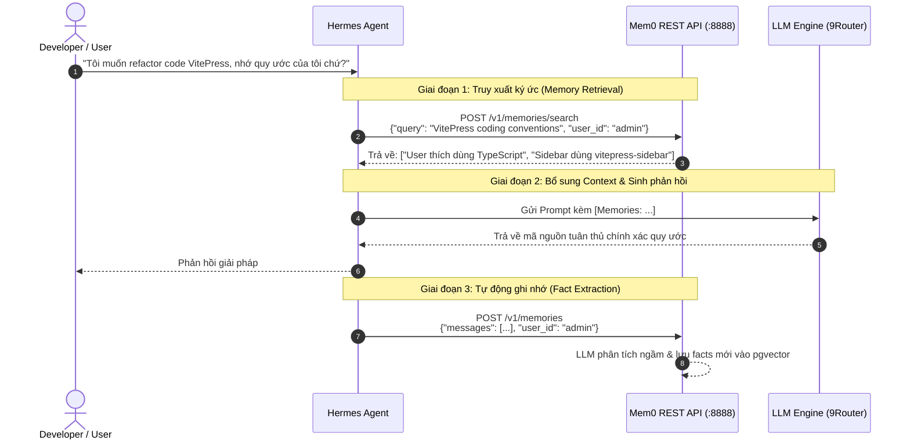

# Hướng dẫn Tích hợp & Vận hành: Mem0 Long-Term Memory cho Hermes Agent

> **Phạm vi:** Thiết lập và kết nối hệ thống bộ nhớ dài hạn (**Mem0 Self-Hosted**) vào **Hermes Agent**, giúp Agent duy trì bối cảnh liên tục qua các phiên làm việc, tự động trích xuất sở thích người dùng và quản trị tri thức dự án.  
> **Trạng thái:** Đã triển khai và kiểm chứng thực tế trên cụm Docker cục bộ (API port `8888`, Dashboard port `3080`, pgvector port `8432`).  
> **Tài liệu liên quan:** [Hermes Agent tích hợp Langfuse](../hermes-langfuse-integration/) · [Handoff Đa tác tử GPT Web - Drive - Kanban](../gptweb-google-drive-hermes-kanban/) · [Kiến trúc WeKnora Personal Knowledge Platform](../../kien-truc/weknora-personal-knowledge-platform/)

---

## 1. Giới thiệu & Tại sao Hermes cần Mem0

Trong vòng đời hoạt động của một AI Agent như **Hermes**, **Context Window** của mô hình ngôn ngữ lớn (LLM) là hữu hạn và mang tính tạm thời:
- Sau mỗi lệnh `/reset` hoặc `/new`, toàn bộ ngữ cảnh trao đổi trước đó sẽ bị xóa sạch.
- Khi hội thoại kéo dài, chi phí token tăng vọt và mô hình gặp hiện tượng trôi dạt ngữ cảnh (*context drift* / *lost in the middle*).
- RAG truyền thống (Retrieval-Augmented Generation) chỉ tìm kiếm văn bản tĩnh, không theo dõi được **sự tiến hóa về sở thích, thói quen và các quyết định kỹ thuật** của người dùng qua thời gian.

**Mem0** ("mem-zero") đóng vai trò là **lớp bộ nhớ thông minh (Memory Layer)**:
1. **Dynamic Fact Extraction:** Tự động phân tích hội thoại để trích xuất các sự thật (*facts*), sở thích (*preferences*) và thông tin ngữ cảnh quan trọng thay vì lưu trữ mù quáng cả đoạn chat.
2. **Multi-layer Memory Scope:** Phân chia không gian bộ nhớ linh hoạt theo Người dùng (`user_id`), Tác tử (`agent_id`) và Phiên chạy (`run_id`).
3. **Continuous Updating:** Tự động hợp nhất (merge), cập nhật (update) hoặc làm mất hiệu lực (invalidate) các thông tin cũ khi có sự thật mới mâu thuẫn.



---

## 2. Kiến trúc Cụm Mem0 Self-Hosted (Docker)

Cụm dịch vụ Mem0 được đóng gói và vận hành qua Docker Compose tại thư mục `server/` của mã nguồn Mem0.

### 2.1. Cấu trúc Topology 3 Tầng

| Container Service | Image | Cổng Host | Chức năng |
| :--- | :--- | :--- | :--- |
| **`mem0-dev-postgres-1`** | `pgvector/pgvector:pg17` | `8432:5432` | Cơ sở dữ liệu PostgreSQL 17 tích hợp tiện ích mở rộng vector `pgvector 0.8.0` lưu trữ embeddings và bảng `mem0_app`. |
| **`mem0-dev-mem0-1`** | `mem0-dev-mem0` (Python 3.12) | `8888:8000` | REST API Server xây dựng bằng FastAPI, thực thi logic trích xuất memory, nhúng vector và xác thực `X-API-Key` / JWT. |
| **`mem0-dev-mem0-dashboard-1`** | `mem0-dev-mem0-dashboard` (Next.js 14) | `3080:3000` | Web UI trực quan để duyệt memory, quản lý API Key, kiểm tra audit log và cấu hình LLM runtime. |

### 2.2. Điểm truy cập hệ thống

- **Dashboard Quản trị:** `http://localhost:3080`
- **OpenAPI Interactive Docs (Swagger):** `http://localhost:8888/docs`
- **Postgres Database:** `localhost:8432` (User: `postgres`, DB: `postgres` & `mem0_app`)

---

## 3. Nhật ký Vận hành & Xử lý Cạm bẫy trên Windows

Trong quá trình triển khai thực tế trên môi trường Windows (Docker Desktop + WSL2), cụm dịch vụ đã được xử lý 3 vấn đề tương thích quan trọng:

### 3.1. Tránh xung đột cổng `3000` với container đang chạy

Trên máy chủ phát triển cục bộ, cổng `3000` vốn đang được container `agentgateway` chiếm dụng. Nếu để mặc định, Docker Compose sẽ báo lỗi `port is already allocated`.

**Giải pháp:**  
1. Ánh xạ cổng của `mem0-dashboard` từ `3000:3000` thành `3080:3000` trong `docker-compose.yaml`.
2. Khai báo biến môi trường `DASHBOARD_URL=http://localhost:3080` trong `server/.env` và `docker-compose.yaml` để CORS Middleware trên FastAPI cho phép nhận request từ UI mới.

### 3.2. Lỗi ký tự ngắt dòng CRLF trong bash script

Khi clone Git trên Windows, các file script bash (`init-db.sh`, `dashboard/entrypoint.sh`, `scripts/seed.sh`) mặc định bị gán ký tự xuống dòng `\r\n` (CRLF). Khi gắn (volume mount) vào container Linux:
- Script khởi tạo Postgres `/docker-entrypoint-initdb.d/init-db.sh` bị báo lỗi `line 2: $'\r': command not found` khiến database `mem0_app` không được tự tạo.
- Next.js entrypoint script bị crash ngay khi container start.

**Giải pháp:** Chuyển đổi toàn bộ các file `.sh` sang định dạng chuẩn Unix LF (`\n`):
```powershell
$files = @("server/init-db.sh", "server/dashboard/entrypoint.sh", "server/scripts/seed.sh")
foreach ($f in $files) {
    $content = [System.IO.File]::ReadAllText($f).Replace("`r`n", "`n")
    [System.IO.File]::WriteAllText($f, $content, (New-Object System.Text.UTF8Encoding($false)))
}
```

### 3.3. Tối ưu cài đặt Poetry trong `dev.Dockerfile`

Trong file `dev.Dockerfile` gốc, lệnh cài Poetry sử dụng `curl -sSL https://install.python-poetry.org | python3 -` dễ bị lỗi mạng socket `ECONNRESET` hoặc timeout trên một số nhà mạng.  
**Giải pháp:** Đổi sang cài đặt trực tiếp qua `pip install --no-cache-dir poetry`, đảm bảo build image mượt mà và tái sử dụng layer cache.

---

## 4. Cấu hình Môi trường (`server/.env`)

File cấu hình tại `d:\4.Code\mem0\server\.env`:

```ini
# --- LLM & Embedder ---
OPENAI_API_KEY=sk-proj-xxxx...              # Điền OpenAI Key thật của bạn
MEM0_DEFAULT_LLM_MODEL=gpt-4o-mini          # Model dùng để phân tích và trích xuất facts
MEM0_DEFAULT_EMBEDDER_MODEL=text-embedding-3-small

# --- Cơ sở dữ liệu pgvector ---
POSTGRES_HOST=postgres
POSTGRES_PORT=5432
POSTGRES_DB=postgres
POSTGRES_USER=postgres
POSTGRES_PASSWORD=0YCQbzktfgsT2Fi5wGpc8vBn  # Mật khẩu ngẫu nhiên đã tạo
POSTGRES_COLLECTION_NAME=memories

# --- Bảo mật & Xác thực ---
ADMIN_API_KEY=m0-sMYw1fcZTl8ka5buCd47UoigeAFntK6J
JWT_SECRET=BQ81GT6ZispAV5zPD2yFRpXlGfY9zOYNgCGFKRkmeZ0=
AUTH_DISABLED=false
DASHBOARD_URL=http://localhost:3080
APP_DB_NAME=mem0_app

# --- Vận hành & Thu dọn ---
MEM0_TELEMETRY=true
REQUEST_LOG_RETENTION_DAYS=30
```

> [!TIP]
> Sau khi chỉnh sửa `OPENAI_API_KEY`, chỉ cần áp dụng lại biến môi trường mà không cần rebuild image:
> ```powershell
> cd d:\4.Code\mem0\server
> docker compose up -d
> ```

---

## 5. Hướng dẫn Tích hợp vào Hermes Agent

Có 2 phương thức chính để Hermes Agent khai thác cụm Mem0: **Agent Tool (Explicit)** và **Lifecycle Hooks (Implicit)**.



---

### Phương thức 1: Đăng ký Tool / Skill cho Hermes Agent (Khuyên dùng)

Khai báo cho Hermes công cụ tìm kiếm và ghi nhớ để tác tử chủ động quyết định lúc nào cần dùng.

Tạo file skill `mem0_memory.py` hoặc thêm vào thư mục kỹ năng của Hermes:

```python
import os
import requests
from typing import Optional, List, Dict, Any

MEM0_API_URL = os.getenv("MEM0_API_URL", "http://localhost:8888")
MEM0_API_KEY = os.getenv("MEM0_API_KEY", "m0-sMYw1fcZTl8ka5buCd47UoigeAFntK6J")

HEADERS = {
    "Content-Type": "application/json",
    "X-API-Key": MEM0_API_KEY
}

def search_memory(query: str, user_id: str = "default_user", limit: int = 5) -> List[Dict[str, Any]]:
    """Tìm kiếm các ký ức liên quan từ Mem0 dựa trên câu hỏi hoặc ngữ cảnh hiện tại."""
    url = f"{MEM0_API_URL}/v1/memories/search"
    payload = {
        "query": query,
        "filters": {"user_id": user_id},
        "limit": limit
    }
    response = requests.post(url, json=payload, headers=HEADERS, timeout=10)
    response.raise_for_status()
    return response.json()

def save_memory(messages: List[Dict[str, str]], user_id: str = "default_user") -> Dict[str, Any]:
    """Gửi các lượt hội thoại để Mem0 tự động trích xuất các facts và lưu vào bộ nhớ dài hạn."""
    url = f"{MEM0_API_URL}/v1/memories"
    payload = {
        "messages": messages,
        "user_id": user_id,
        "infer": True
    }
    response = requests.post(url, json=payload, headers=HEADERS, timeout=15)
    response.raise_for_status()
    return response.json()
```

Khai báo JSON Tool Definition cho Hermes:

```json
[
  {
    "type": "function",
    "function": {
      "name": "search_memory",
      "description": "Tra cứu các thông tin đã ghi nhớ, sở thích người dùng, quy ước dự án từ bộ nhớ dài hạn Mem0.",
      "parameters": {
        "type": "object",
        "properties": {
          "query": {
            "type": "string",
            "description": "Từ khóa hoặc câu hỏi cần tra cứu ký ức liên quan"
          },
          "user_id": {
            "type": "string",
            "description": "Định danh người dùng, mặc định 'default_user'"
          }
        },
        "required": ["query"]
      }
    }
  },
  {
    "type": "function",
    "function": {
      "name": "save_memory",
      "description": "Lưu các sự thật quan trọng, quyết định kiến trúc hoặc sở thích của người dùng vào bộ nhớ dài hạn.",
      "parameters": {
        "type": "object",
        "properties": {
          "content": {
            "type": "string",
            "description": "Nội dung cần ghi nhớ"
          }
        },
        "required": ["content"]
      }
    }
  }
]
```

---

### Phương thức 2: Tự động hóa qua Hermes Lifecycle Hooks (Implicit Memory)

Nếu không muốn tốn lượt gọi Tool Call, có thể dùng plugin hook của Hermes:

1. **`pre_llm_call` Hook:**
   - Trích xuất prompt cuối của người dùng.
   - Gửi truy vấn ngầm tới `POST http://localhost:8888/v1/memories/search`.
   - Nếu có ký ức liên quan, tự động chèn vào đầu System Message dưới dạng:
     ```text
     [User Memory Context]
     - Người dùng ưu tiên kiến trúc Clean Architecture.
     - Luôn sử dụng Conventional Commits cho git commits.
     ```
2. **`post_llm_call` Hook (Chạy bất đồng bộ):**
   - Đẩy cặp `(user_message, assistant_message)` vào hàng đợi nền gửi đến `POST http://localhost:8888/v1/memories`.
   - Vì chạy ngầm (`fail-open`), việc trích xuất ký ức không làm tăng độ trễ phản hồi của Hermes tới người dùng.

---

## 6. Kiểm tra & Thao tác Thực tế với Mem0 API

Bạn có thể test trực tiếp các API của Mem0 qua PowerShell hoặc cURL:

### 6.1. Thêm một ký ức mới (Fact Extraction)

```bash
curl -X POST "http://localhost:8888/v1/memories" \
  -H "Content-Type: application/json" \
  -H "X-API-Key: m0-sMYw1fcZTl8ka5buCd47UoigeAFntK6J" \
  -d '{
    "messages": [
      {"role": "user", "content": "Dự án my-wiki của tôi viết bằng VitePress, tôi thích phong cách viết tài liệu có sơ đồ Mermaid và bảng so sánh chi tiết."}
    ],
    "user_id": "admin"
  }'
```

### 6.2. Tìm kiếm ký ức (Semantic Search)

```bash
curl -X POST "http://localhost:8888/v1/memories/search" \
  -H "Content-Type: application/json" \
  -H "X-API-Key: m0-sMYw1fcZTl8ka5buCd47UoigeAFntK6J" \
  -d '{
    "query": "Quy ước viết tài liệu wiki của tôi là gì?",
    "filters": {"user_id": "admin"}
  }'
```

Kết quả trả về sẽ tự động trích lọc chính xác fact liên quan:
```json
[
  {
    "id": "c1f7b0a8-...",
    "memory": "Thích phong cách viết tài liệu có sơ đồ Mermaid và bảng so sánh chi tiết cho dự án my-wiki (VitePress)",
    "score": 0.892,
    "created_at": "2026-10-15T08:15:00Z"
  }
]
```

### 6.3. Quản trị qua Web Dashboard

Truy cập **`http://localhost:3080`**:
1. Vào tab **Memories**: Xem danh sách toàn bộ các ký ức đã được trích xuất, chỉnh sửa trực tiếp nội dung hoặc xóa ký ức lỗi thời.
2. Vào tab **Entities**: Quản lý danh sách các `user_id`, `agent_id`, `run_id`. Có thể bấm xóa một Entity để xóa tầng (cascade) toàn bộ bộ nhớ của đối tượng đó.
3. Vào tab **API Keys**: Tạo các API Key mới dành riêng cho từng môi trường (Hermes CLI, Hermes WebUI, Subagents).
4. Vào tab **Requests**: Kiểm tra lịch sử kiểm toán (Audit log) các lượt gọi API, độ trễ và mã phản hồi HTTP.

---

## 7. Các Lệnh Quản trị Cần Thiết

Mở terminal tại thư mục `d:\4.Code\mem0\server`:

```powershell
# Xem log trực tiếp của server
docker compose logs -f mem0

# Kiểm tra trạng thái sức khỏe các container
docker compose ps

# Reset mật khẩu tài khoản Admin nếu quên
docker compose exec -T -e EMAIL="admin@example.com" -e PASSWORD="new-strong-password" -e PYTHONPATH=/app mem0 python scripts/reset_admin_password.py

# Dọn dẹp log request cũ hơn 30 ngày để tối ưu dung lượng DB
docker compose exec -T -e REQUEST_LOG_RETENTION_DAYS="30" -e PYTHONPATH=/app mem0 python scripts/prune_request_logs.py

# Dừng cụm dịch vụ
docker compose down

# Khởi động lại
docker compose up -d
```

---

## 8. Kết luận & Lộ trình Tiếp theo

Việc kết hợp **Hermes Agent** với **Mem0 Self-Hosted** mang lại năng lực nhận thức liên tục (**Continual Learning & Personalization**):
- Hermes không còn là một chatbot "mất trí nhớ" sau mỗi lần khởi động.
- Mọi sở thích code, kiến trúc hệ thống và quyết định dự án đều được tích lũy tự nhiên vào cơ sở dữ liệu `pgvector`.
- Toàn bộ dữ liệu nằm 100% trên hạ tầng nội bộ của bạn, đảm bảo tính bảo mật và quyền riêng tư tuyệt đối.
