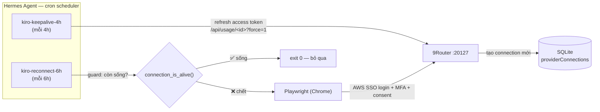
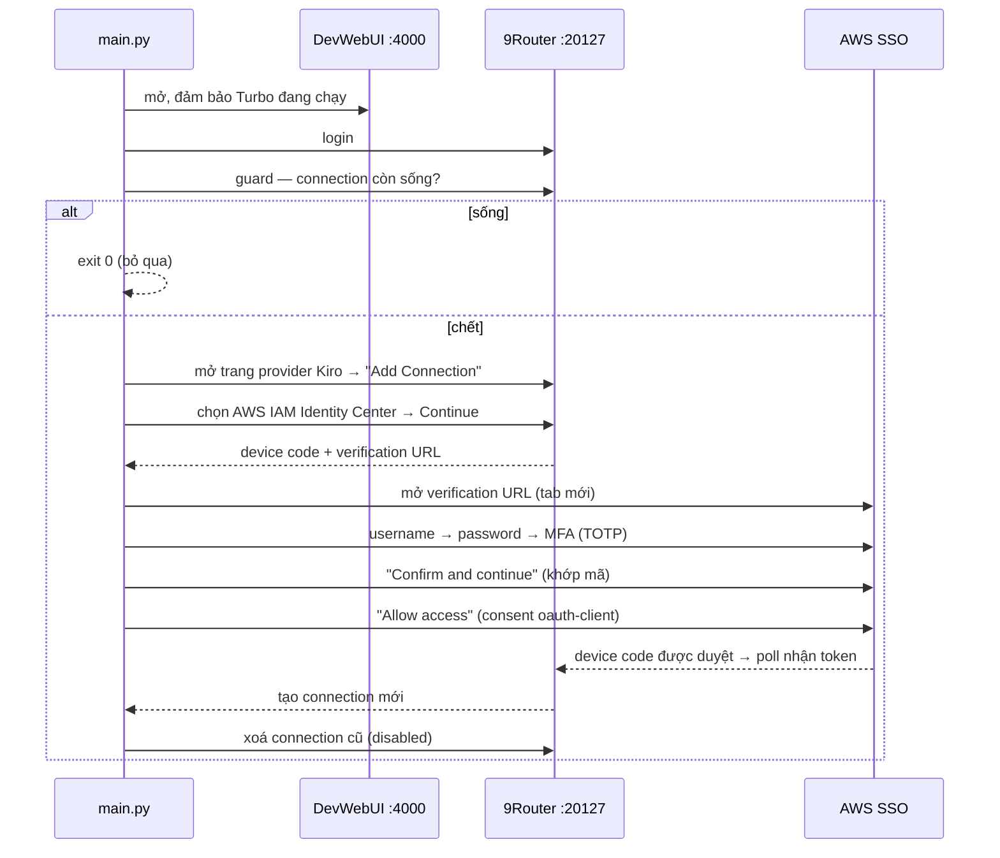

# Tự động duy trì phiên Kiro trên 9Router

> **Mục tiêu:** giữ phiên đăng nhập **Kiro** (Amazon Q / CodeWhisperer qua 9Router) không bị hết hạn bằng hai cơ chế tự động chạy định kỳ trên Hermes Agent — **keepalive** (gia hạn token mỗi 4 giờ) và **reconnect** (đăng nhập lại tự động bằng Playwright mỗi 6 giờ khi phiên đã chết). Kiro xác thực qua **AWS IAM Identity Center (IDC) device flow**, nên mỗi lần đăng nhập đều phải đi qua một trình duyệt thật.

## 1. Bài toán

Kiro trên 9Router là một *provider connection* xác thực bằng AWS IAM Identity Center (IDC). Cơ chế này cấp:

- **Access token** — sống khoảng 1 giờ.
- **Refresh token** — sống theo *session duration* của IDC (vài giờ), hết hạn tuyệt đối, không thể gia hạn vô hạn.

Hệ quả: access token cần được làm mới liên tục (keepalive), còn khi refresh token chết thì bắt buộc phải đăng nhập lại từ đầu (reconnect). Vì IDC dùng *device flow* (hiện mã, duyệt trên web), không thể gọi API đăng nhập đơn thuần — phải điều khiển trình duyệt.

## 2. Kiến trúc tổng quan

Hai cron job, hai script, cộng một **guard idempotent** (chặn chạy trùng khi phiên còn sống):



| Thuộc tính | keepalive | reconnect |
|---|---|---|
| Tên job | `kiro-keepalive-4h` | `kiro-reconnect-6h` |
| Job ID | `28d8b0cfdc9b` | `a53e341dacdb` |
| Lịch chạy | `every 240m` (4 giờ) | `every 360m` (6 giờ) |
| Script | `kiro-keepalive.sh` → `keepalive.py` | `kiro-reconnect.sh` → `main.py` |
| Cơ chế | Gọi API gia hạn token | Điều khiển Chrome (Playwright) |
| Deliver | `local` (lưu cục bộ) | `local` |
| Failure deliver | `origin` (chat) | `origin` |
| Trạng thái | ✅ `ok` | ✅ `ok` |

Cả hai script nằm ở `D:\4.Code\9router\scripts\`, wrapper cron nằm ở `C:\Users\ADMIN\AppData\Local\hermes\scripts\` (bắt buộc — đường dẫn script cron phải tương đối so với thư mục này).

## 3. Luồng reconnect chi tiết

`main.py` (Playwright, channel Chrome) thực hiện tuần tự:



### Bước 1–2: Chuẩn bị môi trường
Mở DevWebUI `127.0.0.1:4000`, kiểm tra hàng **Turbo** — nếu chưa chạy thì bật, rồi đăng nhập 9Router `127.0.0.1:20127`.

### Bước 3: Guard idempotent
Gọi `connection_is_alive()`: duyệt connection Kiro đang enabled, gọi `/api/usage/<id>?force=1`. Nếu trả về quota hợp lệ → phiên còn sống → `exit 0`, không làm gì thêm. Guard này là điều kiện tiên quyết để cron chạy định kỳ mà không tạo connection trùng.

### Bước 4–6: Khởi tạo device flow
Trên trang provider Kiro, bấm **"Add Connection"** → chọn **AWS IAM Identity Center** → Continue. 9Router đăng ký oauth-client với IDC, gọi `device_authorization`, trả về **device code + verification URL**.

### Bước 7–10: Đăng nhập AWS SSO (trình duyệt thật)
Đây là phần nhạy cảm nhất, gồm **bốn** màn hình liên tiếp:
1. Username → Next.
2. Password → Sign in.
3. MFA: nhập mã **TOTP** (RFC 6238, secret đọc từ `.env`).
4. **"Confirm and continue"** — xác nhận mã khớp.
5. **"Allow access"** — màn hình consent *"Allow kiro-oauth-client to access your data?"*.

### Bước 11–12: Chờ poll & dọn dẹp
Sau consent, 9Router poll token endpoint và tạo connection mới. `wait_for_connection()` bám `/api/providers` cho tới khi thấy connection Kiro mới (enabled + active), rồi `cleanup_old_connections()` xoá các connection cũ đã disabled.

## 4. Bẫy thực chiến đã gặp

Đây là phần quan trọng nhất — tự động hoá một web flow của bên thứ ba (AWS SSO) rất dễ gãy theo cách âm thầm.

### 4.1 Device flow cần HAI lần click, không phải một
Lỗi gây ra `trigger job 6h bị lỗi`: sau **"Confirm and continue"** còn một màn hình consent **"Allow access"** nữa. Script đầu chỉ click bước đầu → device code vĩnh viễn ở trạng thái `authorization_pending` → 9Router không bao giờ tạo connection. Biểu hiện bên ngoài chỉ là "connection không được tạo", còn poll thì im lặng trả lỗi. **Bài học:** luôn kiểm tra trạng thái *sau* mỗi click bằng cách bắt nội dung trang, đừng giả định một click là đủ.

### 4.2 Workflow state hết hạn khi login chậm
Khi đăng nhập lâu (ví dụ MFA probe chậm), AWS SSO redirect về **access portal** thay vì trang duyệt thiết bị — màn hình "Confirm and continue" không bao giờ xuất hiện. **Khắc phục:** nếu không thấy màn hình duyệt, mở lại verification URL (session đã active nên lần này vào thẳng trang duyệt).

### 4.3 Connection tích tụ vì dedup dựa trên email
Dedup của 9Router (`createProviderConnection`) chỉ gộp khi `authType === "oauth" && data.email`. Kiro IDC không trả email → mỗi lần reconnect **thêm** một connection mới và disable cái cũ. **Khắc phục:** reconnect tự xoá connection disabled sau khi tạo mới; keepalive ưu tiên connection `isActive !== false` (mới nhất) thay vì `connections[0]`.

### 4.4 Keepalive bám nhầm connection chết
Fallback `connections[0]` lấy hàng đầu tiên của API — thường là connection cũ đã chết — khiến keepalive báo lỗi `no credit quota` dù connection mới vẫn sống. **Khắc phục:** sắp xếp theo enabled + `updatedAt` giảm dần rồi chọn cái đầu.

### 4.5 Selector MFA sai làm chậm 50 giây
Trường MFA thật của AWS SSO là `input[placeholder="Enter code"]`, nhưng script cũ thử 5 selector sai × 10 giây trước khi rơi đúng → tổng ~50 giây lãng phí, đẩy flow vượt ngưỡng timeout. **Khắc phục:** đặt đúng selector lên đầu, giảm timeout probe còn 3 giây.

### 4.6 Nút "Add" đổi nhãn
Nút tạo connection từng là "Add" (hoặc "add Add"), nay render thành **"add Add Connection"** (icon + nhãn). Selector khớp chính xác "Add" sẽ miss. **Khắc phục:** khớp `/Add Connection/i`, giữ fallback cho nhãn "Add" cũ.

## 5. Vòng kiểm chứng

Không tin "đã bấm nút" — xác nhận bằng output thật ở từng lớp:

| Lớp | Kết quả thật |
|---|---|
| Reconnect (chạy tay) | `SUCCESS: new kiro connection created d1185580-...`, exit 0 |
| Keepalive | `OK conn=d1185580 plan=KIRO PRO+ remaining=768.37` |
| DB | 1 connection Kiro: `isActive=1`, `testStatus=active` |
| Cron (đường scheduler) | cả hai job `last_status: ok` |

Phương pháp chẩn đoán hữu ích nhất: **tự gọi lại token endpoint** (`https://oidc.<region>.amazonaws.com/token`) bằng `clientId`/`clientSecret`/`deviceCode` lấy từ phản hồi device-code. Nó trả `authorization_pending` cho tới khi device được duyệt — tách bạch được lỗi "chưa consent" khỏi lỗi "poll của 9Router hỏng".

## 6. Quản lý & bài học vận hành

```bash
hermes cron list                  # xem job + lần chạy gần nhất
hermes cron run a53e341dacdb      # chạy thử reconnect ngay
hermes cron run 28d8b0cfdc9b      # chạy thử keepalive ngay
bash scripts/kiro-keepalive/run.sh   # chạy keepalive thủ công
python scripts/kiro-reconnect/main.py # chạy reconnect thủ công
```

- **Guard idempotent là bắt buộc.** Cron định kỳ mà không có guard sẽ tạo connection trùng mỗi lần tick; guard biến "chạy mỗi 6h" thành "chỉ reconnect khi thật sự cần".
- **Tách hai nhịp khác nhau.** Keepalive (4h) rẻ — chỉ một lệnh API; reconnect (6h) đắt — mở Chrome, qua 5 màn hình. Chạy thưa hơn cho tác vụ nặng.
- **Bí mật nằm ngoài repo.** `user`, `password`, `AWS_TOTP_SECRET` để trong `.env` (đã gitignore). Mã TOTP sinh lúc chạy theo RFC 6238, không lưu mã cố định.
- **Tự động hoá web flow của bên thứ ba thì phải bắt DOM thật.** Mỗi click đều cần xác minh bằng trạng thái trang kế tiếp; một lần "đã click" không chứng minh được gì.
