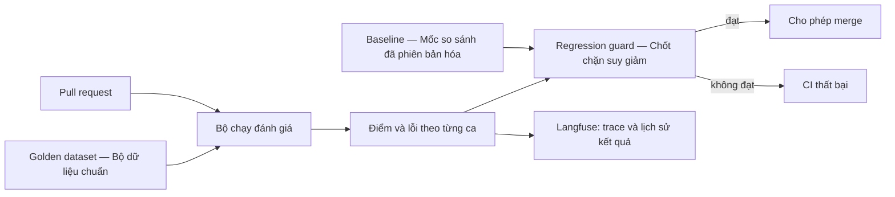

# Đánh giá agent trong CI/CD: Promptfoo, DeepEval, Langfuse và GitHub Actions

> [!IMPORTANT]
> **Chế độ xử lý:** Tổng thuật tiếng Việt (`ORIGINAL_SUMMARY`), không phải bản dịch toàn văn.
>
> **Nguồn:** [Agent evals in CI/CD: Promptfoo + DeepEval + Langfuse + GitHub Actions](https://numoru.com/en/contributions/evals-agentes-ci-cd-promptfoo) — **Numoru Engineering**, xuất bản **06/07/2026**, truy cập **06/10/2026**.
>
> **Quyền chuyển thể:** metadata của trang ghi “© Numoru. All rights reserved.” Trang giấy phép được liên kết chỉ cho phép tái sử dụng **hình ảnh** nguyên vẹn có ghi nguồn; việc dịch hoặc sửa hình cần giấy phép bằng văn bản. Không quan sát thấy quyền dịch toàn văn bài viết, nên trang này không sao chép code, sơ đồ hay cấu trúc đầy đủ của tác giả.

## Tổng thuật tiếng Việt

Bài viết đề xuất đưa đánh giá agent vào mỗi pull request bằng bốn thành phần: Promptfoo kiểm tra đầu ra theo rubric và điều kiện xác định; DeepEval chấm các thuộc tính của RAG; Langfuse lưu dấu vết, bộ dữ liệu chuẩn và kết quả theo lần chạy; GitHub Actions điều phối các bước. Một baseline trên nhánh chính được so với điểm của thay đổi mới; regression guard trả mã lỗi để chặn merge khi mức giảm vượt ngưỡng do nhóm đặt ra. Bộ dữ liệu chuẩn được lưu dạng tệp để review và được phiên bản hóa nhằm phát hiện thay đổi. Tác giả cũng bàn về lấy mẫu dữ liệu vận hành, chi phí và các lỗi thường gặp như dùng ngưỡng trung bình cho ca nghiêm trọng. Các con số về ngưỡng, chi phí, sự cố và hiệu quả thương mại là lựa chọn hoặc tuyên bố trong bài; trang này không xem chúng là benchmark độc lập. Mã mẫu và pipeline chưa được chạy trong my-wiki. [Nguồn A03](https://numoru.com/en/contributions/evals-agentes-ci-cd-promptfoo)

## Phân tích kiến trúc độc lập

Phần này do agent tổng hợp, không phải nội dung dịch từ bài gốc.

### Evaluate không đồng nghĩa với assertion

- **Evaluate — đánh giá** tạo điểm, lý do hoặc báo cáo. Việc gọi một hàm đánh giá chưa tự chứng minh tiến trình sẽ trả exit code khác 0.
- **Assertion — khẳng định kiểm thử** biến điều kiện mong đợi thành kết quả pass/fail mà test runner hiểu được.
- **Regression guard — chốt chặn suy giảm** phải so kết quả mới với baseline, áp dụng chính sách và làm job thất bại rõ ràng khi vi phạm.
- Trong snippet DeepEval của bài, hàm kiểm thử gọi `evaluate(cases, metrics)` với threshold, nhưng lần rà soát tài liệu này không chạy code và không xác minh hành vi exit code của phiên bản thư viện được ghim. Trước khi dùng làm quality gate, cần tạo một ca cố ý dưới ngưỡng và quan sát CI thất bại thật.

### Baseline cần có danh tính

Một baseline hữu ích nên gắn với phiên bản agent, prompt, model, judge, metric, dataset và cấu hình sampling. Nếu chỉ lưu một điểm trung bình, thay đổi judge hoặc dữ liệu có thể bị hiểu nhầm là agent suy giảm. Với ca tuân thủ hoặc an toàn, nên có gate riêng thay vì để điểm trung bình che khuất lỗi nghiêm trọng.

### Phân vai công cụ

| Thành phần | Vai trò trong phương án | Điều cần xác minh trước khi áp dụng |
|---|---|---|
| Promptfoo | Test runner cho prompt và điều kiện đầu ra | Assertion nào quyết định exit code; phiên bản config/CLI |
| DeepEval | Metric cho chất lượng RAG/agent | Schema test case, judge, độ biến thiên và hành vi fail |
| Langfuse | Trace, dataset run và lịch sử điểm | ID liên kết, quyền truy cập, retention và API/version |
| GitHub Actions | Điều phối, secrets và branch gate | Job dependency, artifact, required status check |
| Regression guard | So sánh PR với baseline | Chính sách delta, ca nghiêm trọng, dữ liệu thiếu và lỗi hạ tầng |

## Thuật ngữ Anh–Việt

| English | Tiếng Việt |
|---|---|
| Agent evaluation / eval | Đánh giá agent |
| Golden dataset | Bộ dữ liệu chuẩn |
| Baseline | Mốc so sánh |
| Regression | Suy giảm chất lượng |
| Regression guard | Chốt chặn suy giảm |
| Quality gate | Cổng kiểm soát chất lượng |
| Assertion | Khẳng định kiểm thử |
| Threshold | Ngưỡng |
| Trace | Dấu vết thực thi |
| LLM-as-a-Judge | Mô hình ngôn ngữ làm giám khảo |

## Giới hạn bằng chứng

- Đã đọc toàn bộ nội dung công khai trả về tại URL nguồn và trang giấy phép hình ảnh; không vượt chặn truy cập.
- Tác giả và ngày lấy từ metadata có cấu trúc và phần đầu bài. Không xác minh độc lập các số liệu, case study, chi phí hay tuyên bố hiệu quả của tác giả.
- Không clone hoặc chạy repository mẫu, không cài Promptfoo/DeepEval/Langfuse, không gọi model và không chạy GitHub Actions. Kiểm tra thực hiện cho nhiệm vụ này chỉ là build/link/render của trang tài liệu.
- Giấy phép repository code, nếu có, không được suy rộng thành quyền dịch bài blog.

## Đọc thêm

- [Báo cáo EDD và kiến trúc đánh giá agent với Langfuse + DeepEval](./)
- [Bài gốc A03](https://numoru.com/en/contributions/evals-agentes-ci-cd-promptfoo)
- [Giấy phép hình ảnh của Numoru](https://numoru.com/en/licencia)
