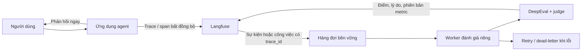

# Các mẫu tích hợp agent với Langfuse và DeepEval

> [!IMPORTANT]
> **Chế độ xử lý: Tổng thuật tiếng Việt (`ORIGINAL_SUMMARY`), không phải bản dịch toàn văn.** Không quan sát thấy giấy phép cho phép dịch/chuyển thể toàn văn bài viết. Dòng “Open Source (Apache 2.0)” trên trang chủ và giấy phép của repository code không được suy rộng thành quyền dịch tài liệu này. Trang không sao chép code hoặc sơ đồ nguồn; xem nội dung nguyên bản tại [bài A04](https://langeval.space/docs/11-Integration-Patterns).

## Thông tin nguồn và phạm vi đọc

| Trường | Thông tin |
|---|---|
| Bài gốc | [Agent Integration Patterns Guide](https://langeval.space/docs/11-Integration-Patterns) |
| Tác giả | Dự án LangEval; trang không hiển thị byline, chưa xác nhận được cá nhân tác giả |
| Nhà xuất bản | LangEval |
| Ngày xuất bản/cập nhật | Không hiển thị; chưa xác nhận được |
| Ngày truy cập | 06/10/2026 |
| Mức độ đã đọc | Toàn bộ nội dung công khai trả về tại URL nguồn, gồm năm mẫu, bảng so sánh và sơ đồ tuần tự hiển thị dưới dạng Mermaid trong HTML; không gặp tường phí |
| Quyền dịch | Chưa tìm thấy quyền phái sinh rõ ràng cho bài; điều khoản dịch vụ chỉ cấp quyền dùng nền tảng/SDK có giới hạn |

## Tổng thuật tiếng Việt

Tài liệu LangEval trả lời câu hỏi đánh giá một agent bằng năm mức tích hợp. Black-box gọi API chat và chỉ thu cặp đầu vào–đầu ra; proxy chuyển lời gọi mô hình qua một điểm trung gian; SDK gửi log bất đồng bộ; callback của framework thu dấu vết sâu hơn. Mẫu cuối đặt Langfuse làm nơi lưu trace/span, còn một worker DeepEval chạy nền lấy trace, tính metric rồi ghi điểm trở lại. Theo dự án, tách đường chấm khỏi đường phản hồi giúp người dùng không phải chờ lời gọi mô hình giám khảo và cho phép mở rộng worker độc lập. Đổi lại, phương án này cần tích hợp trung bình và cơ chế vận hành cho công việc nền. Bảng của nguồn gắn black-box với kiểm thử chấp nhận, proxy với quan sát lời gọi LLM, callback với gỡ lỗi sâu và mẫu Langfuse–DeepEval với ứng dụng RAG ở môi trường doanh nghiệp. “Kiến trúc doanh nghiệp được khuyến nghị” là nhãn/quan điểm của dự án, không phải kết quả benchmark độc lập. [Nguồn A04](https://langeval.space/docs/11-Integration-Patterns)

*Phần tổng thuật trên được viết mới, dưới 200 từ và không tái tạo cấu trúc đầy đủ của bài gốc.*

## Phân tích kiến trúc độc lập

Phần này do agent tổng hợp; sơ đồ dưới đây do agent tạo, không phải sơ đồ của tác giả.

### Vì sao worker riêng đáng cân nhắc?

Worker riêng tách độ trễ và lỗi của mô hình giám khảo khỏi request người dùng, đồng thời có thể scale theo backlog. Tuy nhiên, “bất đồng bộ” chưa đồng nghĩa “bền vững”: nếu chỉ tạo tác vụ trong tiến trình agent, restart hoặc scale-to-zero có thể làm mất việc. Phương án vận hành cần queue/outbox, retry có giới hạn, dead-letter queue, khóa lũy đẳng và giám sát backlog. Đây là khuyến nghị của trang này, không phải xác nhận rằng LangEval đã triển khai các cơ chế đó.

### So sánh theo dữ liệu quan sát được

| Mẫu | Dữ liệu nhìn thấy | Điểm mạnh | Giới hạn chính |
|---|---|---|---|
| Black-box — hộp đen | Input/output cuối | Không cần sửa code; gần kiểm thử chấp nhận | Khó tìm nguyên nhân ở bước trung gian |
| LLM proxy — proxy mô hình | Prompt/response đi qua proxy | Thay đổi cấu hình nhỏ; quan sát lời gọi LLM | Không thấy đầy đủ tool call, DB hoặc logic nội bộ |
| Async SDK log — ghi log SDK bất đồng bộ | Trường do ứng dụng gửi | Linh hoạt với agent tùy biến | Cần quản lý giao nhận, lỗi và schema |
| Framework callback — callback framework | Trace các bước framework phát ra | Gỡ lỗi sâu hơn | Phụ thuộc hook, phiên bản và độ phủ instrumentation |
| Langfuse → DeepEval worker | Trace/context cùng score ghi ngược | Tách observability và evaluation; scale worker riêng | Nhiều thành phần hơn; cần correlation, queue và vận hành lỗi |

Không có mẫu tốt nhất cho mọi tình huống. Black-box phù hợp để kiểm tra hành vi ngoài; proxy hoặc callback giúp chẩn đoán; worker ngoài phù hợp khi chi phí chấm cao và cần lưu kết quả theo trace. Với dữ liệu nhạy cảm, mỗi mẫu còn phải được đánh giá về consent, redaction, retention và quyền truy cập.

## Từ khóa Anh–Việt

| English | Tiếng Việt |
|---|---|
| Black-box simulation | Mô phỏng hộp đen |
| LLM proxy middleware | Phần mềm trung gian proxy LLM |
| Async SDK logging | Ghi log SDK bất đồng bộ |
| Fire and forget | Khởi chạy rồi không chờ kết quả |
| Framework callback | Callback của framework |
| Deep instrumentation | Gắn đo lường chuyên sâu |
| Source of truth | Nguồn dữ liệu chuẩn |
| Evaluation worker | Worker đánh giá |
| Trace / span | Dấu vết / khoảng thực thi |
| Write-back score | Ghi điểm trở lại |
| Durable queue | Hàng đợi bền vững |
| Idempotency | Tính lũy đẳng |

## Giới hạn bằng chứng

- Mô tả các mẫu và lợi ích ở phần tổng thuật là phát biểu của tài liệu LangEval; task không triển khai hoặc benchmark chúng.
- Không xác nhận được cá nhân tác giả hay ngày xuất bản từ trang nguồn. Tên dự án/nhà xuất bản được nhận diện từ branding của trang.
- Task không cài Langfuse, DeepEval, AutoGen hoặc LangEval; không chạy endpoint, proxy, callback hay worker. Kiểm tra thực thi chỉ dành cho build, link và render tài liệu.
- Việc Mermaid render trong my-wiki chỉ chứng minh cú pháp sơ đồ do agent tạo tương thích với build hiện tại, không kiểm chứng sơ đồ nguồn hay hệ thống runtime.
- Cần đối chiếu API và phiên bản SDK chính thức trước khi triển khai; không dùng URL hoặc snippet minh họa của nguồn như cấu hình production.

## Đọc thêm

- [Báo cáo EDD và kiến trúc đánh giá agent với Langfuse + DeepEval](./)
- [Bài gốc A04](https://langeval.space/docs/11-Integration-Patterns)
- [Điều khoản dịch vụ LangEval](https://langeval.space/terms)
