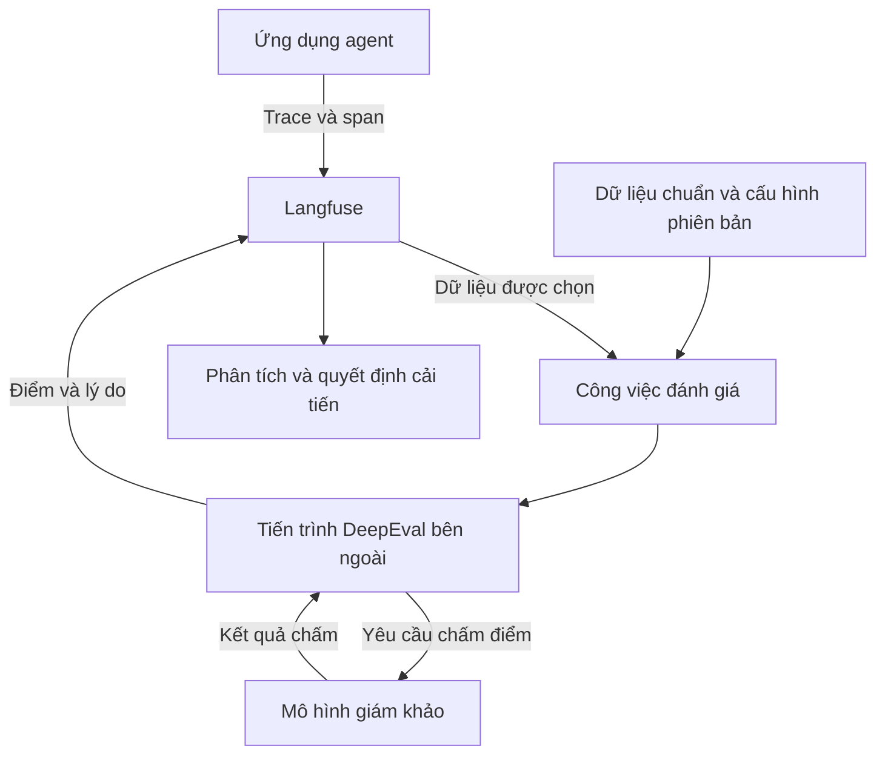

# EDD và kiến trúc đánh giá agent với Langfuse + DeepEval

Ngày tổng hợp: 06/10/2026. Đối tượng: kiến trúc sư giải pháp, kỹ sư phần mềm, nhóm nền tảng và vận hành AI.

**Trạng thái bằng chứng:** các tài liệu web được đọc để xác nhận chủ đề và cơ chế được mô tả. Chưa cài đặt công cụ, chạy code mẫu, đo tải hay kiểm chứng trên máy local. Các sơ đồ và phương án triển khai trong báo cáo là tổng hợp hoặc đề xuất, không phải hệ thống đã triển khai.

## 1. Tổng quan ý chính

**Phát triển dựa trên đánh giá — Eval-Driven Development (EDD)** đặt tiêu chí chất lượng và dữ liệu đánh giá vào vòng phát triển ứng dụng AI. Đội ngũ dùng kết quả đánh giá để quyết định thay đổi prompt, mô hình, công cụ hoặc luồng agent. Bài khởi đầu của DeepEval đề xuất xây một bộ ví dụ chuẩn, chọn các chỉ số có ý nghĩa rồi lặp lại quá trình cải tiến. Những gợi ý về số ví dụ và số chỉ số trong bài là kinh nghiệm của tác giả, không phải tiêu chuẩn bắt buộc. [S01]

**Langfuse + DeepEval** là một cách tổ chức vòng phản hồi này: Langfuse cung cấp dữ liệu quan sát và nơi gắn kết quả; DeepEval thực hiện logic chấm điểm trong một tiến trình Python hoặc công việc đánh giá bên ngoài. Tài liệu tích hợp chính thức mô tả việc nối hai công cụ, nhưng không có nghĩa mọi loại trace tự động chuyển thành mọi loại test case. [S02]

Kết luận kiến trúc của báo cáo: nên thiết kế dữ liệu đánh giá, định danh phiên bản và ranh giới trách nhiệm trước khi chọn toàn bộ bộ công cụ. Điểm đánh giá chỉ có ý nghĩa khi biết trường hợp nào được đo, dữ liệu nào được dùng và mô hình chấm điểm nào tạo ra kết quả.

Phạm vi tổng hợp bao gồm các câu hỏi trong cuộc trao đổi: EDD là gì; cách thực hiện cụ thể; công cụ liên quan trên GitHub; kết hợp DeepEval với Langfuse làm được gì; tài liệu kiến trúc; và bốn bài từ nguồn bên ngoài nói trực tiếp về hai công cụ. Các nguồn kiến trúc agent tổng quát được giữ ở phụ lục để tham khảo, không thay thế nguồn tích hợp trực tiếp.

## 2. Phân tích chi tiết

### 2.1. Từ yêu cầu nghiệp vụ tới vòng phản hồi EDD

Ví dụ minh họa do báo cáo đề xuất: agent trả lời câu hỏi về chính sách sản phẩm ngân hàng. Câu trả lời trôi chảy chưa đủ để coi là tốt. Đội ngũ cần xác định: sử dụng đúng phiên bản chính sách; không tự tạo hạn mức; yêu cầu thông tin bổ sung khi thiếu điều kiện; và không thực hiện hành động vượt quyền.

Từ yêu cầu đó, thiết kế một bộ tình huống có cả ca thông thường và ca biên. Mỗi tình huống ghi đầu vào, điều kiện, kết quả hoặc hành vi mong đợi và mức độ nghiêm trọng khi thất bại. Phân biệt điều kiện có thể kiểm tra chính xác bằng code với chất lượng cần con người hoặc mô hình chấm điểm nhận xét.

Vòng phát triển đề xuất:

1. Định nghĩa thành công theo nhu cầu người sử dụng.
2. Tạo dữ liệu đại diện và một tập kiểm tra độc lập với tập đang dùng để tối ưu.
3. Thiết lập chỉ số, quy tắc thất bại nghiêm trọng và mốc so sánh.
4. Chạy agent, thu đủ dữ liệu, đánh giá và phân tích lỗi.
5. Thay đổi có kiểm soát, đánh giá lại và quyết định phát hành.
6. Chọn lọc trường hợp mới từ vận hành để cập nhật dữ liệu đánh giá.

Đây là quy trình đề xuất, không phải kết quả triển khai tại tổ chức. Cần hiệu chỉnh tần suất chạy và phạm vi đánh giá theo chi phí, thời gian phản hồi và mức độ rủi ro.

### 2.2. EDD và kiểm thử phần mềm truyền thống

| Khía cạnh | Kiểm thử truyền thống | Đánh giá ứng dụng AI |
|---|---|---|
| Ví dụ | API phải trả đúng mã và schema | Câu trả lời phải đúng, hữu ích và dựa trên tài liệu |
| Điều kiện chính xác | So sánh giá trị, ràng buộc, trạng thái | Vẫn cần cho quyền, schema, tham số công cụ và giới hạn |
| Chất lượng khó định lượng | Có thể cần kiểm thử chấp nhận của người dùng | Thường cần tiêu chí chấm, người gán nhãn hoặc mô hình đánh giá |
| Tính biến thiên | Có thể phát sinh do tải và môi trường | Có thêm biến thiên do mô hình và mô hình chấm điểm |
| Chi phí | Phụ thuộc loại kiểm thử | Có thể phát sinh lời gọi mô hình ở cả bước tạo và chấm kết quả |

Bảng là phân tích của báo cáo. EDD bổ sung bằng chứng chất lượng; không thay thế unit test, integration test hay kiểm tra bảo mật. Không nên gọi toàn bộ kiểm thử truyền thống là tức thời hoặc miễn phí: kiểm thử đầu cuối và kiểm thử tải vẫn có chi phí đáng kể.

### 2.3. Thuật ngữ cần thống nhất

| Thuật ngữ song ngữ | Nghĩa trong báo cáo |
|---|---|
| Evaluation — Đánh giá | Kiểm tra một kết quả hoặc hành vi theo tiêu chí xác định |
| Evaluation harness — Bộ khung thực thi đánh giá | Tổ chức dữ liệu, chạy đối tượng, chấm, lưu kết quả và quyết định đạt/không đạt |
| Golden dataset — Bộ dữ liệu chuẩn | Tập tình huống được tuyển chọn cùng kỳ vọng hoặc nhãn |
| Rubric — Bộ tiêu chí chấm | Mô tả chất lượng cần đo và cách diễn giải mức điểm |
| LLM-as-a-Judge — Mô hình ngôn ngữ làm giám khảo | Dùng một mô hình để nhận xét hoặc chấm đầu ra của hệ thống khác |
| Trace — Dấu vết thực thi | Bản ghi một lượt thực hiện và quan hệ giữa các bước |
| Span — Khoảng thực thi | Một phạm vi ghi nhận bên trong lượt thực hiện, chẳng hạn gọi công cụ |
| Trajectory — Chuỗi hành động | Đường đi qua các bước hoặc hành động của agent |
| Baseline — Mốc so sánh | Kết quả của một cấu hình đã xác định để so với cấu hình khác |
| Regression — Suy giảm chất lượng | Thay đổi làm một năng lực đã có trở nên kém hơn |
| Quality gate — Cổng kiểm soát chất lượng | Điều kiện quyết định có cho phép bước tiếp theo hay không |
| Observability — Khả năng quan sát | Dữ liệu và công cụ hỗ trợ hiểu hành vi của hệ thống |
| Runtime — Môi trường thực thi | Nơi ứng dụng hoặc tiến trình chạy |

Theo DeepEval, trace hỗ trợ đánh giá toàn lượt chạy và chuỗi hành động; span hỗ trợ đánh giá thành phần. [S04] Báo cáo dùng các định nghĩa này để phân biệt phạm vi đo, không mặc định dữ liệu của mọi nền tảng có cùng schema.

### 2.4. Các công cụ liên quan trên GitHub

Danh sách sau là nhóm công cụ liên quan được xác nhận qua repository chính thức. **Không xếp hạng độ “hot” hoặc khẳng định vị trí trending**: báo cáo không có chuỗi dữ liệu về tăng trưởng sao, lượng sử dụng hay lịch sử truy cập.

| Công cụ | Vai trò cần xem xét | Repository |
|---|---|---|
| DeepEval | Framework đánh giá ứng dụng LLM, agent và các bước thực thi | [confident-ai/deepeval](https://github.com/confident-ai/deepeval) |
| Langfuse | Quan sát, đánh giá và cải tiến ứng dụng LLM | [langfuse/langfuse](https://github.com/langfuse/langfuse) |
| Promptfoo | Kiểm thử prompt, agent, RAG và các tình huống đối kháng; tích hợp CI/CD | [promptfoo/promptfoo](https://github.com/promptfoo/promptfoo) |
| Ragas | Đánh giá ứng dụng LLM, đặc biệt các luồng truy xuất tri thức | [vibrantlabsai/ragas](https://github.com/vibrantlabsai/ragas) |
| Phoenix | Quan sát và đánh giá AI | [Arize-ai/phoenix](https://github.com/Arize-ai/phoenix) |

Repository Ragas từ đường dẫn cũ `explodinggradients/ragas` chuyển hướng tới `vibrantlabsai/ragas` tại thời điểm kiểm tra. Vai trò công cụ có giao thoa; không nhất thiết phải triển khai cả năm. [G01–G05]

### 2.5. DeepEval + Langfuse làm được gì?

Tài liệu tích hợp chính thức trình bày DeepEval tính điểm và lý do, còn Langfuse tiếp nhận điểm gắn với dữ liệu thực thi hoặc thí nghiệm. Một notebook chính thức minh họa tiến trình bên ngoài lấy dữ liệu, đánh giá, rồi lưu kết quả về trace. [S02][S03]

Từ cơ chế đó, các cách sử dụng đề xuất gồm:

| Nhu cầu | Cách tổ chức | Điều kiện để kết luận đáng tin |
|---|---|---|
| So sánh prompt hoặc mô hình | Chạy cùng bộ tình huống và ghi cấu hình mỗi lần | Giữ dữ liệu và tiêu chí so sánh ổn định |
| Tìm nguyên nhân câu trả lời kém | Nối điểm với bước truy xuất, công cụ và đầu ra | Thu đủ ngữ cảnh đã thực sự được sử dụng |
| Đưa đánh giá vào CI/CD | Chạy bộ kiểm tra rồi áp dụng cổng chất lượng | Pipeline phải chuyển lỗi đánh giá thành trạng thái thất bại thật |
| Theo dõi chất lượng khi vận hành | Chọn mẫu dữ liệu, chấm sau phản hồi và theo dõi xu hướng | Mẫu phải đại diện; có ngân sách và cơ chế xử lý lỗi |
| Cải tiến bộ dữ liệu chuẩn | Tuyển chọn tình huống thực tế và gán nhãn | Ẩn dữ liệu nhạy cảm và tránh tối ưu trực tiếp trên tập kiểm tra độc lập |

Đây là các khả năng kiến trúc, không phải tính năng tự động có ngay chỉ bằng việc cài hai thư viện.

### 2.6. Ba phạm vi đánh giá

| Phạm vi | Câu hỏi minh họa | Dữ liệu đề xuất |
|---|---|---|
| End-to-end evaluation — Đánh giá toàn tác vụ | Agent đã hoàn thành mục tiêu chưa? | Đầu vào, đầu ra, mục tiêu và trạng thái kết thúc |
| Trajectory evaluation — Đánh giá chuỗi hành động | Agent có đi qua các bước hợp lý không? | Công cụ đã gọi, tham số, kết quả và thứ tự hành động |
| Component evaluation — Đánh giá từng thành phần | Bộ truy xuất có lấy đúng tài liệu không? | Đầu vào và đầu ra của bước cần đo |

DeepEval hỗ trợ phân biệt các phạm vi này; đánh giá thành phần dùng dữ liệu ở phạm vi span. [S04][S05] Thiết kế test case cần phù hợp với metric; điểm của câu trả lời cuối không tự chứng minh các bước trung gian đều đúng.

### 2.7. Kiến trúc tích hợp đề xuất

Sơ đồ dưới đây do báo cáo tổng hợp. Phần lấy dữ liệu, đánh giá bên ngoài và gửi điểm dựa trên mô hình trong cookbook chính thức. Hàng đợi bền vững và phiên bản hóa là đề xuất bổ sung để vận hành đáng tin cậy. [S03]

**Ranh giới quan trọng:** tiến trình DeepEval do đội ngũ triển khai là thành phần bên ngoài. Langfuse Worker là cấu phần nội bộ của Langfuse và có nhiệm vụ xử lý bất đồng bộ riêng. Không sử dụng hai tên đó thay thế nhau.

Kiến trúc hạ tầng Langfuse được tài liệu chính thức mô tả với Web/API, Worker, PostgreSQL, ClickHouse, Redis/Valkey và S3/blob storage. PostgreSQL phục vụ dữ liệu giao dịch; ClickHouse lưu dữ liệu quan sát; Redis phục vụ hàng đợi/bộ nhớ đệm; object storage giữ sự kiện và tệp. Đây là thông tin nền tảng Langfuse, không phải danh sách phụ thuộc bắt buộc của riêng thư viện DeepEval. [S06]

### 2.8. Đánh giá trong phát triển và khi vận hành

**Trong phát triển — Development:** dùng tập dữ liệu đã biết kỳ vọng, giữ cấu hình và so sánh thay đổi. Có thể chạy tập nhỏ khi sửa lỗi và tập rộng hơn trước phát hành. Đó là đề xuất nhằm cân bằng tốc độ và chi phí, không phải giới hạn cố định của sản phẩm.

**Khi vận hành — Production:** không phải lượt tương tác nào cũng có câu trả lời chuẩn. Cần chọn metric phù hợp với dữ liệu đang có, lấy mẫu có chủ đích và lưu được quan hệ giữa điểm với lượt chạy. Bài AI with VD mô tả chấm sau khi đóng luồng phản hồi và phân biệt đánh giá dữ liệu thực tế với bộ kiểm tra ngoại tuyến. [A01]

Đề xuất dữ liệu đi kèm mỗi kết quả: `trace_id`, `observation_id` nếu có, phiên bản agent, prompt, mô hình tạo câu trả lời, mô hình giám khảo, bộ tiêu chí, bộ dữ liệu và thời điểm chạy. Định danh công việc nên bao gồm phạm vi đánh giá và phiên bản cấu hình để xử lý việc chạy lại mà không ghi trùng.

### 2.9. Bốn bài từ nguồn bên ngoài nói trực tiếp về hai công cụ

#### A01. Ghép quan sát với chấm điểm sau phản hồi

**[Tracing and Scoring a RAG Pipeline Without Slowing It Down](https://aiwithvd.com/blog/tracing-and-scoring-rag-without-slowing-it-down)** — Vishvdeep Dashadiya, AI with VD, 05/09/2026.

Bài mô tả callback Langfuse theo từng request, dữ liệu LangGraph và tác vụ DeepEval chạy sau phản hồi. Điểm được gắn về trace. Có sơ đồ và phân biệt dữ liệu thực tế với đánh giá ngoại tuyến. Phù hợp nhất để hiểu cách nối luồng quan sát và đánh giá.

**Nhận xét kiến trúc của báo cáo:** không bắt người dùng chờ chấm điểm không đồng nghĩa không có chi phí hoặc tranh chấp tài nguyên. Tác vụ trong cùng tiến trình cần được kiểm tra khi tiến trình dừng; không nên mặc định nó có độ bền như hàng đợi ngoài.

#### A02. Thiết kế bộ công cụ đánh giá cho agent nhiều lớp

**[Building an Eval Stack for a LangGraph Agent: From LangFuse to AWS AgentCore](https://topuzas.medium.com/building-an-eval-stack-for-a-langgraph-agent-from-langfuse-to-aws-agentcore-4bd494f3a2de)** — Ali Süleyman TOPUZ, 11/04/2026.

Bài phân chia chất lượng hội thoại, điều phối và truy xuất. Phương án ban đầu dùng Langfuse, Ragas và DeepEval, sau đó so với AgentCore. Có ví dụ dữ liệu YAML và code chạy local.

**Nhận xét của báo cáo:** thích hợp để đọc lý do chọn công cụ. Code và Docker Compose cần đối chiếu phiên bản hiện hành; bài viết không phải bằng chứng rằng các snippet chạy nguyên trạng trên phiên bản mới.

#### A03. Gắn đánh giá vào CI/CD

**[Agent evals in CI/CD: Promptfoo + DeepEval + Langfuse + GitHub Actions](https://numoru.com/en/contributions/evals-agentes-ci-cd-promptfoo)** — Numoru Engineering, 06/07/2026.

Bài có mục kiến trúc, bộ dữ liệu chuẩn, kiểm tra suy giảm và pipeline; liên kết tới [agent-evals-template](https://github.com/numoru-ia/agent-evals-template). Phù hợp để tham khảo một lab nối nhiều công cụ.

**Nhận xét của báo cáo:** phải kiểm chứng rằng bước tính metric thực sự làm CI thất bại khi không đạt. Không mặc định mọi hàm `evaluate` đều tương đương assertion. Ngưỡng suy giảm, chi phí và ví dụ thương mại trong bài không được coi là benchmark độc lập; phần ví dụ minh họa của tác giả có ghi là trường hợp tổng hợp.

#### A04. Các mẫu tích hợp agent với hệ thống đánh giá

**[Agent Integration Patterns Guide](https://langeval.space/docs/11-Integration-Patterns)** — tài liệu dự án LangEval; không xác nhận được ngày xuất bản gốc.

Mục 6 mô tả agent gửi dữ liệu cho Langfuse và DeepEval làm worker nền. Tài liệu so với cách kiểm tra hộp đen, proxy và callback, đồng thời nêu lý do tách việc chấm điểm và mở rộng worker.

**Nhận xét của báo cáo:** nhãn kiến trúc doanh nghiệp được khuyến nghị là quan điểm của dự án. Trang có vị trí sơ đồ nhưng bản trích xuất văn bản hiện chưa hiển thị hình; agent phải kiểm tra cách render trước khi đưa vào wiki.

### 2.10. Giới hạn và các giả định cần phản biện

Các nội dung sau là phân tích và đề xuất của báo cáo, chưa được đo bằng thực nghiệm local:

| Giả định dễ mắc | Vấn đề | Cách kiểm chứng đề xuất |
|---|---|---|
| Điểm cao nghĩa là agent an toàn | Metric chất lượng có thể bỏ sót quyền và hành động nguy hiểm | Kiểm tra quyền bằng code và tình huống vượt ranh giới |
| Có trace là đánh giá được mọi thứ | Có thể thiếu ngữ cảnh truy xuất, mục tiêu hoặc trạng thái cuối | Kiểm tra schema đầu vào từng metric |
| Chấm sau phản hồi không tác động hệ thống | Vẫn dùng CPU, bộ nhớ, kết nối và quota mô hình | Đo tải với đánh giá bật/tắt và các mức lấy mẫu |
| Bộ giám khảo có thể làm mốc tuyệt đối | Kết quả có biến thiên và thiên lệch | Hiệu chuẩn với nhãn người đánh giá và lưu phiên bản |
| Điểm trung bình đủ để chặn phát hành | Lỗi nghiêm trọng ở nhóm nhỏ có thể bị pha loãng | Gate riêng cho các hành vi trọng yếu |
| Nhiều dữ liệu luôn tốt hơn | Chi phí tăng và ca trùng có thể làm lệch phân bố | Tuyển chọn theo độ bao phủ tình huống |
| Đánh giá đạt cho phép thực hiện giao dịch | Đánh giá chất lượng không cấp quyền | Tách kiểm soát trước hành động với đo chất lượng |

### 2.11. Lộ trình lab đề xuất, chưa thực thi

1. Chọn một agent đọc tài liệu, dữ liệu tổng hợp và không thực hiện giao dịch thật.
2. Thiết lập quan sát từng bước; xác nhận trace đủ trường và có liên hệ với phiên bản agent.
3. Tạo tập tình huống do con người kiểm tra, có kỳ vọng và ca biên.
4. Chạy DeepEval ngoại tuyến; so kết quả với nhận xét thủ công.
5. Tạo một thay đổi cố ý làm giảm chất lượng để kiểm tra CI có chặn thật.
6. Chấm một phần dữ liệu vận hành sau phản hồi; đo chi phí và thời gian.
7. Kiểm tra lỗi giám khảo, mất kết nối, tiến trình dừng và việc ghi điểm trùng.

Điều kiện thành công đề xuất: có bằng chứng liên kết từ tình huống tới trace, cấu hình, điểm, nguyên nhân và quyết định; lỗi hệ thống đánh giá được phân biệt với lỗi agent; không tuyên bố chất lượng tốt lên chỉ dựa trên một lần chạy.

## 3. Góc nhìn khác

### 3.1. Bộ công cụ nhỏ hay nền tảng đầy đủ?

Langfuse có năng lực đánh giá riêng; DeepEval có khả năng ghi nhận dữ liệu đánh giá riêng. Có thể dùng một công cụ trước nếu đáp ứng nhu cầu. Phối hợp hai công cụ có giá trị khi đội ngũ cần metric và test runner trong code, đồng thời muốn tập trung dữ liệu quan sát và kết quả. Giá trị tăng thêm phải lớn hơn chi phí tích hợp, cập nhật SDK và vận hành.

### 3.2. Góc nhìn của từng vai trò

| Vai trò | Cần ưu tiên | Bằng chứng cần có |
|---|---|---|
| Kiến trúc sư | Ranh giới thành phần và thay thế công nghệ | Sơ đồ, contract và luồng lỗi |
| Lập trình viên | Tái hiện và sửa lỗi | Bộ tình huống, cấu hình và trace |
| Nghiệp vụ | Chất lượng phản ánh nhu cầu thực tế | Ví dụ được gán nhãn và tiêu chí chấm |
| Vận hành | Tải, backlog và khả năng khôi phục | Số liệu tiến trình đánh giá và lỗi phụ thuộc |
| Quản trị | Người chịu trách nhiệm và quyết định phát hành | Hồ sơ phiên bản, bằng chứng review và gate |
| Người sử dụng | Câu trả lời hữu ích và hành động đúng | Tỷ lệ hoàn thành tác vụ và phản hồi thực tế |

### 3.3. Câu hỏi kiểm tra kiến trúc

1. Thay framework agent thì lớp quan sát, dữ liệu đánh giá và gate còn dùng được không?
2. Agent trả lời xong nhưng tiến trình dừng thì đánh giá nào bị mất, ai chịu trách nhiệm khôi phục?
3. Có bằng chứng nào cho thấy metric đồng thuận với người đánh giá trong các ca khó?
4. Nếu điểm trung bình tăng nhưng ca nghiêm trọng thất bại, quyết định phát hành là gì?
5. Khi mô hình giám khảo thay đổi, làm thế nào phân biệt agent kém đi với cách chấm thay đổi?

## Phụ lục A. Nguồn chính thức và repository

Đọc nguồn tại thời điểm tổng hợp; đường dẫn và nội dung có thể thay đổi. Không dùng số phiên bản trong snippet blog làm cam kết tương thích.

| ID | Nguồn | Mục đích |
|---|---|---|
| S01 | [DeepEval: EDD](https://deepeval.com/blog/eval-driven-development) | Khởi đầu chủ đề |
| S02 | [Langfuse: DeepEval integration](https://langfuse.com/resources/engineering/deepeval) | Nối engine đánh giá với nền tảng |
| S03 | [External Evaluation Pipeline](https://langfuse.com/guides/cookbook/example_external_evaluation_pipelines) | Lấy dữ liệu, chấm và ghi điểm |
| S04 | [DeepEval: LLM Tracing](https://deepeval.com/docs/evaluation-llm-tracing) | Trace, span và phạm vi đánh giá |
| S05 | [DeepEval: Component-level evaluation](https://deepeval.com/docs/evaluation-component-level-llm-evals) | Đo từng thành phần |
| S06 | [Langfuse Platform Architecture](https://langfuse.com/handbook/product-engineering/architecture) | Hạ tầng nội bộ nền tảng |
| S07 | [Self-host Langfuse](https://langfuse.com/self-hosting) | Hướng dẫn triển khai |
| S08 | [Langfuse v3 Infrastructure Evolution](https://langfuse.com/blog/2024-12-langfuse-v3-infrastructure-evolution) | Lý do thiết kế lịch sử v3, cần đối chiếu hiện hành |
| G01 | [DeepEval](https://github.com/confident-ai/deepeval) | Repository chính thức |
| G02 | [Langfuse](https://github.com/langfuse/langfuse) | Repository chính thức |
| G03 | [Promptfoo](https://github.com/promptfoo/promptfoo) | Repository chính thức |
| G04 | [Ragas](https://github.com/vibrantlabsai/ragas) | Repository chính thức, đích chuyển hướng hiện hành |
| G05 | [Phoenix](https://github.com/Arize-ai/phoenix) | Repository chính thức |

## Phụ lục B. Kiến trúc hệ sinh thái agent rộng hơn

Các nguồn này đã xuất hiện trong quá trình tìm kiếm nhưng có phạm vi rộng hơn yêu cầu trực tiếp về Langfuse + DeepEval:

- [AWS: Enterprise Agentic AI Architecture](https://docs.aws.amazon.com/prescriptive-guidance/latest/govern-architect-agentic-ai/enterprise-architecture.html).
- [Red Hat: Reliable Agentic Workflows](https://developers.redhat.com/articles/2026/02/11/agentic-ai-design-reliable-workflows-across-hybrid-cloud).
- [AWS Samples: AI Agent Factory Architecture](https://aws-samples.github.io/sample-ai-agent-factory/concepts/architecture/).
- [Google Cloud: Choose Architecture Components](https://docs.cloud.google.com/architecture/choose-agentic-ai-architecture-components).
- [AWS: AgentOps at Scale](https://aws.amazon.com/blogs/machine-learning/agentops-operationalize-agentic-ai-at-scale-with-amazon-bedrock-agentcore/).
- [NVIDIA: AI-Q Architecture](https://docs.nvidia.com/enterprise-reference-architectures/ai-q-research-agent-blueprint/latest/system-overview-and-architecture.html).
- [Thoughtworks + AWS: Agentic Enterprise Ecosystem](https://www.thoughtworks.com/en-us/about-us/partnerships/cloud/aws/building-the-agentic-enterprise-ecosystem).

## Phụ lục C. Bàn giao vào my-wiki

Yêu cầu agent local: đưa báo cáo vào mục nghiên cứu phù hợp của my-wiki; tạo bốn trang tiếng Việt tương ứng A01–A04; cập nhật điều hướng; kiểm tra build/link và trả bằng chứng đường dẫn, commit nếu có, kết quả kiểm tra.

Trang tiếng Việt cần phân biệt dịch được phép với tổng thuật bằng lời mới, dẫn tác giả và nguồn. Không lấy giấy phép của repository code làm quyền dịch blog. Không sao chép toàn văn nguồn còn bản quyền hoặc vượt tường phí. Nguồn chưa có quyền dịch rõ ràng được tổng thuật tối đa 200 từ, có nhận xét kiến trúc riêng được đánh dấu.

Báo cáo này chưa xác nhận my-wiki đã được cập nhật. Chỉ receipt có bằng chứng từ agent local mới xác nhận bước đó.
