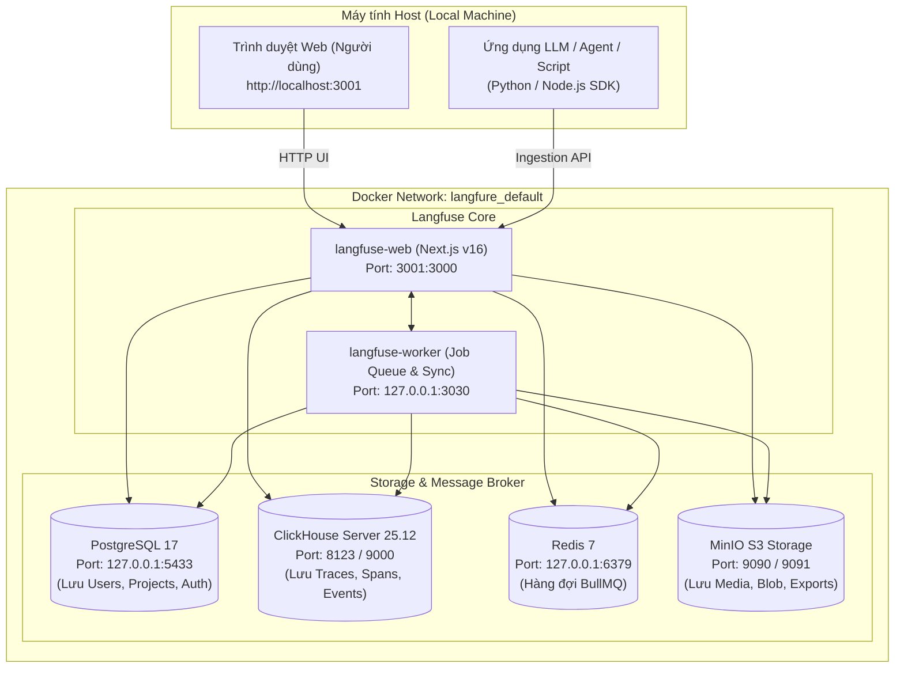
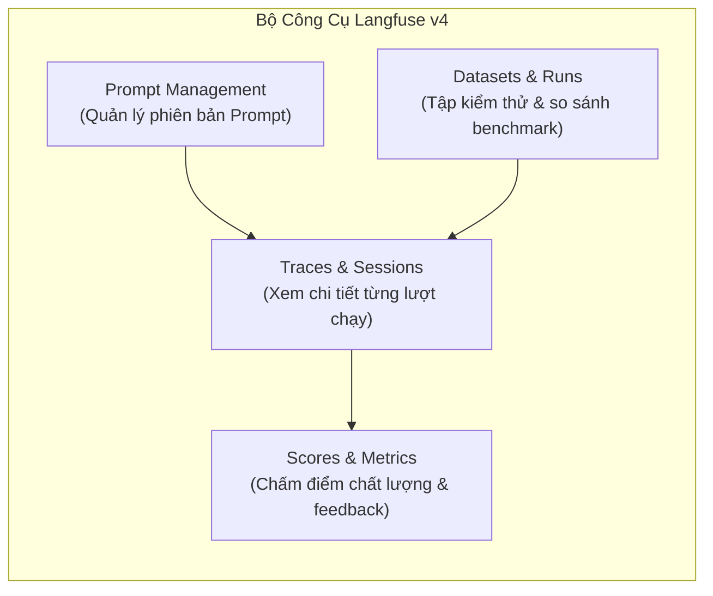

# Hướng dẫn Sử dụng & Vận hành Langfuse Self-Hosted (v4)

> **Phiên bản:** Langfuse v4 (Docker Compose)  
> **Địa chỉ Web UI:** [http://localhost:3001](http://localhost:3001)  
> **MinIO S3 Console:** [http://localhost:9091](http://localhost:9091)  
> **Thư mục triển khai:** `d:\4.Code\langfure`  
> **Tài liệu liên quan:** [EDD và kiến trúc đánh giá agent với Langfuse + DeepEval](../edd-langfuse-deepeval/)

---

## 1. Tổng quan & Kiến trúc Triển khai Cục bộ

Langfuse là nền tảng nguồn mở hàng đầu về **LLM Observability & Evaluation (LLMOps)**, cho phép ghi nhận toàn bộ dấu vết thực thi (Traces), khoảng thời gian (Spans), số lượng token, chi phí và chất lượng phản hồi của các ứng dụng AI Agent / RAG.

Bản triển khai cục bộ hiện tại được thiết lập dựa trên bản phát hành **Langfuse v4** với cấu trúc microservices tối ưu hóa hiệu năng cao nhờ cơ sở dữ liệu phân tích cột **ClickHouse**.

### 1.1. Sơ đồ Kiến trúc Các Thành phần



### 1.2. Bảng Thông số Mạng & Ánh xạ Cổng (Port Mapping)

Để đảm bảo không xung đột với các dịch vụ khác đã có sẵn trên máy (như `agentgateway` ở cổng `3000` và `ea-platform-db` ở cổng `5432`), các cổng bên ngoài đã được quy hoạch an toàn:

| Dịch vụ | Container | Cổng trong Container | Cổng Host (Bên ngoài) | Mục đích sử dụng |
| :--- | :--- | :--- | :--- | :--- |
| **Langfuse Web** | `langfure-langfuse-web-1` | `3000` | **`3001`** | Giao diện quản trị Web & Endpoint SDK API |
| **Langfuse Worker** | `langfure-langfuse-worker-1` | `3030` | `127.0.0.1:3030` | Xử lý hàng đợi ngầm, chạy batch eval, sync |
| **PostgreSQL 17** | `langfure-postgres-1` | `5432` | **`127.0.0.1:5433`** | Lưu trữ metadata, quan hệ người dùng, dự án |
| **ClickHouse** | `langfure-clickhouse-1` | `8123`, `9000` | `127.0.0.1:8123, 9000` | Database dạng cột tối ưu hóa truy vấn hàng triệu trace |
| **MinIO API** | `langfure-minio-1` | `9000` | **`9090`** | Giả lập AWS S3 để upload đa phương tiện / batch export |
| **MinIO Console** | `langfure-minio-1` | `9001` | **`127.0.0.1:9091`** | Giao diện Web quản lý các bucket và object S3 |
| **Redis 7** | `langfure-redis-1` | `6379` | `127.0.0.1:6379` | Hàng đợi tác vụ BullMQ & caching |

---

## 2. Thiết lập Ban đầu (First-Time Setup)

### 2.1. Đăng ký Tài khoản Quản trị viên (Admin)

Langfuse mặc định **không** có tài khoản mẫu tạo sẵn để đảm bảo an ninh. Người truy cập đầu tiên sẽ đóng vai trò quản trị viên:

1. Mở trình duyệt và truy cập: **[http://localhost:3001](http://localhost:3001)**
2. Nhấp vào liên kết **Sign Up**.
3. Điền thông tin cá nhân:
   - **Name**: Tên hiển thị (ví dụ: `Admin`)
   - **Email**: Địa chỉ email quản trị
   - **Password**: Mật khẩu quản trị (tối thiểu 8 ký tự)
4. Nhấn **Create account**. Bạn sẽ được chuyển thẳng vào trang quản trị.

> [!TIP]
> Do chạy trên môi trường cục bộ (không cấu hình SMTP gửi mail kích hoạt), tài khoản được kích hoạt ngay lập tức sau khi bấm Create account.

### 2.2. Tạo Organization & Project

Sau khi đăng nhập, hệ thống sẽ yêu cầu thiết lập không gian làm việc:
1. **Organization Name**: Nhập tên tổ chức (ví dụ: `Personal AI Lab` hoặc `Enterprise Research`).
2. **Project Name**: Nhập tên dự án đầu tiên (ví dụ: `Agent-Development` hoặc `RAG-Evaluation`).
3. Nhấn **Create**.

### 2.3. Lấy API Credentials (Keys)

Để kết nối mã nguồn ứng dụng (Python/TypeScript) với Langfuse:
1. Tại thanh menu bên trái dự án, nhấp vào **Settings**.
2. Tìm đến mục **API Keys** và nhấp chọn **Create new API keys**.
3. Hệ thống sẽ cấp một cặp khóa:
   - **Public Key**: Có tiền tố `pk-lf-...`
   - **Secret Key**: Có tiền tố `sk-lf-...`
   - **Host**: `http://localhost:3001`
4. Hãy sao chép và lưu trữ hai khóa này cẩn thận vào file `.env` của ứng dụng client.

---

## 3. Hướng dẫn Tích hợp SDK (Application Integration)

### 3.1. Tích hợp Python SDK

Cài đặt thư viện:
```bash
pip install langfuse
```

Khai báo biến môi trường trong file `.env` của ứng dụng hoặc trong shell:
```ini
LANGFUSE_PUBLIC_KEY="pk-lf-..."
LANGFUSE_SECRET_KEY="sk-lf-..."
LANGFUSE_HOST="http://localhost:3001"
```

#### Phương pháp 1: Sử dụng Decorator `@observe` (Khuyên dùng)
Cách tiếp cận này tự động bóc tách tham số, thời gian thực thi, kết quả trả về và bắt ngoại lệ (Exceptions):

```python
import os
from langfuse.decorators import langfuse_context, observe
from openai import OpenAI

# Khởi tạo OpenAI Client
client = OpenAI(api_key=os.environ.get("OPENAI_API_KEY"))

@observe(name="fetch-financial-context")
def retrieve_docs(query: str):
    # Giả lập bước truy vấn Vector DB
    return ["Báo cáo tài chính quý 3/2026 ghi nhận doanh thu tăng trưởng 22%."]

@observe(name="financial-rag-agent")
def run_agent(user_question: str):
    # Cập nhật metadata hoặc tags cho trace
    langfuse_context.update_current_trace(
        tags=["production", "rag", "finance"],
        user_id="user_123"
    )
    
    # Bước 1: Retrieval
    docs = retrieve_docs(user_question)
    
    # Bước 2: LLM Generation
    prompt = f"Dựa trên tài liệu: {docs}\nHãy trả lời: {user_question}"
    
    response = client.chat.completions.create(
        model="gpt-4o-mini",
        messages=[{"role": "user", "content": prompt}],
    )
    
    answer = response.choices[0].message.content
    return answer

if __name__ == "__main__":
    result = run_agent("Doanh thu quý 3 tăng trưởng bao nhiêu?")
    print("Kết quả:", result)
```

#### Phương pháp 2: Tích hợp LangChain / LangGraph Callback
Chỉ cần truyền `CallbackHandler` vào `invoke`:

```python
from langfuse.callback import CallbackHandler
from langchain_openai import ChatOpenAI
from langchain_core.prompts import ChatPromptTemplate

langfuse_handler = CallbackHandler(
    public_key="pk-lf-...",
    secret_key="sk-lf-...",
    host="http://localhost:3001"
)

llm = ChatOpenAI(model="gpt-4o")
prompt = ChatPromptTemplate.from_template("Tóm tắt ý chính của văn bản sau: {text}")
chain = prompt | llm

# Truyền callback để tự động log toàn bộ LangChain steps
response = chain.invoke(
    {"text": "Kiến trúc microservice giúp tăng tính mở rộng..."},
    config={"callbacks": [langfuse_handler]}
)
```

#### Phương pháp 3: Tích hợp với LiteLLM Proxy
Nếu hệ thống sử dụng LiteLLM Gateway, chỉ cần cấu hình trong `config.yaml` của LiteLLM:

```yaml
litellm_settings:
  success_callback: ["langfuse"]
  failure_callback: ["langfuse"]

environment_variables:
  LANGFUSE_PUBLIC_KEY: "pk-lf-..."
  LANGFUSE_SECRET_KEY: "sk-lf-..."
  LANGFUSE_HOST: "http://localhost:3001"
```

---

### 3.2. Tích hợp TypeScript / Node.js SDK

Cài đặt package:
```bash
npm install langfuse openai
```

Ví dụ triển khai:
```typescript
import { Langfuse } from "langfuse";
import OpenAI from "openai";

const langfuse = new Langfuse({
  publicKey: process.env.LANGFUSE_PUBLIC_KEY,
  secretKey: process.env.LANGFUSE_SECRET_KEY,
  baseUrl: "http://localhost:3001"
});

const openai = new OpenAI();

async function handleUserChat(userId: string, query: string) {
  // Tạo 1 Trace đại diện cho toàn bộ lượt tương tác
  const trace = langfuse.trace({
    name: "user-chat-turn",
    userId: userId,
    input: query
  });

  // Tạo Span ghi nhận bước gọi LLM
  const generation = trace.generation({
    name: "openai-completion",
    model: "gpt-4o-mini",
    input: query
  });

  const completion = await openai.chat.completions.create({
    model: "gpt-4o-mini",
    messages: [{ role: "user", content: query }]
  });

  const answer = completion.choices[0].message.content;

  // Cập nhật kết quả vào Span và Trace
  generation.end({
    output: answer,
    usage: {
      promptTokens: completion.usage?.prompt_tokens,
      completionTokens: completion.usage?.completion_tokens,
      totalTokens: completion.usage?.total_tokens
    }
  });

  trace.update({ output: answer });

  // Đảm bảo dữ liệu được đẩy đi trước khi kết thúc process
  await langfuse.flushAsync();
  return answer;
}
```

---

## 4. Các Tính năng Trọng tâm trên Giao diện Langfuse



### 4.1. Traces & Spans (Giám sát Lượt chạy)
* **Waterfall Timeline**: Khi mở một trace bất kỳ, bạn sẽ thấy biểu đồ thời gian dạng thác nước (waterfall). Từng thao tác gọi cơ sở dữ liệu vector, công cụ ngoài (Tools) và các lượt gọi LLM đều hiển thị rõ độ trễ (latency tính bằng millisecond).
* **Token & Cost Tracking**: Tự động bóc tách số token đầu vào / đầu ra và quy đổi thành chi phí USD dựa trên bảng giá tiêu chuẩn của từng mô hình (OpenAI, Anthropic, Gemini, DeepSeek...).
* **I/O Inspection**: Xem chính xác JSON payloads gửi vào và nhận ra từ mỗi step, giúp debug lỗi logic nhanh chóng.

### 4.2. Scores & Human Feedback (Đánh giá & Chấm điểm)
* Cho phép gắn điểm số dạng số (`0.0` - `1.0`), dạng boolean (`True`/`False`), hoặc dạng phân loại (`Category`) vào bất kỳ Trace hoặc Generation nào.
* Có thể đánh giá thủ công ngay trên giao diện bằng tay (Human-in-the-loop).
* Có thể tự động chấm điểm từ pipeline bên ngoài (ví dụ: DeepEval, Ragas) qua API.

### 4.3. Quản lý Prompt Tập trung (Prompt Management)
Thay vì hardcode prompt trong mã nguồn, bạn lưu prompt trên Langfuse:
1. Vào tab **Prompts** $\rightarrow$ **New Prompt**.
2. Định nghĩa tên prompt, ví dụ `customer-support-system-prompt`.
3. Nhập nội dung chứa biến động: `Xin chào {{user_name}}, bạn đang hỏi về gói {{product}}...`.
4. Trong mã nguồn, chỉ cần gọi:
   ```python
   prompt = langfuse.get_prompt("customer-support-system-prompt")
   compiled_prompt = prompt.compile(user_name="Tuấn", product="Thẻ tín dụng")
   ```
5. Khi cần tinh chỉnh câu chữ, chỉ cần sửa trên UI Langfuse; ứng dụng sẽ tự động cập nhật mà không cần build lại mã nguồn!

### 4.4. Datasets & Benchmark Experiments
* Tạo bộ dữ liệu kiểm chuẩn (**Golden Dataset**) gồm các câu hỏi mẫu và kết quả kỳ vọng (`Ground Truth`).
* Chạy hàng loạt (Batch Execution) khi thay đổi model (ví dụ từ GPT-4o sang Claude 3.5 Sonnet hoặc DeepSeek-V3) để so sánh tỷ lệ đạt chất lượng, độ trễ và chi phí trên cùng một tập câu hỏi.

---

## 5. Vận hành & Quản trị Hệ thống

Thư mục chứa cấu hình: `d:\4.Code\langfure`

### 5.1. Bảng lệnh CLI Thường dùng

Mở PowerShell tại thư mục `d:\4.Code\langfure`:

| Nhu cầu thao tác | Lệnh PowerShell |
| :--- | :--- |
| **Khởi động lại toàn bộ dịch vụ** | `docker compose up -d` |
| **Dừng an toàn toàn bộ hệ thống** | `docker compose down` |
| **Xem trạng thái chi tiết các container** | `docker compose ps` |
| **Xem logs trực tiếp của Web UI** | `docker compose logs -f langfuse-web` |
| **Xem logs của Worker** | `docker compose logs -f langfuse-worker` |
| **Xem mức tiêu thụ CPU & RAM** | `docker stats --no-stream` |
| **Cập nhật lên bản vá mới nhất** | `docker compose pull && docker compose up -d` |

### 5.2. Cấu trúc Lưu trữ Dữ liệu Bền vững (Docker Volumes)

Toàn bộ dữ liệu được lưu trên các Docker Volume độc lập, không bị mất khi bạn `docker compose down`:

* `langfuse_postgres_data`: Lưu toàn bộ cấu hình dự án, người dùng, API keys, Prompts.
* `langfuse_clickhouse_data`: Lưu hàng triệu bản ghi Trace, Observation, Event dạng nén tốc độ cao.
* `langfuse_minio_data`: Lưu file đính kèm, ảnh, video, dữ liệu export.
* `langfuse_redis_data`: Lưu trạng thái hàng đợi và cache.

> [!CAUTION]
> **Không** chạy lệnh `docker compose down -v` nếu bạn không muốn xóa sạch toàn bộ dữ liệu lịch sử và tài khoản đã tạo. Tham số `-v` sẽ xóa toàn bộ các Docker Volumes trên.

### 5.3. Xử lý Sự cố Thường gặp (Troubleshooting)

1. **Không mở được trang `http://localhost:3001`**:
   - Kiểm tra xem container có đang chạy không: `docker compose ps`
   - Kiểm tra log lỗi: `docker compose logs langfuse-web --tail 50`
   - Đảm bảo các dependency (postgres, clickhouse, minio, redis) đều đang ở trạng thái `(healthy)`.
2. **SDK không gửi được Trace lên Langfuse**:
   - Kiểm tra biến môi trường `LANGFUSE_HOST` phải là `http://localhost:3001` (không dùng cổng 3000 vì cổng 3000 dành cho dịch vụ khác).
   - Kiểm tra `LANGFUSE_PUBLIC_KEY` và `LANGFUSE_SECRET_KEY` đã copy chính xác chưa.
3. **Quên mật khẩu tài khoản Admin**:
   - Do chạy local chưa cấu hình SMTP, bạn có thể tạo một tài khoản mới bằng cách mở trang Login và nhấn **Sign up** với email khác, sau đó thêm tài khoản mới vào Organization hiện tại.
