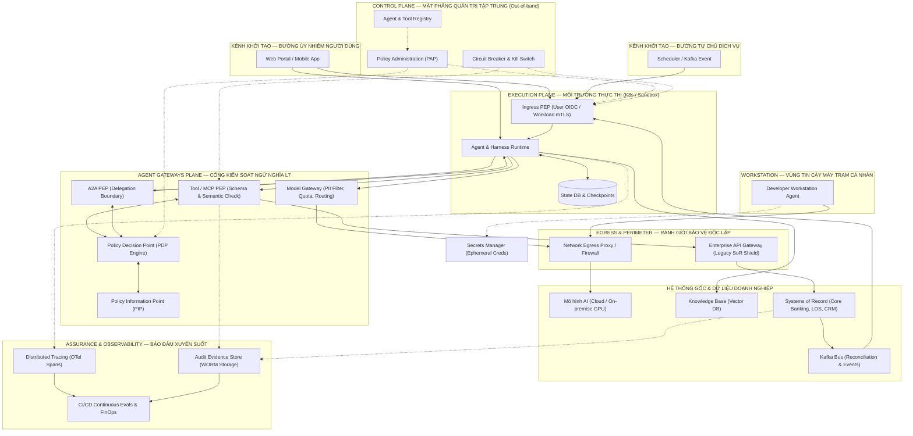
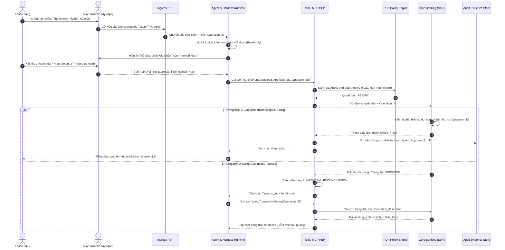

# Kiến trúc Tham chiếu Tác nhân AI Doanh nghiệp

**Khung thiết kế giải pháp cho hệ thống Agentic AI: Từ các đặc tính bất định và dạng thất bại thực tế đến tư duy Harness bốn nhóm năng lực và kiểm soát phân lớp**

**Phiên bản:** 1.1 · **Ngày ban hành:** 30/09/2026 · **Tài liệu thiết kế nội bộ tham chiếu:** [Quản trị Agent Doanh nghiệp Ngân hàng](../mb-enterprise-agent-governance/) — ký hiệu in-text `[TK]` trỏ tới đề xuất kiến trúc nội bộ này (tệp gốc: `evidence/original-article.txt`), KHÔNG phải nguồn chuẩn độc lập.

> **Quy ước dẫn chứng:** `[n]` = nguồn công khai đã trích xuất nội dung (danh sách ở cuối bài, mỗi nguồn kèm trích đoạn verbatim trong `evidence/citation-ledger.json`). `[TK]` = đề xuất thiết kế (Design Proposal / Architectural Inference) kế thừa từ tài liệu nội bộ tham chiếu; không phải trích dẫn chuẩn. Mọi luật cốt lõi mang `[TK]` đều là đề xuất cần kiểm chứng thực địa, không phải chứng cứ vận hành.

> **Tuyên ngôn Kiến trúc Cốt lõi (Architectural Tenets):**
> 1. *"Mô hình đề xuất, chính sách cho phép (Model proposes, policy authorizes)."*
> 2. *"Tách biệt tuyệt đối giữa Tính tự chủ (Agency) và Thẩm quyền thực thi (Authority)."*
> 3. *"Quyền hữu hiệu (Effective Authority) = Quyền chủ thể khởi tạo ∩ Năng lực Agent được cấp ∩ Ngữ cảnh tác vụ/phiên ∩ Chính sách hệ thống đích."* [TK]

---

## 1. Tổng quan Điều hành & Bối cảnh Chuyển dịch Kiến trúc

Khi hệ thống trí tuệ nhân tạo chuyển dịch từ mô hình sinh thông tin đơn lẻ (Generative AI / Chatbots) sang hệ thống tác tử có khả năng tự chủ lập kế hoạch và kích hoạt công cụ (Agentic AI Systems), các giả định kiến trúc phần mềm truyền thống bị thách thức nghiêm trọng [3]. Trong các ứng dụng xác định (Deterministic Systems), kỹ sư kiểm soát chặt chẽ toàn bộ đường đi của mã nguồn và các lời gọi API. Ngược lại, trong một hệ thống có Agent, mô hình ngôn ngữ lớn (LLM) được trao quyền tự chọn chuỗi bước, tự quyết định thời điểm gọi công cụ và tự đánh giá kết quả trả về từ môi trường để tiếp tục hoặc dừng lại [1][2].

Sự tự do này mang lại năng suất đột phá trong xử lý các bài toán mở, nhưng đồng thời tạo ra một bề mặt rủi ro hoàn toàn mới trong môi trường doanh nghiệp và định chế tài chính [3]. Một lỗi suy luận trung gian của mô hình có thể khuếch đại thành một giao dịch tài chính sai lệch, một lệnh xóa dữ liệu ngoài tầm kiểm soát hoặc một lỗ hổng rò rỉ dữ liệu quy mô lớn [6].

Do đó, kiến trúc tham chiếu này xác lập một nguyên lý bất biến: **Tác nhân AI không bao giờ là nguồn cấp quyền (Trust Boundary)**. Toàn bộ hành vi của Agent phải được bao bọc bởi một bộ khung năng lực có tính phòng thủ cao gọi là **Tư duy Harness (Harness Architecture Mindset)** [2][TK], kết hợp với các cổng kiểm soát chính sách độc lập (Policy Enforcement Points - PEP) tuân thủ nguyên tắc Zero Trust [8].

---

## 2. Bản chất Kỹ thuật: 5 Đặc tính Cốt lõi và 5 Dạng Thất bại Doanh nghiệp

Quản trị và thiết kế kiến trúc Agent không xuất phát từ việc cấm đoán mô hình, mà xuất phát từ việc hiểu sâu sắc mối quan hệ đa chiều giữa **5 đặc tính kỹ thuật cốt lõi (Architectural Traits - AT)** của phần mềm tác tử và **5 dạng thất bại tiềm tàng (Failure Modes - FM)** trong vận hành doanh nghiệp [3][TK].

```
  5 ĐẶC TÍNH CỐT LÕI (AT)                      5 DẠNG THẤT BẠI DOANH NGHIỆP (FM)
  ┌─────────────────────────┐                  ┌────────────────────────────────┐
  │ AT1. Vòng lặp suy luận  │──┐            ┌─►│ FM1. Độ tin cậy & Bất biến     │
  │      (Reasoning Loops)  │  │            │  │      (Reliability & Invariants)│
  ├─────────────────────────┤  │            │  ├────────────────────────────────┤
  │ AT2. Gọi công cụ tự chủ │──┼────────────┼─►│ FM2. An ninh & Thẩm quyền      │
  │      (Tool Invocation)  │  │            │  │      (Security & Authority)    │
  ├─────────────────────────┤  │  QUAN HỆ   │  ├────────────────────────────────┤
  │ AT3. Hành vi bất định   │──┼────────────┼─►│ FM3. Quản trị & Bằng chứng     │
  │      (Stochastic Nature)│  │ NHIỀU-NHIỀU│  │      (Audit & Provenance)      │
  ├─────────────────────────┤  │            │  ├────────────────────────────────┤
  │ AT4. Trạng thái & Memory│──┼────────────┼─►│ FM4. Hiệu năng & Độ trễ SLA    │
  │      (State & Memory)   │  │            │  │      (Latency & Performance)   │
  ├─────────────────────────┤  │            │  ├────────────────────────────────┤
  │ AT5. Phối hợp đa tác tử │──┘            └─►│ FM5. Chi phí FinOps & Lãng phí │
  │      (Multi-Agent Flow) │                  │      (FinOps & Cost Explosion) │
  └─────────────────────────┘                  └────────────────────────────────┘
```

### 2.1. Năm Đặc tính Kỹ thuật Cốt lõi (Architectural Traits)

* **AT1 — Suy luận theo vòng lặp (Iterative Reasoning Loops):** Khác với mô hình request-response một lượt, Agent vận hành theo cơ chế lặp liên tục: *Lập kế hoạch (Plan) → Chọn công cụ (Act) → Nhận phản hồi môi trường (Observe) → Đánh giá và điều chỉnh (Reflect)* [1][7]. Đặc tính này cho phép Agent tự sửa lỗi nhưng tiềm ẩn nguy cơ rơi vào vòng lặp vô hạn.
* **AT2 — Gọi công cụ tự chủ theo ngữ cảnh (Autonomous Tool Invocation):** Agent có khả năng tự động chuyển dịch ngôn ngữ tự nhiên thành lời gọi hàm (Function Calling / Tool Use) với các tham số do mô hình tự trích xuất dựa trên bối cảnh hội thoại [1][2].
* **AT3 — Hành vi mô hình bất định (Stochastic Nature):** Cùng một ngữ cảnh đầu vào, mô hình có thể sinh ra các chuỗi suy luận hoặc lựa chọn công cụ khác nhau giữa các lần chạy, phụ thuộc vào nhiệt độ (temperature), ngữ cảnh mở rộng hoặc phiên bản trọng số mô hình [3].
* **AT4 — Duy trì trạng thái tiến trình và bộ nhớ (Persistent State & Memory):** Để hoàn thành tác vụ dài, Agent cần lưu vết tiến độ (Checkpointing), duy trì ngữ cảnh phiên (Working Memory) và truy xuất tri thức quá khứ (Episodic / Long-term Memory) [2][3].
* **AT5 — Phối hợp và phân giao đa tác nhân (Multi-Agent Coordination & Delegation):** Khả năng chia tách bài toán lớn cho nhiều Agent chuyên trách (Orchestrator-Workers, Router, Swarm) cộng tác thông qua các giao thức trao đổi ngữ cảnh [1][7].

### 2.2. Năm Dạng Thất bại Doanh nghiệp (Enterprise Failure Modes)

* **FM1 — Thất bại về Độ tin cậy và Bất biến Nghiệp vụ (Reliability & Invariant Violations):** Agent hiểu sai dữ liệu gốc, tính toán nhầm số liệu kinh doanh, hoặc gọi lại API khi mạng chập chờn gây ra việc thực thi trùng lặp giao dịch tài chính [6][TK].
* **FM2 — Thất bại về An ninh và Thẩm quyền (Security, Privilege Escalation & Excessive Agency):** OWASP định nghĩa *Excessive Agency* là lỗ hổng cho phép các hành động gây hại được thực thi do đầu ra bất ngờ, mơ hồ hoặc bị thao túng từ LLM [13]. Ba căn nguyên gốc rễ gồm: (1) *chức năng quá mức* (excessive functionality), (2) *quyền quá mức* (excessive permissions), (3) *tự chủ quá mức* (excessive autonomy) [13]. Trong môi trường doanh nghiệp, điều này hiện thực hóa thành việc Agent bị tấn công tiêm chỉ thị ẩn (Indirect Prompt Injection) từ dữ liệu bên ngoài, mượn Service Account quyền rộng, hoặc vượt quá thẩm quyền cho phép của người dùng khởi tạo [4][TK].
* **FM3 — Thất bại về Quản trị và Khả năng Kiểm toán (Governability & Provenance Failure):** Hệ thống ghi nhận kết quả thành công nhưng không thể giải trình: mất dấu vết chuỗi suy luận, không lưu phiên bản chính sách tại thời điểm ra quyết định, không chứng minh được ai đã phê duyệt hành động [5][11][TK].
* **FM4 — Thất bại về Hiệu năng Đầu cuối và SLA (End-to-End Latency & SLA Degradation):** Các vòng lặp suy luận quá dài, việc trao đổi qua lại giữa nhiều Agent con làm bùng nổ độ trễ, vi phạm cam kết thời gian phản hồi của dịch vụ trực tiếp (SLA P95/P99) [1][7].
* **FM5 — Thất bại về Chi phí FinOps và Lãng phí Tài nguyên (Reasoning Cost Explosion & FinOps Inefficiency):** Lạm dụng các mô hình suy luận đắt tiền hoặc các cụm đa tác tử phức tạp cho các tác vụ mang tính tuần tự đơn giản (hội chứng "Agent Washing"), làm chi phí trên mỗi kết quả hợp lệ tăng vọt mà không đem lại giá trị nghiệp vụ tương xứng [1][7].

### 2.3. Ma trận Tương quan Nhiều-Nhiều (Many-to-Many Interaction Matrix)

Kiến trúc sư phần mềm cần tránh bẫy tư duy ánh xạ 1:1. Một đặc tính kỹ thuật có thể kích hoạt đồng thời nhiều dạng thất bại, và một dạng thất bại thường là hệ quả cộng hưởng từ nhiều đặc tính:

| Đặc tính Kỹ thuật | FM1: Độ tin cậy | FM2: An ninh & Thẩm quyền | FM3: Quản trị & Audit | FM4: Hiệu năng SLA | FM5: Chi phí FinOps |
|---|:---:|:---:|:---:|:---:|:---:|
| **AT1. Vòng lặp suy luận** | Tích lũy sai số qua từng vòng lặp | Mở rộng bề mặt phơi nhiễm Injection | Dấu vết phân tán, khó tái dựng trạng thái | Bùng nổ độ trễ P99 do lặp nhiều bước | Tiêu tốn token theo cấp số nhân [7] |
| **AT2. Gọi công cụ tự chủ** | Gọi sai tham số, vi phạm schema | Kích hoạt API trái phép (Excessive Agency) [13] | Thiếu liên kết ID giao dịch và bằng chứng | Độ trễ mạng từ các API bên thứ ba | Chi phí tính toán và quota API tăng cao |
| **AT3. Hành vi bất định** | Kết quả dao động, phá vỡ bất biến | Quyết định vượt ranh giới an toàn | Kiểm thử hồi quy không thể đoán trước | Thời gian suy luận không đồng đều | Thử lại nhiều lần làm tăng chi phí |
| **AT4. Trạng thái & Memory** | Dữ liệu cũ gây sai lệch quyết định | Ô nhiễm bộ nhớ (Memory Poisoning) | Không rõ nguồn gốc dữ liệu phục hồi | Tắc nghẽn I/O khi nạp/ghi checkpoint | Chi phí lưu trữ và token truy xuất context |
| **AT5. Phối hợp đa tác nhân** | Lỗi lan truyền giữa các Agent con | Rò rỉ quyền hạn ngầm qua phân giao | Mất liên kết vết (Broken Trace ID) [11] | Nghẽn giao tiếp và đồng bộ trạng thái | Chi phí token trao đổi bùng nổ [7] |

---

## 3. Harness: Tư duy Kiến trúc và Bốn Nhóm Năng lực Bao bọc Tác nhân

Để hóa giải các dạng thất bại trên, kiến trúc giải pháp thiết lập mô hình **Tư duy Harness (The Four Quadrants Framework)** [2][TK]. Trong tư duy này, Harness không đơn thuần là một thư viện SDK hay một máy chủ thực thi, mà là **ranh giới năng lực phần mềm bao quanh mô hình trí tuệ nhân tạo**, chịu trách nhiệm biến các đề xuất văn bản bất định của LLM thành các hành động xác định, được kiểm soát và có thể đối soát hoàn toàn [2][4][TK].

```
┌──────────────────────────────────────────────┬──────────────────────────────────────────────┐
│                  KNOW · BIẾT                 │                  DO · LÀM                    │
│             Agent cần biết những gì?         │            Agent có thể làm những gì?        │
├──────────────────────────────────────────────┼──────────────────────────────────────────────┤
│ • Context: Cửa sổ ngữ cảnh, prompt hệ thống  │ • Tools: Các hàm thực thi nghiệp vụ          │
│ • Knowledge: RAG, tri thức nghiệp vụ, sổ tay │ • MCP: Giao thức chuẩn hóa kết nối công cụ   │
│ • Memory: Ngắn hạn; dài hạn tùy chọn         │ • APIs: Cổng tích hợp backend & đối tác      │
│ • State: Tiến độ tác vụ, biến môi trường     │ • Runtime: Tiến trình thực thi & tính toán   │
│                                              │ • Sandbox: Vùng đệm cách ly an toàn          │
├──────────────────────────────────────────────┼──────────────────────────────────────────────┤
│              CONTROL · KIỂM SOÁT             │            VERIFY & LEARN · KIỂM CHỨNG & HỌC │
│          Agent được phép làm những gì?       │     Làm sao biết Agent làm đúng & cải tiến?  │
├──────────────────────────────────────────────┼──────────────────────────────────────────────┤
│ • Identity: Định danh Agent & ủy quyền kép   │ • Evaluation: Bộ kịch bản chuẩn (Golden Evals│
│ • Permission: Thẩm quyền tối thiểu (Least)   │ • Test: Kiểm thử chức năng & đối kháng       │
│ • Policy: Quy tắc truy cập ABAC, ngắt mạch   │ • Evidence: Bằng chứng kiểm toán & nguồn tin │
│ • Guardrail: Rào chắn Prompt Injection       │ • Trace: Truy vết phân tán (Correlation ID)  │
│ • Isolation: Cách ly phiên & kiểm soát mạng  │ • Observability: Giám sát APM & FinOps       │
│                                              │ • Recovery: Đối soát / xử lý lỗi             │
└──────────────────────────────────────────────┴──────────────────────────────────────────────┘
```

### 3.1. Góc phần tư KNOW (Biết — Quản lý Tri thức và Ngữ cảnh)
Nhiệm vụ cốt lõi của nhóm KNOW là cung cấp đúng và đủ thông tin cho mô hình suy luận, ngăn chặn hiện tượng "ảo giác" (hallucination) và giảm thiểu rủi ro tiếp nhận dữ liệu sai lệch [2]:
* **Context Engine:** Tối ưu hóa cửa sổ ngữ cảnh, nén thông tin và quản lý cấu trúc System Prompt theo phiên bản.
* **Enterprise Knowledge (RAG):** Trích xuất tri thức từ các kho dữ liệu doanh nghiệp có áp dụng phân quyền ở cấp độ tài liệu (Document ACL) tại thời điểm truy vấn [TK].
* **Working & Episodic Memory:** Quản lý bộ nhớ ngắn hạn cho phiên làm việc; bộ nhớ dài hạn chỉ kích hoạt khi có mục đích rõ ràng, có chính sách hết hạn (TTL) và hỗ trợ xóa theo yêu cầu bảo vệ quyền riêng tư [2][3][TK].
* **State Checkpointing:** Lưu trữ bền vững tiến trình thực thi vào cơ sở dữ liệu có phân vùng cách ly (Tenant/Session Partitioning); tuyệt đối không lưu trữ khóa bảo mật hoặc access token bên trong checkpoint [TK].

### 3.2. Góc phần tư DO (Làm — Năng lực Hành động và Tích hợp)
Nhóm DO chuyển hóa ý định của mô hình thành tác động thực tế trong môi trường số một cách an toàn [2]:
* **Standardized Tools:** Định nghĩa các hàm nghiệp vụ có bản đặc tả chặt chẽ, tài liệu hóa rõ ràng để mô hình dễ dàng lựa chọn đúng tham số [1].
* **Model Context Protocol (MCP):** Áp dụng giao thức mở chuẩn hóa để tách rời Agent logic khỏi các máy chủ cung cấp công cụ (MCP Servers), giúp tái sử dụng và thay thế công cụ linh hoạt [2].
* **Runtime Infrastructure:** Môi trường tính toán (Containers, Kubernetes Pods) vận hành tiến trình Agent và logic điều phối.
* **Process Sandboxing:** Vùng đệm cách ly tài nguyên hệ thống (tệp tin, bộ nhớ, mạng). Cần lưu ý: Sandbox không thể bảo vệ các bí mật một khi bí mật đó đã được truyền trực tiếp vào biến môi trường của tiến trình [TK].

### 3.3. Góc phần tư CONTROL (Kiểm soát — Thẩm quyền và Rào chắn An toàn)
Nhóm CONTROL là chốt chặn phòng thủ then chốt, hiện thực hóa các nguyên tắc Zero Trust để ngăn ngừa việc thực thi vượt quyền [4][8]:
* **Dual Identity (Định danh Kép):** AWS xác lập hai mẫu định danh cần được phân tách rõ ràng [12]:
  1. *Ủy nhiệm người dùng (Delegated User Task):* Sử dụng cơ chế OAuth 2.0 Token Exchange (RFC 8693) để biểu đạt chủ thể gốc (`sub`) và tác nhân hành động (`act.sub`) [9]. Agent hành động trong phạm vi quyền của người dùng đó, không mạo nhận credential của người dùng [12].
  2. *Tự chủ dịch vụ (Service-initiated Task):* Agent chạy dưới định danh dịch vụ độc lập, tách biệt khỏi định danh con người, và nhật ký kiểm toán gán mọi hành động cho đúng một tác nhân (agent hoặc human) [12].
* **Fine-grained Authorization (ABAC):** Đánh giá quyền truy cập động tại thời điểm thực thi (Just-In-Time) dựa trên các thuộc tính về Chủ thể, Hành động, Tài nguyên và Ngữ cảnh thông qua Policy Decision Point (PDP) [TK]. Zero Trust đặt nền tảng là không có sự tin tưởng ngầm nào chỉ dựa trên vị trí mạng hay quyền sở hữu tài sản [8].
* **Semantic Guardrails:** Rào chắn phát hiện Prompt Injection, lọc nội dung độc hại và ngăn chặn rò rỉ dữ liệu nhạy cảm (PII/Secret Redaction); các ranh giới vận hành và chính sách phải được cưỡng chế bằng kiểm soát phân lớp, không chỉ bằng chỉ thị trong prompt [4].
* **Perimeter & Network Isolation:** Áp dụng NetworkPolicy và Egress Proxy chặn mọi kết nối ra ngoài danh mục cho phép (Allowlist) [TK].

### 3.4. Góc phần tư VERIFY & LEARN (Kiểm chứng & Học hỏi — Đánh giá và Vận hành)
Nhóm VERIFY & LEARN đóng vòng lặp phản hồi, bảo đảm hệ thống vận hành đúng cam kết và liên tục cải tiến chất lượng [5][TK]:
* **Continuous Evals CI/CD:** Hệ thống đánh giá tự động dựa trên tập dữ liệu chuẩn mực (Golden Evals) trước khi release phiên bản mới của prompt, tool hoặc mô hình; bộ dataset, prompt và rubric chấm điểm được phiên bản hóa và cập nhật liên tục [5].
* **Audit Evidence Store:** Lưu trữ toàn bộ bằng chứng giao dịch vào kho lưu trữ bất biến (WORM logic), tách biệt hoàn toàn khỏi hệ thống log chẩn đoán thông thường [TK].
* **Distributed Tracing:** Việc thực thi Agent sinh ra các trace phân tán ghi lại từng bước suy luận, lời gọi tool, thao tác bộ nhớ và phân giao giữa các Agent, với trace context lan truyền xuyên suốt mọi ranh giới dịch vụ [11].
* **FinOps Governance:** Giám sát chi phí token tích lũy và độ trễ trên từng kết quả nghiệp vụ thành công (Cost per Valid Outcome) [7].
* **Idempotent Recovery & Reconcile:** Khôi phục trạng thái an toàn dựa trên khóa chống lặp (Idempotency Key) gắn liền với payload; tra cứu trạng thái hệ thống đích trước khi quyết định thử lại [6][TK].

---

## 4. Mười Kiểm soát Kiến trúc Trọng yếu (Architectural Controls AC01–AC10)

Để chuyển hóa 4 góc phần tư Harness thành các ràng buộc kỹ thuật có thể kiểm toán độc lập, kiến trúc sư cần áp dụng 10 kiểm soát bắt buộc. Các kiểm soát này là **đề xuất thiết kế** [TK], được neo vào các nguồn chuẩn tại đúng phạm vi mà mỗi nguồn mô tả:

* **AC01 — Bounded Agency (Tự chủ có Giới hạn):** Mọi Agent phải có định danh đăng ký tập trung, mục tiêu hạn định, giới hạn trần số bước lặp (Max Loops), giới hạn thời gian (Timeout) và ngân sách token tối đa; các vòng lặp suy luận phải được bao bọc bởi điều kiện dừng tường minh và ngưỡng thoát dựa trên mức tin cậy [4][7][TK].
* **AC02 — Model Proposes, Policy Authorizes (Mô hình đề xuất, Chính sách cho phép):** Quyết định thực thi hành động bắt buộc phải do Điểm thực thi chính sách (PEP) độc lập và Hệ thống nghiệp vụ nguồn (System of Record - SoR) phán quyết; LLM không bao giờ là thẩm quyền cấp phép [4][TK].
* **AC03 — Explicit Contextual Delegation (Ủy nhiệm Tường minh theo Ngữ cảnh):** Tác vụ thay mặt người dùng phải sử dụng token ủy quyền có thời hạn ngắn, đúng audience và scope theo chuẩn RFC 8693 [9]. Token này không đại diện cho sự đồng ý vô điều kiện đối với một giao dịch tài chính cụ thể [TK].
* **AC04 — Semantic Tool Authorization (Kiểm tra Ngữ nghĩa Lời gọi Công cụ):** Cổng công cụ (Tool PEP) không chỉ kiểm tra cấu trúc dữ liệu (Strict JSON Schema) mà bắt buộc phải kiểm tra ngữ nghĩa tham số (Semantic Validation), số tiền, tài khoản thụ hưởng và trạng thái tài nguyên trước khi chuyển tiếp lệnh [4][TK].
* **AC05 — Payload-Bound Step-Up Consent (Xác nhận Giao dịch Gắn liền Nội dung):** Với các hành động tài chính hoặc pháp lý trọng yếu (R3), yêu cầu xác nhận của người dùng (Smart OTP / Ký số) bắt buộc phải gắn liền với mã băm của nội dung giao dịch (Payload Hash) và thời hạn hiệu lực; OWASP yêu cầu con người phê duyệt hành động tác động cao trước khi thực thi (human-in-the-loop) [13][TK].
* **AC06 — Destination-Side Durable Idempotency (Chống Thực thi Lặp Bền vững tại Đích):** Mọi lệnh ghi có rủi ro phải mang `Operation_ID` ổn định xuyên suốt các lần thử lại. Hệ thống đích phải lưu bền khóa này cùng kết quả xử lý; retry không có đảm bảo idempotency sẽ tạo giao dịch trùng lặp hoặc trạng thái không nhất quán [6].
* **AC07 — Reconcile Before Retry (Đối soát Trạng thái Trước khi Thử lại):** Khi xảy ra sự cố mất kết nối mạng hoặc timeout không rõ trạng thái (trạng thái `UNKNOWN`), Agent tuyệt đối không tự ý phát lệnh gọi lại; hệ thống bắt buộc phải tra cứu đối soát trạng thái thực tế tại hệ thống đích [6][TK].
* **AC08 — Network Egress Traversal for AI Models (Bắt buộc Đi qua Kiểm soát Mạng Chiều ra):** Toàn bộ lưu lượng từ Model Gateway (gọi Cloud LLM hoặc On-premise GPU) bắt buộc phải đi qua Egress Firewall/Proxy để ngăn chặn triệt để nguy cơ đánh cắp dữ liệu (Data Exfiltration) và leo thang tấn công ngang mạng [TK].
* **AC09 — Immutable Audit Ledger Separation (Tách biệt Sổ cái Bằng chứng Kiểm toán):** Tách rời hoàn toàn kho lưu trữ bằng chứng kiểm toán (Audit Evidence Store) khỏi đường ống thu thập log hệ thống (Telemetry Logs). Chính sách lấy mẫu (Sampling) hoặc chính sách xoay vòng log vận hành tuyệt đối không được làm mất chứng cứ kiểm toán [11][TK].
* **AC10 — Versioned Evaluation Gates (Chốt Đánh giá Kiểm thử theo Phiên bản):** Mọi thay đổi về Prompt, Tool definition, Tri thức RAG hoặc Mô hình nền tảng bắt buộc phải vượt qua bộ kiểm thử Golden Evals tự động trên CI/CD và được phê duyệt bởi chủ sở hữu nghiệp vụ trước khi triển khai [5][TK].

---

## 5. Bản vẽ Kiến trúc Tham chiếu Mục tiêu (Target Blueprint)

Dưới đây là bản vẽ kiến trúc phân lớp hoàn chỉnh, thể hiện rõ các ranh giới tin cậy (Trust Boundaries) và các luồng giao dịch bắt buộc:



### Bảng Phân định Ranh giới và Trách nhiệm Tin cậy

| Thành phần Kiến trúc | Phân lớp | Vai trò & Ranh giới Tin cậy (Trust Boundary) | Chủ sở hữu kiểm soát |
|---|---|---|---|
| **Kênh người dùng (`UI`)** | Khởi tạo | Tiếp nhận yêu cầu từ người dùng; nguồn khởi tạo của đường ủy nhiệm. | Kênh giao diện |
| **Kênh sự kiện (`EVT`)** | Khởi tạo | Tác vụ theo lịch/sự kiện, không có người dùng trực tiếp; dùng workload identity, không OIDC user [12]. | Nền tảng tích hợp |
| **Workstation Agent (`DEV_AG`)** | Máy trạm | Chạy cục bộ; KHÔNG đi qua Ingress. Bị kiểm soát bởi Vault (ephemeral creds), Egress allowlist và CI/CD độc lập [TK]. | Endpoint Security + Dev |
| **Secrets Manager (`Vault`)** | Nền tảng | Cấp credential ngắn hạn, tối thiểu quyền; không cấp production secret cho máy trạm [TK]. | IAM / Security |
| **Control Plane (`CP`)** | Quản trị | Registry, phân hạng rủi ro, phiên bản chính sách, Kill Switch. Ngoài luồng giao dịch (Out-of-band). | Platform + EA |
| **Ingress PEP (`IN`)** | Enforcement L7 | Phân biệt hai đường: xác thực user OIDC vs workload mTLS; chặn input tự nhiên không tin cậy. | Integration / API Platform |
| **Agent & Harness Runtime (`RT`)** | Thực thi | Vận hành vòng lặp, quản lý context/checkpoint; cô lập trong Pod/Sandbox. | Runtime Platform |
| **State DB & Checkpoint (`DB`)** | Lưu trữ | Phân vùng theo tenant/user/agent; không lưu secret trong checkpoint [TK]. | Data Platform |
| **Model Gateway (`MG`)** | Gateway L7 | Kiểm duyệt prompt, redact PII, quota, routing; bắt buộc đi qua Egress [TK]. | AI Platform + Data Security |
| **A2A PEP (`A2A`)** | Gateway L7 | Kiểm soát phân giao tác vụ giữa các Agent; cấm kế thừa quyền ngầm [TK]. | Integration |
| **Tool / MCP PEP (`TG`)** | Gateway L7 | Strict schema + semantic authz; hỏi PDP trước mỗi lời gọi. | Integration + Domain SoR |
| **PDP Engine (`PDP`)** | Quyết định | Đánh giá quyền theo thuộc tính thời gian thực; fail-closed khi thiếu policy/thuộc tính [TK]. | Security Architecture |
| **Policy Information Point (`PIP`)** | Quyết định | Cung cấp thuộc tính tài nguyên/ngữ cảnh thời gian thực cho PDP (trạng thái tài khoản, hạn mức, giờ GD) [TK]. | Domain SoR + IAM |
| **Knowledge Base (`KB`)** | Dữ liệu | Vector DB phục vụ RAG; enforce Document-level ACL ngay tại thời điểm truy xuất [TK]. | Data Governance + Domain Owner |
| **Network Egress (`EG_NET`)** | An ninh Mạng | Chặn kết nối ra ngoài allowlist; bảo vệ chống exfiltration & lateral movement [TK]. | Network/Security |
| **SoR API Gateway (`EG_API`)** | Tích hợp | Bảo vệ Core/LOS trước tải giao dịch; mTLS, rate limit. | Integration + Core owner |
| **Systems of Record (`SOR`)** | Nghiệp vụ | Thẩm quyền tối cao về dữ liệu; kiểm quyền + bất biến tại commit; không tin mù quáng vào gateway/LLM [TK]. | Domain SoR owner |
| **Kafka Bus (`BUS`)** | Tích hợp | Vận chuyển sự kiện; consumer phải mang identity + operation ID + dedupe, không thay Tool PEP [TK]. | Integration |
| **Assurance & Audit (`AS`)** | Bảo đảm | Trace/audit bất biến (WORM) tách biệt khỏi telemetry; sampling không làm mất chứng cứ [11][TK]. | SRE/SOC/Compliance |

---

## 6. Trình tự Xử lý Phân tầng theo Rủi ro (Risk-Tiered Sequence Flows)

Kiến trúc áp dụng nguyên tắc phân tầng rủi ro theo từng *hành động cụ thể* (R1, R2, R3) [TK]:

### 6.1. Luồng R1 — Tra cứu Tri thức và Trích xuất Tài liệu (Read-Only)
* **Đặc điểm:** Tác vụ chỉ đọc, không làm biến đổi trạng thái tài nguyên hệ thống.
* **Cơ chế kiểm soát:** Truy vấn thông qua Knowledge Service. Hệ thống bắt buộc phải thực thi **Document-level ACL** ngay tại thời điểm truy xuất vector database, bảo đảm người dùng chỉ nhận được các trích đoạn văn bản mà họ có quyền xem theo chính sách IAM [TK].
* **Chống rò rỉ:** Model Gateway thực hiện lọc dữ liệu định danh cá nhân (PII Redaction) trước khi gửi prompt tới mô hình LLM [4][TK].
* **Cảnh báo phân hạng:** R1 truy xuất dữ liệu nhạy cảm (KYC, CIC, thông tin tài chính) KHÔNG tự động đạt chuẩn Gate G0 — phải đánh giá riêng mức độ nhạy cảm dữ liệu, không chỉ dựa vào việc hành động là read-only [TK].

### 6.2. Luồng R2 — Thẩm định & Soạn thảo Hồ sơ (Draft Write / Proposal-Only)
* **Đặc điểm:** Tác vụ có ghi nhận dữ liệu vào hệ thống nhưng chỉ ở trạng thái bản nháp (`DRAFT`), chưa tạo ra cam kết tài chính hay pháp lý [TK].
* **Nguyên tắc cốt lõi: Tách biệt Suy luận và Quy tắc cứng:**
  1. Agent trích xuất thông tin từ chứng từ (sao kê ngân hàng, hóa đơn) và cung cấp bằng chứng rõ ràng (Provenance).
  2. Các số liệu định lượng (thu nhập đủ điều kiện, tỷ lệ nợ DTI, hạn mức cho vay) bắt buộc phải do **Business Rule Engine (BRE)** hoặc dịch vụ xác định tính toán dựa trên quy tắc nghiệp vụ cứng; tuyệt đối không để LLM tự làm phép tính số học [TK].
  3. Lệnh tạo hồ sơ gửi vào hệ thống LOS thông qua Tool PEP chỉ dừng lại ở quyền tạo bản nháp. Cấp thẩm quyền (Maker-Checker) bắt buộc phải kiểm tra và phê duyệt trên giao diện LOS truyền thống [4][TK].

### 6.3. Luồng R3 — Giao dịch Tài chính & Hành động Khó Đảo ngược (Financial Action)
* **Đặc điểm:** Tác vụ chuyển tiền, giải ngân hoặc trích nợ tài khoản có tác động tài chính trực tiếp và khó có thể đảo ngược bằng cơ chế bù trừ đơn thuần [6][TK].



* **Xử lý Ngoại lệ Bắt buộc:** Khi trạng thái phản hồi rơi vào vùng chưa xác định (`UNKNOWN`), hệ thống cấm Agent tự ý sinh `Operation_ID` mới để retry. Mọi hành động tiếp theo phải dựa trên kết quả đối soát trạng thái thực tế tại Core Banking [6][TK].
* **Ba Ràng buộc Cứng khi Resume / Bù trừ / Sự kiện (khôi phục từ bài gốc):**
  1. **Checkpoint không bảo lưu thẩm quyền.** Khi resume, phải cấp lại token đúng audience/scope, kiểm tra phiên bản chính sách và kiểm tra lại phê duyệt gắn payload; không tái phát lệnh ghi chỉ vì state ghi "đã duyệt" [TK].
  2. **Saga không phải cơ chế undo phổ quát.** Bù trừ không xóa được mọi tác động; chỉ dùng Saga khi có nghiệp vụ bù trừ hợp lệ, cần trạng thái chờ và quy trình xử lý ngoại lệ thủ công [TK].
  3. **Kafka consumer phải mang identity + operation ID như lời gọi đồng bộ.** Event được phân loại, có dedupe và hop/attempt budget, không tự kích hoạt lại vô hạn; Kafka không thay thế Tool PEP [TK].

---

## 7. Khung Cổng Kiểm soát Triển khai Thực tế (Stage Gates & Veto Rules)

Để đưa Agent vào môi trường Production an toàn, tổ chức phải áp dụng lộ trình quản trị theo các Cổng Kiểm soát (Stage Gates) với **Điều kiện Phủ quyết (Veto Rules)** nghiêm ngặt, tuyệt đối không triển khai theo hình thức chạy thử nghiệm tự do [4][5][TK]:

```
  ┌────────────────────────────────────────────────────────────────────────┐
  │                   BA CỔNG KIỂM SOÁT TRIỂN KHAI PRODUCTION              │
  ├───────────────────────┬────────────────────────┬───────────────────────┤
  │ GATE G0: READ-ONLY    │ GATE G1: DRAFT WRITE   │ GATE G2: HIGH IMPACT  │
  │ • Use cases tra cứu   │ • Use cases R2 (Tờ     │ • Use cases R3 (Hành  │
  │ • Đăng ký Registry    │   trình / Bản nháp)    │   động tài chính)     │
  │ • Ingress/Model PEP   │ • Tool PEP + PDP cứng  │ • Step-up Auth bắt    │
  │ • Document ACL chuẩn  │ • Idempotency Key      │   buộc gắn payload    │
  │ • Trace Correlation   │ • Bắt buộc có BRE      │ • WORM Audit Ledger   │
  └───────────────────────┴────────────────────────┴───────────────────────┘
```

1. **Cổng G0 — Sẵn sàng cho Agent Chỉ Đọc (Read-Only Readiness):**
   * *Phạm vi:* Các Agent tra cứu tri thức nội bộ, hỗ trợ khách hàng mức thông tin (R1).
   * *Điều kiện vượt cổng:* Phải có định danh trên Registry; lưu lượng đi qua Ingress PEP và Model Gateway; dữ liệu truy xuất RAG tuân thủ Document ACL; có mã theo vết `Correlation_ID`; vượt qua bài kiểm thử an toàn Prompt Injection cơ bản [4][TK].
   * **Điều kiện Phủ quyết:** R1 truy xuất dữ liệu nhạy cảm KHÔNG tự động đạt G0 — phải đánh giá riêng mức độ nhạy cảm dữ liệu trước khi cấp quyền chạy production [TK].
2. **Cổng G1 — Sẵn sàng cho Bản Nháp có Ghi (Draft Write Readiness):**
   * *Phạm vi:* Các Agent tạo bản ghi nháp, soạn thảo tờ trình tín dụng (R2).
   * *Điều kiện vượt cổng:* Tool PEP và PDP Engine hoạt động ổn định; hệ thống đích hỗ trợ lưu bền `Operation_ID`; tách biệt hoàn toàn giữa LLM trích xuất và Business Rule Engine (BRE) tính toán quy tắc cứng [TK].
   * **Điều kiện Phủ quyết (Veto Condition):** Nếu Agent không chứng minh được cơ chế phân định giữa LLM và BRE, hoặc không có quy trình phê duyệt Maker-Checker của con người trên SoR, Agent bị khóa vĩnh viễn ở chế độ "Chỉ Đề xuất (Proposal-Only)" và bị cấm kích hoạt bất kỳ lệnh ghi nào vào hệ thống [TK].
3. **Cổng G2 — Sẵn sàng cho Quyết định Trọng yếu (High-Impact Action Readiness):**
   * *Phạm vi:* Các Agent hỗ trợ khởi tạo giao dịch tài chính, trích nợ, khóa thẻ tự động (R3).
   * *Điều kiện vượt cổng:* Kênh xác thực độc lập hỗ trợ Step-up Authentication gắn mã băm của payload [13]; hệ thống đích thực thi Idempotency bền vững [6]. Có quy trình tra cứu đối soát khi gặp lỗi mạng `UNKNOWN`; Audit Evidence Store đáp ứng tiêu chuẩn lưu trữ bất biến (WORM) [11][TK]. Kế hoạch diễn tập ngắt mạch (Kill Switch Drill) được phê duyệt bởi hội đồng an toàn thông tin và rủi ro [4][TK].

### 7.4. Hiện thực hóa & Kiểm chứng Thực tế: Bộ 8 Bài Thực hành (KTUD Agent Governance Labs)

Để chuyển hóa các nguyên lý kiến trúc trên thành mã nguồn có thể thực thi và kiểm chứng, toàn bộ các điểm kiểm soát (S01–S16) đã được hiện thực hóa qua **Bộ 8 bài lab thực hành** với kết quả 100% Release Gate đạt PASS (42/42 tests Python, 9/9 tests OPA, 6/6 Golden Evals):

* 📖 **Tài liệu hướng dẫn chi tiết:** Xem bài viết chuyên đề [Hiện thực hóa & Kiểm chứng Kiến trúc: Bộ 8 Bài Thực hành (Agent Governance Labs)](./thuc-hanh-8-labs-agent-governance.md).
* 🖥️ **Bảng điều khiển trực quan (Interactive Dashboard):** Truy cập [Agent Governance Labs Interactive Dashboard](/agent-governance-labs-dashboard.html) để trực tiếp khám phá các kịch bản kiểm thử, cơ chế phòng thủ tấn công và chuỗi bằng chứng JSON thực tế.

---

## 8. Hỏi & Đáp Chuyên sâu về Kiến trúc (Architectural Q&A)

### Câu hỏi 1: Tại sao không gộp Model Gateway, Tool PEP và Network Firewall thành một "Siêu Gateway" duy nhất?
* **Khuyến nghị Kiến trúc:** Việc gộp chung là một sai lầm nghiêm trọng về thiết kế phòng thủ theo chiều sâu (Defense-in-Depth).
  1. *Khác biệt về Tầng mạng và Ngữ nghĩa:* Model Gateway và Tool PEP hoạt động ở **Tầng ứng dụng L7 mang tính ngữ nghĩa AI** (hiểu cấu trúc prompt, JSON schema, vector embedding, ngữ cảnh phân quyền ABAC). Ngược lại, Network Firewall/Proxy hoạt động ở **Tầng mạng L3/L4/L7 truyền thống** (kiểm soát IP, Domain allowlist, luồng gói tin mTLS).
  2. *Phân tách Quyền lực và Vận hành (Separation of Duties):* Cổng mạng do Khối An ninh Mạng / Hạ tầng quản lý độc lập; Tool PEP do Khối Tích hợp và Quản trị Ứng dụng quản lý. Nếu gộp chung, một lỗ hổng phần mềm tại tầng ứng dụng AI có thể làm sụp đổ toàn bộ rào chắn an ninh mạng của tổ chức [8][TK].

### Câu hỏi 2: Tại sao Model Gateway bắt buộc phải đi qua Network Egress Firewall?
* **Khuyến nghị Kiến trúc:** Dù Agent gọi tới mô hình Cloud LLM (như OpenAI, AWS Bedrock) hay gọi cụm máy chủ GPU On-premise nội bộ, lưu lượng từ Model Gateway **bắt buộc phải đi qua Network Egress Firewall/Proxy** [TK]. Điều này ngăn chặn hai nguy cơ sống còn:
  1. Ngăn chặn việc dữ liệu bị đánh cắp và gửi ra ngoài (Data Exfiltration) sang các máy chủ lạ trên Internet dưới vỏ bọc một API call thông thường.
  2. Ngăn chặn tấn công leo thang ngang mạng (Lateral Movement) nếu một pod của Model Gateway bị kiểm soát bởi mã độc. Zero Trust không trao niềm tin ngầm chỉ dựa trên vị trí mạng [8][TK].

### Câu hỏi 3: Nếu phát hiện một Agent mồ côi (Orphan Agent) đang hoạt động, hệ thống ngắt quyền ở đâu nhanh nhất?
* **Khuyến nghị Kiến trúc:** Hệ thống **không cần tìm máy chủ chứa tiến trình Agent để tắt process**. Trong kiến trúc Zero Trust, mọi quyền hạn của Agent bị vô hiệu hóa tức thì tại **Mặt phẳng Quản trị Định danh và Chính sách (Identity Provider / PDP)** [8][TK]:
  1. Vô hiệu hóa ngay Client ID / Service Account của Agent trên IAM.
  2. Thu hồi toàn bộ Access Token đang lưu hành tại Ingress PEP và Tool PEP.
  3. Kích hoạt tín hiệu Kill Switch phát tán tức thì qua cache của các PEP cục bộ. Agent sẽ lập tức bị chặn đứng tại mọi cửa ngõ gọi công cụ hay gọi mô hình [TK].

### Câu hỏi 4: Làm thế nào để ngăn chặn hiện tượng "Agent Washing" gây lãng phí ngân sách doanh nghiệp?
* **Khuyến nghị Kiến trúc:** Áp dụng thước đo kiểm toán kinh tế học AI: **Chi phí trên mỗi kết quả hợp lệ (Cost per Valid Outcome)** [7][TK].

```text
Cost per Valid Outcome
  = (Tổng chi phí token + Chi phí hạ tầng + Chi phí nhân sự rà soát)
    / Số lượng tác vụ hoàn thành đúng được nghiệp vụ chấp nhận
```

* Tiến hành kiểm thử so sánh mù đôi (Double-Blind A/B Testing) giữa giải pháp Agent tự chủ với giải pháp quy trình tiền định (Deterministic Workflow) kết hợp Rule Engine. Nếu mô hình Agent làm tăng độ trễ P99 hoặc chi phí trên mỗi kết quả cao hơn mà không cải thiện rõ rệt tỷ lệ thành công, dự án phải bị hủy bỏ hoặc chuyển đổi về kiến trúc workflow đơn giản theo khuyến nghị của Anthropic và AWS [1][7].

---

## 9. Kết luận & Khuyến nghị Lộ trình Thực thi

Kiến trúc tham chiếu cho Tác nhân AI Doanh nghiệp khẳng định rằng: **Sức mạnh của Agentic AI chỉ thực sự mang lại giá trị bền vững khi nó được đặt trong một kỷ luật quản trị và kỹ thuật kiến trúc nghiêm ngặt** [3][TK].

Tổ chức không nên sa đà vào việc chạy theo các framework điều phối thời thượng mà quên đi các nguyên lý phần mềm cốt lõi. Hãy bắt đầu bằng cách:
1. Xây dựng **Tư duy Harness** bao bọc xung quanh mọi tác nhân với đầy đủ 4 nhóm năng lực: KNOW, DO, CONTROL, VERIFY & LEARN [2][TK].
2. Tận dụng hạ tầng doanh nghiệp sẵn có (IAM, Secrets Manager, CI/CD, K8s, Kafka) kết hợp thiết lập các cổng kiểm soát độc lập L7 (Model Gateway, Tool PEP, PDP Engine) — các cấu phần hạ tầng này là **giả định thiết kế**, cần kiểm kê thực địa trước khi coi là hiện trạng [TK].
3. Tuân thủ tuyệt đối nguyên tắc: *Mô hình đề xuất, chính sách cho phép; Luôn đối soát trạng thái trước khi thử lại; và Áp dụng điều kiện phủ quyết tại từng cổng triển khai* [4][6][TK].

---

## Sources

[1] https://www.anthropic.com/engineering/building-effective-agents — Anthropic — Building effective agents
[2] https://cloud.google.com/discover/agent-harness — Google Cloud — Agent harness
[3] https://docs.aws.amazon.com/wellarchitected/latest/agentic-ai-lens/agentic-ai-lens.html — AWS — Agentic AI Lens
[4] https://docs.aws.amazon.com/wellarchitected/latest/agentic-ai-lens/agentsec04.html — AWS — Alignment (AGENTSEC04)
[5] https://docs.aws.amazon.com/wellarchitected/latest/agentic-ai-lens/agentops06.html — AWS — Evaluation (AGENTOPS06)
[6] https://docs.aws.amazon.com/wellarchitected/latest/agentic-ai-lens/agentrel06.html — AWS — Legacy integration (AGENTREL06)
[7] https://docs.aws.amazon.com/wellarchitected/latest/agentic-ai-lens/agentcost01.html — AWS — Reasoning cost (AGENTCOST01)
[8] https://csrc.nist.gov/pubs/sp/800/207/final — NIST — Zero Trust Architecture
[9] https://www.rfc-editor.org/rfc/rfc8693 — RFC 8693 — OAuth 2.0 Token Exchange
[11] https://docs.aws.amazon.com/wellarchitected/latest/agentic-ai-lens/agentops05.html — AWS — Observability (AGENTOPS05)
[12] https://docs.aws.amazon.com/wellarchitected/latest/agentic-ai-lens/agentsec03.html — AWS — Identity & permissions (AGENTSEC03)
[13] https://genai.owasp.org/llmrisk/llm062025-excessive-agency — OWASP — LLM06:2025 Excessive Agency
