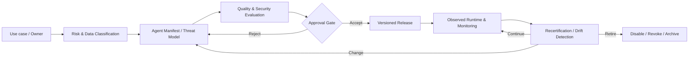
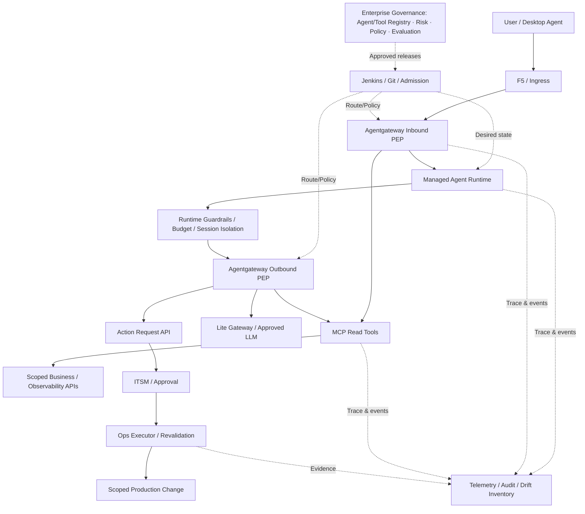
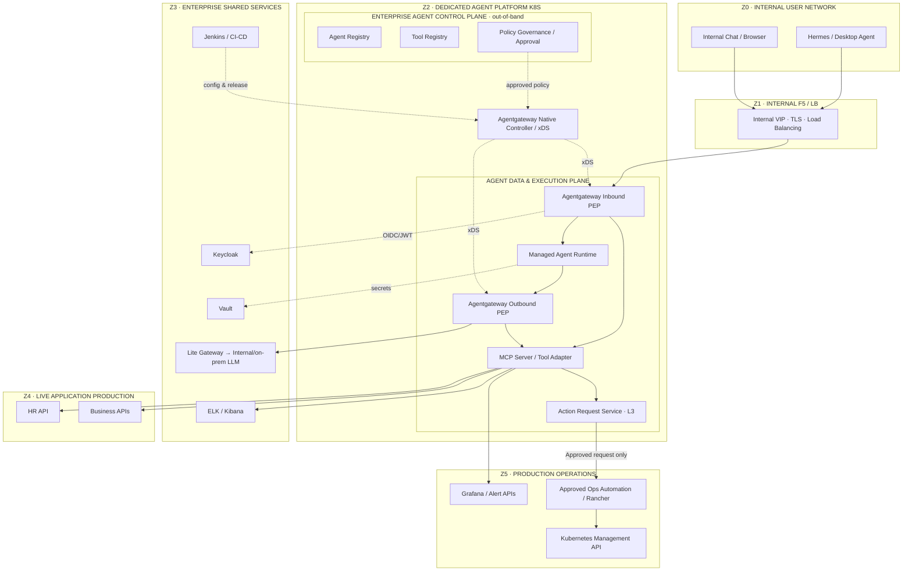
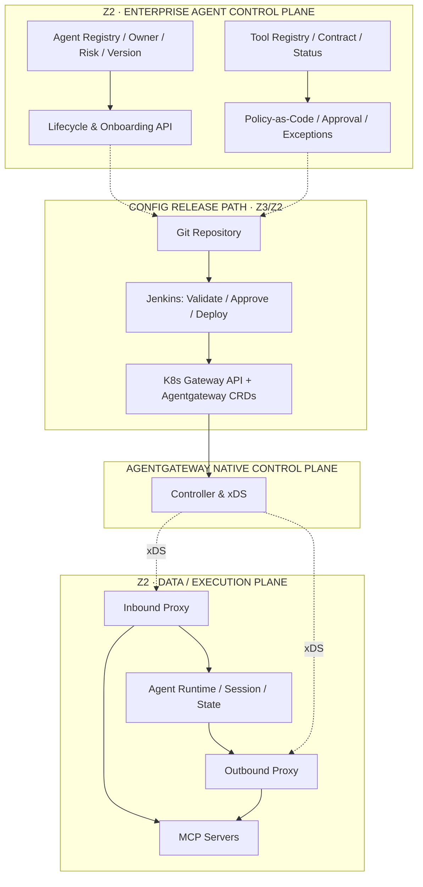
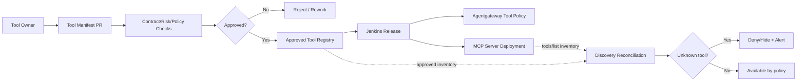
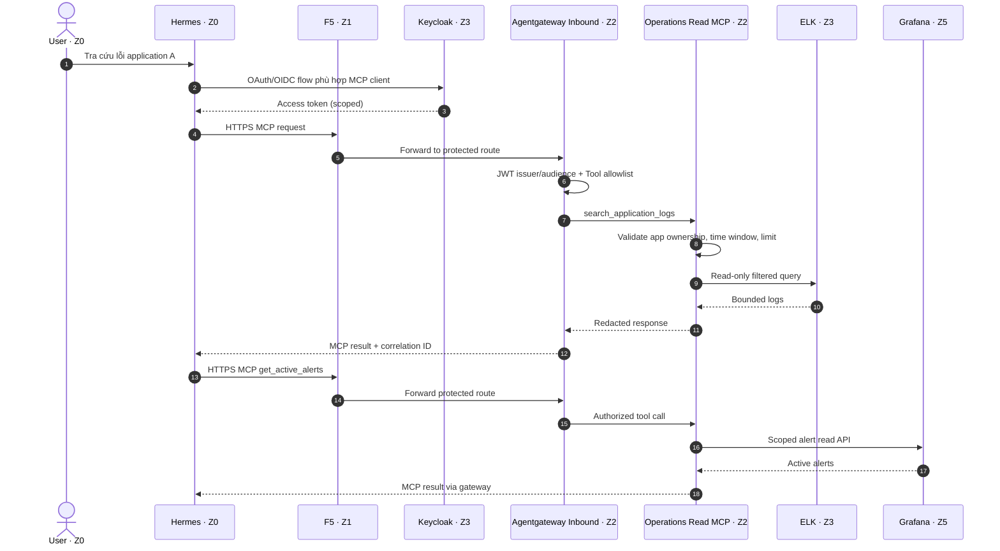
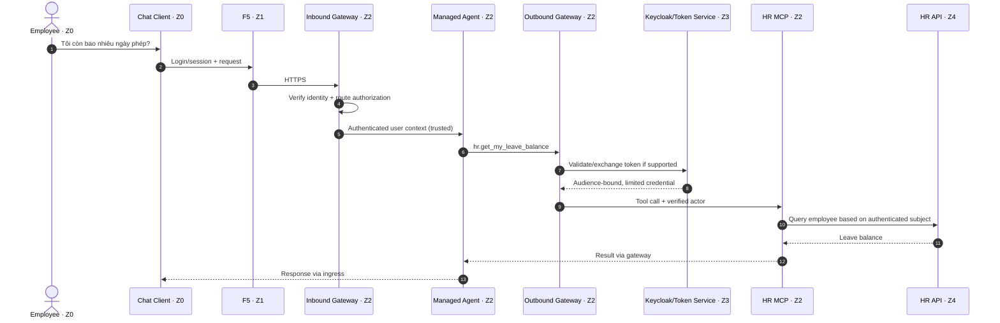
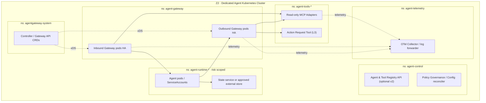

# Kiến trúc Giải pháp & Đặc tả Triển khai Enterprise Agent Platform v5

> **Bản tích hợp hình ảnh / Illustrated edition:** D1–D7 đã được thay bằng các hình kiến trúc PNG; mã Mermaid gốc được giữ tại [Phụ lục cuối bài](#phu-luc-ma-nguon-mermaid-goc-d1-den-d7). Các sơ đồ mở rộng trong mục 5A vẫn giữ dạng Mermaid. Ảnh minh họa cần đối chiếu các mũi tên và nhãn với nguồn trước khi dùng làm bản thiết kế triển khai chi tiết (LLD).

> **Nguồn / Provenance:** Chuyển vào wiki từ tài liệu nội bộ `Enterprise_Agent_Platform_Solution_Architecture_v5_Reviewed.md` (Enterprise Agent Platform v5.0 — 15/10/2026, Architecture Review Revision). Giữ nguyên nội dung tiếng Việt gốc; 7 sơ đồ D1–D7 nhúng dạng ảnh PNG, mã Mermaid gốc ở phụ lục cuối bài.


**Phiên bản:** 5.0 — 15/10/2026 (Architecture Review Revision)  
**Trạng thái:** Revised Proposal / Chờ Architecture Review Board (ARB) phê duyệt  
**Đối tượng:** AI Platform, Kubernetes/Platform Engineering, IAM, Network, DevSecOps, SRE, Security, Operations, Application Integration  
**Phạm vi:** Quản trị vòng đời Agent trên production (Agent Lifecycle Governance), kết nối, thực thi, dữ liệu và hành động theo L1/L2/L3  
**Quy ước:** Tên cấu phần kỹ thuật và thuật ngữ quan trọng sử dụng Việt–Anh.

---

## 1. MỤC TIÊU VÀ QUYẾT ĐỊNH KIẾN TRÚC

### 1.1. Bối cảnh đã xác nhận

- Khoảng 90% ứng dụng đang triển khai trên Kubernetes (K8s).
- Hệ thống xác thực tập trung sử dụng Keycloak; secrets sử dụng Vault; nhật ký ELK/Kibana; CI/CD dùng Jenkins.
- Kết nối LLM đi qua Lite Gateway, phục vụ mô hình nội bộ và on-premises.
- Mục tiêu đưa Agent chạy production về **cụm K8s chuyên dụng**, tách vòng đời và tài nguyên khỏi cụm ứng dụng nghiệp vụ.
- Agent chạy trên máy người dùng nội bộ (ví dụ Hermes) **không** cần chuyển lên cụm Agent để thuộc phạm vi quản trị kết nối.

### 1.2. Ba năng lực kiểm soát, triển khai theo giá trị (không đồng nhất với mức rủi ro)

| Mức | Use case chuẩn | Khả năng phải có | Tiêu chí giá trị |
|---|---|---|---|
| **L1 — Controlled Connectivity / Kiểm soát kết nối** | Hermes trên laptop gọi MCP để đọc log ELK, cảnh báo Grafana | Z0→Z1→Z2 ingress, xác thực Keycloak, quyền theo Tool và phạm vi ứng dụng, Tool Registry, audit | Kiểm soát Agent ngoài nền tảng truy cập production |
| **L2 — Managed Agent Runtime / Quản lý thực thi** | Chat Agent chạy trên cụm Agent, tra cứu ngày phép theo user | Agent Registry, deployment contract, session/state, user delegation, Vault/Jenkins, HR Tool | Quản lý Agent production và danh tính được ủy quyền |
| **L3 — Governed Action / Hành động có quản trị** | Agent phân tích cảnh báo, đề nghị restart, người có thẩm quyền phê duyệt, hệ thống Ops thực thi | Action Catalog, yêu cầu bất biến, approval binding, preflight, executor/automation có giới hạn, post-check, audit | Không biến lời đề xuất thành quyền thay đổi production |

**Quyết định trọng tâm:** Enterprise Agent Platform là tập hợp năng lực quản trị vòng đời, runtime, định danh, dữ liệu, hành vi và vận hành Agent; **Agentgateway chỉ là Policy Enforcement Point (PEP) của các luồng đi qua gateway**. Gateway không thay thế IAM, authorization tại backend, Agent Runtime Guardrails, Registry hay hệ thống điều hành thay đổi production. **L1/L2/L3 là các capability pattern, không phải quyền mặc định hoặc risk tier**: Agent quản lý ở L2 chỉ được thực hiện hành động L3 nếu qua quy trình phê duyệt độc lập.

### 1.3. Nguyên tắc bắt buộc

1. **Zero Trust / Không tin cậy mặc định:** Z0 là mạng người dùng nội bộ nhưng không được xem là môi trường production đáng tin cậy.
2. **Default Deny / Từ chối mặc định:** không tự động công bố Tool mới từ MCP Server; các đường truy cập production phải được cấp phép.
3. **Separation of Duties / Phân tách nhiệm vụ:** người đề xuất, người phê duyệt và tài khoản thực thi hành động L3 được phân tách.
4. **Least Privilege / Quyền tối thiểu:** hạn chế cả API endpoint, thao tác, resource scope, môi trường, thời hạn.
5. **Reuse Before Build / Tái sử dụng trước khi xây mới:** không nhân đôi Keycloak, Vault, ELK, Jenkins, Lite Gateway, ITSM và Operations Automation nếu đã đáp ứng NFR.
6. **Control/Execution Separation / Tách quản trị–thực thi:** Registry/Policy release là quản trị ngoài đường dữ liệu; Gateway runtime không được phụ thuộc đồng bộ vào Git/Jenkins/Registry cho từng request.
7. **Evidence-based Gates / Nghiệm thu bằng chứng:** mỗi mức L1/L2/L3 có test dương tính, âm tính, failure và vận hành.
8. **Identity Continuity / Liên tục danh tính:** định danh người dùng, client, Agent, workload và backend phải truy vết được; không sử dụng token passthrough sai audience.
9. **Runtime Containment / Khoanh vùng thực thi:** giới hạn tool chain, lượt gọi, thời gian, token/cost, sandbox và egress; mọi nội dung Tool/LLM sinh ra đều là đầu vào không đáng tin cậy.
10. **Continuous Evaluation / Đánh giá liên tục:** thay đổi model/prompt/tool/knowledge hoặc policy cần đánh giá tác động và kiểm thử hồi quy theo risk tier.

## 2. PHÂN VÙNG KIẾN TRÚC (ZONE MODEL)

### 2.1. Định nghĩa chính thức Z0–Z5

| Zone | Tên | Nội dung | Ranh giới bảo mật chính |
|---|---|---|---|
| **Z0** | **Internal User Network / Mạng người dùng nội bộ** | Laptop/VDI, Hermes, desktop Agent, web/chat client | Thiết bị và ứng dụng người dùng; không mặc định là workload production |
| **Z1** | **Internal LB / F5 Access Zone / Vùng cân bằng tải nội bộ** | Internal F5 VIP, LB, TLS forwarding/termination có kiểm soát | Điểm tiếp nhận/định tuyến vào Z2; F5 không thay thế tool authorization |
| **Z2** | **Agent Platform Production Zone / Vùng nền tảng Agent** | Dedicated K8s: Agentgateway data plane, MCP/Tool Adapters, Managed Agents, Enterprise Agent Control Plane, native agentgateway controller | Phân namespace/workload, service identity, default-deny network policy |
| **Z3** | **Shared Enterprise Services / Dịch vụ dùng chung** | Keycloak, Vault, ELK/Kibana, Lite Gateway, Jenkins (vị trí logic; có thể khác subnet thực tế) | Chỉ gọi endpoint đã cho phép; reuse service hiện hữu |
| **Z4** | **Live Application Production / Ứng dụng nghiệp vụ production** | HR, CRM, Lending, core-facing APIs, ứng dụng live khác | Backend kiểm tra quyền nghiệp vụ, không tin payload do LLM sinh |
| **Z5** | **Production Operations / Vận hành production** | Grafana/Alert APIs, Rancher, automation/runbooks, approved Ops API, giao diện quản trị K8s | Kiểm soát quyền vận hành và truy cập quản trị, dựa trên vùng thực tế hiện hữu |

**Quan trọng:** Z0–Z5 là **logical security/service zones**, chưa phải định nghĩa subnet/VLAN mới. **Không xây Z5 mới chỉ vì cần phê duyệt restart.** Nếu hệ thống Ops hiện hữu đã ở mạng quản trị độc lập, kiến trúc vật lý phải ánh xạ vào đó. ELK có thể thuộc Z3 về ownership nhưng log vận hành được truy cập qua endpoint ELK trong Z3; Grafana được phân loại Z5 theo công năng Ops dù có thể nằm vật lý cùng hệ thống giám sát Z3.

### D1 — Zone Topology: các ranh giới và đường đi được phép


*Nguồn Mermaid gốc: [Phụ lục Mermaid](#phu-luc-mermaid-d1-zone-topology).*

**Diễn giải D1:** Hình là kiến trúc logic; mũi tên Z2→Z5 chỉ cho các API đã cấp phép (Grafana read; Ops request L3 riêng), tuyệt đối không suy ra rằng Agent Runtime có quyền truy cập trực tiếp K8s API. Quan hệ GI→AG là đường inbound của Chat Agent; Hermes dùng GI→MCP. Các connector khác chỉ được bổ sung sau khi cập nhật firewall matrix và Tool Registry.

### 2.2. Ma trận kết nối liên vùng (đầu vào Firewall Design)

| ID | Source | Destination | Protocol/Port tham chiếu | Workload/Use case | Bảo vệ | Chủ trì |
|---|---|---|---|---|---|---|
| N01 | Z0 Hermes/Chat | Z1 F5 VIP | HTTPS 443 | L1/L2 | managed endpoint posture nếu có, TLS, client auth tại lớp Agentgateway | Network/IAM |
| N02 | Z1 F5 | Z2 Inbound Agentgateway | HTTPS 443 hoặc cổng backend được chuẩn hóa | L1/L2 | allowlist VIP→proxy, xác định TLS termination/re-encryption | Network/Platform |
| N03 | Z2 Proxy/MCP | Z3 Keycloak/JWKS | HTTPS 443 | Authentication | issuer/audience, trust CA, DNS | IAM |
| N04 | Z2 Agent/MCP | Z3 Vault | HTTPS 443 | Secrets | workload identity, Vault policies | Security/Platform |
| N05 | Z2 Agentgateway | Z3 Lite Gateway | HTTPS 443 (xác nhận) | LLM | upstream identity/credentials, quota | AI Platform |
| N06 | Z2 MCP Log Reader | Z3 ELK endpoint | HTTPS port theo triển khai | L1 | read-only role, bounded query, no direct index admin | SRE |
| N07 | Z2 Alert Reader | Z5 Grafana API | HTTPS 443 (xác nhận) | L1 | Grafana permissions/service account hoặc user scope | Ops |
| N08 | Z2 HR MCP | Z4 HR API | HTTPS 443 | L2 | delegated/backend-enforced identity | HR/IAM |
| N09 | Z2 Action Service | Z5 Approved Ops API | HTTPS 443 | L3 | approval binding, scoped action, mTLS/service identity | Ops/Security |
| N10 | Z5 Ops Automation | Z4 cluster control endpoints | Theo platform | L3 | privileged execution controls, audit | Ops |
| N11 | Z2 telemetry | Z3 ELK/collector | OTLP HTTPS / log pipeline | L1–L3 | masking, retention, backpressure | SRE |
| N12 | Z3 Jenkins runners | Z2 K8s management endpoint | HTTPS 6443 hoặc approved API endpoint | CI/CD | service account, release approval | DevSecOps |
| N13 | Z0 desktop Agent | Z3/Z4/Z5 backends trực tiếp | Không cấp theo đường Agent | L1–L3 | deny theo policy, ngoại lệ vận hành hợp lệ thuộc quy trình riêng | Network |

**Cần xác minh trước thiết kế LLD:** subnet/VLAN hiện hữu, firewall routes, TLS termination tại F5, CNI hỗ trợ egress/network policy, cách tiếp cận management API của các cụm, DNS, private CA, proxy outbound và hướng kết nối từ Jenkins.

## 3. KIẾN TRÚC PHÂN LỚP CỦA Z2

### D2 — Enterprise Control Plane, native Controller và Data/Execution Plane


*Nguồn Mermaid gốc: [Phụ lục Mermaid](#phu-luc-mermaid-d2-control-plane-data-plane).*

**Nguyên tắc vận hành:** Khi Registry/Jenkins ngừng hoạt động, proxy vẫn xử lý theo chính sách đã có hiệu lực. Riêng thu hồi khẩn cấp phải có đường can thiệp vào route/policy/gateway và quy trình xác minh thời gian có hiệu lực. Không dùng Registry làm dependency đồng bộ của tất cả request. External PDP (nếu dùng) là ngoại lệ có SLO và fail mode riêng.

### 3.1. Hợp đồng trách nhiệm cấu phần (Component Ownership Contract)

| Component | Xây/Tích hợp | Trách nhiệm | Không đảm nhận |
|---|---|---|---|
| Agent Registry | Git desired state + inventory/reconciler observed state | Agent ID, owner, version, deployment, runtime identity, model/prompt/tool dependencies, risk, trạng thái, kill switch | Orchestration của Agent |
| Tool Registry | Bắt đầu Git metadata; kiểm tra drift | Tool contract, server, owner, classification, approval, dependencies | Không thay MCP Server hay Tool execution |
| Policy Governance | Git/Jenkins + hội đồng phê duyệt | role/tool/application scopes, ngoại lệ, policy release, emergency revoke | Không thay backend authorization |
| Agentgateway native controller | Dùng OSS | Gateway API/CRD → proxy xDS | Không quản lý owner hoặc phê duyệt nghiệp vụ |
| Inbound Agentgateway Proxy | Dùng OSS và cấu hình | AuthN/AuthZ ở cửa vào, MCP routing, audit, rate limits | Không cấp quyền đọc dữ liệu nghiệp vụ |
| Outbound Agentgateway Proxy | Dùng OSS và cấu hình | Route/traffic policy tới LLM/MCP/A2A đã duyệt | Không tự thay Lite Gateway nếu chưa chứng minh lợi ích |
| MCP Adapters | Tích hợp / phát triển | Tool schema, input validation, backend scopes, bounded outputs | Không phê duyệt tool toàn tổ chức |
| Managed Agent Runtime | Golden path + deploy | Agent container, sessions, checkpoints, health, quotas, bounded tool loop, rollout, evaluation hooks | Không có cluster-admin |
| Action Request & Governance | Tái sử dụng ITSM/approval; bổ sung adapter khi thiếu | Intent, approval binding, immutable request, state machine | Không giữ đặc quyền Kubernetes tổng quát |
| Ops Automation | Ưu tiên hệ thống Z5 hiện hữu | Revalidate và thực thi hành động đã phê duyệt | Không chấp nhận lệnh tùy ý từ LLM |

### D3 — Tool Registry, Onboarding và Drift Detection


*Nguồn Mermaid gốc: [Phụ lục Mermaid](#phu-luc-mermaid-d3-tool-registry-drift).*

**Chú ý:** Tool Registry không tự động biến MCP `tools/list` thành một quyền truy cập hợp lệ. Backend Tool phải kiểm tra scope dữ liệu/tài nguyên. Công cụ `restart_deployment` của L3 phân loại privileged; không được công bố trực tiếp như một Tool có khả năng chạy lệnh tùy ý.

### 3.2. Chuẩn Tool Manifest (mẫu tổ chức, không phải CRD sẵn có)

```yaml
tool_id: ops.search_application_logs
version: 1.0.0
owner: sre-observability
mcp_server: ops-read-mcp
endpoint_ref: internal-ops-mcp
risk:
  action_class: read
  data_class: internal-sensitive
  production_access: true
authorization:
  roles: [application-owner, sre]
  scope_source: application-ownership-directory
constraints:
  max_query_window_minutes: 60
  max_results: 200
  max_execution_seconds: 20
lifecycle:
  state: approved
  review_due: 2027-01-15
```

### 3.3. Chuẩn Agent Manifest (mẫu tổ chức)

```yaml
agent_id: internal.leave-assistant
owner: hr-digital
version: 1.0.0
risk_tier: medium
runtime:
  namespace: agent-runtime-hr
  image: registry.internal/agent/leave-assistant@sha256:<digest>
  service_account: leave-assistant
allowed_tools:
  - hr.get_my_leave_balance
model_route: internal-chat-default
identity:
  user_delegation_required: true
lifecycle:
  state: approved
```

Các manifest phải được kiểm tra schema, uniqueness, ownership, risk, dependencies, approved status và policy diff trước merge.

## 4. LUỒNG KỸ THUẬT CHO BA USE CASE

### D4 — L1: Hermes đọc log và cảnh báo production


*Nguồn Mermaid gốc: [Phụ lục Mermaid](#phu-luc-mermaid-d4-l1-hermes-doc-log).*

**L1 triển khai:** (1) kết nối Hermes/Keycloak theo OAuth MCP và xác minh khả năng tương thích phiên bản; (2) F5→Gateway; (3) hai MCP Tool đọc; (4) Tool Registry/Policy; (5) data authorization; (6) audit; (7) negative tests. Mọi tham số `application_id`, index, time range, limit phải được kiểm tra/giới hạn phía MCP/Backend, không tin LLM.

**L1 Gate:** user được quyền A đọc A; không đọc B; unknown tool bị từ chối; no token/wrong audience bị từ chối; direct access trái policy bị chặn; log và alert hiển thị đúng scope, có trace và audit; quá tải không gây ảnh hưởng không giới hạn đến ELK/Grafana.

### D5 — L2: Chat Agent và User Delegation tới HR


*Nguồn Mermaid gốc: [Phụ lục Mermaid](#phu-luc-mermaid-d5-l2-chat-agent-hr-delegation).*

**Thiết kế bắt buộc:** đánh giá khả năng token exchange của Keycloak và HR; token dành cho MCP phải đúng audience; downstream HR token là token riêng, tuyệt đối không chuyển nguyên token MCP sang HR (token passthrough). Nếu HR chỉ chấp nhận service account thì phải có trusted adapter đảm bảo user→employee mapping và enforce quyền tại backend. `employee_id` không lấy từ văn bản do LLM tạo. Tách state/session theo tenant/user; secret lấy qua Vault; không trao toàn bộ HR read cho Agent.

**L2 Gate:** deploy/rollback chuẩn Jenkins; phân tách user sessions; token không bị tái sử dụng chéo; authz âm tính đạt; agent owner/version/manifest truy hồi được; quota, health, failover và audit đủ bằng chứng; bắt buộc đạt evaluation baseline, prompt-injection/tool-output negative tests, model/prompt/tool pinning và emergency disable.

### D6 — L3: Restart sau phê duyệt và kiểm tra lại quyền


*Nguồn Mermaid gốc: [Phụ lục Mermaid](#phu-luc-mermaid-d6-l3-restart-sau-phe-duyet).*

**Z5 không bắt buộc phát triển hệ thống mới:** ưu tiên Jenkins/Rancher/ITSM/Runbook automation hiện hữu **nếu** xác minh được quyền tối thiểu, approval binding, idempotency, preflight, audit và recovery. Z5 là phân vùng Ops logic, không phải lý do cấp thêm quyền rộng cho Agent.

**L3 Gate:** không có approval → không restart; người duyệt sai phạm vi → từ chối; đổi deployment sau duyệt → từ chối; approval hết hạn/tái sử dụng → từ chối; preflight fail → không execute; có execution evidence và post-check; Agent chỉ có quyền đề nghị thao tác, không dùng kubeconfig quản trị; executor có idempotency key, lock theo target, xác minh target/version sát thời điểm thực thi, chặn chạy trùng và kiểm soát blast radius.

## 5. ĐỘ TIN CẬY, BẢO MẬT VÀ VẬN HÀNH

### 5.1. Security enforcement phân tầng

| Tầng | Cơ chế | Bằng chứng |
|---|---|---|
| Z0/Z1 | TLS, F5 allowlist, endpoint posture khi sẵn có | Client/F5 access logs |
| Z1/Z2 | Keycloak JWT/OAuth; Gateway CEL/Tool policy | AuthN/AuthZ negative test |
| Trong Z2 | NetworkPolicy default deny, dedicated SA, Pod Security, quota | Policy/test results |
| Z2→Z3/Z4/Z5 | Egress allowlist + per-backend identity | Firewall logs, access review |
| MCP/Backend | Param validation, data ownership, scoped backend permissions | Unauthorized data access tests |
| L3 Ops | Approval binding, one-time operation, RBAC, pre/post-check | Change ticket + execution evidence |

**Fail policy:** deny mới khi không xác thực/không có policy; backend error không đồng nghĩa được fallback sang quyền khác; với privileged action bắt buộc fail closed. Xác định riêng hành vi mất Keycloak/JWKS, PDP, Vault, Lite Gateway, ELK, Controller, gateway data plane, MCP service và Z5 Ops.

### 5.2. SLO/NFR cần phê duyệt, không gán như cam kết sản phẩm

- Gateway availability theo risk tier và service criticality; mục tiêu tham chiếu 99,9–99,95% chỉ khi được duyệt.
- p95/p99 Gateway overhead đo riêng theo HTTP/MCP/streaming; đo cả end-to-end (bao gồm Backend).
- Node/relica loss, restart, policy rollout, error handling, drain, long-lived MCP connections và retry storms.
- Rate limit theo user/client/tool/app; nếu cần quota toàn cụm nhiều replica, xác minh global limit thay vì dựa vào local limit.
- Audit schema gồm `timestamp`, `trace_id`, `actor_user`, `client_id`, `agent_id`, `agent_version`, `session_id` (pseudonymized), `tool_id`, `tool_version`, `model_id`, `prompt_version`, `resource_scope`, `policy_version`, `decision`, `backend_status`, `action_request_id`; tránh đưa PII/prompt/secret vào log mặc định; bảo đảm chuỗi audit xuyên qua Gateway–Agent–MCP–Backend.
- Restore drill và RTO/RPO cho Registry/Agent state/Action evidence; K8s controller & proxy config rollback.

### D7 — Topology Kubernetes/Namespace và giao tiếp cấu hình


*Nguồn Mermaid gốc: [Phụ lục Mermaid](#phu-luc-mermaid-d7-topology-kubernetesnamespace).*

Namespace không phải security boundary tuyệt đối; quyết định node pool, namespace policy, workload identity, image admission, storage class và khả năng scale riêng cho Gateway/Agent/MCP dựa trên threat model.

## 5A. QUẢN TRỊ AGENT PRODUCTION — CÁC NĂNG LỰC CÒN THIẾU TRONG V4.0

### 5A.1. Phân biệt năng lực, phân loại rủi ro và loại thao tác

Ba khái niệm này **không tương đương**:

| Dimension / Chiều phân loại | Giá trị | Tác dụng |
|---|---|---|
| Platform Capability / Năng lực nền tảng | L1: Controlled Connectivity; L2: Managed Runtime; L3: Governed Action | Xác định control pattern mà workload sử dụng |
| Agent Risk Tier / Mức rủi ro Agent | Low / Medium / High / Critical (quy định nội bộ) | Xác định mức phê duyệt, kiểm thử, giám sát và chu kỳ tái chứng nhận |
| Action Class / Loại hành động | Read / Recommend / Write / Privileged Change | Xác định chính sách cho từng tool call và thao tác |

**Ví dụ ngân hàng:** Agent kiểm tra trạng thái khoản vay sử dụng L2 Managed Runtime nhưng chỉ được Read; Agent xử lý sự cố vận hành có thể dùng L2 runtime và L3 approval cho một thao tác restart cụ thể. Không nâng quyền chỉ vì Agent đã được vận hành ở L2.

### 5A.2. Agent Lifecycle / Vòng đời Agent bắt buộc



Mỗi Agent phải có: Business Owner, Technical Owner, risk tier, business purpose, data classes, allowed tools/action classes, dependency graph, model version, prompt version, runtime image digest, approved environment, expiry/review date, SLO và recovery owner. Registry có hai lớp: **Desired State / Trạng thái mong muốn** quản lý bằng Git và **Observed State / Trạng thái thực tế** từ K8s/deployment/controller/telemetry. Sai lệch phải cảnh báo, chặn promotion hoặc cô lập theo mức rủi ro; Registry không tham gia đường request đồng bộ.

**Emergency Containment / Khoanh vùng khẩn cấp:** phải hỗ trợ vô hiệu hóa tool/route, suspend Agent deployment, revoke workload credentials, cô lập egress và xác minh thời điểm chặn có hiệu lực. Việc xóa registry entry không thay thế được revoke thực tế.

### 5A.3. Identity Chain / Chuỗi danh tính tin cậy

| Hop / Chặng | Định danh cần xác minh | Enforcement / Thực thi |
|---|---|---|
| User → Client | user subject, MFA/session, client_id, device posture khi có | Keycloak, endpoint control |
| Client → Inbound Gateway | token issuer, audience, expiry, scopes; OAuth metadata | Gateway/MCP resource server |
| Gateway → Agent Runtime | identity context được ký hoặc tái xác minh; chống giả mạo headers | Trusted internal interface + network isolation |
| Agent → Outbound Gateway → MCP | Agent workload identity **và** user delegated context nếu cần | SA/workload token, Gateway PEP, MCP AuthZ |
| MCP → Business Backend | downstream token đúng audience hoặc trusted adapter có mapping được chứng thực | Backend Owner, IAM; không raw token passthrough |

Theo MCP HTTP Authorization specification, MCP server phải xác nhận audience của token dành cho chính resource đó, và **không chuyển tiếp nguyên access token MCP sang downstream API**. Cần thử nghiệm Keycloak token exchange/resource indicator và hành vi client Hermes theo phiên bản thực tế trước khi xác nhận L1/L2. **Trusted header chỉ an toàn nếu upstream bị khóa network, headers bên ngoài bị strip và nguồn phát được xác thực**.

### 5A.4. AI Runtime Guardrails / Kiểm soát hành vi thực thi

| Control / Kiểm soát | Lớp thực thi ưu tiên | Negative Test / Kiểm thử âm tính |
|---|---|---|
| Prompt Injection / Chèn lệnh độc hại | Agent orchestration; content trust labeling; Tool adapter | Log ELK chứa lệnh yêu cầu gọi tool không được phép → không thực hiện |
| Tool Output Poisoning / Đầu độc kết quả Tool | Parse schema, treat tool output as untrusted data | Log chứa JSON giả mạo `approved=true` → không vượt action policy |
| Bounded Agent Loop / Giới hạn vòng lặp | Agent Runtime | Tool/model recursion vượt max_steps → dừng an toàn |
| Data Leakage / Rò rỉ dữ liệu | Tool backend + outbound model route + DLP/redaction | Dữ liệu khách hàng từ ứng dụng A không được dùng cho B hoặc gửi model chưa duyệt |
| Unsafe Tool Parameters / Tham số Tool nguy hiểm | MCP adapter + Backend | LLM tự gán `employee_id`, index hoặc namespace khác scope → từ chối |
| Model/Prompt Drift / Thay đổi hành vi model/prompt | CI/CD Evaluation Gate | Thay prompt/model làm giảm success/security threshold → chặn promotion |
| Budget Exhaustion / Vượt ngân sách | Runtime + LLM Gateway | Repeated model/tool calls chạm quota → fail bounded; audit |

**Không coi content filtering là cơ chế cấp quyền.** Guardrails giảm xác suất Agent đề xuất sai, còn Tool/Backend authorization và L3 approval quyết định một hành động có được thực hiện hay không.

### 5A.5. Model, Prompt & Knowledge Governance / Quản trị mô hình, lời nhắc và tri thức

- **Version Pinning / Ghim phiên bản:** mỗi release ghi nhận model route + model revision (nếu backend hỗ trợ), prompt template/hash, tool contracts, knowledge source/version và image digest.
- **Release Evaluation / Đánh giá phát hành:** bộ kiểm thử nghiệp vụ có dữ liệu chuẩn (golden cases), thử tấn công (adversarial cases), kiểm thử rò rỉ, kiểm thử quyền, và kết quả so sánh phiên bản trước.
- **Data Boundary / Ranh giới dữ liệu:** phân loại PII, dữ liệu tài chính, bí mật nội bộ; xác nhận model endpoint, nơi lưu session/checkpoint, retention và deletion. Dữ liệu retrieval/log có thể chứa hướng dẫn độc hại, không được nâng thành system instruction.
- **Model Risk Accountability / Trách nhiệm rủi ro mô hình:** Business Owner ký tiêu chí chấp nhận nghiệp vụ; Security phê duyệt threat controls; AI Platform chịu trách nhiệm test và rollback; Ops chịu trách nhiệm hành động privileged.
- **Promotion / Thăng cấp:** Dev → Test → Pre-prod → Prod với signed artifact, approval, canary/shadow khi phù hợp; không tự động chuyển prompt/model mới vào production nếu chưa evaluation.

### 5A.6. Production Observability / Khả năng quan sát vận hành

| Chỉ số / SLI | Mục đích | Ví dụ ngưỡng chấp nhận (cần xác lập) |
|---|---|---|
| Task Success Rate / Tỷ lệ hoàn thành đúng | Đo giá trị nghiệp vụ, không chỉ HTTP 200 | Theo golden dataset và nghiệp vụ |
| Authorization Denial Rate / Tỷ lệ từ chối quyền | Phát hiện privilege probing và policy drift | Alert theo baseline |
| Tool Execution Error / Lỗi thực thi Tool | Phân biệt lỗi Agent, MCP, backend | Alert theo tool criticality |
| Agent Loop / Số bước mỗi tác vụ | Phát hiện runaway planning | Max steps cấu hình theo use case |
| Token/Cost per Task / Tài nguyên mỗi tác vụ | Ngân sách, capacity, tối ưu | Budget theo owner/app |
| Policy Coverage / Độ phủ chính sách | Phát hiện route/tool không có policy | 100% approved production routes |
| Inventory Drift / Sai lệch kiểm kê | Phát hiện runtime chưa đăng ký hoặc manifest hết hạn | Zero unapproved workload |
| L3 Approval-to-Execution Integrity / Tính toàn vẹn phê duyệt → thực thi | Chống sửa đích, replay, race condition | Zero unauthorized execution |

Telemetry cần tương quan `trace_id`, `agent_id`, `agent_version`, `session_id` được ẩn danh, `tool_id`, `model_route`, `prompt_version`, `policy_version`, `decision`, `backend_status`, `action_request_id`. Audit bảo mật và traces chẩn đoán có retention/access policy khác nhau; tuyệt đối không mặc định thu thập toàn bộ prompt, responses, secrets hoặc PII.

### 5A.7. L3 Transaction Integrity / Tính toàn vẹn giao dịch thay đổi production

1. **Immutable Intent / Ý định bất biến:** canonical action payload + target UID/resourceVersion, cluster, namespace, deployment, parameters, reason, actor, evidence, expiry; tạo hash và approval reference.
2. **Approval Binding / Ràng buộc phê duyệt:** người duyệt có quyền trên đúng target; đề xuất và phê duyệt tách người; xác nhận maintenance/change policy nếu cần.
3. **Execution-time Revalidation / Kiểm tra lại tại thời điểm thực thi:** xác minh version/hash, approver, TTL, nonce, allowed window, target state; không tin ticket status đơn thuần.
4. **Idempotency & Lock / Chống lặp và khóa:** idempotency key, lock theo workload; retry chỉ được trả trạng thái thao tác cũ, không thực hiện restart lần hai.
5. **Blast Radius & Recovery / Giới hạn tác động và khôi phục:** giới hạn workload/pods, health readiness, rollback hoặc incident escalation, bằng chứng trước/sau. Nếu trạng thái target đã thay đổi sau duyệt, dừng và yêu cầu duyệt lại.

**Không đồng nhất ITSM ticket 'Approved' với bằng chứng lệnh chạy được phép.** Ops executor phải tự xác minh quyền, trạng thái, payload đã phê duyệt và uniqueness ngay trước khi tác động production.

### 5A.8. Kiến trúc mục tiêu được hiệu chỉnh — Domain Ownership



**Giới hạn sơ đồ:** Runtime Guardrails là một nhóm control triển khai trong Agent framework/runtime và adapter, **không nhất thiết là một sản phẩm hoặc proxy mới**. Các đường CI/Registry là control/release path, không phải synchronous request path. Đường Agent → Tool vẫn bắt buộc qua outbound PEP nếu được công bố trong kiến trúc này; phải kiểm tra CNI/firewall để chặn bypass.

### 5A.9. Banking Use Case / Tình huống nghiệp vụ kiểm chứng thiết kế

| Use case / Tình huống | Failure mode / Sai lệch cần chặn | Required control / Kiểm soát |
|---|---|---|
| SRE Agent tra log cảnh báo production | Nội dung log bị cài prompt injection ra lệnh xóa log hoặc mở rộng tìm kiếm sang ứng dụng khác | Untrusted log content, scoped tool, bounded query, no write permission |
| HR Leave Agent trả lời số ngày phép | User A yêu cầu nhân danh user B; Agent tự tạo `employee_id` | Delegated identity và HR backend mapping; cross-user state isolation |
| Ops Agent đề nghị restart | Approval cho Deployment A bị tái dùng sau khi target hoặc tham số thay đổi | Immutable intent hash, one-use nonce, target resourceVersion, revalidation, executor lock |
| Lending Assistant tóm tắt hồ sơ tín dụng | Dữ liệu khách hàng đi vào logs hoặc model route chưa phê duyệt; output sai nhưng HTTP 200 | Data classification, model allowlist, masked telemetry, business-quality evaluation và human review |

Các use case trên là **kịch bản thiết kế giả định để kiểm thử** trong bối cảnh ngân hàng, không phải tuyên bố về hệ thống đã được triển khai tại một ngân hàng cụ thể.

---

## 6. KẾ HOẠCH TRIỂN KHAI CHI TIẾT

### 6.1. Work Breakdown Structure (WBS): thứ tự phụ thuộc và deliverable

| ID | Work package | Công việc bắt buộc | Phụ thuộc | Owner đề xuất | Deliverable / Gate |
|---|---|---|---|---|---|
| A01 | Architecture baseline | Zone map, flows D1–D7, trust model, NFR | — | EA/SA | HLD được duyệt |
| A02 | Network & F5 | VIP, TLS topology, DNS, firewall N01–N13, deny bypass | A01 | Network | Connectivity Matrix/Test |
| A03 | Product fit-gap | Chốt version agentgateway/K8s/Gateway API/CRD, Hermes MCP OAuth | A01 | AI Platform/SA | Compatibility report |
| A04 | Cluster foundation | Dedicated K8s, namespaces, SA/RBAC, policies, HA | A01 | Platform | Cluster baseline |
| A05 | Gateway foundation | Inbound proxy/controller, route, TLS, HA, observability | A02–A04 | Platform | Agentgateway baseline |
| A06 | IAM integration | Keycloak issuer/audience/OAuth MCP, negative auth tests | A05 | IAM | Identity integration |
| A07 | Tool governance MVP | Git Registry, manifest schema, approval, unknown tool deny | A03,A05 | Architecture/AI Platform | Tool Registry v1 |
| A08 | MCP read adapters | ELK/Grafana tool contracts, bounded query, backend scopes | A02,A06,A07 | AI Platform/SRE | L1 MCP services |
| A09 | L1 release | Hermes E2E, 401/403/data scoping, audit, runbook | A05–A08 | QA/SRE | **L1 Gate** |
| B01 | Managed runtime | deployment contract, pod/SA/quotas/state/session | A04,A09 | AI Platform | Agent Golden Path |
| B02 | Jenkins/Vault/LLM | Pipeline, secrets injection, Lite Gateway route | B01 | DevSecOps | Runtime integrations |
| B03 | Agent governance | Agent Registry, owner/risk/version/deprecation, dependency | B01,A07 | AI Platform/EA | Agent Registry v1 |
| B04 | HR delegation | user identity propagation, token exchange/adapter, HR authz | A06,B01 | IAM/HR | Delegation contract |
| B05 | L2 pilot | Internal Chat Agent, state isolation, load test, runtime guardrails, evaluation, rollout | B02–B04 | AI Platform/HR | **L2 Gate** |
| B06 | AI evaluation & model governance | Golden datasets, adversarial tests, versioned prompt/model/tools, regression thresholds, fallback | B01,B03 | AI Platform/Model Risk | Evaluation & rollback evidence |
| B07 | Production inventory & kill switch | Observed deployments reconciliation, dependency map, suspend/revoke, emergency drill | B03,A07 | AI Platform/SRE | Agent control evidence |
| C01 | Ops capability review | ITSM/Rancher/Jenkins restart controls, credential model | A01 | Ops/Security | Reuse-vs-build ADR |
| C02 | Action Catalog | allowed actions, risk tier, parameter schema, immutable requests | B03,C01 | AI Platform/Ops | Action spec |
| C03 | Approval integration | approver roles, exact action binding, TTL, anti-replay | C02 | Ops/IAM | Approval flow |
| C04 | Safe execution integration | scoped restart, preflight, execution lock, post-check, audit | C03 | Ops | Controlled executor |
| C05 | L3 pilot | unauthorized/expired/change/replay/concurrency/TOCTOU tests + monitored restart | C04,B05,B06 | Ops/Sec/QA | **L3 Gate** |
| X01 | Ops readiness | OTel/ELK dashboards, alerts, SLO, incident/rollback/DR | A05 onward | SRE | Runbook/evidence |
| X02 | Security validation | threat model, container/secret/IAM tests, pen test, exception closure | Across | Security | Security sign-off |

### 6.2. Lộ trình theo mốc giá trị

| Giai đoạn | Tuần tham chiếu | Mục tiêu thực tế | Điều kiện chuyển bước |
|---|---|---|---|
| Phase 0 — Design & Foundation | 1–2 | HLD, zone mapping, fit-gap, ownership | ARB sign-off |
| Phase 1 — L1 | 3–7 | Hermes qua F5/Gateway đọc ELK/Grafana theo quyền | L1 Gate + SOC/SRE acceptance |
| Phase 2 — L2 | 6–14 | Dedicated Runtime; Agent Chat; HR delegation | L2 Gate + business owner acceptance |
| Phase 3 — L3 | 12–20 | Restart có phê duyệt, thực thi kiểm soát qua Ops | L3 Gate + Ops/Security approval |
| Stabilization | 20–22 | Hypercare, evidence pack, BAU | Handover sign-off |

Thời gian là giả định kế hoạch, không phải cam kết; thay đổi khi cần mở mạng, cấp cluster, phê duyệt bảo mật hoặc tích hợp HR/ITSM chưa sẵn sàng.

### 6.3. RACI rút gọn

| Năng lực | Accountable | Responsible | Consulted |
|---|---|---|---|
| Target Architecture / Standards | Architecture Lead | EA/SA | Security, Platform, AI |
| Gateway Platform Service | Platform Service Owner | AI Platform + DevOps | Architecture/SRE |
| Network/F5 | Network Owner | Network Engineering | Security/Platform |
| Identity & Delegation | IAM Owner | IAM + Backend team | Security/Architecture |
| Agent/Tool Registry & Governance | AI Platform Product Owner | AI Platform + Architecture governance | Tool Owners, Security |
| MCP Tool data scope | Backend/Tool Owner | MCP team + Backend team | IAM/Security |
| Ops privileged execution | Production Ops Owner | Operations | Security/Change Mgmt |
| Incident & SLO | SRE Service Owner | SRE | Platform/Ops |
| Go-live approval | Production Change Authority | Service Owner / Release Manager | Architecture/Security/SRE |

## 7. KIỂM THỬ VÀ GO-LIVE GATES

### 7.1. Bắt buộc trước L1 Go-live

- [ ] HTTPS qua F5; TLS/re-encryption đã được xác minh; không lộ service ngoài VIP được duyệt.
- [ ] Hermes MCP OAuth/token flow chạy trên phiên bản client thực tế; scope/audience đúng.
- [ ] Tool chưa phê duyệt và tool ngoài allowlist đều bị chặn kể cả khi MCP Server tự khai báo.
- [ ] User thuộc application A không tra cứu B; query bị giới hạn time/index/results.
- [ ] Không có đường truy cập trực tiếp Z0→ELK/Grafana trái phạm vi Agent.
- [ ] Audit đủ actor/tool/resource/decision/trace; không log lộ secrets/PII mặc định.
- [ ] HA/failure/rollback của Gateway và MCP có evidence; backend được bảo vệ khỏi query storm.

### 7.2. Bắt buộc trước L2 Go-live

- [ ] Agent đăng ký Owner, Risk, Version, Tool allowlist và image digest.
- [ ] Jenkins deploy/canary/rollback qua pipeline và các gate scan.
- [ ] Vault secrets với chính sách tối thiểu, rotation được kiểm tra.
- [ ] User delegation đến HR được xác minh tại backend; không dùng employee ID do LLM tự đặt.
- [ ] Session/state isolation, health, resource quotas, timeout, soak test được chấp nhận.
- [ ] Agent chạy được kiểm kê observed state; model/prompt/tool versions có thể truy vết và rollback; kill switch đã diễn tập.
- [ ] Prompt injection, malicious tool output, cross-user leakage, runaway loop và budget exhaustion đều có kiểm thử âm tính.
- [ ] Golden dataset và acceptance thresholds cho chất lượng nghiệp vụ được Business Owner phê duyệt.

### 7.3. Bắt buộc trước L3 Go-live

- [ ] Tool đề xuất không trực tiếp chứa quyền K8s/admin.
- [ ] Approval buộc vào đúng action/target/parameters/actor/TTL.
- [ ] No approval, forged approval, wrong approver, expired/replayed approval đều bị từ chối.
- [ ] Revalidation và preflight trước restart, post-check sau restart.
- [ ] Ops executor có quyền giới hạn đúng deployment/namespace, có audit và recovery.
- [ ] Concurrent requests, replay, TOCTOU, target mutation và idempotent retries không tạo thao tác ngoài phê duyệt.
- [ ] CAB/Change Management/Security phê duyệt phạm vi pilot production.

## 8. ARCHITECTURE DECISION RECORDS PHẢI CHỐT

| ADR | Nội dung quyết định | Mặc định khuyến nghị |
|---|---|---|
| ADR-01 | Z0 user internal có yêu cầu managed-device posture? | Có khi hạ tầng hỗ trợ; luôn auth người dùng và client |
| ADR-02 | F5 terminate TLS ở đâu? | Chọn theo chuẩn nội bộ, re-encrypt khi vượt trust boundary |
| ADR-03 | Gateway Inbound/Outbound là cùng hay khác deployment? | Tách workload để cô lập policy/capacity; không nhất thiết khác sản phẩm |
| ADR-04 | Tool Registry MVP storage? | Git-backed schema + Jenkins, mở rộng API sau |
| ADR-05 | Agent Registry MVP? | Git manifest và release inventory |
| ADR-06 | Policy strategy? | CEL tại Gateway, backend authorization; External PDP khi cần |
| ADR-07 | LLM Gateway ownership? | Giữ Lite Gateway là điểm quản lý model hiện hữu |
| ADR-08 | HR delegation khả thi? | Verify Keycloak+HR; trusted adapter nếu backend chưa hỗ trợ |
| ADR-09 | Action approval/execution reuse hay build? | Ưu tiên ITSM/Ops Automation Z5 hiện hữu, build thin adapter nếu thiếu |
| ADR-10 | Z5 là subnet riêng? | Không giả định; ánh xạ mạng quản trị thực tế và threat model |
| ADR-11 | Session/state store placement? | Chọn sau NFR/RPO, dữ liệu và isolation requirements |
| ADR-12 | Observability beyond ELK? | Reuse ELK; bổ sung metrics/tracing pipeline tối thiểu nếu thiếu |
| ADR-13 | Agent lifecycle source of truth? | Git desired state + runtime observed inventory; reconcile drift, owner, expiry |
| ADR-14 | AI Runtime Guardrails đặt tại đâu? | Orchestrator/runtime + Tool adapter; gateway chỉ bảo vệ traffic được quan sát |
| ADR-15 | Model/prompt/tool promotion gates? | Pin phiên bản, test chất lượng/an toàn, canary và rollback |
| ADR-16 | L1/L2/L3 khác risk tier thế nào? | Capability pattern độc lập với Risk Tier và Action Class |
| ADR-17 | Emergency containment? | Suspend Agent/Tool/route, revoke credentials, isolate runtime; drill RTO |
| ADR-18 | Data & retention classification? | Phê duyệt theo loại dữ liệu, nơi lưu và thời hạn; không log PII mặc định |

## 9. DANH MỤC TÀI LIỆU BÀN GIAO

1. HLD — Zone Architecture & Data/Control Plane.
2. LLD — GatewayClass, Gateway, HTTPRoute, AgentgatewayPolicy, controller deployment, topology HA.
3. Network Connectivity Matrix (source IP/VIP, destination, port, TLS, firewall ownership).
4. Identity & Delegation Specification (Keycloak, MCP OAuth, client/workload scopes, HR mapping).
5. Agent/Tool Registry Schema & Governance Process.
6. MCP Tool Integration Contracts (ELK/Grafana/HR).
7. Jenkins Deployment & Policy Release Pipeline.
8. Vault/Secrets, Workload Identity & Hardening Standard.
9. Agent Runtime Deployment Contract & State Design.
10. L3 Action Request/Approval/Execution Contract.
11. SLI/SLO, Monitoring, Logging/Audit, Incident/DR Runbooks.
12. Test Strategy, Threat Model, UAT/NFR Evidence Pack and Go-live Decisions.

## 10. PHÂN BIỆT THỰC TẾ, GIẢ ĐỊNH VÀ VIỆC CẦN XÁC MINH

**Thực tế do tổ chức cung cấp:** Kubernetes chiếm ~90%, Keycloak, Vault, ELK/Kibana, Jenkins, Lite Gateway, nhu cầu 3 mức kiểm soát, Z0/Z1/Z2/Z3/Z4/Z5 logic như định nghĩa.

**Năng lực sản phẩm được tài liệu công khai mô tả:** agentgateway có Kubernetes control/data plane, Gateway API, AgentgatewayPolicy authorization với CEL, MCP OAuth tích hợp Keycloak và tool access dựa trên JWT. **Không** được mặc định rằng mọi tính năng tương thích với phiên bản nội bộ trước lab.

**Giả định thiết kế cần xác thực:** khả năng Hermes OAuth, thực tế subnet Z5, trạng thái Grafana/ELK permission, HR token exchange, ITSM/Operations executor, global rate limiting, xDS HA, state store và TLS termination F5.

**Ranh giới phạm vi:** Không thiết kế một Agent framework bắt buộc; Agent được build bằng framework khác nhau nhưng tuân thủ Deployment & Identity Contract. Không triển khai Portal, thứ hai LLM Gateway, cluster quản trị Ops mới hoặc cơ chế đặc quyền mới nếu hệ thống hiện hữu đã đáp ứng.

## 11. NGUỒN THAM CHIẾU KỸ THUẬT

- Agentgateway Kubernetes Architecture: https://agentgateway.dev/docs/kubernetes/latest/documentation/about/architecture/
- Agentgateway Authorization & CEL Policy: https://agentgateway.dev/docs/kubernetes/latest/documentation/security/authorization/
- Agentgateway MCP OAuth with Keycloak: https://agentgateway.dev/docs/kubernetes/latest/documentation/mcp/auth/setup/
- Agentgateway Tool Access: https://agentgateway.dev/docs/kubernetes/latest/documentation/mcp/tool-access/
- Agentgateway JWT Auth: https://agentgateway.dev/docs/kubernetes/latest/documentation/security/jwt/setup/

---

**Tuyên bố thiết kế:** Đây là Solution Architecture mục tiêu để tổ chức triển khai theo ba mức L1–L3. Phê duyệt production yêu cầu bổ sung LLD, IP/VIP/port thực tế, NFR được ký duyệt, đánh giá phiên bản agentgateway, bằng chứng kiểm thử và sign-off của Security/Operations/Business Owners.


## PHỤ LỤC A — CHANGE LOG V4.0 → V5.0 / GIẢI TRÌNH THAY ĐỔI

| ID | Phát hiện | Thay đổi đã thực hiện | Mức ưu tiên |
|---|---|---|---|
| CR-01 | Scope thiên về kết nối, chưa phản ánh mục tiêu vận hành Agent quy mô lớn | Mở rộng scope, nguyên tắc và Section 5A | P0 |
| CR-02 | L1/L2/L3 dễ bị hiểu nhầm là quyền/risk level | Phân biệt capability, risk tier và action class | P0 |
| CR-03 | PEP bị kỳ vọng kiểm soát toàn bộ hành vi Agent | Phân chia PEP/Runtime/Tool/Backend/Ops responsibilities | P0 |
| CR-04 | Danh tính và audience giữa MCP và HR chưa chặt | Identity chain, audience-bound exchange, no token passthrough | P0 |
| CR-05 | Thiếu kiểm soát Prompt Injection và Tool Output Poisoning | Runtime guardrail matrix và negative tests | P0 |
| CR-06 | Registry Git chưa chứng minh observed runtime/kill switch | Reconciliation, drift và emergency containment | P1 |
| CR-07 | Thiếu kiểm thử chất lượng/mô hình/prompt ở release | Evaluation gate, version pinning, canary/rollback | P1 |
| CR-08 | Approval L3 thiếu khả năng chống race/replay thực thi trùng | TOCTOU, immutable hash, lock, idempotency, blast radius | P0 |
| CR-09 | SLO thiên hạ tầng | AI-specific task/quality/cost/security SLIs | P1 |
| CR-10 | Thiếu policy cho dữ liệu context/telemetry | Classification, minimization, retention, source trust | P1 |

**Phạm vi kiểm chứng còn mở (Evidence Gaps):** chưa có bằng chứng cấu hình từ Keycloak, Hermes, agentgateway deployment version, HR backend, network topology, ITSM, Lite Gateway hoặc K8s thực tế. Vì vậy các yêu cầu và ví dụ trong Section 5A là **architecture requirements / proposed controls**, không được coi là đã chứng minh tương thích. Kiểm chứng qua lab và ADR trước LLD.

**External standards / Tham chiếu bên ngoài dùng để đề xuất bổ sung:**
- MCP HTTP Authorization — https://modelcontextprotocol.io/specification/2025-06-18/basic/authorization
- agentgateway Kubernetes Architecture — https://agentgateway.dev/docs/kubernetes/latest/documentation/about/architecture/
- agentgateway Authorization & CEL — https://agentgateway.dev/docs/kubernetes/latest/documentation/security/authorization/
- NIST AI RMF — https://www.nist.gov/itl/ai-risk-management-framework

**Phê duyệt:** Tài liệu chưa phải LLD hoặc bản Go-live approved. ARB cần chốt ADR-13–18, xác minh tích hợp theo version và đặt NFR/evaluation thresholds có owner trước khi ký thiết kế production.


---

## Phụ lục: Mã nguồn Mermaid gốc D1 đến D7

> Mã Mermaid gốc của 7 sơ đồ, giữ nguyên từ tài liệu nguồn để đối chiếu mũi tên và nhãn khi dùng làm LLD.


### Phụ lục Mermaid D1 — Zone Topology




### Phụ lục Mermaid D2 — Control Plane / Data Plane




### Phụ lục Mermaid D3 — Tool Registry & Drift




### Phụ lục Mermaid D4 — L1 — Hermes đọc log




### Phụ lục Mermaid D5 — L2 — Chat Agent & HR Delegation




### Phụ lục Mermaid D6 — L3 — Restart sau phê duyệt

```mermaid
sequenceDiagram
 autonumber
 participant A as Operations Agent · Z2
 participant G as Agentgateway · Z2
 participant M as Operations MCP · Z2
 participant Q as Action Request · Z2
 participant P as Approval/ITSM · Z3 or Existing
 actor U as Authorized Approver · Z0
 participant X as Approved Ops Automation · Z5
 participant K as Production K8s · Z4 control endpoint
 A->>G: request_restart(app, reason, evidence)
 G->>M: Authorized action-request Tool
 M->>Q: Create immutable action intent
 Q->>Q: Risk, scope, approver eligibility, TTL
 Q->>P: Submit action requiring approval
 P-->>U: Review exact cluster/ns/deployment/action
 U->>P: Approve using authenticated identity
 P-->>Q: Signed/verified approval reference
 Q->>Q: Revalidate policy, target state, maintenance window
 Q->>X: Scoped single-use command with approval binding
 X->>X: Validate signature, TTL, nonce, RBAC, preflight
 X->>K: Execute approved restart
 K-->>X: Operation status
 X->>X: Post-check health/readiness; record evidence
 X-->>Q: Result and immutable audit reference
 Q-->>A: Success/failure/incident state
```


### Phụ lục Mermaid D7 — Topology Kubernetes/Namespace


