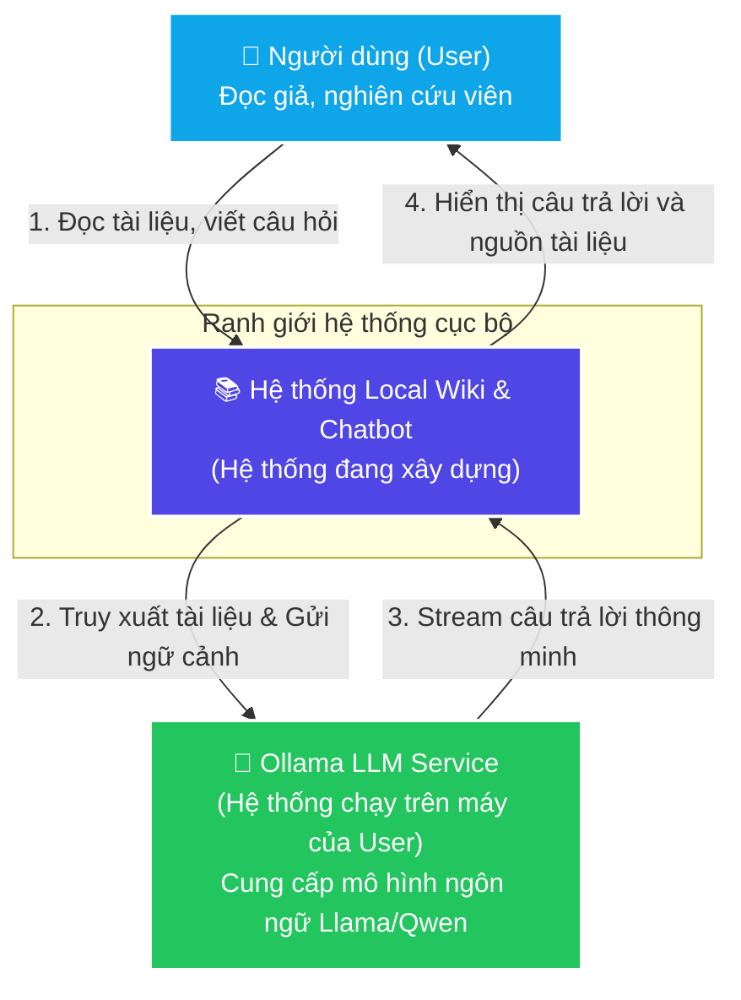
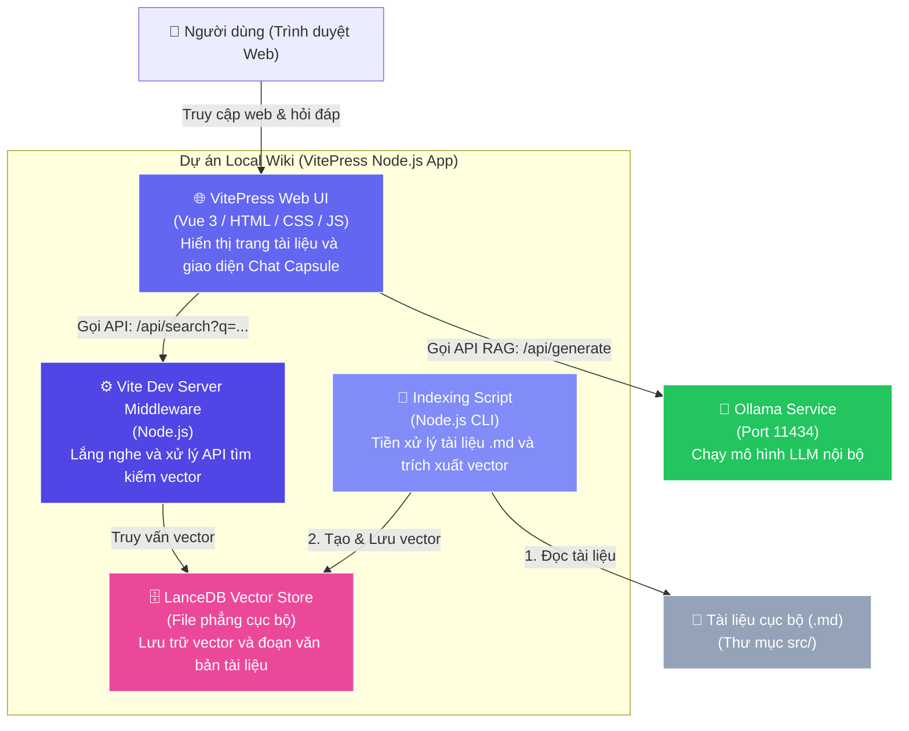
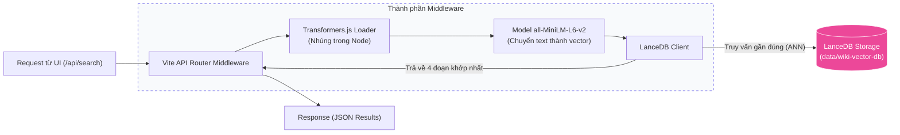
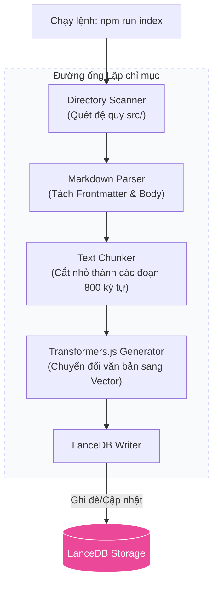

# Kiến Trúc Hệ Thống (C4 Model)

Tài liệu này mô tả chi tiết kiến trúc của dự án **Local Wiki & RAG Chatbot** tuân theo tiêu chuẩn **C4 Model** (Context, Container, Component, Code). Dự án được thiết kế dưới dạng ứng dụng quản lý tri thức cục bộ (local-first) hỗ trợ tìm kiếm ngữ nghĩa và trợ lý AI offline.

---

## C4 - Cấp độ 1: Sơ đồ ngữ cảnh hệ thống (System Context Diagram)

Sơ đồ ngữ cảnh mô tả mối quan hệ giữa người dùng, hệ thống Local Wiki và thực thể bên ngoài duy nhất (mô hình ngôn ngữ lớn chạy trên Ollama).

---

## C4 - Cấp độ 2: Sơ đồ Container (Container Diagram)

Sơ đồ này phân rã hệ thống Local Wiki thành các Container công nghệ chạy độc lập hoặc kết hợp trong môi trường local.

---

## C4 - Cấp độ 3: Sơ đồ thành phần (Component Diagram)

Sơ đồ này mô tả chi tiết các thành phần bên trong **Vite Dev Server Middleware** (xử lý API Tìm kiếm) và **Indexing Script** (xử lý Lập chỉ mục).

### 3.1 Thành phần xử lý API tìm kiếm (Vite Server Middleware)
Khi người dùng thực hiện chat, thành phần này phân tích ý định câu hỏi và truy xuất dữ liệu từ Database.

### 3.2 Thành phần lập chỉ mục tài liệu (Indexing Script)
Thực hiện quét offline tài liệu nguồn để chuẩn bị dữ liệu vector cho cơ sở dữ liệu.

---

## C4 - Cấp độ 4: Code & Ánh xạ tập tin (Code Mapping)

Dưới đây là các lớp mã nguồn chính trong thư mục dự án chịu trách nhiệm thực thi các thành phần kiến trúc trên:

1.  **Giao diện Chatbot UI (`ChatInterface.vue`):**
    *   *Đường dẫn:* [`src/.vitepress/theme/components/ChatInterface.vue`](file:///d:/4.Code/my-wiki/src/.vitepress/theme/components/ChatInterface.vue)
    *   *Chức năng:* Giao diện người dùng Web, quản lý luồng hội thoại, gọi API `/api/search` nội bộ và gọi API `/api/generate` từ Ollama.
2.  **Lập chỉ mục và Sinh Vector (`index-docs.js`):**
    *   *Đường dẫn:* [`scripts/index-docs.js`](file:///d:/4.Code/my-wiki/scripts/index-docs.js)
    *   *Chức năng:* Pipeline chạy bằng dòng lệnh (CLI). Đọc file `.md`, thực hiện chia nhỏ văn bản (Chunking) và nạp dữ liệu vector vào LanceDB thông qua mô hình cục bộ của Transformers.js.
3.  **Tích hợp Server Middleware (`config.mts`):**
    *   *Đường dẫn:* [`src/.vitepress/config.mts`](file:///d:/4.Code/my-wiki/src/.vitepress/config.mts)
    *   *Chức năng:* Tích hợp custom Vite plugin để chặn các request đến `/api/search`, tải mô hình sinh vector và thực hiện truy vấn trực tiếp trên cơ sở dữ liệu LanceDB ngay trên máy chủ phát triển cục bộ.
4.  **Cơ sở dữ liệu Vector (`wiki_chunks`):**
    *   *Đường dẫn:* `d:\4.Code\my-wiki\data\wiki-vector-db`
    *   *Chức năng:* Lưu trữ các file định dạng Lance chứa dữ liệu văn bản và các chuỗi số vector đại diện cho ngữ nghĩa của tài liệu.
